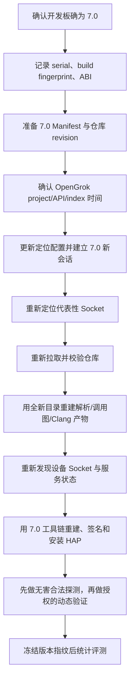

# VulnFounder：OpenHarmony 版本切换影响分析

## 分析范围

本次为只读分析，假设目标已从 OpenHarmony 6.1-LTS 切换到 7.0-Release。重点核对了源码定位、OpenGrok/Manifest、静态调用图、Clang、设备资产发现、动态测试工具链、HAP 工程和历史产物的版本耦合。没有修改源码，也没有把旧版本的扫描结果重新解释为 7.0 结果。

当前环境中，远程 OpenGrok 索引已经按 7.0-Release 的全量源码重建；但 VulnFounder 的本地配置和若干运行时清单仍明确写着 6.1，因此目前最大的风险不是算法失效，而是“7.0 源码索引 + 6.1 映射/工具/缓存”混用。

## 结论分级

### 必须调整

1. **源码定位版本和 Manifest**

   `config/vulnfounder/config.json` 与示例文件仍将 `source_locator.target_revision` 设为 `OpenHarmony-6.1-LTS`，并继续读取 `config/openharmony/ohos-6.1-LTS.xml`。Go 设置页的缺省值也仍是 6.1。若直接访问已经重建为 7.0 的 OpenGrok，源码路径可能看似正确，但仓库 revision、项目路径和拉取结果仍会被旧 Manifest 约束，最终出现版本不一致、错误候选或禁止拉取。

   应准备与 7.0 索引完全匹配的 Manifest，使用实际远端 ref 的精确字符串（通常为 `OpenHarmony-7.0-Release`，以 7.0 Manifest/远端分支实际名称为准），同步更新目标 revision、Manifest 文件名和设置页默认值。OpenGrok 的 `project` 名称不要凭目录名猜测，应通过 API/探测结果确认；如果索引仍暴露为 `openharmony`，该字段可以保持不变。

2. **清理或隔离旧定位会话与证据缓存**

   6.1 产生的 `probe`、源码证据、仓库映射、候选 revision、用户确认记录和 clone 结果不能继续作为 7.0 会话的输入。它们应按“OpenGrok 地址 + project + target revision + Manifest 内容哈希”分隔，最稳妥的做法是新建 7.0 会话/结果目录，不在旧会话上续跑。旧会话可以保留用于历史审计，但必须显示为旧版本。

3. **重新生成所有 7.0 的源码证据**

   对 `/dev/unix/socket/paramservice`、`CJAppSpawn`、`SP_daemon` 等目标，必须重新检索和读取源码，重新确认服务端角色、入口函数、调用链、Manifest 映射和代码行。即使函数名没有变化，行号、注册方式、仓库归属和客户端/服务端边界也可能变化。

### 需要重新验证

4. **静态扫描与调用图产物**

   VulnFounder 的解析器和 BFS 本身不是 6.1 专用，但 `call_graph.json`、residual/ledger、effective graph、Clang overlay、LLM 恢复报告、dataset 和 Stage 1/2 上下文都绑定具体源码快照。若本地待扫描仓库已换成 7.0，必须使用全新的扫描输出目录并重新执行解析、调用边恢复、可达性、上下文增强和报告生成；不能复用 6.1 的 checkpoint 或 overlay。

   当前实现会为 Git 仓库记录 `source_revision`，并在有效图中保存 `graph_version`；但 `build_config_id` 主要描述扫描参数，未覆盖完整的 OpenHarmony 工具链版本、宏集合、sysroot 和生成头文件指纹。因此 7.0 验收时应额外保存构建上下文指纹，并把工具链/配置变化视为强制失效条件。

5. **Clang 语义辅助**

   7.0 的头文件、生成文件、宏和目标 ABI 可能与 6.1 不同。原来为 6.1 手工重建的编译上下文不能直接代表 7.0；若没有匹配 7.0 的 `compile_commands.json`，Clang 结果应标成 `manual_rebuild`/`unknown`，不能升级为产品配置下的确定性边。需要重新准备或自动重建 7.0 依赖，并记录目标架构、sysroot、宏、include 路径和生成头文件来源。

6. **设备事实和 Socket 资产**

   当前设备预检已经能采集 `ro.build.version.*`、设备 revision、进程和 Socket 表，但设备事实库的文件名主要按 serial 区分，稳定事实可能跨刷机版本继续存在。刷到 7.0 后必须重新做一次全量 Socket 资产发现、服务状态预检和版本比对；旧资产不能自动作为 7.0 的事实。建议至少按 `serial + device_revision/build_fingerprint` 隔离事实，或者在版本变化时自动清空稳定事实。

7. **动态测试工具链、HAP 与协议描述符**

   当前项目内清单、README、`local.properties` 和 macOS 运行包明确是 6.1；HAP 工程的 SDK 版本为 23，动态测试的签名工具、Hvigor、Node、HDC、native sysroot 和协议证据均应与 7.0 工具链重新核对。7.0 开发板可能拒绝 6.1 生成的 HAP 或 profile，协议字段、权限和日志也可能发生变化。

   `sp_daemon_text`、`hisysevent_eventraw` 等描述符不能因为 6.1 曾经成功就直接视为 7.0 有效。应在 7.0 源码和设备上重新确认接收端、分帧、字段、权限检查、合法探测和预言机，再生成带版本指纹的描述符。旧 descriptor 可以保留为 6.1 历史版本，但不能覆盖 7.0 自动合成结果。

   另外，`native/build.py` 的编译器路径当前固定为 `aarch64-unknown-linux-ohos-clang`，而文件注释写的是 32 位 ARM 板端 ABI；切换 7.0 时必须先以设备实际 `uname`/ABI 为准选择编译器，不能只替换版本目录名。

8. **官方历史样本和评测集**

   6.1 的历史漏洞样本不应直接当作 7.0 漏洞样本。7.0 可能已经包含修复，也可能移动了函数、改变了入口或关闭了服务。应将旧样本标为“历史回归/负例候选”，按 7.0 的实际源码提交重新建立函数位置、攻击链和预期状态；50 个人工预埋样本如果仍基于旧快照，也必须重新匹配 7.0 源码后再统计召回率。

### 基本无需因版本切换改变

以下机制是平台无关或以证据为输入的，不需要为了 7.0 重写：源码定位状态机、OpenGrok 只读探测、Manifest 最长路径匹配、候选仓库人工选择、调用点台账格式、strict/candidate 分层、Stage 1/Stage 2 的报告结构和前端阶段导航。它们需要消费新的 7.0 证据，但不应通过硬编码 7.0 特例来修改。

## 建议迁移顺序

## 最小验收矩阵

| 验收项 | 通过条件 |
| --- | --- |
| 设备版本 | `getprop`/fingerprint 与 7.0 基线一致，ABI 明确 |
| OpenGrok | API 可用，project 名称确认，索引时间对应 7.0 源码 |
| Manifest | 每个匹配路径的 revision 与 7.0 目标一致，Manifest 内容哈希已记录 |
| 源码定位 | `paramservice`、`CJAppSpawn`、一个 TCP/UDP 端点重新得到服务端证据和入口代码 |
| 静态图 | 新目录生成原生图、ledger、effective graph；没有读取 6.1 overlay/checkpoint |
| Clang | 记录 7.0 编译上下文；缺上下文时明确标记，不把候选边冒充确定边 |
| 设备资产 | 7.0 刷机后重新枚举，旧 serial/version 事实不混入 |
| 动态测试 | 7.0 工具链、HAP 签名和设备 profile 通过诊断；协议描述符有 7.0 证据 |
| 报告 | affected version、源码 revision、设备 revision 和工具链指纹一致 |

## 当前优先级

最先处理的是源码定位配置/7.0 Manifest、旧产物隔离和设备/工具链版本指纹；其次是 Clang 与调用图重建；最后才是重新跑历史样本和动态样本。不要先重跑 24 个历史漏洞或直接比较漏洞数量，否则版本差异、修复状态和缓存污染会混在一起，无法判断结果变化来自算法还是源码版本。
