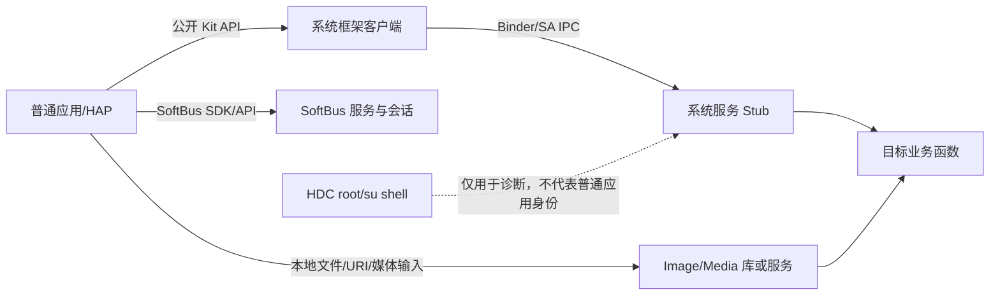

# OpenHarmony CTF 决赛动态验证：开发板基线与服务交互调研

> 记录目的：固化已完成的设备确认、源码对应关系和安全边界，供后续 PoC 设计、复测及报告复核使用。本文记录的是环境与服务入口调研，不代表已经发现或复现了漏洞。

## 1. 调研范围与结论摘要

本记录围绕第二届 OpenHarmony CTF 决赛线上阶段公布的 10 个仓库，核对了本地源码版本、开发板运行版本、系统能力（System Ability，简称 SA）注册配置，以及此前在开发板上执行的只读探测结果。

目前能够得出的结论是：

1. 开发板报告的版本为 `OpenHarmony 7.0.0.38`，与比赛要求的 `OpenHarmony-v7.0-release` 主版本线相符；但尚未核实该设备 ROM 的源码提交、产品配置和编译选项与官方参考 ROM 完全一致。
2. 10 个仓库的本地检出分支均为 `OpenHarmony-7.0-Release`。其中大多数目标以 SA/Binder IPC 为服务边界，不是命名 Unix Socket；`multimedia_image_framework` 在本仓库中没有独立 SA 注册文件，主要需要按应用进程内的库/API 路径研究。
3. 此前的设备探测由 HDC `root`/`su` shell 执行，只能证明某些系统组件在设备上注册、运行或响应 dump 请求；它**不能证明普通第三方应用具有同样的访问能力**。
4. 本阶段只做过版本、进程、SA/服务 dump 等只读检查；没有安装测试 HAP、没有修改配置、没有发送攻击载荷，也没有声称任何漏洞已触发。
5. 2026-10-14 的只读复核确认设备为 RK3568 系列、系统 `OpenHarmony 7.0.0.38`、SELinux Enforcing、ASLR=2。最初的 HAP 签名材料未被设备接受；之后改用 API 26 命令行工具链和设备绑定的 SDK debug Profile，已成功在板上安装、启动并运行多个普通 HAP 探针（详见 3.3 和后续时间记录）。这些证据只适用于对应的普通 debug HAP，不代表任意签名包或官方参考 ROM。

### 1.1 当前进度快照（2026-10-16 15:49 CST）

下表仅归纳已经取得的板端证据；“未确认”不表示安全，也不表示该仓已完成全面审计。十仓扫描服务当前没有运行中的任务，因此不存在可恢复的卡住会话。

| 代码仓 | 已验证的动态边界 | 当前判断 / 下一步约束 |
|---|---|---|
| `account_os_account` | 普通无权限 HAP 的 AppAccount 订阅可区分已安装与不存在的 Bundle；另一个普通 HAP 对合成不存在 userId 调用 `GetAccountState` 得到服务正常响应 | 有低影响信息暴露观察及内部 IAM 状态查询边界；尚无赛事要求的目标系统影响，不计确认漏洞 |
| `ability_ability_runtime` | 已有普通 HAP、自有 Ability 与 SDK 的基线探针及源码门槛复核 | 未证明跨应用或系统级安全影响；不得把对自身 Ability 的调用算作攻击链 |
| `communication_dsoftbus` | `softbus_server` 存在；此前网络接口/路由无可用远端链路，且没有第二台可信设备 | 真实远端攻击链未测；不伪造对端身份，不以本机 mock 代替 |
| `security_access_token` | 普通 HAP 可只读打开 `/dev/access_token_id` | 未调用 ioctl，未证明能查询或修改他人 Token；需先有可信驱动/调用者证据 |
| `bundlemanager_bundle_framework` | 普通 HAP 对其他 Bundle 的标准元数据查询被权限拒绝；已审查的 HSP 路径穿越假设被前置名称过滤否证 | 未证明普通应用可越权安装、查询或写入其他应用数据 |
| `ability_dmsfwk` | 本板未观察到 `distributedsched`/DMS 1401 活动实例，且缺少可信第二设备 | 当前产品/设备条件不满足跨设备动态验证；不强行启动服务或伪造远端 |
| `distributeddatamgr_datamgr_service` | SA 1301 存在；本板配置未启用 `data_share` feature | 相关 DataShare 查询/发布路径在此产品上不可验证；未访问真实 Provider 数据 |
| `ability_form_fwk` | 源码显示表单更新有调用者归属、提供方与数据长度检查；尚未构造跨主体访问 | 只可用自有 Provider/Form 做功能性验证；不发送畸形 Ashmem 或跨用户更新请求 |
| `multimedia_player_framework` | 普通 HAP 的正常 Player API 与短原始 IPC 可达；测试文件路径在服务端规范化阶段被拒绝；有限过滤数组正常处理 | 没有观察到文件读取、服务崩溃或稳定资源影响；不做大计数/耗尽测试 |
| `multimedia_image_framework` | 小型合成畸形 PNG 头被拒绝 | 仅覆盖少数头部边界，且解析位于应用进程；不据此概括整个解码器安全性 |

**扫描观察：** 本次复查未发现 VulnFounder/OpenAnt 扫描 worker，`18099` 无监听；`~/.openant/webui` 最近的静态扫描元数据仍为 2026-09-23，且对应快速命令注入演示仓，不是本次十个 7.0 赛题仓。故没有长时间运行但卡住的扫描可以重启；模型余额问题也没有通过反复重启来规避。

## 2. 官方约束与本调研采用的验证口径

比赛公告与代码仓公告要求：线上基线为 OpenHarmony 7.0；报告要给出漏洞位置、根因、攻击路径、攻击条件、影响、预期执行结果、机器可判定标准和环境；交付包含原生 PoC 源码及二进制、构建与复现脚本、AI 审计日志。复现应自动、零交互，在默认 ASLR/SELinux 等防护下运行；PoC 不依赖大模型运行时，并必须造成可由机器检测的确定性目标状态变化。仅能由攻击者对自身造成影响、没有外部攻击路径的情形不满足公告定义。

据此，本调研将证据分成四类，后续不能相互替代：

| 证据层 | 可以证明 | 不能单独证明 |
|---|---|---|
| 源码与 SA profile | 仓库中声明了何种 SA、进程、启动策略和 IPC 接口 | 当前产品一定编入、运行或对普通应用开放 |
| root HDC 观察 | 设备当前版本、SA/进程/dump 响应、基础系统状态 | 普通应用可达；普通应用拥有 root/HAP shell 的权限 |
| 普通应用/HAP 调用 | 在指定 HAP 身份、权限声明和设备状态下，某个公开 API 或请求确实到达服务 | 存在安全影响；输入可控；影响超出该应用自身权限 |
| 目标状态 Oracle | 对照前后状态，证明目标服务出现特定可检测变化 | 变化由目标输入导致，或满足比赛的外部攻击者威胁模型（还需有因果与权限证据） |

本报告中的“活动/响应”仅表示此前的只读探测观察，不是安全性结论或漏洞结论。

## 3. 设备基线与可复查记录

### 3.1 2026-10-14 实时复核的设备状态

| 项目 | 2026-10-14 本次回读 | 解释边界 |
|---|---|---|
| HDC 设备序列号 | `150100424a5444345209d945be14b900` | 仅用于本地复查，不应写入对外漏洞报告 |
| 系统软件版本 | `const.product.software.version = OpenHarmony 7.0.0.38` | 与 7.0 主版本相符；不等于已证明 ROM 与官方参考构建完全相同 |
| 产品属性 | `const.product.name=OpenHarmony 3.2`、`devicetype=default`、`model=ohos` | `product.name` 与 `software.version` 是不同属性，不能把名称字段直接当成系统版本 |
| 构建指纹 | `const.build.fingerprint/version/type/host` 查询失败（参数不存在，errNum 106） | 暂时无法由设备参数精确还原 ROM 对应源码提交和产品配置 |
| 硬件 | `/proc/device-tree/compatible` 为 `rockchip,rk3568-toybrick-dev-linux-x0`、`rockchip,rk3568`；CPU 为 `aarch64` | 与比赛建议的 RK3568 系列硬件相符；设备树 `model` 文件不存在，但 compatible 属性可用 |
| 内核 | Linux `6.6.101`，`aarch64` | `uname` 输出；不能仅由内核版本推断具体产品构建 |
| SELinux | `Enforcing` | 本次设备侧 `getenforce` 输出 |
| ASLR | `/proc/sys/kernel/randomize_va_space = 2` | 本次设备侧回读，随机化开启 |
| HDC shell 身份 | `uid=0(root)`，安全上下文 `u:r:su:s0` | 是高权限诊断通道，不是普通 HAP 的身份 |
| 观察到的进程 | `accesstoken_ser`、`accountmgr`、`foundation`、`media_service`、`distributeddata`、`softbus_server` | 本次 `ps -A` 过滤结果；进程存在不等于普通应用能访问其所有接口 |
| 主机 SDK | OpenHarmony 7.0 macOS arm64 L2 SDK，`api_version=26`、包版本 `26.0.0.38`，2026-10-13 导入 | 与目标主版本一致；它不是设备 ROM 指纹 |
| HAP 构建工具 | 7.0 L2 SDK 内有 `app_packing_tool.jar`、`hap-sign-tool.jar`，自身 manifest 的 `hvigor`、`node` 组件为空；另已导入 API 26 command-line-tools | 当时尚未完成设备侧签名链验证；2026-10-15 已用 API 26 command-line-tools 和设备绑定的 SDK debug Profile 成功安装、启动普通 HAP，详情见 3.3 |

**版本适配结论：** `OpenHarmony 7.0.0.38` 说明设备处于 7.0 系列，但产品属性仍显示 `OpenHarmony 3.2`，且构建指纹不可读。硬件 compatible 只能确认 RK3568 SoC/板级标识，不能单独证明它就是公告所列 `dayu200_standard_arm32` 的同一产品配置；`aarch64` 内核也不能单独确定用户态 ABI。因而这块板适合做“真实系统上的普通 HAP API/服务入口探索”，但每项结果都必须带设备基线，不能写成已在官方参考 ROM 上验证。若要确认镜像等价性，还需要 ROM 构建信息、产品配置或匹配源码 manifest；目前这些证据缺失。

### 3.2 此前执行的只读命令

以下命令用于环境盘点，不含攻击性输入，也没有改变系统状态：

```sh
hdc list targets
hdc -t <serial> shell "param get const.product.software.version"
hdc -t <serial> shell "id"
hdc -t <serial> shell "getenforce"
hdc -t <serial> shell "uname -a"
hdc -t <serial> shell "hidumper -ls"
hdc -t <serial> shell "ps -A"
hdc -t <serial> shell "hidumper -s <SA_ID> -a -h"
```

此前对若干服务执行过帮助/只读 dump 查询，例如 `hidumper -s 200 -a -show_log_level`、`hidumper -s 401 -a -ability-list`、`hidumper -s 403 -a --running`、`hidumper -s 1301 -a --feature-info`、`hidumper -s 4700 -a -h`、`hidumper -s 3002 -a -h`。其中部分输出经 `wc -l` 计数，计数仅表示命令返回行数，不应解释为 Ability 数量、表单数量或可利用对象数量。

2026-10-14 实时复核的主要命令还包括：

```sh
hdc list targets
hdc -t <serial> shell "param get const.product.software.version"
hdc -t <serial> shell "cat /proc/device-tree/compatible"
hdc -t <serial> shell "ps -A | grep -E 'accountmgr|softbus_server|distributeddata|media_service|foundation|distributedsched|accesstoken'"
hdc -t <serial> shell "cat /proc/sys/kernel/randomize_va_space; getenforce; id; uname -a"
hdc -t <serial> shell "hidumper -ls"
hdc -t <serial> shell "hidumper -s 3002 -a -h"
```

首次复核实际使用的 7.0 HDC 可执行文件位于：

```text
runtime/openharmony/macos-arm64-7.0/sdk/default/openharmony/toolchains/hdc
```

2026-10-14 复核时，HDC 客户端成功列出设备并完成只读命令；如之后断连，应重新采集基线，不能直接复用旧的实时状态。

### 3.3 2026-10-15 HAP 与服务侧基线复测

- 使用项目内 `macos-arm64-clt-26.0.0.851-candidate` 工具链，重新读取 `bm get -u`，按当前设备 UDID 生成一次性 SDK debug Profile，并完成无权限 HAP 的构建、签名、安装和 Ability 启动。
- 当前回读仍为 `OpenHarmony 7.0.0.38`、SELinux `Enforcing`；设备进程列表能观察到 `accesstoken_ser`、`accountmgr`、`faultloggerd`、`media_service`、`distributeddata`、`softbus_server` 等。进程存在仅是服务状态证据，不代表普通 HAP 可访问其所有功能。
- 最新 Image Framework HAP 产物：`/private/tmp/vf-dynamic-hap-smoke-20261015/vf-hap-VF-BOARD-IMAGE-SELF-DECODE-20261015/entry-default-signed.hap`，SHA-256：`9b6754481eb369a3ae156d42b4afc99aabdd5b1b980432e33af27e2b16ae2539`。HAP 内嵌 1×1 PNG，日志确认 `bundled PNG decoded=1x1; PixelMap created`；完成后释放对象、force-stop 并卸载，`bm dump -n com.security.research.trigger` 返回未安装。
- HAP 基线测试覆盖 BundleManager 自身信息、AccessToken 自身权限状态、当前 HAP 所属 OS Account 查询、自有 KV store 的写读删和内嵌图片解码，以及 FaultLogger 的自身记录查询。所有探针未请求权限；它们用于验证正常 API/服务链路和测试载体可运行，不是漏洞利用，也不能替代各目标仓库的攻击路径验证。
- 2026-10-15 新增 Multimedia Player 网络权限边界对照：使用无权限 HAP（`module.json` 的 `requestPermissions` 为空）分别设置 `http://127.0.0.1:1/vf-probe` 与 `HTTP://127.0.0.1:1/vf-probe`，只访问本机回环地址，不访问外网。小写 URL 确实到达 `PlayerServiceStub::SetSource` / `PlayerServer::SetSource`，服务日志明确返回 `user do not have the right to access INTERNET`，HAP 收到无权限错误；大写 URL 最终停留在 `idle`，对应时间段没有服务端 `PlayerServiceStub::SetSource` 记录，不能据此声称权限检查被绕过。`media_service` PID 554 与 `codec_host` PID 473 前后保持不变；设备 TCP 表未发现回环端口 1 的监听者。HAP 已卸载并确认 bundle 不存在。判定：该候选未复现为权限绕过或服务故障；只证明了小写 HTTP 的服务端拒绝路径和大写 URL 未进入该服务端调用路径。HAP 产物：`result/ctf_dynamic_validation/media_uri_boundary/media_uri_boundary_probe.signed.hap`，SHA-256：`a4ab275c0c0871289b545a7f06e8fdbfbddc7299d7ea5fc54cb0af5b1fc88574`。临时测试源码位于同目录的 `hap_smoke_app/`。
- 2026-10-15 新增跨 HAP 媒体本地文件边界探针：普通 HAP A 在自身模块私有目录创建 16,044 字节静音 WAV；普通 HAP B 不声明权限，直接以 `fs.openSync` 读取 A 的私有文件失败。随后分别把物理路径以 `file://...` 和原始本地路径设置为 `AVPlayer.url`，两种形式都被公开 API 客户端层拒绝，日志为 `The input parameter is not fd:// or network address`；服务端只有播放器实例/监听器初始化记录，没有 `Player::SetSource` 请求，因此这次没有实际测试到服务端对跨应用文件的访问控制，不能据此确认或否定服务端路径是否存在问题。`media_service` PID 554、`codec_host` PID 473 保持不变。两测试 HAP 均已 force-stop 并卸载，bundle 查询无残留。对应构建产物与源码保存在 `result/ctf_dynamic_validation/media_cross_app_read/`，只包含本次自建测试应用，不含目标应用数据。
- 2026-10-15 对 `ability_form_fwk` 的 `FORM_MGR_ADD_FORM` 做了源码级入口筛查（本地分支 `OpenHarmony-7.0-Release`，HEAD `12d2ccb`；尚未执行针对该请求的 HAP 动态探针）：`FormMgrStub::OnRemoteRequest` 先比对 IPC interface token；`HandleAddForm` 检查 `Want` 反序列化结果和调用方 remote object；随后 `FormMgrService::AddForm` 在进入适配器前调用 `CheckFormPermission`。该权限函数对非 SA 调用要求调用方是 system app、拥有 `ohos.permission.REQUIRE_FORM` 并满足当前本地账户条件。就这条 `AddForm` 路径而言，源码暂未显示普通无权限 HAP 可直接触发受保护业务处理的证据；这只是单路径筛查，不是整个仓库安全结论，也不是漏洞报告。
- 2026-10-15 13:58 CST 对 `communication_dsoftbus` 做只读网络面检查：`softbus_server` 进程存在（PID 644）；但 `/proc/net/dev` 中 `eth0`、`eth1`、`wlan0`、`lo` 的流量计数均为 0，`/proc/net/route` 为空，`/proc/net/udp`、`udp6`、`tcp` 当时只有表头、没有 socket 项。当前设备没有可供主机或第二设备验证的活动 IP 网络/SoftBus 网络端点；因此暂不发送 SoftBus 报文，也不能把“服务进程存在”表述为网络入口已动态验证。若之后接入网络，应重新读取接口地址、路由与 socket 状态再开展测试。

## 4. 本地源码快照

10 个仓库当前检出分支及 HEAD 短提交如下。进行动态复现前，应再次记录设备 ROM 标识和此表中的完整提交号，避免把不同版本的观察混在一起。

| 仓库 | 分支 | HEAD（短） |
|---|---|---|
| `account_os_account` | `OpenHarmony-7.0-Release` | `9e040ffbe6ed` |
| `ability_ability_runtime` | `OpenHarmony-7.0-Release` | `0b86b79c75d2` |
| `communication_dsoftbus` | `OpenHarmony-7.0-Release` | `3c486a118d00` |
| `security_access_token` | `OpenHarmony-7.0-Release` | `e010158bbe42` |
| `bundlemanager_bundle_framework` | `OpenHarmony-7.0-Release` | `5e3923a48e6a` |
| `ability_dmsfwk` | `OpenHarmony-7.0-Release` | `f68a6be3b2fb` |
| `distributeddatamgr_datamgr_service` | `OpenHarmony-7.0-Release` | `1793a623858b` |
| `ability_form_fwk` | `OpenHarmony-7.0-Release` | `12d2ccbd7654` |
| `multimedia_player_framework` | `OpenHarmony-7.0-Release` | `4cf096e3772c` |
| `multimedia_image_framework` | `OpenHarmony-7.0-Release` | `07ee97e55a8d` |

源码位置均相对于 `source_code_base/`。SA ID 和进程名以本地 7.0 源码配置为准；是否被当前板型产品配置启用，则以设备实测为准。

## 5. 十个目标仓库与设备服务映射

| # | 仓库 | 源码中可确认的服务边界 | 2026-10-14 设备观察 | 动态验证的主要限制/下一步 |
|---:|---|---|---|---|
| 1 | `account_os_account` | SA 200，进程 `accountmgr`；`sa_profile/accountmgr.json`，主要服务实现 `services/accountmgr/src/account_mgr_service.cpp` | `hidumper -ls` 含 `AccountMgr`；`ps -A` 有 `accountmgr` | 从普通 HAP 的 OS Account API 开始，确认权限与真实 IPC；先只读，不先创建/删除账户 |
| 2 | `ability_ability_runtime` | SA 180，进程 `foundation`；`services/sa_profile/180.json`；核心实现位于 `services/abilitymgr/` | `hidumper -ls` 含 `AbilityManagerService`；`foundation` 进程存在 | 用普通 HAP 的 Ability/Context API 验证路径；启动、停止或跨应用连接要限定到可恢复测试组件 |
| 3 | `communication_dsoftbus` | SA 4700，进程 `softbus_server`；`core/frame/standard/sa_profile/4700.json`；客户端 SDK 位于 `sdk/` | `hidumper -ls` 含 `DSoftbus`；`softbus_server` 进程存在 | 先核对本机 API、权限和 session；没有第二设备不能宣称远端发现/通信路径验证完成 |
| 4 | `security_access_token` | SA 3503，进程 `accesstoken_service`；`services/accesstokenmanager/main/sa_profile/accesstoken_service.json` | `hidumper -ls` 含 `AccessTokenManagerService`；进程显示为 `accesstoken_ser` | 只用测试 HAP 自己的 token；权限拒绝是有效边界证据，不能用 root/system token替代 |
| 5 | `bundlemanager_bundle_framework` | SA 401，进程 `foundation`；`sa_profile/401.json`，依赖 SA 3503；另有 SA 511 配置 | `hidumper -ls` 含 `BundleMgr`；`foundation` 进程存在 | 优先查询自身包；安装/卸载只针对隔离样例 HAP 并准备清理 |
| 6 | `ability_dmsfwk` | SA 1401，进程 `distributedsched`，按设备在线/开机事件按需启动；SA 1404 位于 `foundation` | 当前 SA 列表未出现对应 DMS 服务名，过滤进程未发现 `distributedsched` | 1401 按需启动，未观察到不等于代码不存在；不强制启动。无第二台可信设备无法完成真实跨设备链路 |
| 7 | `distributeddatamgr_datamgr_service` | SA 1301，进程 `distributeddata`；`services/distributeddataservice/sa_profile/1301.json` | `hidumper -ls` 含 `DistributedKvData`；`distributeddata` 进程存在 | 使用 HAP 自有临时 namespace 并清理；同步/远端场景另行验证 |
| 8 | `ability_form_fwk` | SA 403，进程 `foundation`；`sa_profile/403.json`；入口接口在 `interfaces/inner_api/`、服务在 `services/src/form_mgr/` | `hidumper -ls` 含 `FormMgr`；`foundation` 进程存在。此前 dump 行数不等于活动表单数 | 需要自有 Provider/Host Ability、元数据与授权；不要把 dump 命令当成应用入口 |
| 9 | `multimedia_player_framework` | SA 3002，进程 `media_service`；`services/etc/3002.json`；另有 `services/etc/on_demand/3002.json` | `media_service` 进程存在；SA 列表含 `PlayerDistributedService`。`hidumper -s 3002 -a -h` 显示 player/recorder PID 为 0 | 媒体服务活动但没有观察到活动 player/recorder 实例；通过普通 HAP AVPlayer API 和自有媒体创建测试实例 |
| 10 | `multimedia_image_framework` | 在该仓库未发现独立 SA profile；`ImageSource`、PixelMap 等库/API 在应用进程中执行 | SA 列表未见该仓独立服务；不把 `media_service` 归为 Image 专属服务 | 本应用拥有的图片只能验证本地解析路径；要满足外部攻击者模型，还需证明跨应用文件/URI 输入及系统影响 |

### 5.1 代表性源码注册文件

```text
account_os_account/sa_profile/accountmgr.json
ability_ability_runtime/services/sa_profile/180.json
communication_dsoftbus/core/frame/standard/sa_profile/4700.json
security_access_token/services/accesstokenmanager/main/sa_profile/accesstoken_service.json
bundlemanager_bundle_framework/sa_profile/401.json
ability_dmsfwk/sa_profile/1401.json
ability_dmsfwk/sa_profile/1404.json
distributeddatamgr_datamgr_service/services/distributeddataservice/sa_profile/1301.json
ability_form_fwk/sa_profile/403.json
multimedia_player_framework/services/etc/3002.json
```

这些文件说明了服务配置，不等于普通应用的访问授权。对 image 仓库，“未找到本仓库独立 SA profile”也不等于整个系统任何其他组件都不承载图像相关功能。

## 6. 深入分析：为什么不能把十个仓库都按 Socket 服务测试

这 10 个仓库并不是 10 个相同形态的网络服务。大部分系统能力通过 Binder IPC 接收请求；SoftBus 有自己的发现/会话/传输协议；Image Framework 更接近应用进程内的解析库。攻击者入口因此至少分为三类：



因此，后续对每一个具体漏洞假设，都要从**该仓库里真实的接口**向上追：

1. 入口是公开 HAP Kit、Native API、系统服务 IPC，还是需要另一个系统 Ability/远端设备；
2. HAP 在普通签名、普通权限声明下能否构造请求并到达目标 Stub；
3. Stub 交易码、接口 token、Parcel 字段和调用身份检查是否与源码一致；
4. 设备产品是否启用了该服务/功能，必要依赖是否存在；
5. 是否能在不使用 root、调试 token、特权签名或关闭 SELinux 的情况下观察预期结果；
6. 结果是否能归因到目标输入，而不是服务启动、已有状态或测试程序自身。

缺少任一环节，结论应标记为“环境/链路待证”或“当前板不满足条件”，不能靠猜测补成一条攻击链。

### 6.3 十个仓库的首轮探针分层

按“请求副作用、公开 API 路径是否明确、是否依赖第二台设备”排序，而不是按仓库顺序盲目发送请求：

| 优先层 | 仓库/服务 | 首轮仅验证的内容 | 结果能说明什么 | 不应据此声称什么 |
|---|---|---|---|---|
| A：低副作用、先建立 HAP 基线 | `bundlemanager_bundle_framework`、`security_access_token` | 通过普通 HAP 查询自身包信息、查询自身 token/权限状态 | 安装、签名、普通应用身份、Kit→客户端代理→系统服务的基础链路是否工作 | 不能推出其他 SA 已可访问，也不能推出越权 |
| A：进程内库路径 | `multimedia_image_framework` | 对 HAP 私有目录中的有效图片调用公开 ImageSource API，记录解码状态与错误码 | 应用侧 API、输入交付和结果记录可用；这是库路径，不是独立系统服务 | 不能推出来自其他应用的 URI 可达或系统权限影响 |
| B：可控但会创建本应用资源 | `multimedia_player_framework`、`distributeddatamgr_datamgr_service` | 对私有媒体执行创建/准备/释放；KV 仅使用测试 HAP 专属 namespace，结束后清理 | 按需媒体子服务是否被拉起；数据服务是否接受该 HAP 自有数据请求 | 不能把服务实例创建或自有数据读写当作安全影响 |
| B：依赖测试组件和清理 | `ability_ability_runtime`、`account_os_account`、`ability_form_fwk` | 只启动/查询测试 HAP 自身 Ability；账户只读查询优先；Form 通过自有 Provider/元数据调用 `getFormsInfo()`，返回自有表单定义；未创建桌面卡片或触发 Host 生命周期 | 普通 HAP 的 framework/IPC 边界、接口权限和返回路径 | 不应创建/删除系统账户、操作其他应用 Ability 或其他应用的表单 |
| C：需真实分布式条件 | `communication_dsoftbus`、`ability_dmsfwk` | 先核对本机 API 初始化和权限；真正的发现、会话、继续/数据交换留待有第二台可信设备时执行 | 可记录本机服务状态、初始化阶段和明确的无对端失败 | 单板不能证明真实对端接收、跨设备调用或远端攻击链 |

当前工程已有一个 HAP 冒烟样例，可作为“工具链/安装/启动/日志回收”的部署基线；它不是上述十仓的完整探针，也不能代替对每个目标 Kit 的权限与交易路径核验。项目所带 macOS 7.0 L2 SDK 不包含 Hvigor/Node 命令行工具；本机另已导入 `runtime/openharmony/macos-arm64-clt-26.0.0.851-candidate/command-line-tools`，其 Hvigor 6.26.8/API 26 能完成最小 HAP 的编译和签名。2026-10-15 的 R3 与后续只读探针 HAP 均已在当前板成功安装、启动并从 HAP 日志回收结果；因此“设备拒绝全部 HAP”的旧判断已被新证据推翻。安装成功只证明该签名产物可部署，不证明任意普通应用签名均受信任，也不证明目标服务路径已覆盖。

### 6.4 官方交付形态与普通应用身份之间的待决问题

公告要求提交 `poc_bin`、`poc.cpp` 和自动推送/赋权/执行的 `reproduce.sh`；但本调研中的许多真实入口是 HAP Kit → 系统服务 IPC。两种执行形态不能未经验证就视为等价：

- 直接由 HDC 推送并运行的 Native ELF，其 UID/安全上下文取决于设备和启动方式。本次 HDC shell 是 `root`/`u:r:su:s0`，不能用它证明普通第三方应用可达。
- 普通 HAP 能获得真实应用 UID、token 和权限集，但其调用入口通常是 Kit API；它不是天然等价于“直接执行的 Native ELF”。
- 如果发现的目标只能由普通 HAP 入口触达，复现物可能需要由 HAP 承载 Native 代码，或让脚本安装并启动测试 HAP。公告列出的文件是最低交付清单，但目前不能据此断言附加 HAP 一定被接受，也不能擅自把 HDC root 运行当作替代。

因此应把“探索调用路径”和“最终提交 PoC 形态”分成两个验收项：先用不请求系统级权限的 HAP 确认真实应用身份及服务路径；再判断目标是否可由标准环境中的独立 Native 进程以同等权限触达。若不能，需在提交前向赛事方确认 HAP 载体是否可作为附加文件/复现步骤。最终复现必须保持官方要求的默认 SELinux/ASLR 与零交互，并且不能靠 root、特权签名或关闭安全机制获得成功。

### 6.1 源码中的代表性交互路径（静态确认，尚未以普通 HAP 实测）

下面列的是下一步动态探针的源码起点，不是已经验证成功的设备调用链。尤其是仓库中的 `interfaces/innerkits`、Native Kit 或测试接口，不应自动视为第三方应用可用的公开 API；还需要核对 SDK 导出、权限声明、签名要求和产品配置。

| 仓库 | 客户端/入口锚点 | 服务端分派锚点 | 当前分析意义 |
|---|---|---|---|
| `account_os_account` | `frameworks/osaccount/native/src/os_account_manager.cpp`；账户子配置文件客户端在 `frameworks/osaccount/native/src/os_account_manager_lite.cpp`，其中 `GetOsAccountService()` 通过 SA 200 取服务对象并发起 IPC | `services/accountmgr/src/osaccount/os_account_manager_service.cpp`；注册配置 `sa_profile/accountmgr.json` | 可以从读账户状态的 Kit API 入手；对创建、删除、切换账户等有持久影响的操作只做源码审阅，除非另有明确测试账户和恢复方案 |
| `ability_ability_runtime` | HAP Context/Ability API；Native 客户端 `services/abilitymgr/src/ability_manager_client.cpp` | `services/abilitymgr/src/ability_manager_proxy.cpp`、`services/abilitymgr/src/ability_manager_stub.cpp`、`services/abilitymgr/src/ability_manager_service.cpp`；SA 180 | 是框架调度入口而非独立网络端口。先用测试 HAP 自身 Ability 做可恢复调用，不能把 HDC `aa` 命令当成攻击者入口 |
| `communication_dsoftbus` | Session/发现 SDK，入口位于 `sdk/` | `core/frame/standard/init/src/softbus_server_stub.cpp`：`OpenSessionInner()` 会调用 `CheckOpenSessionPermission()`；再进入 `SoftBusServer::OpenSession()`；SA 4700 | 源码明确存在调用者身份、包名/session 和权限检查。需要实际核对普通 HAP 的可用权限与设备配对状态；没有第二设备时不能宣称远端通信已验证 |
| `security_access_token` | AccessToken Kit/客户端；`interfaces/innerkits/accesstoken/src/accesstoken_manager_client.cpp` 中客户端定位 SA 3503 | `services/accesstokenmanager/main/cpp/src/service/accesstoken_manager_service.cpp` | 安全探针应查询测试 HAP 自己的 token/权限状态；尝试敏感管理操作被拒绝也是可记录的边界结果，不应为获得成功而使用系统 token |
| `bundlemanager_bundle_framework` | `interfaces/kits/native/bundle/src/bundle_mgr_proxy_native.cpp` 中 `GetBmsProxy()` 获取 SA 401，`GetBundleInfoForSelf()` 序列化查询请求 | `services/bundlemgr/src/bundle_mgr_service.cpp` 及其 IPC Host/Stub；SA 401 profile | 适合从“查询自身包信息”这种低副作用操作建立首个 HAP 到 Binder 的路径；安装/卸载和清理操作另列为有状态测试 |
| `ability_dmsfwk` | 分布式调度/继续客户端，例如 `interfaces/innerkits/common/include/distributed_ability_manager_client.h`、`services/dtbabilitymgr/src/distributed_ability_manager_client.cpp` | `services/dtbschedmgr/src/distributed_sched_stub.cpp`、`distributed_sched_service.cpp`；SA 1401；另有 SA 1404 | 1401 的源码配置是按需启动；必须先确认运行条件。真正的跨设备路径还依赖对端、可信关系与网络状态，不能用对自身调用或本地 mock 替代 |
| `distributeddatamgr_datamgr_service` | 面向 HAP 的 KV/数据共享 Kit 位于相邻 SDK/相关仓库，当前目标仓主要包含服务实现 | `services/distributeddataservice/app/src/kvstore_data_service.cpp` 注册 SA 1301；`kvstore_data_service_stub.cpp` 校验 IPC interface token 并按请求码分派 | 这是“客户端 API 不在当前目标仓”导致的跨仓入口问题；PoC 准备前必须取得与当前源码版本匹配的公开 Kit 定义和编译依赖 |
| `ability_form_fwk` | `interfaces/kits/native/src/form_mgr.cpp` 的客户端通过 SA 403 获取服务代理 | `interfaces/inner_api/src/form_mgr_stub.cpp` 按交易码分派 `AddForm`、`RequestForm` 等；`services/src/form_mgr/form_mgr_service.cpp` 执行业务 | 需要合法 Provider/Host Ability 与表单元数据。当前板的 dump 行数不能当成可用测试对象；优先部署自有的最小 Provider/Host，并只操作它自己的 formId |
| `multimedia_player_framework` | HAP AVPlayer Kit；Native 服务客户端 `services/services/sa_media/client/media_client.cpp` 中 `CreatePlayerService()` 请求 `MEDIA_PLAYER` 子服务 | `services/services/sa_media/ipc/media_service_stub.cpp`；顶层 SA 3002，媒体子服务按需取得 | `services/etc/on_demand/3002.json` 记录了按需/长期未使用卸载配置。先播放应用私有目录中的短小有效媒体，并把 API 状态、服务实例状态分开观察 |
| `multimedia_image_framework` | `ImageSource` NDK/JS Kit；内部入口 `frameworks/innerkitsimpl/codec/src/image_source.cpp` 的 `CreateImageSource()` 支持数据流、内存缓冲、路径或 FD | 没有该仓独立 SA Stub；解码器/插件沿应用进程内调用 | 应将输入边界限定为 HAP 明确有权读取的测试文件/FD。若要研究跨应用 URI/共享文件，必须另行证明 URI 授权和数据提供方路径 |

从这组源码路径可以进一步确定三点：

1. **最像“外部协议服务”的是 SoftBus，但它不是无需前置条件的 UDP/TCP 文本服务。** 客户端身份、session 注册、权限、可信关系和对端状态共同决定路径是否成立。
2. **大多数仓库的真实可控边界是 HAP Kit 到 IPC Stub，而不是直接从 HDC root shell 调 `hidumper`。** 直接构造 Binder Parcel 虽适合定位协议和单测，不自动代表普通应用能取得该 SA 或通过权限检查。
3. **Image 与 Media 的入口模型不同。** Image 数据通常在调用它的进程解码；Media 则经公开播放 API 连接系统媒体服务。即便它们处理相同文件格式，也不能把两个服务路径合并。

### 6.2 单板实验能回答与不能回答的问题

| 目标类别 | 单板可先回答 | 单板不能据此回答 |
|---|---|---|
| 本机 SA/IPC | 普通 HAP 是否能获取公开 API、请求是否到达 Stub、权限/参数校验如何响应 | 设备间分布式场景是否可达，或某个请求造成了外部安全影响 |
| SoftBus/DMS | 本机服务是否启动、HAP API 初始化/注册是否成功、无对端时如何失败 | 对真实远端设备的发现、认证、数据接收/继续链是否成立 |
| KV/账户/表单 | 自有测试命名空间/账户/表单上的可控数据流与可清理状态 | 对其他应用或系统数据的越权访问；除非用普通 HAP 身份获得可复现证据 |
| Media/Image | 自有媒体/图片文件是否进入目标库/服务及正常返回结果 | 仅凭本应用成功处理自身文件就声称存在外部攻击路径或权限提升 |

因此，第一轮的目的应当是**验证访问模型和观测链路**，而不是追求“每个服务都返回成功”。明确的权限拒绝、SA 未启用、无远端设备或缺少产品能力，都是有效环境结果，必须按原样保存。

## 7. 当前真实测试准备度

### 已具备

- 与比赛版本主线匹配的 OpenHarmony 7.0 SDK 工具目录和 HDC 可执行文件。
- 已下载的 10 个 7.0 目标仓库及可复查的分支/提交记录。
- 一台可用于系统能力盘点的开发板；此前 HDC 查询显示 SELinux Enforcing、ASLR 开启。
- 多数目标的源码 SA profile、客户端接口和服务 Stub 可以在源码中继续追踪。

### 尚未具备或尚未证明

- HDC 已于 2026-10-14 恢复连接并完成只读复核；设备状态是带日期的快照，后续每次测试前仍需确认 serial 和版本，不能长期假定在线。
- 尚未拿到该开发板 ROM 对应的准确 manifest/源码提交/产品配置指纹；`7.0.0.38` 只证明版本主线，不证明位级一致。
- 尚未以普通身份 HAP 对 10 个目标逐个完成 API 调用验证；此前的 root HDC 探测不能替代。已完成的只读冒烟探针仅用于验证若干 SDK/服务调用通路，不代表对应仓库的漏洞路径已覆盖。
- 2026-10-14 首次 HAP 安装尝试返回错误码 `9568322`。该次结果只代表当时那份产物未被设备接受；随后发现此前离线验签命令的 `-outCertchain` 参数大小写不正确，不能据此断言 SDK 签名链不受信任。2026-10-15 按 SDK debug Profile 证书链重新生成的 R3 无操作 HAP 已通过正确的 `verify-app` 离线验签，并被设备成功安装、启动；其日志确认 `mode=not-applicable`，未发送任何 socket 帧，随后已强制停止并卸载。故当前不再把“设备拒绝全部测试 HAP”列为已确认结论。
- 2026-10-15 又使用只读 HAP 冒烟夹具完成了系统 API 基线：HAP 未声明任何权限，依次调用 `bundleManager.getBundleInfoForSelf()`、`abilityAccessCtrl.AtManager.getSelfPermissionStatus("ohos.permission.INTERNET")`、`osAccount.getAccountManager().getOsAccountLocalId()`、`distributedKVStore` 的单版本 KV API 和 `faultLogger.querySelfFaultLog()`。设备日志返回自身 bundle/version、`self INTERNET status=2`、`self localId=100`、`self KV round-trip=true; temporary store deleted`、`faultRecords=0`。SDK 将 `PermissionStatus.INVALID` 定义为当前应用未声明该权限，因此 `2` 是预期的“未声明”状态，不应误读为服务故障或权限绕过。KV 探针仅在当前 HAP 的隔离 store 中写入唯一键、读回后删除键并删除整个 store，`autoSync=false`，不触碰其他应用或设备数据。五个调用均有 HAP 日志证据；Account API 只查询当前 HAP 进程所属账户，不枚举或更改其他账户。此结果证明基础调用与日志回收链路可用，不代表已覆盖其他仓库接口，也不构成漏洞触发。测试结束后执行了 force-stop、uninstall，并确认该 bundle 已不在设备上。
- 2026-10-15 在上述 HAP 中新增并实测 Image Framework 基线：`image.createImageSource(ArrayBuffer)` 从 HAP 内嵌的 1×1 PNG 字节创建 `ImageSource`，`getImageInfo(0)` 返回 `1x1`，`createPixelMap()` 成功；随后释放 `PixelMap` 与 `ImageSource`。运行日志明确记录 `Image Framework decode probe success`，HAP 未请求权限，未读取设备相册、共享文件或其他应用数据。该路径是在 HAP 进程中调用图像解码能力，不是对一个独立常驻服务的外部 socket/IPC 利用证明。测试后已 force-stop、卸载，并通过 `bm dump -n com.security.research.trigger` 确认应用不再安装。
- 2026-10-15 又完成 Multimedia Player Framework 的普通 HAP 基线：HAP 在自己的 `filesDir` 生成 8,044 字节、1 秒静音 PCM WAV，以文件描述符构造 `fd://` 播放源；监听 `AVPlayer` 状态从 `idle` 异步变为 `initialized` 后调用 `prepare()`，设备日志确认 `state=prepared`。前两次因未等待 `initialized` 而被正确拒绝，第三次按公开状态机等待后成功；未调用 `play()`、未访问网络或设备既有媒体，释放播放器、关闭 FD 并删除临时文件。HAP 无权限声明，完成后 force-stop、卸载并确认 bundle 不存在。这证明应用到媒体播放框架/服务的正常准备路径可用，不证明媒体输入存在安全缺陷。对应产物为 `/private/tmp/vf-dynamic-hap-smoke-20261015/vf-hap-VF-BOARD-MEDIA-SELF-FILE-20261015-R5/entry-default-signed.hap`，SHA-256：`dc8e0187b3bc88255c16f91024a54a7eb1b23f8a30689273d8e272fc0051a42a`。
- 2026-10-15 新增并实测分布式设备管理权限边界探针：同一无权限 HAP 调用 `distributedDeviceManager.createDeviceManager()`，随后只读查询 `getLocalDeviceName()`；SDK 将该查询标记为需要 `ohos.permission.DISTRIBUTED_DATASYNC`，而 HAP 的 `requestPermissions` 为空。设备日志返回 `Permission verify failed.`，程序捕获拒绝并释放 DeviceManager。没有申请权限、启动配对/发现、创建会话或发送远端数据；测试后 force-stop、卸载，并确认 bundle 不存在。此结果说明当前普通 HAP 身份无法通过该受保护查询，**不等于**已验证 DSoftBus Session API 或跨设备路径，也不是漏洞触发。产物：`/var/folders/x4/hkpqx9113_n7m53jh4l8gh3h0000gn/T/vf-dynamic-hap-smoke-20261015/vf-hap-VF-BOARD-DISTRIBUTED-DEVICE-RO-20261015/entry-default-signed.hap`，SHA-256：`16dcf987f0fefcad643cb67378f8b42d1f45a99b2675c28a66870e01feb8e0b8`。
- 2026-10-15 新增并实测 Form Framework 的只读自有表单查询：HAP 未声明权限、未创建表单，也未访问其他应用数据，仅调用 `formProvider.getFormsInfo()` 查询当前应用表单。设备上 `FormMgr` SA 可见且 hidumper 帮助接口有响应，但 API 返回 `16501000`（`An internal functional error occurred.`）。这与明确的权限拒绝不同；由于样例没有 Provider/Host Ability 和表单元数据，目前只能判定“该最小 HAP 尚未满足可用 Form 查询的功能前提”，不能据此判断 Form 服务异常或存在安全问题。测试 HAP 已 force-stop、卸载，并确认设备侧 bundle 不存在。产物：`/var/folders/x4/hkpqx9113_n7m53jh4l8gh3h0000gn/T/vf-dynamic-hap-smoke-20261015/vf-hap-VF-BOARD-FORM-ERROR-CODE-20261015/entry-default-signed.hap`，SHA-256：`0917e31f840bd66c904674168add4c450b99e5167995b19de2f3adb7072d4706`。
- 2026-10-15 随后给隔离 HAP 增加了仅属于自身的 `FormExtensionAbility` 与 `form_config`，不声明新权限、不请求添加桌面卡片，也不调用其他应用表单接口；重新安装、启动后，`formProvider.getFormsInfo()` 返回 `own form metadata count=1`。这验证了 Form Manager 对当前应用表单定义的查询链路；前一次 `16501000` 是最小应用缺少 Provider/元数据前提时的结果，不是服务故障证据。测试结束后已 force-stop、卸载并确认 bundle 不存在。产物：`/var/folders/x4/hkpqx9113_n7m53jh4l8gh3h0000gn/T/vf-dynamic-hap-smoke-20261015/vf-hap-VF-BOARD-FORM-PROVIDER-20261015/entry-default-signed.hap`，SHA-256：`2fd5fd84566582434329f09383cc3e9daff77f58b26ecdf42fc8d5b778cb49e4`。尚未验证由 Host 添加卡片后的创建/删除生命周期。
- 2026-10-15 对 BundleManager `verifyAbc` 做了一次普通 HAP 只读边界探针：HAP 以 API 26 目标运行，不声明 `RUN_DYN_CODE`，仅传入一个确定不存在的应用私有 `.abc` 路径，并将删除参数设为 `false`。设备日志显示 HAP 确实调用了接口，BMS 返回 `8521238`；源码错误码表将其定义为 `ERR_BUNDLE_MANAGER_SYSTEM_API_DENIED`。因此请求在系统 API 兼容性门处被拒绝，尚未进入权限检查、文件复制或 ABC 校验逻辑；这不是漏洞证据，也不能声称本次动态触发了 `RUN_DYN_CODE` 权限拒绝。`foundation` PID 前后均为 547。测试包随后已 force-stop、卸载，并确认设备侧不再安装。为验证旧 target API 分支而尝试使用 API 23 SDK 构建时，构建工具报告该 SDK license 尚未接受；没有修改设备策略或尝试绕过该限制，因此第二道权限检查留待合适 SDK 条件下再测。
- 2026-10-15 14:49 CST 对 Multimedia Player Framework 做了一个负向输入稳健性探针：普通测试 HAP 只在自己的 `filesDir` 创建 12 字节的截断 RIFF/WAVE 头，使用文件描述符调用 `AVPlayer.prepare()`，不播放、不读共享文件、不访问网络。设备日志返回 `5400106`（Unsupported Format / 不支持的容器格式），HAP 捕获错误并释放播放器、关闭 FD。前后 `media_service` PID 均为 554、`foundation` PID 均为 547，未观察到服务崩溃或重启；这次结果是预期拒绝的负向控制，不构成漏洞证据。复核时 `bm dump` 显示 `com.security.research.trigger` 已不存在，force-stop/uninstall 返回“应用未安装”，确认测试包已清理。
- 2026-10-15 01:28 CST 对分布式服务做了只读设备侧核对：`hidumper -ls` 列出 `DSoftbus`，进程表有 `softbus_server`；当前列表未出现 DMS 的 `DistributedSched`/SA 1401，进程过滤也未发现 `distributedsched`。这只说明本次快照中 SoftBus 本机守护进程运行、DMS 服务未见启动；没有第二台可信设备，因此未创建发现/会话/传输，也不能据此判断跨设备功能整体不可用。
- 2026-10-15 21:31 CST 重新核对 SoftBus 网络前置条件：HDC 仍只列出当前这一台设备；设备 `/proc/net/route` 无路由项，`/proc/net/dev` 中 `eth0`、`eth1`、`wlan0`、`lo` 流量计数均为 0，`/proc/net/tcp{,6}` 与 `/proc/net/udp{,6}` 只有表头、无活动项。`softbus_server` 仍在运行，但当前板没有可验证的活动网络端点或第二个可信对端；因此本轮不注册或打开 SoftBus 会话，避免把无对端的本地状态误写成跨设备动态验证。
- DMSFWK 的跨设备路径缺少第二个实际设备；单板最多验证本地服务状态与权限拒绝条件，不能宣称真实远端利用链通过。当前 `DSoftbus` 本机守护进程存在，但它与 DMS/跨设备业务链不能画等号。
- Image Framework 的应用侧基础解码 API 已在开发板通过；具体图片插件、外部文件授权和目标仓库内部安全边界仍未验证。

## 8. 建议的下一步实测顺序

下一步继续按低风险顺序扩展普通 HAP 探针：BundleManager、AccessToken、OS Account 自身查询、自有 KV namespace、HAP 内嵌图片解码、媒体服务 `prepare()` 和 Form 自有定义查询均已完成；分布式设备管理只读查询已证实无权限 HAP 会被拒绝，但这不是 DSoftBus 会话验证。Form 的 Host 添加/移除生命周期尚未测试；若开展，应只操作测试 HAP 自己的 `formId`。真正的 SoftBus/DMS 跨设备验证仍需第二台可信设备。每个探针都应单独记录公开 API、应用权限声明、服务侧证据、返回值和清理情况；当前结果仅作为普通 HAP 的基础调用与观测基线。若后续遇到设备信任错误，应先核对签名 Profile、UDID 和验签产物，不改变 SELinux 或设备签名校验策略。

建议按依赖从少到多推进，而不是把十个仓库一次性塞进一个大 HAP：

1. BundleManager 与 AccessToken：先查询当前 HAP 自身包信息和自身权限状态，确认普通应用身份、SDK API 与 SA IPC 链路。
2. Image Framework：已用 HAP 内嵌的最小 PNG 验证 `ImageSource → ImageInfo → PixelMap` 解码与释放路径；后续如需测试外部图片输入，应先建立明确的文件授权/Provider 前提，不直接扫描或读取设备相册。
3. Account 与 Ability：先做只读查询或测试 HAP 自身 Ability 的启动/生命周期探针；记录权限拒绝，不创建/删除真实系统账户。
4. Multimedia Player 与 DistributedData：已验证 HAP 独占 KV namespace 的写读删，以及应用私有静音 WAV 的 `AVPlayer.prepare()`；后续如扩展播放动作，只使用自有静音测试媒体，并核验 stop/release 与文件清理结果。
5. Form：先部署自有 Provider/Host，再对自有 formId 执行最小生命周期测试；这比前几项需要更多工程配置，故后置。
6. DSoftbus 与 DMSFWK：单板上仅记录本机初始化、权限和无对端时的返回；真实发现/会话/继续链必须等到第二台可信设备可用后再测。

每次应保存：源码版本、设备版本、HAP 包名/签名类型、权限声明、运行身份、请求参数摘要、服务日志/返回码、前后状态、清理结果。输入数据和状态变化要使用无害且唯一的测试标记；对于任何会创建账户、安装/卸载包、发起远程继续、修改全局设置或导致服务重启的测试，先做影响评估并准备恢复步骤。

每项探针的记录应单独包含：前置条件、调用的公开 API、服务/SA 观察证据、调用者身份、返回码、状态 Oracle、清理动作及结论。若只有 HDC 的 `hidumper` 输出，应归类为“系统服务盘点”；若 HAP API 返回成功但无服务侧证据，最多记为“客户端调用成功”；只有 HAP 身份与目标输入一路对应到服务端处理证据，才记为“服务路径到达”。

### 2026-10-15：AbilityManager 自启动生命周期基线

使用无权限临时 HAP 调用 `UIAbilityContext.startAbility()` 启动同包 Ability，实测收到 `onNewWant` marker、Promise 成功，并观察到测试 Ability 自行结束；force-stop、卸载和设备进程复核均成功。该实验只验证本机自有 Ability 的公开 API 生命周期与观测链路，不构成漏洞确认或外部入口证明。完整步骤、日志和边界见[独立结果记录](../result/ctf_dynamic_validation/ability_runtime_self_start_20261015/ABILITY_RUNTIME_SELF_START_BASELINE_20261015.md)。

### 2026-10-15：AbilityManager 跨包启动基线

两个无权限测试 HAP 通过 `UIAbilityContext.startAbility()` 完成跨包调度；目标为本次测试构建并显式导出的 Ability，收到唯一 marker 后自行结束。目标侧日志确认请求已到达；测试包均已 force-stop、卸载，关键系统进程 PID 未改变。此结果仅验证普通 HAP 到 AbilityManager 的跨包基础路径，不代表可启动任意系统 Ability，也不是漏洞触发。完整证据见[独立结果记录](../result/ctf_dynamic_validation/ability_runtime_cross_bundle_20261015/ABILITY_RUNTIME_CROSS_BUNDLE_BASELINE_20261015.md)。

## 9. 结果用语规范

| 用语 | 严格含义 |
|---|---|
| 服务已注册 | SA 配置/SA 列表显示注册，不代表当前请求路径已经走通 |
| 服务正在运行 | 进程或活动 SA 可观察，不代表目标业务功能有活动实例 |
| 请求已到达 | 普通测试应用发起的请求获得服务侧证据（日志、trace、可验证响应或覆盖点） |
| 输入已被处理 | 服务对请求给出可关联的业务处理证据，仍不等于产生安全影响 |
| 状态变化已观察 | 目标前后状态不同且符合预定义 Oracle；仍需证明由输入导致且超出攻击者自身权限 |
| 动态复现确认 | 以上证据闭环，脚本可重复、零交互，并符合官方攻击者模型及标准防护配置 |

禁止将“设备上有服务”“HDC 命令成功”“应用 API 返回成功”单独写成动态利用确认。

## 10. 资料来源与复核清单

- 官方赛制与提交要求：`../ctf_online/ctf1.md`。
- 决赛仓库列表、7.0 分支和报告附件要求：`../ctf_online/ctf2.md`。
- 十仓源码快照：`source_code_base/ctf_ohos7_*`；分支和提交记录见第 4 节。
- SA 配置文件：见第 5.1 节。
- 板端基线：2026-10-14 由项目内 OpenHarmony 7.0 macOS HDC 对在线设备执行的只读命令。设备序列号仅为本地复核用途；精确 ROM manifest/build fingerprint 尚未取得。

后续每轮测试都应更新一份带日期的结果记录或追加新章节，不覆盖旧基线；任何新测试需注明是否只读、以何种 HAP 身份执行、是否修改了设备状态以及如何清理。

### 2026-10-15 21:54 CST：扫描候选的动态前置核验（未触发漏洞）

本节记录正在运行的仓库扫描所暴露出的候选方向及其动态测试前置条件；这里是源码复核和设备状态核验，不是漏洞确认。

- `ability_dmsfwk` 的 Stage 1 检查点将 `DistributedSchedule::Base64Decode` 标记为资源消耗候选。源码初看确有逐组追加解码结果的循环，但不能据此直接认定来自远端的字符串没有上限：Distributed Intent 的分片头会校验 `totalLen <= MAX_SEND_BYTES_SIZE`，该常量为 `200 * 1024`；收包逻辑还将单个 `payloadLen` 限制在同一上限内，之后才进入 Intent 处理。另一方面，`Base64StrToParcel` 还被 Continue/Collab 事件反序列化调用，因此不能把 Intent 路径的限制直接推广到所有调用者；各事件的传输入口、分片重组和聚合资源上限仍需逐一核实。当前没有据此发送大载荷或进行压力测试。
- 同一 DMSFWK 快照中发现一个更具体、但尚未动态验证的分片资源候选：`ProcessFragFrame` 为每个 `FRAG_START` 建立 `IntentFragBuffer`，后续帧按序写入 `std::map<uint16_t, std::string>`，只在收到 `FRAG_END` 后才比较重组总长度与声明的 `totalLen`；当前源码未在每次追加时核对累计长度/片数是否超过声明值。`OnIntentShutdown` 和空闲会话清理会关闭/移除会话，但没有同步擦除 `fragBuffers_` 中对应项；该映射目前在完整重组、序号错误或适配器析构时清除。若远端对端能够建立该 Intent 会话，异常中断的分片可能留下缓冲，连续会话也可能累积内存。此处只是源码假设，仍需核对 SoftBus 单帧上限、会话准入/认证、实际缓冲生命周期，并用受控对端进行小规模、可回滚测试；当前单板没有网络和第二可信设备，未尝试触发。
- 同一块板在 21:54 的只读复核仍为 `OpenHarmony-7.0.0.38`、SELinux `Enforcing`；`softbus_server` 在运行，但未观察到 `distributedsched`，路由表为空，`/proc/net/tcp{,6}` 与 `/proc/net/udp{,6}` 只有表头。故当前缺少验证 DMS 跨设备入口所需的活动网络/对端条件；本轮没有启动 DMS、注册 SoftBus 会话或发送远端数据。
- `security_access_token` 的 Stage 1 检查点对 `DataPreProcess`、`AppRiskInfoNodeInit` 等给出内存增长/生命周期候选。源码显示这些处理由 `Init(ModelManagerApi*)` 向 SecurityGuard 注册的 `DatabaseListener` 回调进入，事件载荷声明为 SecurityGuard 上报的 `CodeSignatureReportedInfo`。目前尚未证明普通 HAP 能控制该事件或到达回调；因此不将扫描报告中的候选当作普通应用可触发的动态测试目标，也不伪造模型管理器回调来代替真实链路。
- 扫描阶段状态（同一时间点）：`account_os_account` 正在候选边复核；`security_access_token` 与 `ability_dmsfwk` 正在 Stage 1 分析；`ability_form_fwk` 正在 LLM 可达性复核；重启后的 `ability_ability_runtime` 会话仍排队，尚未进入解析。会话未因长阶段而被删除或重启。

后续只有在源码上确认入口属于比赛威胁模型、设备上具备对应服务/网络前置条件，并能定义无害且可回滚的状态 Oracle 后，才执行对应动态用例。

### 2026-10-15 22:44 CST：复核 DMS Base64 候选的真实分派与边界

本节是对 `ability_dmsfwk` 部分 Stage 1 检查点的源码交叉核验。没有向设备发送数据、安装 HAP 或改变服务状态。结论是：Stage 1 指出的“输入可放大内存/CPU 消耗”值得继续留作候选，但它给出的接收链有错误拼接，且“没有目标侧大小限制”和 `size_t → int` 可利用性都不能按原描述成立。

**先纠正调用链：Collab 与 Continue 是两条不同的 SoftBus 业务路由。** Stage 1 的记录把 `DSchedCollabManager::SoftbusListener::OnDataRecv` 接到 `DSchedContinue::OnDataRecv`，并进一步指向 `SinkStartCmd::Unmarshal`；这不符合源码中的实际分派。Collab manager 不会调用 Continue 对象的 `OnDataRecv`：

```text
Continue 路由：
DSchedTransportSoftbusAdapter::OnBytes
  → Continue 业务 listener
  → DSchedContinueManager::OnDataRecv / HandleDataRecv
  → NotifyContinueDataRecv
  → START：DSchedContinueStartCmd::Unmarshal
      → Base64StrToParcel → Base64Decode → WantParams::Unmarshalling
    DATA（已有 continuation session）：DSchedContinue::OnDataRecv
      → DSchedContinueDataCmd::Unmarshal
      → Base64StrToParcel → Base64Decode（Want / AbilityInfo）
      → OnContinueDataCmd → ExecuteContinueData

Collab 路由：
DSchedTransportSoftbusAdapter::OnBytes
  → Collab 业务 listener
  → DSchedCollabManager::OnDataRecv / HandleDataRecv
  → NotifyDataRecv（匹配同一 SoftBus session 与 CollabToken）
  → DSchedCollab::OnDataRecv
  → SINK_START_CMD：HandleSinkStartCmd
  → SinkStartCmd::Unmarshal
      → StartParams / WantParams 的 Base64StrToParcel → Base64Decode
  → 后续执行时比较 callerInfo.sourceDeviceId 与实际 peerDeviceId，
    并调用 CheckCollabStartPermission
```

Collab 新会话还需先处理指向本机的 `SINK_GET_VERSION_CMD`，由 manager 建立带有该 SoftBus session 和 token 的状态；后续 `SINK_START_CMD` 才能匹配到该对象。该先后关系和 token/session 绑定是协议前置条件，不能从一个孤立 `SINK_START_CMD` 推出可达。Continue 则在新 START 上解析基础字段和 WantParams，调用 `CheckContinuationLimit`；已有会话的数据命令会进入另一条 `DSchedContinueDataCmd` 反序列化路径。两类命令均仍依赖已建立的 SoftBus 会话。

**大小边界复核：**

| 层次 | 源码可确认的约束 | 解释 |
|---|---|---|
| DMS 通用 SoftBus `OnBytes` | `dataLen == 0`、`dataLen > 104857600` 或空指针会被拒绝 | DMS 入口自身存在 100 MiB 上限；不能再表述为“完全没有接收上限”。 |
| `DSchedDataBuffer` | 仅当 `capacity != 0 && capacity < 80 MiB` 才分配缓冲 | 小于 80 MiB 的消息仍可能造成较大分配；达到/超过该阈值不会正常得到数据缓冲，随后复制失败。它不是“可成功处理到 100 MiB”的证明。 |
| SoftBus 实际消息配置 | 源码存在按平台/产品配置的不同默认值和运行配置 | 本次没有取得板端该会话的有效 `maxBytes` 配置，不能把某个默认宏直接当作当前 ROM 的实测限额。实际 SoftBus 上限可能更低。 |
| Intent 分片 | `totalLen <= 200 KiB`，单帧 `payloadLen <= 200 KiB`；仅 END 时比较重组长度 | 这条业务路径明确限制声明总长，但目前没有在每次追加时核验累计长度或片数。需要结合单帧上限、序号和 session 清理评估，不能称为无限输入。 |

`Base64Decode` 仍然按有效 Base64 四元组逐段向 `std::string` 追加输出，输入越大分配和处理量越大；不过在已核对的 DMS SoftBus 收包路径中，DMS 层输入不会超过 100 MiB，`size_t` 转 `int` 的 `INT_MAX` 溢出场景因此无法由该路径直接达到。应将当前候选收窄为“受 SoftBus 对端/会话条件约束的大消息重复处理可能造成资源压力”，而不是 Stage 1 所称的无界资源耗尽或整数溢出。是否存在实际可利用的稳定拒绝服务，还需确认板端有效 SoftBus 配置、并发/速率约束和普通对端的准入条件。

**身份绑定仍是独立审计问题，不把它直接升级为发现。** SoftBus adapter 在会话记录中保存 peer device ID；Collab 的执行路径可见 `callerInfo.sourceDeviceId == peerDeviceId` 检查。Continue manager 的 `NotifyContinueDataRecv` 接收 sessionId，但当前这一段调用没有显式把该 session 的 peer ID 传到 `CheckContinuationLimit`；后续 `ExecuteContinueData` 会校验目的设备为本机、payload 内 caller source ID 与 continuation 元数据一致，并进行目标启动权限校验。还需查明下层会话/上层状态是否已经保证了 SoftBus peer 与消息声明的 sourceDeviceId 一致，不能仅凭这段缺少显式参数就断言可冒充设备。

**测试覆盖与动态结论：** 当前 Intent 单测覆盖了超出 200 KiB 的发送/头部拒绝、START、序号错误和 END 等基础路径；本次检索未发现对“多帧累计载荷超出声明长度”“大量顺序帧/序号回绕”或“START 后 shutdown/空闲清理后 `fragBuffers_` 是否释放”的明确断言。源码显示 `fragBuffers_` 的显式删除点为成功组装、序号错误和 adapter 析构；`OnIntentShutdown`/`CleanupIdleSessions` 负责会话清理但未显式删除该映射项，这可作为待验证生命周期假设。它是否形成残留、FD 重用后是否可触达，尚未由单测或设备运行证明。

截至 22:44 CST，开发板仍只有一台设备；上一轮只读快照显示 DMS SA 未见启动、没有网络路由。因而上述 SoftBus 路径没有真实远端发送方，当前动态状态为 **NOT_TESTED / 环境前置缺失**，不是 `NOT_REPRODUCED`，更不是 `CONFIRMED`。后续扫描得到的新 finding 仍需按实际入口、协议顺序、权限和设备条件逐条复核；不能为了得到动态成功而跳过 trusted-peer、设备身份或权限校验。

### 2026-10-15 22:31 CST：DMS Intent 分片入口与准入边界复核

本次继续沿 `ability_dmsfwk` 的 DSoftBus Intent 收包链做源码复核，并再次只读检查开发板；没有发送 SoftBus 数据、安装 HAP 或改变设备状态。

**源码调用链与边界：**

```text
SoftBus Intent listener.OnBytes
  → DistributedIntentDsoftbusAdapter::OnIntentBytes
  → ProcessReceivedData / ProcessFragFrame
  → DeliverIntentData
  → RemoteIntentManager::OnIntentDataReceived
  → HandleIntentExecute
  → DeserializeIntentData / ValidateExecuteRequest
  → IntentPermissionChecker::CheckStartPermission
  → AbilityManagerClient::ExecuteIntentForDistributed
```

`ProcessFragFrame` 在 `FRAG_START` 时以 socket fd 为键创建并保存 `IntentFragBuffer`；后续顺序帧加入 `fragments`，只有收到 `FRAG_END` 才组装并比较实际长度与头部 `totalLen`。头部 `totalLen` 和单次载荷均有限制，但接收循环未在每次追加时验证累计长度不超过声明长度，也没有明确的分片数量上限。`expectedSeq` 是 `uint16_t`，因此长序列的环绕行为也需要单独测试。该实现形成了资源消耗候选，但当前只能证明源码中存在缺少累计约束的迹象，不能据此断言普通 HAP 可触发、可导致系统 OOM，或已满足比赛的外部攻击路径要求。

生命周期方面，`OnIntentShutdown` 删除 `sessions_` 项并关闭 socket；`CleanupIdleSessions` 也会移除过期客户端会话，但这两个路径没有同步擦除 `fragBuffers_` 项。片段缓冲会在正常组装、序号错误或适配器析构时清理。由此可提出“未完成分片在会话关闭后可能残留”的假设；其可观察影响取决于 SoftBus socket 标识复用、后续会话创建、产品配置的传输帧上限与回调并发语义，尚未通过运行实验确认。

**调用者/权限限制：** 本机 `DistributedIntentServiceStub::StartRemoteIntentInner` 在解析 Want 之前要求 provider 存在且 `IsFoundationCall()` 为真，因此这条本地 IPC 启动路径不是普通 HAP 可直接调用的公开入口。发往远端时，`RemoteIntentManager::StartRemoteIntent` 还检查目标设备 ID、设备间能力、调用者信息及 `EXECUTE_DISTRIBUTED_INTENT`、`EXECUTE_INSIGHT_INTENT` 等权限；接收侧在执行 Ability 前再次校验会话 peer 与 payload 中的来源设备 ID、目标必须是本机、账户、远端 token 权限、目标 Ability 可见性及其自定义权限。SoftBus 会话的设备发现/认证与 trusted-peer 准入由下层链路负责，本轮尚未拿到第二台可信设备，不能将这条服务链描述成任意网络主机或本地 HAP 可达。

现有 fuzz harness 能调用分片收包与 shutdown 路径，但已查看的分片场景主要是有限数量的随机帧；单元测试覆盖 START、序号错误、END 等基础情形。当前没有找到针对“累计载荷超过声明长度”“大量顺序帧/序号环绕”或“START 后断开并验证缓冲释放”的明确回归用例。这是测试覆盖缺口的观察，不等价于已经证明生产漏洞。

**开发板复核（22:31 CST）：** `softbus_server` PID 676 正在运行；`hidumper -ls` 显示 DSoftbus，但未列出 `DistributedSched`，进程表未发现 `distributedsched`。路由表为空，`/proc/net/tcp` 与 `/proc/net/udp` 只有表头。因此当前既没有观测到 DMS Intent 服务活动实例，也没有可用的网络/可信对端来完成真实跨设备收包验证。后续若要验证该候选，需要第二台已配对可信 OpenHarmony 设备，先以受限的小分片序列验证服务端是否收到并计量累计缓冲，再在严格内存/时间预算内验证断连清理；不得直接用超大载荷冲击开发板。

**同时核对的仓库扫描状态：** 本机 Web API 在 22:28 CST 返回：`5b43e00038737660`（`ability_form_fwk`）仍在 `llm-reachability`，当时事件流已推进到第 36/194 批；`91c581ef51160f0c`（`account_os_account`）仍在 `llm-call-graph-candidate-review`；`ce97cfcd2f3a5c55`（`security_access_token`）和 `641bc3b3b38b736a`（`ability_dmsfwk`）仍在 Stage 1 分析；`5c52ebd9005e64f1`（`ability_ability_runtime`）状态为运行队列中、当前步骤为空。当前没有因阶段耗时而重启或删除任何会话。

22:35 CST 再次检查时，前四个活跃阶段仍分别为上述 4 项，且各 worker 与本机模型代理 `127.0.0.1:8080` 保持已建立 TCP 连接；没有证据表明它们因网络断开而停滞。`ability_form_fwk` 已到达第 41/194 批；`ability_dmsfwk` 的 Stage 1 检查点为 153/3620（约 4.2%，最近检查点 22:32）；`security_access_token` 日志为 58/2830。`account_os_account` 候选边复核尚未发出完成事件，但进程仍在运行且与模型代理连接。其余 6 个仓库会话仍在扫描队列中；队列状态不等于失败。Stage 1 的预计剩余时间较长（当前 DMS 约 53 小时、AccessToken 约 87 小时），但检查点持续推进，因此暂不因“耗时长”而重启；只有后续至少 20 分钟无新日志/检查点且没有活动模型请求时，才按用户要求重新判断是否卡住。

### 2026-10-15 22:46 CST：设备服务快照与候选入口复核

本次使用项目内 OpenHarmony 7.0 HDC 做只读查询，没有调用变更状态的命令。

- 在线设备仍为单板；`hidumper -ls` 与进程表显示 `AccountMgr`、`BundleMgr`、`FormMgr`、`AccessTokenManagerService`、`AVCodecService`/`media_service`、`distributeddata` 和 `DSoftbus` 活动。未显示 `DistributedSched`，进程表也未找到 DMS 调度进程。`/proc/net/route` 没有路由项，TCP/UDP 表只有表头。板端存在多个可做本机 HAP 基线的服务，但当前没有跨设备动态验证 DMS/SoftBus 的网络前置条件。
- `account_os_account` 当前检查点的 `_summary.json` 在 22:46:18 更新为 Stage 1 `in_progress`、19/4071；`security_access_token` 在 22:45:07 为 59/2830；`ability_dmsfwk` 在 22:45:33 为 161/3620。数字来自各自 checkpoint 汇总，不代表漏洞结论，也不把排队会话计为扫描失败。按照每 20 分钟一次的要求，尚未到下一次完整进度复核时间，不据此重启会话。
- Account 的当前候选 `ReportUserDataSize` 位于账户创建完成后的内部生命周期路径；源码调用点包括 `IInnerOsAccountManager::FinalizeAccountCreate`，对应的服务 API 在 `OsAccountManagerService` 侧要求 `MANAGE_LOCAL_ACCOUNTS`（具体分支见 `services/accountmgr/src/osaccount/os_account_manager_service.cpp`）。候选所称“每次都创建 detached thread”只说明内部代码的资源管理特征；不能推导普通 HAP 可无限触发账户创建。账户创建会改变全局账户状态，本轮没有执行创建/删除测试账户。
- `AccountDumpHelper` 候选来自 AccountMgr 的 `Dump`/hidumper 数据路径，不等同于第三方 HAP 可直接调用的业务 IPC。当前没有证据证明普通应用能到达该入口，因此不把它作为 HAP 动态 PoC 目标；也不使用 HDC shell 的高权限 dump 结果宣称攻击者可达。

这一快照下没有出现新的、具备普通 HAP 外部输入入口且可安全定义状态变化 Oracle 的漏洞候选。后续等 Stage 1 产生新结果时，先核验函数实际调用者和服务端权限，再决定是否需要安装新的探针 HAP；不会为提高“confirmed”数量去创建系统账户、伪造 SecurityGuard 回调或向无对端 SoftBus 服务灌入数据。

### 2026-10-15 22:54 CST：AccessToken 模型回调与 AccountMgr 资源候选准入复核

本次继续检查 `security_access_token` 与 `account_os_account` 的 Stage 1 检查点和服务端源码，没有安装 HAP，也没有创建/删除系统账户或向 SecurityGuard 发布事件。

**AccessToken 分析模型候选：** `analysis_model/src/code_signature_analysis_kit.c` 的 `AppRiskInfoNodeInit` 在分配并初始化 `AppRiskInfo` 后立即将节点插入 `g_modelDataHead` 链表（第 117–146 行）。随后 `AddNewAppInfoNode` 才复制 `report->bundleName`；若 `strcpy_s` 失败，会释放时间戳链和节点，却没有从全局链表摘除该节点（第 202–226 行）。若有合法生产输入能使复制失败，下一次 `FindExistingNode` 遍历可能访问已释放节点（第 29–40 行），构成条件性生命周期候选。`DataPreProcess(EVENT_REPORTED)` 还会为每次事件分配一个时间戳节点并前插链表（第 76–114 行），当前实现未在该处直接呈现长度上限。

但这不是已建立的普通 HAP 攻击链：`DatabaseListener` 是 `Init(ModelManagerApi*)` 通过 `subscribeDb` 注册的 SecurityGuard 数据库回调（第 269–315 行），结构体注释也将 `CodeSignatureReportedInfo` 描述为由 SecurityGuard 上报。当前十仓源码中没有该事件的生产者实现或 HAP 可写入该数据库的公开路径。字段长度也有约束线索：结构体字段为 256 字节，而 BundleManager 的包名上限小于这一长度；仍需确认 SecurityGuard 事件构造是否必然来自 BundleManager 的规范化包名，以及实际 `strcpy_s` 边界行为。单元测试通过 mock 回调提供合法短包名，未覆盖复制失败后链表回滚。

开发板只读查询可见 `security_guard`（PID 616）与 `accesstoken_ser`（PID 381）进程正在运行，但 hidumper 服务列表未显示独立 SecurityGuard 服务项；本次按 `/system/lib`、`/system/lib64` 精确路径查询未找到 `libcodesignature_analysis.so`，并在这两个进程的 `/proc/<pid>/maps` 中均未检索到该库映射。该证据只覆盖这两个进程和这些路径，不能据此断言模型功能未打包（还可能位于其他分区/目录或由其他模块加载）。因此当前状态是：**源码存在条件性 UAF 候选；事件来源、模型是否在该 ROM 启用及普通 HAP 可控性均未证实，不执行动态触发。** 后续要继续，先从镜像/进程映射确认模型是否加载，再查 SecurityGuard 对事件 10110150101 的写入 API、权限和字段来源；如只能通过内部 mock 构造输入，那只能作为单元回归，不计入外部可利用性。

**AccountMgr `ReportUserDataSize` 候选：** `ReportUserDataSize` 在启用 HiSysEvent 的构建中对每次调用启动并 detach 一个执行目录大小统计的线程。扫描产物提到的生命周期调用链包括账户激活/存储启动；但账户创建服务入口的准入检查明确要求 `CONSTANT_CREATE_DIRECTLY` 与 `MANAGE_LOCAL_ACCOUNTS + CONSTANT_CREATE`，只有固定 EDM UID 3057 会跳过这项检查（`os_account_manager_service.cpp:380–389, 2229–2232`）。下游非 SA 账户创建还有数量上限和垃圾账户清理控制（`inner_os_account_manager.cpp:738–754, 916–938`）。此外，Stage 1 的一条 strict 路径从 `AccountMgrService::OnAddSystemAbility` 的系统启动/服务生命周期清理出发，这不是第三方应用可任意重复调用的请求入口。

因此，“每次创建线程且无本地并发上限”是一个可观察的资源管理特征，但尚不能推出普通应用可高频触发、能耗尽服务资源或符合 0day 外部攻击路径要求。触发它的账户操作会改变系统全局状态，本轮不创建账户做压力验证；需要先证明某个低权限公开 API 能反复到达目标调用点，并确定设备上的配置、调用频率限制和线程完成时间，之后才适合设计受限、可清理的动态测试。当前该项保留为**待权限/频率证据的资源耗尽候选**，不记为动态确认。

### 2026-10-15 23:03 CST：NativeToken 扫描命中与普通应用边界

继续复核 `security_access_token` 已完成的 Stage 1 检查点后，看到多条 `vulnerable` 结果集中在 `interfaces/innerkits/nativetoken/src/nativetoken.c` 的 `CompareTokenInfo`、`CreateNativeTokenId`、`CreateStrArray`、`UpdateNewTokenToListAndFile`、`UpdateTokenInfoInList`、`WriteToFile` 等实现；报告把它们关联到 C API `GetAccessTokenId(NativeTokenInfoParams*)`。源码仓内 `GetAccessTokenId` 的非测试定义/声明之外，没有找到这十个目标仓中由 Binder Stub 或公开业务服务转发到这些静态辅助函数的调用点。它们是同进程 native-token 库调用图，不能仅因参数来自 API 就等价为远程攻击入口；若 HAP 直接给该 API 传坏指针并导致自身崩溃，也不满足比赛要求的外部受害影响。

这些函数的潜在影响要结合真实权限运行环境看：`GetAccessTokenId` 最终会更新本地 native-token 配置并尝试同步内核权限。开发板只读 `ls -lZ` 显示 `/data/service/el0/access_token` 为 `root:access_token`、模式 `0750`；`nativetoken.json` 为 `root:access_token`、模式 `0640`；lock 文件为 `root:root`、模式 `0640`，SELinux 标签均属于 AccessToken 数据域。目录没有给其他 UID 写入权限，文件也没有组写权限，普通 HAP 不能依靠此 API 修改系统 native-token 配置。此处只核对权限元数据，没有读取配置内容或尝试写入。

因此，本轮不把这些 Stage 1 结果直接作为可由普通 HAP 利用的系统漏洞，也不构造会令测试应用自身崩溃的 PoC。后续若要继续验证，必须先找到一个真实服务端调用点，证明不可信 IPC/事件字段进入 `NativeTokenInfoParams`，并确认执行进程身份及配置写入权限；否则该项应归类为“进程内 API 参数健壮性/调用者自损候选”，动态系统影响未建立。`libnativetoken` 以构建目标存在，也不代表它一定由该 ROM 装载到可被普通 HAP 调用的进程；这还需匹配的镜像/装载证据。

### 2026-10-15 23:06 CST：Account IAM 凭据回调的系统应用边界

`account_os_account` 检查点还将 `DomainCredentialRecipient::OnSetData` 列为无界凭据复制候选。源码确实将传入 `std::vector<uint8_t>` 整体复制到成员 `data_`，并在 `WaitToGetData()` 返回时再复制一次；这里未看到显式最大长度。对应调用来自 `AccountIAMClient::StartDomainAuth`：它把 `DomainCredentialRecipient` 交给已注册的 `domainInputer_->OnGetData(...)`，等待回调设置数据后，再把返回数据作为域账户认证口令交给 `DomainAccountClient::AuthUser`。

不过 NAPI 的 `InputerData.onSetData` 在解析 Uint8Array 前调用 `IsSystemApp(env)`，其实现基于当前完整 AccessToken 检查系统应用身份。该数据回调是已注册的 Account IAM 输入器接口，而不是普通 HAP 可从任意 IPC 直接调用的服务端接收器。当前普通应用是否能注册/触发此输入器、是否存在非系统应用可控的 `IInputer` 实现、以及实际认证 UI 的输入长度上限，仍需结合公开 API 契约与产品配置验证；本轮没有证据证明攻击者可让系统进程接收任意大向量。它暂记为**系统应用凭据收集回调中的长度约束候选**，不记为普通应用可触发或动态确认，也不发送超大认证数据。

### 2026-10-15 22:56 CST：十仓扫描进度复核

按约定间隔查看本机扫描事件流与检查点，没有重启或删除任何会话。4 个 worker 仍在工作并有新进度：`ability_form_fwk` 的 LLM 可达性到 53/194 批（累计 684 条通过结构校验的信号）；`account_os_account` 的 Stage 1 到 35/4071；`security_access_token` 到 62/2830；`ability_dmsfwk` 到 165/3620。单个批次耗时较长，但各阶段事件流和对应进程均仍在推进，暂不视为卡死。另 6 个扫描会话在 Web 管理器中为 running/等待调度，当前没有对应扫描 worker；队列等待与运行失败应分开记录。下次在约 23:06 CST 复核，除非收到新的用户要求，不做高频轮询。

### 2026-10-15 23:08 CST：扫描继续推进与候选准入复核

再次读取 Web pipeline、Stage 1 检查点与事件流。前 4 个 worker 均有进展，未重启或删除：

| 仓库 | 当前阶段 | 检查点/事件进度 | 错误 | 累计成本（检查点口径） |
|---|---|---:|---:|---:|
| `ability_form_fwk` | LLM 可达性 | 53/194 批；684 条有效结构信号 | — | — |
| `account_os_account` | Stage 1 | 61/4071 函数 | 0 | ¥1.352882 |
| `security_access_token` | Stage 1 | 69/2830 函数 | 0 | ¥1.414626 |
| `ability_dmsfwk` | Stage 1 | 181/3620 函数 | 0 | ¥3.521687 |

其余 6 个 Web 会话仍处于调度等待，当前运行中的 4 个大型分析任务都仍有检查点时间戳更新；队列会话虽显示 `running`，但 `current_step` 为空，不能误报为已开始分析。当前阶段总处理速度仍慢，不能据此承诺十仓 Stage 1 会在短时间内全部结束。

本轮复核到的新增/在途报告仍主要是条件性或进程内健壮性风险：`DomainCredentialRecipient::OnSetData` 的可见 NAPI `InputData.OnSetData` 在参数解析前执行 `IsSystemApp(env)`；Taihe 对应回调也先验证系统应用身份。因此无权限普通 HAP 不能按扫描报告所暗示的“任意应用传入大向量”直接到达该回调。`ReportUserDataSize` 的可见外部服务入口方面，`SetOsAccountIsVerified` 要求 `MANAGE_LOCAL_ACCOUNTS`，`ActivateOsAccountCommon` 要求系统应用及 `INTERACT_ACROSS_LOCAL_ACCOUNTS_EXTENSION + CONSTANT_ACTIVATE`；`StartOsAccount` 在本分支服务实现中仅返回成功，不会进入该报告线程。账户创建/切换等有全局副作用的操作没有执行。

`ability_dmsfwk` 的扫描候选 `Base64Decode` / `Base64StrToParcel` 仍需按真实调用点判断。**更正：后续全仓检索发现多个生产调用，先前“未找到业务调用点”的描述不准确。** `Base64StrToParcel` 被 Collab `SinkStartCmd::UnmarshalOptParams`、Continue 的 `DSchedContinueStartCmd::Unmarshal` 和 `DSchedContinueDataCmd::UnmarshalParcel` 调用；`DmsIntentProviderImpl::DecodeWantFromBase64` 也在生产代码中直接调用 `Base64Decode`。它们均涉及分布式消息/Want 反序列化，但是否可被普通应用或未受信任设备触发、上游总长度限制如何适用、以及实际服务是否在当前板启动，尚需逐条追踪，不能因为找到了调用点就视为攻击链成立。DMS Intent/SoftBus 路径仍缺第二台可信设备；本轮没有构造或发送远端报文。

结论仍为：**本轮没有新增动态确认项**。当前可用设备上的 HAP 基线证明普通应用执行与日志采集可用，但不等于上面这些本地候选具备攻击者入口。下一步继续等扫描产生更多目标，再优先找“普通 HAP/低权限输入 → 服务端 Binder/数据处理 → 可检测的受害进程状态变化”闭环；对仅能令调用者自身崩溃或需要系统应用身份的结果不制作利用 PoC。

### 2026-10-15 23:28 CST：Continue 入站身份绑定复核与扫描进度

本次只读检查了 DMS Continue 收包、会话身份保存、启动权限校验和单元测试，并重新查询开发板；没有发送 SoftBus 数据、安装 HAP、重启服务或改变设备状态。

**确认到的源码事实：**

1. SoftBus 的 `OnBind(socket, PeerSocketInfo)` 会把真实 `networkId` 交给 `DSchedTransportSoftbusAdapter::OnBind`；`CreateSessionRecord` 将其存进该 session 的 `DSchedSoftbusSession::peerDeviceId_`（`dsched_transport_softbus_adapter.cpp:79–83, 455–470, 586–598`）。
2. Continue 入站回调链保留了 `sessionId`：`OnBytes → HandleDataRecv → NotifyContinueDataRecv`。但在新 START 命令路径中，代码先从 payload 反序列化 `srcDeviceId/dstDeviceId`，再只用这两个 payload 字段调用 `CheckContinuationLimit`；随后以 payload 中的 `srcDeviceId` 构造 `DSchedContinue`（`dsched_continue_manager.cpp:760–846`）。该路径没有显式读取 `GetPeerDeviceIdBySocket(sessionId)` 并比较真实 peer 与 `srcDeviceId`。
3. 后续 DATA 处理中的 `DSchedContinue::CheckDeviceIdFromRemote` 检查目标是本机，且消息中的源 ID 等于 `continueInfo_.sourceDeviceId_`；而该元数据由 START payload 初始化。因此这是“消息字段与先前消息字段相互一致”的检查，不是独立的 SoftBus 对端身份校验（`dsched_continue.cpp:151–161, 961–985, 1451–1476`）。`CheckContinuationLimit` 对源 ID 的 `GetDeviceInfoById` 也只确认该 ID 在设备信息存储中存在，并未验证它就是当前 session 的 peer（`dsched_continue_manager.cpp:852` 以下）。
4. 对照 Collab 路径，`DSchedCollabManager::NotifyDataRecv` 会根据 `softbusSessionId` 读取实际 `peerDeviceId` 并传给 `DSchedCollab::OnDataRecv`；当前检索到的 Continue 代码没有对应调用（`dsched_collab_manager.cpp:712–779`）。Continue 单测覆盖字段自洽的 helper 分支，但尚未看到“payload 声明设备 ID 与 session 真实 peer 不同”的拒绝用例（`dsched_continue_test.cpp:656–684`）。

**目前能得出的结论有限：** 这是一个值得继续核验的**跨设备身份绑定候选**，代码层面存在可审计的差异；尚不能据此认定外部攻击路径成立。还需确认：普通应用能否调用公开 API 让远端 DMS 发送任意 Continue 命令，或是否必须由经过系统权限校验的远端 DMS 服务生成；SoftBus session 建立前的真实设备认证与授权边界；`CheckAccountAccessPermission`、远端 bundle/签名元数据及 `CheckStartPermission` 是否能独立阻断“会话 peer 与声明源设备不同”的输入。只有在这些边界被证实后，才决定是否设计受限动态实验。不得把同一设备内伪造 session 的单元测试当作跨设备可利用性证明。

**设备条件复核（23:27 CST）：** OpenHarmony 7.0 HDC 仍能连接唯一开发板 `150100424a5444345209d945be14b900`。只读 `hidumper -ls` 显示 `DSoftbus`、`DeviceManagerService`，但没有 DistributedSched/DMS 项；`pidof distributedsched dmsfwk dms_service` 无输出，路由表仍为空。因此目前不能在该板上端到端发送 Continue 入站消息，且仍无第二台可信设备；动态状态保持 **NOT_TESTED / 前置条件缺失**。

**十仓扫描进度复核（23:25–23:27 CST）：**

| 仓库 | 当前观察到的阶段与进度 | 检查错误 |
|---|---:|---:|
| `ability_form_fwk` | LLM 可达性 80/194 批；累计 1203 条通过结构校验的信号 | — |
| `account_os_account` | Stage 1 约 110/4071 函数；检查点 23:25:30 更新 | 0 |
| `security_access_token` | Stage 1 约 87/2830 函数；检查点 23:25:22 更新 | 0 |
| `ability_dmsfwk` | Stage 1 189/3620 函数；检查点最近更新为 23:21:27 | 0 |

`ability_dmsfwk` 最近约 6 分钟未产生新的 Stage 1 检查点，但 worker 仍在运行；单个函数分析耗时可能较长，当前证据不足以判定卡死，暂不重启。其余 6 个会话仍只有 `meta.json`、没有阶段产物，表示排队而不是已开始扫描。下一次按约 10 分钟间隔复核；若某个活动 worker 连续 20 分钟既无检查点也无事件更新，再结合进程/模型请求状态判断是否需要恢复。

**对 Continue 候选的入口准入补充：** 继续追查 `DistributedSchedStub::ContinueMissionInner` 后发现，本地 Binder 调用先经过 `CheckPermission(isLocalCalling)`；本地调用要求 `DistributedSchedPermission::IsFoundationCall()`，因此不能把此接口直接写成普通 HAP 可调用入口。远端调用由 `OnRemoteRequest` 从 `remoteFuncsMap_` 分发，Continue 的消息由远端 DMS 系统服务生成；尚未发现普通 HAP 可直接提交任意 `srcDeviceId` 或原始 Continue 帧的公开路径（`distributed_sched_stub.cpp:588–593, 1163–1174`）。这削弱了“普通应用可直接伪造消息”的假设，但还不能排除具备受信任 SoftBus 对端能力的受控威胁模型。DSoftBus 官方仓库文档说明设备组网前需要完成设备绑定；因此本路径的外部边界是已绑定/已认证的近场设备通信，不是任意网络主机。[OpenHarmony DSoftBus README](https://gitcode.com/openharmony/communication_dsoftbus/blob/master/README_zh.md)

对 Base64/Parcel 资源候选也补充一个限定：`Base64StrToParcel` 会检查 `Parcel::SetDataCapacity`、`memcpy_s` 和 `SetDataSize` 结果；没有发现其因分配失败而继续空指针写入的证据（`distributed_sched_utils.cpp:79–92`）。上游 DMS 传输存在分片/总长限制，Continue 同时限制并发 sink 数为 1。当前证据支持“解析前会按收到的编码内容分配内存，缺少该 helper 自身的业务长度上限”，不支持“无限制内存分配”或“可由普通 HAP 触发”。是否存在可报告的资源耗尽影响，仍取决于可信远端服务能否构造并发送超大协议消息、设备资源和传输层实际约束；在没有第二台可信设备的条件下不做压力验证。

### 2026-10-15 23:50 CST：Account AppAccount FFI 候选与扫描进度复核

继续从 `account_os_account` 的实时 Stage 1 检查点复核 `CJAppAccountImpl::getCustomData` 的 `inconclusive` 候选，并查询四个活动扫描的事件流。未安装/卸载应用、未写入账户数据，也未改变开发板状态。

**AppAccount FFI 候选核验：** Stage 1 指出 `getCustomData` 在 `MallocCString(value)` 返回空指针时仍返回成功码。函数链可到达 `FfiAppAccountAppAccountManagerGetCustomData`，但真正的输入边界是 Cangjie FFI，且该 API 读取的是当前调用 UID 自己的 AppAccount 数据。服务端 `AppAccountManagerService::GetAssociatedData` 对 `name` 限制为 1–512 字符、`key` 限制为 1–1024 字符；写入路径限制关联值不超过 1024 字符，数据存储按调用 UID 和 Bundle 名隔离。`MallocCString` 对空字符串返回空指针，这是其既有表示；其非空分配失败会返回空指针，但该路径最多说明低内存时 FFI 返回契约需要核对，不能由输入放大到任意内存，也未显示可使 AccountMgr 或其他进程受影响。当前不将其作为外部服务漏洞或动态测试目标。

**Account IAM 边界复核：** `IAccountIAM.idl` 开启 `option_stub_hooks`；`AccountIAMService::CallbackEnter` 对除 `GetAccountState` 外的交易先调用 `CheckSystemApp()`。`GetAccountState` 只接受标量账户 ID，未见前述可变长反序列化对象。`MANAGE_USER_IDM`、`ACCESS_USER_AUTH_INTERNAL` 在权限清单中属于 SYSTEM 级权限。生成 Stub 的具体回调顺序仍待匹配构建产物核对，但现有源码不支持普通 HAP 在业务权限检查前直接驱动凭据向量解析的假设，因此不发送超大认证输入。

**活动扫描快照（23:48 CST）：**

| 仓库 | 当前阶段进度 | 最近事件/检查点 | 错误 |
|---|---|---:|---:|
| `ability_form_fwk` | LLM 可达性 85/194 批 | 事件流 ID 335，正在第 85 批 | 未见错误 |
| `account_os_account` | Stage 1 177/4071 | 事件流显示 AppAccount Cangjie 函数，单项 166.9 秒 | 0 |
| `security_access_token` | Stage 1 101/2830 | 事件流显示 token-setproc 单元，单项 38.2 秒 | 0 |
| `ability_dmsfwk` | Stage 1 200/3620 | 汇总检查点刚更新 | 0 |

四个 worker 均继续推进；其余会话仍按队列等待处理，不因耗时长而删除或重启。`ability_dmsfwk` 的当前速度约 65 秒/函数，剩余阶段预计仍需较长时间；该数字是扫描器的速率估算，不代表整个十仓任务的完成时间。

### 2026-10-16 00:02 CST：AppAccount 订阅请求的服务端工作量候选

继续核对 `account_os_account` 当前新增的 `CJAppAccountImpl::on/off`、`SetDataParameters` 结果，并追踪到公开 JS AppAccount `on` API 的服务端订阅路径。此处只做源码审计，未向开发板发送大数组、安装 HAP 或制造负载。

**值得单独验证的候选：** JS 导出表将 `on` 映射到 `NapiAppAccount::Subscribe`（`napi_app_account.cpp:64, 1728–1757`）；`ParseParametersBySubscribe → GetArrayProperty` 只检查 `owners` 是非空数组并逐项读入，没有方法级元素数上限（`napi_app_account_common.cpp:817–875`）。客户端 `AppAccountEventListener::SubscribeAppAccount` 检查每个 owner 的字符串长度、去重，并将订阅对象数量限制为 200，但没有限制单个 owner 列表长度（`app_account_event_listener.cpp:58–99`）。

服务端 `AppAccountManagerService::SubscribeAppAccount` 通过 `GetCallingInfo` 获取 UID/Bundle 信息，没有在该方法内检查权限或 owner 数量；随后对数组中的每个 owner 调用 `BundleManagerAdapter::GetBundleInfo`（`app_account_manager_service.cpp:1076–1118`）。适配器持有互斥锁并同步调用 BundleMgr Proxy（`bundle_manager_adapter.cpp:81–94`）。当全部 owner 都不存在时，每个元素仍会执行 BundleMgr 查询并触发失败日志/HiSysEvent 记录，最后在 `existOwners.empty()` 分支返回成功，不会进入订阅记录写入或 `CheckAppAccess`（`app_account_manager_service.cpp:1097–1118`）。因此源码支持一个**低权限公开 API 对 AccountMgr→BundleMgr 产生逐项同步工作量的候选**；它不需要账户数据，也不会在“全不存在”路径留下订阅状态。通用 IPC/Parcel 大小限制仍会约束单次请求，不能据现有源码宣称任意大数组或稳定服务崩溃。

**状态与安全测试边界：** 这是目前最值得安排受控动态验证的服务级候选，但尚未确认可造成可用性影响。若开展设备测试，应先使用单次、有限数量（例如几十个格式合法但不存在的 Bundle 名）调用，采集调用耗时、AccountMgr/BundleMgr 日志和前后服务状态；只有观测稳定的服务端资源影响，才逐步扩大规模。不要在唯一开发板上做无上限循环或大规模压力测试。`SetDataParameters` 的数组/指针风险则发生在 Cangjie FFI 参数转换侧，当前证据指向调用 HAP 的进程内解析，不等同于 AccountMgr 服务进程漏洞；`CJAppAccountImpl::off` 的回调比较错误可导致订阅清理失败，但客户端订阅数最多 200，服务端按同一 RemoteObject 更新记录且进程死亡时有 DeathRecipient 清理，暂未建立跨应用持续影响。

**00:00 CST 扫描快照：** `account_os_account` Stage 1 为 204/4071，最新分析 `SetDataParameters` 报告了可变长 FFI 参数候选；`security_access_token` 为 112/2830；`ability_dmsfwk` 为 205/3620。`ability_form_fwk` 的 LLM 可达性停留在第 85/194 批发送事件约 14 分钟，worker 进程仍存活且保持到本地模型网关 `127.0.0.1:8080` 的连接；其他三个 worker 仍有新事件/检查点。按既定阈值先不重启，约 6 分钟后再核对该批是否完成或失败。

### 2026-10-16 00:17 CST：AppAccount 订阅入口的有界普通 HAP 验证

依据上一节的源码候选，构建并运行了一次**单请求、8 个元素**的 OpenHarmony 7.0 普通 HAP 探针；没有循环、没有账户数据写入、没有批量压力或服务重启。测试设备序列号仅用于本机操作，不作为漏洞影响证据。

**载荷与身份：** 临时 HAP 调用一次 `createAppAccountManager().on('accountChange', owners, callback)`，`owners` 是 8 个格式普通、预期不存在的名称：`com.vf.probe.absent001` 至 `com.vf.probe.absent008`。HAP 清单的 `requestPermissions` 为空；设备 `bm dump` 显示 `isSystemApp=false`、`uid=20010045`。HAP 使用 7.0 API 26 工具链及设备绑定 debug profile 构建签名，SHA-256 为 `911e0ddfcb20c2fb26fb055fddee0ec9918be4a2c9e1ddd70b566c7c831f495d`，本机留存于 `result/ctf_dynamic_validation/account_subscribe_probe/account_subscribe_probe.signed.hap`，源码及工程副本同目录。

**设备侧证据：** 应用日志记录唯一一组 `BEGIN owners=8` 与 `RETURN owners=8 elapsedMs=25`；AccountMgr 进程 PID 535 对 8 个名称逐项输出“Failed to get bundle info”，BundleMgr 进程 PID 573 同时逐项输出查询失败。全部 owner 不存在，服务按源码在 `existOwners.empty()` 处返回，没有进入 `innerManager_->SubscribeAppAccount`，也没有写入服务端订阅记录或触及账户内容。探针后 `accountmgr` PID 仍为 535；测试 bundle 已成功卸载，后续 `bm dump` 查询不到该包。

日志中还观察到同一组 8 个 BundleMgr 查询紧接着又出现一次（总计 16 次查询/AccountMgr 失败记录），第二组发生在 HAP 的 25 ms `RETURN` 之后。源码存在 `AppAccount` 系统能力重连时调用 `RestoreListenerRecords()` 的路径（`app_account.cpp:72–88`），但尚未证明它就是此次重复的原因；因此报告保留为“单次 API 触发后观察到重复服务请求，触发机制待查”，不把第二组算作已解释的稳定行为，也不据此外推放大量级。

**判定：** 动态确认了“无权限普通 HAP → AppAccount NAPI → AccountMgr → BundleMgr”的可达路径，以及每个 owner 对应的同步 BundleMgr 查询/失败日志；没有观察到服务崩溃、PID 变化、账户状态变化或其他确定性受害影响。8 个元素的实测用时很短，不能证明可造成拒绝服务，也不能证明缺少数组上限本身已达到比赛漏洞标准。当前结论是**入口和工作量放大机制已动态证实；安全影响未证实，不计为 CONFIRMED 漏洞**。测试只做到 8 项，未继续增加元素或重复请求。

### 2026-10-16 00:17 CST：十仓扫描进度复核

读取各活动会话日志后，4 个 worker 都有新进度；尤其 `ability_form_fwk` 从前次的第 85 批推进到第 95/194 批，原先“可能停滞”的观察已被后续进度排除，没有重启或删除会话。

| 仓库 | 当前阶段进度 | 最新观察 | 状态 |
|---|---:|---|---|
| `ability_form_fwk` | LLM 可达性 95/194 批 | 第 95 批已发送，最近批次累计 1388 条通过结构校验的信号 | 运行中 |
| `account_os_account` | Stage 1 247/4071 函数 | 最近完成 `app_account.cpp` 中单元，检查点继续更新 | 运行中 |
| `security_access_token` | Stage 1 124/2830 函数 | 最近完成 AccessToken 服务代码单元，检查点继续更新 | 运行中 |
| `ability_dmsfwk` | Stage 1 212/3620 函数 | 最近完成 NAPI AbilityConnectionManager 单元，检查点继续更新 | 运行中 |

其余会话仍按调度队列等待；当前没有证据要求重启活动任务。处理速度显示这些仓库扫描仍会持续较长时间，以上阶段进度不代表十仓扫描已完成。

### 2026-10-16 00:44 CST：OAuthTokenInfo 候选路径复核与 DMS 分片边界

本轮继续检查 Stage 1 新出现的 `OAuthTokenInfo::ReadFromParcel` 候选，并沿 DMS Intent 的 SoftBus 分片链核对累计长度限制和会话准入。设备侧仅执行 HDC 在线状态、系统信息及进程查询；没有发送 SoftBus 数据、构造大报文、安装应用或改变设备状态。

**1. `OAuthTokenInfo::ReadFromParcel`：报告的入站链与源码不匹配。**

Stage 1 将 `OAuthTokenInfo::ReadFromParcel` 标为 `VULNERABLE`，理由是 Parcel 中的 `authList` 数量直接控制循环，缺少上限，并给出 `os_account.cpp::ReadOsAccountInfo → GetPropertyRequestIam::Unmarshalling → OAuthTokenInfo::ReadFromParcel` 作为候选路径。逐段核对后，这条链不能成立：

* `frameworks/osaccount/core/src/os_account.cpp:31–41` 的 `ReadOsAccountInfo` 是把 `StringRawData` 解成字符串后交给 JSON 解析器 `CreateJsonFromString/FromJson`，不是 Parcel 解码，也不调用 OAuth token 类型。
* `GetPropertyRequestIam::ReadFromParcel` 实际读取 `authType` 和 `UInt32Vector` 属性键；它与 `OAuthTokenInfo` 的 `authList` 结构无关。
* 在本仓库非测试、非 mock 源码中，`OAuthTokenInfo::Unmarshalling` 只有定义；没有找到生产调用方。它虽然把不受限的 `size` 用于循环（`frameworks/appaccount/native/src/app_account_info.cpp:121–160`），但目前没有证据证明外部 Parcel 能到达这段实现。
* 实际 `AppAccountInfo::ReadFromParcel → ReadTokenInfos` 路径单独解析同类字段：token 数量先受 `MAX_TOKEN_NUMBER` 限制（`app_account_info.cpp:1000–1023`），每个 `authList` 数量受 `Constants::MAX_CUSTOM_DATA_SIZE=1024` 限制（`app_account_info.cpp:902–920`；常量定义在 `app_account_constants.h:56`）。

因此该 Stage 1 结果应记为**目标函数内存在未限界循环，但扫描报告给出的可达调用链是错误关联；当前未证明该函数存在生产入口**，不列为普通应用可触发的系统漏洞，也不为它制作 PoC。后续需要找到真实生产调用方，才能重新评估。

**2. DMS Intent 分片重组：发现条件性累计内存增长缺口，但当前威胁路径不满足普通 HAP 假设。**

在 `DistributedIntentDsoftbusAdapter::ProcessReceivedData → ProcessFragFrame → AssembleFragPayload` 中，代码检查头部声明的 `totalLen <= 200 KiB`（`distributed_intent_dsoftbus_adapter.cpp:79–82`），单帧 payload 也只在不超过 200 KiB 时复制（`683–691`）。但分片到达时逐片放入 `map<uint16_t, string>`，`expectedSeq` 为 `uint16_t` 并逐次递增；累计字节数只在 END 到达、完整字符串已经拼接之后才与 `totalLen` 比较（`722–773`）。所以如果能控制原始分片帧，理论上可先累计远超声明上限的数据，再在最终比较处拒绝；16 位序号空间最多有 65,536 个不同 key，按每片 200 KiB 粗算的极端上界约 12.5 GiB。**这是代码结构推导的理论上界，不是实际分配量、板上观测或可利用性结论。** 实际可达量还受 SoftBus 帧大小、传输速率、会话生命周期和设备内存影响。

进一步核对了同版本 DSoftBus 权限判定，能把“会话名配置”落实到实际准入点：权限文件将 `ohos.distributedschedule.dms.*` 配置为 `PKG_NAME=dms`、`TYPE=system_app`，并允许 `create/open`（`core/common/security/permission/softbus_trans_permission.json:41–51`）。创建 socket 时，客户端适配层把调用者传入的信息交给 SoftBus（`sdk/transmission/session/src/client_trans_socket_service.c:205–237`）；发起会话时，服务端 `CheckOpenSessionPermission` 以本地 `param->sessionName` 和 IPC 调用者 UID/PID 执行 `CheckTransPermission(..., ACTION_OPEN)`，并再检查 UID/PID 归属与会话安全级别（`core/frame/standard/init/src/softbus_server_stub.cpp:93–121`）。`CheckTransPermission` 根据实际调用 Token 计算权限类型，权限表还同时匹配配置的包名、类型和动作（`core/common/security/permission/standard/softbus_permission.cpp:90–131`；`core/common/security/permission/common/permission_entry.c:310–353,355–375`）。因此，单靠普通 HAP 在 `peerName` 中填写 DMS 名称，不足以取得 DMS 本地会话身份；在当前源码和权限配置下，没有发现普通第三方 HAP 能直接创建/打开该 DMS 会话的路径。DMS 的 `SEC_LEVEL=public` 不是“任意应用均可访问”的授权，它只参与会话安全级别比较，不替代上面的 Token/包名/动作检查。

这仍不等于已证明所有远端接入都被拒绝：服务端传输层还可能按协商能力调用 `TransCheckServerAccessControl`，该函数会比较双方 Token 类型，并在 HAP 对 HAP 时继续查设备访问控制关系（`core/common/security/permission/standard/access_control.cpp:309–353`）；该调用在具体传输路径中受 ACL 能力位控制。当前能下的结论是**普通第三方 HAP 的直接会话准入未建立；候选输入边界收窄到通过 SoftBus 授权、以 DMS/system-app 身份建立的对端，或其他具有额外权限/动态授权的服务**，而不是任意网络端点。

高层 Intent 发送端还会先把数据限制在 200 KiB 并自行生成一致的分片（`DistributedIntentDsoftbusAdapter::SendIntentDataBySession:535` 及后续分片循环），普通业务 Want 输入不能直接选择不一致的原始帧序列。结论：这是一个值得保留的**受信系统服务间协议健壮性候选**，但设备上 `distributedsched/dmsfwk` 未运行；本机只有一台开发板、没有第二个可信 SoftBus 对端，也没有执行压力测试。当前不能称为普通 HAP 可利用问题、远程拒绝服务或动态确认项。若后续获得第二台匹配 7.0 的板，应先核对该构建的 DMS 身份和授权状态，再在隔离环境以受控小型累计长度反例测试解析器；不得在比赛板上尝试接近理论上界的分片量。

**3. Security Guard 回调 UAF 继续保持条件性。**

上一轮找到的 `CodeSignatureAnalysisKit` 链仍有同样准入限制：`DatabaseListener` 接收的是 Security Guard 模型数据库订阅回调，`CodeSignatureReportedInfo` 带固定长度 `bundleName`；可见的上游 `RequestDataSubmit` 要求报告权限，且调用方需为系统应用或 Native Token。`AppRiskInfoNodeInit` 先把节点挂进全局链表，后续字符串复制失败分支若释放节点而未摘链，确有悬空链表风险；但当前没有普通 HAP 能控制的事件生产路径，也没有证明合法 Bundle 名长度能使该复制失败。故记为**带内部回调前置条件的内存安全候选**，不做伪造报告或低内存压力测试。

**4. 十仓扫描在途状态（00:44 CST）。**

| 仓库 | 当前阶段 | 最近持久化进度 | 错误数 |
|---|---|---:|---:|
| `account_os_account` | Stage 1 | 310 / 4071 单元，00:43:48 更新 | 0 |
| `security_access_token` | Stage 1 | 143 / 2830 单元，00:42:30 更新 | 0 |
| `ability_dmsfwk` | Stage 1 | 234 / 3620 单元，00:42:28 更新 | 0 |
| `ability_form_fwk` | LLM 可达性 | 仍在该阶段；尚无 Stage 1 检查点 | — |

四个活动 worker 均仍存在，最近检查点在 2 分钟内更新；其余会话按队列等待。开发板 HDC 仍可连接，当前只读进程查询见 `accountmgr`（PID 535）和 `softbus_server`（PID 676），未见 `distributedsched/dmsfwk`。本轮没有重启或删除扫描。

### 2026-10-16 00:53 CST：DMS N-API 异步回调生命周期复核与扫描进度

继续检查 `ability_dmsfwk` 新产生的 `NapiAbilityConnectionSessionListener::CallJsMethodTemplate` 生命周期候选，并复核 DMS Intent 的会话权限结论。没有安装应用、构造网络报文或更改开发板状态。

**N-API 生命周期候选：** N-API 监听器由 HAP 侧 `RegisterAbilityConnectionSessionCallback` 创建，接收的是该调用方进程的 `napi_env`，并注册到本进程的 `AbilityConnectionManager`（`interfaces/kits/napi/ability_connection_manager/js_ability_connection_manager.cpp:846–880`）。收到匹配事件后，`AbilityConnectionSession::ExeuteEventCallbackTemplate` 调用对应监听器（`services/dtbcollabmgr/src/ability_connection_manager/ability_connection_session.cpp:1001–1028`）；监听器把任务投递给 `napi_send_event`，任务执行时再读取 `self->env_` 并调用 N-API（`napi_ability_connection_session_listener.cpp:91–124`）。这说明检查 `env_ != nullptr` 发生在排队之前，单看该函数确实没有显式的执行时生命周期复核。

但这还不足以认定 UAF：本地随附的 `arkui_napi` 实现中，`napi_send_event` 会检查 NativeEngine 是否仍存活，并在投递过程中持有 engine event mutex 的读锁（`arkui_napi/native_engine/native_event.cpp:61–99`）；`NativeEngine::Deinit` 会通过 `DestoryDefaultFunction` 获取写锁并 abort 对应线程安全函数（`arkui_napi/native_engine/native_engine.cpp:154–180`、`native_event.cpp:226–242`）。同时该 API 存在受 `ENABLE_EVENT_HANDLER` 控制的直接 EventHandler 投递路径，当前十仓信息不足以确定目标产品编译开关以及该队列在 Engine teardown 时的完整排空/取消顺序。故需要匹配目标版本、产品开关并核实 teardown 行为，不能仅凭 raw `napi_env` 捕获断言任务会在环境销毁后执行。

更重要的是，监听器和 JS 回调运行于**注册它的 HAP 进程**，不是 `dmsfwk` 服务进程；目前没有证据显示该路径可跨越到其他系统进程。即使最终证明应用退出竞态可使该 HAP 自身崩溃，也不能直接计作系统服务被外部攻击或系统级影响。当前将其记为**依赖 N-API 后端配置与环境销毁时序的应用侧生命周期待核验项**，不作为动态利用目标；设备上 DMS 未运行且没有第二台可信设备，也不具备验证真实远端回调的条件。

**DMS 会话权限结论修订：** `SEC_LEVEL=public` 不能独自证明谁能连接，但权限表、调用身份校验和 OpenSession 代码合起来证明了更窄的事实：本地发起 `ohos.distributedschedule.dms.*` 会话时，SoftBus 按调用 Token、包名及 `ACTION_OPEN` 校验 `dms/system_app` 条目；普通第三方 HAP 没有对应授权（`softbus_trans_permission.json:41–51`、`softbus_permission.cpp:90–131`、`permission_entry.c:310–375`、`softbus_server_stub.cpp:93–121`）。所以目前没有普通 HAP 直接以 DMS 会话身份进入分片处理器的源码路径。**这不是对所有远端威胁的绝对排除**：通过授权的 DMS 对端、额外权限/动态授权及不同产品配置仍需分别核实。之前文中“DMS 会话具有 system-app/package 准入”的结论保留，但现在明确它覆盖的是本地会话身份准入，而不是将所有远端 SoftBus 行为一概视为已验证。

**活动扫描快照（00:52–00:53 CST）：**

| 仓库 | 当前阶段 | 检查点 | 错误 |
|---|---|---:|---:|
| `account_os_account` | Stage 1 | 351 / 4071；00:52:47 更新 | 0 |
| `security_access_token` | Stage 1 | 157 / 2830；00:52:33 更新 | 0 |
| `ability_dmsfwk` | Stage 1 | 245 / 3620；00:52:43 更新 | 0 |
| `ability_form_fwk` | LLM 可达性 | Web pipeline 仍标记 `running`；没有阶段检查点 | 暂无可见错误 |

前三个扫描在约 10 分钟内都有持久化进度，worker 正常推进。`ability_form_fwk` worker 仍存活，且有到本机模型网关 `127.0.0.1:8080` 的已建立连接，但 CPU 接近空闲，Web pipeline 不提供该阶段的批次进度；据此只能说请求/阶段仍在等待，不能证明模型批次成功或判定进程卡死。本轮不重启、不删除；继续观察其事件/检查点，若后续仍无任何批次更新，再结合网关请求状态诊断。

### 2026-10-16 01:00 CST：DMS Intent 分片状态清理与测试覆盖复核

继续只读检查 DMS Intent 分片重组的退出路径和现有单测/fuzzer，确认此前的“累计长度检查过晚”是否只是理论观察，以及连接关闭后是否回收未完成分片。未向开发板发送数据，也未运行资源压力测试。

**源码确认的两个边界缺口：**

1. `ProcessFragFrame` 在收到 `FRAG_START` 后按 `socketFd` 建立缓冲，并将后续顺序片段逐个写入 `fragments`；中间没有将累计字节数与头部 `totalLen` 比较。只有收到 `FRAG_END`，`AssembleFragPayload` 已将各片追加到完整 `std::string` 后，调用方才比较 `fullPayload.size()` 与 `totalLen`（`distributed_intent_dsoftbus_adapter.cpp:703–774`）。所以 200 KiB 限制约束的是声明长度和单片复制大小，不是接收期间的累计分配。若经过准入的 DMS 对端能持续提交格式顺序正确但累计超长的片段，分配会在最终拒绝之前发生；重组阶段还会暂时同时持有片段 map 和完整字符串。这里确认的是**代码层面的资源边界缺口**，其能否达到系统级可用性影响仍取决于 SoftBus 单帧上限、对端身份、速率和实际设备资源。

2. `OnIntentShutdown` 移除 session、调用 `Shutdown` 并清理远端映射，但没有同步从 `fragBuffers_` 删除该 `socketFd` 的未完成缓冲（`distributed_intent_dsoftbus_adapter.cpp:597–632`；缓冲实际只在 END 重组、序号不匹配或适配器析构时删除，见 `:703–720, 751–774` 及析构函数 `:139–150`）。这意味着“收到 START 后中断/断开”的状态可能留在进程内。每条残留至少受单片复制上限约束；是否可通过多次受权会话累积成可观察影响，尚未验证，且文件描述符复用时同 key 的新 START 会覆盖旧记录。故先记作**会话退出清理缺口**，不称为已确认的内存耗尽漏洞。

**现有测试覆盖情况：**

* 单元测试覆盖了 START 建缓冲、序号错位时删除缓冲、END 拼接成功和没有 START 时忽略 MID（`distributed_intent_dsoftbus_adapter_test.cpp:1490–1579`）；未见“分片累计超过声明长度即应在 END 前拒绝”以及“关闭 socket 必须清除未完成缓冲”的断言。
* fuzzer `FuzzOnIntentBytesWithFrag` 只构造单帧或最多两帧，然后调用 `OnIntentShutdown`；它没有验证 shutdown 后 `fragBuffers_` 不含该 socket，也没有持续的多帧序列以覆盖累计长度/序号回绕（`distributedintentdsoftbusadapter_fuzzer.cpp:173–213`）。因此现有测试能覆盖基本协议分支，但不能反证上述两个边界缺口。

**攻击面仍按前节收窄：** 解析器挂在 DMS 的 SoftBus socket 回调上，socket 名为 `ohos.distributedschedule.dms.intent`、包名为 `dms`（`distributed_intent_dsoftbus_adapter.cpp:194–204`；常量定义于 `dsched_transport_softbus_adapter.h:40–41`）。SoftBus 的本地创建/打开权限配置要求 DMS system-app 身份；目前没有普通第三方 HAP 直接进入此解析器的路径。还没有第二台匹配版本的可信设备，开发板上也未运行 DMS，因此这两个边界**没有设备动态验证**。现阶段结论仍是“授权系统对端协议健壮性候选”，不是普通应用可利用、任意网络可达或已造成服务影响的结论。

**后续最小安全验证条件：** 若之后可用隔离的双设备测试环境，应先仅验证小规模累计超长帧是否在到达 END 前增长接收缓冲，以及断连后缓冲记录是否消失；同时记录对端授权身份、DMS/SoftBus 日志、进程内存和服务状态。测试必须设置严格帧数/字节数上限并以进程状态不变为停止条件。当前唯一比赛板没有 DMS 和可信第二对端，不在该设备上尝试构造分片报文。

### 2026-10-16 01:12 CST：AbilityConnectionManager N-API 权限失败控制流复核

继续沿 Stage 1 报出的 `SetSurfaceId`、`GetSurfaceId`、`UpdateSurfaceParam`、`DestroyStream`、`StartStream`、`StopStream` 等权限候选检查 N-API 异常语义、模块加载边界和实际操作对象。未安装测试 HAP，也未在开发板调用这些接口。

**源码层面确认的控制流问题：** 这些回调在 `IsSystemApp()` 为 false 时调用 `CreateBusinessError(ERR_IS_NOT_SYSTEM_APP)`，其默认 `isAsync=true` 路径会执行 `napi_throw_error`，但多个方法没有立即返回。对 `DestroyStream`、`StartStream`、`StopStream`，后续 `GET_PARAMS` 调用的 `napi_get_cb_info`，以及 `JsToInt32` 使用的 `napi_typeof` / `napi_get_value_int32`，在随仓库的 ArkUI N-API 实现中均不检查挂起异常；因此源码控制流仍会解析参数并调用 `AbilityConnectionManager`。`napi_throw_error` 本身抛出 JS 异常，但不在此处同步终止当前 C++ 回调。`SendImage`、`CreateStream` 则在权限失败后先调用 `napi_create_promise`，而该实现明确检测到 pending exception 后返回 `napi_pending_exception`；包装宏随即从回调返回，所以不能把它们与上述同步 stream 操作等同处理。`SetSurfaceId` 等还经过对象属性读取，实际调用结果需在目标运行时逐函数验证，不把它们全部推定为已绕过。

**模块暴露证据及限制：** N-API 模块以 `nm_modname="distributedsched.abilityConnectionManager"` 注册；GN 将共享库安装到 `module/distributedsched`。ArkUI 的 `NativeModuleManager` 只有在配置了 `ModuleCheckerDelegate` 且检查器拒绝时才阻止加载；当前本地源码能看到的 `AppModuleChecker` 由 Ability Runtime 的扩展能力配置装入，所读的 `extension_blocklist_config.json` 是按扩展类型应用的模块黑名单，包含该模块名的条目只证明某些 Extension 不可加载，不证明普通 HAP 被统一禁止。随仓库的 `DistributedCollab` HAP 示例直接导入同名 N-API 模块，并声明 `INTERNET`、`GET_NETWORK_INFO`、`SET_NETWORK_INFO`、`DISTRIBUTED_DATASYNC`；权限定义中 `DISTRIBUTED_DATASYNC` 是普通、用户授权权限，三个网络权限在该快照也标记为 `normal`。DMS 的 `CheckSessionPermission` 对非系统应用按这些权限逐项验证后允许创建会话。因此“普通 HAP 永远无法加载/进入这段代码”并无源码依据，但最终产品 SDK 公开性、签名/授权策略和板端模块加载仍需在对应构建验证。

**关键反证：有效 stream 句柄仍受前置创建门槛约束。** 非系统应用调用 `CreateStream` 时，同样先抛出权限异常；随仓库 ArkUI N-API 的 `napi_create_promise` 检查 VM pending exception 并返回 `napi_pending_exception`，`ABILITY_DMSFWK_CALL` 会立即从回调返回。因此该调用不会到达异步创建/写入 `streamMap_`。Manager 只在成功执行 `AbilityConnectionSession::CreateStream` 后才把新 ID 写入进程内 `streamMap_`（`ability_connection_manager.cpp:294–309`）；`SetSurfaceId`、`GetSurfaceId`、`UpdateSurfaceParam`、`DestroyStream`、`StartStream`、`StopStream` 都先经 `GetAbilityConnectionSessionByStreamId` 查这张映射表，找不到 ID 就返回空/错误（`:312–322,336–399,517–535`）。所以虽然前三个同步方法的 N-API 回调在源码控制流上会继续到 Manager 调用点，但普通应用无法通过同一 API 获得有效 stream ID；跨 HAP 进程也不能直接共享此单例和映射表。当前没有找到能填充普通应用 streamMap 的其他生产入口。由此，Stage 1 报告的“无 system-app 检查后继续调用”目前**只确认了局部控制流不严谨，尚未建立可产生未授权 stream 操作效果的完整链**；按现有证据，不把这些 finding 计为已验证的安全问题。模块加载和其他可能写入 streamMap 的入口若有匹配构建证据，仍可重新评估。

`SetSurfaceId` 等还需经过属性转换，权限异常可能使其中的 N-API helper 提前失败；不把它们全部推定为已绕过。`SendImage`、`CreateStream` 因 `napi_create_promise` 的显式 pending-exception 检查而直接退出。当前最准确的结论是：**扫描器识别到若干权限检查未立即 return 的代码形态；N-API 异常语义及 stream ID 的生产/查找链使其影响被进一步收窄，暂未证明普通 HAP 可获得有效目标状态变化。**这不是动态确认项，也不等于 Stage 1 其他 `VULNERABLE` 标签均成立。

**当前设备与扫描快照（01:11–01:12 CST）：** HDC 仍可连接唯一设备；只读 `pidof` 结果为 `accountmgr` PID 535、`softbus_server` PID 676，未发现 `distributedsched/dmsfwk/dms_service`。四个活动扫描均有新增事件、没有观察到失败：

| 仓库 | 当前阶段进度 | 最近事件 | 状态 |
|---|---:|---|---|
| `account_os_account` | Stage 1 421 / 4071 | 最近完成 `authorization_comm...` 单元；约 2h31m，估计还需约 22h | 运行中 |
| `security_access_token` | Stage 1 177 / 2830 | 最近完成 `permission_status...` 单元；约 4h25m，估计还需约 67h | 运行中 |
| `ability_dmsfwk` | Stage 1 260 / 3620 | 最近完成 N-API continuation manager 单元；约 5h，估计还需约 65h | 运行中 |
| `ability_form_fwk` | LLM 可达性第 135 / 194 批 | 第 134 批完成并发送第 135 批；累计 1596 条通过结构校验的信号 | 运行中 |

以上 ETA 是当前 worker 的局部速率估算，不是全仓完成承诺；其余仓库仍按调度队列等待。没有重启或删除扫描。

### 2026-10-16 01:22 CST：DMS 协作协议未知命令的持久状态增长复核

继续复核 Stage 1 提示的 DMS 协作接收路径，重点确认 `CMDDATA[command]` 是越界访问、短暂日志副作用，还是可积累状态。只读检查源码及现有单测，没有向 SoftBus 或开发板发送任何报文。

**源码事实：** `CMDDATA` 是 `std::map<int32_t, std::string>`，不是按命令号索引的数组，因此此前若将其描述为数组越界读取是不正确的。`DSchedCollabManager::HandleDataRecv` 从接收 JSON 读取数值 `Command` 字段并转换为 `int32_t`，之后无论该值是否属于枚举，都会进入 `NotifyDataRecv`。后者第一条日志语句执行 `CMDDATA[command]`，随后才检查活动协作会话、token 和命令分支。对于一个此前未出现过的整数，`std::map::operator[]` 会插入一个空字符串项；即使后续没有匹配的协作会话、命令最终被拒绝，该项也不会因此删除。仓库中没有看到对该全局表的运行期清理。

因此，**如果一个对端能持续向该处理器提交不同的未知 `Command` 整数，接收侧会为每个不同整数永久保留一个 map 节点**。这是一个条件性的、与命令值去重状态相关的内存增长候选；键域实际为 `int32_t`，所以不能称为数学意义上的无限增长，但协议仅有少数固定命令，代码没有将输入值限制在该命令集合内。现有单测只调用少量固定命令值，没有检查未知命令是否改变 `CMDDATA`，也没有验证无匹配会话时不会留下新项。

**威胁路径尚未成立：** 此数据来自 DMS 的 `ohos.distributedschedule.dms.connect` SoftBus 会话。`DSchedTransportSoftbusAdapter::OnBytes` 只处理本地会话表中已建立的 session；DMS 对外提供的高层协作状态机则由 `PackGetPeerVersionCmd`、`PackStartCmd`、`PackNotifyResultCmd`、`PackDisconnectCmd` 等内部构造器赋予固定枚举值，再由 `BaseCmd::Marshal` 序列化。已检查到的 HAP API 参数中没有可直接设置底层 `Command` 数值的字段。故当前能证明“协议解析器接受任意数值并产生持久插入”，但**没有证明普通 HAP 可以构造此类输入**。潜在触发者目前只能描述为“能够向已建立 DMS 协作 SoftBus 会话发送原始协议数据的对端”；该对端需要什么身份、权限或配对状态，仍需匹配 7.0 产品的 SoftBus 准入配置及双设备环境验证。

**当前评级与后续动作：** 保留为**受信 DMS 对端条件下的协议健壮性 / 资源管理候选**，不计作普通应用可利用问题、远程未授权拒绝服务或动态确认项，也不据此生成 PoC。低风险修复方向是先用 `find()` 做只读命令名查询并对未知值提前拒绝，或把日志名表改为只读固定映射；同时为未知值、无匹配会话两种情况增加单测，断言全局状态不增长。要进一步确认影响，需要隔离的双设备 7.0 环境和获准的 DMS 对端；当前唯一开发板没有运行 `distributedsched/dmsfwk`，也没有第二个可信 SoftBus 对端，因此不做动态验证。

**扫描快照（约 01:20 CST）：** `account_os_account` Stage 1 约 454 / 4071，`security_access_token` 约 150 / 2830，`ability_dmsfwk` 约 250 / 3620，`ability_form_fwk` 的 LLM 可达性已累计 1699 条通过校验的信号。前三项仍在 Stage 1，Form 仍在可达性阶段；Web pipeline 均为 `running`，未见阶段失败。分析检查点计数与流式日志进度可能存在短暂延迟，具体以各自最新检查点和日志时间为准。

**扫描进度更新（01:26 CST）：** 三个 Stage 1 检查点分别推进到 `account_os_account` 513 / 4071、`security_access_token` 205 / 2830、`ability_dmsfwk` 290 / 3620，错误数均为 0；Form 可达性推进到第 156 / 194 批，累计 1793 条通过结构校验的信号。四个 Web pipeline 仍为 `running`。这是阶段进度，不代表这些模型信号或候选报告已人工确认。

### 2026-10-16 01:35 CST：IAM 凭据调用链和 DMS N-API 数据边界复核

本轮继续做源码与运行状态核验，没有向设备发送协议数据、安装 HAP 或更改服务状态。

**Account IAM 的 `AddCredential` 候选不支持“未授权凭据修改”结论。** Stage 1 将客户端转发函数 `AccountIAMClient::AddCredential` 标为 `inconclusive`，理由是该层没有完整校验凭据字段。继续向下追踪发现，服务端 `AccountIAMService::AddCredential` 在调用 `InnerAccountIAMManager` 之前执行 `CheckPermission(PERMISSION_MANAGE_USER_IDM)`；权限定义将 `ohos.permission.MANAGE_USER_IDM` 标为 `system_grant`、`availableType=SYSTEM`。客户端入口缺少本地校验不能绕过服务端权限检查。因此现有证据不能支持普通应用修改凭据或因此产生越权影响；仍应检查 IPC 反序列化层是否存在独立内存安全问题，但这不是当前 finding 已证明的内容。相关源码：

* `frameworks/account_iam/src/account_iam_client.cpp:74–108`：客户端参数整理并发起 IPC；
* `services/accountmgr/src/account_iam/account_iam_service.cpp:133–150,355–362`：服务端先校验权限，再进入内部 IAM 管理器；
* `services/accesstokenmanager/permission_definitions.json:971–978`：`MANAGE_USER_IDM` 权限属性；
* `services/accountmgr/accountmgr.cfg:25`：Account Manager 服务自身声明该权限。

**DMS `JsAbilityConnectionManager::SendData` 的大输入候选目前只证明应用侧分配/复制，不证明系统服务被压垮。** N-API 读取调用方提供的 ArrayBuffer 长度，按该长度创建 `AVTransDataBuffer` 并复制，然后把它交给连接管理器和 SoftBus 通道。GN 目标显示该 N-API 共享库直接链接连接管理器与通道管理器，并安装在 `module/distributedsched`；就当前链路证据而言，不能把 N-API 入口的 `memcpy` 说成发生在独立 `dmsfwk` 系统服务进程里。会话创建还要求系统应用身份，或具备 `INTERNET`、`GET_NETWORK_INFO`、`SET_NETWORK_INFO`、`DISTRIBUTED_DATASYNC` 权限；后续字节经已建立的 peer channel 发送。当前没有证据表明普通 HAP 能借此把任意长输入交给特权 DMS 服务解析并导致系统级影响。应将其保留为**应用/已授权对端间数据通道的大小约束与资源管理审查项**，不要计作已确认的系统服务漏洞。相关源码：

* `interfaces/kits/napi/ability_connection_manager/js_ability_connection_manager.cpp:1341–1420`：ArrayBuffer 长度、分配、复制和异步发送；
* `interfaces/kits/napi/ability_connection_manager/BUILD.gn:35–72`：N-API 模块及直接链接的本地管理器/通道库；
* `services/dtbcollabmgr/src/ability_connection_manager/ability_connection_manager.cpp:61–110`：会话创建与权限条件；
* `services/dtbcollabmgr/src/ability_connection_manager/ability_connection_session.cpp:570–585`：数据通道发送。

**Access Token 的 `SoftBusChannel::RandomUuid` 是误报。** 当前生产代码唯一调用点 `GetUuid()` 传入固定的 `char uuidbuf[37]` 和 `bufSize=37`。函数生成 16 组十六进制字符及 4 个连字符，总计 36 个可见字符，随后写入 NUL；参数不由外部输入控制，函数为私有成员。虽然每次 `sprintf_s` 都收到总缓冲区大小而不是剩余容量，这个唯一固定调用下仍有足够空间，不构成当前路径上的越界写入。Stage 1 对该点的 OOB 判断不成立。源码：`services/tokensyncmanager/include/remote/soft_bus_channel.h:243–285`、`services/tokensyncmanager/src/remote/soft_bus_channel.cpp:152–158`。

**另发现一个与 DMS 字节通道接收端有关的资源分配候选，需与 `SendData` 的本地分配区分。** `SessionDataHeader::ValidateHeaderParameters` 限制 `payloadLen` 和 `packetLen`，并要求 `totalLen >= packetLen`，但没有对 `totalLen` 单独应用同等级上限。`DataSenderReceiver::WriteRecvBytesDataToBuffer` 在收到首个有效分片时，立即按头部的 `totalLen` 创建 `AVTransDataBuffer`，不等待后续分片到齐。该缓冲实现只在容量小于 80 MiB 时分配；因此源码支持“已建立数据通道的对端可让接收侧为单条未完成消息提前预留接近该上限的内存”这一候选。未完成缓冲随 `DataSenderReceiver` 所属 channel 被删除而释放；单个通道并非无限累计。现有数据通道代码运行于被加载 `abilityconnectionmanager_napi` 的应用侧上下文，当前证据没有把这次分配定位到 `dmsfwk` 系统服务进程。故目前只能记作**要求已获准协作会话、影响接收 HAP 进程的条件性资源消耗候选**，还不能按比赛标准认定为系统服务 DoS。源码与测试边界：

* `services/dtbcollabmgr/src/channel_manager/session_data_header.cpp:72–99,202–207`：头部验证限制 `packetLen`，没有给 `totalLen` 独立设置上限；
* `services/dtbcollabmgr/src/channel_manager/data_sender_receiver.cpp:374–388,435–475`：首片到达即按声明总长创建重组缓冲；
* `services/dtbcollabmgr/src/channel_manager/av_trans_data_buffer.cpp:25–35` 与 `include/channel_manager/av_trans_data_buffer.h:35`：缓冲分配阈值为 80 MiB；
* `services/dtbcollabmgr/src/channel_manager/channel_manager.cpp:1105–1124,623–660`：socket 关闭后删除 channel，释放其接收器和残留缓冲；
* `test/unittest/channel_manager/session_data_header_test.cpp:323–415`、`data_sender_receiver_test.cpp:474–534`：覆盖了部分长度和分片一致性错误，但未找到针对“超大 `totalLen` 在首片立即分配”或未完成分片长期保留的专门断言。

这条链下一步应先由产品配置/接口契约确认允许建立会话的对端身份与用户授权语义，再在主机单测中验证“声明长度先被限幅/拒绝、接收缓存有总量预算和超时”的防护；在此之前不对设备或真实网络会话做动态压力测试。

**十仓扫描队列状态（01:35 CST）：** 后端均报告 `running`；当前只有四个 worker 实际执行，其余六个处于队列等待（pipeline steps 仍是 `pending`），这与全局并发槽位安排一致，不是失败或卡死。三个 Stage 1 检查点最近均有写入且错误数为零；Form 已推进到可达性第 165 / 194 批。设备只读检查仍只看到 `accountmgr` PID 535 与 `softbus_server` PID 676，没有 `distributedsched/dmsfwk/dms_service`。因此本板不适合验证 DMS 远端协作处理路径；目前保持静态源码审查，不会把设备上缺少服务误报为“攻击未复现”。

### 2026-10-16 01:46 CST：DMS Base64 候选调用链校正与 N-API 权限门复核

本轮继续静态核对 Stage 1 新产出的 DMS 候选，没有发起 SoftBus 会话、构造输入报文或在板端做压力测试。

**先纠正候选链：** Stage 1 有一条路线把 `DSchedContinue::OnDataRecv`（`services/dtbschedmgr/src/continue/dsched_continue.cpp:1479–1529`）接到 `SinkStartCmd::Unmarshal`。源码显示两者是不同协议分支，`DSchedContinue::OnDataRecv` 不会调用 `SinkStartCmd`，所以这条“Continue → SinkStartCmd”的路径错误。不过，`Base64Decode` 本身确实也能从 Continue 的 DATA 分支到达，只是实际中间函数是 `DSchedContinueDataCmd::Unmarshal`，不是 `SinkStartCmd`。需要区分两条真实、互不混用的调用路线：

```text
Continue DATA 路线：
DSchedContinueManager::SoftbusListener::OnDataRecv
  → DSchedContinueManager::OnDataRecv / HandleDataRecv
  → NotifyContinueDataRecv（匹配活动 Continue session ID）
  → DSchedContinue::OnDataRecv（DSCHED_CONTINUE_CMD_DATA 分支）
  → DSchedContinueDataCmd::Unmarshal / UnmarshalParcel
  → UnmarshalWantParcel / AbilityInfo Base64 字段
  → Base64StrToParcel → Base64Decode
```

该路线的关键位置为 `services/dtbschedmgr/src/continue/dsched_continue_manager.cpp:748–850,941–943`、`services/dtbschedmgr/src/continue/dsched_continue.cpp:1479–1502`、`services/dtbschedmgr/src/continue/dsched_continue_event.cpp:363–454,457–494`。`DSchedContinueManager::NotifyContinueDataRecv` 只把已匹配 session 的后续命令交给 `DSchedContinue`；初始 START 命令会先反序列化并经过设备识别/并发数检查（`:804–848,852–870`）。

另一条有效路线才是 DMS 协作的 SinkStart：

```text
DSchedCollabManager::SoftbusListener::OnDataRecv
  → DSchedCollabManager::OnDataRecv / HandleDataRecv
  → JSON 中读取 Command 与 CollabToken
  → NotifyDataRecv（要求活动协作会话的 SoftBus session ID 与 collabToken 同时匹配）
  → DSchedCollab::OnDataRecv（SINK_START_CMD 分支）
  → HandleSinkStartCmd
  → SinkStartCmd::Unmarshal / UnmarshalOptParams
  → Base64StrToParcel → Base64Decode
```

Continue 路线的上游仍需有效 DMS Continue SoftBus 会话；DMS 协作路线的本地源端调用来自 `JsAbilityConnectionManager::CreateAbilityConnectionSession` → `AbilityConnectionManager::CreateSession` → `CheckSessionPermission`，会话要求应用满足 `INTERNET`、`GET_NETWORK_INFO`、`SET_NETWORK_INFO`、`DISTRIBUTED_DATASYNC`，或为系统应用（`services/dtbcollabmgr/src/ability_connection_manager/ability_connection_manager.cpp:39–110`）。`JSToConnectOption` 可把字符串参数收进 `ConnectOption`；源端 `DSchedCollab::PackStartCmd` 将 start/message 参数序列化为 Parcel 并编码后发送（`interfaces/kits/napi/ability_connection_manager/js_ability_connection_manager.cpp:525–565,666–710`；`services/dtbschedmgr/src/collab/dsched_collab.cpp:549–580`）。普通应用路径另受前台/非流媒体限制：`DSchedCollabManager::CollabMission` 对非系统应用检查前台状态并拒绝后台启动及流媒体选项（`:279–309`）。

**解析时序存在可核验的资源边界问题，但目前不等于已证明的 DoS：** `HandleSinkStartCmd` 先执行 `SinkStartCmd::Unmarshal`，成功后才检查 MDM 状态并投递启动任务（`dsched_collab.cpp:1150–1164`）；反序列化中的 `Base64StrToParcel` 先完整解码成 `std::string`，再按解码大小设置 Parcel 容量（`distributed_sched_utils.cpp:79–93`），对 `startParams` 与 `WantParams` 分别执行（`dsched_collab_event.cpp:306–343`）。`Base64Decode` 本身没有局部输入/输出限额，但不能据此说整个网络路径无限：SoftBus 分片头限制总消息长度为 100 MiB、单片为 4 MiB（`services/dtbschedmgr/include/softbus_adapter/transport/dsched_softbus_session.h:72–73`）；实际重组缓冲只在容量小于 80 MiB 时分配（`include/softbus_adapter/transport/dsched_data_buffer.h:35`、`src/softbus_adapter/transport/dsched_data_buffer.cpp:22–30`）。因此 Stage 1 所称 `size_t → int` 超过 `INT_MAX` 的风险不适用于这条受该传输路径约束的输入；可能需要评估的是在既有最大消息限制下 JSON、Base64 解码、Parcel 和 WantParams 多份表示带来的峰值内存/CPU，而不是无界整数溢出。

`NotifyDataRecv` 的活动会话与 token 匹配减少了任意网络输入直接进入该解析器的可能；同时，本轮尚未核实完成普通应用如何获得目标设备上的有效协作会话、接收端是否还要求明确用户接受、产品构建中相关接口是否启用，以及多副本峰值是否能使系统服务发生可重复的机器可判定影响。故状态为**已修正调用链的条件性资源消耗候选，未确认、不可计入有效 0day**。修复评估可考虑在反序列化前对完整消息及各 Base64 字段设置更小的协议上限、校验解码长度后再分配，并限制单会话的并发/累计接收资源；这些是防御建议，不是复现步骤。

**额外核对 N-API 的 system-app 检查：** 多个回调在 `IsSystemApp()==false` 时调用 `CreateBusinessError`，但源码没有统一立即 `return`；因此要按后续 N-API 调用逐个判断，不能一概认定异常会中止 C++ 回调，也不能一概认定代码会继续。以 `CreateStream` 为例，权限失败路径的 `CreateBusinessError` 默认调用 `napi_throw_error`；紧接着的 `napi_create_promise` 在 VM 存在 pending exception 时返回 `napi_pending_exception`。关键是 `ABILITY_DMSFWK_CALL` 展开为 `ABILITY_DMSFWK_NAPI_CALL_BASE`，该宏会检查 N-API 返回码并在非 `napi_ok` 时立即 `return nullptr`。因此此路径不会解析后续参数、分配 `AsyncCallbackInfo` 或调用 `CreateStreamAsyncWork`，先前“CreateStream 会继续到异步后端”的判断不成立。证据来自匹配 `OpenHarmony-7.0-Release` 的 `arkui_napi` 分支（提交 `464170c9c1faba39f56549a13d232d51740a49d3`）中 `native_engine/native_api.cpp:napi_create_promise`，以及 DMS 的 `common/include/dtbcollabmgr_log.h:57–65` 和 `js_ability_connection_manager.cpp:1506–1544`。

其他同步回调（例如 `DestroyStream`、`StartStream`、`StopStream`）的后续 `napi_get_cb_info`、类型/值转换是否返回成功，需要按 7.0 匹配运行时逐个判断；即使源码控制流到达 Manager，也不能跳过对象与权限前提。当前已核实的下游限制是：连接创建的 `CheckConnectOption` 拒绝普通应用请求 `needSendStream/needReceiveStream`（`js_ability_connection_manager.cpp:647–663`）；`AbilityConnectionSession::InitSenderEngine/InitRecvEngine` 要求会话原本配置相应流选项（`ability_connection_session.cpp:642–675`）；普通应用侧 session/stream 表是应用进程本地状态，且 `streamMap_` 中的 stream ID 只有成功创建后才写入。因而现有证据没有建立普通应用可取得有效 stream ID、修改其他进程流状态或影响 DMS 系统服务的完整路径。当前结论应限定为：**若干 N-API 回调的权限失败分支缺少显式早退，属于实现健壮性/错误处理候选；`CreateStream` 的异常路径会由宏提前返回；系统安全影响未证实，不计作已确认 0day。**不在真实开发板上发送权限绕过或异常触发请求。

**扫描进度快照（01:46 CST）：** `account_os_account` 为 Stage 1 `636/4071`、`security_access_token` 为 Stage 1 `239/2830`、`ability_dmsfwk` 为 Stage 1 `319/3620`，三者最新检查点错误数均为 0；`ability_form_fwk` 正在 LLM 可达性，扫描工作进程仍存活。十个会话中四个占用并发槽位，其余六个排队。开发板只读 `pidof accountmgr softbus_server distributedsched dmsfwk dms_service` 仍仅返回 `535 676`，当前无法动态验证 DMS 协作端点。

### 2026-10-16 01:58 CST：AccessToken 原生令牌参数边界与 N-API/Parcel 误报复核

继续从 AccessToken 的模型候选中抽查“外部输入导致数组越界/资源耗尽”类信号，并对照调用者和进程边界。仅做源码读取与扫描状态查询，没有在设备上调用令牌接口或写入状态。

**`GetAccessTokenId` 下游的 `BuildSpmPerms` 数组越界候选，缺少外部服务输入前提。** `BuildSpmPerms` 按 `tokenInfo->permsNum` 遍历，但该生产调用链先经过 `GetAccessTokenId → PrepareAccessTokenId → CheckProcessInfo`；`CheckProcessInfo` 依次校验进程名、dcap/permission/ACL 数组的数量、元素非空与字符串长度，并校验 APL，然后才会调用 `SyncNativeTokenToKernel → BuildSpmData → BuildSpmPerms`。因此，对经 `GetAccessTokenId` 的调用，`permsNum` 已被 `CheckStrArray(..., MAX_PERM_NUM, ...)` 限制；Stage 1 只看 `BuildSpmPerms` 局部代码而没有携带前置校验，不能据此认定该生产路径存在越界。

另一个边界是：`NativeTokenInfoParams` 是同进程 C API 结构体指针，不是 Parcel/IPC 解码对象。当前 7.0 源码中，令牌库自身没有看到来自 Binder 接收端的生产调用；跨仓检索到的具体系统调用者是 `startup_init` 的 `GetAccessToken()`，它从 init 解析的服务配置构造参数后调用 `GetAccessTokenId`。若调用方直接传空指针或无效地址，缺少顶层空指针/可读范围检查可能导致**调用进程自身**崩溃，但尚未建立普通 HAP 能把该指针值送入 `init` 或访问系统服务进程的路径。`GetAccessTokenId` 及相邻 helper 是值得补充防御式输入检查的 API 边界，不应仅凭“有导出函数 + 参数指针”被计为外部可利用问题。

对 Stage 1 报出的 `SpmDataToKernel` 超大分配，当前已看到的 `GetAccessTokenId` 路径由固定大小的内核权限位图构造 `SpmData`，名称来自经过长度验证的服务名，扩展权限长度为 0；所以此路径不会把任意 Binder 长度直接送到该分配。`SpmGetEntry/SpmSetupGetQuery` 是另一组读回 API，参数中的 buffer capacity 会影响查询缓冲区分配，仍须逐个检查实际生产调用者及 `/dev/access_token_id` 的设备权限，不能把它与 `GetAccessTokenId` 的输入链混为一谈。当前跨仓结果显示的 `SpmGetEntry` 使用点主要是测试；没有据此建立普通应用到 ioctl 的路径。驱动端的长度/权限处理不在本仓源码内，本结论不替代对匹配 7.0 内核驱动及节点 SELinux/DAC 配置的审查。

**Parcel 候选要区分“字段长度上限”和“读取前分配上限”。** `AtmToolsParamInfoParcel::Unmarshalling` 在每个 `ReadString` 完成后立即对刚读出的字段调用 `CheckParam`，因此它的 `MAX_LENGTH` 不能限制该字段读取动作本身可能产生的临时分配；但超长字段会在继续读取后续字段前被拒绝。是否存在可利用影响仍需核实 Binder 事务大小上限、实际 service stub 是否调用该反序列化器，以及重复请求能否造成系统级可观察影响，现阶段只能称为有界 IPC 资源消耗候选，不能写成“完全没有长度检查”或“可无限耗尽”。相对地，`HapPolicyParcel` 对集合项数有显式上限；其字符串在 Parcel 层先被解码这一点仍需按 Binder 最大事务约束评估，不能把“集合项数有上限”误写成“所有字节长度在读取前均已限制”。`SecCompEnhanceDataParcel::Unmarshalling` 则只读固定宽度字段和固定 AES 缓冲区，逐项检查失败并使用等长 `memcpy_s`，其目标函数级不可信变长分配主张不成立。

**截至 01:58 CST 的扫描与设备状态：** 四个运行中的 pipeline 均仍报告 `running`，本地 Stage 1 检查点较上一轮继续推进且 errors 为 0；Form 已从 LLM 可达性阶段进入调用图恢复。当前观测值如下：

| 仓库 | 当前阶段与进度 | 最新检查点 | 状态 |
|---|---|---:|---|
| `account_os_account` | Stage 1 | 727 / 4071 | 运行中，0 错误 |
| `security_access_token` | Stage 1 | 261 / 2830 | 运行中，0 错误 |
| `ability_dmsfwk` | Stage 1 | 339 / 3620 | 运行中，0 错误 |
| `ability_form_fwk` | LLM 调用图恢复 | — | 运行中 |

另外六个仓库仍在队列中。HDC 只读确认设备 `150100424a5444345209d945be14b900` 在线；定向查询 `pidof accountmgr softbus_server distributedsched dmsfwk dms_service` 返回 PID `535 676`，即命中的服务名为 `accountmgr` 与 `softbus_server`，没有 DMS 服务进程。本轮没有重启、删除扫描，也没有做动态触发。

### 2026-10-16 02:01 CST：Security Guard 回调模型中的失败清理路径复核

继续复核 `libcodesignature_analysis` 的 Stage 1 UAF 候选。此库在标准系统构建中编译，公开模型接口通过 `Init(ModelManagerApi*)` 注册 `DatabaseListener`，订阅 `CODE_SIGNATURE_ERROR_EVENT_ID`；本轮没有构造或注入该事件。

**局部生命周期缺陷有源码依据：** `DatabaseListener` 只检查 `result != NULL` 和 `resultLen == sizeof(CodeSignatureReportedInfo)`，随后把结构体传给 `DataProcess`。`DataProcess` 校验 token ID、错误类型和操作类型后，在 `g_modelVisitLock` 保护下查找/新增节点。新增路径中，`AppRiskInfoNodeInit()` 先把 `AppRiskInfo` 链入全局 `g_modelDataHead`；之后 `AddNewAppInfoNode()` 才复制固定数组 `report->bundleName` 并调用 `DataPreProcess()`。若 `strcpy_s` 失败，或后续时间戳节点分配失败，代码释放节点及时间戳链，但没有从全局单链表摘除该节点。后续 `FindExistingNode()` 遍历该链时会读取悬空节点的 `tokenId`，因此“先发布到共享列表、失败后释放但不回滚链接”是成立的 UAF 控制流。位置：`interfaces/innerkits/analysis_model/src/code_signature_analysis_kit.c:202–224,229–265,271–279`。

**外部触发链仍未证实：** 当前仓库只能确认该记录来自 Security Guard 数据库订阅回调；在已下载的十个目标仓库中，没有找到产生 `CODE_SIGNATURE_ERROR_EVENT_ID` 的实现，也没有证据说明普通 HAP、一般 Binder 客户端或远端设备可以控制 `CodeSignatureReportedInfo.bundleName` 的完整字节或诱发节点分配失败。`bundleName` 是固定 256 字节数组，但 `DatabaseListener` 未检查其中是否有 NUL 终止符；这使输入契约值得核对，却不能单独证明不可信输入能到达。故记录为**上游输入契约未知的局部 UAF 候选**，不计为已确认的外部可利用问题，也没有进行动态触发。

防御性修复方向是先在临时节点中完整初始化并验证，再链接到全局表；失败时保持共享列表不变。对回调结构还应按字段长度验证 `bundleName` 的终止符/长度，并增加失败路径测试，断言失败后全局列表仍可安全遍历。后续若取得 Security Guard 的匹配版本代码，应优先追踪事件写入权限及其调用方，确认此回调是不是跨越应用信任边界。

**扫描快照（02:01 CST）：** 十个仓库的会话均为 `running`；四个 worker 在执行，另六个处于解析阶段排队。活动检查点为：`account_os_account` 727/4071、`security_access_token` 261/2830、`ability_dmsfwk` 339/3620（均为 Stage 1、0 错误），`ability_form_fwk` 已从可达性阶段进入调用图恢复。HDC 只读查询返回系统版本 `OpenHarmony 7.0.0.38`，设备在线；对 DMS 相关服务名的定向查询未发现对应进程。随后对常见目标进程名做的只读过滤另看到 `distributeddata`、`honydataability`，不应把前述定向查询误读成整机仅有两个服务进程。没有重启或清理扫描。

**扫描快照（02:06 CST）：** 再次读取活动检查点，`account_os_account` 已到 787/4071、`security_access_token` 278/2830、`ability_dmsfwk` 350/3620，三者仍为 Stage 1、错误数 0；`ability_form_fwk` 仍在调用图恢复阶段。四个活动 worker 都有在推进或处于正常阶段执行状态，另外六个会话等待并发槽位。未重启或删除任务。

### 2026-10-16 02:08 CST：AccessToken DumpTokenInfo 认证前反序列化候选

继续核对 `AtmToolsParamInfoParcel::Unmarshalling` 的实际 IPC 使用点，确认它不是孤立的序列化工具，而是 `IAccessTokenManager::DumpTokenInfo` 的输入对象。

**调用顺序上的边界事实：** IDL 为 `DumpTokenInfo([in] AtmToolsParamInfoParcel, [out] String)` 分配 transaction code 48。客户端 `AccessTokenManagerClient::DumpTokenInfo` 直接将 `AtmToolsParamInfo` 放入 Parcel 后调用代理；其封装未在调用前执行权限检查。接收侧 `AtmToolsParamInfoParcel::Unmarshalling` 读取 `permissionName` 后立即检查该字段，再读取并检查 `bundleName`，最后读取并检查 `processName`；并非先读完三个字段再统一检查。每个字符串长度超过 256 字节会在继续处理后续字段前失败，但对应字段的 `ReadString` 已经发生。服务方法 `AccessTokenManagerService::DumpTokenInfo` 中的 `IsShellProcessCalling()` 和 developer-mode 检查是在参数对象构造完成后才运行。相关证据：`services/accesstokenmanager/idl/IAccessTokenManager.idl:71`、`interfaces/innerkits/accesstoken/src/accesstoken_manager_client.cpp:1137–1151`、`frameworks/accesstoken/src/atm_tools_param_info_parcel.cpp:23–57`、`services/accesstokenmanager/main/cpp/src/service/accesstoken_manager_service.cpp:1843–1858`。

因此，服务方法的 shell 身份检查保护了后续 token 信息转储，但**不会阻止反序列化阶段先读取并分配字段字符串**。这是可审查的认证前解析成本窗口。当前不能进一步声称普通 HAP 确实能调用这个私有 inner-kit transaction，也不能声称输入可无限大：实际单次请求受 IPC/Parcel 传输上限约束，而该运行配置下的有效 Binder 上限、请求并发策略、以及低权限进程能否到达该 SA transaction 还未在源码/板端完全核实。没有测量过低权限请求对 `accesstoken` 服务内存、延迟或存活状态的影响。

**结论：** 记录为“调用身份校验晚于字符串解析的有界资源消耗候选”，不是信息泄露（后续 shell 检查仍会拒绝转储），也不是已确认 DoS/有效 0day。安全改进可考虑在 IPC stub 层尽早校验调用身份，或使用能在分配前验证长度的 Parcel 读取方式；验证时应通过本地服务单测/受控 benchmark 记录单次解析的资源上限，而不是对比赛板进行压力触发。

**扫描快照（02:08 CST）：** 四个活动会话仍在运行；`account_os_account` 为 793/4071、`security_access_token` 为 279/2830、`ability_dmsfwk` 为 352/3620（Stage 1、0 错误），`ability_form_fwk` 正在调用图恢复。另六个会话尚未取得 worker 槽位。本轮未重启任务。

**开发板服务补充观察（02:09 CST）：** 对进程名使用大小写不敏感过滤后，确认 `accesstoken_ser` PID 381、`accountmgr` PID 535、`distributeddata` PID 584、`softbus_server` PID 676 和 `honydataability` PID 1539 正在运行；仍未见 `distributedsched`、`dmsfwk` 或 `dms_service`。系统版本仍为 `OpenHarmony 7.0.0.38`。该结果只证明服务进程存在，不代表任何候选输入路径已被动态验证。

### 2026-10-16 02:14 CST：`datamgr_service` DataShare IPC 权限链审查

本轮仅审查源码及现有测试线索，没有向 `distributeddata` 发送 IPC 请求，也没有修改板端数据。

**交易码入口与信任边界：** `DataShareServiceStub::OnRemoteRequest` 先取得 Binder 调用方 token，并通过 `CheckSystemCallingPermission` 判断系统应用身份；所有 `code >= DATA_SHARE_CMD_SYSTEM_CODE` 的系统交易码，以及 `IsTemplateRequest` 列出的模板/RDB 交易，都会在分发前拒绝非系统应用。普通交易随后校验 `IDataShareService` interface token，再进入对应 handler。具体位置：`services/distributeddataservice/service/data_share/data_share_service_stub.cpp:362–410`。

普通 CRUD 路径的 Parcel 解码发生在 provider 权限验证之前，例如 `OnQuery` 先反序列化 URI、谓词和列名，再调用 `Query`（同文件 `:109–124`）；但真正执行查询/写入前会通过 `DataShareServiceImpl::ExecuteEx` 解析 provider 配置、检查跨账号权限、provider allow-list 和读写权限，然后才取得 DB delegate 并执行回调（`data_share_service_impl.cpp:1309–1356`）。这留下“受 Binder 事务大小与并发约束的认证前参数解析成本”这一通用审查点；当前没有证据证明可利用它造成系统级可观察影响，因此不记作已确认拒绝服务问题。

**一个看起来像权限绕过、实际尚不成立的点：** `ExecuteEx` 调用 `VerifyProvider(providerInfo, pid)` 时没有使用布尔返回值。该函数本身注释说明它用于记录未获批准 provider 的诊断事件；它不是最终授权闸门。紧随其后的 `CheckAllowList` 和 `VerifyPermission` 才决定是否继续，任何失败都会直接返回，且数据库回调只在通过这些检查后发生（`common/common_utils.cpp:77–95`、`data_share_service_impl.cpp:1319–1355,1358–1403,1501–1525`）。因此不能把“忽略 `VerifyProvider` 返回值”单独报告成访问控制绕过。

**静默代理状态默认行为：** `DataShareSilentConfig::IsSilentProxyEnable` 在找不到 profile 配置时返回 `true`；profile 字段本身默认也是 `true`。这表示缺少该可选配置时按默认“启用”处理。实际 CRUD 仍走 `ExecuteEx` 的 provider、跨账号和权限校验，所以当前源码不足以证明该默认值能越权读取或修改数据（`data_share_silent_config.cpp:31–50`、`data_share_profile_config.h:57`）。

**结论：** 本轮没有形成可报告的 0day 候选。后续若 Stage 1 产生具体 DataShare finding，应按确切 transaction code、Parcel 类型、调用方 token、provider 配置和最终回调逐条复核，而不是从一般性的反序列化顺序推断可利用性。

**扫描状态复核（02:14 CST）：** 后端进程仍存在，四个活跃扫描 worker（account、access token、DMS、Form）仍运行；前三个会话已产生大量 `analyze_checkpoints`，说明实际进程已进入逐函数分析/检查点阶段，而不是停留在早前的可达性批次。其余六个会话目录目前只有 `meta.json`，尚无解析产物，仍在等待队列。由于检查点文件时间戳未统一转换到同一时区，本记录不更新函数计数；后续以 API/日志的阶段事件和新检查点的时间差为准。没有重启或删除会话。

**阶段进度补记（02:15 CST）：** 通过本地只读 `/scan/<id>/pipeline` 接口复核，account、access token、DMS、Form 分别仍处于 `analyze`、`analyze`、`analyze`、`llm-call-graph-recovery`；另外六个仍在 `parse` 前排队。三个正在分析的会话在其 `_summary.json` 中分别记录 849/4071、290/2830、365/3620 个已完成函数分析，错误数均为 0；累计模型成本约为 ¥18.31、¥6.04、¥7.22。该完成数是 Stage 1 单元审查进度，不是独立漏洞数量或已确认问题数。

### 2026-10-16 02:18 CST：AccessToken 权限映射越界候选复核

检查了 access-token 会话当前生成的一条 Stage 1 `VULNERABLE` 结果 `ATM-PERM-MAP-OOB-001`。目标 `GetPermissionBriefDef(uint32_t opCode, ...)` 的函数体确实直接使用 `g_permList[opCode]`，但报告提供的 N-API 调用证据并不绑定到这个重载：`napi_atmanager.cpp:1125` 传入的是 `std::string permissionName`，头文件分别声明了字符串重载和 `uint32_t` 重载（`frameworks/common/include/permission_map.h:52–54`），它实际解析到字符串重载；该重载先用 `TransferPermissionToOpcode` 查表，未命中就返回 false。其他目前可见的数值调用也有范围来源：`FilterKernelPermissions` 在调用前检查 `code < GetDefPermissionsSize()`；`PermissionConstraintCheck` 先用 `expectedPermCodes` 过滤；工具的全量 dump 在 `i < GetDefPermissionsSize()` 循环中生成索引，按名称 dump 则先查表转换。

因此，这个 Stage 1 结果目前属于**目标函数内部存在缺少边界检查的局部代码形态，但模型错配了调用重载且没有建立外部可控 `opCode` 路径**。不能把它当作已确认的服务端 OOB/崩溃 DoS；应保留为防御式 API 加固建议或待补证候选。证据位置：`frameworks/common/src/permission_map.cpp:132–157`、`frameworks/common/include/permission_map.h:52–54`、`frameworks/js/napi/accesstoken/src/napi_atmanager.cpp:1117–1128`、`interfaces/innerkits/token_setproc/src/permission_map_c.cpp:56–96`、`services/accesstokenmanager/main/cpp/src/permission/permission_constraint_check.cpp:175–204`、`tools/accesstoken/src/to_string.cpp:173–202`。

**开发板只读复核（02:18 CST）：** HDC 目标仍在线；`pidof distributeddata` 返回 PID 584。没有向该进程发送测试数据或触发任何状态改变。

**Stage 1 中间结果抽样（02:20 CST）：** 三个正在分析的仓库分别已完成 865/4071（account）、294/2830（access token）、371/3620（DMS）个函数分析，错误数仍均为 0。各自当前 checkpoint 中标成 `VULNERABLE` 的函数条目数为 105、41、52；它们是逐函数模型判定，未经去重、Stage 2 复核、源码人工验证或动态确认，不能直接称为漏洞数量。DMS 的前 12 条抽样中，大部分落在应用内 N-API/语言运行时库，另有 Base64 输入处理候选；其唯一目前落在 `services/` 的记录是针对 `AbilityConnectionWrapperStub::OnRemoteRequest` 的 `INCONCLUSIVE` 上下文风险，不是目标函数主 finding，且路径只有 candidate、缺少分派绑定和影响证据。已手工核对 `resultCode` 未检查 Parcel 读取结果这一局部事实，但尚未证明任意 HAP 能获得该 callback stub 的 Binder 引用，也未证明返回值影响安全敏感状态；因此当前不作为可提交 0day。

对这个 DMS callback 风险又沿对象创建链作了核对：`DistributedSchedService::StartAbilityByCallFromRemote` / `ConnectAbilityFromRemote` 在完成设备身份匹配及目标权限检查后创建 `AbilityConnectionWrapperStub`，然后把该 wrapper 作为 Ability Manager 的连接回调传入 `StartAbilityByCall` / `ConnectAbility`（`services/dtbschedmgr/src/distributed_sched_service.cpp:2790–2825,3151–3189`）。这使 `OnRemoteRequest` 首先是系统 Ability Manager 回调对象，不是 DMS 对普通 HAP 或任意远端 parcel 暴露的常规 SA 入口。即使远端协作路径能间接导致回调，仍缺少攻击者可独立伪造此本地 callback Binder 调用的证据；本轮将它从“服务端入口候选”降为“受信框架回调的健壮性检查项”。

### 2026-10-16 02:22 CST：ANI 与 DMS 输入候选复核

**AccessToken ANI 数组解析候选：** Stage 1 的 `ATM-ANI-QSBP-001` 指出 `QueryStatusByPermissionExecute` 先将 ANI 数组完整转换为 `std::vector<std::string>`，之后 `AccessTokenKit::QueryStatusByPermission` 才检查数组项数。源码顺序属实：ANI 回调在 `ani_ability_access_ctrl.cpp:1027–1041` 调用 `ParseAniStringVector`，通用解析器在 `ani_utils.cpp:135–162` 遍历整组元素；`accesstoken_kit.cpp:1082–1110` 的列表大小检查发生在转换之后。但这一段执行在调用方的 ANI/native API 运行时，当前没有证据表明它把数组交给另一个进程前就能消耗 AccessToken 服务资源。模型将“目标函数缺少早期数组上限”推成系统服务 DoS，超出了已证实的影响；暂不作为跨进程问题或 0day 计数。

**NativeToken 字符串检查候选：** `CheckProcessName` 对非空指针调用 `strlen` 后才检查 `MAX_PROCESS_NAME_LEN`，局部上依赖传入指针可读且以 NUL 结尾。不过，在仓库非测试源码中未找到来自 IPC/远端处理器的 `GetAccessTokenId` 调用；该函数属于 NativeToken 本地 C kit，公开头文件接收进程内的 `NativeTokenInfoParams*`，现有仓库证据不足以把任意 HAP/网络数据绑定到该指针。此类违反 C API 调用前提的输入不能仅凭函数体升级为远程越界读取或系统服务崩溃问题。

**DMS Base64 反序列化候选：** `SinkStartCmd::UnmarshalOptParams` 确实把 JSON 字段传给 `Base64StrToParcel`，而 `Base64Decode` 按输入长度逐字节追加解码结果。传输/缓冲层同时定义了 `DSCHED_MAX_RECV_DATA_LEN=100 MiB`、`BINARY_DATA_MAX_TOTAL_LEN=100 MiB`，且 `DSchedDataBuffer` 对大于等于 80 MiB 的容量不分配；因此不能说此路径“无上限”或可无限分配。该命令还需通过 `DSchedCollabManager::NotifyDataRecv` 的活动 session ID 与 collaboration token 匹配，才会进入既有会话的 `DSchedCollab::OnDataRecv` 并解析 `SINK_START_CMD`。这仍是需要评估的有界大消息成本，但会话建立、对端信任及实际负载限制尚未完整验证；未在开发板发送大包或做压力测试。

**新增的 DMS 小状态候选（静态发现，攻击路径不成立）：** `DSchedCollabManager::HandleDataRecv` 从 SoftBus 数据解出 JSON `Command` 整数后调用 `NotifyDataRecv`；后者在检查活动 session ID / collaboration token 之前执行 `CMDDATA[command]` 日志查找。`CMDDATA` 是以固定命令初始化的全局 `std::map<int32_t, std::string>`，对未知键使用 `operator[]` 会插入并保留新节点；未知命令后续会落到“无匹配会话”返回路径。单看 DMS 源文件，这构成一个输入驱动的状态增长形态。

随后检查同批 7.0 DSoftBus 源码，发现 DMS 实际 listener 使用 `SOCKET_DMS_SESSION_NAME="ohos.distributedschedule.dms.connect"`、`pkgName="dms"`；权限清单对 `ohos.distributedschedule.dms.*` 要求 `PKG_NAME=dms`、`TYPE=system_app` 且 `create,open`（`core/common/security/permission/softbus_trans_permission.json:41–50`）。SoftBus 的服务端创建 session 会调用 `CheckTransPermission(..., ACTION_CREATE)`（`core/frame/standard/init/src/softbus_server_stub.cpp:588–620`），打开远端 session 会调用 `CheckOpenSessionPermission`，其中同样核验 `ACTION_OPEN`（同文件 `:93–110,821–869`）。所以当前证据支持的是“特权 DMS 服务之间的协议输入”，没有支持普通 HAP 或未受信设备直接建立此 DMS session。未知命令导致 map 增长的局部代码现象成立，但比赛要求的外部攻击路径尚未建立，故不作为本轮可提交 0day；除非威胁模型明确包含被攻陷的 system-app/native 对端，否则停止进一步动态触发。开发板 DMS 服务也未运行，未进行任何动态发送。

**02:22 CST 扫描状态：** 10 个仓库会话 API 状态均为 `running`；`account_os_account`、`security_access_token`、`ability_dmsfwk` 正在 Stage 1 分析，`ability_form_fwk` 在调用图恢复，其余 6 个尚在并发队列。HDC 目标仍在线；`accesstoken_ser` PID 381、`accountmgr` PID 535、`distributeddata` PID 584、`softbus_server` PID 676 存在，未发现 DMS 进程。以上均为只读状态检查；没有重启服务、发送异常载荷或改变设备状态。

### 2026-10-16 02:30 CST：DMS `CreateStream` Stage 1 权限候选复核

对 DMS 扫描会话 `641bc3b3b38b736a` 的检查点 `analyze_checkpoints/interfaces__kits__napi__ability_connection_manager__js_ability_connection_manager.cpp_JsAbilityConnectionManager__CreateStream.json` 进行人工复核。Stage 1 将 `DMSFWK-CREATESTREAM-AUTH-001` 标为 `vulnerable`，理由是 `IsSystemApp()` 失败后没有显式 `return`，并推断后续会创建 Promise、解析参数、排入异步任务，最终执行 `AbilityConnectionManager::CreateStream`。

这个推断与真实 7.0 N-API 控制流不符。该仓 `CreateStream` 的实际顺序是：权限失败时调用默认异步形式的 `CreateBusinessError`，后者调用 `napi_throw_error`；随后调用 `ABILITY_DMSFWK_CALL(napi_create_promise(...))`。匹配 OpenHarmony 7.0 Release 的 `arkui_napi`（提交 `464170c9c1faba39f56549a13d232d51740a49d3`）在 `napi_create_promise` 开始处检测 VM 的 pending exception，并返回 `napi_pending_exception`；DMS 宏 `ABILITY_DMSFWK_NAPI_CALL_BASE` 对任何非 `napi_ok` 状态立即返回 `nullptr`。因此，未授权调用不会走到参数解析、`AsyncCallbackInfo` 分配、`CreateStreamAsyncWork` 排队或后端 `CreateStream`。Stage 1 的证据只覆盖了局部“缺少显式早退”形态，没有考虑随仓库运行时和宏共同决定的实际返回路径。

**本样本判定：** 对“普通应用绕过 system-app 检查创建 stream”这一具体主张，当前源码证据反驳了扫描器给出的调用链，归类为该 finding 的**误报/不成立**，而不是待动态确认的权限绕过。另有 `sessionId` 未验证的次级 inconclusive 主张，但因上述入口在异常路径提前返回，也没有从该调用获得下游执行的证据。没有在真实开发板调用此接口。前文 01:46 和 01:58 小节已统一为此结论，避免把 N-API pending exception 和 DMS 宏误写成“继续排队”。

**02:30 CST 扫描状态：** 本地 Web 服务仍响应；十个扫描会话 API 均为 `running`。account、access token、DMS 分别仍在 Stage 1，最近检查点为 `967/4071`、`322/2830`、`396/3620`，错误数均为 0；Form 仓库在调用图恢复；另外六个会话仍排队。相对 02:20 检查点，前三个分析计数都有增加；没有重启、删除或改写会话。该计数是模型分析单元进度，不代表发现数量或最终结果。

### 2026-10-16 02:42 CST：Account IAM Parcel 反序列化入口与状态查询复核

对 Stage 1 提到的 `AuthParam::ReadFromParcel`、`CredentialParametersIam::ReadFromParcel` 和 `GetPropertyRequestIam::ReadFromParcel` 做了 IPC 入口级核对。单看这些结构体，它们确实会从 Parcel 读取变长 vector/string；但不能把局部解析器直接等同于普通应用可达的系统服务入口。

**变长 IAM 字段在 IDL 生成的服务端入口前受 system-app 钩子保护。** `frameworks/account_iam/IAccountIAM.idl:29` 启用了 `option_stub_hooks on`。与 7.0 分支匹配的 `ability_idl_tool`（`OpenHarmony-7.0-Release`，提交 `018614b4ccbca38b49eb9e01b970d1d871adbe5e`）生成 `OnRemoteRequest` 时先调用 `CallbackEnter(code)`；若返回值不是 `ERR_NONE`，立即返回，只有通过后才调用 `OnRemoteRequestInner` 读取接口 token、分派方法并解码参数。Account IAM 的 `CallbackEnter` 对除 `COMMAND_GET_ACCOUNT_STATE` 外的所有事务执行 `AccountPermissionManager::CheckSystemApp()`（`services/accountmgr/src/account_iam/account_iam_service.cpp:83–97`）。因此普通非 system app 的请求会在 `AuthParam`、`CredentialParametersIam` 等 Sequenceable 的字段读取之前被拒绝。这个生成顺序不是推断：7.0 IDL 生成器 `idl_tool_2/codegen/SA/cpp/sa_cpp_service_stub_code_emitter.cpp` 的 `EmitInterfaceStubMethodImpls` 先发出 hooks，`EmitInterfaceStubUseHooks` 则在调用 `OnRemoteRequestInner` 前对失败返回。

实际解析函数也存在一些本地约束：`AuthParam::ReadAdditionalInfo` 检查 `ADDITIONAL_INFO_MAX_SIZE`；其余 vector/string 读取没有同一函数内的显式业务长度上限（`frameworks/account_iam/src/account_iam_info.cpp:137–185,381–405,434–454`）。但基于当前源码，不能把它们描述成普通 HAP 可触发的系统服务资源耗尽；高权限/system-app 威胁模型、Binder 事务上限和分配影响还需单独评估。当前应从“外部可达的未限长 Parcel finding”降为**受入口权限保护的健壮性/资源边界检查项**，不计入已确认外部问题。

**单独保留 `GetAccountState` 作为低影响待核实项，而不是把它与变长反序列化混为一谈。** IDL 将它作为 `int GetAccountState([in] int userId)` 暴露；它是 `CallbackEnter` 唯一跳过 system-app 检查的事务。实现直接调用 `InnerAccountIAMManager::GetState(userId)` 并返回枚举值，不做账号存在性校验；若 userId 未出现在状态表，`GetState` 返回 `userStateMap_[0]`（`inner_account_iam_manager.cpp:576–583`）。外层 `AccountMgrService::GetAccountIAMService` 会创建并返回该远程对象，外层 `AccountMgrService::CallbackEnter` 只检查服务是否启动（`account_mgr_service.cpp:818–830,1168–1176`）；源码也存在 `OhosAccountKitsImpl` 的客户端取对象路径。

这说明“被豁免的 IPC 事务”值得继续验证：若普通应用确实能通过系统账户服务取得该对象并调用此事务，可能读到 IAM 内部状态，且任意未知 userId 会回退到 user 0 的状态。现阶段尚未确认该接口在产品权限/导出策略下是否对普通 HAP 实际开放，也未证明返回状态具有可利用的安全影响；目前只记为**低影响信息暴露候选、未确认**。本轮没有在开发板调用该查询，也没有发送任何 Parcel 测试数据。

**AccessToken `SoftBusChannel::RandomUuid` 的 Stage 1 越界写结论不成立。** 检查点把 `char uuidbuf[37]` 的 36 个 UUID 字符误算成 37 个有效字符，因而把终止符定位到 `buf[37]`。实际循环每轮写两个十六进制字符，只有 `n==3,5,7,9` 时额外插入一个连字符；合计 `16×2+4=36` 个字符。调用者在 `GetUuid` 中传入 `char uuidbuf[37]` 和 `bufSize=37`（`services/tokensyncmanager/src/remote/soft_bus_channel.cpp:152–158`），最后 `p` 指向 `buf[36]`，`*p=0` 正好写入第 37 个字节，位于数组范围内。`RandomUuid` 每次 `sprintf_s` 都传原始 `bufSize`、而不是剩余容量，属于不严谨的容量参数传递；但在唯一已找到的生产调用中，格式每次最多输出两个字符加终止符，且最终显式终止符仍在 `buf[36]`，当前证据不能支持该调用发生 OOB write。Stage 1 报告中的“最后一个组件从 offset 35 开始、终止符写到 offset 37”与循环和连字符的实际偏移不符。

其声称的远端触发链也仍未闭合：`TokenSyncCallbackStub` 对事务做调用者身份检查后才进入业务处理，`GetUuid` 位于本进程主动执行远端命令的 `SoftBusChannel::ExecuteCommand` 路径。即使后续能证明某个远端请求可触发 `ExecuteCommand`，也不能弥补本地数组下标计算的反证。当前判定为**Stage 1 算术误报，停止把它作为内存破坏候选追踪**；不做设备触发。

**Account OS Account `OnConstraintChanged` 的超大数组候选受双层 system-app 检查保护。** Taihe 包装器在把 `array_view` 全量复制进 `std::set<std::string>` 前调用 `CheckSystemApp(false)`；账户服务端 `OsAccountManagerService::SubscribeOsAccountConstraints` 对 `needAcross=false` 又执行 `CheckSystemApp()`。相应负向模块测试使用非 system caller，并断言服务端返回拒绝（`frameworks/ets/taihe/os_account/src/ohos.account.osAccount_accountManager.impl.cpp:574–590`；`services/accountmgr/src/osaccount/os_account_manager_service.cpp:1995–2024`；`services/accountmgr/test/moduletest/os_account/os_account_manager_service_no_permission_module_test.cpp:590–625`）。因此，数组没有显式元素数/总字节上限虽是 system-app 接口的稳健性问题，但当前代码没有建立普通 HAP 可利用该复制路径消耗系统服务资源的证据；不计为外部 DoS。

**02:45 CST 扫描状态快照：** 本地十个 7.0 仓库扫描会话仍为 `running`。Account、AccessToken、DMS 的 Stage 1 检查点分别为 1074、344、429 个，检查点文件仍在更新；Form 会话处于调用图恢复；其余六个会话仍显示排队（尚无 `analyze_checkpoints` 目录）。未中止或重启任何会话。检查点数量仅代表已处理单元数，不代表最终问题数量。

**02:49 CST 开发板基线（只读）：** HDC 目标 `150100424a5444345209d945be14b900` 在线；`const.product.software.version` 返回 `OpenHarmony 7.0.0.38`，产品名为 `OpenHarmony 3.2`。`ps -A` 可见 `accountmgr` PID 535、`useriam` PID 554、`accesstoken_ser` PID 381、`softbus_server` PID 676、`distributeddata` PID 584、`foundation` PID 573、`media_service` PID 583、`media_monitor` PID 579 等服务进程。未看到独立 `dms_service` 进程；DMS 相关服务可能由 Foundation/其他 SA 承载，不能仅凭进程名断定组件未运行。上述仅为参数读取和进程枚举，没有向服务发送测试请求或改变设备状态。

**Account OS Account `ParseInteractionContext` 不构成授权校验绕过。** Taihe 包装层在转换交互上下文失败时只记录日志并返回，确实没有把 `resultCode` 改为失败值；但它此前已设置 `options.hasContext=true`，而 `options.isContextValid` 仅会在 `FillInfoFromContext` 成功后设为 true（`frameworks/ets/taihe/os_account/src/ohos.account.osAccount_accountManager.impl.cpp:1540–1558`）。包装层随后仍将 options 传给服务端。服务端 `AuthorizationManagerService::AcquireAuthorization` 在调用 `InnerAuthorizationManager`、连接 UI/Service Extension 或产生授权结果前，先执行 `ValidateChallengeAndContext`；其中明确拒绝 `options.hasContext && !options.isContextValid`，返回无效参数（`services/accountmgr/src/authorization_manager/authorization_manager_service.cpp:115–164,176–194`）。此外，该服务入口还要求 system app 和 `PERMISSION_ACQUIRE_AUTHORIZATION`。因此，局部错误码遗漏被后续契约校验兜住；本样本应视为**防御闭环有效、Stage 1 的端到端绕过推断不成立**。无需通过真实请求来验证拒绝路径。

### 2026-10-16 02:54 CST：DMS 回调对象与协作消息命令索引复核

本轮只读核对 `ability_dmsfwk` 的 Stage 1 检查点、服务端实现及同版本 SoftBus 权限配置，没有向开发板发送 DMS/SoftBus 请求。

**`AppDeviceCallbackStub::OnRemoteRequest`：缺少本地调用者校验是真的，但普通应用可达性尚未成立。** 该 stub 先校验 `AppDeviceCallbackInterface` 的 interface token，然后读取 token/`ContinuationResult` 并调用 `DistributedAbilityManagerService::OnDeviceConnect/OnDeviceDisconnect/OnDeviceCancel`（`services/dtbabilitymgr/src/continuation_manager/app_device_callback_stub.cpp:32–90`）。interface token 只是协议标识，不能证明发送者身份；这是扫描器指出的真实局部事实。然而这个对象并不是通过 System Ability 名称直接创建后交给任意客户端：`HandleStartDeviceManager` 在系统服务内部创建 stub，并把它作为 remote object 写入请求，再由 DMS 服务连接到 `ohos.ability.action.deviceSelect` 对应的 ExtensionAbility（`distributed_ability_manager_service.cpp:430–466,717–764`）。因此该 remote object 更像交给被选中的设备选择面板的 capability。`OnDeviceConnect` 随后还要求已有 continuation handler、对应 token 注册了 `EVENT_CONNECT` notifier，才会把结果异步发回该 token 的调用方（同文件 `:522–560,650–687`）。

当前需补证的是：产品安装中该 action 的候选 ExtensionAbility 是否被限制为可信系统组件，以及普通应用是否能注册/抢占该 action，进而获得 DMS 创建的 callback object。源码中 `QueryExtensionAbilityInfos` 使用 action 查询并取首个结果，虽检查 bundle/name 非空，却没有在该函数里显式比较 system-app 身份（`:447–466`）；这值得作为**组件解析/绑定候选**继续查证，但仅凭 callback stub 没有 caller UID 检查，不能推导普通应用可直接访问该对象或产生系统状态影响。未证明前不计入可确认问题。

**`ContinuationExtraParams::ReadFromParcel`：预授权反序列化顺序已由 7.0 IDL 生成器源码确认，影响仍未确认。** 该函数读取 `deviceTypeVec` 后逐项 UTF-16→UTF-8 转换，再读取 bundle、description、filter、authInfo 等字符串；它没有业务层的最大元素数/聚合字节数检查（`services/dtbabilitymgr/src/continuation_manager/continuation_extra_params.cpp:29–43,140–147`）。IDL 将它用于 `Register` 和 `StartDeviceManager` 的 `sharedptr<ContinuationExtraParams>` 参数（`interfaces/innerkits/common/IDistributedAbilityManager.idl:18–32`）。关键时序已查清：此 IDL 没有声明 `option_stub_hooks on`；OpenHarmony `OpenHarmony-7.0-Release` 分支的 `SaCppServiceStubCodeEmitter::EmitInterfaceStubMethodImpl` 会先为 `[in]` 参数生成 `EmitReadMethodParameter(...)`，随后才生成服务方法调用；只有显式启用 stub hooks 的接口，才会在 `OnRemoteRequest` 的 token 读取/参数解码前调用 `CallbackEnter`。所以此处 `ContinuationExtraParams::Unmarshalling/ReadFromParcel` 会先于 `DistributedAbilityManagerService::Register/StartDeviceManager` 方法体中的 `VerifyPermission(DISTRIBUTED_DATASYNC)`。7.0 分支生成器源码可在 [sa_cpp_service_stub_code_emitter.cpp](https://github.com/openharmony/ability_idl_tool/blob/OpenHarmony-7.0-Release/idl_tool_2/codegen/SA/cpp/sa_cpp_service_stub_code_emitter.cpp) 核查；仓库 `interfaces/innerkits/common/BUILD.gn` 也确认该 IDL 由 `idl_gen_interface` 生成并编入服务。

参数与目标类型的绑定也已核对，而不只是看生成器的通用顺序：7.0 的 `SaPtrTypeEmitter` 为 sequenceable/shared pointer 输入生成 `data.ReadParcelable<ContinuationExtraParams>()`；7.0 `Parcel::ReadParcelable<T>` 随后调用 `T::Unmarshalling(parcel)`，再进入本仓 `ContinuationExtraParams::ReadFromParcel`。因此真正的静态服务链是 **IDL `Register`/`StartDeviceManager` → generated Stub 读 `[in] sharedptr` → `ReadParcelable` → `ContinuationExtraParams::Unmarshalling` → `ReadFromParcel` → generated Stub 调用服务方法 → `VerifyPermission`**。Stage 1 检查点里把 `distributed_extension_types.h` 的 `DExtConnectInfo` 作为上游的那条候选链并不是这条 IDL 服务路径，不能把它当成入口证明；入口依据是这里核实的 IDL 与生成器序列。

这个顺序证明的是“权限检查前做了参数解析”，不等价于“超大内存分配”或“可造成 DoS”。OpenHarmony 7.0 `commonlibrary_c_utils` 的 `Parcel::ReadString16Vector` 会拒绝负长度，也会在 `len > GetReadableBytes()` 或超过 `vector::max_size()` 时拒绝，再执行 `resize`；因此小 Parcel 不能仅靠伪造一个巨大 count 就直接触发同等规模的 vector 分配。剩余问题是合法体积内大量短元素导致的对象开销与 UTF 转换成本，是否能在实际 Binder 限制下形成可测影响，当前没有实测。实现可核查于 [7.0 parcel.cpp](https://github.com/openharmony/commonlibrary_c_utils/blob/OpenHarmony-7.0-Release/base/src/parcel.cpp) 的 `ReadString16Vector`。

还需要区分 **SA 可发现性** 与 **方法权限**。DMS SA 1404 的配置为 `foundation` 进程、`run-on-create=false`（本仓 `sa_profile/1404.json`）；方法体会检查 `DISTRIBUTED_DATASYNC`，该权限在配套 7.0 AccessToken 定义中为 `user_grant`、`availableLevel=normal`。当前开发板的 `service_contexts` 将 1404 标为 `sa_foundation_continuation_manager_service`，`sehap_contexts` 将普通 APL 应用映射到 `normal_hap`。对设备当前加载策略执行只读 `selinux_check_access` 后，`u:r:normal_hap:s0 → u:object_r:sa_foundation_continuation_manager_service:s0 / samgr_class get` 返回允许（退出码 0、无拒绝记录）；同一目标上的 `system_hap` 查询则记录 `{ get }` 拒绝。由此应修正先前“普通 HAP 的 SA 获取权限未知/可能被挡住”的判断：**当前板策略没有用该 SELinux 权限阻止 normal_hap 获取 1404**。不过这是策略决策查询，不是实际 `GetSystemAbility` 调用；SA 当前是否已注册、`run-on-create=false` 下的按需加载是否会由该客户端路径触发、以及普通 HAP 可用的公开/本地调用接口，尚未通过实际应用验证。`app_allow_cfg` 为空不改变上述实际策略查询结果；上游通用 TE 也不能替代本板策略。方法级 `DISTRIBUTED_DATASYNC` 检查仍在参数反序列化之后，因此普通 HAP 即使没有该权限，也可能在方法拒绝前触发 Parcel 解码——前提是它能取得并调用 SA 代理。

**当前结论：** 这是一个已确认的“生成 Stub 在业务权限检查前解码参数”的代码事实，以及一个**解析资源消耗候选**。板端策略已证实 normal_hap 对 SA 1404 的 SAMgr `get` 权限允许，但实际 HAP API/链接路径、SA 当前是否注册、可达请求的资源成本和系统级影响尚未验证。它不能写成已确认 DoS/0day。若后续做设备验证，应先确认目标 SA 在该镜像中可用，再制定可恢复、低强度的测试；本轮没有向设备发送 Parcel 测试载荷。

**`DSchedCollabManager::NotifyDataRecv` 的 Stage 1 越界类别不准确。** `CMDDATA` 的类型是 `std::map<int32_t, std::string>`，并非数组；`CMDDATA[command]` 对未知整数会通过 `operator[]` 插入默认值，不会因索引越界直接读写数组（`services/dtbschedmgr/src/collab/dsched_collab_manager.cpp:44–53,763–769`）。这可能构成未知命令键持续增加导致的容器增长候选，但该日志访问在检查当前会话的协作 token 之前执行；函数自身不验证命令枚举范围。其上游仍是 SoftBus 接收回调和已建立的会话。7.0 SoftBus 配置将 `ohos.distributedschedule.dms.*` 限制为包名 `dms`、`system_app`，而 `ohos.dtbcollab.dms.*` 虽标为 `normal_app`，仍限定包名为 `dms`（`ctf_ohos7_communication_dsoftbus/core/common/security/permission/softbus_trans_permission.json:41–62`）；DMS 连接会话名为 `ohos.distributedschedule.dms.connect`（`services/dtbschedmgr/include/softbus_adapter/transport/dsched_transport_softbus_adapter.h:39–41`）。因此任意普通 HAP/任意网络设备直接建立该 session 的路径当前没有证据。应继续核查的威胁模型是：被授权的 DMS 对端或被攻陷设备是否能在有效 session 上控制任意 `Command` 并稳定造成 DMS 服务级影响。当前结论为**受 SoftBus 身份/会话边界约束的容器增长候选，非数组越界，未确认、不可计入有效 0day**。

**02:54 CST 扫描状态快照：** Account、AccessToken、DMS 的 Stage 1 检查点分别为 1123、359、444 个，较 02:45 的 1074、344、429 均有增长；最新写入约在 02:53:50、02:53:24、02:52:11。四个当前工作进程（另含 Form）仍存活；Form 最新阶段产物仍是 01:51 的可达性结果，进程保持到本地模型网关 `127.0.0.1:8080` 的 TCP 连接，故暂记为**等待中的模型请求/阶段无新落盘，继续观察**，尚不贸然重启。其余六个仓库在队列中且尚无分析检查点；排队不能单独视为卡死。当前没有扫描错误证据，也没有删除或重启会话。

**03:00 CST 进度复核：** 三个正在 Stage 1 的计数继续增加到 Account 1178、AccessToken 373、DMS 453，最新检查点时间均为 03:00 左右；四个扫描进程仍存在。Form 的 SSE 日志仍停在“调用图恢复输入已加载”之后，但该任务尚未超过最近一次定期复查间隔，不据此重启。

**03:02 CST 开发板设备选择扩展只读核查：** `bm dump -a` 列出 45 个已安装 bundle；逐个读取其 bundle 元数据，没有发现 `ohos.ability.action.deviceSelect` 或 `ohos.hiplay.panel` 字符串。单独读取 `com.ohos.devicemanagerui` 的元数据确认其为系统应用，但在该 bundle 当前安装的能力信息中只列出 `MainAbility`，没有 deviceSelect action/skills。这个事实只描述当前 RK3568 板镜像，不能外推到其他 7.0 产品。结合“DMS 进程未观察到”和源码中 callback remote object 仅在 DMS 主动连接该 action 后创建并随请求传给扩展的实现，目前没有该板上普通 HAP 获取 `AppDeviceCallbackStub` 的路径证据；**不向该对象发送任何伪造回调**，该授权候选维持未确认。

### 2026-10-16 03:18 CST：DMS SA 1404 的板端 SELinux 可发现性复核

为关闭上一节的未决点，本轮只调用板端策略查询程序，没有向 SAMgr 或 DMS 发送 IPC，也没有启动服务。先用 `/system/etc/selinux/targeted/contexts/sehap_contexts` 核对 `apl=normal` 对应域为 `normal_hap`，再用当前加载策略检查 `samgr_class get`：

| 源安全域 | 目标安全类型 | 策略查询 | 解释 |
|---|---|---|---|
| `u:r:normal_hap:s0` | `u:object_r:sa_foundation_continuation_manager_service:s0` | 允许，退出码 0，无 AVC 拒绝 | 普通 APL 应用域未被 SELinux 的 SAMgr `get` 权限拦截 |
| `u:r:system_hap:s0` | 同一类型 | AVC `{ get }` denied | 负向对照确认该查询会报告拒绝 |

复核时使用的设备命令形态为 `selinux_check_access <source_context> <target_context> samgr_class get`。这只查询访问控制决策，不等同于应用实际调用 `GetSystemAbility(1404)`，也不证明 SA 已注册或调用方已通过服务方法权限。结合源码：`DistributedAbilityManagerClient::GetContinuationMgrService()` 通过 SAMgr 获取 1404（`services/dtbabilitymgr/src/distributed_ability_manager_client.cpp:32–45`）；`Register`、`StartDeviceManager` 在服务方法体中验证 `DISTRIBUTED_DATASYNC`（`distributed_ability_manager_service.cpp:159–167,325–333`）；同版本 IDL 生成顺序则在这些方法体之前解码 `ContinuationExtraParams`。该权限是 `user_grant`、`availableLevel=normal`，因此“用户未授予权限”不能保护前置反序列化阶段。

**更新后的边界结论：** 普通 HAP 的 SELinux `get` 权限已由当前板策略直接证实为允许；因此不能再把“SELinux 阻止普通应用发现 SA 1404”作为排除理由。剩余未决项收窄为：SA 的实际注册状态、普通 HAP 在产品 API/链接边界上取得并调用该代理的可行性，以及受 Parcel/Binder 体积限制的实际资源成本和机器可观察影响。源码客户端只调用 `GetSystemAbility`，没有自行调用 `LoadSystemAbility`。还要纠正一个配置关联：`sa_profile/1404.json` 属于 `foundation` 进程；仓库里的 `etc/init/distributedsched.cfg` 与 `sa_profile/1401.json` 则配置另一项 SA 1401 / `distributedsched` 服务，不能据其 `ondemand=true` 推断 SA 1404 的启动方式。未发送应用请求、未构造大 Parcel，故该候选仍**未确认，不计作有效 0day**。

**03:22 CST 设备服务列表补充（只读）：** `hidumper -ls` 返回当前注册的 SA 列表；过滤 `continuation`、`1404`、`1401` 后未见对应项，列表中能看到的是 `DSoftbus`、`DeviceManagerService`、`DistributedKvData`、`DistributedNotificationService`、`DistributedDeviceProfile` 等其他服务。该快照说明当前没有看到 Continuation Manager/SA 1404 的注册项，但不能单凭名字列表推断产品构建永久禁用了此能力，也没有调用 `LoadSystemAbility` 去启动它。它与策略查询共同说明：**normal_hap 有 SELinux 查询权限，但此刻未观察到目标 SA 注册；真实 HAP 路径仍待确认。**

### 2026-10-16 03:30 CST：DMS N-API 入口和板端模块存在性

继续核对“普通 HAP 是否有机会进入代理端”时，发现比单看内部 C++ Client 更强的证据：

| 证据 | 观察 | 能说明什么／不能说明什么 |
|---|---|---|
| 7.0 源码 N-API 模块注册 | `interfaces/kits/napi/continuation_manager/continuation_manager_module.cpp:18–26` 注册模块名 `continuation.continuationManager`；对应 GN 目标 `continuationmanager_napi` 安装到 `module/continuation`（`BUILD.gn:81`） | 源码确实提供 ETS/N-API 包装，不只是内部 C++ Client。 |
| 仓库自带 HAP 示例 | `services/dtbschedmgr/test/samples/continuationManagerTestSuite/eTSContinuationManager/entry/src/main/ets/MainAbility/MainAbility.ts:17` 以 `@ohos.continuation.continuationManager` 导入；后续调用 `registerContinuation()` 和带 `ContinuationExtraParams` 的版本；`module.json5:64–67` 声明 `ohos.permission.DISTRIBUTED_DATASYNC` | 至少在该仓库的 HAP 测试样例构建路径中，存在从应用 JS 到该模块的调用方式。它仍是测试样例，不能单独证明任意第三方应用在公开 SDK/API 级别都可用；该权限也需要单独评估用户授予条件。 |
| 当前开发板的模块文件 | 只读 `ls` 确认 `/system/lib/module/continuation/libcontinuationmanager_napi.z.so` 存在（文件大小 89,280 字节） | 该镜像确实安装了 N-API 模块文件；不等于 SA 1404 当前已注册，也不等于对任意签名等级的 HAP 均开放。 |
| 当前开发板的 SA | 再次查询 `hidumper -ls` 仍未见 1404/Continuation Manager；`foundation` 进程存在 | 当前快照仍没有服务注册证据。源码 `sa_profile/1404.json` 的条目只有在 `dmsfwk_feature_dams_enable` 打开时才加入（`sa_profile/BUILD.gn:19–28`），因此需要确认当前 ROM 的该构建特性/SA profile，而不能从 N-API 模块存在推断服务也存在。 |

源头到服务端的静态路径可具体化为：**HAP JS `registerContinuation(options)` → N-API `OnRegister` → `UnWrapContinuationExtraParams` → `DistributedAbilityManagerClient::Register` → SAMgr `GetSystemAbility(1404)` → Stub 反序列化 `[in] ContinuationExtraParams` → 服务端 `Register` 的 `DISTRIBUTED_DATASYNC` 检查。** 在 N-API 中，`OnRegister` 于调用异步任务前同步解析 JS 对象（`js_continuation_manager.cpp:126–166`）；IDL Stub 对 `[in]` Parcelable 的解码发生在服务方法分派前；服务权限验证在 `distributed_ability_manager_service.cpp:159–167`。这说明“权限检查晚于 IPC 参数解码”的源码顺序真实存在，并且现在有板端 N-API 文件和仓库 HAP 样例支持入口并非纯假设。

**仍未证明的关键事实：** 该 ROM 当前没有观察到 SA 1404 注册；源码 profile 又受 `dmsfwk_feature_dams_enable` 条件控制。因而不能确认普通 HAP 的 `GetSystemAbility(1404)` 在此板上会返回代理，也不能确认传入的 Parcel 会到达该服务 Stub。并且即便能到达，当前 Parcel 字节数会约束 vector/string 的最大解码规模；尚无受控测量证明资源放大或系统可观察影响。结论维持为**可达前置解码候选、尚未确认安全影响**，本轮未安装/启动服务、未发 IPC、未构造异常或大尺寸参数。

**03:22 CST 十仓扫描复核：** Account、AccessToken、DMS 的 Stage 1 检查点分别为 `1398/4071`、`405/2830`、`490/3620`，最近检查点时间在 03:20–03:21，错误数均为 0，仍在前进。Form 的 4833 个单元 LLM 可达性阶段已完成（报告记录 2200 条信号、570 个提升入口、815 个语义种子）；但有效图恢复、候选复核等后续报告仍未生成，`analyze_checkpoints` 目录不存在，目录内最后产物时间仍为 01:51。进程仍存活并持有到本地模型代理的 TCP 连接，所以暂记为**调用图恢复阶段长时间等待/疑似停滞，未贸然杀进程**；需下一轮比较网络计数与阶段产物，若仍无变化再按既定恢复方案处理。其余仓库当前仍由并发队列管理，未手工重启或删除任何会话。

**03:30 CST 扫描状态复核（随后由实时事件流修正）：** 当时仅按文件时间观察，误以为 Form 扫描停在调用图恢复前；下一次读取 Web SSE 后证实它已进入 `[4/10]`“LLM 调用图恢复复核”，所以“调用图阶段尚未开始”这一判断作废。CPU/目录枚举快照只代表采样瞬间，不能用来推断整个阶段停滞。没有终止或删除任何任务。

**03:32 CST 实时扫描事件流复核：** 通过只读 `GET /scan/<id>/logs` 读取 Web SSE 尾部，得到比产物落盘更及时的阶段信息：Account 已到 Stage 1 `1507/4071`（约 8 小时剩余的动态 ETA）；AccessToken `435/2830`（动态 ETA 约 37 小时）；DMS `509/3620`（动态 ETA 约 45 小时）；Form 已运行到 `[4/10]` 调用图恢复复核并正在执行模型请求。三个仍在 Stage 1 的扫描日志有持续递增记录；Form 的阶段报告尚未写出，但 SSE 已证明阶段推进。故当前四个任务均不是“无证据卡死”，**保持运行，不重启、不删除**。ETA 会随模型延迟变化，只作当前日志的粗略估计，不是承诺完成时间。

### 2026-10-16 03:40 CST：DMS Stage 1 候选的人工边界复核

抽查当前 DMS Stage 1 检查点，而不是把模型标签直接当成结论。检查点 `services__dtbabilitymgr__src__continuation_manager__continuation_extra_params.cpp_ContinuationExtraParams__ReadFromParcel.json` 将 `DMSFWK-CEP-001` 标成 `vulnerable`，理由是 Parcel 字段没有应用层长度上限、转换整个 vector；它自己的 `missing_evidence` 也承认没有核实 Parcel 实现上限、精确 Stub 调用关系和实测资源影响。

人工复核后的拆分结论：

1. **有源码依据的事实：** `Register`/`StartDeviceManager` 的 IDL `[in] ContinuationExtraParams` 会由生成 Stub 在服务方法体前解码；随后 `ReadFromParcel` 将向量元素 UTF-16 转 UTF-8。当前板有相应 N-API `.so` 文件，仓库也有 HAP 测试样例调用 API。
2. **不能沿用 Stage 1 的影响推断：** OpenHarmony 7.0 `Parcel::ReadString16Vector` 在扩容前检查负长度、可读字节数和 `vector::max_size()`，因此攻击者不能仅伪造巨大 count、用很小的 Parcel 触发同等规模 vector 分配。各字符串同样受实际 Parcel 字节输入限制。即使合法消息中的对象/转换开销高于原始字节数，当前也没有测量证明它足以造成服务级资源耗尽。
3. **板端可达仍受构建状态限制：** 本次板端 `hidumper -ls` 未观察到 SA 1404；源码 7.0 的 SA profile 由 `dmsfwk_feature_dams_enable` 条件编入。模块文件存在不等同于 SA 实现已部署/注册。因此在此板上尚未证明 HAP 请求能到达该 Stub。

故 `DMSFWK-CEP-001` 当前应归类为**前置反序列化顺序已确认，资源耗尽影响未确认；本板服务前置条件未满足/未知**，不是已确认 DoS 或 0day。本文不通过构造异常 Parcel 或压力请求来“补足”影响证据。

同时复核 `JsAbilityConnectionManager::CreateStream` 的 `DMSFWK-CREATESTREAM-AUTH-001`：源码确实在 `IsSystemApp()==false` 分支调用 `CreateBusinessError` 后没有显式 `return`；但 `CreateBusinessError` 默认抛出 N-API 异常，紧接着 `napi_create_promise` 经 `ABILITY_DMSFWK_CALL` 检查失败会直接退出回调。再者，`CreateStream` 依赖当前 HAP 进程内已创建的 session；而普通应用的 `JSToConnectOption` 会拒绝 `needSendStream/needReceiveStream`，`AbilityConnectionSession::InitSenderEngine/InitRecvEngine` 也再次检查相应选项。因此本地源代码能证实控制流写法不严谨，却尚无证据证明普通 HAP 可以创建有效 stream 或影响其他进程。开发板上 `libabilityconnectionmanager_napi.z.so` 存在，但 `hidumper -ls` 未见 DMS/DistributedSched 服务项；本轮没有调用该 API。

**结论更新：** 当前 Stage 1 的 `vulnerable` 数量/标签不能替代人工确认。对上述两项，调用入口或局部检查缺陷虽可由源码复现，最终威胁模型、产品配置和机器可观察影响均未闭合，继续标为候选，不作为已经动态验证的漏洞。

### 2026-10-16 续：AppAccount 订阅探针出现两组 BundleMgr 查询的源码解释

针对前一轮普通 HAP 仅调用一次 `SubscribeAppAccount`、设备却观察到两组各 8 个 BundleMgr 查询的现象，补查了客户端恢复逻辑：

1. `AppAccount` 构造时向 SAMgr 订阅 Account SA 状态变化（`frameworks/appaccount/native/src/app_account.cpp:72–80`）。当 Account SA 的状态回调到达时，客户端会调用 `RestoreListenerRecords()`，从本地 listener 状态重建 owner 集合，再调用服务代理的 `SubscribeAppAccount`（`:82–107`）。
2. 正常的应用订阅路径也会先将 subscriber 和 owners 记入本地 `AppAccountEventListener`，然后在 `needNotifyService` 为真时向服务端发送一次完整 owner 集合（`app_account.cpp:786–820`；`app_account_event_listener.cpp:58–102,138–150`）。因此，若订阅后发生 SA 可用/恢复回调，恢复路径会再发送一次请求；这是设备日志中第二组查询的一个源码支持的解释。
3. 服务端对每个 owner 单独调用 `BundleManagerAdapter::GetBundleInfo`（`services/accountmgr/src/appaccount/app_account_manager_service.cpp:1076–1119`）。不存在的 bundle 会记失败并继续；若全部不存在，则返回成功结果而不创建订阅记录（`:1097–1114`）。因此，一组 8 个不存在名称对应约 8 次查询；两组共 16 次，与设备日志观察相符。

**因果强度限制：** 上述代码说明“服务状态回调可导致本地订阅恢复并再次发送 owners”，但目前保留的设备日志没有把每条 BundleMgr 查询与 HAP API 调用/SA 回调做逐事件关联；因此只能称为**最符合源码和次数的解释**，不能断言已证明该次运行必然由恢复回调触发。其他并发订阅或服务端既有恢复行为仍需排除。复测时应同时记录 HAP 单调时钟标记、`AppAccount` 侧恢复日志和 `accountmgr` 查询日志的时间顺序；不要通过增加 owner 数量或重复请求来放大负载。

**安全结论仍未升级：** 该观察证明一次普通应用 API 调用能让服务对用户提供的 bundle 名称执行有限查询；第二组可能来自订阅恢复。当前没有证据显示服务状态异常、跨应用数据泄露、订阅持久化异常或其他机器可观察安全影响。它仍是低风险行为观察，不作为有效 0day，也不需要继续通过加大输入量来追求影响。

### 2026-10-16 03:52 CST：当前板服务快照与 DSoftbus IPC 边界核验

**设备快照（只读）：** HDC 目标仍为 `150100424a5444345209d945be14b900`；进程表确认 `softbus_server` PID 676、`accountmgr` PID 535、`media_service` PID 583、`distributeddata` PID 584 在线。`hidumper -ls` 可见 `DSoftbus`、`AccountMgr`、`AccessTokenManagerService`、`DistributedKvData`、`FormMgr` 等 SA。该次 `/proc/net/tcp` 与 `/proc/net/udp` 仅有表头，没有活动 TCP/UDP socket；因此本轮 DSoftbus 关注的是本地 SA/Binder 面，不把它描述成当前存在可直接连接的网络监听端口。`/dev/unix/socket` 快照中可见 `paramservice`、`hdcd`、faultloggerd、hisysevent 等命名 socket；没有向这些 socket 发送数据。

**DSoftbus 源码复核：**

* `SoftBusServerStub::OnRemoteRequest` 先校验 interface token 与服务初始化状态，再执行 `CheckPermission(code)` 和 account constraint 检查，最后才将请求分派到 `*Inner`（`core/frame/standard/init/src/softbus_server_stub.cpp:365–398`）。多数注册在 `InitMemberPermissionMap` 的接口会在读取业务 Parcel 参数前校验相应权限（`:241–304`）。
* `SERVER_SESSION_SENDMSG` 的映射值是空权限（`:252`），所以不能只看公共权限表就说“该调用无授权保护”。它的 handler 先从 Parcel 读取 channel、length 和原始字节，之后调用 `TransGetAndComparePid`，只有 Binder 调用 PID 与通道记录的进程 PID 一致才会进入 `SendMessage`（`softbus_server_stub.cpp:1067–1105`；`core/transmission/trans_channel/manager/src/trans_channel_manager.c:983–1006`）。从当前源码看，这是按通道所有权实施的保护；Parcel 数据在验证前已由 Binder 承载，但本轮未发现由这段代码直接导致的越权发送或跨进程副作用。
* `OpenSession` 在 handler 中还会根据 session 类型执行 peer access control、客户端 PID/UID 约束或 `CheckOpenSessionPermission`（`:821–901`）；不能把“请求先解码”本身等同于可利用问题。

**结论：** 这是对一个常见误判点的源码否证，不是发现。当前板没有网络监听证据，本轮也没有创建 Softbus session、发送应用间消息或触发服务状态变更。若后续要动态检查 Softbus，先确认独立普通 HAP 的 API/权限前置条件及第二个合法端点；在没有配对设备或已授权会话时，不发送伪造的跨设备流量。

**AppAccount 授权检查的补充反证：** `AppAccountSubscribeManager::CheckAppAccess` 在订阅准入处对可访问账户 owner 使用前缀比较（`services/accountmgr/src/appaccount/app_account_subscribe_manager.cpp:200–219`），初看存在名称混淆可能；但事件真正分发时会对每个 receiver 再调用账户记录的 `CheckAppAccess(receiver->bundleName, ...)`，该函数用 `authorizedApps_.find(authorizedApp)` 做精确匹配，未授权且 receiver 不是账户 owner 时跳过回调（`app_account_subscribe_manager.cpp:374–405`、`frameworks/appaccount/native/src/app_account_info.cpp:397–405`）。所以仅凭订阅准入的前缀比较，尚不能推出账户信息泄露；没有创建/授权账户，也没有向板端验证该假设。它与此前缺少 owner 数量上限的资源开销观察均维持为未确认候选，不计 0day。

### 2026-10-16 03:39 CST：十仓扫描的模型余额故障与排队任务状态

本轮通过 Web 只读 pipeline/SSE 接口和落盘结果核查了十个扫描会话。此前“其余六个排队、等待 worker”的描述已不再适用：

| 仓库 | 会话 | 当前观察 |
|---|---|---|
| `account_os_account` | `91c581ef51160f0c` | 仍运行到报告生成；Stage 1 有 2,520/4,071 个函数请求失败。 |
| `security_access_token` | `ce97cfcd2f3a5c55` | 会话状态 `error`，报告已生成；Stage 1 有 2,385/2,830 个函数请求失败。 |
| `ability_dmsfwk` | `641bc3b3b38b736a` | 会话状态 `error`，停在分析阶段；3,101/3,620 个函数请求失败。 |
| `ability_form_fwk` | `5b43e00038737660` | 仍在迭代调用图恢复，进程仍存活；需要继续按阶段事件观察。 |
| `ability_ability_runtime`、`communication_dsoftbus`、`multimedia_player_framework`、`distributeddatamgr_datamgr_service`、`multimedia_image_framework`、`bundlemanager_bundle_framework` | 六个独立会话 | 均在模型配置预检阶段失败，未开始解析。 |

三个已进入 Stage 1 的会话中，全部函数级错误记录均为模型网关返回的 `403 insufficient_balance`（`Insufficient account balance`）；六个尚未启动的会话也在 `llm-config 'openharmony-live-gpt' failed validation` 收到相同 403。故这是账户余额耗尽导致的模型请求失败，不是这些源码仓库无法解析。AccessToken 的 63 个 `vulnerable`、164 个 `inconclusive`，DMS 的 62 个 `vulnerable`、282 个 `inconclusive`，以及 Account 的 203 个 `vulnerable`、807 个 `inconclusive` 都来自部分失败的任务结果；不能当作扫描覆盖完整、已人工核实或已动态确认的发现数量。错误数分别为 2,385、3,101、2,520。所有会话设置了 `--no-enhance`，未执行上下文增强或项目动态验证。

本轮没有重启、删除或重跑会话，也没有更换模型/密钥。Form 仍有运行中的 CPU 工作进程，SSE 显示它处于调用图恢复阶段；在观察到该会话持续推进前，不将其判定为卡死。其余六个会话因预检失败没有工作进程，是否重新排队应等用户确认可用余额/模型配置后再决定，避免反复触发同一失败并制造误导性结果。

**03:40–03:42 CST 开发板与剩余任务复核（只读）：** HDC 目标 `150100424a5444345209d945be14b900` 在线。`hidumper -ls` 当前可见 `AccessTokenManagerService`、`DistributedKvData`、`DSoftbus`、`PlayerDistributedService`、`AVCodecService`、`DeviceManagerService`、`DistributedDeviceProfile` 等 SA；进程查询确认 `accountmgr` PID 535、AccessToken 服务 PID 381、`distributeddata` PID 584、`media_service` PID 583。未观察到 `distributedsched`、`dms_service`、`datamgr_service`、`bundlemgr` 或 Form 服务的同名进程/SA；进程名过滤不等于完整构建配置证明，后续若要测某个仓库必须先以 SA 列表、产品 profile 和目标 API 重新确认。

扫描队列随后发生变化：六个等待会话都已被调度，但在模型配置预检处立即失败，日志明确记为相同的 `403 insufficient_balance`，没有进入解析。Form 会话在 03:40 的调用图恢复阶段之后已推进至候选边复核（`llm-call-graph-candidate-review`），worker 仍在运行。Account 仍在报告生成；AccessToken 和 DMS 已结束为 `error`。因此本轮将可并行的源码/设备服务调查继续进行，但不再把这十个会话描述为“正在完整扫描”；需要恢复其 Stage 1 结论，必须先有可用模型余额并重新运行未覆盖的分析。

### 2026-10-16 03:43 CST：媒体录音 IPC 权限状态候选的反证检查

选择板上当前可见的媒体能力做一轮定向源码审计：HDC 只读查询观察到 `media_service` PID 583，以及 `PlayerDistributedService`、`AVCodecService`、`AVSessionService` 等 SA 名称。没有调用录音 API、发送 Binder Parcel、启动录制或修改设备状态。

Stage 1 后续待扫描区域中值得先核对的状态点是 `RecorderServiceStub::OnRemoteRequest`：处理 `SET_AUDIO_SOURCE` 时先从 Parcel 读取音源并写入当前 Stub 的 `audioSourceType_`，之后才调用 `CheckPermission()`（`services/services/recorder/ipc/recorder_service_stub.cpp:203–228`）。音频请求集合包含 `SET_AUDIO_SOURCE`、`SET_AUDIO_ENCODER` 等，共享状态 `needAudioPermissionCheck` 初始为 false（`recorder_service_stub.h:160–166`）。

单看顺序似乎可能出现“权限拒绝前已改变状态”。继续追踪后，当前证据不支持权限绕过：每次音频请求都会把 `needAudioPermissionCheck` 置为 true；即使 `SET_AUDIO_SOURCE` 因权限失败而提前返回，后续 `COMMON_REQUEST`（包括 `PREPARE`、`START`）仍会再次按 `audioSourceType_` 调用 `CheckPermission()`（`:213–228`）。`AUDIO_SOURCE_VOICE_CALL` 明确要求 `RECORD_VOICE_CALL`，麦克风等音源要求 `MICROPHONE`；底层 `HiRecorderImpl::SetAudioSource` 还会先经 `CheckAudioSourceType` 拒绝无效枚举（`hirecorder_impl.cpp:254–272,1164–1180`）。`RecorderServiceStub` 是按 Recorder 实例创建的对象（`media_server_manager.cpp:407–415`），现有源码没有显示该状态在不同应用的 Stub 之间共享。

因此，该位置目前是**权限检查前的实例内状态更新**，但后续检查链阻止了从这段代码直接推出录音权限绕过或跨应用影响。没有找到足够理由向板端构造恶意请求；此处只完成源码否证，没有进行动态触发。若以后需要验证，应先用独立普通 APL HAP、仅授予非麦克风权限，验证 `VOICE_CALL` 设置及随后的 `START` 均被拒绝，并确认服务 PID/录音状态未变；不得使用开发板 shell/root 身份代替普通应用身份。

### 2026-10-16 04:02 CST：扫描进程状态更正、DSoftbus 权限复核与 AppAccount 数组上限候选

**十仓扫描当前状态（本机只读核对）：** `127.0.0.1:18099` 连接拒绝，`lsof` 未发现该端口监听；没有 VulnFounder Web/扫描 worker 进程。现存 `result/webui/<scan-id>` 产物最后更新时间在 2026-10-16 03:55 CST 左右。此前 03:43 节记录的“Form 仍在运行”已经过时，不能再作为当前状态。没有重启服务、删除会话或重跑扫描。

| 仓库／会话 | 现存产物显示的最后阶段 | 不能据此宣称的结果 |
|---|---|---|
| `account_os_account` / `91c581ef51160f0c` | 已有 Stage 1 结果与阶段报告；`analyze.report` 为 1,551/4,071 个单元，2,520 个模型错误；`scan.report` 标记 success，但 203 vulnerable、807 inconclusive、2,520 errors。报告步骤记录 `formats_generated=[]`。 | 不能称为完整扫描或已验证发现；模型失败覆盖比例很高，且没有生成可用披露格式。 |
| `security_access_token` / `ce97cfcd2f3a5c55` | 已有 Stage 1 汇总；445/2,830 个单元被分析、2,385 errors。报告数据阶段遇到 `403 insufficient_balance`，没有 HTML 报告。 | 不完整的 Stage 1 标签不能视为扫描结论。 |
| `ability_dmsfwk` / `641bc3b3b38b736a` | 已有解析、LLM 可达性、调用图恢复／复核／投影产物；没有 `analyze.report` 或 `scan.report`。 | 没有证据显示它进入 Stage 1。 |
| `ability_form_fwk` / `5b43e00038737660` | 可达性与调用图阶段产物存在；Stage 1 0/4,046 个单元成功分析、4,046 errors；报告数据 0 actionable，最终报告阶段因 `403 insufficient_balance` 失败。 | 不能将其报告文件存在误当成成功分析；当前没有有效漏洞发现。 |
| `ability_ability_runtime` / `9a915337bfc3f5ce` | C 解析器运行约 1,800 秒后超时，`parse.report` 为 error。 | 没有进入后续分析。 |
| `communication_dsoftbus`、`distributeddatamgr_datamgr_service`、`multimedia_image_framework`、`multimedia_player_framework`、`bundlemanager_bundle_framework` | 归档中仅有会话元数据，没有解析产物；当时在模型配置预检收到余额错误。 | 没有开始源码扫描。 |

因此，十个仓库中可复查的产物并不等价于十个成功扫描：只有 Account、AccessToken、DMS、Form 产生了较深入的阶段数据，且都受余额错误或阶段中断影响；Ability Runtime 在解析阶段超时；另外五个没有开始解析。当前 Web 服务/worker 均不在运行。余额状态没有在本轮重新探测，故不自动重启或补跑；后续先确认模型配置可用，再由用户决定恢复哪些会话。

**DSoftbus 误判点复核：** 对 `SERVER_GET_TRUSTED_DEVICES`、`SERVER_POST_CONVERSATION_DATA`、`SERVER_REGISTER_CONVERSATION_LISTENER`、`SERVER_UNREGISTER_CONVERSATION_LISTENER`，公共 `memberPermissionMap_` 中未设置权限，并不等于 handler 无权限校验。对应 `*Inner` 方法分别调用 `BasicPermissionVerify`（`core/frame/standard/init/src/softbus_server_stub.cpp:2754–2762,2817–2835,2859–2870,2880–2891`）；该函数默认要求调用者为系统应用，并核验 `ohos.permission.sec.ACCESS_UDID` 与 `ohos.permission.DISTRIBUTED_DATASYNC`（`:2961–2985`；系统应用校验受 `persist.sys.softbus.check.system.app` 控制，默认值为 true）。所以这四项没有构成普通 HAP 绕过证据。`SERVER_SESSION_SENDMSG` 仍按通道所属 PID 复核，未发现越权发送路径。本轮没有向 SoftBus Binder 接口提交请求。

**AppAccount 新的有界性疑点（仅源码候选）：** 现有 HAP N-API `GetArrayProperty` 只检查 owners 是非空数组并逐项复制，没有在此处检查元素总数（`interfaces/kits/napi/appaccount/src/napi_app_account_common.cpp:817–842`）；客户端 listener 对 owner 去重并逐项检查单个名称长度，但没有总数上限（`frameworks/appaccount/native/src/app_account_event_listener.cpp:58–102`）；服务端 `SubscribeAppAccount` 检查非空后逐项调用 BundleManager 查询，只有 `UnsubscribeAppAccount` 显式检查 `MAX_ALLOWED_ARRAY_SIZE_INPUT`（`services/accountmgr/src/appaccount/app_account_manager_service.cpp:1076–1130`）。这形成一个值得验证的**每个请求可触发多次 BundleManager 查询**候选，而不是已确认拒绝服务：Parcel/IPC 的总字节限制、调用频率限制、服务线程调度以及普通应用可达到的最大参数规模尚未在匹配运行时源码中核清；服务影响也没有测量。

之前留存的 hilog 中出现过两组各 8 次 BundleManager 查询。起初使用 `hilog -e` 过滤时没有显示应用标记，容易误以为查询发生在 HAP 运行之前；改为读取环形日志并在主机侧过滤后，找到同一 HAP 进程的 `VFAccountProbe BEGIN/RETURN`。因此，当前证据支持这两组查询与本次探针有强时间关联。Account SA 恢复回调可能导致第二次订阅，是源码支持的解释，但尚无该回调自身的日志来证明它就是第二组请求的直接触发原因。

**16-owner 扩展探针准备结果：** 临时 ASCII 项目目录和 SDK 路径问题已解决，Hvigor 成功生成 unsigned HAP；但签名阶段失败。现有 `config/hap_cert/debug` 的 profile/certificate 与该临时包所需签名身份不匹配，`hap-sign-tool` 报 profile 校验失败。已有 8-owner HAP 的签名证书与本地这组证书不同，且未找到其私钥/profile；因此没有安装 16-owner 包，也没有绕过签名校验或更换证书强行安装。该结果是签名条件不满足，不是服务端拒绝请求，也不是 16-owner 动态测试结果。

### 2026-10-16 04:14 CST：8-owner AppAccount 探针单次复测与清理

为检查服务端查询放大现象，本轮只安装并启动已有的签名 8-owner 普通 HAP 一次。8 个 owner 均使用 `com.vf.probe.absent001` 至 `com.vf.probe.absent008` 这类明确不存在的名称；包没有请求权限，也不是 system app。没有使用 shell/root 身份调用账户接口，没有创建账户、读取账户资料或更改授权状态。

**本次复测实际结果：** HAP 安装成功，`bm dump` 显示它是普通应用（`isSystemApp=false`、无请求权限），`aa start` 返回成功。环形日志中同一 HAP 进程 PID 6032 记录 `VFAccountProbe BEGIN owners=8`（04:13:11.457）和 `RETURN owners=8 elapsedMs=25`（04:13:11.482）；探针源码在此区间只调用一次 `manager.on('accountChange', owners, ...)`。`accountmgr` PID 535、线程 1250 对 8 个 `com.vf.probe.absent001` 至 `absent008` 名称各查询一次，第一批查询结束并记录 `ExistOwners is empty` 的时间为 04:13:11.480；紧接 HAP API 返回后，同一线程又查询相同 8 个名称，并在 04:13:11.506 记录第二条 `ExistOwners is empty`。因此，**一次普通 HAP 订阅调用附近确实观测到两批、合计 16 次逐项查询**：第一批发生在 API 返回前，第二批发生在返回后约 3 毫秒。

环形日志另有一条 Ability 生命周期记录的时间晚于上述 HAP marker；时间顺序不一致，因此本结论以 HAP marker 和服务查询的同一时段记录为核心证据，不用那条生命周期日志推断 API 调用先后。最初的 `-e` 检索没有展示自定义 HAP tag，是日志筛选方式造成的观察遗漏；后续读取 `hilog -x` 全量缓冲再主机侧 `grep` 才取得 marker。

**结论与因果限制：** 对“单次普通 HAP 订阅附近出现两批逐项查询”这一行为，动态关联较强；第二批的触发机制还没有回调专属日志，但随后核对到的 7.0 同版本源码与时间顺序高度吻合，见下节。`accountmgr` PID 在测试前后均为 535，未见服务崩溃、账号数据读取或授权状态改变。该 8-owner 单次请求只证明有限查询与一次重放现象，没有证明可造成服务级资源影响或安全边界跨越。

测试结束后已执行 `bm uninstall -n com.vulnfounder.research.accountprobe`，设备返回 `uninstall bundle successfully`；再次 `bm dump` 已无法查询到该 bundle。`accountmgr` 仍为 PID 535。**动态复测支持普通无权限 HAP 一次订阅附近触发两批、每批 8 次 bundle 查询；没有证明资源耗尽、服务不可用、敏感数据泄露或授权绕过。** 这属于行为/资源开销候选，不计为已确认问题。当前不扩大 owner 数量，也不以请求耗时单独推断 0day。

### 2026-10-16 04:22 CST：AppAccount 第二批查询的 7.0 源码时序核对与扫描进度复查

为解释 04:13:11 的第二批查询，核对了设备对应的 Account 源码快照（`ctf_ohos7_account_os_account`，HEAD `9e040ffbe6ed6ff91d521822c265b16c37d0b481`）和 Samgr 7.0 发布分支（`systemabilitymgr_samgr` 的 `OpenHarmony-7.0-Release`，HEAD `a5096b5c55b4ff26dfd7e0345b7137d8b6ac8de9`）。链路如下：

1. HAP 的单次 `manager.on('accountChange', owners, ...)` 进入 N-API `NapiAppAccount::Subscribe`，调用 `AppAccountManager::SubscribeAppAccount`（`interfaces/kits/napi/appaccount/src/napi_app_account.cpp:1728–1757`；`frameworks/appaccount/native/src/app_account_manager.cpp:250–252`）。
2. 首次构造 `AppAccount` 单例时，构造函数向 Samgr 订阅 Account SA 状态（`frameworks/appaccount/native/src/app_account.cpp:72–80`）。Samgr 7.0 的 `SubscribeSystemAbility` 会调用 `CheckListenerNotify`；若目标 SA 已注册，Samgr 将 `OnAddSystemAbility` 通过异步任务通知订阅者（`systemabilitymgr_samgr/services/samgr/native/source/base_system_ability_manager.cpp:591–607,617–650`）。测试时设备上的 `AccountMgr` 已处于运行状态，且 `accountmgr` PID 535 未变化。
3. 正常订阅路径先在 `eventListenersMutex_` 下登记本地 listener/owners，再同步发送第一笔 `SubscribeAppAccount` IPC（`app_account.cpp:786–820`）。异步 SA 回调进入 `RestoreListenerRecords` 后也要获取同一把 `eventListenersMutex_`，然后读取本地 owners 并再次调用服务（`app_account.cpp:82–107`）。若回调在第一条订阅期间排队，它会等待这把锁；第一笔请求返回、HAP 打出 `RETURN` 后，恢复任务随后发送第二笔请求。
4. 服务端每笔请求都逐个调用 `BundleManagerAdapter::GetBundleInfo`（`services/accountmgr/src/appaccount/app_account_manager_service.cpp:1076–1119`）；当全部 owner 不存在时，记录查询失败并返回，不会插入订阅记录（`:1097–1114`）。

另检查了第二次请求是否会累积重复监听状态：正常订阅与恢复路径都使用 `AppAccountEventListener::GetInstance()->AsObject()`（`app_account.cpp:903–912`）；服务端 `InsertSubscribeRecord` 对同一 remote listener 会先清除旧 owner 记录，再插入新的记录（`services/accountmgr/src/appaccount/app_account_subscribe_manager.cpp:226–282`）。本次 owner 全不存在，服务端更早就在 `ExistOwners is empty` 分支返回。故当前观察支持“重复计算/IPC 开销”，**不支持订阅记录无限累积或 callback 重复投递**。

这个并发/恢复时序与观测逐项一致：HAP `BEGIN` → 第一批 8 次查询 → 第一条 `ExistOwners is empty` → HAP `RETURN` → 第二批 8 次查询 → 第二条 `ExistOwners is empty`。因此，**第二批最符合“Samgr 对已注册 Account SA 异步通知，客户端在首次订阅锁释放后恢复并重放 owner 集合”的解释**；这不是随机重复，也不需要假设 HAP 发送了两次。日志中没有单独打印 `OnAddSystemAbility/RestoreListenerRecords` 的事件，所以仍将根因标为源码强支持的推断，而非直接观察到回调本身。

该实现可能产生一次额外的同步服务往返及 N 次 BundleManager 查询；本次 N=8，服务保持 PID 535，查询在毫秒级完成，且 owner 均不存在、没有订阅状态写入。有效 owner 下，服务会检查 AppAccess，并以相同 listener 对旧订阅进行替换，因此目前没有证据表明会累积重复监听。当前证据不足以说明额外开销会影响其他调用方、导致可用性下降或形成安全漏洞。没有再安装 HAP，也没有增大输入规模。

**十仓扫描复查（只读）：** 主机 `result/webui` 的最后新写入仍为 Form 会话 `5b43e00038737660` 在 03:55:28 的 `pipeline_output.json`；Account、AccessToken、DMS 的最后关键报告分别约为 03:35、03:38、03:38。系统中没有 VulnFounder 扫描 worker，18099 Web 端口也未监听。自 03:55 后没有新的扫描产物，前述会话仍受 `403 insufficient_balance`、解析超时或中间阶段未完成影响；本轮不重启或重跑，避免在模型不可用时重复产生失败结果。

### 2026-10-16 04:30 CST：AccessToken 字符设备边界核验

**设备现状：** RK3568 开发板仍在线，`uname -a` 返回 Linux `6.6.101`，设备系统基线此前记录为 OpenHarmony `7.0.0.38`。`/dev/access_token_id` 是字符设备，`stat` 返回权限 `0666`、属主/属组 `access_token`；`ls -Z` 返回 SELinux 类型 `u:object_r:dev_at_file:s0`，当前设备处于 Enforcing。对当前加载策略执行只读 `selinux_check_access`，`u:r:normal_hap:s0 → u:object_r:dev_at_file:s0` 的 `chr_file open` 和 `chr_file ioctl` 均返回允许（退出码 0）。这证明当前策略决策允许该域访问此类型节点，但本轮没有从 HAP 实际打开设备，也没有向它发送 ioctl。

**先前 `SpmCopyGetResult` 候选需要降级为当前镜像下未证实/很可能未启用。** AccessToken 7.0 源码中的用户态 `SpmGetEntry` 确实会对 `/dev/access_token_id` 发送命令号 18（`GET_SPM_ENTRY`），并把 ioctl 返回结构中的 size/offset 用于后续复制（`interfaces/innerkits/token_setproc/src/spm_setproc.c:269–327`）。但匹配 `OpenHarmony-7.0-Release` 的 `kernel_linux_6.6` 源码提交 `19b978ab962254b26d9d3ab3a6d253c0da040f91` 中，驱动 `access_tokenid_ioctl` 只分派 token ID、ftoken ID 和 permission 相关命令；命令号 18 会走 `default` 并返回 `-EOPNOTSUPP`（`drivers/accesstokenid/access_tokenid.c:315–355`），整个驱动目录也没有 `GET_SPM_ENTRY` 实现。因此，**若当前板确实使用该 7.0 release 驱动，前述用户态 SPM 复制路径不会由本机驱动执行**。板端内核源码与运行二进制尚未逐构建哈希对应，所以此处是强版本源码证据，不是对板上 ioctl 返回值的直接动态证明。

**初步疑点（后经核对已降级）：** 同一内核源码的 `access_tokenid_get_permission`（`:291–313`）接收调用方提供的 token ID 与 permission opcode，未在内核函数中按 caller 做所有权检查；相邻写入/删除权限操作则限制为 root 或 UID 3020（`:257–289`）。只看内核局部代码，容易把这种读写权限差异误判成越权。该函数还在释放读锁后继续读取节点字段，形成并发删除时的潜在 UAF 形态；但当前没有证明普通 HAP 可控制删除时序，未做竞态或崩溃测试。

随后发现同仓库公开 API `verifyAccessToken` 明确用于查询“目标应用”的单个权限状态，并说明 token ID 可从 `BundleInfo.accessTokenId` 获取；7.0 SDK 中同步/异步 API 均有声明（`runtime/openharmony/macos-arm64-7.0/sdk/default/openharmony/ets/api/@ohos.abilityAccessCtrl.d.ts:115–131,191–223`）。对应 NAPI 在非系统应用查询非自身 token 时会按每 10 次写入一次一致性统计事件，但之后仍调用 `AccessTokenKit::VerifyAccessToken` 并返回查询结果（`frameworks/js/napi/accesstoken/src/napi_atmanager.cpp:447–464,515–548,652–689`）；`AccessTokenKit` 再将单个权限位查询交给 `GetPermissionFromKernel`（`interfaces/innerkits/accesstoken/src/accesstoken_kit.cpp:381–400,420–439`）。这说明当前内核 `GET_PERMISSION` 无 caller 所有权检查与公开的跨 token 单权限校验 API 相吻合，**更符合预期实现，不应作为访问控制漏洞报告**。

token ID 获取链也与文档吻合：7.0 BundleManager `GetBundleInfo` 允许具备 `GET_BUNDLE_INFO_PRIVILEGED` 或 `GET_BUNDLE_INFO` 权限的调用者查询指定 bundle（`source_code_base/ctf_ohos7_bundlemanager_bundle_framework/services/bundlemgr/src/bundle_mgr_host_impl.cpp:335–367`）；AccessToken 权限定义将 `GET_BUNDLE_INFO` 标为 `system_grant`、`availableLevel=normal`（`source_code_base/ctf_ohos7_security_access_token/services/accesstokenmanager/permission_definitions.json:230–238`）。因此公开 API 文档不是要求攻击者猜测 token ID，而是描述已授权的 bundle 查询路径。是否允许特定产品中的普通 HAP 获得该权限仍以产品策略为准，但该问题不改变 `verifyAccessToken` 本身是公开单权限查询能力这一结论。

这与更详细的 `queryStatusByTokenID` 接口采取不同授权并不矛盾：后者返回 token 的权限状态记录集合，服务端要求 `GET_SENSITIVE_PERMISSIONS` 且拒绝非系统第三方 HAP（`services/accesstokenmanager/main/cpp/src/service/accesstoken_manager_service.cpp:2736–2754`）；前者只返回调用方指定的一项权限是否授予，并由 SDK 明确暴露给应用。当前的访问控制疑点因此降为**预期能力/误报**。锁释放后读取节点的并发安全形态是另一个独立问题，仍缺少可由普通攻击者触发删除并获益的路径，不计漏洞。

**边界与状态（04:30 当时的初判，04:52 已更正）：** 上述驱动源码属于 `kernel_linux_6.6` 的 7.0 Release 分支，不是十个目标仓库之一。仅看内核局部代码时，曾把缺少 caller 所有权检查暂记为访问控制候选；后续核对公开 SDK API 及其跨 token 查询语义后，已降级为预期功能，不作为漏洞或 0day。没有 HAP 实际查询其他应用 token，也没有并发触发删除或尝试内核崩溃；内核锁释放后的对象生命周期问题仍缺少可由普通攻击者控制的删除路径。

**扫描进度复查：** 04:30 CST 再查本地进程、18099 监听和近 20 分钟阶段产物，未发现 VulnFounder 扫描 worker、Web 监听或新阶段文件；十仓扫描状态与 04:22 记录一致。本轮没有重启或删除扫描。

### 2026-10-16 04:45 CST：AccessToken 只读 ioctl 的板端冒烟验证

为检查当前镜像是否实际接受只读 ioctl，准备了一个最小探针：打开 `/dev/access_token_id`，读取**当前执行身份自己的** token ID，再查询自己的一个权限位；不查询其他应用 token，不调用设置/删除 ioctl，也不触发并发竞态。源码位于 `result/ctf_dynamic_validation/access_token_ioctl_readonly_probe.c`。

**工具链与目标架构核对：** 首次按 AArch64 用户态链接，虽然生成了目标文件，但板端没有对应的 AArch64 musl 动态加载器。检查发现该 RK3568 镜像使用 ARM32 用户态：设备存在 `/system/lib/ld-musl-arm.so.1`，并由 `/lib → /system/lib` 提供加载器路径。因此改用 SDK 的 `arm-linux-ohos` 目标，成功生成 `ELF 32-bit ARM EABI5` 可执行文件，解释器为 `/lib/ld-musl-arm.so.1`。这也说明不能仅凭 `uname -m` 的 AArch64 内核架构选择用户态二进制。

链接期间发现 SDK 自带 `ld.lld` 首次启动停在 macOS 动态加载入口。没有改动 SDK 原文件或全局 Gatekeeper；仅将经 Huawei Developer ID 签名的链接器复制到临时目录，在副本上移除 quarantine 属性后完成启动和链接。临时链接器副本、ARM32 ELF 和目标文件未写回项目 SDK；04:56 CST 已将这些本轮临时产物移入用户废纸篓，便于恢复。

**板端实际结果及身份边界：** 目标设备 `150100424a5444345209d945be14b900` 在线。`hdc shell` 返回的身份是 `uid=0`、SELinux 域 `u:r:su:s0`，不是普通 HAP。探针通过 HDC 推送到唯一临时路径 `/data/local/tmp/vf_access_token_ioctl_probe_20261016_0448` 后执行，输出：`self_only_query=success opcode=0 granted=0`。这证明当前板端驱动接受“取当前身份 token ID”及“查询该 token 的权限位”这条只读 ioctl 序列；它**不证明 normal_hap 域可实际打开/调用，也不证明可读其他 token 的权限状态**。执行后已删除该次推送的唯一临时文件，并再次检查确认路径不存在；未改变设备服务、权限或账户状态。

**安全结论：** 这次 root/su 冒烟验证只证明板端接受“查询当前 token 自身权限位”的 ioctl 序列；没有以普通 HAP 身份调用，也没有查询其他 token。源码与 7.0 SDK 文档已表明跨 token 的单权限校验属于公开 API 语义，因此不再把它列作漏洞候选。没有读取系统或第三方应用 token，没有测试竞态，也没有执行提权或崩溃行为。`GET_SPM_ENTRY` 是否被当前二进制驱动支持也未通过板端调用验证，仍以匹配版本源码为依据。

**扫描复查：** 04:56 CST 本机仍无 VulnFounder Web 18099 监听、无扫描 worker，也无 04:30 之后的新阶段产物。十仓扫描没有恢复，本轮未重启、删除或重跑任何扫描。此前一个耗时约 67 分钟、用于搜索 HAP 签名文件的只读 `find`（PID 53370）及其命令 shell（PID 53361）已按精确 PID 结束；它不是扫描进程。

### 2026-10-16 05:10 CST：DMS 服务端空回调参数候选复核

**开发板与扫描状态：** HDC 可连接到 RK3568，系统版本仍为 OpenHarmony `7.0.0.38`、内核 `6.6.101`。只读进程列表显示 `accountmgr`、`softbus_server`、`accesstoken_ser` 等服务运行。DMS 不是独立进程：本机 `/system/profile/foundation.json` 将 SA `1404` 配置为由 `foundation` 加载，且 `run-on-create=false`；当前 `foundation` 的 `/proc/573/maps` 中没有 `libdistributed_ability_manager_svr.z.so`，`hidumper -ls` 未列出 SA 1404，`hidumper -s 1404` 也没有返回服务内容。因此当前只能确认 DMS 组件已安装、尚未按需加载；没有尝试启动服务或向其发送事务。

**源码候选：** `DistributedAbilityManagerService::RegisterDeviceSelectionCallback` 首先检查 `ohos.permission.DISTRIBUTED_DATASYNC`、回调类型及调用方 token 注册关系；首次登记时，它把 `notifier` 交给 `NotifierInfo::SetNotifier`，随后直接执行 `notifier->AddDeathRecipient(...)`，在这条服务函数内未见对空 `notifier` 的检查（`services/dtbabilitymgr/src/distributed_ability_manager_service.cpp:216–252`；`services/dtbabilitymgr/src/continuation_manager/notifier_info.cpp:36–39`）。IDL 将该参数声明为 `IRemoteObject notifier`；仓库内的普通应用示例会请求 `DISTRIBUTED_DATASYNC`，权限定义是 `user_grant` 且 `availableLevel=normal`（`interfaces/innerkits/common/IDistributedAbilityManager.idl`；`services/dtbschedmgr/test/samples/DistributedCollab/entry/src/main/module.json5`；`source_code_base/ctf_ohos7_security_access_token/services/accesstokenmanager/permission_definitions.json:5279–5287`）。高层 N-API 和 `DistributedAbilityManagerClient` 会构造/检查非空监听器，但这是调用方保护，不能替代 IPC 服务端参数校验。

**目前能下的结论：** 若 Binder/IDL 解包允许合法事务携带空远程对象，且调用者持有该用户授权限并已注册自己的 token，则服务端可能在首次回调注册时空指针解引用，影响 DMS 服务可用性。`IDistributedAbilityManager.idl` 的生成解包器源码不在当前仓库快照中；本轮没有核实生成器是否拒绝空 `IRemoteObject`。板端服务当前未运行，故未发起崩溃型验证。此项仅为源码候选，不计为已确认问题或 0day；也尚未满足官方动态复现要求。

**需要的下一步证据：** 从与 7.0 基线匹配的构建产物取得生成的 DMS Stub，确认 `ReadRemoteObject()` 对空对象的处理；若确实将空值传入服务，先在隔离的本地单元测试中验证空参数路径，再确认标准板是否启用该服务及普通 HAP 的权限授权条件。只有在不影响其他设备用途且可明确恢复服务的受控环境中，才考虑一次设备级拒绝服务验证。不能仅凭客户端 N-API 参数检查或源码局部缺少空检查，直接宣称外部可利用。

**扫描复查：** 05:10 CST 仍无 VulnFounder 扫描 worker，18099 Web 端口未监听；十仓会话状态未变化，本轮没有重启或删除会话。扫描结果中的错误比例和模型余额问题仍使已有 Stage 1 发现不能作为可信结论。

### 2026-10-16 05:20 CST：DMS 空 notifier 候选由 7.0 Stub 生成规则否证

上一节把 `RegisterDeviceSelectionCallback(..., notifier)` 的空对象路径保留为待核实候选。现已用与目标基线一致的 `ability_idl_tool/OpenHarmony-7.0-Release`（提交 `018614b4ccbca38b49eb9e01b970d1d871adbe5e`）核对生成器的具体分支，而不再只依据客户端检查：

1. DMS IDL 明确声明 `sequenceable OHOS.IRemoteObject`，并把 `notifier` 定义为 `[in] IRemoteObject`；其构建规则通过 `idl_gen_interface` 生成 Stub（`ctf_ohos7_ability_dmsfwk/interfaces/innerkits/common/IDistributedAbilityManager.idl:17,24–25`、`interfaces/innerkits/common/BUILD.gn:27–32`）。
2. 7.0 `SaCppServiceStubCodeEmitter::EmitInterfaceStubMethodImpl` 对 `[in]` 参数调用 `EmitReadMethodParameter(..., true, ...)`，然后才生成服务方法调用（`idl_tool_2/codegen/SA/cpp/sa_cpp_service_stub_code_emitter.cpp:241–254`）。`TYPE_SEQUENCEABLE` 会映射到 `SaSeqTypeEmitter`（`idl_tool_2/codegen/SA/sa_code_emitter.cpp:284–285`）。
3. 对类型名为 `IRemoteObject` 且 `emitType=true` 的参数，`SaSeqTypeEmitter::EmitCppReadVar` 生成 `sptr<IRemoteObject> notifier = data.ReadRemoteObject(); if (!notifier) return ERR_INVALID_DATA;`，空对象在分派服务方法前即被拒绝（`idl_tool_2/codegen/SA/type/sa_seq_type_emitter.cpp:87–100`）。同分支单元测试断言了这段生成代码（`idl_tool_2/test/unittest/sa_type_emitter_test/sa_seq_type_emitter_test.cpp:318–332`）。

因此，虽然 DMS 服务方法本身确实没有重复检查空指针，并在首次注册分支对 `notifier` 调用 `AddDeathRecipient`，**通过该 7.0 IDL IPC Stub 发送空 notifier 不会到达该解引用点**。此前把它作为潜在普通应用 IPC 崩溃路径的判断应撤销，归类为**生成层参数校验已兜底的 Stage 1 误报**；不再做设备崩溃验证，也不计为候选 0day。只有服务进程内部绕开 Stub 的直接调用才不受该检查约束，当前没有发现普通应用可触发这种调用的路径。

本轮同时在临时只读 checkout 中核对了 `commonlibrary_c_utils/OpenHarmony-7.0-Release`（提交 `755d3e6c85468d395b8210733456fc8d33f4f5b8`）的 `Parcel::ReadString16Vector`（`base/src/parcel.cpp:1656–1684`）。`len` 被约束为非负、不得超过剩余可读字节数及 `vector::max_size()`，但没有单独的业务元素上限；随后先 `resize(len)`，再循环读取。每个内部 `ReadString16()` 返回空字符串时，外层循环没有检查该元素是否成功，仍会继续迭代并最终返回 true。故 DMS `ContinuationExtraParams` 的风险边界更准确地说是：**单次 Parcel 的 count 和数据都受真实传输字节数约束，但服务仍可能为有界的高元素数创建 UTF-16/UTF-8 两份容器并做逐项转换；该放大在当前系统上的峰值、重复并发影响以及可从普通 HAP 到达的程度仍未测量。** 这保留为资源消耗研究问题，不是已确认的服务 DoS；由于本板当前未观察到 SA 1404 注册，本轮没有发送大 Parcel 或压力请求。

**本轮设备/任务状态（只读）：** HDC 仍能连接目标板，版本 `OpenHarmony-7.0.0.38`；进程快照仍可见 `accountmgr`、`softbus_server`、`accesstoken_ser`、`foundation`，`hidumper -ls` 未列出 DMS SA 1404。主机侧没有 VulnFounder 扫描 worker，Web 端口 18099 未监听；十仓扫描产物没有新进展。没有启动 DMS、重跑扫描或改变设备状态。

### 2026-10-16 05:27 CST：DMS 参数后续消费边界与实时状态复核

继续追踪 `ContinuationExtraParams` 从 DMS 入口解包后的去向，并重新只读核对开发板及扫描进程。

**源码链路补充：** `Register` 与 `StartDeviceManager` 在验证 `DISTRIBUTED_DATASYNC` 后，只读取 `ContinuationMode` 并检查其是否为 0 或 1（`services/dtbabilitymgr/src/distributed_ability_manager_service.cpp:159–175,325–355`）。后续 `HandleStartDeviceManager` 将完整 Parcelable 写入面向系统 Hiplay 面板代理的 `START_DEVICE_MANAGER_CODE` 请求（`:718–757`）；`ContinuationExtraParams::Marshalling` 序列化 `deviceTypeVec`、`targetBundle`、`description`、`filter`、`continuationMode`、`authInfo`（`services/dtbabilitymgr/src/continuation_manager/continuation_extra_params.cpp:60–68`）。在当前十仓源码范围内，除 `ContinuationMode` 外，其他字段没有发现服务端业务读取点；它们被转发给不在本仓库源码范围内的 Hiplay 面板实现。因此，不能仅凭 DMS `ReadFromParcel` 的字段读取/转换开销推断这些字段造成了后续业务错误或安全影响；面板侧是否有额外校验仍未知。

**候选结论收窄：** 对 `deviceTypeVec` 的逐项 UTF 转换/分配，仍可作为输入解析成本审计项；但普通应用到该入口的权限条件、Parcel 的实际大小约束、DMS 在当前产品上的注册状态和下游面板处理均限制了目前能作出的结论。没有量化证据证明单次有效请求或并发请求会造成可检测的服务影响；不构造大 Parcel、不做压力测试，也不将此项计为已确认漏洞。

**开发板实时只读状态（05:26 CST）：** 7.0 HDC 仍发现设备 `150100424a5444345209d945be14b900`；系统返回 `OpenHarmony 7.0.0.38`。进程列表包含 `accountmgr`、`foundation`、`accesstoken_ser`、`softbus_server`、`distributeddata`、`media_service`；`hidumper -ls` 可见 `AccountMgr`、`BundleMgr`、`FormMgr`、`DistributedKvData`、`DSoftbus`、`PlayerDistributedService`，未见 DMS/`DistributedSched` 条目。探测只读取服务注册表和进程列表，没有启动服务或发送请求。

**扫描实时状态：** 主机 `ps` 中没有 VulnFounder 扫描 worker，端口 `18099` 没有监听者。磁盘上的 Account、AccessToken、DMS 等 `results.json` 仍是 03:35–03:38 CST 的部分 Stage 1 结果，分别有 2520、2385、3101 条模型请求错误；Form 会话存在先前的阶段产物，但当前没有运行 worker。不能把这些部分结果视为十仓扫描完成或覆盖充分。本轮没有重启、删除或重新排队扫描。

### 2026-10-16 续：AppAccount 订阅接口的 Bundle 存在性差异（源码假设，待动态对照）

在复核已做过的 8 个不存在 owner 探针时，注意到一个不同于资源消耗的待验证点：`AppAccountManagerService::SubscribeAppAccount` 对不存在的 owner 记录查询失败并跳过；若所有 owner 都不存在，则把 `funcResult` 设为 `ERR_OK` 并直接返回（`services/accountmgr/src/appaccount/app_account_manager_service.cpp:1097–1111`）。若 owner 在 BundleMgr 中存在，服务会把它纳入 `existOwners`，再进入 `InnerAppAccountManager::SubscribeAppAccount` 和 `AppAccountSubscribeManager::CheckAppAccess`；对于调用方既非 owner、也没有对应可访问账户的情况，后者返回 `ERR_ACCOUNT_COMMON_PERMISSION_DENIED`（`services/accountmgr/src/appaccount/app_account_subscribe_manager.cpp:170–220`）。N-API `Subscribe` 在 `accountChange` 类型下会把该错误转换成业务异常返回 HAP（`interfaces/kits/napi/appaccount/src/napi_app_account.cpp:1757–1763`；`frameworks/appaccount/native/src/app_account.cpp:31–39,805–817`）。

这组分支可能泄露应用安装状态。以下补充记录了同一无权限 HAP 对已安装与不存在 Bundle 的对照复测；此前尚未完成动态对照的结论已由该复测更新。

### 2026-10-16 05:44 CST：AppAccount Bundle 存在性差异的普通 HAP 对照实测

旧 HAP 的签名材料不匹配只阻止了对旧包原位修改。本轮使用项目内 SDK 测试签名链为当前设备生成一次性 device-bound debug profile，构建了新的无权限 HAP。测试源码位于 result/ctf_dynamic_validation/account_owner_oracle_20261016/Index.ets。HAP 的 requestPermissions 为空，profile 类型为 debug，包名为 com.vulnfounder.research.accountprobe。安装、启动和日志核对后已 force-stop 并卸载；没有创建或删除账户、读取账户资料或修改目标 Bundle。

同一 HAP 对同一目标名称先调用标准 BundleManager 查询，再调用 AppAccount 的 accountChange 订阅接口：

| 目标 | 标准 getBundleInfoSync | AppAccount on(accountChange) |
|---|---|---|
| 板上确认已安装的 com.ohos.settings | BusinessError 201：Permission denied | 同步抛出 Permission denied |
| 确认不存在的 com.vf.oracle.bundle.definitelyabsent20261016 | BusinessError 201：Permission denied | API 正常返回 |

设备日志中的关键 HAP marker 为：

    BUNDLE_API_ERROR known-installed ... Permission denied ... GET_BUNDLE_INFO ... GET_BUNDLE_INFO_PRIVILEGED
    BEGIN known-installed
    ERROR known-installed message=Permission denied
    BUNDLE_API_ERROR known-absent ... Permission denied ... GET_BUNDLE_INFO ... GET_BUNDLE_INFO_PRIVILEGED
    BEGIN known-absent
    RETURN known-absent
    DONE

这与 7.0 源码相符：BundleManager 的 GetBundleInfoV9 只允许 GET_BUNDLE_INFO_PRIVILEGED、系统应用持有 GET_BUNDLE_INFO，或查询自身 Bundle（source_code_base/ctf_ohos7_bundlemanager_bundle_framework/services/bundlemgr/src/bundle_mgr_host_impl.cpp:392–425），所以无权限 HAP 对已安装和不存在目标的标准查询都被拒绝。AppAccountManagerService::SubscribeAppAccount 则以服务身份查询 Bundle；不存在目标被跳过，existOwners 为空时返回 ERR_OK（source_code_base/ctf_ohos7_account_os_account/services/accountmgr/src/appaccount/app_account_manager_service.cpp:1097–1111）；已安装目标进入 CheckAppAccess，因探针没有该账户的访问权限而返回 permission denied（source_code_base/ctf_ohos7_account_os_account/services/accountmgr/src/appaccount/app_account_subscribe_manager.cpp:170–220）。N-API 接受 accountChange，但错误抑制仅适用于精确类型 change，因此 accountChange 把差异同步暴露给调用应用（source_code_base/ctf_ohos7_account_os_account/interfaces/kits/napi/appaccount/src/napi_app_account_common.cpp:845–861、source_code_base/ctf_ohos7_account_os_account/interfaces/kits/napi/appaccount/src/napi_app_account.cpp:1731–1763）。

**结论边界：** 现已确认普通、无权限 HAP 可用该接口区分指定 Bundle 名称是否安装；标准 BundleManager 查询对照对两者均返回权限拒绝。此行为只泄露安装状态，本轮未取得 BundleInfo、账户内容或权限，也未观察到系统服务崩溃、PID 改变或其他确定性系统状态变化。因此它是设备上已复现的低影响信息泄露候选，**尚不满足赛事公告要求的动态 PoC 状态变化条件，不能计为合格 0day 提交或利用成功**。没有进行压力、账户变更或越权操作。

### 2026-10-16 05:54 CST：SetAssociatedData JSON 字符串候选复核

检查 `account_os_account` 部分 Stage 1 结果中 `AppAccountInfo::SetAssociatedData` 的 `CWE-158` 命中。模型指出 `std::string` 经 `c_str()` 传入 cJSON 时会在内嵌 NUL 处截断，并指出 `AddStringToJson` 返回值未被检查。源码确认了这两处实现事实：`IsKeyExist`、`AddStringToJson` 都把 `key.c_str()` 交给 cJSON；目标函数忽略 `AddStringToJson` 的布尔结果，之后仅以序列化结果非空作为成功条件。

但该候选没有建立跨应用或系统安全影响：`AppAccountManagerService::SetAssociatedData` 限制 name/key/value 长度，并通过调用方身份构造 `AppAccountCallingInfo`；`AppAccountControlManager` 按当前 OS 用户选择存储，再用调用方 `bundleName` 构造 `AppAccountInfo`，查询和保存的都是该 owner/name 记录。现有代码没有显示可借此覆盖别的 Bundle 的账户数据。内嵌 NUL 至多使调用方自己的关联数据键按 C 字符串前缀处理；写入失败时返回旧数据则是调用方自己可观察到的数据更新失败/状态不一致，尚未证明能影响其他主体或受保护系统状态。没有为此构造写入探针或触碰板端账户数据。

**处置：** 将它从“普通应用可利用候选”降为**目标函数局部健壮性问题，外部安全影响未证实**；`AddStringToJson` 忽略失败可作为可靠性修正建议，但不计为漏洞利用结果。此例也说明本次 Account Stage 1 的 `VULNERABLE` 标签不能直接当作经过验证的发现：其 4071 个单元中有 2520 个模型调用错误，整体结果不适合作为召回率或精度统计。

**扫描与设备复查：** 05:54 CST 本机没有 VulnFounder 扫描 worker，18099 端口无监听；本轮没有重启或补跑因 `403 insufficient_balance` 失败的会话。HDC 仍能列出目标 RK3568，`OpenHarmony 7.0.0.38`；设备快照仍显示 `accountmgr`、`softbus_server` 等服务。除已记录的 Bundle 存在性对照外，本轮没有修改设备状态。

### 2026-10-16 05:56 CST：AppAccount 订阅差异与 API 契约的交叉核对

再将动态结果与设备随附的 7.0 SDK 声明对照：`@ohos.account.appAccount.d.ts` 对 `on('accountChange', owners, callback)` 明确列出 `12400001 - Application not found`。但当前服务端在所有 owner 均无法由 BundleMgr 查询时将 `funcResult` 设为 `ERR_OK`；N-API 对 `accountChange` 会把非零错误抛给 HAP，故该正常返回并非文档要求的“不存在应用”错误。对照 HAP 已证明：直接 BundleManager 查询在两种目标上都因权限不足而失败，AppAccount API 却在“存在/不存在”两种状态下分别表现为权限错误/正常返回。

这证明服务返回差异可以作为包名存在性的响应 Oracle，但**不能仅凭这一点认定为包可见性绕过**：同一公开 API 的 7.0 SDK 契约本身就列出了 `Application not found` 错误，表明“目标应用是否存在”至少是该 API 对调用者可观察的业务结果。当前实现对缺失 owner 返回成功而不是文档所列错误，属于 API 契约/实现不一致；是否与产品的包可见性安全目标冲突，需要组委会或维护者确认。实测没有取得 BundleInfo、账户内容或权限，也没有改变系统服务状态；不等于提权、账户访问或进程影响。按赛事公告严格措辞，服务返回差异是可机器判定的行为差异，但尚无证据证明它满足“系统服务发生确定性状态改变”这一动态 PoC 要求，因此不能直接计为合格提交。

**本轮之后的只读设备状态：** 05:56 CST HDC 仍连到同一 RK3568，系统为 `OpenHarmony 7.0.0.38`；`accountmgr`、`softbus_server`、`accesstoken_ser`、`foundation`、`distributeddata` 等进程仍活动，`hidumper -ls` 可见 AccountMgr、BundleMgr、FormMgr、AccessTokenManagerService、DistributedKvData、DSoftbus、PlayerDistributedService；没有 DMS `DistributedSched`。没有启动或停止服务、改写账户/包状态，也未增加新的扫描任务。

### 2026-10-16 06:00 CST：十仓扫描停止状态核对

本次通过进程列表、各扫描目录和结果文件时间戳复核十个会话，没有发现扫描 worker。四个产生了 Stage 1 结果的会话最后结果时间分别为：Account `03:35:10`（4071 单元，2520 错误）、AccessToken `03:36:46`（2830 单元，2385 错误）、DMS `03:38:22`（3620 单元，3101 错误）、Form `03:54:50`（4046 单元，4046 错误）。Form 报告日志明确记录 `403 insufficient_balance`；这些会话是失败/部分结束，不是仍在执行的长任务，也不能将非错误项视为人工核实的漏洞发现。

其余六个会话 `ability_ability_runtime`、`communication_dsoftbus`、`multimedia_player_framework`、`distributeddatamgr_datamgr_service`、`multimedia_image_framework`、`bundlemanager_bundle_framework` 目录目前只有 `meta.json` 与 `logs.txt`，没有解析/数据集/分析阶段产物；它们没有开始有效扫描。全部会话使用同一个 `openharmony-live-gpt` 配置。由于当前没有扫描 worker，也没有在本地项目配置目录找到可直接替换的已配置模型文件，本轮未按相同余额错误重启任务；重试同一凭据只会重复失败。只有模型凭据/余额状态改变后才应恢复或重新排队。

**开发板状态：** `hdc list targets` 在 06:00 CST 返回目标序列号；本轮无读写设备命令，也没有改变任何进程或账户状态。设备上一轮记录的 `accountmgr`、`softbus_server` 等仍为可用服务；DMS 1401/`distributedsched` 仍未观察到注册/运行。DMS `CMDDATA[command]` 未知整数导致的 map 增长候选仍需要已建立的可信 SoftBus 对端才能动态送达；本机没有第二台设备，因此不能把单元/源码推理写成设备动态确认。

### 2026-10-16 06:06 CST：DMS 协作消息命令表增长候选的调用链复核

继续核实上一节提到的 `CMDDATA[command]`，重点确认未知命令能否在会话/令牌校验前触发状态增长，以及该路径的网络前置条件。

**源码链路：** DMS 协作适配器创建 `SOCKET_DMS_SESSION_NAME` 对应的 SoftBus 字节流服务端 socket，并调用 `Listen`（`services/dtbschedmgr/src/softbus_adapter/transport/dsched_transport_softbus_adapter.cpp:148–187`）。远端绑定时，`OnBind` 建立本地 `sessions_` 记录（同文件 `:586–599`）；收到数据后，`OnBytes` 要求 session ID 已登记、缓冲区非空且单帧不超过 `DSCHED_MAX_RECV_DATA_LEN`（100 MiB）（同文件 `:699–720`，上限定义于 `include/softbus_adapter/transport/dsched_transport_softbus_adapter.h:31`）。因此这不是任意 IP 数据包直达的 UDP/TCP 入口，必须先经 SoftBus 建立该服务的有效 session。

进入 `DSchedCollabManager::HandleDataRecv` 后，消息需为可解析 JSON，且包含字符串 `BaseCmd`；其中嵌套 JSON 需提供数值 `Command` 和字符串 `CollabToken`，随后把 `Command` 转成 `int32_t` 并调用 `NotifyDataRecv`（`services/dtbschedmgr/src/collab/dsched_collab_manager.cpp:712–760`）。`NotifyDataRecv` 第一条业务语句是 `CMDDATA[command]` 日志访问（`:763–766`），而 `CMDDATA` 是仅初始化了已知命令项的可变全局 `std::map<int32_t, std::string>`（`:44–52`）。对 map 使用非常量 `operator[]` 会为不存在的整数键插入默认空字符串。该访问发生在后续循环核对 `softbusSessionId` 与协作 token 之前（`:767–779`）；未知命令随后落到 `SINK_GET_VERSION_CMD` 特例以外的拒绝分支（`:780–806`），源码中未发现对新插入命令项的清理。

**候选影响及限制：** 对每个不同的、能通过 JSON 数值转换的未知 `int32` 命令，代码形态上会在 DMS 进程内永久增加一个 map 项，即使协作 token 不匹配。这形成一个有条件的进程内存累积候选。它至少需要 DMS 服务加载、SoftBus 接受对端绑定并建立 session、对端可重复发送格式正确的 BaseCmd；SoftBus 对端身份/配对策略、目标产品实际启用情况、消息速率限制和可达到的资源影响尚未核实。每帧还受 100 MiB 上限约束，但该上限不是小消息速率限制。map 项是否能被实际堆积到造成可测服务退化，不能由局部源码直接推出；一个请求只增加至多一个键，也不能证明可利用拒绝服务。

**当前判定：** 保留为低优先级源码候选/资源消耗假设，不计作已确认漏洞或 0day。没有向设备建立 SoftBus session、发送未知命令、制造内存压力或尝试崩溃。设备当时没有观察到 DMS SA 1401/`distributedsched`，且手头只有一台板，缺少真实远端对端，因此无法在当前设备完成有意义的安全动态验证。后续若取得第二台匹配设备，第一步应先验证合法 SoftBus session 和 DMS on-demand 加载条件；未经单独的安全性与可恢复性审查，不直接进行高频累积测试。

**本轮状态复查（06:05 CST）：** HDC 仍列出 RK3568 目标，系统版本为 `OpenHarmony 7.0.0.38`；`accountmgr`、`softbus_server`、`accesstoken_ser`、`foundation`、`distributeddata`、`media_service` 进程在快照中存在，`hidumper -ls` 未见 DMS/`DistributedSched`。主机未发现 VulnFounder 扫描 worker，端口 18099 未监听；没有扫描新产物。模型余额错误仍未解除，所以未重启扫描。

### 2026-10-16 06:09 CST：扫描恢复凭据检查

为判断十仓任务能否改用已配置的 DeepSeek 或其他模型恢复，只检查了环境变量是否存在及模型目录的字段结构，没有输出或记录任何密钥值。当前 shell 中 `DEEPSEEK_API_KEY`、`OPENAI_API_KEY` 均未设置；`config/models.json` 是模型目录，不包含 API 凭据。未发现可直接用于本轮扫描的 DeepSeek 认证配置，因此没有切换模型、发起新的付费请求或重排扫描。现存失败会话继续保持原样，待取得可用凭据后再决定恢复/重跑；已有部分模型结果仍不作为可信漏洞结论。

### 2026-10-16 06:15 CST：AccessToken 远程命令入口与 UUID 越界报告复核

继续人工核验 `ce97cfcd2f3a5c55` 的 Stage 1 候选，不把模型的 `VULNERABLE` 标签直接当成结论。

**`RandomUuid` 越界写报告目前被源码反证。** `RandomUuid` 位于 `SoftBusChannel` 私有区域（`services/tokensyncmanager/include/remote/soft_bus_channel.h:97,243–289`），生产代码中唯一调用点是 `GetUuid`（`services/tokensyncmanager/src/remote/soft_bus_channel.cpp:152–161`）：它传入 37 字节数组及容量 37。循环固定写 32 个十六进制字符和 4 个连字符，随后在偏移 36 写 NUL，正好使用 `buf[0..36]`。`p - buf == bufSize` 的判断确实位于终止符写入之后，作为通用容量校验设计不佳；但当前唯一调用者始终提供 37 字节，不构成已证明的越界写，也没有外部输入能控制该长度。该模型报告降为误报，不计入候选 0day。

**SoftBus 远程命令路径有明确前置条件，不等于任意网络报文入口。** 设备收到的数据经过 `SoftBusSocketListener::OnClientBytes`：要求 socket 已经由 `OnBind` 登记，数据非空且不超过 10 MiB（`services/tokensyncmanager/src/remote/soft_bus_socket_listener.cpp:36–63,98–120`）。`OnBind` 要求会话名前缀为 `ohos.security.atm_channel.` 且包名精确为 `ohos.security.distributed_access_token`，随后再交给 `SoftBusChannel::HandleDataReceived`（同文件 `:44–57,114–120`）。后续只接受可解压到最多 1 MiB 的数据、有效 JSON、有效消息类型和三个注册命令类（`soft_bus_channel.cpp:238–280,320–341,427–441`）；每个命令的执行器还验证消息中源设备 ID 能映射到设备信息并与通道绑定设备 ID 相符（`services/tokensyncmanager/src/command/base_remote_command.cpp:234–247`）。这些是源码可见的校验；它们是否代表完整的设备配对/可信关系保证，仍取决于 SoftBus/DeviceManager 的授权语义，不能只靠本仓代码断言。

当前唯一板上没有第二台可配对设备，无法建立真实可信 SoftBus 对端；本轮没有自行伪造远端身份、发送协议数据或调用会变更访问令牌状态的命令。因此没有动态证明远程命令路径存在可利用缺陷。源码仅能说明此路径依赖合法 SoftBus 会话和设备身份关系。

**Code Signature 分析模型的累积候选仍未形成普通 HAP 攻击链。** `Init` 将 `DatabaseListener` 注册到 SecurityGuard 数据库事件 `10110150101`；回调只验证数据指针与固定结构长度，再进入 `DataProcess`（`interfaces/innerkits/analysis_model/src/code_signature_analysis_kit.c:269–303`）。事件报告会按 `EVENT_REPORTED` 为时间戳链表分配节点，靠 `OUT_OF_STORAGE_LIFE` 事件清理旧节点（同文件 `:76–114`）。本地十仓源码没有包含该事件的生产方，无法证明普通应用能发布此二进制事件；该仓库权限定义把 `ohos.permission.securityguard.REPORT_SECURITY_INFO` 标记为 `system_grant` 且 `availableType=SYSTEM`（`services/accesstokenmanager/permission_definitions.json:1315–1323`）。因此，当前只保留“若上游系统事件可被不受信主体高频触发，需评估时间戳积累”的条件性资源假设；不声称它能被普通 HAP 触发，也未向设备发送事件或做压力测试。

**本轮主机与设备状态：** 06:14 CST `hdc list targets` 仍列出设备 `150100424a5444345209d945be14b900`；主机进程列表没有 VulnFounder 扫描 worker，18099 未监听。当前无扫描新结果；前述模型认证/余额问题仍未解除。本轮仅做源码只读核对和设备连接枚举，没有重启服务、改变板端状态或重排任务。

### 2026-10-16 06:19 CST：AccessToken Parcel 长度检查与 IPC 调用方权限边界

进一步核对 Stage 1 的 `AtmToolsParamInfoParcel::Unmarshalling`“先反序列化、后检查字符串长度”候选，确认这是有真实 IPC 调用点的代码，而不是孤立 Parcelable：IDL 的 `DumpTokenInfo` 使用 `AtmToolsParamInfoParcel` 作为 `[in]` 参数（`services/accesstokenmanager/idl/IAccessTokenManager.idl:71`）；客户端公开 innerkit 包装为 `AccessTokenKit::DumpTokenInfo`（`interfaces/innerkits/accesstoken/include/accesstoken_kit.h:513–518`）；服务端的 `AccessTokenManagerService::DumpTokenInfo` 只有在参数已由 Stub 解包后才调用 `IsShellProcessCalling()`（`services/accesstokenmanager/main/cpp/src/service/accesstoken_manager_service.cpp:1843–1858`）。因此非 shell 调用会被业务层拒绝，但拒绝点在 Parcelable 解码之后。

目标实现先 `ReadString()` 将 `permissionName`、`bundleName`、`processName` 写入 `std::string`，随后才由 `CheckParam()` 检查单字段是否超过 256 字节（`frameworks/accesstoken/src/atm_tools_param_info_parcel.cpp:32–58`）。对应单元测试明确覆盖非 root UID 1234 调用后得到空结果（`interfaces/innerkits/accesstoken/test/unittest/SaTest/dump_token_info_test.cpp:80–107`），另有 257 字节字段被拒绝的测试（同文件 `:127–150`）。这说明接口存在拒绝路径和长度限制，但限制发生在字符串分配/读取之后。

**目前能下的结论仍有限：** 这是服务端输入解析的资源边界/纵深防御问题候选。7.0 `communication_ipc` 中的 `SOCKET_MAX_BUFF_SIZE = 1 MiB` 是 DBinder/socket 通道使用的上限（例如 `dbinder_base_invoker_*` 的收发校验），不能泛化为所有本地 Binder 事务的统一上限；当前没有据此断言任意字段可无限大或系统内存消耗无界。多次并发请求造成系统服务可观测退化也没有被实测。`DumpTokenInfo` 是 innerkit API，当前未在普通 HAP 中确认可用，非 root UID 的系统测试也不等同于普通 HAP。没有构造大 Parcel、重复发送、压测或崩溃服务；暂不计为确认问题或符合赛事要求的 PoC。若后续要推进，先用无副作用 HAP/IPC 调用确认普通 HAP 是否能到达该 Stub，再评估单次安全边界行为；未经单独批准和恢复方案，不做并发压力测试。

### 2026-10-16 06:22 CST：Player 轨道筛选 Parcel 计数边界初查

查看 `multimedia_player_framework` 中标准 Player 的 IPC 入口。`MediaServer::OnRemoteRequest` 按 `MEDIA_PLAYER` 创建 `PlayerServiceStub`（`services/services/sa_media/server/media_server.cpp:189–190`；具体创建见 `services/services/sa_media/server_manager/media_server_manager.cpp:354–398`）。Stub 的 `OnRemoteRequest` 校验接口描述符后按交易码查分派表，再异步提交成员处理函数；此处未见通用调用者权限检查（`services/services/player/ipc/player_service_stub.cpp:351–379`）。这只表明该对象入口的本地代码形态，调用者是否能获得并持有对象仍要沿客户端创建 API 和系统服务策略核验。

**值得复核的输入处理：** `SET_TRACK_SELECTION_FILTER` 交易进入 `PlayerServiceStub::SetTrackSelectionFilter`，调用 `ReadTrackSelectionFilter`，再进入 `ReadTrackSelectionFilterInner`（`player_service_stub.cpp:1649–1704`）。后者依次读取四个 `uint32_t size`，分别循环读取 preferred video MIME types、audio MIME types、audio languages、subtitle languages，并逐个 `emplace_back` 到 `std::vector<std::string>`；这四个列表在该反序列化函数中没有显式元素数上限。相邻的 `ReadMediaStreamListFromMessageParcel` 对流列表明确限制为 `MAX_MEDIA_STREAM_LIST_SIZE`（10，`:1433–1448`），SEI payload 列表也限制为 `MAX_PAYLOAD_TYPES_SIZE`（100，`:1859–1875`），说明同一文件中存在针对计数的边界检查惯例。

发送侧 `PlayerServiceProxy::WriteTrackSelectionFilterInner` 写入每个 vector 的 `size()`，然后逐项写字符串；写入返回值被忽略（`services/services/player/ipc/player_service_proxy.cpp:1598–1606`）。公开 native `AVPlayTrackSelectionFilter` 确实包含这四个 vector（`interfaces/inner_api/native/player.h:70–83`），JS 转换函数也逐个读取数组成员，但未看到元素总量上限（`frameworks/js/common/common_napi.cpp:326–375,455–490`）。因此，正常 SDK 路径可把调用者构造的列表送到服务端；IPC 事务大小仍限制实际传输字节数，而非直接证明任意 `uint32_t` 计数都能通过代理构造并到达服务端。

**当前判定：** 这是一个可复现性尚未确定的**计数边界/资源放大候选**：源码上服务端循环的计数没有上限，反序列化会为读取出的项构造 vector；但尚未核实 IPC 读越界时的返回行为、超限写入后的事务是否被发送、正常 JS/native API 能否形成足以造成服务端可观测影响的输入，以及系统对 Player stub 数量与任务队列的限制。因而目前不能称为拒绝服务漏洞，更没有满足比赛要求的状态变化证据。没有向开发板发送异常计数、超大列表或重复请求，也未改变 media service 状态。下一步仅做源代码层的 Parcel 失败语义与代理/API 可达性核对；若需在设备上验证资源影响，应先经单独评估并采用可恢复的隔离测试服务，而不直接压测唯一开发板上的系统媒体服务。

**主机/设备状态复查（06:22 CST）：** HDC 仍枚举到序列号 `150100424a5444345209d945be14b900`。本机进程表未见 VulnFounder worker 或 `uvicorn`/Web 服务进程；十个仓库扫描仍无运行中的 worker。本轮没有触发新扫描、重启设备服务或发送媒体 IPC 请求。

### 2026-10-16 06:30 CST：Ability Connection Manager `StartStream` 权限绕过候选复核

从 DMS Framework 会话 `641bc3b3b38b736a` 的部分 `results.json` 中，抽查到 `DMSFWK-STARTSTREAM-AUTHZ-001`。Stage 1 将 `JsAbilityConnectionManager::StartStream` 判为 `VULNERABLE/AUTHZ_BYPASS`，理由是 `IsSystemApp()` 为 false 后调用 `CreateBusinessError()`，但函数没有显式 `return`。该条目自己同时列出“下游授权/状态效果未知”“外部可达注册未确认”“streamId 语义未确认”等缺口；而该会话整体 3620 个单元中 3101 个分析错误，所以模型 verdict 不能直接视为确认结论。

**源码复核：** N-API 回调确实在模块初始化表中以 `startStream` 名称注册（`js_ability_connection_manager.cpp:2233`），且 `StartStream` 在权限失败分支后没有显式返回（`:1921–1948`）。但 `CreateBusinessError` 默认走 `CreateErrorForCall(..., isAsync=true)`，而该分支调用的是 `napi_throw_error`（`:306–314`）。随后 `GET_PARAMS` 通过 `ABILITY_DMSFWK_CALL` 执行 `napi_get_cb_info`；宏只要取得非 `napi_ok` 状态便立即从回调返回（`:48–53`；宏定义见 `common/include/dtbcollabmgr_log.h:52–59`）。OpenHarmony N-API 文档将未处理异常列为 Node-API 的 `napi_pending_exception` 状态；不过本轮未在目标板对这个具体回调验证 `napi_get_cb_info` 在 pending exception 时的返回码，因此不把该运行时分支写成已实测事实。

即便把“异常后代码可能继续”作为保守假设，目标操作也不是只凭调用方传入一个整数就能作用于其他应用或系统会话：`AbilityConnectionManager::StartStream` 先通过本进程内 `streamMap_` 查找 streamId，找不到即返回 `INVALID_PARAMETERS_ERR`（`services/dtbcollabmgr/src/ability_connection_manager/ability_connection_manager.cpp:378–387,517–535`）。映射只有在对应本地 `AbilityConnectionSession` 的 `CreateStream` 成功后才写入（`:294–310`）；创建 session 又经过权限检查（`:43–91`），而 N-API 的 `CheckConnectOption` 明确拒绝非系统应用请求 `needSendStream` 或 `needReceiveStream`（`js_ability_connection_manager.cpp:647–664`），底层 sender/receiver 初始化也会再次检查这些标志（`ability_connection_session.cpp:642–674`）。因此，当前源码没有证明普通应用能够先取得有效 streamId，再通过这几个缺少显式 `return` 的包装函数影响受保护流状态。

**判定：** `AUTHZ_BYPASS` 的 Stage 1 结论目前**未获证据支持，按误报/未证实候选处理，不计为动态确认或 0day**。代码仍值得维护者修正为权限失败后立即返回，以消除控制流歧义；但“缺少 return”本身不足以证明授权绕过。仍未证明的内容包括：目标设备上 N-API pending-exception 的准确返回行为、普通 HAP 是否可以获得可用 streamId、目标 7.0 产品是否加载该 DMS 能力，以及任何可机器判定的受保护状态变化。当前设备此前未观察到 DMS `DistributedSched` 注册；本轮没有安装探针、创建协作会话、调用流 API 或修改设备状态。

**扫描监控（06:30 CST）：** `result/webui` 中相关 `scan.report.json` 仍停留在 03:35–03:55 CST；主机进程列表未发现扫描 worker，18099 未监听。十仓任务当前没有活动扫描可恢复，也没有因等待超时而误重启任务。模型 403/余额阻断仍未变化；在没有有效模型凭据前，不重复发起相同请求。

### 2026-10-16 06:34 CST：DMS `AppDeviceCallbackStub` 缺调用方校验候选复核

同一份 DMS 部分结果还把 `AppDeviceCallbackStub::OnRemoteRequest` 标为 `DMS-APP-CALLBACK-001/AUTHZ_BYPASS`：Stub 检查 Binder interface token 并解析交易码/Parcel，但本函数不读取 Binder caller UID，也不单独核验权限。局部观察是准确的；关键问题是外部主体能否取得并调用这个特定 Stub 对象。

**对象来源和上游门禁：** `DistributedAbilityManagerService::StartDeviceManager` 先校验调用者持有 `ohos.permission.DISTRIBUTED_DATASYNC`，再核对 token 属于该调用者且已注册相应 notifier（`services/dtbabilitymgr/src/distributed_ability_manager_service.cpp:325–359`）。未连接时，服务按固定 action `ohos.ability.action.deviceSelect` 连接设备选择扩展；连接建立后，`HandleStartDeviceManager` 创建 `AppDeviceCallbackStub`，把它作为 `RemoteObject` 写入发给 `appProxy` 的请求（同文件 `:717–754`）。因此该 Binder 对象是一次设备选择流程中的回调能力对象，源码没有显示它被注册成可由任意应用按 SA ID 查询的独立服务。

**可达性与影响边界：** Stub 的 `OnRemoteRequest`（`services/dtbabilitymgr/src/continuation_manager/app_device_callback_stub.cpp:32–69`）只校验接口描述符，然后从 Parcel 取 token、结果列表，转发到 `DistributedAbilityManagerService::OnDeviceConnect/OnDeviceDisconnect`。如果其他非可信进程能取得该 callback Binder，缺少 caller 身份校验确实值得安全审查；但当前材料没有证明该对象会被返回给发起应用、被持久公开或可由其猜测取得。对象仅发送给系统设备选择扩展，且发起 `StartDeviceManager` 本身有 permission、token 归属和 notifier 条件。故不能把“局部没有 UID 检查”直接推导为“任意应用可伪造回调”。

进一步看到 `OnDeviceConnect` 先 `HandleDisconnectAbility()`，再检查 notifier 是否仍注册，之后通过 `IsNotifierRegisteredLocked()` 检查并释放锁，再重新加锁访问 `callbackMap_[token]`（`:522–540`）；这存在值得单独审查的 check/use 并发窗口。但仍需证明攻击者控制回调对象调用时机、能与注销并发，以及空值/失效 notifier 会导致可测的服务影响。不能以静态竞态形态代替动态 DoS 证明。

**判定：** 将此条保留为**受对象能力和系统扩展边界约束的条件性授权/并发候选**，目前不计为已确认 0day。扫描给出的“任意本地 Binder 调用路径”没有被源码证明；赛事要求的无交互外部路径和确定性系统状态变化也未成立。设备上此前没有观察到 DMS `DistributedSched` SA，本轮没有启动 DMS、伪造 Binder callback、修改 notifier 状态或并发压力测试。下一步若继续，应先核实目标 7.0 设备产品是否包含该 SA、实际设备选择扩展及其对回调 Binder 的持有/调用权限；仅在取得系统源码/运行时证据表明不可信调用者可获得对象后，才有必要设计无状态的正常回调行为核验。

### 2026-10-16 06:35 CST：Account `CheckPermission` 的 self-token 命中被源码调用者否证

人工筛查 `account_os_account` 会话 `91c581ef51160f0c` 时发现一个表面上值得优先处理的命中：Stage 1 将 `frameworks/ets/taihe/os_account/src/taihe_common.cpp::OHOS::AccountSA::CheckPermission(const std::string&)` 判为 `VULNERABLE/AUTHZ_BYPASS`，因为函数使用 `GetSelfTokenID()`。报告把它关联到 `DomainAccountManagerService` 的 Binder 入口，推断该 helper 在 SA 进程内拿到服务 token、导致来访者权限被绕过。

**关键反证是调用图目标绑定错误。** 对仓库中该精确重载的全部调用点检索后，发现 `taihe_common.cpp::CheckPermission(string)` 只在 `frameworks/ets/taihe/os_account/src/ohos.account.osAccount.impl.cpp` 的 `OnCredentialChanged` 与 `OffCredentialChanged` 两个客户端 API 中使用（`:667–705`）。它们是 Taihe 客户端绑定逻辑；当前组件构建清单也将 `taihe_common.cpp` 与该客户端实现编入同一 Taihe OS Account 组件（`frameworks/ets/taihe/BUILD.gn:242–246`）。在此处 `GetSelfTokenID()` 代表发起 API 调用的应用自身，正是本地权限预检查所需身份，不是 Account SA 里的 Binder 来访者身份。

Stage 1 把它错连到的是另一个同名但不同签名/类型的函数：`DomainAccountManagerService::CheckPermission(IDomainAccountIpcCode)`（`services/accountmgr/src/domain_account/domain_account_manager_service.cpp:349–380`）。这是 SA 服务端自己的策略分派器，不是 Taihe helper。它对需要系统应用的命令调用 `AccountPermissionManager::CheckSystemApp()`；该函数在服务 Stub 默认参数 `isCallStub=true` 下读取 `GetCallingFullTokenID()`（`frameworks/common/utils/include/account_permission_manager.h:28`、`frameworks/common/utils/src/account_permission_manager.cpp:47–59`）。具体 permission 检查进入 `AccountPermissionManager::VerifyPermission(string)`，该函数明确通过 `GetCallingTokenID()` 验证 Binder 调用者（同文件 `:28–35`）。因此报告列举的 `RegisterAccountStatusListener`、`AddServerConfig` 等服务方法实际调用的是枚举参数重载，权限依据是 caller identity；不能把客户端 Taihe helper 的 `GetSelfTokenID()` 代入其服务端路径。

**判定：** 这是一次明确的**同名符号/跨层调用边误绑定导致的 Stage 1 误报**，不是有待设备利用的权限绕过。报告的 `stage1.status=candidate`、`generic_entry_path_found=false`、`candidate_entry_path_found=true` 以及 `candidate_edge_not_in_effective_graph` 本已显示路径未证明；本次源码核验进一步证明该候选路径的 callee 绑定错误。没有必要为这个已被静态反证的路径制作利用 HAP或调用账号管理接口；本轮未触发设备 API、未改变账户/权限/配置状态。

### 2026-10-16 06:38 CST：AccessToken 权限编号索引候选的调用者闭环核验

复核 `ce97cfcd2f3a5c55` 中 `ATM-PERM-MAP-OOB-001`。被指出的函数确有一个局部缺陷形态：`frameworks/common/src/permission_map.cpp::GetPermissionBriefDef(uint32_t, PermissionBriefDef&)` 在调用 `InitMap()` 后直接读取 `g_permList[opCode]`，本函数没有检查 `opCode < MAX_PERM_SIZE`。

但把生产调用者逐个追到参数来源后，未找到可从普通 HAP 或未经授权 IPC 控制任意 `opCode` 的路径：

* `PermissionDataBrief::GetPermissionBriefData`（`services/accesstokenmanager/main/cpp/src/permission/permission_data_brief.cpp:88–93`）先调用 `TransferPermissionToOpcode(permState.permissionName, code)`，只在映射成功后使用编号；映射表在 `permission_map.cpp:45–67` 中只以 `[0, MAX_PERM_SIZE)` 的索引初始化。
* C 接口 `FilterKernelPermissions`（`interfaces/innerkits/token_setproc/src/permission_map_c.cpp:53–83`）从固定长度位图逐位计算编号，并在调用前显式执行 `code >= maxPermSize` 检查。
* 工具 `PermDefToJson` 的调用者在空名称场景以 `i < GetDefPermissionsSize()` 遍历；指定名称场景先执行 `TransferPermissionToOpcode` 成功判定（`tools/accesstoken/src/to_string.cpp:174–199`）。
* `PermissionConstraintCheck::FixBriefPermData` 的确把 `BundleInfoInner::permCodeList` 中的值传给该重载，但仓库内仅发现该函数定义、头文件声明和单元测试调用，没有找到生产代码调用。即使未来被调用，这条内部数据来源也不能直接等同于普通应用可控输入。

**判定：** 这是一个值得在库函数层加边界检查的健壮性缺口，但当前证据不支持外部可达的越界读或赛事所需的系统影响。`ATM-PERM-MAP-OOB-001` 保留为**不可达/输入来源未证实**，不构造 HAP，不计为已确认 0day；没有向设备调用 AccessToken 接口或改变 token/权限状态。

### 2026-10-16 06:40 CST：DMS 继续状态回调 Stub 的方向与对象所有权复核

对 DMS Stage 1 将 `JsContinuationStateManagerStub::ContinueStateCallback` 判为 IPC 输入风险的候选做方向核对。该 Stub 由应用侧 Taihe/N-API 管理器的 `ContinueStateCallbackOn` 创建并保存 callback/env 数据（`interfaces/kits/napi/continuation_state_manager/js_continuation_state_manager.cpp:44–80,139–185`），再通过 `ContinuationStateClient::RegisterContinueStateCallback` 把 RemoteObject 注册给 Distributed Schedule 服务；服务侧随后持有它并向其发送状态回调。`OnRemoteRequest` 接收的是**服务到应用回调对象**方向的 Parcel，不是任意应用直接调用系统服务的服务端入口。

`ContinueStateCallback` 读取 `state` 和 `message` 后异步交给创建该 Stub 的应用 JS callback（`js_continuation_state_manager_stub.cpp:32–69`）。从现有代码可见，畸形或异常回调内容的主要影响面首先是注册该对象的应用进程；尚无证据说明普通应用可取得其他应用的回调 Binder，或由此控制系统服务状态。该点仍可作为回调数据健壮性审查项，但报告中的“系统服务外部输入路径”方向不成立。

**判定：** 按**客户端回调接口，不是系统服务入口**处理；不制作恶意 Parcel，不向设备发起回调调用，也不计入可利用候选。

**扫描/设备状态：** 本轮源码审查期间未重启或补跑十仓扫描。最近一次扫描状态检查仍显示没有活动 worker，模型调用因余额/认证错误停在失败或部分结果；下一次按既定约 20 分钟间隔复核。HDC 目标仍可枚举；本轮没有安装/卸载 HAP、启动/停止服务、改变账户、权限或分布式设备状态。

### 2026-10-16 06:42 CST：Form Framework `UpdateForm` Parcel 预校验候选复核

继续检查 `ctf_ohos7_ability_form_fwk` 的 `FormMgrStub::HandleUpdateForm`：它先从 IPC Parcel 读取 `formId` 并反序列化 `FormProviderData`，之后才调用服务端 `UpdateForm`（`interfaces/inner_api/src/form_mgr_stub.cpp:520–530`）。这确认“先解析、后业务校验”的顺序真实存在，但单独的顺序差异不代表可利用缺陷。

**后续调用者与主体约束：** 公开 Native `FormMgr::UpdateForm` 会连接 Form Manager 并发起相同 IPC（`interfaces/kits/native/src/form_mgr.cpp:240–281`）；JS provider N-API 的 `JsFormProvider::OnUpdateForm` 从 Form 扩展侧读取 formId/data 后调用该 API（`frameworks/js/napi/form_provider/js_form_provider.cpp:548–583`）。服务端 `FormDataAdapter::UpdateForm` 取得记录后将 IPC 调用 UID 放进 `RefreshData`（`services/src/form_mgr/form_mgr_adapter_facade.cpp:178–182`、`form_data_adapter.cpp:108–130`）。数据刷新配置明确先运行 `TYPE_UNTRUST_APP`、`TYPE_CALLING_USER`、`TYPE_MULTI_ACTIVE_USERS`（`services/src/form_refresh/refresh_impl/form_data_refresh_impl.cpp:24–31`）；其中 `CallingUserChecker` 拒绝 `record.uid != callingUid`，而 `UntrustAppChecker` 对表单所属提供方执行信任/禁用状态检查。因此常规 `UpdateForm` 的成功更新只允许提供方更新其自身记录；现有源码没有建立普通宿主应用修改其他应用表单的路径。

**输入界限：** 大块 JSON 数据的共享内存读取检查 Ashmem 大小，并限制 `0 < bufferSize <= 32 MiB` 后才 mmap、复制和解析（`interfaces/inner_api/src/form_provider_data.cpp:389–434`）；负长度不会进入大块分支。图片列表计数上限为 1000（同文件 `:436–454`），但 `FormProviderData` 的读入函数不显式比对每项 `len` 与 Ashmem 大小，之后缓存以该 `len` 调用 `Ashmem::ReadFromAshmem`（`services/src/data_center/form_cache_mgr.cpp:312–333`）。为补齐依赖实现，我核对了 OpenHarmony `commonlibrary_c_utils` 的 `OpenHarmony-7.0-Release` 分支（分支提交 `755d3e6c85468d395b8210733456fc8d33f4f5b8`）：`Ashmem::ReadFromAshmem` 在返回映射指针前调用 `CheckValid`，其中检查负长度、长度大于映射大小及 `offset + size` 越界，失败返回 `nullptr`（[7.0 分支 ashmem.cpp](https://github.com/openharmony/commonlibrary_c_utils/blob/OpenHarmony-7.0-Release/base/src/ashmem.cpp#L254-L285)）。因此目前没有证据支持由该长度字段导致越界读。另一个独立观察是 `FormProviderData::Marshalling` 写入的长度为 `sizeof(entry.second)`（`:541–565`），而 ashmem 创建长度使用原始图像大小；这会导致缓存长度与图像长度不一致，值得维护者核对其功能影响，但尚无外部越权影响或系统状态变化证据。

**判定：** `UpdateForm` 的“先解析后核验”可作为纵深防御改进点；图片长度字段对应的是待核实的数据一致性问题，不是已证实的内存越界。现有证据不足以证明普通攻击者可借此更新其他主体数据或稳定影响系统服务，不能计为赛事有效发现。唯一开发板上不做畸形 Ashmem/Parcel 或资源压力测试，也不构造利用 HAP。下一步转向其他仓库中存在外部入口证据且影响链可闭合的候选，而不是继续放大本条自有表单/有界解析风险。

### 2026-10-16 06:49 CST：BundleManager HSP 技能包路径穿越候选闭环复核

复核 `ctf_ohos7_bundlemanager_bundle_framework` 中 `InstalldOperator::ExtractSkillFromHsp` 的归档路径拼接。函数确实把 `targetPath + "/" + relativePath` 作为写入路径（`services/bundlemgr/src/installd/installd_operator.cpp:1086–1108`），局部看起来值得检查；但前置文件清单与名称约束已覆盖本条输入：

* `BaseExtractor::GetZipFileNames` 不会把任何文件名包含 `ServiceConstants::RELATIVE_PATH` 的条目放入可提取列表（`services/bundlemgr/src/base_extractor.cpp:117–132`；该常量为 `../`）。
* 上游 `IndependentSkillsInstaller::ExtractSkills` 在调用 Installd 前也排除包含 `../` 的技能名（`services/bundlemgr/src/skills_installer/independent_skills_installer.cpp:792–810`）。
* 解压器只处理以 `skills/<已过滤的 skillName>/` 开头的归档项；在 Linux 目标上，归档名中的反斜线是普通字符，不会作为路径分隔符。

**判定：** 目前没有构造出可越出 `targetPath` 的归档名，故把 ZIP Slip/路径穿越列为本次被现有过滤否证的误报方向；未生成攻击 HSP、未调用设备安装接口，也没有修改板端文件。

### 2026-10-16 06:49 CST：Player Track Selection Filter IPC 无界计数候选

从播放器仓库 `ctf_ohos7_multimedia_player_framework`（源码提交 `4cf096e3772cfeba3965c2ff5992d9d034b7462c`）发现一个比前几条更值得隔离复现的资源放大候选。播放器公开 N-API 注册 `setTrackSelectionFilter`，入口将 JS 对象转换为 `AVPlayTrackSelectionFilter` 后提交给播放器服务（`frameworks/js/avplayer/avplayer_napi.cpp:190–192,1956–1982`）；数组解析器遍历并转换调用方提供的字符串数组，但没有元素个数上限（`frameworks/js/common/common_napi.cpp:326–375,446–490`）。常规媒体客户端通过 `MediaClient::CreatePlayerService` 获取对应 Player Binder 对象，服务端 `MediaServer::GetSubSystemAbility(MEDIA_PLAYER, ...)` 创建 `PlayerServiceStub`（`services/services/sa_media/client/media_client.cpp:258–282`、`services/services/sa_media/server/media_server.cpp:169–191`）。

`PlayerServiceStub::OnRemoteRequest` 对 Player 请求校验接口 token 后按交易码派发，没有看到调用者 UID/权限判定；`SET_TRACK_SELECTION_FILTER` 最终进入 `ReadTrackSelectionFilterInner`（`services/services/player/ipc/player_service_stub.cpp:351–387,1649–1690`）。该反序列化函数读取每组 `uint32_t size` 后按该值循环执行 `vector<string>::emplace_back(data.ReadString())`，四组列表均没有计数上限，也没有检查各 `ReadString()` 是否成功。OpenHarmony 7.0 的 `commonlibrary_c_utils` 分支源码（提交 `a976855b06f872ab589ec8032e124bead33c1178`）显示，缓冲区不足时 `Parcel::ReadString()` 返回空字符串并恢复读取游标（`base/src/parcel.cpp:1176–1202`）；因而若调用方能提供一个声明较大的计数而后续字符串数据不足，循环仍会持续向 vector 添加空字符串。`communication_ipc` 的 `SOCKET_MAX_BUFF_SIZE = 1 MiB` 定义对应 DBinder/socket 传输，不应当作本地 Binder 的通用上限（`ipc/native/src/core/framework/include/buffer_object.h:27–42`）。本地 AVPlayer 路径的 Parcel 写入容量则需按 `commonlibrary_c_utils` 实际实现和具体 `MessageParcel` 发送路径核验；不能仅凭该 socket 常量推断其截断行为。

**可达性与边界：** 正常 JS API 是普通应用可用的播放器功能，能创建有大量元素的数组；但正常 Proxy 会把真实 vector 大小写入 Parcel，因此仍需评估应用进程自身构造/复制大数组的内存成本。更强的“短 Parcel 声明超大 count”场景需要确认普通应用能否对其取得的 Player Binder 对象发送原始交易；从源码看 `GetSystemAbility` 返回子系统对象、Player Stub 只校验 descriptor，但尚未在设备或独立 HAP 上验证这条 raw-Parcel 调用方式。若该计数到达服务端，源码明确存在按 attacker-controlled count 分配/循环的风险，可能导致 `media_service` CPU/堆内存消耗；实际是否能触发确定性进程退出、系统退化或其他赛事要求的影响仍未动态证明。

**当前判定：** 记为**优先级较高、尚待隔离复现的 DoS/资源放大候选**，不是已确认漏洞、不是可提交 0day。没有向唯一 RK3568 开发板发送大计数/畸形 IPC、批量创建数组或做压力测试；避免在唯一板上验证可能拖死或崩溃 `media_service` 的输入。安全的下一步是先在匹配 7.0 的独立构建/模拟环境里，用限时和内存上限的 `PlayerServiceStub` harness 验证小计数下的失败读取行为，再确认普通应用是否能直接向所获 Binder 对象发送原始交易；只有在隔离环境证明可复现后，才设计板端低上限、可恢复的影响验证。若没有隔离目标，当前证据止于源码候选，不据此报告“已触发”。

### 2026-10-16 06:54 CST：Player 列表计数候选的普通应用路径与 Parcel 截断语义补核

进一步沿普通应用公开 API 收紧攻击路径：N-API 属性表把 `setTrackSelectionFilter` 注册为播放器实例方法（`frameworks/js/avplayer/avplayer_napi.cpp:151–192`），回调解析 JS 对象后排入异步任务（`:1956–1995`）；`CommonNapi::GetPropertyArrayString` 读取 JS 数组长度并逐项构造 `std::vector<std::string>`，未限制数组元素个数（`frameworks/js/common/common_napi.cpp:326–375`）。随后 `MediaClient::CreatePlayerService` 经媒体服务公开的 `GetSubSystemAbility` 取得该应用自己的 Player Stub（`services/services/sa_media/client/media_client.cpp:258–285`；服务端 `MediaServiceStub::GetSystemAbility` 返回该对象，`:256–263`）。所以，不需要先假设普通 HAP 能自造一个任意 Binder Parcel：它确实能通过正常播放器 API把列表交给服务端。

SAMgr 仍是外层访问门槛：7.0 `SystemAbilityManagerStub::GetSystemAbilityInner` 会调用基于 SELinux SID 的 `CheckGetSAPermission(3002)`（`systemabilitymgr_samgr/services/samgr/native/source/system_ability_manager_stub.cpp:47–57,631–640`）。本次没有取得对应产品 SELinux service policy，因而不单凭 `3002.json` 声明来推断任意应用都能直取 SA；但上述正式 AVPlayer 客户端本身走同一 SA/服务路径，足以证明正常应用 API 的设计路径存在。是否能绕过 N-API/Proxy 自行发送原始交易，仍未证明，也不再作为本候选成立的必要前提。

补核到两个影响上一条结论的序列化细节：7.0 `Parcel` 默认最大数据容量是 204800 字节（`commonlibrary_c_utils/base/src/parcel.cpp:45–46,151–176`）；`WriteString` 先写字符串长度，再写内容，内容写入失败时返回 false（`:595–612,434–460`）。`PlayerServiceProxy::WriteTrackSelectionFilterInner` 先写 vector 的 `size()`，再逐元素 `WriteString`，但忽略每次写入的返回值（`player_service_proxy.cpp:1598–1609`）。服务端按原始 `uint32_t size` 循环，且 `ReadString()` 在缺数据时返回空字符串（`:1676–1704`；Parcel 实现在 `parcel.cpp:1176–1203`）。因此，在列表计数已成功写入而 Parcel 之后触及容量上限时，传输数据可能只包含一部分元素；服务端循环仍以完整计数为界，缺失项可被反复转成空字符串并加入向量。`PlayerServer::SetTrackSelectionFilter` 会先将收到的过滤器复制到 `config_.trackSelectionFilter_`，即使 engine 为空也返回成功（`services/services/player/server/player_server.cpp:2349–2358`），所以这类分配可能在播放器实例配置中保留，而非只存在于解析栈上。

**判定更新：** 普通应用到服务端的路径和“声明计数与实际传输列表可能不一致”的源码机制均比前一轮更具体，候选优先级上调；但现有证据仍只证明代码结构，未测得 `Parcel::WriteString` 到容量边界时的具体 `dataSize` 状态、IPC 驱动是否接收该部分 Parcel、目标产品的实际内存放大倍数、同应用可保留的 Player 数量上限，亦未证明 media_service 崩溃或可机器检测的服务退化。尚不能称为已确认 DoS/0day。唯一开发板上不执行大数组、超限写入、重复请求或压力测试；后续应先在隔离 7.0 harness 中验证序列化边界与服务端向量长度，再决定是否需要可回滚的板端低阈值验证。

**设备与扫描复查（06:52 CST）：** HDC 仍只枚举到开发板 `150100424a5444345209d945be14b900`；板上只读进程查询显示 `media_service` PID 583 正常存在，未调用它的媒体接口或修改服务状态。主机没有 VulnFounder 扫描 worker，18099 端口未监听；最近的扫描报告仍在 03:37–03:55 CST，当前没有活动扫描可恢复。本轮未安装 HAP、发 IPC、启动/停止服务或改变设备数据。

**只读 Player 基线（06:56 CST）：** `hdc shell hidumper -s 3002 -a player` 成功读取到两个 `PlayerServer` 实例，均显示 `com.ohos.systemui`、`PLAYER_IDLE`、engine 尚未创建；这是取证基线，不是本轮创建的实例，也没有调用媒体控制接口。它表明媒体服务处于运行态且产品内有常驻客户端对象，但不能证明普通 HAP 能触发计数候选或能造成服务级影响。

**设备能力快照（06:58 CST）：** 只读参数查询仍为 API 26、OpenHarmony `7.0.0.38`。`ps -A` 当前能看到 `accountmgr`（PID 535）、`foundation`（573）、`media_service`（583）、`softbus_server`（676）；本次名称过滤未观察到独立 `form_mgr`、`bundlemgr` 或 DMS `DistributedSched` 进程。该快照只说明进程存在与否，不能替代 SA/模块是否按需加载的判断；后续动态验证应优先选真实运行且有可达公开 API 的服务，不为测试而启动缺失系统服务。

### 2026-10-16 06:58 CST：十仓扫描状态复核

十个比赛仓库的会话没有仍在运行的扫描 worker，`18099` 也没有监听进程；不能把它们描述成“还在后台慢慢跑”。六个仅有 `meta.json`/`logs.txt` 的会话（Ability Runtime `5c52ebd9005e64f1`、DSoftBus `a2f743cf5e1b256d`、Player Framework `ae92db3e850383a4`、Distributed Data `f609720bdb815364`、Image Framework `0c679b1210aa6736`、Bundle Manager `fd17a29cb71f28ef`）都在扫描启动时的模型连通性探测阶段因 `403 insufficient_balance` 以 exit code 2 结束，尚未形成可供审查的完整结果。

另外三个近期完整输出不是可靠的“全部样本已成功分析”：Form Framework `5b43e00038737660` 的 4046 个单元全部是 `errors`；Account `91c581ef51160f0c` 4071 个单元中 2520 个错误；Access Token `ce97cfcd2f3a5c55` 2830 个单元中 2385 个错误。DMS 会话 `641bc3b3b38b736a` 有 3620 个结果，其中 3101 个错误。报告顶层 `status=success` 表示流程/产物完成，不代表模型逐函数分析成功。最新产物仍停留在 03:55 CST。本轮不删除这些历史证据，也不在同一 403 状态下盲目重试；后续代码审查继续以源码和设备事实为准，模型结果只作为候选线索。

**后续静态核查（06:55 CST）：** `MediaServerManager::CreatePlayerStubObject` 为每次客户端请求创建 Player Stub 并按 PID 记入 `playerStubMap_`（`services/services/sa_media/server_manager/media_server_manager.cpp:355–400`）；本路径未见显式的 Player 实例数量上限，释放则依赖客户端对象清理（`:694–715`）。这使“每个 Player 保留一份筛选向量”的累积影响值得保留为候选，但不代表设备允许无限实例；SAMgr/应用内存配额、系统资源策略和 Binder 生命周期仍会约束实际规模。06:55 CST 再查仍无扫描 worker、18099 无监听；最近扫描产物时间未推进（最新 `scan.report.json` 为 03:55 CST）。现有扫描并非正在慢慢跑，而是已停止/退出；其中最新结果包含大量分析错误，不能把结果文件的 `status=success` 误读为样本分析完整成功。没有删除历史产物或重复发起被模型 403 阻断的请求。

### 2026-10-16 06:58 CST：Account IAM `GetPropertyRequestIam` 无界计数候选被 Parcel 上限与权限门槛降级

从 Account 扫描产物挑出 `GetPropertyRequestIam::ReadFromParcel`：该函数把 Parcel 中的 `keys` 读成 `std::vector<uint32_t>` 后逐项转换，单看目标函数没有单独的业务层元素上限（`frameworks/account_iam/src/account_iam_info.cpp:434–451`）。但 7.0 `commonlibrary_c_utils::Parcel::ReadVector` 在 `resize` 前先计算 `GetReadableBytes() / sizeof(T)`，若声明长度超过当前 Parcel 剩余字节可容纳的元素数，就直接返回 false；随后才分配并逐项读取（`base/src/parcel.cpp:1502–1530,1607–1609`）。默认 Parcel 容量为 200 KiB，因此单次调用的计数分配受剩余报文长度约束，Stage 1 所说“可用极小 Parcel 声明巨大 count 触发任意分配”的推断不成立。

再沿生产入口核对，`AccountIAMService::GetProperty` 在分派前执行 `CheckPermission(PERMISSION_ACCESS_USER_AUTH_INTERNAL)`，拒绝未持该权限的调用者（`services/accountmgr/src/account_iam/account_iam_service.cpp:286–297`；权限常量位于 `:29–31`）。客户端 N-API 的 `GetProperty` 最终走 `AccountIAMClient::GetProperty`，并非一个绕开服务端权限检查的替代入口（`interfaces/kits/napi/account_iam/src/napi_account_iam_user_auth.cpp:154–190`、`frameworks/account_iam/src/account_iam_client.cpp:494–518`）。

**判定：** 按“业务层未自设上限”的健壮性观察记录，不作为外部可利用的计数型资源耗尽候选；底层 Parcel 对计数与剩余数据一致性已有程序化约束，服务端又要求 `ACCESS_USER_AUTH_INTERNAL`。未在开发板构造 Parcel、调用 UserAuth GetProperty、请求权限或修改账号/认证状态。该例也说明十仓扫描里的 `VULNERABLE` 标签必须逐条经过底层反序列化实现及服务端授权核对。

### 2026-10-16 07:06 CST：AccessToken 与 Account 剩余候选的入口边界复核

继续核对扫描结果中两个看起来可能形成服务影响的候选：`SoftBusChannel::RandomUuid` 缓冲区长度，以及 `InnerDomainAccountManager::GetAccessToken` 的异步任务资源。

* `RandomUuid(char buf[37], int bufSize)` 的仓库内唯一生产调用位于 `SoftBusChannel::GetUuid()`，实际传入栈上 `char uuidbuf[37]` 和长度 `37`（`services/tokensyncmanager/src/remote/soft_bus_channel.cpp:152–158`）。其实现按固定 UUID 格式逐段最多写两个字符，当前唯一调用满足 37 字节输出空间；没有找到 IPC、SoftBus 报文或应用参数可以控制 `bufSize` 的调用路径。因此扫描器把这个定长 helper 的形式参数误当成攻击者可控长度，现阶段不构成外部越界写证据。
* `InnerDomainAccountManager::GetAccessToken()` 的确为每次通过的请求创建 detached worker thread（`services/accountmgr/src/domain_account/inner_domain_account_manager.cpp:1452–1492`），若它面向任意应用会值得核查频率限制。但外层 `DomainAccountManagerService::GetAccessToken()` 先调用 `CheckPermission(COMMAND_GET_ACCESS_TOKEN)`（`services/accountmgr/src/domain_account/domain_account_manager_service.cpp:109–116`）；`CheckPermission` 对不在 `NON_SYSTEM_API_SET` 中的命令首先要求 `AccountPermissionManager::CheckSystemApp()` 成功（`:350–357`）。`COMMAND_GET_ACCESS_TOKEN` 不在该非系统 API 白名单中，所以普通应用不能以这个服务 API 无限制触发线程创建。该入口还没有在本轮设备上调用。

同轮检查了 DMS Collab 扫描器标出的 `DSchedCollabManager::NotifyDataRecv` “command index OOB”。源码中 `CMDDATA` 的真实类型是 `std::map<int32_t, std::string>`，并以 `CMDDATA[command]` 取日志标签（`services/dtbschedmgr/src/collab/dsched_collab_manager.cpp:44–52,763–767`），不是数组；未知整数不会产生数组越界，而会由 `operator[]` 插入一条空值映射。该语句在匹配既有协作会话之前执行，后续对未知 command 的处理会返回；因此更准确的假设是：**在可建立的 DMS SoftBus session 上，持续发送不同 command 值可能令进程内映射增长**，不是报告声称的 OOB。

这个 DMS 假设仍有重要前置条件：接收回调只处理已经进入 `sessions_` 的 SoftBus 会话，服务使用专用 session name `ohos.distributedschedule.dms.connect` / package `dms`；远端必须先成功建立该命名服务会话。现有仓库证据尚未证明任意普通应用或未配对设备能够建立会话，也没有找到服务端对 peer 的应用级身份授权完整链。本设备快照没有观察到 DMS `DistributedSched` 进程，且没有第二个隔离设备供合法协作双方测试。对已匹配会话中的未知 `command`，下游 `DSchedCollab::OnDataRecv` 的 switch 走 `default` 后直接忽略（`services/dtbschedmgr/src/collab/dsched_collab.cpp:1113–1135`）；所以当前可见影响仅是 manager 内命令名 `std::map` 新键的持久插入，不会由此直接进入业务分派。故此项只记为**受信任设备会话边界后的低置信度状态增长候选**；不发送伪造 SoftBus 帧、不启动 DMS、不做循环消息或压力测试，也不按 OOB/已确认 0day 统计。

**设备和扫描状态待按约定时间复查。** 本节结论均来自 7.0 源码静态核验；没有在板端调用 Account、AccessToken 或 DMS 接口，也没有修改任何设备状态。

**设备/扫描只读复查（07:07 CST）：** `hdc list targets` 仍只返回 RK3568 设备 `150100424a5444345209d945be14b900`，产品版本为 OpenHarmony `7.0.0.38`。`ps -A` 可见 `accountmgr` PID 535、`foundation` PID 573、`media_service` PID 583、`softbus_server` PID 676；DMS `DistributedSched` 仍未见。主机进程检查只发现此前用于 HTML 预览的 headless Chrome，没有 VulnFounder 扫描 worker；TCP 18099 无监听。设备没有收到本次研究流量。

**SA 列表补查（07:10 CST）：** 只读 `hidumper -ls` 可列出 `AccountMgr`、`AccessTokenManagerService`、`DSoftbus` 等服务，但结果中没有名为 `DistributedSched` 的 SA。此结果与进程列表一致，支持“当前产品未观察到 DMS 服务实例”的判断，但不等价于证明整个产品构建完全不包含 DMS 组件；本轮没有通过查询或命令触发其启动。

**临时 HAP 安全检查（07:11 CST）：** 在准备播放器公开 API 的一元素冒烟测试前，`bm dump -n com.security.research.trigger` 意外显示该 bundle 当前已安装（设备 UDID 不写入研究日志）。虽然此前一份记录称某次媒体边界探针结束后已卸载，但当前事实优先；为避免覆盖或卸载用户/其他会话的包，本轮立即停止对该 bundle 的任何安装、更新或删除操作。后续若继续做 HAP 冒烟测试，必须先使用独立的新 bundle 名和设备绑定的临时 debug profile，并确认测试结束只清理本轮新装包。

### 2026-10-16 07:12 CST：目标仓库对应服务的板端只读复核

按比赛范围再次查询板端 `/proc/net/unix`、`hidumper -ls` 和 `ps -A`，均为只读操作，没有启动服务、发送业务 IPC 或修改设备状态。当前 `hidumper` 列表能观察到 `AccountMgr`、`BundleMgr`、`FormMgr`、`DistributedKvData`、`AccessTokenManagerService`、`DSoftbus`、`PlayerDistributedService`、`AVCodecService` 等系统能力；进程列表能观察到 `accountmgr`、`accesstoken_ser`、`distributeddata`、`media_service` 和 `softbus_server`。这说明前一轮“未观察到 Form/Bundle/Distributed Data”的快照已经过时，后续应以本次板端快照为准。

`/proc/net/unix` 本次能看到 `paramservice`、`fd_holder`、`init_control_fd`、`AppSpawn`、`CJAppSpawn`、`NativeSpawn`、`HybridSpawn`、faultloggerd、hilog、hisysevent、`native`、`fusioncall`、`dnsproxyd`、VPN 相关 fd、`fwmarkd`、`hdcd` 和 `NWebSpawn` 等命名项。该文件会同时列出监听端和已连接端，**仅凭路径出现在表中不能把每一行都称作 LISTENING，也不能直接映射到比赛十仓**；需要结合其 type/state、进程归属和 SA/源码证据后逐项分类。当前 SA 清单未见 `DistributedSched`，但可见 `DSoftbus`；这只说明本次没有观察到 DMS 服务实例，不能推断 DMS 代码不存在或永久不可用。当前清单也没有独立列出 Image SA，不能据此否定系统提供图像解码等库能力。

本机十个 `ctf_ohos7_*` 仓库快照均存在，且本次 `git log -1 --format='%h %D'` 对十仓均显示 HEAD 指向 `OpenHarmony-7.0-Release`（其中部分另带 `OpenHarmony-v7.0-Release` 标签）。短提交分别为 Account `9e040ff`、Ability Runtime `0b86b79`、DSoftBus `3c486a1`、Access Token `e010158`、Bundle Manager `5e3923a`、DMS `f68a6be`、Distributed Data `1793a62`、Form `12d2ccb`、Player Framework `4cf096e`、Image Framework `07ee97e`；`git status --short` 未显示本轮前述仓库存在未提交改动。这确认本机代码仓分支名与公告基线一致；仍需注意它不证明 RK3568 ROM 的每个二进制组件都与这些 Git 提交逐文件完全一致。

扫描运行态复核：本轮仍未发现 VulnFounder 扫描 worker，TCP `18099` 无监听。它们不是仍在运行的任务，因此本轮没有“恢复”或删除扫描；较早的 403 余额失败及高错误率结果仍应视为扫描不完整。当前板端可供后续低风险正常 API 冒烟测试的媒体服务确实在运行，但没有执行 `setTrackSelectionFilter` 请求，也没有用大数组、超限 Parcel、循环请求或畸形 IPC 验证资源放大候选。单元素 API 冒烟最多验证正常调用路径和服务稳定性，不能证明该候选的安全影响；要确认影响，仍应先在隔离环境验证 Parcel 边界与服务端实际接收语义。

| 公告目标仓 | 本次板端观察 | 解释边界 |
| --- | --- | --- |
| `account_os_account` | `AccountMgr` / `accountmgr` 可见 | 适合后续从公开、只读账户 API 验证正常服务路径；不代表敏感写操作已授权。 |
| `ability_ability_runtime` | `AbilityManagerService` 可见 | 由系统能力列表确认；本轮未启动 Ability 或改变应用状态。 |
| `communication_dsoftbus` | `DSoftbus` / `softbus_server` 可见 | 只有当前板端服务事实；无第二设备，不做对端会话伪造或压力测试。 |
| `security_access_token` | `AccessTokenManagerService` / `accesstoken_ser` 可见 | 服务存在不代表普通应用可调用内部令牌接口；继续先看权限门槛。 |
| `bundlemanager_bundle_framework` | `BundleMgr` 可见 | 不安装、覆盖或卸载已有包；测试应用若需要部署，必须使用唯一 bundle。 |
| `ability_dmsfwk` | 未观察到 `DistributedSched`；`DSoftbus` 可见 | 不能把 SoftBus 存在误作 DMS 服务存在，当前不具备协作双方验证条件。 |
| `distributeddatamgr_datamgr_service` | `DistributedKvData` / `distributeddata` 可见 | 本轮未做数据写入或跨设备同步。 |
| `ability_form_fwk` | `FormMgr` 可见 | 本轮未创建、更新或删除卡片。 |
| `multimedia_player_framework` | `PlayerDistributedService`、`AVCodecService` / `media_service` 可见 | 当前最具体的播放器 IPC 候选所在组件在板上运行；未发候选输入。 |
| `multimedia_image_framework` | `hidumper -ls` 未列独立 Image SA | 不是“图像能力不存在”的证据；需结合进程、模块/库加载和公开 API 再定可测性。 |

以上用于安排后续服务级验证次序，而不是 10 个仓库的漏洞覆盖结论。当前在唯一设备上只优先做无状态读取和正常 API 的最小冒烟；任何可能造成目标系统服务退出、长时间阻塞或持续资源增长的检查，先移到隔离的 7.0 构建/测试环境。

### 2026-10-16 07:16 CST：播放器候选的输入成本与服务端放大边界

沿 `setTrackSelectionFilter` 调用实现再细化一次威胁模型：N-API 从 JS 数组长度开始逐项检查类型、复制字符串并完整构造客户端 `vector<string>`（`frameworks/js/common/common_napi.cpp:326–375`），因此攻击者不能只提交一个很小的 JS 请求、却让 N-API 凭空声明任意大计数；构造超大数组本身也消耗应用进程内存和 CPU。随后 Proxy 先写 `vector.size()`，再逐项调用 `WriteString`，但忽略写失败返回值，仍调用 `SendRequest`（`services/services/player/ipc/player_service_proxy.cpp:1374–1388,1582–1604`）。Stub 端对反序列化出的计数循环并插入 `ReadString()` 结果（`player_service_stub.cpp:1658–1704`），没有显式元素上限；PlayerServer 将解析后的 filter 复制进该 Player 的配置后才检查 engine 是否存在（`services/services/player/server/player_server.cpp:2349–2358`）。因此值得验证的不是“仅靠短报文控制巨大 count”，而是“合法公开 API 的大数组经过 Parcel 容量截断后，服务端仍按原计数循环并保存缺失项的空字符串”，以及应用能否创建足够多 Player 使每个对象保存的副本累积。

播放器仓库现有 `SetTrackSelectionFilter_006` 单元测试只用正常 Proxy 序列化值做往返校验（`test/unittest/player_service_stub_test/player_service_stub_test.cpp:339–355`），没有覆盖超限写失败、计数/元素不一致或服务端计数上限。该测试空白支持继续审计，但本身不证明可利用。下一步如果能得到可回滚的独立 7.0 目标，应先做递增、严格设上限的单实例输入，并同步记录应用侧内存、`media_service` 内存/CPU、Player 对象数和恢复情况；达到预设安全阈值即停止。只有在单实例低风险实验确认数据/计数不一致且服务端确实保留放大后的对象后，才考虑评估多实例或系统影响。当前唯一开发板上不执行超大数组、跨阈值递增或多实例累积测试；因此候选仍是**源代码支持的资源放大假设，动态状态未验证**。

**媒体服务只读基线（07:18 CST）：** `/proc/583/status` 显示 `media_service` 状态为 sleeping，VmRSS 93,816 kB、VmSize 189,616 kB、VmPeak 208,952 kB、线程数 15；`hidumper -s 3002 -a player` 显示两个 `com.ohos.systemui` 的 `PLAYER_IDLE` 实例，均未创建播放 engine。本轮未创建 Player 或发送 API/IPC 请求。该快照可供后续安全冒烟比较，但它是瞬时基线，不是性能基准或漏洞影响证明。

**Player 计数错配的实现细节复核（07:41 CST）：** 临时只读 checkout 的 7.0 `commonlibrary_c_utils/base/src/parcel.cpp` 确认 `Parcel` 默认 `maxDataCapacity_ = 204800`（`:34–75`）。`WriteString` 先写 `int32` 长度，再调用 `WriteBufferAddTerminator`（`:595–612`）；如果长度头可写、字符串主体因容量失败，写入函数返回 false，但调用方 `PlayerServiceProxy::WriteTrackSelectionFilterInner` 忽略该返回值，仍继续发送（Player 仓库 `player_service_proxy.cpp:1598–1609`）。服务端 `ReadString` 在内容不足时把读取游标复位到该字符串长度头的位置并返回空串（c_utils `parcel.cpp:1176–1203`），而 `ReadTrackSelectionFilterInner` 不检查读取状态，仍按原 `size` 循环（Player 仓库 `player_service_stub.cpp:1658–1704`）。所以“计数已经写入、若干字符串主体未写入、服务端仍执行完整循环并收集空串”在代码层面成立，不依赖手工伪造 Binder 交易。

该结论仍不能直接等价为高影响 DoS：正常 N-API 会先把实际 JS 数组逐项复制成客户端 `vector<string>`，而 Proxy 序列化辅助 lambda 又按值复制 vector（`player_service_proxy.cpp:1598–1604`）；攻击者在请求发出前必须承担构造大数组和客户端临时副本的资源成本。服务端 `PlayerServer::SetTrackSelectionFilter` 会把解析结果复制进该 Player 的配置；`MediaServerManager::CreatePlayerStubObject` 为每个客户端请求创建 Stub 并记入 `playerStubMap_`，当前代码未见显式实例数上限（`media_server_manager.cpp:354–400`），对象销毁路径会清理映射（`:694–715`）。因此可成立的研究假设是“普通应用能否通过大量且保持存活的 Player 实例，让有限 Parcel 输入在媒体服务中留下累积向量状态”；仍需实际测量单实例放大率、客户端可承受的实例/数组上限、binder 与系统资源约束及服务恢复行为。唯一开发板上不做大数组、重复实例或阈值测试；暂列为**源码链完整、影响未证实的资源放大候选**，不称为已确认漏洞。

### 2026-10-16 07:20 CST：对部分扫描报告做入口与授权边界复核

读取 10 仓扫描产物的结构化汇总：Account 会话 `91c581ef51160f0c` 共 4,071 单元，其中 Stage 1 只有 1,551 条得到 verdict，另 2,520 条为 errors；其中 `VULNERABLE` 203、`INCONCLUSIVE` 807、`SAFE` 537、`PROTECTED` 3。Access Token 会话 `ce97cfcd2f3a5c55` 共 2,830 单元，只有 445 条得到 verdict，2,385 条为 errors；其中 `VULNERABLE` 63、`INCONCLUSIVE` 164、`SAFE` 211、`PROTECTED` 7。DMS 会话 `641bc3b3b38b736a` 共 3,620 单元，`VULNERABLE` 62、`INCONCLUSIVE` 282、`SAFE` 175、`ERROR` 3,101。上述 `VULNERABLE` 是 Stage 1 初筛标签，三份结果均有大量分析 errors，且 `verified=0`；不作为已验证问题或有效 0day 数量。

手工核查其中两条具有代表性的高置信扫描候选：

* Account `CJAppAccountImpl::ConvertSet2CArrString`（扫描报告：OOB write，置信度 0.96）确有值得修复的本地越界写模式：它按集合大小分配 `char*` 数组，却在循环体与 `for` 更新表达式各递增一次索引（`frameworks/appaccount/cj/src/appaccount_impl.cpp:712–733`），`getAuthList` 将其用于把 `AppAccountManager::GetAuthList` 的结果转换成返回值（`:248–261`）。当前证据指向 Cangjie 客户端库的调用者进程，不是 `accountmgr` 服务端内存；未证明远端攻击者可诱使系统进程使用此返回值，不能按服务端可利用漏洞计数。该路径没有在设备触发，以免造成无关应用崩溃。
* DMS `JsAbilityConnectionManager::SendImage`（扫描报告：Missing Authorization）虽然在 `!IsSystemApp()` 分支中没有显式 `return`，但随后马上调用 `napi_create_promise`，外层使用 `ABILITY_DMSFWK_CALL`。其宏在 N-API 返回码非 `napi_ok` 时立即返回（`common/include/dtbcollabmgr_log.h:57–65`）；`CreateBusinessError` 默认走 `napi_throw_error`（`js_ability_connection_manager.cpp:306`），而 OpenHarmony N-API 实现会在 pending exception 时令 `napi_create_promise` 返回 `napi_pending_exception`（`arkui_napi/native_engine/native_api.cpp:3388–3396`）。因此该失败权限分支在创建异步任务、调用服务前就退出，扫描器把“缺少显式 return”误判成授权可绕过。板上当前未观察到 DMS `DistributedSched`，无设备侧调用验证。

访问令牌报告中的 `RandomUuid` 及 `AtmToolsParamInfoParcel` 已在前面按生产调用缓冲区和 Parcel 上限复核，不构成当前高优先级外部候选；其他多条 ANI/N-API 数组规模 finding 仍须区分“调用者自身资源消耗”与跨进程服务影响，不能把函数参数大或无局部上限直接当作设备服务 DoS。

本轮复核没有在开发板发送业务请求。主机扫描状态仍无 VulnFounder 扫描 worker、18099 无监听；已有 partial 结果不代表仍在运行，因此没有盲目重启。下一步优先从仍有真实跨进程入口、且候选输入对服务状态有可测影响的 finding 中继续筛选；仅有服务端代码片段、客户端自崩溃、异常分支已阻断或依赖当前设备不存在的服务，均先排除动态触发。

### 2026-10-16 07:27 CST：AccessToken 代码签名事件回调与 DMS 分片缓冲候选复核

**AccessToken 代码签名分析模型：** 扫描器将 `DataPreProcess`、`AppRiskInfoNodeInit`、`ReleaseTimeStampChain` 和 `AddNewAppInfoNode` 标为高置信风险。源码确实存在一个需要修复或至少补单测的错误回滚模式：`AppRiskInfoNodeInit` 在初始化时间戳链后立即把节点挂入全局链表（`interfaces/innerkits/analysis_model/src/code_signature_analysis_kit.c:117–146`）；随后 `AddNewAppInfoNode` 才复制 `bundleName` 并分配事件时间戳（`:202–226`）。若 `strcpy_s` 或时间戳节点分配失败，错误分支释放节点及时间戳链，却没有从 `g_modelDataHead` 摘链；以后 `FindExistingNode` 可能沿着该悬空指针访问已释放对象。`DatabaseListener` 只接受固定大小的 `CodeSignatureReportedInfo`，`DataProcess` 会校验 `tokenId`、`errorType` 和 `optType`（`:229–282`），但这些检查并不能修复失败清理中的链表不一致。

**可达性限制：** 这个模型通过 `Init(ModelManagerApi*)` 将 `DatabaseListener` 注册给 `api->subscribeDb`，订阅事件号 `CODE_SIGNATURE_ERROR_EVENT_ID`（`:284–314`）；目标仓库测试中的 `SubscribeDbMock` 由测试代码保存并直接调用回调（`interfaces/innerkits/analysis_model/test/unittest/code_signature_analysis_kit_test.cpp:55–65,410–440`）。为查清事件写入门槛，只读检查了匹配分支的 `security_security_guard`（`OpenHarmony-7.0-Release`，commit `b6e82fc`）：普通 SDK/N-API 的 `ReportSecurityInfo` 最终进入 `DataCollectManagerService::RequestDataSubmit`；该服务要求 `ohos.permission.securityguard.REPORT_SECURITY_INFO` 或 `ohos.permission.REPORT_SECURITY_EVENT`，并要求调用方是 system app（`services/data_collect/sa/data_collect_manager_service.cpp:73–88,182–195,665–694`）。当前未发现代码签名事件 `10110150101` 的公开生产端，且普通应用不能仅靠公开事件上报接口写入这一受限服务。因此，即使失败回滚的内存安全缺陷模式有源码依据，**现在没有普通应用可达的事件输入链**，不作为本轮外部攻击候选；除非之后在确切 7.0 产品配置中找到比通用上报接口权限更宽的专用生产端。未在开发板触发该回调，也未制造内存压力。

**DMS SoftBus 分片接收：** 重新核对 `DSchedSoftbusSession::PackRecvData`，每帧要求实际长度与头部 `dataLen` 一致、`dataLen <= totalLen`、单帧不超过 4 MiB、总长度不超过 100 MiB（`services/dtbschedmgr/src/softbus_adapter/transport/dsched_softbus_session.cpp:107–124`；常量位于 `include/softbus_adapter/transport/dsched_softbus_session.h:72–80`）。一个合法 `FRAG_START` 会按声明的 `totalLen` 立即申请缓冲区，后续分片再经过会话状态、序号和剩余容量检查（`.cpp:241–316`）。所以它不是未受限长度分配；剩余候选是**建立 DMS SoftBus 会话的对端可否用合法但未完成的分片长期占用最多约 100 MiB/会话**，而不是仅凭 `CheckUnPackBuffer` 报告 OOB。该仓库适配层把 `OnBind` 转成会话记录、`OnBytes` 限制单次接收大小并转入解析器（`dsched_transport_softbus_adapter.cpp:79–96,586–600,699–720`）。对端身份、会话创建门槛、并发会话上限与未完成分片清理时机仍需结合 SoftBus 配套源码和运行态核实；目前设备未观察到 `DistributedSched`，因此没有板端验证条件，也没有发送 SoftBus 帧。

**扫描状态（07:27 CST）：** 再查主机没有 VulnFounder 扫描 worker，18099 无监听；本次未发现新扫描产物。此前会话已经退出或在模型余额探测阶段失败，当前没有可恢复的活动任务。没有删除历史产物或在余额错误未解除时盲目重跑。

**补充授权核查（07:29 CST）：** `security_security_guard` 的 7.0 `DataCollectManager::ReportSecurityEvent` 将事件提交到 Data Collect Manager SA（`frameworks/common/collect/src/data_collect_manager.cpp:344–370`）；该 SA 的 `RequestDataSubmit` 会先检查 `REPORT_SECURITY_INFO` / `REPORT_SECURITY_EVENT` 权限，再检查 system-app 身份（`services/data_collect/sa/data_collect_manager_service.cpp:73–88,182–195,665–694`）。Security Guard N-API 虽然暴露通用事件上报调用，也不能绕过这两项服务端门槛。此结果进一步排除了“普通 HAP 任意构造事件并直接触发模型回调”的假设；失败回滚问题保留为内部健壮性缺陷模式，不纳入外部利用候选。

**DMS 未完成分片生命周期补核（07:29 CST）：** `DSchedSoftbusSession` 在构造时清空分片状态，析构函数为空（`dsched_softbus_session.cpp:34–55`）；未完成数据仅在错误分支、收到 `FRAG_END` 或 session 对象销毁时由 `ResetAssembleFrag` 释放（`:241–326`）。协作层 `COLLAB_TIMEOUT` 只在完整消息进入 `DSchedCollabManager` 后设置（`dsched_collab_manager.cpp:379–398,801`），看起来不会覆盖“绑定已建立但消息只发 `FRAG_START`”的阶段。由此形成更具体的候选：一个通过 SoftBus 建立的远端会话可声明 100 MiB 总长并只发首片，缓冲区会随 session 留存，直到后续分片错误、对端断开或会话被其他逻辑清理。这个候选仍依赖 SoftBus 对端认证和会话配额，且缺少目标板 DMS 运行态；不对唯一开发板发测试帧，也不宣称可从普通无配对设备触发。

**Account 凭据回调候选排除（07:30 CST）：** `DomainCredentialRecipient::OnSetData` 将回调传入的 `vector<uint8_t>` 原样复制到 `data_`，没有长度上限（`frameworks/account_iam/src/account_iam_callback_service.cpp:197–204`），但它在客户端 Account IAM 库中，不是 `accountmgr` 的 Binder 服务代码。生产用途是 `StartDomainAuth` 的本地回调：调用已注册的 `domainInputer`，等待其设置凭据数据（`frameworks/account_iam/src/account_iam_client.cpp:244–264`）。注册入口同时要求 system-app 身份及 `ACCESS_USER_AUTH_INTERNAL` 或 `MANAGE_USER_IDM` 权限（`:664–684`）；N-API 的 `InputerData.onSetData` 也检查 `IsSystemApp` 并只接收系统输入器持有的 `Uint8Array`（`interfaces/kits/napi/account_iam/src/napi_account_iam_onsetdata.cpp:51–87`）。因此扫描报告中的“无界凭据复制”是受信任系统输入器进程内的可控内存用量问题，当前没有普通 HAP 控制服务端内存的证据，不作为本轮外部攻击候选，也不在板上测试。

**设备能力只读复查（07:35 CST）：** `ps -A` 仍能观察到 `accountmgr`、`accesstoken_ser`、`media_service`、`distributeddata`、`softbus_server`；`hidumper -ls` 能观察到 `AccountMgr`、`BundleMgr`、`FormMgr`、`DistributedKvData`、`AccessTokenManagerService`、`DSoftbus`、`PlayerDistributedService`、`AVCodecService`，仍未观察到 `DistributedSched`。这是服务实例/注册能力快照，不等于证明相关仓库代码未编译进产品；但足以说明当前不能把 DMS 分片候选当作本板可实测对象。本轮只执行只读状态查询，没有创建应用、调用业务接口或发送协议数据。

### 2026-10-16 07:39 CST：DMS 回调空指针候选与 SoftBus 会话门槛复核

继续核查 `DistributedAbilityManagerService::RegisterDeviceSelectionCallback` 中 `notifier->AddDeathRecipient(...)` 前没有空值判断的服务端候选。函数先验证 `DISTRIBUTED_DATASYNC`、回调类型和调用者自己的注册 token，再在首次回调注册分支保存 notifier 并解引用（`services/dtbabilitymgr/src/distributed_ability_manager_service.cpp:216–249`）。IDL 参数确实允许传入 `IRemoteObject notifier`（`interfaces/innerkits/common/IDistributedAbilityManager.idl:25–27`），而该权限在 7.0 定义中属于 `user_grant`、`normal`（`ctf_ohos7_security_access_token/services/accesstokenmanager/permission_definitions.json:5279–5289`），故“持该权限的应用可以走到该服务方法”有源码依据。

但目前仍缺少关键的普通应用触发证据：公开客户端 `DistributedAbilityManagerClient::RegisterDeviceSelectionCallback` 在发送 IPC 前明确拒绝空 notifier（`services/dtbabilitymgr/src/distributed_ability_manager_client.cpp:73–90`），N-API 也会创建有效的 `JsDeviceSelectionListener` 后才调用客户端（`interfaces/kits/napi/continuation_manager/js_continuation_manager.cpp:384–415`）。现有单测 `RegisterDeviceSelectionCallbackTest_011` 专门验证客户端对空 notifier 返回 `ERR_NULL_OBJECT`（`services/dtbabilitymgr/test/unittest/continuation_manager/continuation_manager_test.cpp:507–524`）；服务端单测在通过权限、类型及 token 校验后只覆盖非空 notifier（`services/dtbabilitymgr/test/unittest/distributed_ability_manager_service_test.cpp:357–390`）。IDL 生成 Stub 是否拒绝空远端对象、普通 HAP 是否能绕过 innerkit 直接构造该 Binder 交易，目前均未核验。因此该空指针暂列为**服务方法健壮性缺陷候选，外部可达性未证实**，不计入普通应用可利用路径，也不在板端尝试触发。

同一仓库的 SoftBus 分片候选也需要区分两套会话命名空间：主 DMS 接续会话 `ohos.distributedschedule.dms.*` 的传输权限配置要求包名 `dms` 且 `system_app`（`ctf_ohos7_communication_dsoftbus/core/common/security/permission/softbus_trans_permission.json:31–41`），与任意普通 HAP 无关。协作会话 `ohos.dtbcollab.dms.*` 虽配置 `normal_app`（`:44–54`），但 SoftBus 的 `CheckSourceCollabRelation` 会继续要求通过本机 DMS 的协作关系核验（`core/frame/standard/init/src/softbus_server_stub.cpp:871–880`；实现位于 `core/transmission/trans_channel/common/src/trans_channel_common.c:736–779`）。故不能把“会话 SEC_LEVEL=public”解释为未配对普通应用可直接向 DMS 分片接收器发数据；关系建立前置条件仍未在当前板上验证，且板上没有 `DistributedSched`。本条继续保持源码候选，不对设备发送 SoftBus 数据。

**设备与扫描状态快照（07:39 CST）：** HDC 仍只列出 `150100424a5444345209d945be14b900`。板端 `ps -A` 能看到 `accountmgr` PID 535、`accesstoken_ser` PID 381、`media_service` PID 583、`distributeddata` PID 584、`softbus_server` PID 676；`hidumper -ls` 仍列出 `AccountMgr`、`BundleMgr`、`FormMgr`、`DistributedKvData`、`AccessTokenManagerService`、`DSoftbus`、`PlayerDistributedService`、`AVCodecService`，没有 `DistributedSched`。HDC 同时打印一条 `FreeChannelContinue handle->data is nullptr` 警告，但命令成功返回目标序列号及进程/SA 数据；当前看是 HDC 通道清理告警，不是这些目标服务退出的证据。主机没有 VulnFounder 扫描 worker，18099 无监听；扫描产物未见时间推进。本次只有只读枚举，没有发送业务请求或改变设备状态。

### 2026-10-16 07:44 CST：Player 实例生命周期、计数解析与模糊测试覆盖复核

继续沿播放器候选确认对象创建是否受仓库内显式配额约束，以及普通应用可走到哪一层。7.0 源码中 `MediaServiceStub::GetSystemAbility` 读取子系统 ID 和 listener 后转入 `MediaServer::GetSubSystemAbility`；`MEDIA_PLAYER` 分支调用 `MediaServerManager::CreateStubObject(PLAYER)`，最终逐次创建 `PlayerServiceStub` 并登记到 `playerStubMap_`（`services/services/sa_media/ipc/media_service_stub.cpp:256–263`、`services/services/sa_media/server/media_server.cpp:174–192`、`services/services/sa_media/server_manager/media_server_manager.cpp:293–322,354–402`）。在这条对象创建路径及 Player 仓库内搜索到的实现中，没有看到按调用 PID 或全局 Player 数量拒绝新实例的显式上限；这不排除 Binder、系统内存管理或产品策略的外部限制。

实例不是永久滞留：`SetDeathListener` 按调用 PID 维护 listener 与 death recipient；远端进程死亡后 `ClientDied` 调用 `DestroyStubForPid`，再清理该 PID 的 Player stub（`media_service_stub.cpp:97–162`）。客户端也有 `ReleaseClientListener` 的显式释放入口（`:200–234`）。因此候选需要假设调用应用持续存活并保留 Player；不能将其描述成无条件、跨进程退出仍存在的泄漏。

计数错配的具体资源行为比“缺少 count 上限”更窄：每个字符串向量先读 `uint32_t size`，随后逐项 `ReadString()` 并 `emplace_back`，没有验证每次读取成功或把计数与 Parcel 剩余内容对应起来（`player_service_stub.cpp:1660–1704`）。在普通公开路径中，N-API 先从真实 JS 数组逐项建立 `std::vector<std::string>`（`frameworks/js/common/common_napi.cpp:326–375`），Proxy 再将向量计数和字符串写入 Parcel；写入失败值被忽略，最后仍发送请求（`player_service_proxy.cpp:1374–1388,1582–1604`）。这意味着攻击者若走普通 API，必须先在应用侧构造实际的大数组并承担相应的客户端分配和遍历成本；不能把它等同于“少量外部字节即可任意指定巨大计数”。服务端仍可能按报文中的计数执行循环并保存解析到的字符串/空值，但放大比例、可达到的数量及全局影响尚未测量。

现有 fuzz 覆盖也没有回答这个边界：`PlayerServiceProxyFuzzer::SetTrackSelectionFilterStatic` 将四个字符串向量的元素数限制在 `0..4`，每项字符串最多 16 字节（`test/fuzztest/player_fuzztest/playerstub_fuzzer/player_service_proxy_fuzzer.cpp:884–921`）；单测 `SetTrackSelectionFilter_006` 是正常序列化往返（`test/unittest/player_service_stub_test/player_service_stub_test.cpp:339–355`）。因此它们未覆盖 Parcel 容量写失败后的服务端循环行为。`PlayerServer::SetTrackSelectionFilter` 会在 engine 为空时仍保存 filter 配置并返回成功（`player_server.cpp:2349–2358`）；专用 Player 内存指标来自 DFX memory-usage event，而不是该配置向量的直接计量（`:2074–2080,2571–2576`）。这只能说明该指标未直接反映这份配置，不能推出系统整体看不到 `media_service` 的 RSS。

**当前判断：** 这是有源码依据的输入完整性与资源消耗候选，入口属于媒体服务的公开 Player API；但普通 API 的客户端构造成本、单实例可达到的服务端保留量、同时存活实例数、产品级限额和可观察服务影响都未确定。现在仍不能称为已确认 DoS 或 0day。后续若继续，优先在独立测试构建中为 Stub 解析添加 Parcel 截断/计数不一致单测，并限制测试计数与耗时；唯一开发板上不发超大数组、畸形 Binder Parcel 或多实例累积请求。

本次仍未对设备调用 Player API。上一条 07:39 只读快照和扫描进程状态仍是最近一次状态证据：没有 VulnFounder 扫描 worker，18099 无监听；未恢复、删除或重启任何扫描。

### 2026-10-16 07:47 CST：Form 回调接口与图像框架入口复核

**Form 回调接口复核：** `FormMgrService::RequestOverflow`、`ChangeSceneAnimationState`、`GetFormRect` 虽然服务方法本身没有直接调用通用权限检查，但都会取 Binder 调用者 UID 并传给 `FormCallbackAdapter`（`services/src/form_mgr/form_mgr_service.cpp:2230–2283`）。前两个进入 `SceneAnimationCheck`，该检查先调用 `CallerCheck`；后者直接调用 `CallerCheck`。`CallerCheck` 要求 `formId > 0`、表单记录存在，且 `formRecord.uid == callingUid`（`services/src/form_mgr/form_callback_adapter.cpp:572–589`）。因此这些方法不是“未鉴权的任意表单操作”：普通应用至多对自己作为 provider 的表单请求相应回调；不能凭 formId 操作其他应用拥有的表单。动画路径还检查设备是否支持该能力、应用锁状态及目标表单配置（`:592–624`）。

相应 proxy 注册接口 `RegisterOverflowProxy`、`RegisterChangeSceneAnimationStateProxy` 和 `RegisterGetFormRectProxy` 在 `FormMgrService` 层要求 `CheckCallerIsSystemApp()`；随后适配器按 UID 登记回调。请求处理会按表单记录中的 `formUserUids` 查找登记过的 host delegate，再转发消息（`form_callback_adapter.cpp:210–237,255–285,302–326`）。这与普通调用者只能操作自己提供的表单相结合，当前不支持跨应用表单控制或系统权限提升假设。结论是**表面缺少统一权限宏，但下游存在资源所有权校验；未形成可提交候选**。本轮没有在板上调用这些接口。

**图像框架入口复核：** 7.0 JS `ImageSource` 的 `CreateNativeImageSource` 接受路径、fd、RawFileDescriptor 或 ArrayBuffer，并在当前调用进程内直接调用 `ImageSource::CreateImageSource`（`frameworks/kits/js/common/image_source_napi.cpp:2043–2084`）。缓冲区入口有 300 MiB 的显式上限，并拒绝空指针/零长度（`frameworks/innerkitsimpl/codec/src/image_source.cpp:174,559–589`）；图像源创建函数在本进程创建 `ImageSource` 对象和 source stream（`:519–540`）。对本仓库的 IPC/System Ability 搜索只看到图像工具查询 Bundle Manager 的少数调用，没有发现图像解析请求被转发到独立 Image SA 的证据；板端 `hidumper -ls` 也未列独立 Image SA，但这不是整个产品无图像系统服务的证明。

因此，JS/N-API 解析器发现的格式漏洞通常首先影响调用它的应用进程；仅凭“输入图片来自外部”不能满足本次关注的系统服务外部攻击路径与可检测服务状态变化要求。仍需留意仓库外的系统组件是否把不可信图片交给该库处理，但当前没有找到这样的具体调用链。**当前图像框架没有板端系统服务方向的高优先级候选**；不在唯一开发板上用畸形图片做崩溃测试。

本轮结论来自 7.0 源码静态追踪与既有只读设备快照；没有部署 HAP、没有调用 Form 或 Image 业务 API，也没有修改设备状态。扫描运行态最近复核为 07:46 CST：没有 VulnFounder 扫描 worker，18099 无监听。

### 2026-10-16 07:50 CST：NativeToken 登记路径与设备 ioctl 权限复核

AccessToken 扫描中若干 `NativeToken` 风险标签需要区分“登记辅助代码存在”与“普通应用能向系统服务登记任意令牌”。在 7.0 生产源码中，`GetAccessTokenId(NativeTokenInfoParams*)` 的非测试调用者只找到 `init_service.c:297`；其输入由启动配置提供。API 首次执行还会初始化并读取 `/data/service/el0/access_token/nativetoken.json`。板端该目录为 `root:access_token 0750`、JSON 为 `root:access_token 0640`，普通 HAP 无法遍历并读取登记配置；初始化失败路径也不能绕过此文件访问边界。

设备节点 `/dev/access_token_id` 的 DAC 是 `0666`，单看文件权限容易误判为可以任意切换或修改系统 token。为核对真实边界，检查了匹配 `OpenHarmony-7.0-Release` 的 `kernel_linux_5.10` 驱动及 SELinux 策略：驱动对设置 token ID 的 ioctl 限制 root、设备节点属主，以及满足 NWebSpawn 条件的进程；添加、删除、设置 token 权限的 ioctl 仅允许 UID 3020（access_token）或 root。SELinux 又将修改类 ioctl 命令限制给系统服务域，形成独立的策略门。故当前源码和板端标签共同表明，普通应用不能仅凭 `0666` 修改授权或把自身切换成任意 NativeToken。

`GET_PERMISSION` 查询 ioctl 没有相同的 UID 限制，但其语义是读取指定 token 的权限状态；用户态 `AccessTokenKit::VerifyAccessToken` 正是用它实现权限校验快速路径。现有证据未显示该查询能改变系统状态、泄露权限之外的敏感数据或授予调用者权限，因此不把它升级为提权候选，也不在设备上专门调用它。

**本轮边界与结论：** 上述判断来自匹配版本的 7.0 驱动/SELinux 源码、AccessToken 用户态调用关系，以及此前只读板端权限快照；没有调用登记 API、修改 token、发送 ioctl、安装 HAP 或更改设备。`NativeToken` 登记和权限修改路径当前因文件权限、调用者来源、内核 UID 与 SELinux 限制而不构成普通应用攻击链；`GET_PERMISSION` 暂视为预期的只读权限检查接口。该结论不等价于 AccessToken 仓库所有路径均已排除。

### 2026-10-16 07:56 CST：DataShare 发布流程中的 `srcToken` 身份来源疑点

分布式数据服务出现一个需要优先验证、但目前不能定为漏洞的身份绑定疑点。`DataShareServiceImpl::Publish` 从 Binder token 取得真实 `callerBundleName`，并将其放入 `Context`；随后 `PublishStrategy` 调用 `LoadConfigCommonStrategy`。该策略先把 `IPCSkeleton::GetCallingTokenID()` 写入 `context->callerTokenId`，但当 `currentUserId == 0` 时，又会从 `context->uri` 查询参数中的 `srcToken` 覆盖它；同一解析器还接受 `dstBundleName`，最后从 URI 移除查询部分（`services/distributeddataservice/service/data_share/strategies/general/load_config_common_strategy.cpp:30–79`）。`Publish` 的 URI 来自每个 `PublishedDataItem::key_`，该 key 与目标 Bundle 名均来自请求数据（`data_share_service_impl.cpp:412–439`）。

若普通 HAP 能调用 `DATA_SHARE_SERVICE_CMD_PUBLISH`，且其有效请求在该产品中满足 `currentUserId == 0`，则请求者可能构造含 `srcToken` 的 key，使 `callerTokenId` 与先前从真实 Binder 身份取得的 `callerBundleName` 不一致。后续策略会用这个 `callerTokenId` 检查 `ohos.permission.WRITE_APP_PUSH_DATA`，获准时设置 `isAllowCrossPer`（`publish_strategy.cpp:57–69`；`cross_permission_strategy.cpp:25–32`）；配置加载器从目标 Bundle 的 `proxyDatas` 取写权限，`PermissionStrategy` 在 `isAllowCrossPer` 为真时跳过该项权限校验（`load_config_from_data_proxy_node_strategy.cpp:45–62`；`permission_strategy.cpp:23–38`），最终再以解析出的 `calledBundleName` 写入数据表（`publish_strategy.cpp:39–54`）。`WRITE_APP_PUSH_DATA` 在 7.0 权限定义中为 `system_grant`、`system_basic`。这构成一条**条件性授权上下文混淆假设**，不是已确认的跨应用写入。

已有证据同时给出重要边界：DataShare Stub 对 `PUBLISH` 交易码没有施加与系统码/模板操作相同的 `CheckSystemCallingPermission` 门槛（`data_share_service_stub.cpp:362–396`），但仍需确认普通 HAP 是否能从产品公开 API 到达该具体交易、该调用使用何种 URI 形式及系统上的实际用户 ID。`srcToken` 的已知生产者之一是 Form 系统服务，它把 Form 记录中的 `tokenId_` 和 `bundleName_` 编入 URI（`ctf_ohos7_ability_form_fwk/services/src/data_center/form_data_proxy_record.cpp:109–116`）；这说明该字段存在受信任服务代传调用身份的用途，也意味着不能仅凭参数可控代码片段断言外部 HAP 路径成立。另一方面，AccessToken 服务对非 Native/非特权调用者的 `GetHapTokenID` 返回无效 token，现有无权限测试也覆盖了这一限制（`security_access_token/services/accesstokenmanager/main/cpp/src/service/accesstoken_manager_service.cpp:1475–1489`；`interfaces/innerkits/accesstoken/test/unittest/PermDenyTest/accesstoken_deny_test.cpp:273–284`）；因此，即使 URI 参数可控，仍须证明攻击者能够取得/猜测一个具有相关授权的有效 token ID，或者存在不依赖该前提的影响。

**本轮结论与边界：** 将其登记为 DataShare 的高优先级源码审查项，当前状态为“身份来源不一致的可疑代码链；普通应用入口、token 可获得性和跨 Bundle 可观察影响未证实”。下一步优先核对对应 7.0 客户端 API/SA 访问模型、产品用户 ID 和目标 Bundle 的 `proxyDatas` 配置，再考虑在隔离的自建测试 Provider 中做可回滚对照；不在唯一开发板上向现有系统/应用数据写入，也不尝试枚举或伪造系统 token。07:56 CST 主机复核没有 VulnFounder 扫描 worker，18099 无监听；板端本轮没有发送业务请求或改变状态。

### 2026-10-16 08:03 CST：区分 DataShare 旧式 `PUBLISH` 与公开 ProxyData `publish` API

继续核对后发现，上一节把同名的“发布”路径混在一起了，需明确更正：7.0 SDK `runtime/openharmony/macos-arm64-7.0/sdk/default/openharmony/ets/api/@ohos.data.dataShare.d.ts` 暴露的是 `createDataProxyHandle()` 和 `DataProxyHandle.publish(ProxyData[], DataProxyConfig)`，注释标注 `SystemCapability.DistributedDataManager.DataShare.Consumer`、`@since 20`；它不是 `IDataShareService::DATA_SHARE_SERVICE_CMD_PUBLISH`。

两条服务端路径在接口枚举和 Stub handler 中明确分离：旧式 `DATA_SHARE_SERVICE_CMD_PUBLISH` 是交易码 3，反序列化 `Data` 与 provider bundle 后进入 `OnPublish()` → `DataShareServiceImpl::Publish()` → `PublishStrategy`；现代 SDK 的 `DataProxyHandle.publish()` 对应 `DATA_SHARE_SERVICE_CMD_PROXY_PUBLISH`（枚举码 22），进入 `OnPublishProxyData()` → `PublishProxyData()`。后一条路径不经过 `LoadConfigCommonStrategy`，也不读取 URI 的 `srcToken`：服务端从实际 IPC token 获取 `BundleInfo`，`PublishedProxyData::InsertProxyData` 要求 `datashareproxy://` URI 的 bundle 名等于实际调用者 bundle（`proxy_data_manager.cpp:252–258`），更新既有值又核对实际 token ID 与原节点 token ID（`:449–470`）。因此，普通应用使用 SDK 公共 ProxyData API 的正常链路，不能直接作为前一节旧式 `srcToken` 身份混淆假设的入口证据。

另一个来源关系也需收紧：Form 服务在 `form_data_proxy_record.cpp:109–116` 构造带 `srcToken`、`dstBundleName` 的 URI，随后在 `:328` 调用 `DataShareHelper::SubscribePublishedData`；服务端对应 `SubscribePublishedData()` 使用 `SubscribeStrategy`，确实也会调用 `LoadConfigCommonStrategy`。这证明 Form 的该 URI 是**受信任订阅流程**的身份上下文，不证明普通调用者能把相同 URI 送进旧式 `Publish()`。目前仓库内未找到该 Form 代码调用 `DataShareHelper::Publish` 的证据。

入口侧仍有一处值得静态保留：DataShare feature 由 SA 1301 的 `KvStoreDataService::GetFeatureInterface("data_share")` 创建并返回，顶层 `GetFeatureInterfaceOnRemote` 只解包 feature 名；对应 Stub 的 `OnRemoteRequest` 校验 IPC interface token 后按码分派，源码中未见该方法自身的 system-app 检查。但这只证明服务端 feature 获取 handler 没有显式检查，**不等于普通 HAP 已证明能够通过公开 SDK 获取裸 `IDataShareService` 对象，或可提交旧式交易码 3 的 Parcel**。当前 SDK 的公开 `DataProxyHandle` 只提供封装后的高层操作；native `DataShareHelper`/旧式交易客户端是否作为第三方可用接口导出、SA 1301 对普通 HAP 的产品访问约束、旧式 `PUBLISH` 在普通 token 下的完整生产调用者仍待确认。

旧式链路还需计入真实系统应用上下文：`OnRemoteRequest()` 虽未对交易码 3 直接拒绝非 system app，但会以**真实 Binder 调用者**设置 `DataShareThreadLocal::IsFromSystemApp()`；旧式发布随后调用 `GetBundleInfoFromBMSWithCheck()`，其规则拒绝普通应用访问普通应用的 Bundle（`bundle_mgr_proxy.cpp:127–142`）。因此，已有源码最多支持“在允许访问的 provider / 账户配置上，URI 覆盖 token 可能影响后续 cross-permission 判断”的条件性假设，不能笼统写成任意跨应用发布。仍缺：旧式交易从普通应用可达的证据、用户 ID 条件、匹配的系统 provider 元数据、可由普通攻击者获得的合法目标 token 来源，以及数据影响的安全后果。

**更正后的判级：** 从“高优先级普通应用入口候选”降为**中低优先级的旧式内部 IPC 身份绑定审查项**。SDK 公共 ProxyData `publish` 路径目前看到的是实际调用者身份与所有权绑定；旧式 `PUBLISH` 中的 `srcToken` 解析仍值得代码审查，但其普通应用可达性和权限影响没有建立，不作为已发现 0day，也不对板端尝试裸 Binder 交易、伪造 token 或写入任一 provider 数据。若后续拿不到旧式 API 的第三方导出和真实入口证据，应将此项标记为未证实/不进入提交候选，而不是用 Stub 层缺少显式 gate 代替攻击链证明。

### 2026-10-16 08:08 CST：DataShare 旧接口的 SAMgr/SELinux 可达性门继续核验

继续核验后需要修正上一节“公开 SDK 没有裸 `IDataShareService` 客户端封装，所以普通 HAP 没有 raw IPC 路径”的潜在过度推断。7.0 ArkTS RPC 声明公开 `IPCSkeleton.getContextObject()`，返回系统能力管理器 `IRemoteObject`（`runtime/openharmony/macos-arm64-7.0/sdk/default/openharmony/ets/api/@ohos.rpc.d.ts:3217–3225`）；同一模块公开 `IRemoteObject.sendMessageRequest()`，允许对已有 RemoteObject 发送 IPC。SAMgr 接口的 `GET_SYSTEM_ABILITY_TRANSACTION` 为 1，描述符是 `OHOS.ISystemAbilityManager`（`source_code_base/systemabilitymgr_samgr/interfaces/innerkits/samgr_proxy/include/samgr_ipc_interface_code.h:21–24`；`if_system_ability_manager.h:446`）。因此，“未找到 DataShareHelper 的公开 JS/native wrapper”不能作为“普通 HAP 绝无机会取得 SA”的证明；公开通用 IPC 能力使原始 SA 查询在技术上值得检查。

但 SAMgr 对 `GetSystemAbility` 有实际的服务发现门：在 SELinux 构建下，`GetSystemAbilityInner()` 调用 `CheckGetSAPermission(systemAbilityId)`，后者按 Binder 调用 SID 和 SA ID 执行 `ServiceChecker::GetServiceCheck()`，失败就返回 `ERR_PERMISSION_DENIED`（`system_ability_manager_stub.cpp:47–58,611–640`）。开发板只读文件显示 SELinux 为 `enforcing`，且 SA 1301 被映射为 `u:object_r:sa_distributeddata_service:s0`（`/system/etc/selinux/config`、`/system/etc/selinux/targeted/contexts/service_contexts`）。本地当前十仓和 SDK 没包含该产品的 SELinux allow 规则源文件，板端公开上下文映射也不显示 `normal_hap` 是否有权 `find` 该标签；因此还不能判定普通 HAP 能否获得 SA 1301。

即使 SA 1301 可取回，`KvStoreDataServiceStub` 的 `GetFeatureInterface` 仍只是把 feature 名交给 `KvStoreDataService` 并返回相应 RemoteObject（`services/distributeddataservice/app/src/kvstore_data_service_stub.cpp:49–60,101–118`）；这尚未证明 `data_share` feature 可由普通 HAP 初始化或取回，更未证明旧式 `PUBLISH` 在普通身份下能通过 BMS、配置、账号与权限策略。现有证据把缺口收敛为三段：**normal_hap → SAMgr 的 SA 1301 find 权限；SA 1301 → `data_share` feature 的实际返回；旧交易码 3 的普通身份业务前置条件**。

**当前判级保持中低优先级、未证实。** 本轮只读检查了 7.0 SDK IPC API、SAMgr 源码和设备 SELinux 上下文；没有向 SAMgr 或 DataShare 发送业务 IPC，没有构造/安装 HAP，没有读取、写入或修改 DataShare 数据。后续若需要解决第一个缺口，应优先取得与板上构建匹配的 SELinux 规则或在隔离镜像做仅取回 SA 1301 的一次性验证；在此之前不尝试裸 `IDataShareService` 交易。扫描状态复核为 08:06 CST：没有 VulnFounder 扫描 worker，18099 无监听。

### 2026-10-16 08:18 CST：播放器轨道筛选的公开 IPC 到达路径与模糊测试覆盖

本轮把播放器轨道筛选候选的边界从“普通 API 大数组”推进到“应用可构造的原始 IPC”。7.0 SDK 的 `@ohos.rpc` 对普通应用公开 `IPCSkeleton.getContextObject()`（`runtime/openharmony/macos-arm64-7.0/sdk/default/openharmony/ets/api/@ohos.rpc.d.ts:3217–3225`）；N-API 实现直接返回 `IPCSkeleton::GetContextObject()` 得到的进程 IPC 注册对象（`communication_ipc/ipc/native/src/napi/src/napi_ipc_skeleton.cpp:36–42`）。同一 SDK 公开 `MessageSequence.create()`、`writeInterfaceToken()`、`writeInt()`、`writeRemoteObject()`、`readRemoteObject()`，以及 `IRemoteObject.sendMessageRequest()`（同一 `.d.ts` 中 `MessageSequence`、`IRemoteObject` 声明）。也就是说，ArkTS HAP 不局限于走 N-API 预先组装好的播放器方法；它具备对自己取得的远端 IPC 对象编码并发送消息的公开 API 能力。

取得播放器对象的服务端路径也能从源码闭合：SAMgr 的 `PLAYER_DISTRIBUTED_SERVICE_ID` 为 3002（`systemabilitymgr_samgr/interfaces/innerkits/samgr_proxy/include/system_ability_definition.h:196`），其 `GetSystemAbility` 交易码为 1，`GetSystemAbilityInner()` 会执行 SELinux `CheckGetSAPermission()`（`samgr_ipc_interface_code.h:21–24`；`system_ability_manager_stub.cpp:47–58,611–643`）。但媒体框架自身的公开 AVPlayer N-API 构造函数在调用应用进程内执行 `PlayerFactory::CreatePlayer(PlayerProducer::NAPI)`（`frameworks/js/avplayer/avplayer_napi.cpp:261`）；`PlayerImpl::Init()` 接着调用 `MediaClient::CreatePlayerService()`，后者用同一应用进程的 SAMgr 客户端取得 SA 3002，再向媒体 SA 请求播放器子对象（`frameworks/native/player/player_impl.cpp:62–97`；`services/services/sa_media/client/media_client.cpp:258–285`）。这说明标准应用播放器 API 的正常构造路径本身需要从应用进程通过 SAMgr 获取媒体 SA；SA 发现不是仅限系统服务的隐藏路径。

媒体 SA 的 `GET_SUBSYSTEM` 交易码为 0，`MEDIA_PLAYER` 子能力枚举值也为 0（`services/sa_media/ipc/i_standard_media_service.h:33–36,90–102`）。对应 `MediaServiceStub::GetSystemAbility()` 将收到的子能力 ID 和监听对象交给 `MediaServer::GetSubSystemAbility()`，而 `MEDIA_PLAYER` 分支直接调用 `MediaServerManager::CreateStubObject(PLAYER)`（`services/sa_media/ipc/media_service_stub.cpp:256–263`；`services/sa_media/server/media_server.cpp:169–193`；`services/sa_media/server_manager/media_server_manager.cpp:354–400`）。已检查的 `MediaServiceStub::OnRemoteRequest()` 校验 interface token 后按码调用 handler，未见额外调用方身份判定（`media_service_stub.cpp:131–155`）。所以源码支持的可达关系是：**HAP IPC Kit → SAMgr 返回媒体 SA 3002 → 请求 `MEDIA_PLAYER` 子对象 → 得到按调用 PID 创建的 `PlayerServiceStub` → 对该对象发送 `SET_TRACK_SELECTION_FILTER`。** 这比仅凭“JS 方法可收大数组”更强；但当前没有在板上用 HAP 实测这条原始 IPC 序列，实际产品 SELinux 配置仍应在隔离镜像做一次无副作用的对象获取验证。

输入解析部分保持此前结论：`PlayerServiceStub::OnRemoteRequest()` 校验 descriptor 后通过函数映射派发，没有按调用者权限或每个过滤列表的最大项数做检查（`player_service_stub.cpp:351–387`）；`ReadTrackSelectionFilterInner()` 从 Parcel 读取四个 `uint32_t` 计数，并对每个计数执行循环读取、插入字符串，未检查读失败或业务上限（`:1658–1704`）。已核对的 7.0 `Parcel::ReadString()` 在内容不足时返回空字符串并恢复读取位置（`commonlibrary_c_utils/base/src/parcel.cpp:1176–1203`）；因此短报文里的计数字段与后续缺失元素可以不一致，循环仍会追加空字符串。`PlayerServer::SetTrackSelectionFilter()` 会把解析后的过滤器复制到配置，再检查 engine 是否存在（`player_server.cpp:2349–2358`）。源代码由此支持“单个原始 IPC 可能触发与输入正文长度不成比例的 CPU/向量分配；达到资源边界时可能影响媒体服务可用性”的风险假设，不证明服务必然崩溃，也不证明设备上已经发生影响。

测试覆盖复核修正了此前“只有正常序列化用例”的说法：常规单测 `SetTrackSelectionFilter_006` 使用正常过滤器做往返测试（`test/unittest/player_service_stub_test/player_service_stub_test.cpp:338–358`）；专用 Proxy fuzzer 将四个列表各限制为 0–4 项（`test/fuzztest/player_fuzztest/playerstub_fuzzer/player_service_proxy_fuzzer.cpp:884–925`）；但另有 `playerstub_fuzzer` 对 `PlayerServiceStub::OnRemoteRequest()` 直接写入任意 fuzz 字节并遍历 IPC 码（`test/fuzztest/player_fuzztest/playerstub_fuzzer/playerstub_fuzzer.cpp:34–82`），理论上会覆盖畸形 Parcel。`playerapi_fuzzer` 的轨道过滤器生成同样把每个列表限制为 0–4 项（`test/fuzztest/player_fuzztest/playerapi_fuzzer/playerapi_fuzzer.cpp:49–77`）。因此不能称为“该解析器没有畸形输入模糊测试”；仍需要查该 fuzzer 的实际运行时长、语料和崩溃/超时记录，才能判断这个边界是否已被系统性覆盖。

**当前判级：** 这是一个**源码链闭合、原始 IPC 在公开 API 能力层面可达、服务影响仍待隔离验证的可用性候选**，比普通 AVPlayer 大数组假设更具体；仍不是已确认漏洞或 0day。若 7.0 产品中的 SA 发现策略拦截普通 HAP，则原始 IPC 路径仍需按实际策略降级；标准 AVPlayer API 的可达性本身不等于任意原始消息能通过所有部署限制。下一步优先在隔离 7.0 镜像中做两个无破坏验证：先只取回媒体 SA 和一个 Player 子对象后立即释放，确认 HAP 的发现/对象路径；再在单独可回滚环境、严格内存与时长上限下验证 malformed count 是否引发受控超时/拒绝，而不是在唯一比赛板上试探服务崩溃。当前没有向板上发起媒体 IPC、没有部署 HAP、没有做大数组或压力测试。

### 2026-10-16 08:22 CST：更正播放器 C API 的本地 URI 校验结论

上一节开始检查本地 URI 时，我曾把字幕接口的输入校验误当成主播放器 URL 接口的校验。现已核对并更正：JS `AVPlayerNapi::SetSource()` 确实只接受包含 `http` 的地址或 `fd://`，因此之前的 JS HAP 测试会在客户端拒绝 `file://`；但主播放器 C API `OH_AVPlayer_SetURLSource()` 并没有相同限制。其 SDK 头文件只把参数描述为 HTTP URL（`interfaces/kits/c/avplayer.h:69–83`），实现只检查 player/url 非空，然后直接调用 `playerObj->player_->SetSource(url)`（`frameworks/native/capi/player/native_avplayer.cpp:1231–1241`）。这是公开 C API 的实现与注释契约差异：调用应用可以把任意字符串交给 `PlayerImpl::SetSource()`，而 `PlayerImpl` 只检查非空并继续经 Proxy 送往服务端（`frameworks/native/player/player_impl.cpp:160–168`；`services/services/player/ipc/player_service_proxy.cpp:193–208`）。

服务端 URL 路径随后只对包含 `http` 的输入检查调用者的 INTERNET 权限；其它字符串进入播放器引擎。引擎明确实现本地文件 URI 处理：`HiPlayerImpl::IsFileUrl()` 将无 scheme 或 `file://` 识别为文件，`GetRealPath()` 规范化路径、拒绝 `..`，并在 `media_service` 进程上下文执行 `access(R_OK)`（`services/services/player/server/player_server.cpp:154–175,242–270`；`services/engine/histreamer/player/hiplayer_impl.cpp:414–442,507–528`）。所以与上一节 JS API 的否定结果不同，**C API 提供一条源码上可达服务端本地路径处理逻辑的普通应用入口**，不必先假设应用自己构造原始 Binder Parcel。

这个修正提升了“路径确实可到服务端处理代码”的可信度，但仍没有闭合跨应用读取结论：头文件把 URL 契约限定为 HTTP；`media_service` 的 SELinux 域为 `u:r:media_service:s0`，系统为 Enforcing，目标应用数据标记为 `data_app_el2_file`（本轮 08:21 的只读设备查询）。`access()` 是否允许该服务读入不同 UID 的私有文件，取决于实际 DAC/SELinux 策略；而 `MediaSource::SetAppUid(appUid_)` 的实现位于本地未包含的 Histreamer 依赖，是否对读取权限进行二次隔离也未确认。此前只测试了 JS API，不能把它的拒绝结果推广到 C API；本轮也没有通过 C API 在设备上尝试本地路径。

**更正后的判级：** 现在已确认的是“公开 C API 可将 URL 字符串送到服务端，服务端代码存在本地文件分支，并按 `media_service` 身份检查可读性”。潜在风险是服务端是否成为超出调用 HAP 文件权限的 confused deputy，以及读取内容能否被调用 HAP 观察到；这两点都仍未验证。当前为**中优先级、需隔离环境验证的跨权限文件访问候选**，不是已确认越权、漏洞或 0day。下一步只在可回滚 7.0 镜像中使用自建、无敏感内容的两个 HAP 和短小媒体文件核验：A 创建其私有文件，B 通过公开 C API 设置该 URL，观察拒绝/成功及 B 可见的受控播放输出；测试先从正常大小、有限次数开始，并设置服务进程状态基线。唯一开发板不做这项试验，也不读取设备上的真实应用私有文件。

### 2026-10-16 08:23 CST：播放器本地文件插件的匹配版本依赖补核

针对 `HiPlayerImpl` 所依赖但本地十仓未收录的 `media_foundation`，只读取得与目标版本对应的 OpenHarmony 7.0 分支源码，仓库 `openharmony/multimedia_media_foundation`，分支 `OpenHarmony-7.0-Release`，提交 `a9d40eb0bfcb61626ea6780527d2235cbd9bc5dc`。`interface/inner_api/common/media_source.h:245–267` 声明 `MediaSource::SetAppUid/GetAppUid`，并保存 `appUid_` 字段；这确认播放器确实把调用 UID 传入媒体源对象，但在该分支对应文件源插件和已检查的引擎实现中，尚未找到 `GetAppUid()` 用于本地文件授权的调用点。插件接口层 `engine/include/plugin/common/media_source.h` 中的另一种 `Plugin::MediaSource` 类型本身不包含 app UID 字段，不能把两类同名对象混为一谈。

同一匹配分支的 `FileSourcePlugin::SetSource()` 解析 URI 后直接调用 `OpenFile()`（`engine/plugin/plugins/source/file_source/file_source_plugin.cpp:138–147`）；`ParseFileName()` 将 `file://` 后的路径提取为文件名（`:217–252`）；`CheckFileStat()` 检查存在性并拒绝目录和 socket（`:254–269`）；随后 `OpenFile()` 以 `std::fopen(fileName_, "rb")` 打开文件（`:272–289`）。在该文件插件路径上没有按 HAP UID 或 token ID 执行的单独访问判定，文件读取是否允许由执行插件的进程 DAC/SELinux 权限决定。`media_foundation` 的仓库说明其 HiStreamer 引擎提供文件源插件；本地播放器仓库通过 `media_foundation:media_foundation` 依赖该引擎，播放器实例在媒体服务端创建。以上将静态链补充为：**普通应用的公开 C API 字符串 → Player Binder 服务 → `media_service` 中的 HiPlayer → 文件源插件解析路径并调用 `fopen`**。

**证据边界：** 这仍不证明 `media_service` 域能读取普通 HAP 私有目录。设备显示 SELinux enforcing，目标目录标签是 `data_app_el2_file`；本机未取得该板构建所用的完整 allow 规则，也没有在板上尝试读取任何应用私有数据。当前也未证明解码结果能通过 API 回传文件内容。因此本候选保持“普通 C API 入口可达、服务端文件源无显式调用者身份判定、OS 文件策略与可观察影响待核”，不升级为已确认跨应用读取或有效 0day。下一步若能获得匹配产品 SELinux 策略，应先做静态 allow-rule 核查；若仍不确定，再评估隔离镜像中的双 HAP 自建文件实验，唯一比赛板不做该实验。

### 2026-10-16 08:30 CST：匹配 7.0 SELinux 源策略对播放器文件访问的限制

继续核对匹配 OpenHarmony 7.0 Release 的 `security_selinux_adapter` 源码，分支提交为 `cfc1d5b31a7438dbc87763f9222f00337221cf21`。此前“尚未取得匹配产品 SELinux 规则”的表述需要细化：现在已拿到该 Release 分支的通用与播放器策略源码，但还没有把设备实际加载的二进制策略解析成有效访问向量。

该分支 `sepolicy/base/public/hap_domain.te:48–53` 将 `normal_hap_data_file`、`appdat` 和调试 HAP 数据类型归入 `normal_hap_data_file_attr`。`sepolicy/base/te/media_service.te:27–30,90` 对 `data_app_el1_file` 的访问是另一类规则：一般规则仅列出 `getattr`，播放器组件策略对该类型允许 `map/open/read/getattr`；这不能外推为对 `data_app_el2_file` 或普通 HAP 私有数据类型的同等授权。

对普通 HAP 数据属性，播放器策略 `sepolicy/ohos_policy/multimedia/player/system/media_service.te:88` 确实授予 `media_service` `normal_hap_data_file_attr:file { read getattr }`。但访问文件路径还需要打开文件、遍历目录。基线 `sepolicy/base/public/hap_domain.te:218` 的 `neverallow` 禁止未列入例外集合的域对该属性目录执行任意权限；`:221` 又禁止未列入例外集合的域对该属性文件执行 `open`。这两条例外名单均未包含 `media_service`。因此，按该 7.0 策略源构建时，对于**实际标记为 `normal_hap_data_file_attr` 的普通 HAP 私有数据路径**，`media_service` 缺少目录访问和文件 `open` 许可；单独的 `read/getattr` 规则不足以让 `FileSourcePlugin::OpenFile()` 的路径式 `fopen()` 成功。播放器组件给 `data_app_el1_file` 的读取许可仅适用于该标签，不能证明可打开普通 HAP 私有数据；对于设备上观察到的 `data_app_el2_file` 标签，本次也没有找到授予 `media_service` 文件读取/打开权限的对应规则。

设备侧只读复核确认：开发板仍为 SELinux `Enforcing`，`/system/etc/selinux/targeted/policy/policy.31` 存在且大小为 562619 字节（08:29 CST）；主机没有 `seinfo`/`sesearch` 工具，当前尚未解析该产品的实际二进制策略，也未确认设备策略与上述源码提交完全一致。因此，策略源码使原先的跨 HAP 私有文件读取假设**更可能被 SELinux 阻断**，但不能把未解析的设备策略说成已经实测。

**更新后的候选结论：** 已有证据闭合“公开 C API → 媒体服务 → 文件源插件尝试按路径打开”的代码路径；匹配版本通用策略则显示普通 HAP 私有目录遍历与文件打开受到限制。当前没有证据证明 `media_service` 可以读取普通 HAP 私有文件，也没有证明读取内容能回传到调用者。该项降为**低优先级、尚未证实且可能被策略阻断的接口契约/权限边界审查项**，不是已确认跨应用读取或 0day。后续优先取得并解析设备实际 `policy.31`，再决定是否值得在隔离镜像用两个自建 HAP 和无敏感测试文件验证；唯一比赛板不做跨应用文件访问试验。

本轮仅执行源码和设备只读查询：确认在线设备、SELinux 模式及策略文件元信息；没有拉取或读取应用私有文件，没有发送媒体 IPC、部署 HAP 或改变设备状态。

### 2026-10-16 08:31 CST：决赛十仓扫描运行态复查

按“定期查看扫描、仅在卡死时评估恢复”的要求检查本机进程、18099 监听端口和 `result/webui` 会话日志：当前没有 VulnFounder 扫描 worker，18099 也没有监听进程，因此不是仍在后台推进的扫描。最近一批日志中，至少 7 个会话（图像框架 `0c679b1210aa6736`、Form Framework `5b43e00038737660`、DSoftBus `a2f743cf5e1b256d`、Player Framework `ae92db3e850383a4`、AccessToken `ce97cfcd2f3a5c55`、DataShare `f609720bdb815364`、Bundle Framework `fd17a29cb71f28ef`）在模型预检阶段收到 `403 insufficient_balance` 并以错误退出；这属于模型账户余额导致的启动失败，不是扫描卡死，也不能通过删除会话或重启 worker 自行修复。

当前不自动重启这些失败会话：重跑同一个模型配置会重复得到 403；只有模型账户/配置恢复可用后，才适合续跑或新建扫描。其余旧会话的已有产物可以继续用于人工源码审查，但不能把它们描述成当前仍运行中的扫描。该状态复查没有清理、删除或改写任何会话产物。

### 2026-10-16 08:39–08:47 CST：DataShare SA 与 feature 对象的普通 HAP 只读验证

为区分“普通 HAP 能否从 SAMgr 取得 DataShare 服务句柄”和“能否进一步取得 DataShare feature 对象”，构建了一个无权限、非 system app 的临时 HAP。包名为 `com.vulnfounder.research.datasareadonly`，板端 UID 为 `20010045`，安装信息确认 `isSystemApp=false`、`permissions=[]`。测试只执行两类 IPC：查询 SA 1301；随后尝试向该 SA 发送 feature 获取交易（code 0，接口描述符 `OHOS.DistributedKv.IKvStoreDataService`，feature 名 `data_share`）。测试没有调用 DataShare 的查询、发布、插入、更新或删除接口，也没有访问业务数据。

**第一步成功：** 普通 HAP 的 SAMgr 请求返回远程对象，设备日志记录 `SA_QUERY_GRANTED remote_object=1`。这说明当前板上普通 HAP 可以通过服务管理器取得 SA 1301 的 Binder 代理，且没有被权限 API 拒绝；它只证明 SA 发现/句柄获取这一层，不证明任何 DataShare 业务操作可用。对应的匹配 7.0 `security_selinux_adapter` 源策略将 SA 1301 标记为 `sa_distributeddata_service`，并允许 `normal_hap_attr` 对该服务执行 `samgr_class get`（提交 `cfc1d5b31a7438dbc87763f9222f00337221cf21`，`sepolicy/base/te/normal_hap.te:85`）。此处的板端观察与该策略方向一致。

**第二步未成功，原因未定：** 向 SA 1301 发送 `GetFeatureInterfaceOnRemote` 请求后，首个 HAP 的异常处理没有保留 RPC 错误字段，因此应用日志只显示 `SA_QUERY_ERROR undefined`。随后修正错误字段采集；诊断版构建成功并在设备上复测，日志明确记录 `IPC_REQUEST_ERROR errCode=-1 requestCode=0`。这确认失败发生在请求码 0 的 IPC 调用，但不足以将 `-1` 定性为访问控制拒绝：可能是交易码/Parcel 布局、代理调用方式、接口 token 或服务端返回路径不匹配。本次没有观察到明确的 AVC 拒绝，也没有捕获到足以判定具体原因的服务端错误日志。因而当前只能说**SA 代理获取成功，feature 对象获取没有得到成功证据**，不能把它记为普通 HAP 已取得 `data_share` 接口。

测试所依据的 DataShare 7.0 源码快照为 `openharmony/distributeddatamgr_datamgr_service`，提交 `1793a623858b17aca8ce8d65cb5e13e847951342`。`KvStoreDataServiceStub::OnRemoteRequest()` 的 code 0 分支对应 `GetFeatureInterfaceOnRemote`，会解析 feature 名并调用 `GetFeatureInterface()`；DataShare feature 的 `OnInitialize()` 受 `std::call_once` 保护。板端 `hidumper -s 1301 -a --feature-info` 曾显示 `DataShareServiceInfo` handler，但这只表明该 feature 的诊断初始化路径已出现，不能代替对本次 feature IPC 成功的证明。旧的 `IDataShareService` code 3（`PUBLISH`）与现代公开 `DataProxyHandle.publish` code 22 也不是同一协议路径；本轮没有调用其中任何一种写入接口。

**清理与影响检查：** 诊断复测后，`aa force-stop` 返回“找不到应用”的提示，但紧接着的 `bm dump` 仍显示 HAP 已安装；设备 `ps -A` 快照中未见该 HAP 进程。随后 `bm uninstall -n com.vulnfounder.research.datasareadonly` 成功，卸载后的 `bm dump` 再次确认包已不存在。`distributeddata` 进程安装前后均为 PID 584，未观察到退出或重启；设备仍处于 SELinux Enforcing。没有调用写入交易、没有修改用户数据，也没有留下测试应用。HAP 构建产物保存在主机 `/private/tmp` 临时目录，仓库只保留可审阅的测试模板 `result/ctf_dynamic_validation/data_share_sa_access_probe/template/`，不把绑定该设备 UDID 的签名包纳入项目。

**当前判级：** 普通 HAP 可获取 SA 1301 的远程对象，是已在这块设备上观察到的能力；feature 对象获取和任何数据操作均未证实。单独的 SA 可发现性符合当前策略与服务管理行为，暂不作为越权漏洞或 0day 线索。下一步若继续排查，应先利用诊断版日志确定 feature 请求失败的 RPC 错误码和服务端处理分支，并通过源码/生成接口核对真实 IPC 序列；在定位问题前不应尝试 `PUBLISH`、CRUD 或其他可能改变数据状态的交易。

**扫描状态补查（08:47 CST）：** 本机未发现 VulnFounder 扫描 worker，TCP 18099 无监听。此前至少 7 个仓库会话因 `403 insufficient_balance` 失败的结论不变；本次没有重启、删除或改写扫描会话。

### 2026-10-16 08:50 CST：扫描会话状态纠偏与账户权限候选人工复核

对现有会话的结构化产物和日志交叉核验后，需修正 08:31 的概括：**不能把至少 7 个会话统一描述为“模型预检阶段失败”。** 当前检查到的三份结果显示，模型余额错误发生阶段不同，而且“扫描阶段产物存在”与“最终报告生成成功”是两回事：

| 会话 | 仓库 | `scan.report.json` 统计 | 实际证据状态 |
|---|---|---:|---|
| `5b43e00038737660` | `ctf_ohos7_ability_form_fwk` | 4,046 个单元全部为 `ERROR` | 扫描结果没有可用的漏洞/待定结论；后续 summary 报告因 403 失败。 |
| `91c581ef51160f0c` | `ctf_ohos7_account_os_account` | 203 `VULNERABLE`、807 `INCONCLUSIVE`、2,520 `ERROR` | 有分析结果，但大量单元错误；summary 与 disclosure 生成均因 403 失败，`report.report.json` 的 `outputs` 为空。 |
| `ce97cfcd2f3a5c55` | `ctf_ohos7_security_access_token` | 63 `VULNERABLE`、164 `INCONCLUSIVE`、2,385 `ERROR` | 同样有分析结果，但大量单元错误；summary 与 disclosure 生成均因 403 失败，`report.report.json` 的 `outputs` 为空。 |

这里 `scan.report.json` 的 `status=success` 仅表示其记录的扫描编排阶段结束，不代表所有单元分析成功，更不代表最终披露报告产物齐全。`report.report.json` 也可能出现 `status=success` 同时 `errors` 非空、`outputs={}` 的情况，因此检查时必须同时看单元统计、错误列表和输出路径，不能只看单一状态字段。以上计数是模型判定结果，尚未逐条人工确认，不应直接作为有效漏洞数量。

在账户仓库结果中发现一条看似严重的权限候选：`frameworks/ets/taihe/os_account/src/taihe_common.cpp:39–44` 的 `AccountSA::CheckPermission()` 使用 `IPCSkeleton::GetSelfTokenID()`，报告将它与 `DomainAccountManagerService::AuthWithParameters()` 的服务端校验关联，并推测服务自身 token 可能代替调用方 token。**源码核对后，该漏洞假设不成立，属于同名方法/限定作用域混淆造成的误报：**

* `taihe_common.cpp` 中的 `AccountSA::CheckPermission(const std::string&)` 只在 Taihe 面向应用的本地入口 `OnCredentialChanged` 和 `OffCredentialChanged`（`ohos.account.osAccount.impl.cpp:670,701`）使用。它在当前 HAP 调用上下文检查自身 token，语义上是检查当前应用自己的权限。
* Domain Account 服务端方法调用的是另一个成员函数 `DomainAccountManagerService::CheckPermission(IDomainAccountIpcCode)`，不是 Taihe helper。`AuthWithParameters()` 在服务实现 `domain_account_manager_service.cpp:186–201` 中调用这个成员函数。
* 服务端校验先对非系统 API 集合执行 system-app 检查，然后读取 `IPCSkeleton::GetCallingUid()`；权限项再通过 `AccountPermissionManager::VerifyPermission()` 校验。该函数明确使用 `IPCSkeleton::GetCallingTokenID()`（`frameworks/common/utils/src/account_permission_manager.cpp:28–34`），所以检查的是 Binder 来访者，而不是服务自身 token。
* `COMMAND_AUTH_WITH_PARAMETERS` 对应 `ACCESS_USER_AUTH_INTERNAL`（`domain_account_manager_service.cpp` 文件顶部 `PERMISSIONMAP`），代码 190 的服务端调用落在该权限校验下游。

**人工复核结论：** 这一条权限绕过报告不应保留为候选；决定性原因是被模型关联的 helper 与真实服务端校验属于两个不同类、不同调用上下文。此次复核没有在板端发起认证或账户操作。它也说明当前扫描中的高风险类别数量不能代替人工确认：至少应先核对完整限定符、实际分派路径和调用者身份 API，再决定是否继续做动态验证。

这次纠偏未改变设备状态，也没有重启或清理扫描会话。当前仍无 VulnFounder 扫描 worker，18099 无监听；因余额问题失败的最终报告阶段不应自动重试。

### 2026-10-16 08:58 CST：MedicalSensor 权限候选的范围与设备条件核对

顺着旧扫描会话 `e90c2e24d4986779` 复核 `PermissionUtil::CheckSensorPermission()` 的“未知 sensor ID 默认放行”候选。该会话的源码目录是 `source_code_base/sensors_medical_sensor`，检出 `master`，HEAD `6f87daec8f0a91057336b0b243eee702bd8731e7`（2026-08-15）；它**不属于本次决赛指定的十个 OpenHarmony 7.0 仓库**，也不是前文表格所列的 `OpenHarmony-7.0-Release` 快照。因此不能把这条旧扫描结果计入本次十仓覆盖或漏洞结论。

在该 master 快照里，`utils/src/permission_util.cpp:35–49` 的权限映射只给 `TYPE_ID_PHOTOPLETHYSMOGRAPH`（129）、`TYPE_ID_ELECTROCARDIOGRAPH`（130）和 `TYPE_ID_HEART_RATE`（278）检查 `READ_HEALTH_DATA`；未在表中的 ID 会直接返回 `PERMISSION_GRANTED`。Native 类型头文件还定义了 `TYPE_ID_WEAR_DETECTION`（280），但仓库其余实现没有找到该枚举的生产使用点；JavaScript 声明仅公开 PPG（129）。服务 Stub 的五个传感器操作确实把 Parcel 中的 ID 送入该权限函数，之后再交给服务/HDI 层；服务层主要拒绝 `INVALID_SENSOR_ID`，并不在权限检查前证明 ID 属于当前 HDI 的有效传感器清单。仓库自带的 `HdiServiceImpl` 是测试实现，只公布 sensor 0 并拒绝不支持的 ID，不能代表比赛设备的生产 HDI 行为。

这说明“未列入权限表即放行”是一个真实的**策略完整性疑点**，但尚不能证明能读到受保护传感器数据：仍须确认 7.0 目标源码是否包含相同映射、产品实际 HDI 是否公布 129/130/278/280 之外的受保护类型，以及这些类型是否能通过数据通道把数据交给普通调用者。它也不能与 7.0 十仓扫描结果混用。

设备只读核对（08:57 CST）：HDC 仍连接 `150100424a5444345209d945be14b900`；`ps -A` 只观察到通用 `sensor_host`、`sensors`，没有 `medical_sensor` 进程；`hidumper -ls` 只有 `SensorService`，未见 MedicalSensor 服务项。故当前板上没有此仓库候选对应的可观测服务，**没有发送传感器交易、安装 HAP 或尝试启动服务**。这条候选暂时不进入板端动态验证计划；若以后要研究，先取得与比赛基线相符的 MedicalSensor 仓库和产品 HDI 配置，再重新建立服务和权限映射。

同一时间点主机没有 VulnFounder 扫描 worker，TCP 18099 无监听。当前不把旧扫描结果当作正在运行的任务，也没有重启或清理任何历史会话。

### 2026-10-16 09:00 CST：DataShare feature IPC 返回 -1 的源码定位

继续对照只读 HAP 探针与 7.0 `KvStoreDataServiceStub`，没有再次向设备发送请求。探针发送的 interface token `OHOS.DistributedKv.IKvStoreDataService` 与仓库 fuzz harness 使用的 token 一致；请求码 0 对应 Stub handler 表的第一个项 `GetFeatureInterfaceOnRemote`，feature 名 `data_share` 也与 `DataShareServiceImpl::Factory` 注册的名称一致（`services/distributeddataservice/app/src/kvstore_data_service_stub.h:32–40`、`.cpp:49–59`；`services/distributeddataservice/service/data_share/data_share_service_impl.cpp:114–122`）。所以目前没有证据表明探针把接口 token、请求码或 feature 名写错。

该 Stub 对请求只执行三步：`ITypesUtil::Unmarshal(data, name)`；调用 `GetFeatureInterface(name)`；再用 `ITypesUtil::Marshal(reply, remoteObject)`。源码中只有 Unmarshal 失败或 Marshal 失败会令 handler 返回 `-1`（`kvstore_data_service_stub.cpp:49–60`）。`GetFeatureInterface` 会从 `FeatureSystem` 按名字取 creator，创建 `FeatureStubImpl`，调用 `OnInitialize(executors_)`，最后返回 `AsObject()`（`kvstore_data_service.cpp:165–187`）。因此 HAP 记录的 `errCode=-1` 已把问题缩小到“服务端收到的字符串未成功反序列化”或“远程对象未能序列化回 Parcel”这两个分支；仅靠客户端错误码无法区分。若 creator 查找/构造失败导致空对象，最终行为取决于 `Marshal` 对空 `sptr<IRemoteObject>` 的处理，当前仓库没有带入该 `ITypesUtil` 实现，不能武断归因。

此前 HAP 代码没有记录 `writeInterfaceToken` 与 `writeString` 的返回布尔值，也没有获得与该板实际二进制完全匹配的服务端日志；因此“请求布局已核验”仍不等于“运行时 Parcel 字节布局已核验”。下一步若要继续查明，只需在本地探针里记录两次写入是否成功，并从相同 7.0 构建依赖中取得 `ITypesUtil` 的 Marshal/Unmarshal 实现；如仍需板端验证，再经过一次用户可见的确认后做单次、只取对象、不调用 DataShare 业务方法的重试。当前没有证据表明这是权限拒绝或漏洞，也没有触碰业务数据。

本次源码复核没有对设备发命令，没有安装新的 HAP、发送 IPC 或访问 provider；最近一次只读设备观察中 `distributeddata` 为 PID 584。主机运行态在 08:58 CST 复核：没有 VulnFounder 扫描 worker，18099 无监听。

### 2026-10-16 09:07 CST：DataShare feature 请求的单次诊断复测

在 `/private/tmp` 临时副本中给探针增加了编码阶段日志后，使用匹配当前板 UDID 的临时 debug profile 构建并签名 HAP，SDK `verify-app` 校验成功。板端确认原包未安装；安装并启动一次后，HAP 日志为：

```text
BEGIN no_permissions=1 query_sa=1301 get_feature=data_share
FEATURE_REQUEST_ENCODE descriptor_written=undefined name_written=undefined
IPC_REQUEST_ERROR errCode=-1 requestCode=0
```

这里 `writeInterfaceToken()` 和 `writeString()` 的 API 返回 `undefined`，表示这些调用没有返回布尔状态，不能据此说写入失败；请求执行也没有在 HAP 侧抛出本地编码异常。HAP 能继续到 feature IPC，说明本次 SA 查询取得了远程对象；但 feature 请求仍返回 `-1`。因此这轮仍未获得 `data_share` feature 对象，也没有调用任何业务接口或读写数据。

**源码结论需要补正：** 上一节把 `-1` 只归因于 handler 内的 Unmarshal/Marshal 两种分支，范围说窄了。`KvStoreDataServiceStub::OnRemoteRequest()` 在进入 handler 前还会比较 `data.ReadInterfaceToken()` 与服务端 descriptor；不匹配时也直接返回 `-1`（`app/src/kvstore_data_service_stub.cpp:105–115`）。当前 7.0 源码的 fuzz harness 使用的 token 与探针一致，但尚未从板端取得服务端匹配日志，也没有证明板上二进制与本地源码是同一构建。因此现有证据允许三种失败位置：接口 token 检查、handler 的字符串反序列化、返回远程对象的序列化；`errCode=-1 requestCode=0` 本身不能区分它们。

`descriptor_written=undefined` / `name_written=undefined` 也不等于 Parcel 内容已被独立验证。要进一步区分失败分支，需要匹配产品版本的客户端 IPC 行为或服务端日志；本轮没有追加第二次设备请求。主机侧 HAP 源码编译和签名均成功，先前 Hvigor 自动签名失败是临时工程材料目录格式不匹配，改用项目现有的设备绑定 debug 签名生成器后解决；诊断源码与签名材料都留在 `/private/tmp`，没有改动正式 HAP 工程或产品代码。

**清理复核：** 测试应用卸载成功；卸载后 `bm dump -n com.vulnfounder.research.datasareadonly` 返回未找到应用。`distributeddata` 进程仍为 PID 584，与安装前一致。探针不申请权限，SELinux 状态未改，未发现服务崩溃或重启。当前可确认的只有“无权限 HAP 可取得 SA 1301 代理”；feature 对象获取失败原因仍未决，不能把它解读为服务越权或权限拒绝。

### 2026-10-16 09:13 CST：十仓相关服务的当前板端运行态

在卸载探针后，以只读 `ps -A` 与 `hidumper -ls` 复查当前板。可见进程包括 `accesstoken_ser`（PID 381）、`accountmgr`（535）、`media_service`（583）、`distributeddata`（584）和 `softbus_server`（676）；系统能力列表包含 AbilityManager、AccountMgr、BundleMgr、FormMgr、AccessTokenManagerService、DistributedKvData、DSoftbus、Media 相关服务等。由此可确认这些组件在当前板上存在可观察的运行/注册实例，适合后续按普通 HAP 公开 API 做低副作用边界验证；这不等于对应仓库源码与设备二进制完全同版本，也不证明某个具体请求具备漏洞影响。

`hidumper -s 1301 -a --feature-info` 返回 `KVDBServiceInfo`、`DataShareServiceInfo`、`RdbServiceInfo`、`ObjectServiceInfo` 标题，但该命令没有列出 `GetFeatureInterface("data_share")` 的返回对象或访问权限，不能用它解释上一节的 `-1`。本轮没有触发这些服务的业务方法，也没有改变任何设备状态。DMS 专用 SA 未在本次截取的列表中出现；`DSoftbus` 已注册不等于分布式任务管理已启用或存在可信远端对端。

### 2026-10-16 09:18 CST：Account IAM 向量解包候选的边界复核

对旧扫描 `91c581ef51160f0c` 中 `GetPropertyRequestIam::ReadFromParcel()` 的“无界向量导致资源消耗”线索做了源码级复核。账户仓库快照为 `ctf_ohos7_account_os_account`，HEAD `9e040ffbe6ed6ff91d521822c265b16c37d0b481`（提交说明为合并至 `OpenHarmony-7.0-Release`）。该函数在 `account_iam_info.cpp:434–452` 先读取 `authType`，再调用 `Parcel::ReadUInt32Vector(&keys)`，然后逐项转换并追加到请求对象；此处没有额外的业务字段数量上限。服务端 `AccountIAMService::GetProperty()` 在 `account_iam_service.cpp:286–297` 才检查 `ohos.permission.ACCESS_USER_AUTH_INTERNAL`，因此如果有调用者能直接到达该 IPC，序列化对象确实会先被解包，再进入权限判断。

**但“无界分配”这一风险描述不成立。** 对照匹配 7.0 分支的 `openharmony/commonlibrary_c_utils`（提交 `755d3e6c85468d395b8210733456fc8d33f4f5b8`）`base/src/parcel.cpp:1502–1532`，通用 `Parcel::ReadVector()` 会拒绝负长度，并在 `resize()` 前校验 `len <= GetReadableBytes() / sizeof(T)` 及容器 `max_size()`。因此，向量长度字段不能单独诱导按任意 32 位数分配；实际分配量受请求 Parcel 中已有数据字节数约束。仍存在“无业务层元素数上限、逐项线性转换”的事实，但不能据此推导为不受限内存耗尽。它最多提示一个受 IPC 消息大小约束的前置解析成本；没有测量到可见影响，也没有发送大载荷或重复请求。

入口也需要分层表述：

* 公开 NAPI `UserAuth` 构造函数在 `napi_account_iam_user_auth.cpp:49–56` 检查 `IsSystemApp()`；Taihe `UserAuthImpl` 构造函数在 `ohos.account.osAccount.impl.cpp:1455–1461` 同样限制系统应用。NAPI 的 `GetProperty` 会经过该对象，Taihe `GetPropertySync` 也属于系统应用限制的 `UserAuthImpl`。
* `AccountIAMService::GetProperty()` 的服务端内部权限检查仍然存在；`AccountIAMClient` 的公开头文件把该调用标注为 `ACCESS_USER_AUTH_INTERNAL`。
* 外层 `IAccount` IDL 暴露 `GetAccountIAMService()`，`AccountMgrService::GetAccountIAMService()` 的实现本身没有单独的权限判断（`account_mgr_service.cpp:818–832`）。但本轮没有证明普通 HAP 能经合法公开 API 取得 `IAccount` 代理并调用该方法，也没有验证原始 IPC 交易路径。不能仅凭 getter 无本地检查就声称第三方 HAP 可达；反过来，也不能把系统应用包装层视为对所有可能的原始 IPC 调用者的证明。
* 仓库内 `AccountIAMClientNoPermission_GetProperty` 单测使用 `PROXY_MOCK` 和进程内服务对象（`account_iam_client_no_permission_test.cpp`、对应 `BUILD.gn`），不是普通 HAP 对设备上 Binder 服务的端到端证明。

**当前判定：** 原告警中的“无界长度／大向量内存耗尽”应从漏洞候选中撤下；依据是通用 Parcel 解码在分配前将元素数限制为当前消息可承载的字节数。还未闭合的是外层 `IAccount → GetAccountIAMService → IAccountIAM` 对普通 HAP 的原始 IPC 可达性，以及消息级调用频率/总量限制。为了回答这个剩余问题，不能猜交易码，因为错误码可能落到同接口的其他操作；在没有生成接口代理或官方交易码证据前，不发送裸 IPC。若将来确认外层服务对普通应用可调用，也只应先做不带敏感操作的最小只读接口可达性验证，不做大向量、循环压力或服务稳定性测试。没有证据支持将此项报告为漏洞或 0day。

本轮没有修改账户仓库源码，没有安装 HAP、发送 Account IAM IPC 或改动设备。只读复查确认开发板仍在线；`accountmgr` PID 535、`media_service` PID 583、`distributeddata` PID 584、`softbus_server` PID 676 仍在运行。本机未发现 VulnFounder 扫描 worker，TCP 18099 无监听；旧十仓会话没有被重启、删除或改写。

### 2026-10-16 09:27 CST：Account IAM 服务句柄的普通 HAP 可达性验证

为收敛上一节留下的外层 IPC 问题，先用本机 OpenHarmony 7.0 `idl` 工具从当前源码生成 `IAccount.idl` 的 C++ 代理/桩代码，而不是猜事务号。生成代码确认 `MIN_TRANSACTION_ID=1`，`GetAccountIAMService()` 在接口方法顺序中对应事务号 15；AccountMgr 的 SA 编号 200 由同一版本 `system_ability_definition.h` 明确定义。生成代理还确认请求只写 `ohos.accountfwk.IAccount` 接口 token，成功回复依次读取错误码和远端对象。

随后构建了一个**不申请任何系统权限**的临时 HAP。它只执行两步：从 SAMgr 查询 SA 200；对返回的 `IAccount` 代理发送事务 15，取得 `GetAccountIAMService()` 的结果。设备 Hilog 明确记录：

```text
ACCOUNT_IAM_HANDLE_RESULT GET_IAM_HANDLE_GRANTED no_inner_method_called=1
```

因此，本轮补上了一个具体的可达性事实：**当前 7.0 开发板允许这个无权限 HAP 取得 AccountMgr 代理，并调用外层 getter 获得非空 Account IAM 远端句柄。** 这仍不等于可以调用成功的 IAM 业务操作；探针没有对该句柄发送任何内层事务，没有调用 `GetProperty`，也没有读取账户或认证属性。结合源码中 `AccountIAMService::GetProperty()` 对 `ACCESS_USER_AUTH_INTERNAL` 的检查，现有证据只证明句柄获取边界可达，不能证明权限绕过或敏感数据访问。

HAP 通过 7.0 SDK 签名验证；打包后的 `module.json` 显示 `requestPermissions=[]`。测试前 `bm dump -a` 未见该包名；测试后已 `aa force-stop` 并成功 `bm uninstall`，再次按包名查询返回未找到。设备上的 `accountmgr` PID 535 与 `useriam` PID 554 仍在运行。探针工程留在本机 `result/ctf_dynamic_validation/account_iam_readonly_service_handle_probe/template/` 作为复核材料，签名 HAP 及中间产物位于 `/private/tmp/vf-account-iam-handle-build/`；没有改动产品源码、账户状态或服务配置。

**判定更新：** “普通 HAP 无法取得 `IAccount` 代理”这一未决项已被本次证据否定；普通 HAP 可以取得外层服务代理和 IAM 句柄。`GetProperty` 的业务权限边界仍需依据服务端代码判断，且本轮刻意未触发它。故原先的“无界向量导致内存耗尽”候选仍不成立；当前也没有证据把“可取得服务句柄”单独定为漏洞。若继续验证该权限边界，只能使用不含属性键、不会读取敏感数据的专门测试设计，并先核对系统权限令牌与回调协议；在此之前不向 IAM 服务发送业务请求。

### 2026-10-16 09:32 CST：AccessToken 设备节点只读可打开性与静态候选复核

针对 AccessToken 扫描 `ce97cfcd2f3a5c55` 中 `SpmCopyGetResult()` 的越界读告警，先以 HDC 只读检查设备对象：`/dev/access_token_id` 存在，权限为 `crw-rw-rw-`（0666），属主/属组为 `access_token`，SELinux 标签为 `u:object_r:dev_at_file:s0`；HDC shell 观察到 SELinux 仍为 Enforcing。随后构建一个 `requestPermissions=[]` 的临时普通 HAP（板端 `appPrivilegeLevel=normal`、UID `20010045`），只调用 `fs.openSync('/dev/access_token_id', READ_ONLY)`，成功后立即 `closeSync`。设备日志为：

```text
ACCESS_TOKEN_NODE_OPEN_RESULT OPEN_READ_ONLY_GRANTED ioctl_called=0
DEVICE_NODE_CLOSED
```

这证明当前普通 HAP 可打开该节点，但**没有证明它能执行某个 ioctl，更没有证明能查询其他应用的令牌或权限**。本次明确没有发 `GET_TOKEN_ID`、`GET_PERMISSION`、`GET_SPM_ENTRY` 或任何写类 ioctl。

源码复核也收窄了扫描告警的含义：`SpmCopyGetResult()`（`interfaces/innerkits/token_setproc/src/spm_setproc.c:269–302`）确实按 ioctl 返回的 `offset/size` 计算 `query->buf + offset`，本地没有验证源区间；`SpmGetEntry()` 在 ioctl 返回成功后调用它（`304–326`）。但当前检出的仓库不含 `/dev/access_token_id` 内核驱动实现，因而不能确认 ioctl 返回字段的约束、内核是否严格检查用户指针与缓冲区，或普通 HAP 是否能成功发出对应 ioctl。仓库内除单元测试外未找到 `SpmGetEntry()` 的生产调用者，尚无证据把这条库函数链连接到普通应用可控的业务入口。因此告警仍是**待查的 ioctl 边界候选**，不能判定为可利用越界读。

同一扫描对 `SoftBusChannel::RandomUuid()` 报告的“一字节越界写”经源码长度核算也不成立于已知调用：唯一生产调用 `GetUuid()` 分配 37 字节并传 `bufSize=37`；函数写 16 个两位十六进制组（32 字节）、4 个连字符（共 36 字节），最后在 `buf[36]` 写 NUL，位置仍在分配范围内。函数把总 `bufSize` 反复传给 `sprintf_s`，若未来出现小于 37 字节的调用者则需另行审查；当前仓库没有这样的生产调用。该模型告警不能按当前调用路径记为命中。

临时 HAP 已 `force-stop` 并卸载；包名复查返回未找到。`accesstoken_ser` PID 381、`accountmgr` PID 535、`useriam` PID 554 仍在运行。HAP 工程保存在 `result/ctf_dynamic_validation/access_token_node_open_probe/template/` 供审阅，签名构建产物只在 `/private/tmp/vf-access-token-node-open-build/`；没有改变节点权限、账户数据或设备服务状态。

### 2026-10-16 09:37 CST：DMS continuation callback 路径与调用者身份边界复核

对 DMS 扫描会话 `641bc3b3b38b736a` 中 continuation callback 相关告警进行了源码复核。源码快照为 `ctf_ohos7_ability_dmsfwk`，HEAD `f68a6be3b2fb0851071e0d3711370d44add24bd7`。需要先纠正扫描报告的路径表述：该会话的两个实际目标是客户端 `AniContinuationStateClient::RegisterContinueStateCallback()` 和 `UnRegisterContinueStateCallback()`；它们没有证明 `DistributedSchedService::OnRemoteRequest → distributed_intent_plugin → AniContinuationStateManagerStub::OnRemoteRequest` 这条直接调用链。后者是应用注册给 DMS 的远端回调对象，属于另一条 callback 方向。

**公开 API 路径（身份由当前应用上下文生成）：** N-API `JsContinuationStateManager::ContinueStateCallbackOn()` 调用 `CreateStub()`；后者从当前 `AbilityContext` 读取 bundle、module、ability 和 mission ID，并把应用传入的 `prepareContinue` 字符串及回调函数保存在 Stub（`interfaces/kits/napi/continuation_state_manager/js_continuation_state_manager.cpp:44–74,139–185`）。客户端随后将这些字段和 callback remote object 写入 Parcel，向 SA 1401 发送 `CONTINUE_STATE_CALLBACK_REGISTER`（`js_continuation_state_client.cpp:42–90`）。Taihe 路径类似。这个公开包装层没有让应用直接指定其他 bundle/mission 身份。

**服务端 IPC 路径（原始 Parcel 身份字段）：** `DistributedSchedStub::OnRemoteRequest()` 根据 `IPCSkeleton::IsLocalCalling()` 选择 `localFuncsMap_` 或 `remoteFuncsMap_`，命中后校验 DMS interface token，再调用映射函数（`services/dtbschedmgr/src/distributed_sched_stub.cpp:255–276`）。`CONTINUE_STATE_CALLBACK_REGISTER/UNREGISTER` 只登记在 local map（同文件 `:186–189`）。Register handler 依次读取 bundle、mission ID、module、ability 和 callback，随后直接调用 service；Unregister handler 读取四个身份字段后直接调用 service（`:404–428`）。service 的 Register 仅拒绝空 callback，然后把 Parcel 字段组装成 `StateCallbackInfo` 并传给 manager；Unregister 则直接按同样字段移除记录（`distributed_sched_service.cpp:928–965`）。这些函数体中未见把所传 bundle/mission 与 IPC 调用者 UID、token 或当前应用上下文比较的逻辑。通用分派层在这里证明了接口 token 检查，不等同于调用者身份授权。

Manager 以 `StateCallbackInfo` 为键保存回调。对已存在的键，Register 会替换 `remoteObject`（`continue/dsched_continue_manager.cpp:598–624`）；Unregister 会删除该键（`:626–630`）。后续 `NotifyQuickStartState()` 按键查找并向缓存的 remote object 发送状态和消息（`:633–677`）。因此，**源码支持一个待验证的跨应用回调归属假设**：若普通 HAP 能直接访问 SA 1401 的该本地 IPC transaction，并能提交其他应用的身份键，可能影响同键 callback 的注册/注销归属；真正可观察的影响需由实际 continuation 状态事件触发。它不是此前模型提到的“任意远端事件直接进入应用 Stub”路径，也不能仅凭缺少 UID 比对就宣告为漏洞。

当前板的只读状态复核：`ps -A` 仅见 `softbus_server`（PID 676），未见 `distributedsched`；`hidumper -ls` 只有 `DSoftbus`，没有 DistributedSched/DMS 能力项。SA profile `sa_profile/1401.json` 将服务设为 `run-on-create=false`，并配置在 device-online/boot-complete 事件下按需启动。由于服务未运行，且当前只有一块设备、没有可触发真实 continuation 的对端，本轮没有向 DMS 发送注册/注销 IPC，没有尝试加载或启动 SA，也没有以虚构身份覆盖实际回调。故目前只能记录为**静态授权边界候选，板端动态验证受限**。

扫描报告中的两个客户端异常处理线索也不构成已证实漏洞：客户端在 `SendRequest()` 传输成功后直接 `reply.ReadInt32()`，源码未显式核验回复 Parcel 是否含完整字段；但没有证据表明普通应用可控制系统 DMS 的 Binder 回复，也没有确认截断回复的返回值会触发安全敏感状态变化。第二个“字符串无长度限制”线索的字段在公开包装层来自 bundle/ability 元数据而非任意用户字符串；`bizType` 虽从 JS 参数读取，但只在应用侧与常量 `prepareContinue` 比较，不进入这组服务端身份字段。不能把应用自身的输入分配成本等同于系统服务资源耗尽。

后续如需把该候选提升为可动态验证项，应先在匹配 7.0 产品镜像中确认 SA 1401 可用和访问策略，再使用隔离测试应用、只针对测试应用自己的 mission/ability 键做注册与注销往返，并验证身份字段是否受服务端约束；不触碰其他应用键、不注入伪造 continuation 事件、不制造循环或大包。当前没有向维护者报告漏洞或 0day 的充分证据。

### 2026-10-16 09:37 CST：Account 数据大小遥测线程告警的外部触发条件复核

对 Account 扫描会话 `91c581ef51160f0c` 中 `ReportUserDataSize()` 的“每次调用创建 detached thread、可能耗尽线程资源”告警做调用者复核。源码快照 `ctf_ohos7_account_os_account` 的 HEAD 为 `9e040ffbe6ed6ff91d521822c265b16c37d0b481`。目标函数在启用 `HAS_HISYSEVENT_PART` 时启动 `ReportTask(accountIds)` 并立即 detach；任务会对系统账户目录执行 `statfs`、递归统计目录大小并上报 HiSysEvent（`dfx/data_dfx/data_size_report_adapter.cpp:70–108`）。因此“单次调用启动异步工作、函数自身没有并发限流”是源码事实。

但扫描报告列出的调用点并非普通应用可以直接调用的入口：账户创建由 `ValidateAccountCreateParamAndPermission()` 及 system-app 检查保护；删除账户属于受保护的账户管理操作；`SetOsAccountIsVerified()` 的服务端入口要求 `MANAGE_LOCAL_ACCOUNTS`（`services/accountmgr/src/osaccount/os_account_manager_service.cpp:1634–1652`）；IAM 回调路径只在认证成功并满足额外状态条件后调用内部 `SetOsAccountIsVerified()`（`services/accountmgr/src/account_iam/account_iam_callback.cpp:372–380`）。`SendToStorageAccountStart()` 发生于账户存储启动/解锁流程，而不是接收任意应用提供的账户数组。由此，模型证据目前没有建立“普通 HAP 可高频触发”的外部路径。

**当前判定：** 这是一个可关注的内部遥测资源管理属性，但仅凭 detached thread 缺少节流不能推导出可由外部攻击者触发的服务拒绝服务。要证明可利用性，至少还需有无需系统权限即可反复触发的生命周期/API 路径，以及设备上可观察到、归因于调用的资源影响；本轮没有创建/删除账户、请求认证、修改账户资料或制造并发负载。设备上的 `accountmgr` PID 535 仍在运行；未进行此候选的动态请求。

### 2026-10-16 09:43 CST：AccessToken SPM ioctl 的官方内核分派核对

为补齐上一节关于 `SpmCopyGetResult()` 的内核端证据，直接检查了 OpenHarmony 官方 `kernel_linux_6.6` 的 `OpenHarmony-7.0-Release` 分支。分支 HEAD 为 `19b978ab962254b26d9d3ab3a6d253c0da040f91`。`drivers/accesstokenid/access_tokenid.c` 中 `access_tokenid_ioctl()` 明确分派 token ID、first-token ID 及 permission 相关 ioctl；未包含 `GET_SPM_ENTRY`（命令号 18）分支，默认分支返回 `-EOPNOTSUPP`。同分支 `drivers/accesstokenid/access_tokenid.h` 的命令枚举只定义到 `SET_PERMISSION`（命令号 8），没有用户态 `setproc_common.h` 所列的 SPM 命令 16–25。官方 `kernel_linux_common_modules` 的同版本树也没有第二份 AccessToken ioctl 驱动实现；`dec/examples/token_setproc.cpp` 只封装 token ID / first-token ID 的读写，不实现 SPM 查询。

由此，在上述官方 7.0 Release 驱动实现下，用户态 `SpmGetEntry()` 发出的 `ACCESS_TOKENID_GET_SPM_ENTRY` 会进入 ioctl 默认分支并失败；其控制流只在 `ioctl(...) == 0` 时调用 `SpmCopyGetResult()`。因此，扫描器针对该复制函数报告的 offset/size 越界读取形态，**在官方 7.0 Release 内核实现中不可由该 ioctl 路径触发**。这比此前“仓库未包含驱动、约束未知”的结论更具体：官方对应内核树没有该命令的处理器。

开发板只读信息与该源码背景相符但不能替代二进制级验证：板端报告 Linux `6.6.101`，`/sys/class/misc/access_token_id` 存在；用户态曾以 `normal_hap` 域成功打开节点，尚未发过 ioctl。没有从设备内核镜像提取源码提交号，也没有对板端发送 `GET_SPM_ENTRY`。所以设备级结果仍记为“尚未直接验证”；按官方 7.0 驱动源码，该 ioctl 应不受支持。为避免将推测升级为实测，本轮不构造查询请求，也不把它计为确认发现。

官方源码入口：[`access_tokenid.c`](https://gitcode.com/openharmony/kernel_linux_6.6/blob/OpenHarmony-7.0-Release/drivers/accesstokenid/access_tokenid.c)、[`access_tokenid.h`](https://gitcode.com/openharmony/kernel_linux_6.6/blob/OpenHarmony-7.0-Release/drivers/accesstokenid/access_tokenid.h)、[`kernel_linux_common_modules` 7.0 Release](https://gitcode.com/openharmony/kernel_linux_common_modules/tree/OpenHarmony-7.0-Release)。本机对上述仓库使用浅层、按需取 blob 的只读检出；没有改动官方仓库或设备状态。

### 2026-10-16 09:47 CST：播放器轨道筛选计数候选的上游历史筛查

在评估是否对唯一开发板做播放器畸形 Parcel 测试前，先核查 Stage 1 指向的 `PlayerServiceStub::ReadTrackSelectionFilterInner()`。OpenHarmony 7.0 Release 快照 `ctf_ohos7_multimedia_player_framework`（HEAD `4cf096e3772cfeba3965c2ff5992d9d034b7462c`）确实从 Parcel 读取四组 `uint32_t size`，按其值循环读取字符串并追加到向量；该版本没有每组计数上限，解析失败也不会阻止后续调用 `SetTrackSelectionFilter()`。

但这不是适合提交的 0day 候选：官方仓库 `master` 已存在更早的公开上限修复提交 `5059dabdfdadf9d8f2f6ef2859c6f24d13489639`（2026-07-13，提交说明“settrackselectionfilter增加上限检查”）。该提交为四组列表各加入 `MAX_MIME_TYPES_SIZE` 检查，并让上层在解析失败时停止进入业务方法；当前 `master` 仍保留这些校验，常量为 1000。也就是说，7.0 Release 快照虽仍有缺口，但同一官方仓库已在另一公开分支修复，按比赛规则不应把已知并有上游修复的同一问题包装成新的 0day。

该路径在本地源码上可由播放器服务端 IPC 到达；不过，复现未受限计数可能造成媒体服务 CPU/内存消耗，唯一比赛板上不做大计数、资源压力或崩溃试验。由于上游公开修复已足以排除其“新 0day”资格，本轮不再部署 HAP 或发送畸形 IPC。保留此记录用于解释 Stage 1 命中与赛事有效性筛选的区别；不计入动态测试成功数，也不生成提交包。

官方历史链接：[`5059dabdfdadf9d8f2f6ef2859c6f24d13489639`](https://gitcode.com/openharmony/multimedia_player_framework/commit/5059dabdfdadf9d8f2f6ef2859c6f24d13489639)。本轮只读比较 7.0 Release 与官方 `master` 源码，没有修改仓库、安装应用或改变开发板状态。

### 2026-10-16 09:49 CST：`GetAccountState` 低影响状态查询候选复核

继续核对 Account IAM 的 `GetAccountState(userId)`。7.0 IDL 将它列为 `IAccountIAM` 事务；内层 `AccountIAMService::CallbackEnter()` 对该事务跳过 `CheckSystemApp()`，业务函数只读取 `InnerAccountIAMManager::userStateMap_`，返回 `IAMState` 枚举。状态表构造时仅初始化 `userStateMap_[0] = IDLE`；未知 `userId` 会返回 user 0 的状态。枚举表达的是认证操作的短暂内部状态，例如打开会话、认证中、添加/删除凭据中，而不是凭据、口令或认证结果（`interfaces/innerkits/account_iam/native/include/account_iam_info.h:71–82`；`services/accountmgr/src/account_iam/inner_account_iam_manager.cpp:66–72,576–584`）。

入口方面，普通无权限 HAP 已在上一节被验证可以取得外层 AccountMgr 代理和非空 `IAccountIAM` 远端句柄；但仓库提供的公开 Taihe 用户账户接口没有把 `GetAccountState` 暴露给普通 JS/ArkTS 应用。仓库内生产调用只有 innerkits 的 `AccountIAMClient::GetAccountState()`，未发现普通应用 API 调用它；服务端对此事务的例外准入仍是事实，是否属于设计上对内部客户端开放，需要结合 SDK/应用签名边界评估。源码中该状态仅用于 IAM 管理器内部的状态门控，没有证据表明查询值可直接认证、修改账户或绕过凭据。

**当前结论：** 这是一个可由普通 HAP 取得 Binder 句柄、但只返回瞬态 IAM 内部状态的低影响信息查询候选。可能泄露的状态范围受操作时序限制；普通 HAP 无法通过公开接口启动相应受保护的凭据操作，因此本次没有构造并发认证去探测其他用户状态。既未证明实际敏感信息披露，也未证明系统状态改变或安全影响；不计为有效 0day。没有向内层 `IAccountIAM` 发送查询事务，没有认证、添加/删除凭据或改变设备状态。

### 2026-10-16 09:49 CST：扫描与板端服务只读快照

本机 18099 未监听，未发现扫描 worker；十仓最近产物没有在近 30 分钟内更新。板端 HDC 目标仍在线，`accountmgr`、`useriam`、`foundation`、`media_service`、`distributeddata`、`softbus_server` 进程仍存在。该快照只说明设备/主机可用状态，没有证明上述服务的每个 API 可访问；本轮未重启扫描、启动服务、安装 HAP 或发送业务 IPC。

### 2026-10-16 09:53 CST：DataShare `srcToken` 覆盖分支的用户身份门槛复核

继续核对上一节的旧式 `PUBLISH` 候选。`LoadConfigCommonStrategy::LoadConfigCommon()` 先从 IPC 调用 token 计算 `currentUserId`，只有 `currentUserId == 0` 才调用 `GetInfoFromProxyURI()`，从 URI 的 `srcToken`、`user`、`dstBundleName` 参数改写上下文（`services/distributeddataservice/service/data_share/strategies/general/load_config_common_strategy.cpp:35–47`）。因此，URI 中出现 `srcToken` 本身并不意味着该值会被采用；调用者所处用户上下文是前置条件。

DataShare 仓库中的 `AccountDelegateNormalImpl::GetUserByToken()` 对 Native/Shell token 返回 0，对 HAP token 则调用 `AccessTokenKit::GetHapTokenInfo()` 并返回 `tokenInfo.userID`（`services/distributeddataservice/adapter/account/src/account_delegate_normal_impl.cpp:104–116`）。同一轮前序普通无权限 HAP 探针记录的 UID 是 `20010045`；OpenHarmony 7.0 Account 源码定义 `UID_TRANSFORM_DIVISOR = 200000`，并说明本地用户编号按 UID 除以该值计算（`interfaces/innerkits/ohosaccount/native/include/account_info.h:85`），该 UID 编码对应 user 100。此值是此前探针的进程 UID，不是本轮读取到的 `HapTokenInfo.userID`；故它支持“该普通 HAP 不是 user 0 上下文”的判断，但不能单独证明当前产品运行时选用了哪一种 `AccountDelegate` 实现或当前 HAP token 的确切 `userID`。

**判级更新：** 在 `AccountDelegateNormalImpl` 生效且普通 HAP 的 token `userID` 为非零这一条件下，普通 HAP 的 `LoadConfigCommonStrategy` 不会进入 URI 身份覆盖分支；已观察到的 UID 编码与该条件一致。故此前 `srcToken` 混淆假设应进一步降为**受限上下文下的内部身份代理机制审查项**，而不是当前普通 HAP 攻击候选。Native/Shell token 会映射到 user 0，但这只是源码中的受信任调用上下文，不能作为普通应用攻击入口。此前检查也表明 SDK `DataProxyHandle.publish()` 使用独立的交易码和服务端实现，不经过这段 URI 覆盖逻辑。

本轮没有读取或写入 DataShare 内容，没有重试 feature 获取 IPC，也没有构造 `PUBLISH` 交易。若要把这项重新提升为外部攻击候选，必须先有产品构建证据确认适用的 AccountDelegate、普通 HAP token 的实际 `userID`，并证明普通 HAP 可到达旧式 `PUBLISH`；否则保持未证实，不计为有效 0day。

### 2026-10-16 09:58 CST：AccessToken `CompareTokenInfo` 越界候选的调用者闭环

复核 AccessToken 扫描结果中 `CompareTokenInfo(tokenNode, dcapsIn, dcapNumIn, aplIn)` 的潜在越界读取。该函数本体确实假设 `tokenNode`、两个 capability 数组和每个字符串都有效，没有重复做空指针与数组长度检查；不过其唯一生产调用点 `UpdateNewTokenToListAndFile()` 由 `PrepareAccessTokenId()` 调用，而后者在查找/比较前先调用 `CheckProcessInfo()`。该检查限制 `dcapsNum` 在 `0..MAX_DCAPS_NUM` 范围内，检查数组非空条件及每个元素非空，并限制字符串长度。`CompareTokenInfo()` 还先比较存储数量与输入数量，不相等即返回；只有数量相等时才按已校验的 `dcapNumIn` 遍历。

已有 `tokenNode` 的来源也不是本次普通应用输入：初始化时由 NativeToken 配置 JSON 装载，`GetInfoArrFromJson()` 对条目数和字符串类型/长度作校验；运行期节点则由同一内部注册流程创建。对已检出的完整源码树做生产调用点搜索，除测试外只找到 `startup_init::GetAccessToken()`：init 从解析后的服务配置构造 `NativeTokenInfoParams`，再调用 `GetAccessTokenId()` 为启动服务登记 native token（`startup_init/services/init/standard/init_service.c:287–303`）。没有发现普通 HAP、Binder 交易或远端协议可把 `NativeTokenInfoParams` 送到该函数。

**判定：** Stage 1 把“目标函数缺少局部参数校验”提示成潜在越界是有价值的审计线索，但当前调用链的输入是系统启动配置，而不是外部请求；现有生产调用在到达比较前也会执行计数/数组校验。因此没有建立可由远程攻击者或普通应用触发的越界路径，不作为赛事有效候选。这个结论不声称内部 C API 对任意无效指针都安全；它只说明当前源码中的生产入口和信任边界不支持外部利用假设。本轮没有调用 NativeToken 注册 API、改写配置或触碰设备状态。

### 2026-10-16 10:02 CST：DMS Base64→Parcel 大输入告警的 SoftBus 会话准入复核

对 DMS 扫描 `641bc3b3b38b736a` 的 `Base64StrToParcel()` 资源消耗线索做了端到端静态复核。源码快照为 `ctf_ohos7_ability_dmsfwk` HEAD `f68a6be3b2fb0851071e0d3711370d44add24bd7`；SoftBus 快照为 `ctf_ohos7_communication_dsoftbus` HEAD `3c486a118d0030bc309ef769952253977b590b49`。

**解析成本确实存在。** `Base64StrToParcel()` 将 Base64 字符串解码为 `std::string`，再按解码长度设置 Parcel 容量并复制（`common/src/distributed_sched_utils.cpp:79–92`）。Continuation 与 Collaboration 的收包处理会先把接收缓冲区复制成 `jsonStr`、调用 cJSON 解析外层 JSON 和 `BaseCmd`，再进入消息分派（`continue/dsched_continue_manager.cpp:760–800`、`collab/dsched_collab_manager.cpp:712–759`）；若后续命令 Unmarshal 到包含 Base64 字段的事件，才会到达上述 Parcel 解码函数。Collaboration 路径还要求消息中的 token 与当前活跃会话的 session ID/token 同时匹配；不匹配时不会进入活跃会话事件处理（`collab/dsched_collab_manager.cpp:763–779`）。因此，告警不能简化成“任意网络字节直接到 Parcel 分配”。

**主 DMS SoftBus session 有明确的系统应用准入。** DMS 服务端注册的 session 名为 `ohos.distributedschedule.dms.connect`，本地包名为 `dms`（`dsched_transport_softbus_adapter.h:39–40`；`dsched_transport_softbus_adapter.cpp:176–187`）。7.0 SoftBus 权限配置对 `ohos.distributedschedule.dms.*` 要求 `PKG_NAME=dms`、`TYPE=system_app`，仅开放 `create/open`（`communication_dsoftbus/core/common/security/permission/softbus_trans_permission.json:41–50`）。SoftBus 在 `OpenSession` 侧通过 session 名解析包名，再以调用者 UID/PID、token 和权限表检查是否允许打开该 session（`softbus_server_stub.cpp:93–118`）；接收端还会调用 `TransCheckClientAccessControl(peerDeviceId)` 后再执行 `CheckOpenSessionPermission()`（`:861–869`）。这将当前源码支持的攻击面收窄为具有相应 DMS 系统服务身份、且能通过 SoftBus 对端访问控制建立会话的分布式对端；没有证据表明普通第三方 HAP 可以伪装为 `dms` 打开这个主 session。`OnBind()` 本身主要记录 peer/session，并不在 DMS 层再次执行命令级身份授权（`dsched_transport_softbus_adapter.cpp:586–598`），但这不能抹去 SoftBus 建链前的权限门槛。

**尺寸限制让“无界分配”表述不成立，但仍留下受限的大消息成本。** SoftBus session 头将单片限制为 4 MiB、总长限制为 100 MiB（`dsched_softbus_session.h:72–73`），适配器还拒绝大于 100 MiB 的单次接收（`dsched_transport_softbus_adapter.h:31`、`dsched_transport_softbus_adapter.cpp:699–719`）。另一方面，`DSchedDataBuffer` 只在容量严格小于 80 MiB 时分配存储（`dsched_data_buffer.h:35`、`dsched_data_buffer.cpp:22–30`）；80 MiB 及以上会得到空缓冲，随后的 `memcpy_s` 失败并提前返回。分片消息在第一片声明总长后尝试分配整包缓冲，且复制失败时退出（`dsched_softbus_session.cpp:239–285`）。所以最大聚合输入并非 100 MiB 可成功送达解析器；但小于 80 MiB 的合法分片仍可能依次产生包缓冲、完整 JSON 字符串、cJSON 对象及解码 Parcel 等成本。源码审阅没有量化实际峰值或确认服务是否会受影响，不能据此直接下“拒绝服务”结论。

**当前判定：** 这是一条“系统 DMS 对端输入可导致有界的大消息解析/复制成本”的静态观察，不是已证实的普通应用或任意网络攻击路径。是否可作为赛事攻击链，取决于标准产品上可信设备/账户配对、SoftBus 对端 ACL、DMS session 建立者身份、具体业务命令的状态前置条件，以及消息尺寸对服务可用性的实际影响；这些目前尚未在设备上逐项证明。开发板只读快照仍未见 `distributedsched` 进程，且只有一块开发板、没有第二个可信对端。本轮没有启动 DMS、发送 SoftBus 数据、构造大消息或施加资源压力，因此不计为动态验证，也不作为有效 0day 候选。若后续获得第二台隔离测试设备，应先验证正常小消息会话与 ACL，再在可恢复的实验环境中测量温和、受控的消息大小变化；不得以服务崩溃作为首选证明。

### 2026-10-16 10:01 CST：扫描与板端服务只读快照

HDC 仍能列出目标 `150100424a5444345209d945be14b900`，但每次调用伴随 `FreeChannelContinue handle->data is nullptr` 警告；设备命令仍成功返回。只读进程列表显示 `accountmgr` PID 535、`useriam` PID 554、`foundation` PID 573、`media_service` PID 583、`distributeddata` PID 584、`softbus_server` PID 676；过滤结果中未见 `distributedsched`。主机未发现扫描 worker，18099 端口无监听。以上只确认设备和扫描服务的可观察状态，不代表 DMS 服务可用；本轮没有重启扫描、启动 DMS 或改变设备状态。

### 2026-10-16：DMS SoftBus 分片头 TLV 完整性审查

沿 `DSchedSoftbusSession::OnBytesReceived → PackRecvData → GetFragDataHeader → ReadTlvToHeader` 检查固定 49 字节分片头。源码快照仍为 `ctf_ohos7_ability_dmsfwk` HEAD `f68a6be3b2fb0851071e0d3711370d44add24bd7`。

**源码确认的解析缺口：** `PackRecvData()` 在栈上声明 `SessionDataHeader headerPara`，而结构体的数值成员没有默认初始化（`dsched_softbus_session.cpp:116`；`dsched_softbus_session.h:86–94`）。`GetFragDataHeader()` 只要求 TLV 累计消费满 `BINARY_HEADER_FRAG_LEN=49`；它没有记录七类字段是否都出现过，也没有拒绝同一 type 重复出现（`.cpp:142–159`）。`ReadTlvToHeader()` 检查 TLV 长度没有越过剩余头部字节，然后把该长度直接作为 `memcpy_s` 的 count；它未要求 `len == sizeof(对应字段)`（`.cpp:162–206`）。因此，正长度但短于字段宽度的已知 TLV 可以只覆盖字段的一部分；只要其他 TLV 将总字节数补足，某字段也可能完全缺失，解析器仍可能返回成功，后续却读取 `dataLen`、`totalLen`、`fragFlag` 等未完整初始化的值。OpenHarmony `third_party_bounds_checking_function` 的 `OpenHarmony-7.0-Release` commit `2ae82839ecaaa7d031e66ccbd2076d671acfd615` 中，`memcpy_s` 对 `count <= destMax` 的短复制会复制 count 字节并返回成功；它保证的是目的缓冲区边界，不替调用者验证协议字段必须具有的精确宽度。[7.0 分支 `memcpy_s` 实现](https://gitcode.com/openharmony/third_party_bounds_checking_function/blob/2ae82839ecaaa7d031e66ccbd2076d671acfd615/src/memcpy_s.c)、[API 声明](https://github.com/OpenHarmony-mirror/third_party_bounds_checking_function/blob/master/include/securec.h)。目标源码集合未带入该依赖，但本轮已单独读取官方 7.0 分支对应实现；仍未将该源码与板端实际链接的二进制逐字节比对。

**影响边界：** 不完整字段会进入普通长度和分片处理：`PackRecvData()` 比较帧长、单片不超过 4 MiB、总长不超过 100 MiB（`.cpp:122–127`）；`AssembleFrag()` 再检查会话等待状态、序号、累计长度，并用 `memcpy_s` 复制（`.cpp:239–315`）。`DSchedDataBuffer` 对不小于 80 MiB 的容量不分配缓冲区，复制失败会退出（`dsched_data_buffer.cpp:22–30`）。这些检查降低了直接越界写和超大聚合缓冲区成功分配的可能性，但不能消除未初始化标量被读取这一事实。当前没有证据证明它可稳定造成越界、信息泄露、权限绕过或可由攻击者选择的服务崩溃；分片头各字段在合法协议中本来就由发送端提供，因此“畸形头被接受”本身还不足以证明新增攻击能力。

**已有测试覆盖：** 仓库包含 `dschedsoftbussession_fuzzer`，随机数据可进入 `OnBytesReceived()`；但当前 harness 不检查字段唯一性、字段齐全性或长度精确性（`test/fuzztest/dschedsoftbussession_fuzzer/dschedsoftbussession_fuzzer.cpp:81–100`）。单元测试覆盖了部分超长 TLV 被拒绝和正常宽度字段被接受，没有覆盖短宽度、缺字段或重复字段（`test/unittest/softbus_adapter/softbus_transport_test.cpp:471–715`）。本轮没有运行该 OHOS fuzz target，也没有编造“模糊测试通过/失败”的结果。

**当前判定：** 这是有源码依据的协议解析健壮性缺陷／未初始化读取候选，不是已证实可利用的 0day。其收包路径仍受 DMS SoftBus 系统应用 session 规则及设备对端访问控制限制；本轮没有证据建立普通 HAP 或任意网络端到该 session 的路径。开发板未见 `distributedsched`，且没有第二台可信 SoftBus 对端，所以没有发包验证。建议的修复是将头结构值初始化，按每个字段严格校验精确长度，并用字段位图拒绝缺失或重复字段；另校验协议版本和 fragment flag 取值。后续先在源码单测/fuzzer 中覆盖这些畸形结构，再决定是否需要在隔离的双设备环境验证；不对当前唯一比赛板发送畸形头。

### 2026-10-16：DMS 分片首帧零载荷导致的大缓冲区长期占用候选

继续沿同一条 DMS SoftBus 收包路径检查分片组装状态，发现一个比 TLV 缺字段更具可量化性的资源占用候选。目标快照 `ctf_ohos7_ability_dmsfwk` HEAD 为 `f68a6be3b2fb0851071e0d3711370d44add24bd7`；官方 Secure C 依赖为 `third_party_bounds_checking_function` 的 OpenHarmony 7.0 Release commit `2ae82839ecaaa7d031e66ccbd2076d671acfd615`。

**路径条件与状态变化：** 一个结构完整、仅含 49 字节头部且没有正文的 SoftBus bytes 帧，可以声明 `dataLen=0`、`fragFlag=FRAG_START`，并把 `totalLen` 设为小于 80 MiB、但接近 80 MiB 的值。当前代码的各项检查都接受这种组合：外层缓冲区长度正好是 `dataLen + 49`；`dataLen <= totalLen`；单片长为零，自然不超过 4 MiB；`totalLen` 小于 100 MiB（`dsched_softbus_session.cpp:110–127`）。之后 `AssembleFrag()` 先设置 `isWaiting_` 和分片状态，再按攻击者给出的 `totalLen` 创建 `packBuffer_`；仅当片长已被复制后才增加 offset（同文件 `:239–262`）。

`DSchedDataBuffer` 对 `0 < capacity < 80 MiB` 执行 `new uint8_t[capacity] {0}`，因此 `totalLen=80 MiB-1` 会申请并初始化约 80 MiB 内存（`dsched_data_buffer.h:35`、`dsched_data_buffer.cpp:22–30`）。随后复制长度是 `buffer->Size()-49=0`。官方 7.0 Secure C 实现先因 `count>0` 条件不满足而进入错误处理，再明确将 `count==0` 作为成功情况返回 `EOK`（`src/memcpy_s.c:478–485,445–470`）。所以本例不会走复制失败后的 `ResetAssembleFrag()`；函数留下 `isWaiting_=true` 和已分配的 `packBuffer_`。该会话对象保存在适配器的 session 表中，源码里没有针对未完成分片的定时清理；缓冲区会在后续分片完成、异常路径重置、后续新 START 替换旧缓冲区或 session teardown 时释放。也就是说，一个极小的首帧可在一个存活 session 上长期占住接近 80 MiB，而不是每次收到后立即回收。

**可见性与限制：** 这是内存占用放大／资源 pinning 的源码级候选，尚未验证是否足以让标准产品进程被 LMK 杀死或影响系统功能，也没有测量 HDC/SoftBus 传输速率或实际内存峰值。最大占用受到 `DSCHED_MAX_BUFFER_SIZE=80 MiB` 限制，每个 session 的 `packBuffer_` 是单份；同一 session 的新 START 会替换旧缓冲区，不能据此声称一帧就能无限累积内存。主 DMS session 仍要求 `dms` system-app 身份并经过 SoftBus 对端访问控制（见 10:02 小节），因此普通 HAP/任意网络路径尚未建立。GitCode 当前 `ability_dmsfwk` master 快照 `aa1b0347b10700d761def383c08749420dd3f71a` 的对应 `PackRecvData()` / `AssembleFrag()` 仍保留相同关键控制流；这只是一次分支源码对照，不能代替 issue/PR 全量排查或安全公告核验。

**当前判定：** 比前一节的 TLV 未初始化读更值得优先做安全复核，但仍应称为“受限 DMS 对端下的内存资源耗尽候选”，不能称为已确认 0day，也没有板端触发证据。当前开发板没有运行 `distributedsched`，只有一块设备且没有第二台可信对端。本轮不创建 HAP、不启动 DMS、不发送分片头、不重复申请大内存。建议先用小容量 mock allocator 的单测验证 `dataLen=0 + FRAG_START` 是否将 assembly 状态留存，再增加分片超时、非空首片/片段校验、单 session 与全局未完成总长预算；如需端到端复核，应在可恢复的双设备测试环境测量服务 RSS 与释放条件，并以无崩溃的受控阈值为止。

### 2026-10-16：DMS 协作通道中的同类分片缓冲区占用路径复核

进一步确认 `dtbcollabmgr` 使用的是另一套分片解析器，并非前述 `DSchedSoftbusSession`。协作通道通过 `ChannelManager::CreateClientSocket()` 创建动态名称 `ohos.dtbcollab.dms<owner>_<type>_<channel>` 的 SoftBus session，`pkgName` 为 `dms`；入站 bytes 经 `ChannelManager::OnBytesReceived()`、`ProcessRecvData()` 到该 socket 对应的 `DataSenderReceiver::PackRecvPacketData()`（`services/dtbcollabmgr/src/channel_manager/channel_manager.cpp:1344–1376,600–616`）。每个 `DataSenderReceiver` 随 channel/socket 建立，缓冲区状态保存在实例的 `packBuffer_`、`isWaiting_` 和 `currentPos` 中。

这套格式的头部为 58 字节，`SessionDataHeader::Deserialize()` 能拒绝 TLV 越界，但没有要求分片负载非空；`ValidateHeaderParameters()` 检查单片/总包上限、`totalLen >= packetLen`、`packetLen <= 当前缓冲区长度` 及 `payloadLen <= packetLen`，没有排除 `payloadLen=0`（`services/dtbcollabmgr/src/channel_manager/session_data_header.cpp:72–96,180–223`）。因此，合法 TLV 头声明 `FRAG_START`、`packetLen=58`、`payloadLen=0` 和低于 80 MiB 的较大 `totalLen` 时，`ProcessStartPacketRecv()` 会进入 `WriteRecvBytesDataToBuffer()`；该函数检查偏移/长度后，先按 `totalLen` 创建 `AVTransDataBuffer`，再执行零长度复制，最后把 `isWaiting_` 设为 true（`data_sender_receiver.cpp:302–337,365–391,429–475`）。与上一节相同，`AVTransDataBuffer` 对小于 80 MiB 的容量分配并清零内存（`av_trans_data_buffer.h:35; av_trans_data_buffer.cpp:22–30`）；7.0 Secure C 的 `memcpy_s` 对合法参数的零长度复制返回 `EOK`。`GetPacketedData()` 在 `isWaiting_` 时不交付数据，因而该分片缓冲区会留在此 channel 的 `DataSenderReceiver` 中，直到后续分片完成、错误触发 `ResetFlag()` 或 channel 销毁；该类没有独立的分片超时清理。

**这扩大了代码复用范围，但攻击者可达性仍需单独证明。** SoftBus 权限表为 `ohos.dtbcollab.dms.*` 配置 `TYPE=normal_app`，连接处理还调用 `CheckSourceCollabRelation()`，核验发起进程、设备、账户及 DMS 协作关系（`communication/dsoftbus/core/common/security/permission/softbus_trans_permission.json:54–62; core/frame/standard/init/src/softbus_server_stub.cpp:871–880; core/transmission/trans_channel/common/src/trans_channel_common.c:736–779`）。DMS 的 `AbilityConnectionManager::CreateSession()` 对非系统应用检查 `INTERNET`、`GET_NETWORK_INFO`、`SET_NETWORK_INFO`、`DISTRIBUTED_DATASYNC`；7.0 权限定义中前三者为 normal level 的 system-grant，`DISTRIBUTED_DATASYNC` 为 normal level 的 user-grant（`services/dtbcollabmgr/src/ability_connection_manager/ability_connection_manager.cpp:66–110; ctf_ohos7_security_access_token/services/accesstokenmanager/permission_definitions.json:797–830,1551–1560,5279–5290`）。这说明存在面向应用的协作 API，但不等于无条件可连接。

需要区分两种发送路径。高层 N-API `sendData()` 接收 HAP 的 `ArrayBuffer`，再调用 DMS 的 `AbilityConnectionManager::SendData()`；框架内部由 `DataSenderReceiver::SendBytesData/SendUnpackData()` 生成分片头，应用只控制业务负载，不能通过该 API 直接指定外层 `FRAG_START`、`totalLen` 等头字段（`interfaces/kits/napi/ability_connection_manager/js_ability_connection_manager.cpp:1341–1375; services/dtbcollabmgr/src/ability_connection_manager/ability_connection_manager.cpp:256–267; services/dtbcollabmgr/src/channel_manager/data_sender_receiver.cpp:180–230`）。另一方面，DSoftBus 源码确实定义了低层 C `Socket()`、`SendBytes()` 接口（`communication/dsoftbus/interfaces/kits/transport/socket.h:319,394`）。当前源码审查尚未证明普通 HAP 能否以符合产品策略的身份直接建立一个指向该 DMS 监听端的原始 SoftBus 会话，也未证明它能取得目标 session 名并通过对端关系校验；`normal_app` 这一项本身既不能证明可达，也不能证明不可达。

因此，当前只确认“协作 API 的高层消息会被框架重新分帧”和“接收器存在零负载首片分配路径”；**恶意应用能否绕过高层封装、把自定义分片头送到该接收器，仍是未决的关键前提**。在这条原始帧路径未核实前，不将其描述为普通 HAP 可触发，也不计入已建立的外部攻击链。若后续继续，应先在代码中追踪 `SocketInfo` 的 package/session-name 认证与 N-API/Native SDK 暴露范围，再在隔离双设备环境用有界小缓冲、断言释放状态的测试确认准入；当前唯一开发板上不做此验证。

**判定与后续：** 这是 DMS 主传输与协作子系统中两处独立实现的相似资源占用候选；协作路径当前尚无动态证明，且本机只有一块设备，板上未观察到 DMS SA。没有发起协作会话、构造帧、申请大块内存或对服务施压。应优先在离线单测中给两套解析器分别加入“首片负载为零但总长较大”的状态断言，并验证缓冲区会否滞留；随后加入组装超时与每通道/全局未完成缓冲区预算。只有确认产品上的协作关系模型和外部参与条件后，才在可恢复的双设备测试环境评估可观察影响。

### 2026-10-16 10:14 CST：开发板与扫描状态只读复核

`hdc list targets` 仍能发现设备 `150100424a5444345209d945be14b900`。只读命令返回 Linux `6.6.101`、AArch64；查询 `const.ohos.version.release` 失败，故本轮不据此重新确认系统完整版本。进程过滤仍只看到 `softbus_server`（PID 676），未见 DMS、`distributedsched` 或 `dtbcollabmgr` 进程；`hidumper -ls` 可见 `DSoftbus`，未列出 DMS/协作服务。HDC 输出有 `FreeChannelContinue handle->data is nullptr` 警告，但命令和目标枚举成功。该快照不证明组件未安装，只说明当前没有观察到其运行/注册。本轮没有启动服务、发起 SoftBus 会话或改变设备状态。

### 2026-10-16 10:23 CST：DMS 协作原始 Socket API 暴露范围复核

本节更新上一节中“尚未证明普通 HAP 能否使用低层 Socket API”的表述。核对范围为本地 OpenHarmony 7.0 源码快照：`ctf_ohos7_communication_dsoftbus` HEAD `3c486a118d0030bc309ef769952253977b590b49`、`ctf_ohos7_ability_dmsfwk` HEAD `f68a6be3b2fb0851071e0d3711370d44add24bd7`，以及项目内随附的 OpenHarmony 7.0 Command Line Tools SDK。

**低层 API 确实存在，但“源码有接口”不等于“普通 HAP 的标准 SDK 能直接调用”。** DSoftBus 的仓库使用说明把 `SocketInfo`、`Socket()`、`Listen/Bind()`、`SendBytes()`列在上层应用传输接口章节（仓库 `README_zh.md:215–280`），源码头文件也有对应声明（`interfaces/kits/transport/socket.h:319,394`）。另一方面，7.0 `communication_dsoftbus/bundle.json` 为 `softbus_client` 声明的 inner-kit 头文件列表只包含 `transport/session.h`，没有 `transport/socket.h`（`:157–165`）；随附 7.0 公共 Native SDK 中也未发现这份 DSoftBus Socket 头文件或对应 Socket API 声明，但包含面向应用的 `@ohos.distributedsched.abilityConnectionManager` ArkTS 声明。因此，仓库说明支持“存在面向上层业务的接口”这一判断，SDK 清单则说明**当前没有证据证明普通三方 HAP 能通过标准 7.0 公共 SDK 直接链接/调用这套低层 C API**。不能把它说成已确认可用，也不能仅凭 SDK 清单断言特殊签名、系统集成或私有 Native 依赖绝无可能。

**会话准入还有独立约束。** 7.0 SoftBus 权限表对 `ohos.dtbcollab.dms.*` 配置 `PKG_NAME=dms`、`TYPE=normal_app`、`create/open`（`core/common/security/permission/softbus_trans_permission.json:54–64`）。标准服务端创建 session 时，`CheckNormalAppSessionName()`会将普通应用提交的会话名与调用者真实 bundle 名和 appId 比对，并移除身份后缀（`core/frame/standard/init/src/softbus_server_stub.cpp:486–524,610–631`）；打开 session 时还会从本端 session 记录取包名、检查 `ACTION_OPEN` 权限及 UID/PID 归属（同文件 `:93–115`）。若本端 session 名以 `ohos.dtbcollab.dms` 开头，绑定请求还会经过 `CheckSourceCollabRelation()`，核验应用、设备及已存在的 DMS 协作关系（`:871–879`）。所以配置中的 `normal_app` 只说明策略类别，不代表任意应用无需身份、权限和关系条件即可接入。

**高层路径与原始帧路径必须分开。** 公共 SDK 中可见的高层协作 API 是 `abilityConnectionManager`；其 `sendData(sessionId, ArrayBuffer)`把应用数据交给 DMS，DMS 的 `DataSenderReceiver` 再生成分片头。该接口不能让 HAP 指定内部 `FRAG_START`、`totalLen` 等封装字段。DSoftBus 仓库源代码虽提供低层 C `Socket/SendBytes`，但要把它用于触达 `DataSenderReceiver`，还必须证明该接口对目标 HAP 的实际构建/链接可用、正确的对端 session 名可被取得、Open/Bind 的设备与 DMS 关系校验能通过，以及具体产品配置启用了相应组件。当前材料没有证明这些条件同时成立。

**更新后的结论：** 两处解析器的零载荷首片缓冲区保留行为仍是源码可复现的状态机候选；高层正常协作 API 不提供直接构造内部头部的能力。低层 Socket 从仓库接口说明看有上层业务用途，但在本地 7.0 公共 SDK/inner-kit 清单中未确认它是普通 HAP 可直接调用的 API；同时仍有会话身份、对端访问控制及 DMS 协作关系门槛。因此目前应归类为“外部路径未证实的条件性资源占用候选”，不是已确认普通应用可利用的问题，也不是动态验证结果。下一步应优先从匹配产品构建的 SDK 导出清单/符号表确认 API 可用性，再确认合法协作关系如何建立及目标端点如何提供；在此之前不制作 HAP、不构造原始帧、不对唯一开发板启动 DMS 或施加资源压力。

### 2026-10-16 10:25 CST：DMS 协作解析器的进程归属与影响范围校正

进一步追踪 `dtbcollabmgr` 的构建和调用位置后，需要明确一个重要边界：**协作通道解析器不是直接运行在中央 `distributedsched` 服务进程里。** `interfaces/kits/napi/ability_connection_manager/BUILD.gn` 将它构建为 `abilityconnectionmanager_napi` 共享库，设置 `install_enable = true`、安装在 `module/distributedsched`，并直接依赖 `distributed_ability_connection_manager` 与 `dtbcollab_channel_manager`（`:32–57`）。而 `AbilityConnectionManager::CreateSession()`通过 `IPCSkeleton::GetSelfTokenID()`检查当前应用 token，并在该调用过程中初始化 `ChannelManager`、创建本端 socket 与会话对象（`services/dtbcollabmgr/src/ability_connection_manager/ability_connection_manager.cpp:61–112`）。因此该 NAPI 模块被应用加载后，`ChannelManager::OnBytesReceived()`、`ProcessRecvData()`及其 `DataSenderReceiver` 缓冲区都在**接收端应用进程的地址空间**内运行；当前协作 parser 的缓冲区候选首先影响接收端 HAP 自身的内存/可用性，不应表述为直接耗尽系统 DMS 服务内存。

OpenHarmony 7.0 SDK 的 `@ohos.distributedsched.abilityConnectionManager` 声明将此能力描述为跨设备协作，并说明第三方应用可以启动**同一应用**的远端 UIAbility（本地 SDK 文件 `runtime/openharmony/macos-arm64-7.0/sdk/default/openharmony/js/api/@ohos.distributedsched.abilityConnectionManager.d.ts:22–26`）。这支持“有应用级协作数据路径”，但不等于任意应用可以无条件向任意其他应用发起消息。SoftBus 对 DMS 前缀 session 的 DMS 关系检查仍然存在；而普通 `sendData(ArrayBuffer)`仍由框架生成分片头，不能直接生成前述异常 assembly 状态。

**对比赛外部攻击路径的影响：** 若影响仅限调用方自己控制的应用进程，或只能由同一应用实例主动向自己的会话发送输入，则属于自触发/自影响，不能满足赛事要求的外部攻击者影响。要把协作路径提升为有效外部候选，必须进一步证明：攻击者控制的远端应用身份能与受害者应用建立被策略允许的协作关系；受害者端对应 parser 实际承载在受害者 HAP 中；攻击者能通过受支持的接口影响到有问题的外层分片状态；并且影响超出攻击者自身应用。现有源码和单板快照尚未同时证明这些条件。`DSchedSoftbusSession` 主 DMS 解析路径则是另一条进程/权限边界，不能与 NAPI 协作模块的影响范围混为一谈。

**修正后的评估：** 协作路径仍是“应用进程内的有界资源保留状态机候选”，不是已证实的跨应用拒绝服务，也不是系统服务拒绝服务。最关键的后续证据不是在唯一设备上压大内存，而是先从公开 API 与关系模型确认攻击者是否能成为受害者端的合法远端协作方；只有存在独立、非自触发的远端主体路径，才值得安排隔离双设备、低额度、可回滚的验证。当前没有启动协作功能、部署应用或发送数据。

### 2026-10-16 10:27 CST：DMS 前缀会话的应用身份校验例外

为避免把身份校验说得过强，继续追踪 DMS 协作会话创建分支。`SoftBusCheckIsNormalApp()` 对 `ohos.dtbcollab.dms` 前缀明确返回 `false`，源码注释写明该类授权由 Samgr/DMS 协作关系处理（`communication/dsoftbus/adapter/common/security/access_token/common/softbus_access_token_adapter.cpp:99–105`）。DMS 协作 session 名长度又超过 `CheckNameContainServiceId()` 的 31 字符上限（`core/transmission/common/src/trans_split_serviceid.c:51–60`），所以标准服务端 `CheckNormalAppSessionName()` 对此类名称不会走 serviceId 分支，而会调用上述 `SoftBusCheckIsNormalApp()`；结果是此命名空间**不执行普通 HAP 的 bundle/appId 后缀绑定**。这与权限表中 `ohos.dtbcollab.dms.*` 的 `TYPE=normal_app`、`PKG_NAME=dms` 规则一致，不能再把后缀校验当作普通应用创建此类 session 的阻断条件。

这不等于无需授权：会话创建/打开仍需匹配 SoftBus 权限项；打开时有本地 UID/PID 归属检查；对 DMS 前缀的 Bind 请求还必须通过 `CheckSourceCollabRelation()`。所以**源码策略允许 normal-app 类别进入协作命名空间，但实际通信由协作关系检查兜底**。由于低层 `Socket/SendBytes` 是否属于目标产品普通 HAP 可调用的公开能力仍未证实，且目标端点名由协作框架按运行时信息生成、应用是否可获知该名称也未证实，尚不能把“可创建前缀 session”直接推导为“可连接受害者 parser 并控制其分片状态”。

这项审查修正了前一节两处容易误读的地方：一是 bundle/appId 后缀不是 DMS 前缀的核心防线；二是正常的 `sendData(ArrayBuffer)`仍只交付业务数据，原始外层头部是否能通过另一路径到达接收器仍待证明。若继续验证，应从匹配产品的 Native SDK/动态库导出与应用加载策略、远端 socket 名的产生/可见范围、以及 DMS 关系映射的创建与校验三处取证；当前不进行设备侧连接或报文试验。

### 2026-10-16 10:27 CST：板端协作模块与 SoftBus 符号只读核验

在开发板上只读列举到 `/system/lib/module/distributedsched/libabilityconnectionmanager_napi.z.so`、`/system/lib/platformsdk/libdtbcollab_channel_manager.z.so`、`/system/lib/platformsdk/libsoftbus_client.z.so`，以及 `/system/lib/libdms.z.so`、`libdms_adapter.z.so`。`ps` 仍只观察到 `softbus_server`（PID 676），没有 `distributedsched` 进程。由此可确认相关模块/库安装在镜像中，但不能据此说 DMS 协作服务当前已启动。

为核实系统库实际导出情况，本机通过 HDC 只读复制了 `/system/lib/platformsdk/libsoftbus_client.z.so`（828,760 bytes）到临时目录，并用随附 OpenHarmony 7.0 `llvm-nm` 查看动态符号；该 ARM32 ELF 的动态符号表包含 `Socket`、`Bind`、`Listen`、`SendBytes`。这证明产品镜像内的 SoftBus Native 库导出了这些符号，**但不证明第三方 HAP 的标准 SDK/链接命名空间允许直接导入它们**：本地 7.0 公共 Native SDK 未找到对应头文件或库；板上也未安装/运行专门的试验 HAP。高层 `abilityconnectionmanager_napi` 确实链接了该库，但它的 JS 导出列表只有创建/连接会话、发送消息/数据和流等接口，没有原始 Socket fd 或原始分片头 API（`interfaces/kits/napi/ability_connection_manager/js_ability_connection_manager.cpp:2210–2232`）。

因此 API 可用性判断更新为：**原始 C 符号在设备系统库中存在并导出；普通 HAP 能否在目标产品运行时直接使用仍未证实；官方高层 ArkTS API 不暴露这些原始传输方法。** 这比只看 SDK 头文件更完整，但仍不足以建立普通 HAP 到畸形外层帧的可达路径。此次设备操作只有 `hdc list/ls/ps` 与只读文件拉取，没有启动组件、安装应用、调用原始符号或发送 SoftBus 数据。

### 2026-10-16 继续：高层协作 API 返回值与端点信息边界

继续核对 ArkTS/NAPI 的具体字段，而不只看导出函数名。7.0 SDK 的 `ConnectResult` 仅声明 `isConnected`、可选 `errorCode` 和 `reason`（`runtime/openharmony/macos-arm64-7.0/sdk/default/openharmony/ets/api/@ohos.distributedsched.abilityConnectionManager.d.ts:123–149`）；`EventCallbackInfo` 声明 `sessionId`、可选 `reason`、`msg` 和 `data`（同文件 `:231–264`）。NAPI 的连接结果打包代码也只写出 `isConnected`、`reason`，失败时再写 `errorCode`（`interfaces/kits/napi/ability_connection_manager/js_ability_connection_manager.cpp:1056–1071`）；事件包装器写出 session/event 标识、reason、message、data 等字段，没有把 `peerSocketName` 或 SoftBus socket ID/fd 暴露给 ArkTS（`interfaces/kits/napi/ability_connection_manager/napi_ability_connection_session_listener.cpp:160–195`）。

相反，底层会话对象确实在 `HandleCollabResult()` 中保存 `peerSocketName_`，随后由 `CreateChannel()` 组装 `ChannelPeerInfo` 交给内部 `ChannelManager`（`services/dtbcollabmgr/src/ability_connection_manager/ability_connection_session.cpp:334–357, 1089–1093`）。这说明框架内部知道并使用端点名，但**公开高层回调没有直接返回该值**。这不能证明应用永远无法从其他公开信息或配置推导端点，也不能证明低层 C API 不可调用；它只排除了“调用高层 `connect()` 后就能从标准结果对象直接拿到原始 peer socket 名/句柄”这一条简单路径。

**当前判定：** 高层 `sendData(ArrayBuffer)`仍是经框架封装的协作数据入口；要触及内部外层分片解析器，仍需证明存在另一条可用的原始传输路径或框架可被外部输入驱动的异常状态转换。当前源代码、SDK 声明和板端只读检查尚未建立这一点，因此保留为“路径未证实的条件性应用进程资源占用候选”，不升级为跨应用拒绝服务或有效 0day。没有部署 HAP、连接协作会话、尝试推导/连接 peer socket，也没有发送数据。

### 2026-10-16 继续：高层 `sendData` 无法生成零载荷 `FRAG_START`

继续沿公开 `sendData` 到线上的序列化函数追踪后，能把上述关键可达性缺口再收窄一层：NAPI `sendData` 进入 `AbilityConnectionSession::SendData()`，再到 `ChannelManager::SendBytes()` / `DoSendBytes()`，最终调用 `DataSenderReceiver::SendBytesData()` 和 `SendUnpackData()`（`ability_connection_session.cpp:570–586`、`channel_manager.cpp:1209–1214`、`data_sender_receiver.cpp:176–230`）。

`SendUnpackData()` 对不超过当前 SoftBus 单包容量的数据走 `SendAllPackets()`，生成 `FRAG_START_END`，头部的 `totalLen` 为“业务数据长度 + 头长度”，`payloadLen` 等于业务数据长度（`:189–190, 233–260`）。因此空 `ArrayBuffer` 会成为一个完整的零载荷单包，而不是分片首包。只有业务数据超过单包容量才走分片分支；首包 `payloadLen` 固定为 `maxSendSize - HEADER_LEN`（`:192–210`），在有效的会话 MTU 大于协议头的前提下为正值。发送端没有提供由 HAP 指定 `fragFlag`、`totalLen` 或 `payloadLen` 的字段。

接收解析器的候选状态要求一帧声明 `FRAG_START`、携带零载荷，并仍声明较大的 `totalLen`；它会按 `totalLen` 分配 `packBuffer_`，零长度 `memcpy_s` 成功后把 `isWaiting_` 置为真（`data_sender_receiver.cpp:372–388, 426–472`）。**这个具体首包形态不能由已追到的高层 `sendData` 序列化路径产生**：空数据走 `FRAG_START_END`；分片首包带正长度的首片。故当前不能把该 parser 状态直接算作从 ArkTS 高层 API 可达。

这不排除底层原始 `Socket/SendBytes` 被目标 HAP 直接使用、产品中存在未审计的其他发送路径，或其他非零载荷序列触发资源生命周期问题；这些需要单独证明。它也不构成对整个消息解析器的完整健壮性证明。对现有“零载荷首片”假设，判定应从一般的“高层路径未证实”更新为更具体的**“已知公开高层发送器不会产生该畸形首片；剩余路径依赖未证实的低层原始帧能力”**。没有在设备上生成/发送这类帧，也没有做内存压力试验。

### 2026-10-16 10:34 CST：当前设备运行态复核与候选降级

本机 HDC 再次列出唯一目标 `150100424a5444345209d945be14b900`；设备 `ps -A` 只观察到 `softbus_server`（PID 676），未观察到 `distributedsched` 或 DMS 相关进程。这个只读快照意味着本轮无法在板上验证 DMS 协作接收路径；不代表系统镜像未安装相关模块（前一节已确认模块文件存在）。

综合源码路径与运行态：**主 DMS session 候选受系统服务身份/SoftBus session 权限约束；协作 NAPI parser 位于接收 HAP 进程，但畸形零载荷首片不能由已追踪的公开 `sendData` 产生；原始 C Socket 在板端有导出符号，但其普通 HAP 可用性、端点可获知性及合法协作关系下的原始发送路径均未证实。** 因而当前 DMS 分片首片候选不进入“可动态触发”队列，也不计为有效外部问题。后续只有在从匹配产品 SDK/链接策略或另一条真实生产调用链找到明确入口后，才值得申请隔离双设备验证；当前单板不做构造帧或资源压力试验。

### 2026-10-16：十仓库扫描运行状态与 AccessToken 线索人工复核

#### 扫描状态

检查 `result/webui` 中 2026-10-15 发起的十个 OpenHarmony 7.0 仓库会话，并检查本机进程：没有 VulnFounder 扫描 worker 正在运行。六个会话（`ctf_ohos7_ability_ability_runtime`、`ctf_ohos7_communication_dsoftbus`、`ctf_ohos7_bundlemanager_bundle_framework`、`ctf_ohos7_distributeddatamgr_datamgr_service`、`ctf_ohos7_multimedia_player_framework`、`ctf_ohos7_multimedia_image_framework`）在模型预检时收到 HTTP 403 `Insufficient account balance` 后退出，属于终止失败而非卡住；同配置重启预计只会重复失败，本轮没有重启。

其余四个会话写出了 `results.json`，但不能据此称为四仓扫描完成：DMS、Account、AccessToken 结果分别包含 3,101/3,620、2,520/4,071、2,385/2,830 个 `ERROR` 单元；Form 会话也需按自身状态逐项审计。它们使用的均为 `autodl-openai/gpt-5.6-luna`。因此这些结果只作为局部源码审查线索，不用于统计扫描覆盖率或提交结论。当前配置没有已登记的可替代扫描模型；仅在环境中发现模型密钥变量名，不足以证明其适用性或授权使用，故本轮没有切换供应商或发起新的计费请求。

#### AccessToken 结果中的误报线索

对 `ctf_ohos7_security_access_token` 产物中的 `SoftBusChannel::RandomUuid` 越界写告警做了源码闭环：目前唯一调用位于 `SoftBusChannel::GetUuid()`，调用方创建 37 字节栈缓冲区并传入 `bufSize=37`（`services/tokensyncmanager/src/remote/soft_bus_channel.cpp:152–161`）；生成的 16 组字符、4 个连字符及结尾 NUL 共需 37 字节。该函数的 `sprintf_s` 每次从当前位置写入固定两位字符，实际剩余空间在最后一组仍足够。当前实现中没有由远端报文控制 `bufSize` 的路径，也没有第二个调用者。因此，扫描报告所称“外部输入可控缓冲区大小导致越界写”不受源码调用链支持；将其降为未证实/疑似误报，不安排板端触发。

同批 `AtmToolsParamInfoParcel::Unmarshalling` 告警目前只看到该对象流向 AccessToken 服务的 `DumpTokenInfo`。服务方法先执行 `IsShellProcessCalling()`，非 shell 调用仅返回空结果；随后还要求开发者模式开启才调用 dumper（`services/accesstokenmanager/main/cpp/src/service/accesstoken_manager_service.cpp:1843–1859`）。这条入口不是普通应用可直接使用的未授权解析入口，故仅凭 Parcel 可控字段不能认定可形成外部利用。

Account 会话中的 `ReportUserDataSize` 资源消耗告警也尚无外部可控大向量证据：现有调用点来自账号服务内部的已验证账号集合或单个账号 ID；函数仅在 `HAS_HISYSEVENT_PART` 构建条件下启动遥测任务（`dfx/data_dfx/data_size_report_adapter.cpp:97–106`）。仍需核对账号数量上限及各上游生命周期操作的权限，当前不把该线索视为可由普通应用触发的拒绝服务。

#### 板端快照与下一步

只读板端进程快照显示 `accesstoken_ser`、`accountmgr`、`distributeddata`、`media_service` 和 `softbus_server` 正在运行。服务在运行只说明具备做后续验证的环境，不证明任何报告成立。后续优先人工检查有清晰 IPC/SoftBus 接收端的候选，逐一核对“攻击者可调用的公开入口—服务端权限检查—危险参数/状态变化—可检测影响”；没有建立外部路径前，不部署触发 HAP、不发送畸形 IPC/SoftBus 数据，也不以设备自我调用制造成功结果。

### 2026-10-16 继续：代码签名风险模型回调的来源与影响复核

针对 AccessToken 局部 Stage 1 产物中 `DataPreProcess`、`AddNewAppInfoNode` 的资源/生命周期告警，按目标仓库和依赖边界复核了真实回调。目标代码位于 `interfaces/innerkits/analysis_model/src/code_signature_analysis_kit.c`；`CodeSignatureReportedInfo` 的结构注释明确标记为由 SecurityGuard 上报。

**代码中确有值得审计的状态错误，但它依赖事件数据抵达：** `AppRiskInfoNodeInit()` 分配节点后立即把节点挂到 `g_modelDataHead->next`；`AddNewAppInfoNode()` 随后才复制固定长度的 `bundleName` 并调用 `DataPreProcess()`。如果这两步返回失败，清理路径会释放节点及时间戳链，却没有先从全局链表摘除节点，可能留下悬空链表指针。对已有 token 的 `EVENT_REPORTED`，`DataPreProcess()` 每次另分配一个 `TimeStampNode`；`MAX_CODE_SIGNATURE_ERROR_NUM` 用于风险策略判定，不是每 token 的时间戳节点硬上限。这些是源码中的生命周期和资源增长疑点，不等于已经证明外部可触发或能形成稳定服务影响。

**事件入口并非普通 HAP 直接传入该结构：** AccessToken 通过 `ModelManagerApi::subscribeDb` 订阅 SecurityGuard 内部数据库回调，`DatabaseListener` 只接受非空且长度精确等于 `sizeof(CodeSignatureReportedInfo)` 的记录，`DataProcess()` 再检查 token、错误类型和操作类型。为核对依赖，本轮只读查看了 SecurityGuard `OpenHarmony-7.0-Release`（commit `b6e82fc42cd88e675ff823d4a3031a5b62e9921d`），没有对该依赖仓库做漏洞挖掘。其 DataCollectManager 的 `RequestDataSubmit()` 会执行 API 权限和系统应用身份检查；权限要求为 `ohos.permission.securityguard.REPORT_SECURITY_INFO` 或 `ohos.permission.REPORT_SECURITY_EVENT`，并且非 native 调用还必须是系统应用。因此，这条通用上报接口不能作为普通第三方 HAP 可直达的入口。SecurityGuard 源码将自身描述为统一采集与管理设备风险数据的框架，见[官方仓库说明](https://gitcode.com/openharmony/security_security_guard)。

开发板上只读观察到 `security_guard` 进程（PID 616），说明设备运行了该依赖服务；这不证明 AccessToken 的该模型已被加载，也不证明普通应用能产生对应的代码签名事件。当前十仓源码中没有找到 `CODE_SIGNATURE_ERROR_EVENT_ID` 的普通应用生产者，也没有闭合“普通应用可造成代码签名校验失败 → SecurityGuard 生成该类型记录 → AccessToken 收到回调”的链。没有尝试伪造数据库记录、调用需要系统权限的事件提交接口、破坏已安装应用或施加内存压力。

**当前结论：** 保留为“目标函数具有可审计的错误清理/资源增长疑点，但外部事件生成和消费路径未证实”的条件性候选；不计动态确认，不作为普通应用可利用漏洞。继续推进需要先在 7.0 代码签名校验/安装/运行时验证流程中找到真实事件生产者，并核实普通应用可控制的输入是否能触发该事件；若只能由系统组件主动上报，则不满足本轮要求的外部攻击路径。

### 2026-10-16 继续：Account IAM Parcel 候选的 Stub 前置权限复核

对 `GetPropertyRequestIam::ReadFromParcel()` 的无显式向量上限告警做了额外入口核验。该函数确实从 `Parcel` 读取 `authType` 和 `UInt32Vector keys`，并将 keys 复制到请求对象；但它挂在 `IAccountIAM` IPC Stub 的序列化路径上，而 `frameworks/account_iam/IAccountIAM.idl:29` 显式启用 `option_stub_hooks on`。`AccountIAMService::CallbackEnter()` 对除 `COMMAND_GET_ACCOUNT_STATE` 之外的交易先执行 `AccountPermissionManager::CheckSystemApp()`；OpenHarmony 同类 Stub 的源代码注释说明该 hook 在每次 `OnRemoteRequest` 入口处调用。随后 `GetProperty()` 本身还要求 `ACCESS_USER_AUTH_INTERNAL`，该权限在 7.0 AccessToken 权限清单中是 `system_grant` 且 `availableType=SYSTEM`。

因此，普通三方 HAP 在此 IPC Stub 的入口 hook 就被拒绝，不能据此认定它能让系统服务执行 `GetPropertyRequestIam::ReadFromParcel()`；被豁免的 `GetAccountState` 交易只读取标量 userId，不使用该向量结构。当前不构造 Parcel、不部署 HAP，也不把向量没有业务上限单独升级为外部可利用问题。只有具备系统应用身份的受信调用方可到达该路径，这不符合“普通外部应用导致系统影响”的当前测试假设。

### 2026-10-16 继续：十仓库扫描会话终态复核

再次核对 2026-10-15 发起的十个会话、各自 `results.json`/阶段报告和本机进程。没有 VulnFounder 扫描 worker 运行；已有结果不是一轮完整的十仓库扫描，模型余额不足后没有恢复。

| 仓库 | 会话 | 产物状态 |
|---|---|---|
| `ability_ability_runtime` | `5c52ebd9005e64f1` | 模型预检 HTTP 403，未进入扫描 |
| `communication_dsoftbus` | `a2f743cf5e1b256d` | 模型预检 HTTP 403，未进入扫描 |
| `bundlemanager_bundle_framework` | `fd17a29cb71f28ef` | 模型预检 HTTP 403，未进入扫描 |
| `distributeddatamgr_datamgr_service` | `f609720bdb815364` | 模型预检 HTTP 403，未进入扫描 |
| `multimedia_player_framework` | `ae92db3e850383a4` | 模型预检 HTTP 403，未进入扫描 |
| `multimedia_image_framework` | `0c679b1210aa6736` | 模型预检 HTTP 403，未进入扫描 |
| `ability_dmsfwk` | `641bc3b3b38b736a` | 3,620 个单元中 3,101 个为 ERROR；仅局部分析产物，不构成完整扫描或可直接采信的漏洞结论 |
| `account_os_account` | `91c581ef51160f0c` | 4,071 个单元中 2,520 个为 ERROR，另有 1 个 `insufficient_context`；报告生成也有余额错误 |
| `security_access_token` | `ce97cfcd2f3a5c55` | 2,830 个单元中 2,385 个为 ERROR；报告生成有余额错误 |
| `ability_form_fwk` | `5b43e00038737660` | 4,046 个单元全部为 ERROR，报告阶段 HTTP 403；没有可用 Stage 1 结果 |

这些错误单元的风险类别/数量来自受余额错误影响的部分模型响应，不应汇总成漏洞发现率。六个预检失败的会话若用同一 `openharmony-live-gpt` 配置重跑，只会重复失败；本轮没有发起新扫描或计费请求。后续仍以源码可复核的具体入口链为主，先判断能否从普通应用/可信外部主体到达目标，再决定是否安排低影响设备验证。

### 2026-10-16 10:55 CST：DataShare Extension 访问控制路径人工复核

本轮转到当前板端正在运行的 `distributeddata`，只审查 DataShare Extension 的 URI 解析与权限链，没有调用 DataShare 业务接口、读取设备数据或安装测试 HAP。目标仓快照为 `distributeddatamgr_datamgr_service` commit `1793a623858b17aca8ce8d65cb5e13e847951342`（OpenHarmony-7.0-Release）。

普通 IPC 查询确实可进入 `DataShareServiceStub::OnRemoteRequest`；该函数只对 system command 和 template 请求强制系统应用身份（`service/data_share/data_share_service_stub.cpp:362-396`）。查询链随后由 `DataShareServiceImpl::ExecuteEx` 解析 URI 对应的数据提供方，并逐项检查跨用户权限、配置的 `allowLists` 和读/写权限（`service/data_share/data_share_service_impl.cpp:1309-1338`）。对于普通应用目标，`BundleMgrProxy::GetBundleInfoFromBMSWithCheck` 会拒绝访问另一普通应用；普通应用请求的 Extension 分支因此只能继续到系统应用提供方（`service/data_share/common/bundle_mgr_proxy.cpp:127-141`）。

发现一处**值得进一步核实但尚不能认定为绕过**的控制流：`DataProviderConfig::GetProviderInfo` 在 Extension 回退分支判断调用者是否为系统应用、是否在 `dataShareExtNames` 中；不满足时只记录“not allowed for silent access”，随后仍调用 `GetFromExtension()`（`service/data_share/data_provider_config.cpp:307-320`）。而 Extension 权限路径允许 `readPermission` 为空时继续（`:161-194`；服务层 `VerifyPermission` 在 `isFromExtension` 且权限为空时返回允许，`data_share_service_impl.cpp:1501-1525`）。

这段代码本身仍不足以证明普通应用能够越权读取：真实请求还受目标提供方是否为系统应用、Extension 元数据/URI、提供方 `readPermission`、跨用户限制和 `isSilentProxyEnable` 配置影响；`dataShareExtNames` 检查的产品语义也需要结合 7.0 产品配置和系统应用 Extension 声明确认。当前仓 `conf/config.json` 没有列出 `dataShareExtNames`，但这不等于设备运行时配置必然为空。OpenHarmony 的 DataShare Extension API 将 `exported`、`readPermission` 与静默访问作为不同配置面；因此“空权限可访问”也可能是提供方显式开放的数据共享契约，而非服务端越权。

**当前判定：** 保留为“Extension 回退分支中的 caller allowlist 仅记录日志；是否构成策略绕过取决于目标系统应用 Extension 的声明和 7.0 产品配置”的静态审查项，不计漏洞、不计动态确认。下一步若继续，只先从源码/构建产品配置确定 `dataShareExtNames` 的加载来源、Extension 元数据中 `exported` 与 `readPermission` 的实际使用方式，以及该板是否存在明确标注为公开且无敏感内容的测试 Provider；在这些条件未核实前，不对系统 Provider 发起读取请求，也不安装/启动测试 HAP。

本机再次只读枚举到设备 `150100424a5444345209d945be14b900`，`accesstoken_ser`、`accountmgr`、`media_service`、`distributeddata` 与 `softbus_server` 仍在运行。此次 `param get const.ohos.version.release/sdk` 使用的属性名在该镜像上不存在（返回 106），故此轮版本未由该命令重验；不据此改写先前已记录的 OpenHarmony 7.0 基线。

#### 同轮旁路检查：普通应用伪造 RDB 变更通知

`DATA_SHARE_SERVICE_CMD_NOTIFY_OBSERVERS` 在普通交易码范围内，`OnNotifyObserver` 仅反序列化 URI 并调用 `NotifyObserver`（`idata_share_service.h:49-50`、`data_share_service_stub.h:66-100`、`data_share_service_stub.cpp:413-421`）。单看分派代码，普通调用者似乎能够请求触发订阅通知；但 `RdbNotifyStrategy::Execute` 会先解析 URI，再比较 URI 指向的 `calledBundleName` 与调用者真实 `callerBundleName`，两者不同即拒绝，不会向订阅者发出通知（`service/data_share/data_share_service_impl.cpp:978-989`、`service/data_share/strategies/rdb_notify_strategy.cpp:27-44`）。因此目前只能认定应用可能通知自己的数据变化，不能跨应用伪造他人的 RDB 通知；没有在设备上发送通知或扰动观察者。

### 2026-10-16 11:01 CST：UDMF 拖拽数据与延迟回填权限链复核

在同一 `distributeddata` 服务仓库继续只读检查 UDMF 的 `SetData/GetData/Update/Delete`、拖拽 URI 授权及延迟数据回填路径。审查问题是：普通应用是否能伪造调用身份、把未授权文件 URI 交给其他应用，或通过延迟数据回填替换他人的数据。未向设备发起 UDMF 事务、未读取任何设备数据，也没有安装测试 HAP。

**入口身份由 IPC 层覆盖，而不是信任 Parcel 中的 TokenID：** `UdmfServiceStub::OnSetData` 反序列化后将 `customOption.tokenId` 替换为 `IPCSkeleton::GetCallingTokenID()`；`OnGetData`、`OnGetBatchData`、`OnUpdateData`、`OnDeleteData` 同样把查询 TokenID设为实际调用者（`service/udmf/udmf_service_stub.cpp:82-100,103-120,122-141,144-185`）。`SetData` 再基于该 TokenID获取 bundle，之后才写入运行时信息并持久化（`service/udmf/udmf_service_impl.cpp:122-160,163-204`）。

**读取路径要求数据自身授予访问权：** 拖拽数据由 `RetrieveData` 按 key 取出后先调用 `VerifyDataAccessPermission`；`CheckerManager` 最终要求已保存的 `Privilege.tokenId` 与真实查询 TokenID相同，或存在针对该 key 的服务端授权缓存（`service/udmf/udmf_service_impl.cpp:268-334,336-349`；`service/udmf/permission/data_checker.cpp:35-44`）。获得数据后，跨调用者读取还会走 `ProcessUri`：检查保存 TokenID与来源 bundle 的一致性，并仅按已记录的 URI 权限掩码调用 `GrantUriPermission`（`service/udmf/udmf_service_impl.cpp:372-415`）。这使“拿到 key 就能读取正文/文件”的假设不成立；key 与 privilege 不是同一授权。

**客户端不能通过伪造对象字段自授 URI 权限：** 拖拽数据入库前，`HandleFileUris` 清空输入对象中的 `REMOTE_URI`、`PERMISSION_POLICY` 和 `URI_PERMISSION_MASK`，随后基于原始 URI 调用 `UriPermissionManagerClient::CheckUriAuthorization`。读权限不足、或所需权限掩码为零时拒绝整个 URI 集合；检查通过才将许可结果写回对象（`service/udmf/preprocess/preprocess_utils.cpp:237-279,281-305,415-449`）。因此，Parcel 中自行填入较高权限掩码或远端 URI 不能直接成为服务端授权依据。

**更新、删除和延迟回填也有独立归属检查：** 普通 `UpdateData` 在写入前校验 key 中的 bundle 与调用者 bundle，并进一步比对原数据的 TokenID/appId（`service/udmf/udmf_service_impl.cpp:472-515,518-550`）；`DeleteData` 对每条记录检查 owner TokenID，或经 appId 校验后才纳入删除列表（`:553-623`）。拖拽数据 `PushDelayData` 将来访 TokenID与服务端登记的加载/阻塞项 TokenID比对；若登记项已不存在，则 `UpdateDelayData` 再检查存储记录的 owner TokenID（`:1288-1338`）。`SetDelayInfo` 用真实 IPC TokenID生成运行时身份并注册 callback，而非从客户端任意 TokenID接收身份（`:1233-1260`）。

**低影响残余点，尚不构成外部利用结论：** `GetSummary` 在服务实现中只验证 key 格式并读取对应摘要，没有像 `GetData` 那样调用 privilege checker（`service/udmf/udmf_service_stub.cpp:188-205`；`service/udmf/udmf_service_impl.cpp:625-645`）。摘要由类型计数/总大小等字段组成（`service/udmf/preprocess/preprocess_utils.cpp:759-772`），它可能形成有限元数据侧信道，但是否可被普通应用利用还取决于 `UnifiedKey` 的生成与可预测性、该 key 的跨应用可见性，以及摘要是否包含敏感业务信息；这个仓库快照未包含 `UnifiedKey` 定义，当前不作可利用性判断。同样，`ObtainAsynProcess/ClearAsynProcessByKey` 以业务 key 读写进程内状态表、未见调用者归属检查（`service/udmf/udmf_service_stub.cpp:308-338`；`service/udmf/udmf_service_impl.cpp:982-1008`），但现有处理仅回传/清除同步状态记录，尚未看到它能读取或改写 UDMF 正文、文件权限或实际同步任务；最多列为状态元数据的待核查点。

**当前判定：** UDMF 的主要跨应用数据访问链具备多层身份与权限检查，本轮没有找到可由普通应用闭合到跨应用数据读取、URI 授权或数据篡改的利用链。`GetSummary` 和异步状态 key 的语义值得后续结合缺失依赖定义与正式 API 契约核对，但不计漏洞、也不计动态确认。上述判断基于源码，不代表已在此开发板验证相应 7.0 服务二进制与源码完全一致。

### 2026-10-16 继续：Form Framework 表单更新与生命周期权限复核

对 `ability_form_fwk` 的公开表单管理路径进行只读核查。源码快照为 `ctf_ohos7_ability_form_fwk` commit `12d2ccbd7654cc6d726416dd75b2f06974dbff69`（OpenHarmony-7.0-Release）。重点检查 `UpdateForm` 是否能被普通应用用于改写其他提供方的表单，以及常见创建、删除和临时表单操作是否缺少归属校验；未调用设备表单服务、未安装 HAP。

**普通表单更新虽没有在 Service 方法顶层检查系统权限，但下游按真实调用 UID 限定提供方归属。** `FormMgrService::UpdateForm` 从 `IPCSkeleton::GetCallingUid()` 取得调用者 UID 并向下传递（`services/src/form_mgr/form_mgr_service.cpp:388-393`）；`FormDataAdapter::UpdateForm` 读取目标 `FormRecord`，将该 UID 放进 `RefreshData`，随后调用 `TYPE_DATA` 刷新策略（`services/src/form_mgr/form_data_adapter.cpp:108-131`）。该策略配置了 `TYPE_UNTRUST_APP`、`TYPE_CALLING_USER` 和 `TYPE_MULTI_ACTIVE_USERS`（`services/src/form_refresh/refresh_impl/form_data_refresh_impl.cpp:23-31`）。其中 `CallingUserChecker` 要求 `record.uid == callingUid`，否则返回“非本人操作”（`services/src/form_refresh/check_mgr/calling_user_checker.cpp:24-32`）；记录创建时，`record.uid` 取自提供方 UID，而非由请求 Parcel 任意填写（`services/src/data_center/form_data_mgr.cpp:367-384`）。因此，普通应用可以更新自己作为提供方的表单，但目前未看到其仅凭猜测/取得他人 formId 就能改写其他提供方表单的闭合路径。

**明确的跨提供方更新接口另有系统权限门槛。** `UpdateFormCrossBundle` 先验证系统应用身份、`UPDATE_FORM_CROSS_BUNDLE` 权限和跨账号权限，再进入适配层（`services/src/form_mgr/form_mgr_service.cpp:401-417`）。刷新实现会用目标记录中的提供方 UID作为调用身份（`services/src/form_mgr/form_data_adapter.cpp:134-155`），但这发生在上述权限检查之后，不构成普通调用者可伪造 UID 的入口。

**其他生命周期入口也有相应约束。** 多数管理接口通过 `CheckFormPermission` 限定系统应用、具体权限及跨账号权限；该检查仅在明确允许的 SA 内部调用情形下短路（`services/src/form_mgr/form_mgr_service.cpp:951-977`）。删除与释放还会将真实调用 UID和用户 ID同数据库记录中的 `formUserUids`、`providerUserId` 比对（`services/src/form_mgr/form_lifecycle_adapter.cpp:391-431,683-730`）；临时表单转正式表单要求该调用者 token 对应的 host record 确实持有该 formId，并受表单数量限制（`:745-815`）。这些检查降低了通过 formId 跨应用操纵表单记录的可能性。

**当前判定：** 本轮没有找到普通应用可跨提供方更新或删除表单的已闭合路径。公开 `UpdateForm` 是面向提供方自身更新能力，当前源码中的关键保护是实际 IPC UID与可信表单记录 provider UID匹配；跨提供方操作走独立受限接口。该结论是源码静态复核，不代表已在设备上验证 7.0 镜像与本地快照完全一致，也不覆盖尚未检查的每个表单回调/渲染接口。下一步继续优先审查其余扫描仓库中外部输入可达、且能形成具体系统影响的候选，不因“接口可调用”或“顶层未写权限检查”单独上报。

### 2026-10-16 继续：Bundle Manager 安装、卸载及元数据查询入口抽查

对 `bundlemanager_bundle_framework` 的高影响 IPC 面做定向只读复核：包安装/卸载以及跨应用 Bundle 元数据查询。源码快照为 `ctf_ohos7_bundlemanager_bundle_framework` commit `5e3923a48e6a781738c9f457a3f69652ba63d83b`（OpenHarmony-7.0-Release）。本轮没有调用板端 Bundle Manager、安装/删除应用或查询设备上的应用数据。

**安装入口并非无权限的路径参数写入。** `BundleInstallerHost::Install` 先校验状态回调和 shell 用户参数，随后运行 `VerifyInstallPermission`；非系统应用还受 system API/target SDK 检查约束，非 Foundation 服务调用者须具有安装、企业安装或内部测试安装权限之一（`services/bundlemgr/src/bundle_installer_host.cpp:525-574`）。`BundlePermissionMgr::IsSelfCalling()`只把 `FOUNDATION_UID` 视为服务内部调用，不是“应用安装自己的包”这一宽泛豁免（`services/bundlemgr/src/bundle_permission_mgr.cpp:601-608`）。卸载路径同样检查系统 API 资格和卸载权限；强制卸载另限 EDC UID（`bundle_installer_host.cpp:599-613,653-692,678-682`；`bundle_permission_mgr.cpp:610-619`）。沙箱安装/卸载、预装包安装等入口还各自要求系统应用及安装/卸载权限（`:786-843,1227-1281`）。因此，本轮未发现普通 HAP 能仅凭控制文件路径或包名触发任意安装、卸载的可达链。

**跨应用元数据读取也有服务端门槛。** 例如 `GetApplicationInfo` 在查询前要求 Bundle Info 权限，或查询目标为调用者自身；较新的 V9 接口还先要求系统应用身份（`services/bundlemgr/src/bundle_mgr_host_impl.cpp:218-260`）。此前抽查的 BundleInfo、UID 映射及批量查询也分别有系统 API、权限或 self-call 条件；这一结论仅限已查的 API 入口，不外推到整个仓库每个查询/文件访问接口。

**当前判定：** 安装/卸载的普通应用入口受显式身份和权限约束；本轮没有闭合出普通应用可远程改变其他应用安装状态的路径。该结果是定向静态审查，不代表对安装包签名校验、所有 installer 交易码或设备二进制完成了全量验证；后续若扫描候选指向其他安装辅助接口，应沿其实际 Stub 分派和权限验证继续追踪，而不是仅凭 `BaseBundleInstaller` 具备写操作就认定可利用。

### 2026-10-16 继续：Player Framework 屏幕捕获与录音权限路径抽查

对 `multimedia_player_framework` 的屏幕捕获和录音 IPC 做定向只读复核。源码快照为 HEAD `4cf096e3772cfeba3965c2ff5992d9d034b7462c`（`OpenHarmony-7.0-Release`）。没有调用板端录屏/录音接口、读取屏幕或音频、创建 HAP，也没有进行并发/资源压力试验。

**屏幕捕获的客户端布尔值不能单独绕过授权。** Stub 将 `StartScreenCapture` 转交给对应的 `ScreenCaptureServer`（`services/services/screen_capture/ipc/screen_capture_service_stub.cpp:692-700`）。服务实例构造时记录 IPC 调用者真实 token、UID、PID（`services/services/screen_capture/server/screen_capture_server.cpp:1618-1624,2101-2111`）。启动时先检查参数，再由 `CheckPrivacyWindowSkipPermission` 验证 `EXEMPT_CAPTURE_SCREEN_AUTHORIZE`；没有豁免权限时，普通应用会进入用户授权流程，或在不启用授权窗口的路径上被要求具有 `CAPTURE_SCREEN`（`:2129-2159,2986-3043`）。用户回调明确拒绝时不会调用 `OnStartScreenCapture`（`:2161-2191`）。因此，Parcel 中的 `isPrivacyAuthorityEnabled` 只是选择“用户授权窗口”还是“直接验证 CAPTURE_SCREEN 权限”的策略参数，不等于授权结果；本轮没有发现普通 HAP 单靠该布尔值即可静默捕获屏幕的闭合链。

**录音权限候选经下游校验后未形成绕过。** `RecorderServiceStub::OnRemoteRequest` 对音源设置先保存枚举，再按音源检查 `MICROPHONE`/`RECORD_VOICE_CALL`；`AUDIO_INNER` 明确拒绝（`services/services/recorder/ipc/recorder_service_stub.cpp:193-243,1115-1137`）。未知枚举在权限 `switch` 的默认分支会返回允许，但实际引擎 `HiRecorderImpl::SetAudioSource` 随后通过 `CheckAudioSourceType` 拒绝不在枚举内的值（`services/engine/histreamer/recorder/hirecorder_impl.cpp:254-280,1164-1181`），所以目前没有证据表明该值能建立音频采集管线。音源与 `needAudioPermissionCheck` 状态存储在单个 `RecorderServiceStub` 实例中；Stub 创建独立 RecorderServer，销毁时清状态（`recorder_service_stub.cpp:33-65,48-53`）。失败后状态重置/释放的边界可继续做可靠性检查，但现有证据最多支持同一调用实例的状态可用性疑点，不支持跨应用采集或系统权限影响。

**当前判定：** 上述媒体接口在本轮没有确认可由普通应用绕过屏幕/录音授权的利用链。结论来自 7.0 源码路径，不代表匹配设备二进制的动态确认，也不覆盖此仓库的解码器、文件格式解析、Surface 生命周期及所有回调交易；这些仍需从可控输入和可观察影响明确的候选继续审查。

### 2026-10-16 继续：Image Framework PixelMap Parcel 反序列化边界抽查

对 `ctf_ohos7_multimedia_image_framework` 的 `PixelMap::Unmarshalling` 及其调用端做只读检查。源码快照为 `07ee97e55a8d182a7d6d9c3a00ac48922b2b1657`（`OpenHarmony-7.0-Release`）。没有在开发板传送 Parcel、分配大块共享内存或运行模糊测试。

**尺寸与缓冲区头字段有多层校验。** `ReadImageInfo` 拒绝非正宽高及无法识别的像素格式（`frameworks/innerkitsimpl/common/src/pixel_map_parcel.cpp:558-580`）；分配器枚举必须处于定义范围，ASTC 实际尺寸也受最大尺寸约束（`:583-603,624-669`）。`CheckRowDataSizeIsVaild` 要求报文中的行大小与该宽度、像素格式对应的规范值完全一致；`GetRowDataSizeByPixelFormat` 用 `uint64_t` 计算并拒绝超过 `INT32_MAX` 的结果（`frameworks/innerkitsimpl/utils/src/image_utils.cpp:397-423,2183-2191`）。常规像素缓冲区再验证报文声明值与期望总字节数完全相等；HEAP 分配的期望值上限为 `PIXEL_MAP_MAX_RAM_SIZE`（600 MiB），非 HEAP 路径的通用上限为 `INT_MAX`（`image_utils.cpp:2194-2204`；常量见 `interfaces/innerkits/include/pixel_map.h:90`）。YUV 数据另做格式、平面布局及容量检查（`pixel_map_parcel.cpp:605-621,791-837,840-876`）；共享内存 FD 的实际大小必须与 Parcel 声明大小一致（`pixel_map_utils.h:176-187`）。因此，本轮没有从图像宽高/行长乘法中确认可直接闭合的整数溢出或越界读写链。

**较大的共享内存映射仍是资源边界，不等同于可利用的系统 DoS。** `SHARE_MEM_ALLOC` 路径会按经校验的 `bufferSize` 映射 FD（`pixel_map_parcel.cpp:1033-1073`）；与 HEAP 路径不同，当前通用校验允许其期望大小到 `INT_MAX`，随后还要求 FD 大小精确匹配。它可能令接收进程建立较大的虚拟映射；是否产生显著物理内存占用取决于共享内存创建者、后续访问及产品资源策略，不能仅凭映射长度推断目标系统服务会耗尽内存。

**已检索到的消费端没有形成“普通应用输入 → 高权限服务解析”的闭合链。** 仓库调用点包括 Cangjie/JS/Taihe 的 Parcel 转换接口、`Picture`/`AuxiliaryPicture` 解码，以及窗口系统的 PixelMap 回调/属性反序列化（图像仓库 `frameworks/kits/{cj,js,taihe}` 与 `frameworks/innerkitsimpl/picture`；十仓中其他调用点为 `window_window_manager/wm/src/zidl/get_snapshot_callback_stub.cpp:26-80`、`window_scene/common/src/window_session_property.cpp:1308-1317` 和 `arkui_ace_engine/adapter/ohos/entrance/ui_session/ui_report_stub.cpp:45-90,182-218`）。窗口快照和 UI 图片路径是回调对象接收图像，`WindowSessionProperty` 的反序列化发生于 `SessionStageStub` 侧；本轮没有证据表明这些接收者是接受任意普通 HAP PixelMap Parcel 的高权限系统解析端。ArkUI 的 `UiReportStub` 通过 `UIContentServiceProxy::Connect` 将回调对象交给远端（`ui_content_proxy.cpp:134-154`），因此该 Stub 本身是回调接收端，不应误读为 system service 在解析应用发来的图像。

**当前判定：** 没有确认 PixelMap Parcel 校验可被绕过，也没有确认普通应用能借这些调用点造成跨进程高权限影响。保留的只是“共享内存接收上限较大、需要结合具体接收者和配额评估”的资源设计观察项；其余风险仍需依赖 SurfaceBuffer/DMA 下层实现或某个真实高权限服务入口，不能由本轮静态片段推定。未部署 HAP、未向设备发 IPC/Parcel、未做内存压力验证，故不记为动态确认或有效漏洞。

### 2026-10-16 继续：Ability Runtime 自动启动配置接口权限边界抽查

对 `ctf_ohos7_ability_ability_runtime` 的自动启动配置增删、查询和“隐藏启动”入口做只读源码核查。源码快照为 `0b86b79c75d24a420955e929f0cc3b42e17524ab`（`OpenHarmony-7.0-Release`）。没有在开发板增删自动启动项、启动 Ability 或调用该业务接口。

**普通应用不能仅凭 Parcel 指定 bundle/ability 来写系统自动启动配置。** Stub 只负责读取 `AutoStartupInfo` 并转调服务（`services/abilitymgr/src/ability_manager_stub.cpp:4039-4060`）；`AbilityAutoStartupService::SetApplicationAutoStartup` 与 `CancelApplicationAutoStartup` 均在写入/删除前执行 `CheckPermissionForSystem`，该检查要求产品启用功能、调用方属于允许使用 System API 的主体，并通过 `MANAGE_APP_BOOT` 权限验证（`ability_auto_startup_service.cpp:103-113,169-179,572-590`）。目标身份和属性随后由 BundleMgr 解析，目标不可见时拒绝；调用者不能单靠请求字段伪造最终 `accessTokenId/userId`（`:593-612`）。普通取消还会检查现有记录的 setter 用户归属，并拒绝改动 EDM 强制控制的记录（`:198-228`）。

**隐藏启动及全量枚举有额外边界。** 普通设置接口明确拒绝 `isHiddenStart`；隐藏启动配置只由 EDM 专用入口处理，并要求内部管理权限（`ability_auto_startup_service.cpp:110-117,632-677,714-721`）。全量查询经 RPC 的 `QueryAllAutoStartupApplications` 需要 EDM 权限或 System API 权限（`:231-245`）；名为 `QueryAllAutoStartupApplicationsWithoutPermission` 的内部帮助函数在仓库中只被 AbilityManager 的开机启动流程调用（`ability_manager_service.cpp:9688-9704`），没有对应 Stub 交易码或公开 RPC 入口。自查询状态 `GetAutoStartupStatusForSelf` 的 token 由服务端用 `IPCSkeleton::GetCallingTokenID()`取得后传入管理器，不信任 Parcel 自报调用身份（`ability_manager_service.cpp:14181-14189`）。

**当前判定：** 本轮未发现普通应用能新增/取消他人启动项、设置隐藏启动或枚举全量自动启动应用的闭合链。该结论只覆盖上述自动启动接口，不等于 Ability Runtime 所有 StartAbility、URI 授权、后台启动或 Extension 交易均已完成审查；后续仍需对具体入口逐项核对目标可见性、manifest permission、调用方前台状态和服务端实际 IPC 身份。当前没有因此产生一个值得在唯一开发板上动态触发的候选，故不发送测试 IPC，也不改动设备状态。

### 2026-10-16 继续：Player 轨道筛选数组的 IPC 资源边界

继续复核 `multimedia_player_framework` 中 `AVPlayer.setTrackSelectionFilter()` 的端到端路径。源码版本仍为 `4cf096e3772cfeba3965c2ff5992d9d034b7462c`；开发板只读确认在线，系统版本 `OpenHarmony 7.0.0.38`，`media_service` 当前运行（PID 583）。没有安装 HAP、调用该 API 或施加资源压力。

**公开 API 确实把普通应用提供的字符串数组送入媒体服务。** JS NAPI 导出 `createAVPlayer` 和 `setTrackSelectionFilter`（`frameworks/js/avplayer/avplayer_napi.cpp:145-192`）；构造器经 `PlayerFactory::CreatePlayer` 建立客户端代理（`:247-279`），`JsSetTrackSelectionFilter` 只拒绝已释放对象，然后将数组转成 `AVPlayTrackSelectionFilter` 并异步调用代理（`:1956-1985,2161-2169`）。`CommonNapi::GetPropertyArrayString` 遍历数组、复制字符串，没有按元素数或总字节数设置业务上限（`frameworks/js/common/common_napi.cpp:326-374`）；客户端 IPC 代理随后按“数量 + 每个字符串”序列化四个数组（`services/services/player/ipc/player_service_proxy.cpp:1374-1386,1598-1610`）。

**服务端反序列化对计数没有显式上限或读取失败检查。** `PlayerServiceStub::ReadTrackSelectionFilterInner` 从 Parcel 连续读入四个 `uint32_t size`，并按每个 size 执行 `ReadString()` 循环后追加到 vector（`services/services/player/ipc/player_service_stub.cpp:1676-1693`）；交易处理器调用它后直接转入 `PlayerServer::SetTrackSelectionFilter`（`:1649-1674,1755-1760`）。服务端把整份过滤器复制进每个 Player 的 `config_`，即使尚未创建播放引擎也先保存后返回成功（`services/services/player/server/player_server.cpp:2349-2359`）。`MediaServerManager::CreatePlayerStubObject` 为调用者记录 Player stub，但没有像 RecorderProfiles 那样的实例数量上限检查（`services/services/sa_media/server_manager/media_server_manager.cpp:353-400,432-436`）。

**这构成需要进一步验证的资源消耗候选，不是已确认的 DoS。** 普通 HAP 可以通过受支持的 JS API 提供合法数组，所以“普通应用能否影响服务端长期持有的数据”这条链有源码依据；但常规代理会同步写入完整数组，不能仅凭服务端缺少计数检查就声称普通 HAP 能发送“超大计数、没有对应元素”的畸形 Parcel。高层 API 的实际单次请求受 IPC Parcel 容量限制；单次数组最大可达范围、多个 Player 的可持续累积量、系统是否会回收/限制实例，以及是否产生可检测的 `media_service` 状态变化，均尚未测量。

此外，媒体服务的内存上报并非直接扫描该配置对象：`GetMemoryUsageForPlayer()` 汇总每个 Player 的 `GetMemoryUsage()`（`media_server_manager.cpp:1158-1178`），该值取自 `PlayerServer::totalMemoryUage_`，其来源是 DFX 事件而非 `config_.trackSelectionFilter_` 的 vector 容量（`player_server.cpp:2078-2079,2571-2575`）。这提示配置数组可能不在该特定播放器内存指标中，但**不能推出整个进程的资源治理都看不到它**；还需核对目标产品的 memmgr 配置、API 版本隔离和其它系统级 OOM/配额机制。

**下一步的安全验收界限：** 先确认对应产品的公开 API 版本、实际 IPC Parcel 上限和服务实例回收逻辑；若继续板端验证，只先用一个隔离测试应用、单个 Player、远低于设备资源边界的合法小数组验证公开调用链及释放/进程基线恢复，不发送伪造原始 Parcel、不循环创建实例、不以服务崩溃为目标。是否开展更高负载的 DoS 验证，应先获得明确的测试窗口和恢复方案。当前候选不计漏洞、不计动态确认，也不作为提交报告。

### 2026-10-17 08:41 CST：Player 轨道筛选 API 单次小数组路径验证（仅证实可达）

依照前述低风险验收边界，使用已验签的普通 HAP `com.vf.probe.trackfilter20261016` 做一次正常 API 调用。设备侧 `bm dump` 显示 `isSystemApp=false`、`appPrivilegeLevel=normal`、`requestPermissions=[]`。HAP 仅创建一个 `AVPlayer`，调用一次 `setTrackSelectionFilter()`，四个合法字符串数组各含一个元素，再调用一次 `getTrackSelectionFilter()` 读回，最后调用 `release()`。HAP 日志记录四个数组各返回一项并出现 `PROBE_RELEASED`；服务端 `media_service` PID 583 同时记录 `PlayerServiceStub ... SetTrackSelectionFilter is received` 及对应处理函数，证明公开 API 请求确实到达服务端，而非仅在应用侧解析。

调用前 `media_service` RSS 为 98,292 KiB；调用窗口的样本为 98,292–98,308 KiB，之后保持 98,308 KiB，PID 与线程数稳定。HAP 已 force-stop、卸载，设备 Bundle 查询确认不存在。SHA-256 为 `1481ed31805bc2c75626ef3cd49263dea7e783fc597ad1a17bcc78a2dfe96773`；服务日志与清理记录见 `result/ctf_dynamic_validation/media_track_filter_probe/device_probe_20261017.log`。

**结论边界：** 这确认普通 HAP 能把小型、合法的筛选数组交给媒体服务，并完成常规释放；没有测试大数组、重复创建 Player、持续累积或服务耗尽。样本与服务资源变化均很小，未观察到安全影响，故不确认资源耗尽问题，也不把它计为动态漏洞命中。

### 2026-10-16 11:15 CST：十仓库扫描再次确认无活跃任务

本轮重新检查本机 VulnFounder/ OpenAnt 进程、18099 Web 监听和十个比赛扫描会话目录。没有扫描 worker，也没有 18099 监听；六个会话的日志明确以模型预检 HTTP 403 `Insufficient account balance` 退出。另四个目录保留的是前一轮部分产物，均没有新修改时间或新 worker，不能当成正在推进的扫描。由于失败原因是余额而非卡死，本轮没有删除或重启这些历史会话；源码人工审查继续进行，扫描恢复需在模型配置可用后重新发起。

### 2026-10-16 继续：DMS Intent SoftBus 分片接收器的累计长度边界

对 `ctf_ohos7_ability_dmsfwk` 的分布式 Intent 接收路径作定向源码复核。该路径是 SoftBus 字节回调，不是普通 Unix socket/HAP 直接 Binder Parcel 路径：回调 `OnIntentBytesCallback` 进入 `OnIntentBytes`，再进入 `ProcessReceivedData` 和 `ProcessFragFrame`，分片完成后交给 `RemoteIntentManager::OnIntentDataReceived`。当前没有在开发板发送分片数据、创建远端会话或做内存压力测试。

复核源码快照：DMS `f68a6be3b2fb0851071e0d3711370d44add24bd7`，DSoftBus `3c486a118d0030bc309ef769952253977b590b49`；二者均为本地 `OpenHarmony-7.0-Release` 比赛源码副本。

**源码里存在一个需要验证的累计资源边界问题。** `ReadFragHeader` 将声明的 `totalLen` 限制为 `MAX_SEND_BYTES_SIZE`（200 KiB）；`ProcessReceivedData` 也只复制单个不超过 200 KiB 的片段（`services/dtbschedmgr/include/distributedIntent/distributed_intent_dsoftbus_adapter.h:57`、`services/dtbschedmgr/src/distributedIntent/src/distributed_intent_dsoftbus_adapter.cpp:67-89,667-700`）。但 `ProcessFragFrame` 将每个连续序号的 `payload` 写入 `std::map<uint16_t, std::string>`，只递增 16 位 `expectedSeq`，没有在插入时检查“累计已接收字节数不得超过 `totalLen`”；直到收到 `FRAG_END` 后，`AssembleFragPayload` 才遍历并拼接全部片段，随后才比较拼接长度与起始帧声明长度（同文件 `:703-719,722-773`）。由于 `expectedSeq` 是 `uint16_t`，连续合法序号最终会回绕；在回绕前 map 最多可占用 65,536 个不同序号键。单片受 200 KiB 复制上限约束，但总缓存量没有对应的 200 KiB 聚合上限。结束时先拼接、后比对，也意味着超长数据可能先产生显著分配，再被长度不匹配逻辑丢弃。

另一个状态清理缺口是：`OnIntentShutdown` 清除 session 并关闭 SoftBus socket，但该函数没有同步删除 `fragBuffers_[socket]`（`:597-633`）。当前源码中片段缓存的删除点是收到结束帧完成组装、序号不匹配，或 Adapter 析构；没有看到超时淘汰。因而未完成分片状态可能在连接关闭后继续保留。单条残留缓存的上限及其能否通过反复创建不同 socket 会话累积，仍受 SoftBus fd 生命周期和连接准入约束，需要在匹配构建/运行环境核实。

**攻击路径尚未闭合到比赛威胁模型。** 远端数据必须先抵达 SoftBus 为 `ohos.distributedschedule.dms.intent` 建立的会话。DMS 建立 socket 时把 `name`、`peerName` 设为 Intent 服务名、`pkgName` 设为 `dms`（`ctf_ohos7_ability_dmsfwk/services/dtbschedmgr/src/distributedIntent/src/distributed_intent_dsoftbus_adapter.cpp:194-215`）；SoftBus 的 7.0 权限清单将 `ohos.distributedschedule.dms.*` 配置为 `TYPE=system_app`、`PKG_NAME=dms`，仅允许 `create,open`（`ctf_ohos7_communication_dsoftbus/core/common/security/permission/softbus_trans_permission.json:41-51`）。SoftBus Server 在打开会话时按真实 IPC UID/PID 调用 `CheckTransPermission(..., ACTION_OPEN)`，创建服务端会话时检查 `ACTION_CREATE`（`core/frame/standard/init/src/softbus_server_stub.cpp:93-115,605-629`）；权限匹配失败会拒绝。因此，在这两份 7.0 源码快照对应的策略下，普通 HAP 不能只凭知道 socket 名称就伪装成 `dms` 并向该 endpoint 发原始帧。SoftBus 的设备认证仍需以目标产品配置确认，但**应用身份这一关已经足以否定普通 HAP 直接连接当前 DMS Intent endpoint 的假设**。本地 DMS Binder 的 `StartRemoteIntentInner` 也要求 `provider_->IsFoundationCall()`，否则拒绝（`distributed_intent_service_stub.cpp:82-85`）；而现有代码没有显示普通 HAP 可让 DMS 代发任意协议字节的 API。

单位测试目前覆盖了“分片开始”“序号不匹配”“结束组装”等基本路径，却未覆盖累计长度超限、序号回绕、断连后分片缓存清理或不同分片头字段不一致（`services/dtbschedmgr/test/unittest/distributed_intent/distributed_intent_dsoftbus_adapter_test.cpp:1494-1579`）。其中 `ProcessFragFrame_FragEnd` 夹具把 `totalLen` 设为 20，但 `"start_data"` 与 `"end_data"` 的合计长度为 18，同时期待下游恰好收到一次数据；按当前实现，长度比较应提前返回、不调用下游。该测试夹具与实现条件看起来不一致，需实际运行该单测确认，不能把它当成安全测试已覆盖的证据。

**当前结论：** 这是“DMS Intent 分片解析器缺少累计长度约束及断连缓存清理”的源码级协议健壮性候选；但**不满足当前普通应用攻击者模型的可达性证据**，也不是已确认拒绝服务或有效 0day。现有 SoftBus 权限清单表明，普通 HAP 无法以 `dms` 身份打开该服务会话；剩余假设是攻击者已控制另一台运行受信 DMS 系统组件的对端，能够绕过对端服务本身而发送自定义帧，这不应未经赛事威胁模型确认就算作有效外部攻击路径。设备上当前未观察到 `distributedsched` 进程，本轮没有发送帧或进行压力测试。若后续要验证，应先在可丢弃的双设备集成环境核实可信对端模型，并采用受限帧数与可恢复监控；不在唯一开发板上尝试大规模分片。修复方向是每个 session 记录累计字节数并在追加前做减法式边界校验、限制片数并拒绝序号回绕、校验后再分配/拼接、在断连/超时/新 START 时清理旧状态，并补充超过声明长度和异常关闭的单元测试。

### 2026-10-16 11:21 CST：扫描与设备运行态复查

再次只读检查本机进程、`18099` 监听以及开发板进程。没有 VulnFounder 扫描 worker，也没有 `18099` Web 监听；唯一 HDC 目标仍为 `150100424a5444345209d945be14b900`，系统版本 `OpenHarmony 7.0.0.38`，当前观察到 `media_service`（PID 583）和 `softbus_server`（PID 676），未观察到 `distributedsched`。因此 DMS 分片候选没有可用的板端接收服务，且不应在唯一设备上用压力流量验证。本轮没有改动设备状态；源码审查笔记已记录在本文。

### 2026-10-16 11:28 CST：Account 数据大小报告与 AccessToken 代码签名回调复核

针对 Account 与 AccessToken 的 Stage 1 候选继续追查入口，不以模型的 `VULNERABLE` 标签代替外部可达性证明。

**Account `ReportUserDataSize`：** `ReportTask` 会枚举固定的系统账户目录，并按传入账户 ID 拼出 `/data/service/el2/<id>/account`；`ReportUserDataSize` 在非 fuzz 构建中为每次调用分离一个线程，源码中没有线程并发上限（`account_os_account/dfx/data_dfx/data_size_report_adapter.cpp:71-110`）。但调用点位于 `IInnerOsAccountManager` 的账户创建完成、删除、账户资料变更、验证状态更新等服务内部生命周期代码；目录列表中的 ID 也来自服务维护的 `verifiedAccounts_`，而不是直接从任意调用者的 Parcel 逐项传入（例如 `services/accountmgr/src/osaccount/inner_os_account_manager.cpp:911,1666,2686,3235,3412`）。对应账户创建、删除、资料修改和验证状态入口另有服务层权限/系统应用检查。现有证据支持“授权账户生命周期操作会触发异步统计任务”，不支持普通应用任意提交账户 ID、直接启动无界任务或影响系统服务的结论。未在设备执行账户创建、删除、切换或并发请求；该项不作为普通应用可利用的 0day 候选。

**AccessToken Code Signature 分析回调：** `Init()` 将 `DatabaseListener` 注册给 `ModelManagerApi::subscribeDb`，回调要求缓冲区长度精确等于 `sizeof(CodeSignatureReportedInfo)`，随后检查 token ID、错误类型和操作类型，再进入时间戳链表管理（`security_access_token/interfaces/innerkits/analysis_model/src/code_signature_analysis_kit.c:229-315`）。`EVENT_REPORTED` 会为每个事件分配并保留一个时间戳节点，单个 token/错误类型没有本地计数上限；新 `AppRiskInfo` 节点也在 `AddNewAppInfoNode` 完成名称复制和首个事件初始化前插入全局链表，若后续步骤失败则释放节点但没有从全局链表摘除（`:101-110,117-147,202-227`）。这是有源码依据的回调资源/错误清理问题候选。

但本地十仓没有展示普通 HAP 可调用 `subscribeDb` 或直接提交 `CodeSignatureReportedInfo` 的 IPC；该 API 的输入来自外部 Security Guard 数据库回调。要成立外部攻击链，还必须证明普通应用能使 Security Guard 以攻击者可控字段发布此事件，且异常事件可达对应生产者。当前扫描产物中从 AccessToken Binder 查询路径到 `Init` 的边明确只是 candidate，并非已核验调用关系。因而不把“回调已注册”误当成“普通应用可投递回调数据”。未向设备制造代码签名异常事件、未注入数据库消息、未触发内存压力。

**同轮运行态复核：** 主机时间为 2026-10-16 11:28 CST；没有 VulnFounder 扫描 worker、TCP `18099` 没有监听。四份已有主要结果文件最后修改时间分别为 Account `03:35:13`、AccessToken `03:36:48`、DMS `03:38:24`、Form `03:54:52`，不是当前正在推进的任务；前六个扫描会话先前记录的模型网关 403 也没有因进程重启而改变。开发板仍在线，版本 `OpenHarmony 7.0.0.38`、SELinux `Enforcing`；当前观察到 `accesstoken_ser` PID 381、`accountmgr` PID 535、`foundation` PID 573、`media_service` PID 583、`distributeddata` PID 584、`softbus_server` PID 676，未观察到 `distributedsched`。本轮没有重启/删除扫描、安装 HAP 或改变设备状态。

### 2026-10-16 11:38 CST：Player 轨道筛选 API 的低负载板端可达性探针

对上一节的 `AVPlayer.setTrackSelectionFilter()` 候选执行一次最小普通 HAP 探针。目标源码为本地 `ctf_ohos7_multimedia_player_framework`，HEAD `4cf096e3772cfeba3965c2ff5992d9d034b7462c`。探针包使用本机 OpenHarmony 7.0 Command Line Tools 构建；包名 `com.vf.probe.trackfilter20261016`，模块清单不请求任何权限，仅调用公开 `AVPlayer` API，向四个数组各传入 1 个短字符串，立即读回并释放播放器。

第一次安装失败时，设备安装日志明确显示 Profile 的 `provisionBundleName` 仍是模板旧包名 `com.security.research.trigger`，与探针包名不匹配；同时发现首次临时构建继承了无关的 `INTERNET` 权限请求。修正后重新生成与新包名及当前设备 UDID 匹配的临时 Debug Profile，使用无权限请求的最小清单重建。`hap-sign-tool verify-app` 显示摘要校验通过；签名 Profile 解包内容中的 `bundle-name` 和设备 UDID 均与探针配置一致；最终 HAP 的 `requestPermissions` 为空。没有更改开发板安全设置。

安装与执行结果：设备接受安装，Ability 启动成功。设备日志记录 `PROBE_BEGIN`、`PROBE_READBACK`、`PROBE_RELEASED`、`PROBE_END`；读回计数为 `videoMime=1,audioMime=1,audioLang=1,subtitleLang=1`。这说明该公开 API 在本机 7.0.0.38 板上能够从普通、无权限 HAP 到达，并且这些小型值经 API 往返后仍可读回。它**不证明超限数组可被接受，不证明服务资源耗尽，不证明存在安全影响，也不构成漏洞确认**。没有发送伪造 IPC、畸形 Parcel、大数组或循环请求。

探针执行后尝试 `aa force-stop` 时，设备表示该应用已不在安装应用信息中；随后 `hdc uninstall` 返回成功，`bm dump -n com.vf.probe.trackfilter20261016` 也确认包已不存在。`media_service` PID 始终为 `583`，SELinux 仍为 `Enforcing`。HAP、构建/签名/验签日志保存在 `result/ctf_dynamic_validation/media_track_filter_probe/`；签名私钥和临时 Profile 生成目录未保留。

**后续判定：** 该点仍是“公开输入数组在服务端缺少显式业务计数上限”的资源边界观察项。下一步优先静态确认 Player 实例生命周期、IPC Parcel 容量和引擎消费方式；只有这些事实表明存在可由普通应用触发且可观察的影响，才考虑在有恢复窗口的条件下做受限递增验证。当前不作为 0day 提交候选。

### 2026-10-16 11:48 CST：原始 Player IPC 探针停止于服务发现阶段

为确认上节的服务端 Parcel 解析边界，构建了一个**无权限请求**的临时 HAP，计划经系统能力管理器取得 `media_service`，仅发送一条四个数组计数均为 8、且不附带字符串数据的短请求（服务端最多执行 32 次字符串读取），然后读取状态并销毁临时 Player Stub。HAP 本地构建、签名摘要校验和安装均成功；包清单 `requestPermissions` 为空。

执行时，HAP 在取得目标服务前报错并退出，目标 `SetTrackSelectionFilter` 交易码没有发送。回看随 SDK 提供的 `@ohos.rpc` 声明，`rpc.IPCSkeleton.getContextObject()` 返回的是“系统能力管理器”上下文，并非 `ISystemAbilityManager`；设备日志同时出现 `desc=*.accessToken` 的代理错误。也就是说，本次代码把 AccessToken 上下文误当成 SAMgr 使用，属于**探针服务发现代码错误**，不能据此推断媒体服务拒绝或接受了该 Parcel，也不能据此报告服务端漏洞。没有发送任何短缺 Parcel 或计数型请求到媒体服务。

随后卸载了临时 HAP；`bm dump` 确认包不存在。设备上的 `foundation` PID 仍为 `573`、`media_service` PID 仍为 `583`，没有观察到服务重启或崩溃，SELinux 保持 `Enforcing`。本轮没有进一步尝试通过非公开接口绕过应用边界；如继续验证，只能先找到普通 HAP 可用且有明确授权语义的媒体服务公开路径，并保持小规模输入。当前结论仍是源代码层面的无业务计数上限观察项，未动态确认影响。

**扫描运行态（11:48 CST）：** 本机没有 VulnFounder 扫描 worker，`18099` 没有监听。十个仓库会话没有新的后台任务在推进；此前六个会话在模型预检阶段因 HTTP 403 结束，DMS 与 Form 的已存部分产物仍分别是大量单元错误和报告阶段失败，不将其当作完整扫描结果。本轮未重启或删除会话。

### 2026-10-16 11:56 CST：播放器轨道筛选公开 API 的有界数组复测

针对上节“服务端没有显式轨道筛选计数上限”的源码观察，改用普通 HAP 实际公开的 `AVPlayer.setTrackSelectionFilter()` 路径做一次有界复测，不再尝试非公开的原始 Binder 交易。HAP 未请求任何系统权限，仅创建一个 Player；分别向四个字段各传入 128 个短字符串（合计 512 项），调用一次 set、一次 get，然后立即 release。没有循环创建 Player、并发调用、网络访问或播放媒体。

设备日志明确记录 `PROBE_BEGIN`、`PROBE_READBACK`、`PROBE_RELEASED`、`PROBE_END`；读回计数为 `videoMime=128,audioMime=128,audioLang=128,subtitleLang=128`。操作前后 `media_service` PID 均为 `583`、`foundation` PID 均为 `573`。测试包 `com.vf.probe.trackfilter20261016` 已 force-stop 并卸载；卸载后 `bm dump -n` 返回“未找到包信息”，与卸载命令成功相符。HAP 的 SHA-256 为 `9982ea6eb88052d70ebdfcd8c12030b5bb2fde96dd2516bff226f2a5ee9d1514`，构建产物与设备命令台账在 `result/ctf_dynamic_validation/media_track_filter_bounded_api/`。

**判定边界：** 这证明普通无权限 HAP 可经公开接口向媒体服务传入并取回 512 项的合法筛选值，且一次有界请求没有造成可观察的服务重启或 API 失败；它不能证明接口没有更高层资源限制，也不能证明超大输入、恶意 Parcel、资源耗尽或安全影响。源码缺少业务级计数上限仍是一个待评估的资源控制观察项，当前没有可复现影响，不按漏洞或 0day 命中统计。此前原始 IPC 探针因错误使用 `IPCSkeleton.getContextObject()` 而在服务发现阶段失败，没有向媒体服务发送交易；不再将那次探针当成目标行为证据。

**原始 Binder 路径的边界复核：** 本机 7.0 SDK 的 `@ohos.rpc.d.ts` 将 `IPCSkeleton.getContextObject()` 明确声明为取得 System Capability Manager；它不是 `ISystemAbilityManager`。SDK 的公开 ETS API 声明中也未检索到 `SystemAbilityManagerClient`、`getSystemAbilityManager()` 或可直接按 SA ID 获取任意系统服务的对应接口。媒体服务源码的 `GetSubSystemAbility()` 会创建并返回 Player Stub，但该方法本身未见额外调用者权限判断；要把无上限计数问题转成普通应用攻击路径，仍须证明应用可取得该内部远程对象并能发出对应的原始交易。当前公开 AVPlayer NAPI 只调用其内部代理，不向 HAP 暴露这个 Binder 对象。基于现有公开 API 和失败探针，本轮不再尝试猜测其它上下文对象或绕过服务发现；这只能说明**尚未找到受支持的普通 HAP 原始交易路径**，不宣称所有可能的 Native/系统组件调用方式均不存在。

**扫描运行态（11:59 CST）：** 按约十分钟间隔复查后，仍未发现 VulnFounder 扫描 worker，`18099` 也没有监听；十个仓库会话没有恢复执行。开发板 HDC 目标仍在线。本轮未重启或删除扫描会话。

### 2026-10-16 12:00 CST：当前板端监听端点快照

只读执行 `netstat -an` 并筛选 `LISTENING`，随后核对十仓相关服务进程。此时 Internet sockets 表只有表头，没有 TCP/UDP 监听或已建立连接记录；DMS `distributedsched` 仍不在进程列表中。当前可见的命名/抽象 Unix 监听端点共 15 项：

| 类别 | 当前 `LISTENING` 端点 |
|---|---|
| 系统启动与参数 | `/dev/unix/socket/init_control_fd`、`/dev/unix/socket/paramservice`、`/dev/unix/socket/CJAppSpawn`、`/dev/unix/socket/NativeSpawn`、`/dev/unix/socket/HybridSpawn`、`/dev/unix/socket/AppSpawn` |
| 崩溃与日志 | `/dev/unix/socket/faultloggerd.server`、`/dev/unix/socket/faultloggerd.sdkdump.server`、`/dev/unix/socket/faultloggerd.crash.server`、`/dev/unix/socket/hilogControl`、`/dev/unix/socket/hilogOutput` |
| 网络辅助 | `/dev/unix/socket/dnsproxyd`、`/dev/unix/socket/fwmarkd` |
| 抽象本地端点 | `@ohjpid-control`、`@1545PandaDebugger` |

此表是 2026-10-16 12:00 CST 的设备瞬时状态，不代表系统所有已绑定但未处于 `LISTENING` 的 socket，也不代表代码仓中的所有服务都已启动。`fd_holder` 等数据报端点不在本次 `LISTENING` 列表里。当前没有可用于真实验证 TCP/UDP 入口的活动端点；不启动未请求的服务、不向系统启动/崩溃处理等 socket 发送业务数据。设备相关系统服务进程仍为 `accesstoken_ser` 381、`accountmgr` 535、`foundation` 573、`media_service` 583、`distributeddata` 584、`softbus_server` 676；本轮只读查询，没有改变设备状态。

### 2026-10-16 12:05 CST：DataShare Extension 产品元数据与配置交叉核验

继续检查上一轮保留的 DataShare Extension 候选，但只读服务配置和 Bundle 元数据；没有调用 `DataShareHelper.query()`、没有读取设置项或其他业务数据，也没有安装 HAP。

板端 `/system/etc/distributeddata/conf/config.json` 的 `dataShare` 配置中，`dataShareExtNames` 字段缺失；`publicProvider` 明确列有 `com.ohos.settingsdata.DataAbility`，`uriTrusts` 列有 `datashare:///com.ohos.settingsdata/entry/settingsdata`。本地比赛源码包 `ctf_ohos7_distributeddatamgr_datamgr_service/conf/config.json` 与该字段布局一致，也没有 `dataShareExtNames`。配置模型的 `Unmarshal()` 对缺失字段只调用 `GetValue`，没有因此报错或填入特殊拒绝值（`services/distributeddataservice/service/config/src/model/datashare_config.cpp:26-31`）；配置工厂实际读取 `/system/etc/distributeddata/conf/config.json`（`service/config/src/config_factory.cpp:19-22,39-45`）。

`bm dump -n com.ohos.settingsdata` 的只读结果显示：该包是预装系统应用（`isSystemApp=true`），其 `DataExtAbility` 类型为 `dataShare`、`visible=true`，URI 为 `datashare://com.ohos.settingsdata.DataAbility`，`readPermission` 为空、`writePermission=ohos.permission.MANAGE_SECURE_SETTINGS`，包本身没有声明普通应用权限。OpenHarmony 文档将 `visible` 定义为其他应用能否调用该 Extension，并将 `readPermission` 定义为读取其数据所需的权限；空值没有声明读取权限。[模块配置文件说明](https://gitcode.com/openharmony/docs/blob/OpenHarmony_feature_20250327/zh-cn/application-dev/quick-start/module-configuration-file.md)

与此对应，服务端 `GetProviderInfo()` 在调用者不是系统应用或不在 `dataShareExtNames` 时，日志明确写的是“not allowed for silent access”，但随后仍调用 `GetFromExtension()`（`data_provider_config.cpp:307-320`）。该 Extension 路径设置 `isFromExtension=true` 并读取包元数据中的读写权限（`:161-194`）；普通 CRUD 还要经过 `ExecuteEx()` 的跨账号、provider profile allow-list 和读写权限检查（`data_share_service_impl.cpp:1309-1355`）。对 Extension 而言，`VerifyPermission()` 只在非空权限名时调用权限代理；空 `readPermission` 会通过这一层（`:1501-1525`）。因此，“不在静默访问名单时仍继续解析普通 Extension”并不能单独证明授权绕过；板端配置与系统包元数据反而表明 `settingsdata.DataAbility` 是产品显式登记、可见且未配置读权限的 DataShare Provider。此类接口是否只返回设计为公开的设置数据，必须结合 Provider 的表/列级实现和产品数据分类判断。

**判定：** 目前没有证明普通应用能读取非公开设置、也没有证明能越权写入；这个候选暂不计为漏洞或动态确认。为避免访问真实系统设置，本轮不向该 Provider 发起查询。后续只有在源码或产品文档能确认某个无敏感测试表/字段且明确预期拒绝普通调用时，才考虑使用无权限 HAP 做单次、无副作用的访问控制验证；否则停止该动态验证路线。`visible=true` 与空 `readPermission` 在本例中是重要的暴露面证据，不应被直接等同为缺陷。

### 2026-10-16 12:09 CST：DMS NAPI “缺少 return”授权告警的异常语义复核

从 DMS 部分扫描产物抽查到多条 `JsAbilityConnectionManager` 的 `AUTHZ_BYPASS` 告警：`SendImage`、`CreateStream`、`SetSurfaceId`、`GetSurfaceId`、`UpdateSurfaceParam`、`DestroyStream`、`StartStream`、`StopStream` 的非系统应用分支调用 `CreateBusinessError(ERR_IS_NOT_SYSTEM_APP)` 后没有显式 `return`。单看 C++ 控制流确实会继续向下，因此逐个检查后续代码，而不是把“没有 return”直接当作绕过。

`CreateBusinessError()` 的默认异步错误分支调用 `napi_throw_error()`（`js_ability_connection_manager.cpp:293-319`）；在 `SendImage` 与 `CreateStream` 中，紧随其后的 `napi_create_promise()` 被 `ABILITY_DMSFWK_CALL` 包裹，宏在任何 NAPI 状态非 `napi_ok` 时立即返回（`common/include/dtbcollabmgr_log.h:57-65`）。其余被告警的方法紧接着调用 `GET_PARAMS`，该宏同样通过 `ABILITY_DMSFWK_CALL(napi_get_cb_info(...))` 取参数，NAPI 失败时直接返回（`js_ability_connection_manager.cpp:49-55`）。官方 NAPI 状态说明列明：有未捕获 JS 异常时，`napi_create_promise` 等接口可返回 `napi_pending_exception`；因此显式抛出的权限异常会使紧随的包装宏提前退出，不会继续分配异步任务或调用 `AbilityConnectionManager`。此外，连接选项解析也独立拒绝普通应用请求发送流、接收流或后台启动（同文件 `:647-661`）。[OpenHarmony NAPI 状态码说明](https://gitcode.com/openharmony/docs/blob/OpenHarmony-5.1.0-Release/zh-cn/application-dev/napi/napi_status_introduction.md)

板端只读检查发现 7.0 镜像安装了 `libabilityconnectionmanager_napi.z.so`，但当前没有 `distributedsched` 进程；没有为验证该 API 而启动服务或发送连接/流操作。**当前判定：** 这组报告能说明缺少显式 C++ `return`、错误处理风格易误读，但后续 NAPI 异常检查宏形成了提前退出；现有证据不支持把它计为授权绕过。服务未运行，且没有观察到越权状态变化，本轮不计动态确认。若将来对单个方法做 HAP 验证，只以权限异常和无异步调用/无服务状态变化作为预期，不创建真实协作会话或发送图像/媒体数据。

### 2026-10-16 12:14 CST：DMS 协作命令表未知键写入复核

对 DMS 扫描中 `DSchedCollabManager::NotifyDataRecv` 的“命令值越界”告警进行源码和板端策略核对。**告警名称不准确：** `CMDDATA` 定义为进程内 `std::map<int32_t, std::string>`，不是定长数组（`services/dtbschedmgr/src/collab/dsched_collab_manager.cpp:44-52`）。接收路径解析 JSON 的 `Command` 为 `int32_t` 后，先执行 `CMDDATA[command]` 生成日志，再检查会话 ID 与 `CollabToken` 是否匹配（`:712-769`）。因此未知命令不会数组越界；`std::map::operator[]` 会为缺失键插入空字符串，即使后续因无匹配会话而返回，该新键也不会在此处被删除。对许多不同整数重复发送，源码层面存在 map 项持续增加的可能，属于潜在的资源增长/拒绝服务方向，而非已确认的内存越界。

攻击路径的关键限制是 SoftBus 会话身份。DMS 监听 `ohos.distributedschedule.dms.connect`，并以 `pkgName=dms` 创建服务端 socket（`services/dtbschedmgr/include/softbus_adapter/transport/dsched_transport_softbus_adapter.h:39-41`）。比赛源码随附的 SoftBus 权限策略将 `ohos.distributedschedule.dms.*` 限定为 `PKG_NAME=dms` 且 `TYPE=system_app`（`ctf_ohos7_communication_dsoftbus/core/common/security/permission/softbus_trans_permission.json:41-51`）；服务端创建/打开会话时，SoftBus 还基于调用方 UID/PID 执行 `CheckTransPermission` 和 PID 绑定检查（`core/frame/standard/init/src/softbus_server_stub.cpp:93-115`）。所以普通 HAP 不能仅通过指定会话名或伪造 `pkgName` 就直接连接此 DMS 通道。源码中另有 `ohos.dtbcollab.dms.*` 协作数据通道规则，但它是另一类 session 名，不能据此推断普通 HAP 可以向 DMS 主协议 socket 注入任意原始 JSON。

若要把 map 增长提升为有效外部攻击路径，还需证明恶意对端可通过正常、受支持的跨设备协作流程，向目标 DMS 主会话持续投递攻击者可控的任意 `Command` 整数；目前只证明了接收函数对未知整数会先插入日志表键，没有证明普通本地应用或未授权网络对端能构造该输入。板端 12:14 CST 的只读策略文件与源码规则一致；进程快照仍只有 `softbus_server`（PID 676），没有 `distributedsched`，因此目标处理器当前不可用。本轮没有启动服务、建立协作会话、发送原始帧或实施内存压力测试。

**当前判定：** 记录为“经过受限 SoftBus DMS 会话才能触达的未知命令 map 增长观察项”，静态上存在状态增长机制，但外部可达性和可观察安全影响未闭合；不计为已确认漏洞或 0day，不据此准备提交。若后续通过合法产品 API 和匹配的第二台测试设备确认任意命令确实可以送达，优先在可恢复的模拟/单测环境验证边界；唯一板端不执行大量唯一命令的压力测试。防御性修复可以把 `operator[]` 改为 `find()`/`contains()` 的只读查询，并在未知命令时提前拒绝，同时给命令字段采用显式枚举范围校验。

### 2026-10-16 12:19 CST：DMS 协作 Parcel 解码路径的输入范围复核

继续核对 `SinkStartCmd::Unmarshal()` 到 `Base64StrToParcel()` 的资源告警。路径是：SoftBus `OnBytes()` → DMS 分片重组 → `DSchedCollabManager::HandleDataRecv()` → 已匹配协作会话的 `DSchedCollab::HandleSinkStartCmd()` → `SinkStartCmd::Unmarshal()` → `Base64StrToParcel()` → `WantParams::Unmarshalling()`。`HandleSinkStartCmd()` 在解析完整 `StartParams` / `WantParams` 后才执行 `CheckMDMControl()` 并调度启动逻辑，因此解析成本发生在后续业务策略判断之前（`services/dtbschedmgr/src/collab/dsched_collab.cpp:1150-1164`；`dsched_collab_event.cpp:239-273,306-342`）。

这条链具备比前一个 map 告警更清楚的普通应用上游：本机普通应用可通过 N-API `CreateAbilityConnectionSession()` 提交 `ConnectOption.parameters`；常规前台、非流媒体选项不会被 `CheckConnectOption()` 拒绝（`interfaces/kits/napi/ability_connection_manager/js_ability_connection_manager.cpp:358-411,525-564,647-663`）。N-API 的 `JsToString()` 将每个键/值限制为小于 1024 字节，但 `UnwrapParameters()` 对属性逐项遍历，代码未见聚合参数数目/总字节数上限（`:129-160,666-709`）。本地 DMS Binder Stub 从调用者 Parcel 读取参数，并把 UID、PID、Token 替换为 IPC 真实调用者信息，再调用 `CollabMission()`（`services/dtbschedmgr/src/distributed_sched_stub.cpp:731-777`）；`CollabMission()` 允许前台普通应用发起普通协作，但禁止后台启动和流传输（`dsched_collab_manager.cpp:279-310`）。目标端只在 SoftBus DMS 通道及初始设备 ID 检查通过后创建协作状态；目标收到 `SINK_START_CMD` 时，先反序列化，再继续业务策略判断。

资源边界也不能遗漏：DMS 传输层单片接收上限为 100 MiB、分片总长度上限为 100 MiB、单片协议载荷上限为 4 MiB；`DSchedDataBuffer` 实际只为小于 80 MiB 的容量分配内存，发送一侧也会因该构造上限而拒绝 80 MiB 及以上的数据（`dsched_transport_softbus_adapter.h:31`、`dsched_softbus_session.h:72-73`、`dsched_data_buffer.h:35`、`dsched_data_buffer.cpp:22-29`、`dsched_softbus_session.cpp:120-139,241-259`、`dsched_collab.cpp:1061-1084`）。因此它不是数学意义上的无界解码；从普通应用 API 可直接提交的聚合输入还受单次本地 Binder Parcel 体积约束。源码没有证明普通 HAP 能通过这个入口构造 80 MiB 级参数包，也没有证明单次低于 Parcel 上限的输入足以令服务崩溃。模型把它描述为“无界分配”过度了，最多可保留为“聚合参数缺少显式业务限额、跨设备解析前有多次字符串/JSON/Parcel 拷贝”的资源效率观察。

**当前判定：** 普通应用到远端 DMS 协作解析器的结构路径在源码上存在，但要求受信任/已建立的跨设备 SoftBus 对端、有效协作流程与目标应用信息；其单次实际输入受 Binder 与传输上限限制。板上没有 `distributedsched` 进程，且只有一台开发板，不能做同设备自触发来代替远端攻击路径，也无法验证对端协作链。没有建立跨设备会话或发送参数。本候选暂不计为漏洞、动态确认或 0day；如果之后有第二台匹配设备且赛事威胁模型认可“普通应用在已配对设备间发起协作”，可先用很小的合法参数验证路由和拒绝条件，再在可恢复的测试环境做内存测量，不在唯一板上发送大参数或并发请求。

### 2026-10-16 12:20 CST：比赛扫描与设备状态复查

本轮只读检查本机 `python -m vulnfounder` 扫描 worker、TCP `18099` 监听及开发板进程。没有扫描 worker，`18099` 未监听；此前的十仓扫描仍是已结束的历史会话，没有新的后台执行。唯一 HDC 目标仍为 `150100424a5444345209d945be14b900`，设备运行态仍见 `accesstoken_ser`（PID 381）、`accountmgr`（PID 535）、`softbus_server`（PID 676），没有 `distributedsched`。因此本轮不能对 DMS 协作入口做真实动态收包验证；没有启动 DMS、安装新 HAP、建立 SoftBus 会话或更改设备状态。

### 2026-10-16 12:23 CST：AccessToken opcode 告警可达性复核

继续检查 AccessToken Stage 1 中 `GetPermissionBriefDef(uint32_t, PermissionBriefDef&)` 的数组越界告警，并顺带核对 `InitMap()` 的数组边界、`BuildSpmPerms()` 的权限数组读取候选。仅进行源码追踪；没有向开发板调用 AccessToken 私有 IPC、注入非法 opcode、传递伪造指针或触发并发压力。

**opcode 越界告警没有形成普通应用到该数组访问的路径。** `GetPermissionBriefDef(uint32_t, ...)` 本身确实直接以 `opCode` 索引 `g_permList`，局部没有范围判断（`frameworks/common/src/permission_map.cpp:151-158`）。但该函数的非测试生产调用中，`PermissionDataBrief::GetPermissionBriefData()` 先以 `TransferPermissionToOpcode(permissionName, code)` 确认权限名存在，再将返回的映射值传给该重载（`services/accesstokenmanager/main/cpp/src/permission/permission_data_brief.cpp:84-106`）；`TransferPermissionToOpcode()` 只返回由 `g_permList` 建立的表项索引（`permission_map.cpp:45-68`）。另一个看似可疑的 `PermissionConstraintCheck::FixBriefPermData()` 在生产树中只有定义，没有非测试调用者；其 `permCode` 输入不能据此当作外部可控路径。`BuildSpmPerms()` 也由本地 `GetAccessTokenId()` 同步调用，而前置 `PrepareAccessTokenId()` 会经 `CheckProcessInfo()` 校验权限数组数量、元素非空和字符串长度（`interfaces/innerkits/nativetoken/src/nativetoken.c:554-584,883-935,1019-1038`）。这些 C 指针检查无法保护恶意本地调用者传入的无效地址，但那是调用进程自身提供无效内存的自触发情形，不等于普通 HAP 可通过 IPC 让系统服务解引用该地址。

**`InitMap()` 的“数组大小未知”告警也被仓库内定义消解。** `g_permList` 由权限定义生成器输出，`MAX_PERM_SIZE` 被生成成 `sizeof(g_permList) / sizeof(PermissionBriefDef)`（`frameworks/common/permission_definition_parser.py:57,66`），初始化循环的边界与实际数组元素数同源，因此 Stage 1 所称“可能超出数组实际长度”没有成立条件。并发读写 `g_initedPermMap` 的警告仍可作为一次性初始化线程安全代码质量问题审查，但当前没有证明普通请求能控制首次初始化时序，更没有设备端崩溃或状态变化证据。

**当前判定：** 上述 AccessToken 告警不构成已验证的外部利用链，不应作为本轮动态确认样本。若要继续追踪，应优先找具有公开 HAP/IPC 入口、并能把攻击者输入带到服务端危险操作的独立 finding；不能为了“动态测试”而对唯一设备调用私有接口或制造无效内存参数。本轮没有改变设备状态，也没有产生动态确认。

### 2026-10-16 12:24 CST：AccessToken 公开 ANI 查询与授权边界复核

继续沿 `GetPermissionsStatusExecute()` 核对“攻击者可传任意权限列表/Token ID”类告警。ANI 入口会解析调用者给出的数组并形成 `PermissionListState`，但这只是客户端框架层数据准备（`frameworks/ets/ani/accesstoken/src/ani_ability_access_ctrl.cpp:471-507`）。到服务端后，`AccessTokenManagerService::GetPermissionsStatus()` 对 HAP 调用方要求系统应用身份；非特权调用还必须具有 `GET_SENSITIVE_PERMISSIONS`，列表长度不得超过 `MAX_PERMISSION_SIZE`，并且目标 Token ID 必须存在，之后才查询状态（`services/accesstokenmanager/main/cpp/src/service/accesstoken_manager_service.cpp:821-845`）。`GrantPermission()` 与 `RevokePermission()` 同样在服务端限制非系统 HAP，并要求 `GRANT_SENSITIVE_PERMISSIONS` / `REVOKE_SENSITIVE_PERMISSIONS` 或受限 shell 调试条件（`:1036-1074`）。所以 Stage 1 只看到 ANI 数组没有本地长度上限或传入任意 token ID，并不足以推出普通应用可以读取他人权限状态、授权权限或造成服务端无界处理。

**动态验证决定：** 该条路径不需要向设备发送探针才能得出普通 HAP 被服务端拒绝的源码结论；重复调用也不会增加证据。设备在线复核时间为 12:24 CST：`OpenHarmony 7.0.0.38`，`accesstoken_ser` PID 381、`accountmgr` PID 535、`media_service` PID 583、`distributeddata` PID 584、`softbus_server` PID 676；过滤结果仍无 `distributedsched`。本次 HDC 操作只查询版本与进程，没有安装应用、调用权限管理 API 或改变设备状态。此前十仓扫描没有新 worker；下次计划在约 12:40 CST 做只读状态复查。

### 2026-10-16 12:34 CST：App Account 认证器会话队列边界复核

针对 `APPACCOUNT-CREATEIMPLICITLY-UNBOUNDED-RESOURCE` / `TaiheAppAccountAuthenticator::CreateAccountImplicitly`，重新沿调用方向区分了“请求者 API”“系统服务会话管理”和“认证器应用回调”三个角色。扫描结果本身将若干跨层边标为候选，不能把这条链当作已经验证的漏洞路径。

源码事实如下：

* 7.0 SDK 声明 `appAccount.createAccountImplicitly(owner, callback)` 及带选项重载，标注 `SystemCapability.Account.AppAccount`，没有在该 API 声明旁标出额外权限；NAPI 将该函数导出，并经 inner-kit IPC 进入 `AppAccountManagerService::CreateAccountImplicitly()`。服务端依据真实 IPC caller UID/PID 查询 caller bundle，并限制 owner、authType 和 requiredLabels（其中 requiredLabels 最多 1024 项），然后创建认证器会话。服务端方法中未看到额外的调用方权限判断，但系统能力/API 发布策略仍需与板端包管理策略一起确认。
* `GetAuthenticatorInfo()` 只选择 owner 包中以指定 AppAccount/OAuth action 注册、可见、类型为 SERVICE 且 appIndex 为 0 的 ability/extension。会话 `Open()` 先验证该认证器存在，再异步连接它。由此可见，单纯向 API 传任意字符串不能直接到达认证器实现；需要目标用户下存在满足注册条件的认证器。
* `AppAccountAuthenticatorSessionManager` 有进程级 `SESSION_MAX_NUM = 256` 上限，并在同一把互斥锁下检查当前会话数；达到上限时返回 `ERR_APPACCOUNT_SERVICE_OAUTH_BUSY`。因此该队列不是无界增长。正常回调 `OnResult()` 会断开 ability 并 `CloseSelf()` 移除 session；客户端 callback 对象死亡会由 death recipient 移除 session；认证器服务死亡也会触发错误回调和清理。
* 在 inspected implementation 中没有找到显式 session 超时定时器。若一个可见认证器保持连接但长期不回调，session 可能持续占用名额，直到结果返回、客户端进程死亡或认证器死亡。认证器 NAPI/Taihe 层会把请求投递到应用自己的 event handler；这不是 accountmgr 中无界队列的证据，也不能单凭 `PostTask()` 断言能耗尽系统资源。

**可能的安全问题与限制：** 如果普通第三方应用可自行注册一个可见 AppAccount 认证器，并通过该公开 API持续建立不返回结果的会话，则它理论上可能占满最多 256 个全局会话，使其他应用的 AppAccount 认证操作暂时收到“服务繁忙”。这比原 finding 所称“无界参数/队列”窄得多，是一个**有硬上限、依赖认证器生命周期和跨应用可用性影响的候选拒绝服务场景**。它仍缺少板端证明：是否有攻击者可安装/声明的 authenticator、普通 HAP 对此 API 的实际访问策略、会话保持时间，以及达到上限前对 accountmgr 和其他应用的可观察影响。攻击者使用自己应用的 authenticator 也带有自触发因素，必须明确证明受影响的是其他应用的功能，而不只是攻击者自己的服务。

板端 `bm dump -a` 本次只读列出已安装 bundle 名称，没有出现明显的自定义 AppAccount authenticator 包；该命令输出不包含完整 ability/action 元数据，故不能据此断言设备上绝无认证器。当前 `accountmgr` PID 为 535。为避免在唯一开发板上造成 AppAccount 全局拒绝服务，本轮**没有安装 authenticator HAP、没有创建挂起会话、没有发送重复请求，也没有尝试填满 256 个名额**。

**当前判定：** 将原始 finding 降级为“受可见认证器条件约束的、最多 256 个未完成会话可能耗尽”静态候选；不算动态验证通过、不算漏洞/0day确认。下一步若继续，只先用板端只读 bundle/ability 元数据确认真实认证器注册情况，并核对 SDK/系统能力访问策略；需要实际验证会话积压时，改用可恢复的独立测试镜像或 mock 服务，不在这块唯一板上做容量耗尽实验。

### 2026-10-16 12:43 CST：认证器注册和后台扫描状态复查

通过板端只读命令列出 45 个已安装 bundle，并逐个查询 bundle ability/extension 元数据，筛选 `ohos.appAccount.action.auth` 与 `ohos.account.appAccount.action.oauth` 两个注册 action；本次没有匹配结果。`bm dump -a` 与 bundle dump 的覆盖及字段受系统返回内容限制，因此结论是“当前安装应用元数据中未发现这两种 action”，而不是证明任意运行态/配置都绝无认证器。`accountmgr`（PID 535）、`foundation`（PID 573）仍在运行。

同时只读检查本机 VulnFounder scan worker 与 `18099` 监听：没有发现仍运行的仓库扫描 worker，端口未监听。十仓扫描仍无后台进程推进；没有重启、删除或重跑会话，也没有向模型服务发起新请求。本次未改变设备状态。

### 2026-10-16 继续：CreateAccountImplicitly Parcel 告警的公开入口复核

针对 `APPACCOUNT-READPARCEL-UNBOUNDED-CONTAINER-001`，从公开 HAP API 到系统服务重新核对了完整序列化路径，避免把服务端 `ReadFromParcel()` 的局部表现误当成普通应用可直接控制的 IPC 数据。

* JS/Taihe API 经 `AppAccountManager::CreateAccountImplicitly()` 到 `AppAccount::CreateAccountImplicitly()`；后者在 `GetAppAccountProxy()` 和代理 IPC 之前检查 `owner`、`authType`，并对 `options.requiredLabels` 应用 `MAX_ALLOWED_ARRAY_SIZE_INPUT`（1024）上限。只有这些检查通过后，代码才取得 Account 服务代理并调用 `proxy->CreateAccountImplicitly(...)`（`frameworks/appaccount/native/src/app_account.cpp:168-183`）。
* `CreateAccountImplicitlyOptions::ReadFromParcel()` 的确调用 `ReadStringVector(&requiredLabels)`，并没有在该反序列化函数内部重复应用 1024 项业务上限（`frameworks/appaccount/native/src/app_account_common.cpp:271-281`）。但这段代码位于服务端 Binder 反序列化侧；已检查的公开高层调用在发送前就会拒绝超限数组。因此，现有证据不支持“普通 HAP 通过官方 API 将超限 vector 送入该服务端反序列化器”的攻击路径。
* 如果攻击者绕过该 SDK/inner-kit 封装，直接构造私有 Account Binder 交易，才可能避开客户端检查；这既不是当前证实的公开 API 路径，也未在唯一开发板上尝试原始私有 IPC。Parcel 自身的传输限制和具体服务端调用权限仍需对应构建产物核实，不能据此臆测超限数据一定能到达或造成资源影响。

**结论：** 这是一个服务端反序列化层缺少重复业务边界校验的防御纵深观察项；在当前已核对的公开 API 路径下，前置 1024 项校验阻断了超限输入。尚无动态漏洞证据，也不应把目标函数直接认定为可从普通 HAP 到达的资源耗尽点。为验证这一点而特意发送 1025 项，预期只会在客户端边界被拒绝，不能证明服务端漏洞；本轮没有为此构造或安装额外 HAP，没有发送账户请求，也没有改变设备状态。

### 2026-10-16 12:56 CST：十仓扫描状态、动态验证覆盖与 BundleManager 查询面复核

按赛事 `ctf_online/ctf1.md`、`ctf2.md` 要求，动态结果必须有真实外部攻击路径、标准 7.0 设备环境和可机器判定的影响。本轮没有调用模型，也没有发送破坏性/大规模请求。

**扫描监控：** 只读检查当前本机进程和 TCP `18099` 监听，没有活跃 VulnFounder 扫描 worker，也没有 Web 监听。可见的十仓扫描会话均为既有产物；先前日志显示模型余额预检失败或没有进入 Stage 1。它们不是“有活动句柄但长时间无进度”的卡住任务，因此没有重启。若 API 余额恢复，应由新任务/恢复流程重新发起；当前不能靠重启旧 worker 修复余额错误。

| 赛题仓库 | 可用扫描/源码证据 | 开发板与本轮动态状态 |
|---|---|---|
| `account_os_account` | `91c581ef51160f0c` 有 4,071 个单元的 Stage 1 汇总，但仅 1,551 个单元成功分析、2,520 个模型错误；不能将 203 个 `VULNERABLE` 标签视作已验证漏洞。 | `accountmgr` PID 535 在线。认证器未在已安装 bundle 元数据中发现；会话队列有 256 上限。8-owner 订阅探针记录 25 ms、两批共 16 次 bundle 查询，服务 PID 未变、账户状态未变；不构成 DoS 或数据越权。CreateAccountImplicitly Parcel 告警受公开 API 发包前 1024 项校验约束。当前无 confirmed。 |
| `ability_ability_runtime` | `9a915337bfc3f5ce` 解析阶段报错；后续 `5c52ebd9005e64f1` 无解析/分析产物。 | `foundation` PID 573 在线。没有从无效扫描结果中挑漏洞，也没有进行未授权能力启动探针；尚无本轮可验证 finding。 |
| `communication_dsoftbus` | `a2f743cf5e1b256d` 只有会话元数据，无解析或 Stage 1 结果。 | `softbus_server` PID 676 在线。已审阅的敏感交易有 system-app/权限和会话 PID 检查；针对 DMS/协作的输入还受可信对端约束。没有发原始 SoftBus/Binder 帧。 |
| `security_access_token` | `ce97cfcd2f3a5c55` 仅 445/2,830 单元有分析结果，2,385 个模型错误；部分告警已由映射表、调用权限和权限清单反证。 | `accesstoken_ser` PID 381 在线。本轮没有向私有 AccessToken IPC 注入伪造 opcode、指针或并发请求；没有已确认的普通 HAP 外部路径。 |
| `bundlemanager_bundle_framework` | `fd17a29cb71f28ef` 只有元数据，无解析/Stage 1 结果；转为人工审查公开查询 API。 | Bundle Manager 由 `foundation` 提供。`GetBundleInfoV9` 对他人 bundle 要求 `GET_BUNDLE_INFO_PRIVILEGED`，或系统应用持 `GET_BUNDLE_INFO`；自查询允许无权限，`userId` 参数是公开 API 明示能力。检查到的 `GetDirByBundleNameAndAppIndex` 对普通 bundle 只生成相对目录名且属于 inner API，未显示对外文件读取/写入路径。因此暂未形成越权或系统影响链，未做动态探针。 |
| `ability_dmsfwk` | `641bc3b3b38b736a` 有 3,620 单元 Stage 1 输出（62 vulnerable、282 inconclusive）；这些仍是模型报告标签，需逐点人工核验。 | 当前未见 `distributedsched`/`dmsfwk` 进程，且只有一台设备。SoftBus ACL 将 Intent 服务名限制为 DMS 系统身份；没有匹配运行服务/可信第二台设备，未发送分片或协作协议数据。 |
| `distributeddatamgr_datamgr_service` | `f609720bdb815364` 只有会话元数据，未开始解析。 | `distributeddata` PID 584 在线，但没有已分析 finding 支持构造特定、低影响测试；本轮没有对数据服务发送未验证 IPC。 |
| `ability_form_fwk` | `5b43e00038737660` 记录 4,046/4,046 Stage 1 错误，`4549e1b473a7197d` 只到前置阶段；当前没有可用的漏洞报告结论。 | 板端未观察到 FormMgr 服务；无可达目标服务，未安装表单提供方或发送请求。 |
| `multimedia_player_framework` | `ae92db3e850383a4` 仅有元数据，无 Stage 1 结果。 | `media_service` PID 583 在线。既有无权限 HAP 已经通过公开 `setTrackSelectionFilter` 对四类数组各 128 项做单次设置、读回和释放；进程 PID 稳定，无故障/越权/服务影响。该结果是有界稳健性探针，不是漏洞确认。 |
| `multimedia_image_framework` | `0c679b1210aa6736` 仅有元数据，无 Stage 1 结果。 | 既有 1×1 PNG HAP 基线只证明合法图片可解码；没有发现有证据的跨进程危险 sink。本轮未对唯一设备做模糊测试或故意触发解码崩溃。 |

**BundleManager 本轮新增审查细节：** 从公开 SDK `getBundleInfo(bundleName, flags, userId)` 追到 `BundleMgrHostImpl::GetBundleInfoV9()` 与 `BundleDataMgr::GetBundleInfo()`。服务端先校验调用权限；无权限时仅允许 `IsBundleSelfCalling(bundleName)`，并按传入 userId 查询该同一 bundle。SDK 文档本身公开了 userId 参数并说明可查询调用者自身信息，因此仅凭“自包跨 userId 查询”不能判定为权限绕过；未看到普通 HAP 可把 bundleName 换成他人包后仍通过该校验。板上当前测试包 `com.security.research.trigger` 只读元数据指向 userId 100；没有为了验证而在另一个用户下安装副本或改动多用户状态。

**当前真实结论：** 十个仓库中，目前的有效动态材料主要是账户订阅的有限调用与媒体播放器合法 API 的有界往返；它们都没有达到赛事要求的安全影响，也没有可提交的 `CONFIRMED` 0day。其余候选分别因普通应用权限路径未成立、目标服务未运行/缺少可信对端、扫描结果缺失或 Stage 1 覆盖不足而未能开始有效动态复现。设备仍为 OpenHarmony 7.0.0.38、SELinux Enforcing；本轮只读检查，未安装/卸载 HAP、未改用户/服务配置。

### 2026-10-16 13:02 CST：多媒体播放器实例创建与释放路径复核

继续核对 `multimedia_player_framework` 中“普通应用可能反复创建播放器、令媒体服务对象集合增长”的资源候选。这里区分“某条 API 能创建对象”与“攻击者能造成可观测系统影响”，避免仅凭没有看到上限就称为漏洞。

**源码路径与边界：**

* 对外的 JS AVPlayer 包装器调用 `PlayerFactory::CreatePlayer(PlayerProducer::NAPI)`（`frameworks/js/avplayer/avplayer_napi.cpp:261`）；`PlayerImpl::Init()` 通过 `MediaServiceFactory::CreatePlayerService()` 获取服务端对象（`frameworks/native/player/player_impl.cpp:62-70,92-101`）。
* `MediaClient::CreatePlayerService()` 经公开媒体服务代理请求 `MEDIA_PLAYER` 子服务，服务端分派到 `MediaServerManager::CreateStubObject(PLAYER)`，再执行 `CreatePlayerStubObject()`（`services/services/sa_media/client/media_client.cpp:258-291`、`services/services/sa_media/ipc/media_service_stub.cpp:248-263`、`services/services/sa_media/server/media_server.cpp:169-216`、`services/services/sa_media/server_manager/media_server_manager.cpp:293-321,354-401`）。检查到的 `CreatePlayerStubObject()` 没有显式的按调用方实例数上限；常量 `SERVER_MAX_NUMBER=16` 在同文件中用于 `RECORDERPROFILES` 创建路径，没有用于 PLAYER。
* 该路径会在 `playerStubMap_` 与 `pidToPlayerStubMap_` 中按实例登记 Stub。一个应用能通过公共媒体 API 到达这段创建逻辑；在本仓库所查代码中，取 PLAYER 子服务的该分支没有单独的 HAP 权限检查。HAP SDK/系统版本的公开 API 可见性与最终产品策略仍应以该 7.0 构建为准。
* 正常显式 `release()` 会进入 `PlayerImpl::Release()`，释放后调用客户端工厂销毁服务对象；`PlayerClient` 析构时向服务端发 `DestroyStub()`，最终由 `MediaServerManager::DestroyAVPlayerStub()` 从对象 map 和按 PID 集合移除（`frameworks/native/player/player_impl.cpp:344-362`、`services/services/player/client/player_client.cpp:45-56,227-237`、`services/services/player/ipc/player_service_stub.cpp:338-351`、`services/services/sa_media/server_manager/media_server_manager.cpp:703-745,866-900`）。客户端进程死亡时，death listener 还会走 `DestroyStubObjectForPid()` 清理该 PID 的播放器对象（`services/services/sa_media/ipc/media_service_stub.cpp:96-130`、`services/services/sa_media/server_manager/media_server_manager.cpp:999-1014,1081-1088`）。

**当前判断：** 这是“服务端没有明显的每调用方播放器数量配额”这一资源治理候选，而不是已确认的资源耗尽漏洞。API 设计本来允许一个应用持有播放器对象，应用自身运行时限额、系统内存回收、服务端对象单体开销及达到何种数量会造成其他应用可感知的失败，都未由静态代码证明。正常 release 和调用方死亡清理路径存在，也降低了“正常关闭后持续泄漏”的可能性。

**动态测试决定：** 本轮没有在唯一开发板上递增创建大量播放器或逼近系统内存上限；这类测试本身可能影响全局媒体服务，且少量创建后释放只能证明 API/清理可用，不能证明无配额会导致服务拒绝。此前的 128 项 `setTrackSelectionFilter` 是单个已创建播放器上的输入边界往返，与“多实例数量上限”不是同一测试，不能拿来证明该候选。若后续要继续，优先在可恢复的 7.0 镜像/仿真环境中做逐级、可停止、带服务 PID/其他应用可用性观测的数量测试；当前唯一板只做少量正常 API smoke，不做容量耗尽。

**结论：** 暂记为 `needs_impact_validation` 的低置信资源管理候选；不计为漏洞、动态确认或 0day。需要进一步确认该公开 API 在标准应用策略下的调用者范围、产品配置是否有外部 quota，以及远低于系统资源耗尽的实例规模是否能令其他应用稳定观察到失败，才能决定是否升级。

### 2026-10-16 继续：DMS 流媒体 API 的系统应用校验路径复核

利用既有 `ability_dmsfwk` Stage 1 产物中的 `CreateStream` / `SendImage`“缺少授权”标签，核对 NAPI、会话创建和数据面三层。模型标签只作为审查线索，不作为漏洞证据。

`JsAbilityConnectionManager::CreateStream()`、`SendImage()` 及若干 stream 操作在 `!IsSystemApp()` 分支里调用 `CreateBusinessError(ERR_IS_NOT_SYSTEM_APP)` 后，没有显式 `return`（`interfaces/kits/napi/ability_connection_manager/js_ability_connection_manager.cpp:1419-1430,1506-1518`；其他 stream 操作位于同文件 1723 行以后）。这属于值得修正/测试的控制流写法：应核实 `CreateBusinessError()` 是否通过设置 pending JS exception 阻止后续 NAPI 与异步逻辑，而不应只依赖其返回副作用。

继续追到 native manager 后，存在独立的会话与配置约束：

* `CreateAbilityConnectionSession()` 调用 `AbilityConnectionManager::CreateSession()`；后者调用 `CheckSessionPermission()`。系统应用可直接通过；非系统应用必须同时通过 `INTERNET`、`GET_NETWORK_INFO`、`SET_NETWORK_INFO`、`DISTRIBUTED_DATASYNC` 四项访问令牌校验（`ability_connection_manager.cpp:42-47,55-112`）。其中 `GET_NETWORK_INFO` 和 `SET_NETWORK_INFO` 在同版本 AccessToken 权限定义中均是 `system_grant`，因此目前源码证据不支持普通第三方 HAP 获得有效会话所需的权限组合。
* 即使仅看 NAPI 连接参数，`JSToConnectOption()` 对非系统应用设置 `needSendStream` 或 `needReceiveStream` 会直接返回 `ERR_IS_NOT_SYSTEM_APP`（`js_ability_connection_manager.cpp:640-663`）。而 `AbilityConnectionSession::InitSenderEngine()` / `InitRecvEngine()` 分别要求对应的 stream flag 已开启；否则立即返回无效参数（`ability_connection_session.cpp:624-655`）。`CreateStream()` 先根据 SOURCE/SINK 初始化相应引擎，`SendImage()` 则还要求 `senderEngine_` 已建立（`:589-603,624-655`）。
* `CreateStream` 后续还用进程内 `sessionMap_` 查 `sessionId`；`SetSurfaceId` 等操作通过当前进程内 `streamMap_` 找会话。单独猜测数值 ID 不能构成跨应用会话/流句柄访问的证据（`ability_connection_manager.cpp:294-310` 及相邻的 stream 查找实现）。

**当前判定：** NAPI 权限失败分支缺少显式早退，可能导致错误继续执行或产生不一致的 JS 异步错误，属于控制流健壮性候选；但有效流媒体会话受到系统应用身份、四项权限、连接选项和进程内会话状态共同约束。没有证据表明普通 HAP 能创建可发送/接收的有效流，或借缺少 `return` 绕过 native 会话条件。不能据此认定为权限绕过。

**动态验证决定：** 板上没有 `distributedsched`/DMS 目标服务，本轮也没有对应的可信第二台设备。无法走真实会话链；向不存在的服务发送探针没有价值。本轮没有尝试伪造 Binder/SoftBus 帧、跨进程猜 ID 或在设备上启动 DMS。后续若目标产品确实启用 DMS，应在正常 HAP API 下验证普通应用权限拒绝是否发生在 native session 创建前、是否留下任何资源/服务状态变化；成功调用的判据必须是可观察的 session/stream 状态，而不是单纯捕获 JS 异常。

**结论：** 归档为 `source_control_flow_issue / security_impact_unproven`；不计为漏洞、动态确认或 0day。

### 2026-10-16 继续：DataShare Binder 入口与调用者状态复核

继续审查 `ctf_ohos7_distributeddatamgr_datamgr_service`。本轮重点检查公共 `OnRemoteRequest()` 的事务路由、系统专用事务授权、DataShare provider 的访问控制，以及一个 thread-local 清理疑点。

* 普通事务在 `DataShareServiceStub::OnRemoteRequest()` 中先计算调用方是否为 system app，再写入 `DataShareThreadLocal`；系统专用 transaction code 和模板管理事务要求 system app，否则直接返回。其余请求还要通过 `IDataShareService` interface token 校验，然后才进入 handler 表（`data_share_service_stub.cpp:367-408`）。
* Query/Insert/Update/Delete 等 provider 操作进入 `DataShareServiceImpl::ExecuteEx()` 后，会解析 provider 配置、检查跨账号权限、allow-list、provider 配置的读写权限，再获取数据库配置并执行回调（`data_share_service_impl.cpp:1310-1355`）。系统应用、普通应用及 SA provider 的路径在 `DataProviderConfig` / `BundleMgrProxy` 中还有分别的限制；只看到公共 Binder 可达，并不足以推出数据越权。
* 确认到一个代码卫生疑点：未授权的 system-only transaction 在 `SetFromSystemApp(false)` 后提前返回，没有执行 `CleanFromSystemApp()`。但该标志只在同一 DataShare 请求的 provider/config 判断中读取，且每次 `OnRemoteRequest()` 入口都会按当前 IPC 调用方重新赋值；拒绝路径在返回前没有继续执行受该标志保护的 provider handler。因此目前没有证据表明这个残留值能跨请求造成权限混淆，暂不列为可利用问题。
* `DATA_SHARE_SERVICE_CMD_NOTIFY` 路由到 `OnNotifyConnectDone()`，通过调用方 token 得出调用方 bundle，并只唤醒同名 bundle 的 `AppConnectManager` 等待项（`data_share_service_stub.cpp:337-340`、`data_share_service_impl.cpp:873-880`、`common/app_connect_manager.cpp:52-68`）。没有发现它允许伪造其他 bundle 的身份；目前也没有证据显示该自通知能影响其他应用的 provider 或全局授权。

**判定：** 本轮没有形成 DataShare 的外部越权或可测安全影响链。thread-local 早退遗漏保留为低优先级状态清理观察项；不能仅凭缺少 cleanup 就报成权限绕过。未向板端 DataShare 服务发送专门构造的 Binder 请求，未改动设备状态；后续若继续动态检查，应通过正常 SDK/DataShare API 和自有测试 provider 验证调用者隔离，而不是自行拼接私有 IPC。

**SQL 输入面补查：** DataShare `UpdateEx` / `DeleteEx` / `Query` 在读写前调用 `VerifyPredicates()`；`QUERY_LANGUAGE` 模式会对 `whereClause` 与 `order` 拒绝跨表、子查询、DML/DDL 关键词、注释分隔符和多语句分隔符。随仓库单测覆盖大小写混淆、`SEL/**/ECT`、`UNION`、`JOIN`、注释及正常谓词；非 QUERY_LANGUAGE 的 method-builder 谓词仍经既有字段校验。常规 Insert/Update 值通过 Native RDB ValuesBucket/Predicates API 传递，而不是把值字面量直接拼入 SQL。代码中可执行原始 SQL 的 `RdbDelegate::UpdateSql()` 当前由 RDB subscriber template 路径调用；DataShare 的模板管理交易属于 `IsTemplateRequest()` 的 system-only 集合，因此本轮没有看到普通 HAP 能把任意 SQL 送到该 sink 的证据。`VerifyQueryLanguage()` 是词法过滤而非完整 SQL parser，这仍值得防御纵深改进，但仅凭过滤器不是 parser 不能推出可绕过；本轮没有在设备上发送 SQL 探针或修改测试数据。

### 2026-10-16 继续：AppAccount 单个挂起认证会话的可达性与动态验证阻塞

继续复核上一节提到的认证器会话占用候选，重点确认普通应用能否注册公开认证器入口，以及是否存在会话归属校验、超时或调用方配额。

**源码核验补充：**

* OpenHarmony 7.0 SDK 的 `@ohos.account.appAccount.d.ts` 同时公开 `createAppAccountManager().createAccountImplicitly(owner, options, callback)`、`Authenticator` 以及 `getRemoteObject()`；该 API 文档只声明 `SystemCapability.Account.AppAccount`，当前检查到的声明没有额外 `@permission` 限制。
* accountmgr 查询 owner bundle 下匹配 `ohos.appAccount.action.auth` / OAuth action 的可见 `SERVICE` ability 或 service extension。仓库内 Ability Runtime 的普通 Stage 工程测试资源确实使用 `extensionAbilities: [{ type: "service", visible: true, skills: [...] }]` 暴露服务入口，且服务的 `onConnect()` 可以返回 `rpc.RemoteObject`。这说明“普通 HAP 完全不能注册入口”目前不能作为排除理由。
* 当前 SDK 的较新 `AppServiceExtensionAbility` 文档明确要求企业应用 ACL 权限；但 accountmgr 查询的是一般 service ability / service extension 类型，不能把这个较新 API 的企业限制直接推广到所有旧式 service extension。公开 `appAccount.Authenticator` 示例与仓库里的普通 service fixture 需要按设备实际 API 组合判断。
* 会话槽上限为进程级 256；`OpenSession()` 在同一把递归互斥锁下检查容量、打开并写入 map。正常 `OnResult()` 移除会话；客户端回调 remote object death recipient 与认证器服务死亡路径也会清理。查到 `GetAuthenticatorCallback(sessionId)` 的服务端实现会验证 `request.callerUid == ownerUid_` 且 `request.callerBundleName == request_.owner`，因此当前没有证据表明其他应用可仅凭 session ID 取得目标回调对象。
* `AppAccountAuthenticatorSession::AddClientDeathRecipient()` 的返回值在 `OpenSession()` 后未检查，是一处错误处理韧性观察项；正常请求中的 callback 对象有效时会尝试注册 death recipient。尚无证据说明普通应用能稳定令该注册失败并留下无法清理的 session，不能据此升格为漏洞。

**候选边界：** 若普通应用可以注册自身 authenticator 并从公开 API 创建会话，且认证器不调用 callback，则可以占用一个全局槽；同一进程级共享上限理论上可能影响其他应用的账户操作。但达到 256 个需要大量请求，且现有设计有硬上限及若干清理路径。单次挂起只能验证入口连通和会话生命周期，不能证明全局拒绝服务或 CTF 规则要求的可利用影响；本轮不做批量积累或容量耗尽。

**设备侧验证状态：** 当前板仍为 `OpenHarmony-7.0.0.38`、SELinux `Enforcing`，`accountmgr` PID 535 和 `foundation` PID 573 正常；探针包 `com.vulnfounder.research.accountprobe` 未安装。本轮尝试构建隔离的单请求 HAP，但 Hvigor 在 SDK 元数据／license 检查阶段终止（先报告组件目录布局，调整到现有 SDK 视图后报告 SDK license 未接受），尚未进入 ArkTS 编译，更没有安装、发起 AppAccount 请求或改变设备状态。未尝试跳过或伪造 SDK license。

本轮只读检查确认：没有活跃十仓扫描 worker，`18099` 无监听；没有重启或重跑旧扫描。当前 AppAccount 项保留为 `needs_impact_validation` 的低置信全局资源占用假设，不是动态确认、漏洞结论或 0day。

### 2026-10-16 继续：DataShare Query 列投影的外部输入路径更正

**更正前一节 SQL 补查的覆盖范围：** 前文排除了普通 HAP 直接调用 system-only 原始 SQL `RdbDelegate::UpdateSql()` 的路径；这不等于排除了 DataShare `Query` 的列投影输入。重新对照 Ability Runtime 7.0 SDK 与 `DataShareService` 后，确认旧 FA 模型下存在单独的 `DataAbilityHelper.query(uri, columns, predicates)` 接口，`columns` 是应用可提供的字符串数组，并且它可能走 DataShare fallback。此前“普通 HAP 没有公开 SQL 查询入口”的说法过宽，应以本节为准。

当前源码链条如下：

1. 7.0 SDK `ets/api/ability/dataAbilityHelper.d.ts` 声明 `query(uri, columns, predicates, ...)` 及 Promise 重载；接口标注 `SystemCapability.Ability.AbilityRuntime.FAModel` / `@famodelonly`。`@ohos.ability.featureAbility.d.ts` 提供 `acquireDataAbilityHelper(uri)`。在 NAPI 实现中，`NAPI_Query()` → `QueryWrap()` 直接把 JS 数组解析到 `queryCB->columns`，未做列名语法白名单或标识符转义（`source_code_base/ctf_ohos7_ability_ability_runtime/frameworks/js/napi/featureAbility/napi_data_ability_helper.cpp:1521-1567`）。官方 AbilityKit 文档将该获取接口限定为 FA 模型；本地 SDK 声明没有看到额外 `@permission` 或 `@systemapi` 标签。实际第三方 HAP 的构建和产品准入仍需设备侧确认。
2. `DataAbilityHelper::Query()` 在无法取得传统 DataAbility helper 时，会尝试 `GetDataShareHelper()`；对于可转换的 `datashare` URI，转发 `dataShareHelper->Query(dataShareUri, dataSharePredicates, columns)`（`source_code_base/ctf_ohos7_ability_ability_runtime/frameworks/native/ability/native/data_ability_helper.cpp:462-485`）。`TransferScheme()` 明确接受 `datashare://`（`:734-755`）。
3. DataShare Binder `OnQuery()` 从请求 Parcel 反序列化 `columns`，然后进入 `DataShareServiceImpl::Query()`（`source_code_base/ctf_ohos7_distributeddatamgr_datamgr_service/services/distributeddataservice/service/data_share/data_share_service_stub.cpp:111-126`）。该查询对 predicates 调用 `VerifyPredicates()`，但此处没有对 `columns` 做相应验证（`data_share_service_impl.cpp:286-317`）。普通 Query code 不属于 system-only transaction code；system-only 检查仍由 `OnRemoteRequest()` 按事务类型执行（`data_share_service_stub.cpp:362-408`）。
4. 服务在 `ExecuteEx()` 中仍会对具体 provider 做跨账户、allow-list、读取权限检查（`data_share_service_impl.cpp:1309-1355`）。通过这些检查后，`RdbDelegate::Query()` 将原始列数组传给 `store_->QueryByStep(rdbPredicates, columns)`（`services/distributeddataservice/service/data_share/common/rdb_delegate.cpp:241-254`）。与该 7.0 源码依赖匹配的 `distributeddatamgr_relational_store` 分支 `OpenHarmony-7.0-Release` 当前提交为 `de7af7469471a36c68452295ad290a28597a93e0`；其 `RdbStore::QueryByStep(predicates, columns)` 直接构造查询，`SqliteSqlBuilder::AppendColumns()` 对非空列名逐项 `builder.append(col)`，没有标识符引用或列表达式限制（`frameworks/native/rdb/src/rdb_store.cpp:313-325`、`frameworks/native/rdb/src/sqlite_sql_builder.cpp:89-105,134-145`）。

**当前安全含义与限制：** 这形成了一个值得验证的“应用输入 → SELECT 列表达式 → SQLite 查询构造”候选。它不等价于已证明的越权：请求仍受目标 provider 的读权限、allow-list 与账号边界控制；还需确认实际产品 provider 的数据库布局、其 URI/table 映射，以及普通 FA HAP 能否在比赛镜像上调用该接口。若某个已授权 URI 对应的数据库含有不应由该调用者读取的其他表，未限制的 SELECT 列表达式可能把跨表读取带入结果集；目前没有对具体产品敏感表完成源码证明，也没有在板端读取任何设置或业务数据。因此先记作 `candidate_sql_projection / impact_unverified`，不计漏洞、动态确认或 0day。

**安全验证边界：** 使用系统 `sqlite3` 在仅含 `public` 与 `private` 两张合成表的内存数据库中验证了 SQLite 本身允许 SELECT 列表达式引用同一数据库的另一张表；该结果只验证 SQL 语义，不是 OpenHarmony/DataShare 端到端证据。没有向 `com.ohos.settingsdata` 或其他真实 Provider 发查询，也没有试图读取设备设置、密钥、账号或应用数据。下一步如继续验证，应先构建并安装只含合成数据的自有 FA DataShare 测试 Provider，再从无特权 HAP 经公开 `DataAbilityHelper.query()` 验证：是否到达 DataShare service、列表达式是否原样进入 RDB、provider 权限是否如预期阻止或允许读取，以及是否能跨越仅属于该测试库的表边界；测试完成后删除该测试包和数据。若 SDK license/构建环境再次阻塞，则只保留静态候选，不触碰设备真实 provider。

### 2026-10-16 继续：DataShare 合成 Provider 动态验证前置条件更正

在尝试部署上一节提出的“普通 FA HAP + 自建合成 DataShare Provider”之前，继续核对了 OpenHarmony 7.0 `DataShareService` 的 provider 发现与访问控制。**上一节把该测试方案描述成可由两个普通应用完成，前提不成立；不应继续按原方案安装测试包。**

* 普通调用方查找 URI 对应 Provider 时，`DataProviderConfig::GetBundleInfo()` 和 `GetFromExtension()` 都会调用 `BundleMgrProxy::GetBundleInfoFromBMSWithCheck()`。该函数明确拒绝普通应用访问非 system app Provider，并返回 `E_NOT_SYSTEM_APP`（`services/distributeddataservice/service/data_share/common/bundle_mgr_proxy.cpp:127-140`）。因此，普通测试 consumer 访问普通测试 provider 会在 Provider 元数据阶段被挡住；一个同进程 FA DataAbility 直连成功也不能代替 DataShare Binder → RDB 的验证。
* SA Provider 另有独立条件：普通调用方只有在 SA 配置将 `normalAppAccessible` 明确设为 true 时才能继续；否则 `GetFromDataShareConfig()` 返回 `E_NOT_SYSTEM_APP`（`data_provider_config.cpp:245-268`）。之后仍要通过跨账号、allow-list 及读权限检查（`data_share_service_impl.cpp:1310-1355`）。这些配置由系统侧决定，不能通过测试 HAP 自行放宽。
* 因此，自建普通 Provider 的测试方案不能证明普通应用到系统 Provider 的攻击路径。用系统签名/提权把合成 Provider 伪装成 system app、改设备配置，或对真实系统 Provider 发跨表投影探针，都不属于本轮允许的验证路径；本轮没有安装或签名测试 HAP，没有查询任何真实 Provider，也没有改动设备。
* 本地源码测试还包含 `GetFromDataShareConfig_NormalAppAccessible001`，明确断言非 system caller 访问 `normalAppAccessible=false` 的 SA 配置返回 `E_NOT_SYSTEM_APP`（`service/test/unittest/data_share/data_provider_config_test.cpp:142-171`）。这与上述静态调用路径相互印证，但仍不是开发板端到端测试。

**当前判定更新：** `DataAbilityHelper.query(columns)` 到 RDB 列投影的代码传递现象仍存在；但合成普通 Provider 动态测试被 7.0 的普通应用访问边界阻断，且目前没有确定一个获准普通应用访问、数据库布局又能支持安全合成验证的真实产品 Provider。该项继续标记为 `candidate_sql_projection / impact_unverified / dynamic_test_blocked_by_provider_policy`，不得计为漏洞、动态确认或 0day。无需通过提权解决这个阻塞。若之后取得可恢复的测试镜像，可由测试产品配置中的 system Provider 明确提供一个只含合成数据的表，再让普通测试 HAP 使用公开 API 查询该表；在此之前应转向其他无需碰真实系统数据的候选。

### 2026-10-16 14:07 CST：决赛范围、源码基线与扫描监控基线复核

重新读取 `ctf_online/ctf1.md`、`ctf_online/ctf2.md`，并逐仓检查本地十份赛题源码的 Git 分支与 HEAD。十仓均处于公告要求的 `OpenHarmony-7.0-Release` 分支，当前 HEAD 如下；这些是本机源码快照证据，不代表开发板上的服务二进制与每个仓 HEAD 完全一致。

| 代码仓 | 本地 HEAD |
|---|---|
| `account_os_account` | `9e040ffbe6ed6ff91d521822c265b16c37d0b481` |
| `ability_ability_runtime` | `0b86b79c75d24a420955e929f0cc3b42e17524ab` |
| `communication_dsoftbus` | `3c486a118d0030bc309ef769952253977b590b49` |
| `security_access_token` | `e010158bbe423566e8d838cc741bbbc2e9093822` |
| `bundlemanager_bundle_framework` | `5e3923a48e6a781738c9f457a3f69652ba63d83b` |
| `ability_dmsfwk` | `f68a6be3b2fb0851071e0d3711370d44add24bd7` |
| `distributeddatamgr_datamgr_service` | `1793a623858b17aca8ce8d65cb5e13e847951342` |
| `ability_form_fwk` | `12d2ccbd7654cc6d726416dd75b2f06974dbff69` |
| `multimedia_player_framework` | `4cf096e3772cfeba3965c2ff5992d9d034b7462c` |
| `multimedia_image_framework` | `07ee97e55a8d182a7d6d9c3a00ac48922b2b1657` |

**交付口径：** 只有具体外部输入路径、目标服务影响、标准防护环境下可重复的自动化 PoC 三者都得到证据支持，才进入候选提交包；单纯危险代码、模型报告、合成 SQLite 结果、目标自触发或只证明 API 可达均不算确认。每仓最多 3 份，链式报告中的每个漏洞必须实际参与同一条链，PoC 需含原生 C++、构建脚本、复现脚本及 AI 审计日志。报告草稿只记录已核实事实，不预先制造 `poc_bin` 或声称 0day。

**扫描监控基线（14:06–14:07 CST）：** 本机进程表没有 VulnFounder/OpenAnt 扫描 worker，端口 `18099` 没有监听；`~/.openant/webui` 中最新静态扫描报告更新时间为 2026-09-23 16:49。逐个检查现存 WebUI 会话的 `meta.json` 后，没有发现针对本次十个 `ctf_ohos7_*` 7.0 仓库快照生成的扫描会话；可见的历史会话来自此前的源码仓库、样本目录和服务子目录，不作为本轮十仓赛题 finding。因此目前没有活跃任务或长期卡住的扫描可重启。本轮启动只读 20 分钟状态观察会话（工具会话 ID `38181`）；它只记录扫描相关进程、`18099` 监听和近 21 分钟新建的 WebUI 会话目录，不会自行重启或终止进程。开发板 HDC 可达，系统报告 `OpenHarmony 7.0.0.38`；本轮没有安装 HAP、调用目标服务或修改设备状态。

**接续事项：** 后续先从其余九个仓中选取公开 API 可达且能够用无害、可逆输入验证的具体候选；每个候选必须先完成源码入口、服务端鉴权、配置条件和影响判定，再决定是否上板。当前 DataShare 列投影候选因普通 Provider 访问策略无法用普通合成包复现，暂不继续部署；任何涉及 system app 身份、真实用户数据或全局服务资源耗尽的测试都不以提权/破坏方式推进。

### 2026-10-16 14:10 CST：DataShare URI 路径穿越假设的静态排除

在同一 DataShare 审查中，补查了另一种可能性：URI 的 `bundle/module/store/table` 路径段未经明显字符白名单，是否会拼接成服务端 RDB 文件路径并导致路径穿越。当前代码链不支持这一假设：

* `URIUtils::GetUriConfig()` 把 URI 交给 `Uri` 解析并拆分 `pathSegments`；`DataProviderConfig::GetFromUriPath()` 只将四段保存为 bundle、module、store、table 标识，没有在此处直接拼接文件系统路径（`services/distributeddataservice/service/data_share/common/utils.cpp:120-133`、`data_provider_config.cpp:197-214`）。
* `DataShareDbConfig::QueryMetaData()` 用解析出的 bundle、store、用户和 appIndex 构造元数据键并从 `MetaDataManager` 加载 `StoreMetaData`；`GetDbConfig()` 只有在元数据存在后才创建 DBDelegate（`data_share_db_config.cpp:34-55,64-106`）。
* RDB 实际打开位置来自已加载元数据的 `meta.dataDir`，传给 `RdbStoreConfig`，而不是 URI path segment（`common/rdb_delegate.cpp:70-82`）。所以 `../`、编码斜杠或其他路径字符串若不能映射到合法 Provider/Store 元数据，不会按当前代码证据直接变成任意文件路径。

**判定：** 暂无 URI→文件路径穿越链，不构造路径穿越 HAP，也不对真实系统 Provider 试探路径。该项标记为 `static_hypothesis_rejected_by_metadata_path`，不是动态确认或报告候选。此核验仅排除了“URI 段直接拼接 DB 文件路径”的具体假设；没有证明 DataShare 整体不存在其他问题。

### 2026-10-16 14:16 CST：AccessToken 跨令牌权限状态查询路径复核

检查 `security_access_token` 的公开 `checkAccessTokenSync(tokenID, permissionName)` 是否可能让普通 HAP 探测其他应用的权限状态。服务端 `AccessTokenInfoManager::VerifyAccessToken()` 在调用方为普通 HAP、目标 token ID 与调用方不同的情况下，会对不存在的 token ID 记录异常访问并拒绝；对有效 token ID 则继续返回该 token 对指定权限的授权状态（`services/accesstokenmanager/main/cpp/src/permission/accesstoken_info_manager.cpp:2157-2197`）。N-API 也只在调用者查询自身 token 时使用缓存；查询其他 ID 直接调用 Kit（`frameworks/js/napi/accesstoken/src/napi_atmanager.cpp:652-690`）。因此，不能仅用“有跨 token 比较分支”断言存在授权绕过。

**关键前置条件：** 将 API 用于另一应用前，调用方必须先得到目标 `tokenID`。本地 OpenHarmony 7.0 SDK 的 `BundleManager.getBundleInfo(bundleName, ...)` 要求 `GET_BUNDLE_INFO_PRIVILEGED` 或 `GET_BUNDLE_INFO`；无权限 HAP 的自有测试已表明，对已安装的 `com.ohos.settings` 与不存在的测试 bundle，标准 BundleManager 查询都只返回 `BusinessError 201: Permission denied`。SDK 的 `getBundleInfoForSelf*` 仅适用于本应用。AccessToken 服务的 `GetHapTokenID()` 也只向 native/privileged caller 返回真实 ID，其他调用者得到零 ID（`services/accesstokenmanager/main/cpp/src/service/accesstoken_manager_service.cpp:1475-1490`）。当前没有找到普通 HAP 从公开受支持 API 获得其他 bundle token ID 的证据。

**动态测试取舍：** 不对真实应用 token ID 做猜测或枚举。无效 ID 探测会触发 AccessToken 异常访问监控，且没有先证明普通应用可获得有效目标 ID；在此前提未成立时，继续探测既不能验证真实攻击路径，也可能触发设备侧惩罚逻辑。目标 token ID 可控的双 HAP对照至多验证 API 对已知测试 ID 的设计行为，不能证明真实受害应用的 ID 可被外部攻击者取得，故本轮不构造、不安装该探针 HAP。

**结论：** 当前将此项标记为 `foreign_token_id_source_unproven`，不计为漏洞或动态确认。已有 AppAccount 包名存在性响应差异仍是设备上复现过的低影响信息泄露观察项，但没有系统服务状态变化，不满足本赛事 PoC 的目标服务影响要求。14:11 CST 的只读设备快照确认开发板仍为 `OpenHarmony-7.0.0.38`；进程检查未显示服务异常。本轮未安装/卸载测试包、未读写真实账户或权限数据，也未改变设备配置。

### 2026-10-16 14:25 CST：Form `RequestOverflow` 跨提供方调用假设排除

复核 `FormMgrService::RequestOverflow()` 顶层没有单独权限宏、但继续通过适配层向表单宿主转发回调的路径。仅看服务入口容易误判为任意 HAP 可以触发其他应用的表单宿主；沿着服务、回调适配器及记录校验检查后，当前源码证据不支持这一结论。

* N-API `formProvider.requestOverflow(formId, overflowInfo)` 与 ETS 同名接口均进入 `FormMgr::RequestOverflow()`；native kit 会拒绝非正 `formId`，对 `isOverflow=true` 的场景拒绝非正时长，然后提交 FormMgr IPC。
* `FormMgrService::RequestOverflow()` 从 Binder 调用身份取得 `callingUid`，经 `FormMgrAdapterFacade` 进入 `FormCallbackAdapter::RequestOverflow()`。后者先调用 `SceneAnimationCheck(formId, callingUid)`；其中 `CallerCheck()` 将传入 ID 规范到匹配表单记录，并要求 `formRecord.uid == callingUid`，否则返回 `ERR_APPEXECFWK_FORM_OPERATION_NOT_SELF`。
* 通过提供方身份检查后，还要求产品配置启用 Scene Animation、表单未被锁定、对应表单配置存在 `sceneAnimationParams.abilityName`。随后只查询该表单记录中的 `formUserUids`，对每个 UID 查找此前由该 UID 自己注册的 `overflowRegistry_` 宿主代理，再调用其 `RequestOverflow()`。注册/注销也按当前 Binder UID 分别写入/移除，不是任意调用者能指定其他 UID 注册的全局回调。

**当前判定：** 该 API 是表单提供方为自己名下、且启用场景动画的表单通知已注册宿主的功能。它存在跨进程回调，但回调集合来源于该表单的宿主记录及 UID 键控注册表；没有证据显示攻击者能够用其他提供方的 `formId` 触达其宿主。因此“缺少权限宏”不能单独作为访问控制缺失证据。本项标记为 `provider_uid_and_form_ownership_checked`，不作为漏洞或动态确认。

**板端取舍：** `hidumper -ls` 可见 `FormMgr` SA，但 FormMgr 是由 `foundation` 承载的 SA，不需要按同名独立进程判断。当前没有建立与真实用户桌面交互的自有 Live Form/宿主配对；仅发送伪造 `formId` 会走既有身份拒绝，不能检验跨宿主影响。没有安装额外 HAP、创建桌面表单、触发真实宿主回调或改变用户桌面状态。下一步转向无需用户交互、无需特权签名，并能以机器指标观察服务端结果的候选。

### 2026-10-16 14:34 CST：媒体播放器轨道过滤器的单次有界验证

复核媒体播放器服务 `SetTrackSelectionFilter` IPC 反序列化路径。服务端从 Parcel 读取四个 `uint32` 数量，并按数量循环读取 `videoMimeTypes`、`audioMimeTypes`、`audioLanguage`、`subtitleLanguage` 字符串；这段反序列化代码未见显式数量上限。单看服务端解析器仍不足以证明普通应用可构造任意不一致的 Parcel：公开 AVPlayer Kit 会依据实际数组序列化数量和元素，正常调用方不能通过该 API 单独伪造“声明数量与实际载荷不匹配”。

为验证公开 API 的正常边界行为，本轮仅复用现有自有测试包 `com.vf.probe.trackfilter20261016`，不改代码、不扩大参数、不循环调用：单个播放器对四类过滤字符串各提交 128 项（总计 512 项），读取一次服务端回显后释放播放器。测试前后通过 `/proc` 观察 `media_service`：

| 指标 | 测试前 | 测试后 |
|---|---:|---:|
| PID | 583 | 583 |
| VmRSS | 93828 kB | 93848 kB |
| VmSize | 189616 kB | 189780 kB |
| Threads | 15 | 16 |

设备日志记录 `PROBE_BEGIN count=128`、四个字段均为 128 项的 `PROBE_READBACK`、`PROBE_RELEASED` 和 `PROBE_END`；这次往返约 0.1 秒。之后只卸载了上述自有测试包，并做只读复核：测试包已不存在，`media_service` 仍为 PID 583，VmRSS 为 93848 kB，服务没有崩溃或重启。HDC 输出中的 `FreeChannelContinue handle->data is nullptr` 是主机侧通道清理警告；设备服务指标与日志显示本次请求完成。

**判定与边界：** 这只证明公开 API 能处理该固定、有限数组并正常释放对象；不证明存在内存耗尽、崩溃、资源泄漏或其他可利用影响，也不能据此排除原始 IPC 入口在其他可信调用方场景下的风险。没有通过原始 Parcel 发送畸形数量、没有循环或并发请求、没有尝试使服务异常，也没有触碰用户媒体内容。当前不把此项计作漏洞、动态确认或 0day；不再重复该载荷测试。若后续能从源码和权限模型证明不可信调用方可直接控制原始计数，再另行设计可随时中止、使用自有进程与合成数据的最小验证。

### 2026-10-16 14:45 CST：媒体服务短 Parcel 计数边界的单次原始 IPC 验证

在上节确认正常公开 API 的边界后，进一步核对先前失败的 HAP 原始 IPC 探针。失败原因是探针把 SAMgr 访问 token 写成 `OHOS.ISystemAbilityManager`；与 7.0 DSoftbus 客户端源码一致的 token 实际为 `ohos.samgr.accessToken`。修正后，普通无权限 HAP 从 `IPCSkeleton.getContextObject()` 取得媒体 SA 3002，向 `IStandardMediaService` 请求 `MEDIA_PLAYER` 子对象，再向该 HAP 专属的 `IStandardPlayerService` 对象发送一条 `SET_TRACK_SELECTION_FILTER`。本次只声明四组各 8 个元素（总计 32），不附任何字符串正文；完成后读取同一对象的回显，不使用超大计数、循环或并发。HAP 未声明应用权限，设备侧签名校验成功。

设备日志显示：服务发现、设置过滤器、读回都成功，回显计数为 `8/8/8/8`；对应请求由应用 PID 20667 发起。测试前 `media_service` PID 583、VmRSS 93832 kB、VmSize 189620 kB、Threads 15；请求后仍是 PID 583，VmRSS 93868 kB、VmSize 189944 kB、Threads 17。HAP 测试进程随后退出；系统记录其 `OnProcessDied` 和媒体内存管理器对 PID 20667 的注销。只卸载了本次自有 HAP，未卸载或重启系统服务。卸载后及数秒后的只读复核均未见测试 HAP 进程/包；`media_service` 仍是 PID 583，VmRSS 93844 kB、Threads 16，无崩溃或重启。

**探针清理事务的审计更正：** 这份 HAP 的本次构建误把事务码 37 当成 `DESTROY`；根据 7.0 接口枚举，37 实际对应 `SET_CALLBACK`，`DESTROY` 是 36。因此日志中的 `PROBE_DESTROY ... status=331350038` 不能作为 Player 对象已显式销毁的证明。测试进程已退出并从设备卸载，观察到服务指标小幅回落且稳定；但本轮没有直接读取服务端 Player stub map，故不声称已独立确认该单个临时对象的 map 清理。源探针模板已更正为 36；为避免无必要地重复目标请求，本轮不重跑。后续若复用，须先用单独的无风险构建/反汇编核对事务码，再运行一次。

**判定：** 原始 Parcel 的外部到达路径现已在本设备上得到有限证明，且短载荷被服务端接受并规范化为 32 个空字符串；这比仅有源码推断更强，但观察结果没有显示异常服务状态或明显资源影响。它不证明大计数可利用，更不支持在唯一比赛板上做耗尽测试。由于唯一的潜在影响是未量化的资源放大，而当前安全测试范围仅允许低强度、可中止验证，此项仍为**输入边界缺少显式上限的源码观察 / 资源影响未证实**，不计漏洞、动态确认或 0day；不再增加计数或请求次数。

### 2026-10-16 14:52 CST：DataShare SA 可发现性与产品功能开关核验

使用单次、无权限的自有 HAP 调用 SAMgr GetSystemAbility(1301)，只读取返回对象是否存在。设备返回 transport=0、SA1301Found=true，证明普通 HAP 在该产品配置下能够发现 distributeddata SA。随后，另一个只请求 data_share feature 对象、不会调用其任何业务方法的探针收到了 IPC -1；设备没有崩溃，服务 PID 584 保持不变。

为解释该结果，读取板端 /system/etc/distributeddata/conf/config.json 的只读配置。其 features 明确为 ["kvdb", "rdb", "object", "backup", "data_sync"]，不包含 data_share；与本地对应 7.0 仓库的 conf/config.json 一致。源码 KvStoreDataService::GetFeatureInterface() 只有找到已注册的 feature creator 才能返回对象，而 data_share creator 位于 DataShare 实现构造/注册路径。结合板端功能列表，当前失败与产品未启用该 feature 相符；不能把 IPC -1 解释为鉴权拒绝，也不能据此推断其他开启 DataShare 的产品同样不可达。

**结论与范围：** DataShare 的普通 HAP 可达性分成两层：SAMgr 能返回 SA 1301；但当前 RK3568 比赛板没有启用 data_share feature，故本板无法继续验证此前涉及旧式 DataShare PUBLISH 的候选链。没有向系统服务发送 publish/query 操作，没有读取或写入任何 DataShare/provider 数据。两个只读探针 HAP 均已 force-stop 并卸载，bundle 查询确认不存在；distributeddata PID 584 仍在运行，测试后 VmRSS 29380 kB、Threads 25，与请求前约 29348 kB、25 threads 接近，无崩溃或重启。该 DataShare 假设对当前比赛镜像记为**功能未启用、无法形成该产品攻击链**，不计漏洞或动态确认；若后续针对启用 DataShare 的其他产品，应重新验证其实际配置与 provider 权限，不可外推本板结果。

### 2026-10-16 15:00 CST：AppAccount 订阅工作量的 32 项单次验证

在此前 8 个不存在 owner 名称的单次测试基础上，进行一次仍保持低强度、可清理的规模对照。HAP 使用普通应用身份（`isSystemApp=false`、UID `20010045`、`requestPermissions=[]`），只调用一次 `createAppAccountManager().on('accountChange', owners, callback)`；`owners` 是 32 个格式合法、预期不存在的 `com.vf.probe.absent101` 至 `absent132`。全程不创建 AppAccount、不查询账户内容、不执行循环或并发请求。HAP SHA-256 为 `d23b7bebf2f24e9c3eb583d74d5a0c916dd4fbfd68ac97d61a977fb8421d3355`，测试代码为 `result/ctf_dynamic_validation/account_subscribe_probe/account_probe_index_32.ets.in`，签名包留存于 `/private/tmp/vf-hap-builds/account-subscribe-32-unique-20261016/vf-hap-account-subscribe-32-unique-20261016/entry-default-signed.hap`。

**可观察结果：** HAP 日志记录唯一一组 `BEGIN owners=32` 与 `RETURN owners=32 elapsedMs=75`。AccountMgr 对合成 owner 名称逐项调用 BundleMgr 查询；尾部日志中可见 API 返回前的一波查询后段，以及返回后的一波完整 32 项查询，均以 `ExistOwners is empty` 收尾。因为设备侧本次只取了过滤后的末尾 180 行，首波开头被截断，故不把理论上的 64 次调用写成精确实测总数；可以确认的是单次 HAP API 触发了重复的逐项查询波次，且无效 owner 没有进入订阅记录写入路径。

AccountMgr PID 535 在请求前后均为 VmRSS 19660 kB、Threads 12。承载 BundleMgr 的 foundation PID 573 在请求前约为 VmRSS 153368 kB、Threads 50；请求后短时观测到约 154392 kB、77 threads，约 35 秒后回落至 153796 kB、52 threads。由于 foundation 是共享进程且设备负载无法完全控制，这些前后快照只能说明短时波动与请求时间重合，不能将线程/RSS 变化全部归因于本次探针，更不能据此声称发生了拒绝服务。HAP 已 force-stop 并卸载，bundle 查询确认不存在；AccountMgr 与 foundation 均未重启。

**判定：** 该结果增强了“低权限订阅 API 可把一组外部 owner 字符串转化为多次同步 BundleMgr 查询”的工作量放大证据，也复现了查询波次重复现象；但单次 32 项请求在约 75 ms 返回，服务指标随后回落，没有稳定服务影响或可重复的可用性破坏证据。因此仍记为**入口和工作量路径已动态证实、资源影响未证实**，不计为漏洞、动态确认或 0day；本轮不继续增大列表或重复施压。

### 2026-10-16 15:15 CST：Account IAM 合成 userId 查询探针未执行

为验证普通 HAP 是否能到达 `IAccountIAM::GetAccountState`，构建了一个无权限 HAP；它先按源码中已核实的 IDL 顺序取得 AccountMgr SA 200 和 IAM 远端句柄，再计划仅发送一次 `GetAccountState(2147483647)`。该 userId 是用于测试的不存在正整数；探针设计为丢弃状态返回值，不在设备日志中打印。HAP SHA-256 为 `71b669837ec64211a71118fe8eefc31206d43397821bbd26aea173a635026e22`。

HAP 安装成功，设备元数据确认 `appPrivilegeLevel=normal`、`isSystemApp=false`、UID `20010045` 且无请求权限。但 HDC 在安装后丢失了目标连接，`aa start` 未获得成功响应；重新连回后，既没有探针日志 `ACCOUNT_IAM_STATE_RESULT`，也没有对应应用进程。随后已对该唯一测试包执行 force-stop 和卸载，卸载返回成功，AccountMgr PID 535、useriam PID 554 及其资源指标保持稳定。**因此这次只验证了普通 HAP 的安装签名/身份，不验证 `GetAccountState` 的调用是否被接受；没有向 IAM 句柄发送内层事务，也没有读取任何 IAM 状态。**

**状态：** `GetAccountState` 的单次只读动态验证因设备连接中断而未执行，不能记为允许或拒绝。旧有源码判断仍是：该事务在 `CallbackEnter` 中跳过 `CheckSystemApp()`，但只返回短暂的 IAM 内部状态；它是否构成有意义的信息暴露仍未证实。本轮没有因连接失败而重试业务请求。

### 2026-10-16 15:30 CST：Image Framework 小型 PNG 头部边界探针

对 Image Framework 公开 `ImageSource.createImageSource(ArrayBuffer) → getImageInfo()` 路径进行三次串行、单次、无权限 HAP 探针。输入只包含合成的 PNG 头部，不访问文件系统、相册或其他用户数据，也不调用 PixelMap 分配、图像解码、媒体服务或循环请求。三个载荷分别是：8 字节 PNG 签名截断输入、16 字节且 chunk 长度字段为 `0xffffffff` 的头部、33 字节且 IHDR 宽高均为 0 并带正确 IHDR CRC 的头部；每项最多触发一次元数据读取，HAP 捕获异常并释放 `ImageSource`。

HAP `com.vf.probe.imageboundary20261016` 由本机 OpenHarmony 7.0 工具链构建并签名，设备确认 `isSystemApp=false`、UID `20010045`、`reqPermissions=[]`。产物 SHA-256：`e6f757fa0b5a041b6b1e8bd692b5e7f0faf7a1cb22bd549342a662dcafa50d4a`，本机留存于 `result/ctf_dynamic_validation/image_parser_boundary/image_parser_boundary_probe.signed.hap`。设备日志按顺序出现三组 `BEGIN → REJECT`，最后出现 `DONE`；未出现 `INFO`（即没有成功接受这些头部作为图像元数据）、服务崩溃或 HAP 异常退出。探针前后 `media_service` PID 保持 583、`foundation` PID 保持 573。测试后 `aa force-stop` 和 `bm uninstall` 均成功，复查 Bundle 已不存在。

**结论：** 这三种小型畸形 PNG 头部都被拒绝，没有复现可报告的缺陷。由于 `ImageSource` 在普通 HAP 进程内解析，本次也不是系统服务权限边界测试；不能从这三个负向样例推断完整图像解码器或其他格式安全。它只补充了低风险输入拒绝基线。

### 2026-10-16 15:41 CST：媒体 Player 跨应用私有文件路径的单次原始 IPC 核验

沿 `OH_AVPlayer_SetURLSource → PlayerServiceStub::SetSource → HiPlayerImpl::SetSource → GetRealPath` 检查了一个边界假设：普通 HAP 能否让 `media_service` 对另一个普通 HAP 的私有文件通过 `R_OK` 检查。所有文件均由本轮自建测试应用生成；目标只是 16,044 字节、全静音的 WAV canary，不包含用户内容。

**探针流程与执行校正：** 首个签名包误沿用了旧 `EntryAbility` 页面路由。那次运行实际执行的是旧的公开 API 对照：普通 HAP 直接 `fs.openSync` owner 路径被拒绝；公开 JS Player API 因本地路径 URL 格式不接受而返回 `invalid parameters`，没有进入准备阶段。该次不是原始 IPC 结果，也没有播放或读到文件内容。发现后立即停止并卸载该包，再修正 `EntryAbility` 和页面清单。修正包 `com.vf.probe.mediacrossraw20261016` 为普通应用（UID `20010046`、`isSystemApp=false`、`reqPermissions=[]`），通过原始 IPC 取得媒体 SA 3002 与 `MEDIA_PLAYER` Player stub，只发送一条 `SET_SOURCE`，随后发送 `DESTROY`；没有调用 `PREPARE`、`PLAY` 或任何读内容接口。修正包签名 HAP SHA-256：`2b00600e08f9c7e5f59f097ed0186912af5602fbf69913727ad20f04ac572b9f`，源码和产物留存于 `result/ctf_dynamic_validation/media_cross_app_read/consumer_raw/`。

owner HAP `com.vf.research.mediaowner` 也是本轮安装的普通非系统应用、无请求权限，UID `20010045`。canary 在板端实际物理路径 `/data/app/el2/100/base/com.vf.research.mediaowner/haps/entry/files/vf_media_owner_canary.wav`，权限为 `0660`，属主/属组 `20010045`，SELinux 标签 `u:object_r:debug_hap_data_file:s0`。需要注意：该包通过 SDK debug Profile 安装，数据标签是 `debug_hap_data_file`，本实验结果不能直接外推到 release Profile 的普通 HAP 标签。

**设备观测：** 媒体服务 PID `583`、UID `1013`、域 `u:r:media_service:s0`。修正探针日志为 `transport=0; setSourceStatus=331350054`，随后 `DESTROY transport=0,status=0`。服务日志同时记录 `HiPlayerImpl::GetRealPath` 的 `invalid url ... path may be invalid` 和 `SetSource error: GetRealPath error`。按源码分支，这对应 `PathToRealPath` 阶段失败；因此本次没有证据表明服务通过文件的 `access(R_OK)` 检查，更没有证据表明服务或调用方读取了文件内容。请求后服务仍为 PID 583；VmRSS 从请求前约 `93848 kB` 到请求后约 `93872 kB`，清理后约 `93832 kB`，线程数从 16 到 17、清理后回到 15。该小幅波动不构成服务影响证据。

**清理与结论：** 两个本轮测试包均已 force-stop 并卸载；bundle 查询确认不存在，owner 卸载后 canary 路径也不存在；`media_service` 未崩溃或重启。当前结论是：Player IPC 可以到达，但在所测路径上媒体服务拒绝解析 owner 的私有文件路径；没有动态确认跨应用读取，故该假设不计为漏洞、动态确认或 0day。由于访问链在路径解析阶段已被拒绝，且本轮唯一候选是私有文件读取，不继续尝试其他路径编码或扩展读取接口。

### 2026-10-16 15:47 CST：Account IAM 合成用户状态查询的单次只读复核

补完上一节因 HDC 断连而未执行的 `GetAccountState` 可达性验证。复用已构建、已签名的 HAP（SHA-256：`71b669837ec64211a71118fe8eefc31206d43397821bbd26aea173a635026e22`）；设备实际 bundle 为 `com.vulnfounder.research.accountiamhandle`。安装元数据确认其身份为普通应用（UID `20010045`、`isSystemApp=false`、`reqPermissions=[]`）。HAP 只查询 AccountMgr SA 200、调用已由 IDL 生成代码核对的 `GetAccountIAMService` 外层事务 15，再对 IAM 句柄调用一次 `GetAccountState` 事务 17，参数为不存在的合成 userId `2147483647`。探针消费返回整数但故意不记录其值；没有查询真实账户 ID、认证结果或凭据，没有启动认证流程，也没有修改账户状态。

设备 Hilog 记录：

```text
ACCOUNT_IAM_STATE_RESULT SYNTHETIC_ID_QUERY_ACCEPTED state_value_discarded=1
```

这证明当前板上的普通无权限 HAP 可以到达该服务端例外事务，并收到正常响应；与源码中 `CallbackEnter()` 对 `GetAccountState` 跳过 system-app 检查的行为一致。它尚不能单独说明返回的瞬态 IAM 状态对攻击者有何安全影响：本次只用了不存在的合成 ID，且没有记录响应值；源码还显示未知 ID 回退到 user 0 的状态。因而本项更新为**普通应用调用路径已动态证实、信息影响待定**，不计为漏洞、动态确认或 0day。若要评估状态是否敏感，应先证明普通应用能否在不触发受保护认证操作的条件下观察到另一主体的有意义状态；本轮不制造并发认证、不查询真实用户状态。

测试包已 force-stop 并卸载；按 bundle 查询确认应用不存在。`accountmgr` PID `535`、`useriam` PID `554`、`foundation` PID `573` 均保持运行，没有观察到崩溃或重启。设备上无其他变更。

### 2026-10-16 16:03 CST：AbilityManager `TerminateMission` 边界的源码复核

为寻找下一条可在普通 HAP 身份下安全验证的 AbilityManager 路径，检查了赛题源码 `ctf_ohos7_ability_ability_runtime` 中公开 `appManager.terminateMission()` 到服务端的实现。ETS API 将请求转交给 `AbilityManagerClient::TerminateMission()`；服务端 `AbilityManagerService::TerminateMission()` 在调用 `missionListManager->ClearMission(missionId)` 之前，依次执行 `CHECK_CALLER_IS_SYSTEM_APP` 与 `VerifyCallingPermission(PERMISSION_KILL_APP_PROCESSES)`。前者会在非系统应用时立即返回 `ERR_NOT_SYSTEM_APP`，后者要求 `ohos.permission.KILL_APP_PROCESSES`；二者都先于任务状态变更。

由此可见，普通无权限 HAP 即使能调用公开包装 API，也不能据此触达 `ClearMission()`。为避免副作用，本轮没有对真实任务 ID 调用该 API，也没有终止测试 HAP 或系统任务；源码门槛足以将“普通应用任意结束其他任务”这一具体假设判为**当前入口下不成立**。这只是该单一接口的入口判定，不代表 Ability Runtime 整体不存在其他问题。

相关位置（均相对于 `source_code_base/ctf_ohos7_ability_ability_runtime/`）：

| 位置 | 作用 |
|---|---|
| `frameworks/ets/ets/@ohos.app.ability.appManager.ets:730-744` | 公开 `terminateMission(missionId)` 包装并调度 Native 调用 |
| `frameworks/ets/ani/app_manager/src/ets_app_manager.cpp:1698-1723` | Native 桥转调 `AbilityManagerClient::TerminateMission` 并将错误返回给调用方 |
| `services/abilitymgr/src/ability_manager_service.cpp:17353-17367` | 系统应用与 `KILL_APP_PROCESSES` 双重门槛；通过后才调用 `ClearMission` |
| `services/abilitymgr/src/ability_manager_service.cpp:183-188` | `CHECK_CALLER_IS_SYSTEM_APP` 宏的早退定义 |
| `services/common/include/permission_constants.h:68` | `KILL_APP_PROCESSES` 权限常量定义 |

### 2026-10-16 16:03 CST：继续工作时的设备与任务状态

HDC 只读复核确认开发板仍在线，系统版本仍为 `OpenHarmony 7.0.0.38`；`foundation`、`accountmgr`、`useriam`、`media_service` 和 `softbus_server` 进程仍存在。此项只说明服务当前可观察，不等于测试过它们的全部接口。

再次核对主机任务状态时，没有发现本轮十个赛题仓库对应的活跃扫描 worker；Web 端口 `18099` 也没有监听。已存档的阶段产物不能替代当前扫描，且当前模型 API 额度/认证问题未解决，因此本轮不重启旧扫描、不虚报扫描进度。后续继续采用“先核对普通应用入口和服务端授权，再做最小、可逆的板端验证”的顺序；低强度资源检查仅在源码显示存在现实可达路径且能设置明确上限、时限、停止条件和服务恢复检查时才执行。

### 2026-10-16 16:21 CST：低强度资源验证范围确认

用户确认允许“低强度、可中止的资源压力测试”。据此，本轮板端验证范围仍限定为单次或少量串行请求、预设小规模上限、明确停止条件和请求前后服务健康检查；不做持续压力、并发轰击、逼近全局资源上限、崩溃触发或其他可能影响比赛板可用性的操作。每个候选仍须先有源码支持的普通应用入口和可解释的潜在影响，不能仅因用户允许低强度测试就扩大输入或把资源波动当成漏洞。

16:21 CST 只读复查确认设备 `150100424a5444345209d945be14b900` 在线，系统为 `OpenHarmony 7.0.0.38`；`foundation`（PID 573）、`accountmgr`（535）、`useriam`（554）、`media_service`（583）和 `softbus_server`（676）仍在运行。主机侧未发现 VulnFounder/OpenAnt 扫描 worker，端口 `18099` 无监听。本次没有安装或启动新的测试包，也没有发送资源压力请求。

播放器轨道过滤器仍是唯一已建立普通应用到服务端原始 IPC 解析路径的输入边界候选；现有验证限于公开 API 每类 128 项和原始短 Parcel 每类声明 8 项，未观察到稳定服务影响。由于提高原始计数需要重新生成并签署测试包，且当前没有确认新的签名输入可复用，本轮不以未验证的签名配置冒险安装包，也不将既有小计数结果外推成高负载结论。后续优先继续人工检查其余仓库中可由普通应用公开接口触达、且能用低风险单次探针验证的候选。

### 2026-10-16 16:31 CST：播放器轨道过滤器每类 256 项的单次低负载 IPC 验证

在用户确认允许低强度、可中止的资源测试后，对上一节的媒体服务解析器候选进行一次受限验证。使用自动生成、绑定当前设备 UDID 的 debug profile 构建临时普通 HAP；请求权限列表为空，设备侧显示其 `appPrivilegeLevel=normal`。本次 HAP 的 bundle 为 `com.vf.probe.trackfilterbounded20261016`，SHA-256 为 `b198f21042ae9f98d7704768575cdb754801fc6cc2af2fef406d6a8a8da0138e`。测试源码隔离副本位于 `/private/tmp/vf-track-filter-bounded-fDhJZG/project-source/Entry/src/main/ets/pages/Index.ets`，构建产物位于 `/private/tmp/vf-hap-builds/vf-hap-trackfilterbounded256_retry2_20261016/entry-default-signed.hap`；没有修改仓库内正式代码。

探针只创建一个 Player stub，向 `SET_TRACK_SELECTION_FILTER` 发送一次短 Parcel；四个字符串数组的声明计数均为 256，总计最多 1,024 次服务端字符串读取/插入。Parcel 不含字符串正文，因此只测试计数驱动循环，不承载文件、账户或其他业务数据。随后只读回同一个过滤器并调用已核对正确的 `DESTROY` 事务码 36；没有循环、并发、持续请求或主动停止服务。

设备 Hilog 记录了该轮唯一的 `PROBE_BEGIN`、`PROBE_SET transport=0,status=0`、`PROBE_RESULT ... counts=256/256/256/256`、`PROBE_DESTROY transport=0,status=0` 和 `PROBE_END`。这证明普通 HAP 能让当前 7.0 媒体服务接受这四个短计数数组，并完成 1,024 个条目的回读；正确销毁事务返回成功，补上了上一轮对该新对象清理状态的证据。

资源健康快照（设备 `/proc/583/status`）：探针前 `media_service` PID 583、VmRSS 93,832 kB、VmSize 189,616 kB、15 threads；请求完成后立即检查为 PID 583、VmRSS 93,872 kB、VmSize 189,944 kB、17 threads；force-stop 并卸载 HAP 后约 5 秒复查为 PID 583、VmRSS 93,852 kB、VmSize 189,780 kB、16 threads。服务未重启；短时差值很小且未显示稳定资源增长。测试包已 force-stop、卸载，`bm dump` 随后确认 bundle 不存在。

**判定：** 该探针把“原始 Parcel 计数可由普通 HAP 控制”从每类 8 项推进到每类 256 项，但服务仍能正常处理和清理；未观察到崩溃、稳定资源占用、其他应用受影响或规则要求的确定性系统状态改变。它仍是计数解析缺少显式上限的代码观察项，而不是已确认漏洞或有效 0day。遵守低强度范围，本次之后不继续递增计数或重复施压；若要证明拒绝服务/系统影响，应使用可恢复镜像及独立负载环境，而不是这块比赛板。

16:31 CST 同步复核扫描任务时，仍无 VulnFounder/OpenAnt 扫描 worker、无 `18099` 监听。最新两个 Web 元数据目录对应的 `started_at` 分别为 2026-09-23 08:35Z 和 06:02Z，仓库路径是旧的 `quick_command_injection_demo`；它们不是当前十个决赛仓库的活动扫描，本轮未重启或改写这些历史会话。

### 2026-10-16 16:55 CST：SoftBus 权限边界与服务端候选复核

本轮只读复核 `ctf_ohos7_communication_dsoftbus` 的标准系统服务端 Binder 分派。`SoftBusServerStub::OnRemoteRequest()` 先检查接口 token 和服务初始化状态，再统一调用 `CheckPermission()` 与账户约束检查，随后才按事务码进入处理函数。蓝牙代理的打开、关闭、发数据和监听状态事务要求 `ohos.permission.ACCESS_BLUETOOTH`；查询代理状态、注册 Push Hook、内部事件处理及若干扩展对象获取事务要求相应的分布式权限。即使部分会话/对话事务未在统一权限表中配置，具体处理函数仍调用 `BasicPermissionVerify()`，要求 system app（默认配置下）及 `SEC_ACCESS_UDID`、`DISTRIBUTED_DATASYNC`。特权关闭通道另校验 DMS UID 和 DMS 服务权限。

`SERVER_SESSION_SENDMSG` 是权限表中唯一显式设为 `nullptr` 的事务，因而跳过统一 AccessToken 权限检查；但其处理函数读取消息后会调用 `TransGetAndComparePid(callingPid, channelId, channelType)`，不匹配就拒绝，只有已绑定到调用进程的通道才会进入发送逻辑。当前源码没有显示普通应用可以借任意通道号向其他应用或系统会话注入消息。以上是源码调用链核对，不是本轮的板端事务探测；没有构造原始 SoftBus Parcel 或发送消息。

同时复核 AccessToken 扫描中的 `PermissionManager::ScopeFilter()` 候选：它逐项处理 token ID 与权限名并放入集合，函数自身没有列表长度上限；但全局权限状态订阅服务入口要求 system app 和 `GET_SENSITIVE_PERMISSIONS`，普通 HAP 不具备该路径。公开的 self-subscribe 分支把订阅范围限制为调用者自己的 token；它只能说明有一个受限的自我观察接口，不能据此推出跨应用权限数据泄露。本轮没有发送大列表或注册状态回调。

Account 扫描中的 `GetOAuthList()` 服务包装器虽未在本函数体内做单独权限判断，但会由 IPC 身份构造 `callerUid`、`callerBundleName` 和 `appIndex`；下游按该 UID 取数据存储，并以调用者 Bundle 作为账户 owner 查询。因此扫描报告所说“缺少本地显式授权检查”不足以证明可以读取别的应用账户。此前设备上的普通 HAP 包名存在性响应差异另有记录，当前仅证明 API 返回差异，尚未证明满足决赛要求的服务端确定性影响。

**本轮结论：** 上述候选暂未形成安全、普通应用可达且能证明系统服务状态影响的测试路径；没有安装新 HAP、没有发起压力请求，也没有改变板端状态。16:51 CST 复核时设备仍在线，HDC 目标为 `150100424a5444345209d945be14b900`；主机侧仍无当前十仓扫描 worker，`18099` 无监听。扫描产物中此前因模型余额不足而停在入口处的仓库仍不能提供新的 Stage 1 证据，旧分析报告只作为人工审计线索。

### 2026-10-16 17:09 CST：DMS 回调与流控制告警的入口核验

对 2026-10-15 DMSFWK 扫描中较靠近服务端的告警做了源码级入口复核，重点检查 `AppDeviceCallbackStub::OnRemoteRequest`、`DistributedAbilityManagerService::OnDeviceConnect`，以及 N-API `StartStream`/`DestroyStream` 等流控制函数。此轮没有向设备发送这些请求。

**回调 Stub 告警：** `AppDeviceCallbackStub::OnRemoteRequest` 的本地实现确实只核对 IPC interface token 后读取事务参数；其 Parcel 结果列表也没有在这一层表现出独立的业务长度上限。但该 Stub 不是通过公开 SA 查询接口交给任意 HAP 的：`DistributedAbilityManagerService::HandleStartDeviceManager` 在服务内部创建 `AppDeviceCallbackStub`，将其 remote object 写入发给 `appProxy` 的 `START_DEVICE_MANAGER_CODE` 请求。相关服务启动路径和回调注册路径均要求 `DISTRIBUTED_DATASYNC`，注册还校验 token 属于当前调用者。现有源码证据没有显示普通第三方 HAP 可以取得该服务内部回调对象或伪装成接收它的 HiPlayPanel。因此，“缺少对调用 UID 的显式检查”尚不足以证明普通应用可达；它可能依赖 Binder 对象引用的持有边界。`OnDeviceConnect()` 在验证 callback 注册状态前调用 `HandleDisconnectAbility()` 是值得关注的顺序，但只有在非预期调用方能够取得并调用该 Stub 时，才可能转化为跨主体影响。

**流控制告警：** N-API 的 `CreateStream`、`StartStream`、`StopStream`、`DestroyStream` 和 `UpdateSurfaceParam` 在 `IsSystemApp()` 失败时会创建/抛出业务错误，但部分函数没有立即 `return`，因而在源代码控制流上仍会继续解析参数并调用本地 `AbilityConnectionManager`。不过，建立会话时 `JSToConnectOption()` 会解析 `needSendStream` / `needReceiveStream`，调用 `CheckConnectOption()`；普通应用设置任一流标记时返回 `ERR_IS_NOT_SYSTEM_APP`，创建会话的调用方随后在 `ExecuteCreateSession()` 前结束请求。即使进入 `CreateStream`，`AbilityConnectionSession::InitSenderEngine()` / `InitRecvEngine()` 也会检查相应会话流标记，没有配置时拒绝初始化。SDK 的公开类型声明未列出这些内部流控制函数。综合来看，当前证据只证明 N-API 错误分支缺少早退，尚未形成普通应用能取得有效 stream/session 并改变目标系统状态的完整路径；不应直接把扫描报告计为确认漏洞。

**设备限制与决定：** 17:09 CST 设备仍在线，版本为 `OpenHarmony 7.0.0.38`，既有基础进程仍在；本次只读进程检查没有发现 `distributedsched`。当前也没有第二台可信设备或活动分布式链路。由于目标代码属于跨设备协作流程，缺少真实对端时，任何本机 mock 或 HDC root 调用都不能替代普通应用跨设备攻击路径；本轮因此不安装测试 HAP、不构造伪造远端、不做资源压力请求。若后续取得可信对端，先用自有应用建立可清理的协作会话，再验证低副作用状态，不控制其他应用或系统会话。

**扫描状态：** 17:09 CST 主机检查仍未发现本轮十仓扫描 worker，也没有端口 `18099` 监听。已发现的 Chrome headless 进程属于 2026-10-13 HTML 预览目录，与扫描无关。模型余额/认证失败的静态扫描会话仍是历史产物；没有依据重启。

### 2026-10-16 17:25 CST：设置 DataAbility 安装包字节码复核

为核实 `com.ohos.settingsdata` 的访问边界，只从设备读取了安装包 `/system/app/com.ohos.settingsdata/SettingsData.hap`，SHA-256 为 `6f97257cc8597c91c6000588eaf589b15bdb92ab8633f145a7febfe05782cd44`，并使用与板端 API 版本匹配的 Ark 工具链在主机反汇编；没有修改仓库、安装应用或访问设置数据库。设备已知版本为 OpenHarmony 7.0.0.38。HAP 元数据确认 `DataExtAbility` 是 `type=dataShare` 的扩展，`visible=true`，`writePermission=ohos.permission.MANAGE_SECURE_SETTINGS`，未配置 `readPermission`；DataShare profile 列出 `SETTINGSDATA`、`USER_SETTINGSDATA` 和 `USER_SETTINGSDATA_SECURE` 三个 URI/表名映射。

**写入顺序复核：** 字节码显示 `insert()` 创建 `rdbInsert` 回调后调用 `verifyPermission(value, rdbInsert)`；并非先执行数据库写入。`verifyPermission()` 检查信任名单/同 UID 条件，否则取 IPC caller token，并调用 `verifyAccessToken(..., MANAGE_SECURE_SETTINGS)`；其异步成功回调才把 `true` 交给 `rdbInsert`。`rdbInsert` 的 `grantStatus` 为真后才调用 `DoSystemSetting()` 并执行 `rdbStore.insert()`，拒绝分支回传错误。`update()` 采用同类先校验、后回调到 RDB 更新的结构。因此当前安装包字节码不支持“普通调用方先写入、后鉴权”的假设；不安排写入探针。

**查询路径复核：** `DataExtAbility.query()` 不调用 `verifyPermission()` 或 `isTrustList()`，在数据库就绪时把其 `predicates` 与 `columns` 交给 `rdbStore.query(SETTINGSDATA, predicates, columns)`；初始化期间则将相同字段放入待处理队列，之后仍以 `SETTINGSDATA` 执行查询。应用层没有对 `columns` 做可见的列名白名单。结合此前 7.0 DataShare 服务/RDB 源码追踪，这保留了“列投影表达式输入未被应用层限制”的**源码候选**，但不等于已确认越权：本机没有该仓库对应的 7.0 产品构建，当前板的 `/system/etc/distributeddata/conf/config.json` 明确未启用 `data_share` feature；而 `DataExtAbility` 本身就是 DataShare 扩展，现有数据不足以证明普通 HAP 能在本产品实际调用到该扩展。数据库中的三张表是否可被同一投影跨表访问、受保护表是否包含不应公开的数据，也没有在设备上验证。

**安全边界与判定：** 不发送 SQL 表达式，不查询实际设置项，不读取密钥、账号或其他用户数据，也不写入设置。此前的 SQLite 内存合成库实验仅说明 SQL 引擎支持相应语法，不能替代产品端点证据。该项维持 `candidate_sql_projection / impact_unverified / current_board_feature_disabled`，不计漏洞、动态确认或 0day；`insert/update` 的“鉴权后写入”路径则从本轮待测假设中排除。后续继续优先检查其他已下载仓库中普通应用实际可达且影响可在低副作用条件下验证的接口。

### 2026-10-16 17:30 CST：DomainAccount `GetAccessToken` 普通应用入口复核

继续人工复核旧 Account 扫描产物中的 `InnerDomainAccountManager::GetAccessToken` 候选。源码入口为 `DomainAccountManagerService::GetAccessToken()`，它首先调用 `CheckPermission(COMMAND_GET_ACCESS_TOKEN)`，只有检查成功才进入异步 token/plugin 处理。

`CheckPermission()` 对未列入 `NON_SYSTEM_API_SET` 的命令先执行 `AccountPermissionManager::CheckSystemApp()`。`COMMAND_GET_ACCESS_TOKEN` 不在该非系统 API 集合中，因此普通 HAP 会在服务入口被拒绝；权限映射中虽没有此命令的额外具体权限，不能据此认为它对普通应用开放，因为前置系统应用检查仍然生效。`CheckSystemApp()` 对 HAP caller 检查 `TokenIdKit::IsSystemAppByFullTokenID()`，只允许系统应用 HAP 通过该门槛；native/shell 调用另有 token 类型路径。

内部逻辑在获准后按显式 `DomainAccountInfo` 查询关联 OS user ID，读取该 user ID 对应的 domain account token map，将凭据和 `WantParams` 封装后交给 domain plugin，并通过 callback 返回 plugin 结果。这个操作涉及认证令牌/插件结果，不适合作为普通低权限动态探针；本轮没有调用接口、查询实际域账户、读取 token 或启动认证。`QueryAccountInfo()` 对显式账户名的映射也没有在自身再做 caller-user 一致性检查，但目前入口限定为系统应用，单凭这点不能认定存在普通应用可利用路径。

开发板只做了此前同一时段的只读在线/进程复核：设备仍为 OpenHarmony 7.0.0.38，`accountmgr`、`useriam`、`foundation` 均在运行。没有查询账户、认证状态或 token，也没有发送动态请求。当前结论为 `system_app_only / no_normal_hap_path_established`；该旧扫描候选不计漏洞、动态确认或 0day，转而继续审查普通应用可达接口。

### 2026-10-16 17:34 CST：Account IAM `GetAccountState` 返回范围与隐私边界复核

继续核对先前普通无权限 HAP 已能到达的 `IAccountIAM::GetAccountState(userId)`。IPC stub 的 `CallbackEnter()` 对这一事务明确跳过系统应用检查；服务随后直接调用 `InnerAccountIAMManager::GetState(userId)`，没有先校验 OS account 是否存在或是否属于调用者。`GetState()` 对未知 ID 返回 `userStateMap_[0]`，而不是错误码；本地状态表的实际写入目前只见 `OpenSession()` 写入 `AFTER_OPEN_SESSION`、`CloseSession(0)` 恢复 `IDLE`，以及凭据回调写入短暂的操作完成状态。

这意味着任意 userId 都可能读出一项短暂的 IAM 操作状态，且未知 ID 会回退到 user 0 的状态；它不是凭据或认证 token 的返回接口。潜在影响是认证/凭据操作状态侧信道，但尚未证明该状态能被普通应用稳定关联到另一个用户的实际认证活动，也未证明其具备比赛规则要求的安全影响。此前对合成不存在 userId 的 HAP 探针只确认调用有响应，并主动丢弃了状态值，因此不把它记成已动态确认的信息披露。

**设备侧边界：** 不查询真实 userId 的状态、不发起或打断认证/凭据操作，也不观察用户登录过程。当前把它保留为 `cross_user_state_side_channel_candidate / impact_unproven`，不计漏洞或 0day。对于用户明确禁止读取的真实账户状态，不以动态实验追求“确认”；后续若要评估，只能在隔离测试镜像和明确合成账户环境中进行。

### 2026-10-16 17:36 CST：十仓扫描与设备健康复核

按照“每 20 分钟检查活动扫描”的要求核对主机进程、Web 扫描元数据和近一小时阶段产物：当前没有 VulnFounder/OpenAnt 扫描 worker，近一小时没有新的扫描产物；现存十仓扫描相关元数据均为 2026-09 的历史会话。因不存在当前运行或卡住的扫描，本轮没有重启历史扫描，也没有声称扫描已完成。旧产物继续只作为人工审查线索；自动扫描仍受模型认证/额度条件限制。

设备 `150100424a5444345209d945be14b900` 在线，`getenforce=Enforcing`。只读进程快照显示 `accountmgr` PID 535、`useriam` PID 554、`foundation` PID 573、`media_service` PID 583、`distributeddata` PID 584、`softbus_server` PID 676 均存在；本轮未发现独立 DMS 进程。本次只是健康检查，没有安装/启动应用、发送业务请求、进行资源压力测试或修改设备状态。此快照只能说明这些进程当时存在，不代表十个仓库的所有目标功能均已启用。

十个本地赛题仓均检出在 `OpenHarmony-7.0-Release` 分支；为后续将发现固定到可复核源码快照，当前 HEAD 如下：

| 代码仓 | HEAD |
|---|---|
| `ability_ability_runtime` | `0b86b79c75d24a420955e929f0cc3b42e17524ab` |
| `ability_dmsfwk` | `f68a6be3b2fb0851071e0d3711370d44add24bd7` |
| `ability_form_fwk` | `12d2ccbd7654cc6d726416dd75b2f06974dbff69` |
| `account_os_account` | `9e040ffbe6ed6ff91d521822c265b16c37d0b481` |
| `bundlemanager_bundle_framework` | `5e3923a48e6a781738c9f457a3f69652ba63d83b` |
| `communication_dsoftbus` | `3c486a118d0030bc309ef769952253977b590b49` |
| `distributeddatamgr_datamgr_service` | `1793a623858b17aca8ce8d65cb5e13e847951342` |
| `multimedia_image_framework` | `07ee97e55a8d182a7d6d9c3a00ac48922b2b1657` |
| `multimedia_player_framework` | `4cf096e3772cfeba3965c2ff5992d9d034b7462c` |
| `security_access_token` | `e010158bbe423566e8d838cc741bbbc2e9093822` |

### 2026-10-16 17:37 CST：Account IAM `ReEnrollCallback` 空回调告警入口核验

复核旧 Account 产物中 `ReEnrollCallback::OnAcquireInfo()` 无空指针检查的告警。该对象由 `AuthCallback::InnerHandleReEnroll()` 创建，构造时传入既有 `AuthCallback::innerCallback_`；只有 IAM 回调返回 `ATTR_RE_ENROLL_FLAG=true` 且认证类型为 PIN 时才进入该分支，随后调用 `InnerAccountIAMManager::UpdateCredential()`。同仓服务的 IAM IPC `CallbackEnter()` 对 `GetAccountState` 之外的操作要求系统应用，`AuthUser()` 还要求 `ohos.permission.ACCESS_USER_AUTH_INTERNAL`，并检查 `additionalInfo` 大小后才进入认证逻辑。因此现有证据不支持普通 HAP 能构造此回调或直接调用它。

虽然目标函数在局部缺少 `innerCallback_` 空值检查，但当前可见创建链始终从经授权的认证请求携带回调；通过真实 PIN 认证、触发重注册标志或观察用户认证回调会触及真实认证流程，本轮不做此类动态测试。该项记为 `privileged_auth_callback / normal_app_path_not_established`，不作为可提交 0day。Account IAM 的 Parcel 大字段告警也处于同一系统应用/权限边界之后，不以超大认证数据做板端测试。

### 2026-10-16 17:42 CST：AccessToken 跨 token 权限查询路径核验

根据用户对测试范围的确认，允许低强度、可中止的资源压力验证；这只扩大了可做的低负载测试范围，不改变“不探测真实用户凭据、不做 token 枚举或暴力猜测、不触发崩溃/耗尽资源”的边界。本轮先复核旧候选 `AccessTokenInfoManager::VerifyAccessToken(tokenID, permissionName)` 是否存在普通应用可获得其他应用 `tokenID` 的现实路径；未找到之前不向设备发请求。

源码链显示，AccessToken N-API 的同步与异步 `VerifyAccessToken` 都允许参数携带 `tokenID`，非系统应用提交与自身不同的 ID 时会按每 10 次记录一次 `VERIFY_ACCESS_TOKEN_EVENT`，然后继续调用 `AccessTokenKit::VerifyAccessToken`。服务端 `AccessTokenInfoManager::VerifyAccessToken()` 对普通 HAP 的异主体查询会调用 `ReportExceptionalAccessTokenUsage()`；若目标 token 无效，会记录异常并拒绝；若目标 token 有效，则在未处于惩罚期时继续返回该 token 对应权限状态。服务端监控对无效 ID 的异常行为按每分钟 50 次门槛进入惩罚期。由此确认“已知有效的他人 token ID 可形成权限状态查询”这一局部代码行为，但**尚未证明普通应用能取得目标 ID**，也没有证明该状态查询具有足以构成赛事有效报告的安全影响。

对 token ID 来源的复核没有找到普通应用可直接列出所有安装应用 token ID 的通道：

* JS `ConvertApplicationInfo()` 确实会把 `ApplicationInfo.accessTokenId` 转成 `accessTokenId` 属性；但旧版 `GetApplicationInfos()` 服务端要求 `GET_BUNDLE_INFO_PRIVILEGED`，并且对达到 API 9 的 HAP 将返回空列表。新版 `GetApplicationInfosV9()` 还要求系统应用及 `GET_INSTALLED_BUNDLE_LIST`。
* `GetBundleInfo()` / `GetApplicationInfo()` 对非自身 Bundle 要求 `GET_BUNDLE_INFO_PRIVILEGED` 或 `GET_BUNDLE_INFO`；对自身查询可以返回自身 token ID，但这不构成跨主体 ID 来源。
* `QueryAbilityInfos()` 同样要求上述 Bundle 信息权限或调用者查询自身 Bundle；`AbilityInfo` 的 N-API 转换又嵌入 `ApplicationInfo`，但可见的服务端准入仍挡在结果转换之前。

因此当前状态为 `foreign_token_query_if_id_known / token_id_acquisition_unproven / impact_unproven`。虽然这轮获得了低强度测试许可，但继续猜测 token ID 会把测试变成枚举行为，且源码中已有异常计数机制；不在比赛板上做此类探测。没有访问真实应用列表、读取真实 token、查询任意已安装应用权限或安装测试包。该线索暂不计动态确认或可提交 0day；后续只有发现受支持的普通应用 token-ID 来源，才考虑用两个完全自建的测试 HAP 做单次对照，并且仅查询自建应用的合成权限状态。

### 2026-10-16 17:45 CST：Form 服务数据查询候选的权限门复核

继续检查 `ability_form_fwk` 中看似可由表单 ID 或 Want 参数触发的 `AcquireFormData` / `AcquireFormState`：这类 API 在方法内会连接表单提供方，表面上容易被误判为“只校验参数、可读取任意表单”。

逐层核对发现，`FormMgrService::AcquireFormData()` 在检查正数 `formId`、非空 callback 和正数 `requestCode` 后，仍先调用 `CheckFormPermission()`，通过后才把请求转给 `FormMgrAdapterFacade`。`AcquireFormState()` 同样在进入 `FormQueryAdapter` 之前检查 `CheckFormPermission()`。默认 `CheckFormPermission()` 要求调用者是 system app，再验证相应表单权限以及跨本地账户限制；SA 调用是单独的受信路径。因而局部函数没有重复写 Bundle 所有权检查，不代表普通 HAP 可越权访问 provider 数据。

**结论：** 当前源码没有建立“普通第三方应用 → 任意 formId/provider → 读取其他应用表单数据”的路径。没有对设备表单 ID 进行枚举、请求已有表单、连接 provider 或读取实际表单数据；该告警不计动态确认或有效 0day。`ability_form_fwk` 此候选标记为 `system_app_and_permission_gate / no_normal_hap_cross_bundle_path_established`，后续只在发现能够绕过此门的具体事务/调用点时才重新评估。

17:46 CST 做了只读设备健康复查：目标仍在线，系统为 `OpenHarmony 7.0.0.38`、SELinux `Enforcing`；`accountmgr` PID 535、`useriam` PID 554、`foundation` PID 573、`media_service` PID 583、`distributeddata` PID 584、`softbus_server` PID 676 均仍在运行。该复查没有发送业务请求、安装/启动测试 HAP 或制造资源负载，服务状态与上一快照一致。

### 2026-10-16 17:54 CST：播放器轨道过滤器计数循环单次 4096 项验证

基于前述玩家 IPC 解析器缺少显式数量上限的代码观察，在用户确认允许低强度、可中止的资源验证后，进行一次受限普通 HAP 测试。源码中 `SET_TRACK_SELECTION_FILTER` 的分派位于 `player_service_stub.cpp:278-280`，处理器在 `:1649-1655` 直接解析并保存过滤器；`ReadTrackSelectionFilterInner()` 在 `:1676-1704` 连续读取四个 `uint32_t` 计数，并按每个计数循环调用 `MessageParcel::ReadString()`，可见实现没有按剩余 Parcel 字节数或业务上限截断。该结构支持“超大计数可能放大服务端循环/内存”的风险假设，但本次没有测试极大计数或耗尽条件。

测试包从隔离副本构建，仅申请空权限列表；bundle 为 `com.vf.probe.trackfilterbounded20261016`，HAP SHA-256 为 `4539aca43606f853f1756148cb888f1054dae859e3cbb6512ba6fc00350d8448`。包通过系统 Ability Manager 获取媒体服务和 Player Stub，向 `SET_TRACK_SELECTION_FILTER` 发送**一次** Parcel：四个字符串列表的计数各为 4096，未携带字符串正文；随后回读一次过滤器并通过事务 36 销毁同一个临时 Player。总解析循环为 16,384 次，测试没有并发、循环重试或用户数据。设备日志记录了 `PROBE_SET transport=0,status=0`、`PROBE_RESULT ... counts=4096/4096/4096/4096`、`PROBE_DESTROY transport=0,status=0` 和 `PROBE_END`；从 `PROBE_BEGIN` 到结果约 0.20 秒，证明普通 HAP 的该入口确实到达目标服务并接受/回读了合成计数。

资源快照：基线 `media_service` PID 583，VmRSS 93,836 kB、VmSize 189,620 kB、15 线程；请求完成、清理前为 VmRSS 93,868 kB、VmSize 189,940 kB、17 线程；卸载测试包后复查为 VmRSS 93,848 kB、VmSize 189,776 kB、16 线程。PID 未变，未见服务重启或稳定资源增长。测试 HAP 已 force-stop 并卸载，随后 `bm dump -n` 确认该 bundle 不存在。

一次更早的临时签名配置导致 HAP 安装被系统拒绝，错误为 `verify signature failed`；失败时没有执行 Ability，也没有发出业务 Parcel。之后只使用匹配的临时 bundle/profile 重新构建，成功安装并完成上述单次验证；没有关闭或绕过设备签名校验。

**判定：** 当前获得了普通 HAP → 媒体 Player Stub → 无显式计数上限的四个循环的可达性证据，但 4096 项负载未造成可观察服务影响；该测试不能证明规则要求的机器可检测影响，也不能单独确认可提交 0day。继续增大计数可能演变为服务资源耗尽，因此在唯一比赛板上不再提高计数、不尝试极值、不做并发。该项标为 `reachable_unbounded_count_loop / safe_probe_no_impact / denial_of_service_hypothesis_unconfirmed`，不计 CONFIRMED 或 0day；下一步优先寻找可在低副作用条件下证明影响的其他服务入口，并保留此处源码和动态证据供隔离测试镜像复核。

17:48 CST 扫描监控复核结果：没有发现十仓扫描 worker，WebUI 最新扫描目录仍停留在 2026-09-23，最近 25 分钟没有新的扫描阶段产物。可见的长期 Chrome 进程来自 HTML 预览任务，并非仓库扫描；没有符合“活动任务卡住”的对象，因此未重启历史会话。

### 2026-10-16 17:58 CST：DMS 选择回调空对象边界复核（未发送崩溃探针）

针对 `DistributedAbilityManagerService::RegisterDeviceSelectionCallback()` 的潜在空对象解引用，沿接口、客户端包装和服务端分支重新核验。服务端先检查当前调用者是否持有 `ohos.permission.DISTRIBUTED_DATASYNC`，限制 `cbType` 为 `EVENT_CONNECT` / `EVENT_DISCONNECT`，并要求 `token` 已由同一调用者注册（`services/dtbabilitymgr/src/distributed_ability_manager_service.cpp:216-251`）。权限定义为 `user_grant`、`normal`（`security_access_token/services/accesstokenmanager/permission_definitions.json:5279-5289`）；这只说明权限在权限模型中可由普通级应用申请，不证明目标板产品实际启用了相应接口，也不证明权限已授予。

服务端在首次回调注册时创建 `NotifierInfo`，`SetNotifier()` 会直接将传入对象写入映射；紧接着无条件调用 `notifier->AddDeathRecipient(...)`（`distributed_ability_manager_service.cpp:243-248`；`services/dtbabilitymgr/src/continuation_manager/notifier_info.cpp:29-32`）。若 IPC 解码得到的 `notifier` 为 null，且执行到首次注册分支，源码上存在空指针解引用路径。若该 token 的 callback map 已存在，代码走另一分支，只调用 `SetNotifier()`，不在此处解引用；是否到达疑似故障行还取决于服务端状态。

现有公开上层路径会阻止普通调用者传入 null：N-API 参数检查要求第三个参数是有效回调函数（`interfaces/kits/napi/continuation_manager/js_continuation_manager.cpp:352-381`），随后自行创建 `JsDeviceSelectionListener`；native client 在发 IPC 前也检查 `notifier == nullptr` 并返回 `ERR_NULL_OBJECT`（`services/dtbabilitymgr/src/distributed_ability_manager_client.cpp:73-90`）。IDL 确实把 `IRemoteObject notifier` 暴露为 IPC 参数（`interfaces/innerkits/common/IDistributedAbilityManager.idl:21-27`），但本轮没有证明普通 HAP 能绕过这些公开封装并向 SA 1401 发送自定义 null 对象，也没有证明这种调用方式属于赛事规定的外部攻击者能力。

板端 `hidumper -ls` 只读查询没有列出 Continuation Manager；进程检查也没有 `distributedsched`。源码 profile 将 SA 1401 配置为 `run-on-create=false`，由 `deviceonline` / `BOOT_COMPLETED` 条件按需启动（`ability_dmsfwk/sa_profile/1401.json`）。本轮没有尝试激活该服务、没有授予 `DISTRIBUTED_DATASYNC`、没有构造裸 IPC、没有传入 null 回调，也没有发送可能令系统服务崩溃的请求。因而该项目前是 `server_null_deref_hypothesis / public_wrapper_blocks_null / board_service_not_observed`，不是动态确认或可提交结论。用户允许的“低强度、可中止资源压力测试”不等同于允许故意触发系统服务崩溃；在取得独立明确授权和可恢复镜像前，不做此验证。

**后续优先级：** 继续检查其余九仓和 DMS 的普通 HAP 可达业务功能，优先寻找能通过正常 API、可清理状态并以非破坏方式观察影响的候选；不把需要绕过公开封装、服务未启用或仅能通过崩溃证明的局部缺陷计入有效发现。

### 2026-10-16 18:10 CST：媒体播放器本地路径权限边界的源码候选（未读取设备文件）

在播放器输入侧继续核对本地文件路径是否始终按调用 HAP 的权限校验。`OH_AVPlayer_SetURLSource()` 的 C API 对 URL 非空做检查后，直接调用 `player_->SetSource(url)`（`multimedia_player_framework/frameworks/native/capi/player/native_avplayer.cpp:1231-1240`）。`PlayerServer::SetSource(url)` 仅对字符串中包含 `http` 的输入调用 `CheckNetWorkPermission(appUid_, appPid_, appTokenId_)`（`services/services/player/server/player_server.cpp:154-177`）；本地路径随后进入 `HiPlayerImpl::SetSource()`，由 `GetRealPath()` 拒绝含 `..` 的路径、规范化真实路径并调用 `access(R_OK)`（`services/engine/histreamer/player/hiplayer_impl.cpp:414-437,507-528`）。`access()` 在 media_service 进程身份下执行，而不是以 HAP 的 UID 代行；设备上的 `media_service` 为 UID 1013、SELinux 域 `u:r:media_service:s0`，组为 `1000/1003/1097`。

这形成一个待验证的权限边界问题：若服务进程能访问调用方本不能读取的私有路径，播放器/解码接口可能成为 confused deputy；若 DAC/SELinux 正确拒绝其他应用沙箱路径，则该路径不会成立。当前源码只证明 `access(R_OK)` 检查存在，不足以证明它等价于调用方权限检查，也不足以证明其他应用的私有文件对 media_service 可读。网络访问路径同时有按调用方 token 验证 `INTERNET` 的服务端检查；本轮未发现可用的协议大小写/非 HTTP 变体绕过。高层 `VideoPlayer`/Taihe URL 包装主要接受 fd 或 http 地址；C API 则直接把 URL 交给 native Player，需进一步确认普通 HAP 使用条件。

**验证边界与计划：** 本轮未读取、枚举或试开板上任何已有文件，没有安装 HAP。若继续验证，只用两份自建测试 HAP：应用 A 在自己的沙箱中生成一份无敏感的合成 WAV/媒体文件；应用 B 仅把 A 提供的已知测试路径交给 Player，并仅观察 `SetSource`/媒体元信息是否成功，不读取其他应用数据，不尝试系统凭据或用户内容。若板端/构建环境无法可靠生成独立签名 HAP，则停止在静态候选，不用 shell 权限代替普通 HAP。该项状态为 `media_service_file_access_deputy_hypothesis / synthetic_cross_app_test_pending / no_impact_confirmed`。

18:08 CST 扫描复核：没有发现 VulnFounder/OpenAnt 扫描进程或新的 WebUI 扫描阶段产物；端口 `18099` 未监听。持续存在的 Chrome headless 进程仍指向 2026-10-13 的 HTML 预览目录，不是扫描 worker。当前自动扫描未运行，无会话可恢复或重启。

### 2026-10-16 18:46 CST：播放器计数循环每类 8192 项的单次低强度验证

根据用户确认的“允许低强度、可中止的资源压力测试”，在此前每类 4096 项验证基础上只做一次 2 倍递增，不进行极值、并发或循环重放。测试范围仍是媒体服务 `SET_TRACK_SELECTION_FILTER` 的四个字符串列表：每类声明 8192 项，总计最多 32,768 次 `ReadString()` 循环；Parcel 不含字符串正文。构建前媒体服务 PID 583、UID 1013、VmRSS 93,832 kB、VmSize 189,616 kB、15 线程，`MemAvailable` 约 1,155,160 kB。设备 SELinux 为 Enforcing。

测试 HAP 使用当前设备绑定的 SDK debug profile，bundle 为 `com.vf.probe.trackfilterbounded20261016`，SHA-256 `ea74d43251b6b7dcda72456176d194fdd71b1ff1136110dc63a9371fa47badbc`。只创建一个 Player stub、发送一次设置请求、回读一次相同过滤器，再用已核实的事务销毁对象。设备 Hilog 记录本轮专属标记 `vf-track-filter-bounded-8192-20261016`：`PROBE_SET transport=0,status=0`、`PROBE_RESULT ... counts=8192/8192/8192/8192`、`PROBE_DESTROY transport=0,status=0`、`PROBE_END`。从请求开始到回读约 0.36 秒，设置、回读及销毁均返回成功。

请求完成后的即时快照中 `media_service` PID 仍为 583、VmRSS 93,872 kB、VmSize 189,944 kB、17 线程。测试包随后卸载成功；约 5 秒后的复查为 PID 583、VmRSS 93,852 kB、VmSize 189,780 kB、16 线程，接近测试前水平；专属 bundle 查询返回未找到。`MemAvailable` 即时快照约 1,102,600 kB，卸载后约 1,142,928 kB，与测试前相差约 12 MB；由于这是单次不同时间的系统级快照，不能把差值归因于本探针。媒体服务 PID 未变，无持续 RSS 增长或崩溃迹象。

**判定：** 普通 HAP 可提交每类 8192 的合成计数，服务正确回读并销毁对象；本次较 4096 项请求仍未观察到可重复或稳定的服务影响。它加强了“解析路径可由普通 HAP 到达、目前测试规模处理正常”的证据，不证明拒绝服务或其他安全影响，也不计漏洞、动态确认或有效 0day。按照低强度边界，计数递增测试到此停止；不继续提高负载。源码副本和签名构建产物分别留在本地 `/private/tmp/vf-track-filter-8192-20261016/` 与 `/private/tmp/vf-hap-builds/vf-hap-trackfilter8192_safe_20261016/`，未改动正式仓库源码。

### 2026-10-16 18:55 CST：Account 数据大小报告线程候选关闭；播放器 URL 大小写假设排除

对旧静态扫描产物中 `AccountSA::ReportUserDataSize()` 的“每次调用均 detach 新线程并遍历账户目录”候选，继续追查所有可见触发点和公开入口。函数本身确会为 `ReportTask(accountIds)` 创建 detached worker，worker 对固定系统目录及已验证账户目录执行 `statfs` / `GetFolderSize` 后写 HiSysEvent（`ctf_ohos7_account_os_account/dfx/data_dfx/data_size_report_adapter.cpp:70-107`）。但在 `inner_os_account_manager.cpp` 中的主要调用点分别位于账户创建完成（约 911 行）、账户删除（约 1666 行）、设置头像成功（约 2686 行）、账户验证/启动完成（约 3235、3412 行）；分布式账户头像更新也会调用一次（`ohos_account_data_deal.cpp:254`）。这些是账户生命周期或头像变更的后置工作，不是可直接由任意 IPC 任意指定调用次数的入口。

关键头像 API `OsAccountManagerService::SetOsAccountProfilePhoto()` 在进入内部修改前同时检查 `ohos.permission.MANAGE_LOCAL_ACCOUNTS` 与 `constraint.os.account.set.icon`（`services/accountmgr/src/osaccount/os_account_manager_service.cpp:1288-1314`）；IDL/IPC 的 `StringRawData` 重载还先执行 `AccountPermissionManager::CheckSystemApp()`（`:1317-1326`）。SDK 头文件也将此 API 标注为需要 `MANAGE_LOCAL_ACCOUNTS`（`interfaces/innerkits/osaccount/native/include/os_account_manager.h:364-372`）。OpenHarmony 7.0 配套权限定义将该权限设为 `system_grant`、`availableLevel=system_basic`、`availableType=SYSTEM`（`ctf_ohos7_security_access_token/services/accesstokenmanager/permission_definitions.json:616-620`）；无权限模块测试亦专门验证普通测试 UID 会被拒绝（`os_account_manager_service_no_permission_module_test.cpp:355-365`）。`PermissionCheck()` 在非 release 测试构建下有 root 测试捷径，但标准 release 镜像不走该分支（`os_account_manager_service.cpp:2200-2225`）。

因此，虽然 detached-thread 模式在高权限调用者可反复触发时值得做并发/限流设计审查，当前证据并未建立“普通 HAP → 可重复调用 → 大量线程/目录遍历”的外部路径。尝试通过真实头像接口验证还会修改开发板现有账户资料；这超出本轮安全测试范围，也没有必要在入口已被系统级权限门阻断后继续。该候选记为 `privileged_account_lifecycle_work / normal_app_path_not_established / no_board_mutation`，不作为可提交 0day，也不向设备发业务请求。

同时将播放器 URL 的协议大小写问题收敛为已排除假设：`PlayerServer::SetSource()` 的 `http` 权限检查、`HiPlayerImpl::IsNetworkUrl()` 以及 `NetworkClient::IsValidUrl()` 对网络 URL 的识别都使用大小写敏感的 `http` / `https` 前缀；大写协议在后续网络 URL 分类/校验处也不会作为有效 HTTP URL 接受。没有依据认为仅改变大小写即可绕过网络访问控制，本轮没有发送大写 URL 请求。状态记为 `case_variant_not_network_url / no_probe_needed`。

18:55 CST 重新检查本地扫描状态：没有 VulnFounder/OpenAnt 扫描 worker，端口 `18099` 没有监听，WebUI 扫描目录没有新阶段产物；当前没有可恢复或需要重启的活动扫描。开发板 `hdc list targets` 仍返回唯一设备 `150100424a5444345209d945be14b900`。此次设备查询仅用于确认连接，不执行账户、媒体或其他业务操作。

### 2026-10-16 19:01 CST：DMS 协作报文命令表候选（需另一台配对设备，未动态验证）

从旧 `ability_dmsfwk` 扫描候选中复核 `DSchedCollabManager::NotifyDataRecv()`。协作数据接收链为 `SoftbusListener::OnDataRecv()` → `DSchedTransportSoftbusAdapter::OnBytes()` → `DSchedCollabManager::OnDataRecv()`（投递到事件线程）→ `HandleDataRecv()` 解析 JSON 的 `BaseCmd.Command` → `NotifyDataRecv()`。`HandleDataRecv()` 将 `cJSON` 的 `valueint` 直接作为命令号传入；`NotifyDataRecv()` 第一行在查找协作会话、比对 token 或分派命令之前执行 `CMDDATA[command].c_str()`（`services/dtbschedmgr/src/collab/dsched_collab_manager.cpp:712-766`）。

`CMDDATA` 是文件内匿名命名空间的可变全局 `std::map<int32_t, std::string>`，初始化只含 `MIN_CMD`、五种已知命令和 `MAX_CMD`（同文件约 44-52 行；枚举定义在 `include/collab/dsched_collab_event.h:44-52`）。对未知整数使用 `std::map::operator[]` 会默认插入一个空字符串键；该插入发生在会话/token 校验之前，映射在进程生命周期内未见对应清理。后续 `DSchedCollab::OnDataRecv()` 的 `switch` 对未知命令只走 `default`，所以单个无效命令本身不会证明代码执行或直接造成服务状态改变；潜在资源影响需要对端发送大量**互不相同**的未知命令号，重复相同命令只会命中同一键。

传输层初始化会建立 SoftBus 命名服务 `ohos.distributedschedule.dms.connect`（包名 `dms`，`services/dtbschedmgr/include/softbus_adapter/transport/dsched_transport_softbus_adapter.h:39-40`；创建及监听位于 `src/softbus_adapter/transport/dsched_transport_softbus_adapter.cpp:176-187`）。本日志 12:14 CST 的既有核验已确认：对应 SoftBus 权限规则把 `ohos.distributedschedule.dms.*` 限定为 `PKG_NAME=dms` 且 `TYPE=system_app`，SoftBus 服务端还会校验传输权限和 PID 绑定；因此普通 HAP 不能仅凭会话名或伪造包名直连该主通道。传输 `OnBytes()` 另有单帧上限 `DSCHED_MAX_RECV_DATA_LEN = 104857600`（100 MiB，`services/dtbschedmgr/include/softbus_adapter/transport/dsched_transport_softbus_adapter.h:31`；校验在 `src/softbus_adapter/transport/dsched_transport_softbus_adapter.cpp:699-719`），但该上限不限制不同命令帧的累计数量。板端只连有一台设备；本轮只读查询未观察到 `distributedsched` 进程（DMS 也可能由其他服务进程承载，不能只凭进程名断言组件未运行）。因此，无法用当前硬件证明具备系统应用身份的远端前置条件，也没有发送未知命令、启动 DMS、建立协作或制造 map 增长。

**判定：** `CMDDATA[command]` 的副作用是真实的 map 键插入，但扫描器把它称为数组越界并不正确。此处应与 12:14 CST 的结论保持一致：状态为 `system_app_softbus_peer_required / ordinary_hap_path_not_established / map_growth_impact_unconfirmed`。当前没有证明普通应用或未授权网络对端能向此受限 DMS 通道发送任意命令，也没有展示机器可检测的安全影响；不计动态确认或有效 0day。若后续取得第二台可恢复测试设备，且赛事威胁模型明确包含可建立该 DMS 系统级 SoftBus 通道的攻击者，再在隔离/可重刷配置上做极小、有限个唯一命令号的对照，并读取服务内存差异；绝不在当前唯一比赛板上做累计压力验证。

DMS N-API 中“系统应用检查后缺少显式 return”的告警已在 12:09 CST 依据 OpenHarmony N-API 异常状态语义排除；本轮重新查看 `SendImage()` / `CreateStream()` 只确认与既有结论一致，没有新增动态证据，也没有用普通 HAP 发送图片、建流或连接其他设备。

19:01 CST 再次复核扫描监控：本机没有仓库扫描 worker，端口 `18099` 未监听，WebUI 扫描目录没有新阶段产物；没有正在运行或卡住的扫描可供恢复。目标板仍在线，`getenforce` 为 `Enforcing`，系统标识为 `OpenHarmony-7.0.0.38`。未观察到 DMS 进程；除只读系统状态命令外未进行设备操作。

### 2026-10-16 19:12 CST：DMS 远端 Intent 身份字段来源与接收校验复核

继续只读追查 `RemoteIntentManager::DeserializeIntentData()` 将 JSON 中的 `uid`、`pid`、`callerAppId`、`bundleNames`、`accessToken` 和账户字段写入 `IntentContext` 的情况。序列化位置为 `services/dtbschedmgr/src/distributedIntent/src/distributed_intent_provider_impl.cpp:162-181`；反序列化位置为同文件 `:188-224`。该反序列化器主要验证 JSON 结构、`requestCode`、`wantData` 与 Base64 Want 能否解析；上述身份字段随后按键读取，缺省时填入 `-1`、空字符串或零值。仅从这个函数体看不到签名或字段级完整性校验，因此不能把 JSON 字段本身当成已独立认证的调用者凭据。

沿数据来源和接收路径继续核对后，发现两个重要边界：

* 本机发起 `StartRemoteIntent` 时，调用链进入 `DistributedIntentServiceStub::StartRemoteIntentInner()`，它先要求 `provider_->IsFoundationCall()`（`distributed_intent_service_stub.cpp:82-85`），然后才读取 Parcel 中的 caller UID、token 并转交服务。该 Stub 的公开虚函数实现默认返回 `ERR_DI_NOT_SYSTEM_APP`（`:70-80`）。发起端 `RemoteIntentManager::StartRemoteIntent()` 还会调用 `CheckCallerPermission()`；该函数要求 `EXECUTE_DISTRIBUTED_INTENT` 与 `EXECUTE_INSIGHT_INTENT`（`intent_permission_checker.cpp:208-220`）。OpenHarmony 7.0 配套权限定义将两者标为 `system_grant`、`SYSTEM` 可用（`ctf_ohos7_security_access_token/services/accesstokenmanager/permission_definitions.json:3035-3043,9311-9320`）。因此现有源码不支持普通第三方 HAP 直接构造该服务端请求并令 Foundation 代发任意身份字段。
* 接收端 `OnIntentBytesCallback` 从已绑定 SoftBus session 的 socket 进入 `ProcessReceivedData()`，再由 session 记录的 peer device ID 调用 `RemoteIntentManager::OnIntentDataReceived()`（`distributed_intent_dsoftbus_adapter.cpp:112-120,641-664`）。对 Execute 消息，`HandleIntentExecute()` 至少要求 JSON 的 `sourceDeviceId` 与该会话 peer ID 相同、Want 的目标设备 ID 是本机（`remote_intent_manager.cpp:259-272,294-329`）；之后 `CheckStartPermission()` 检查同账户关系、调用 `AllocLocalTokenID(sourceDeviceId, accessToken)`，再对远端 token 执行 Intent 权限和目标 Ability 可见性/自定义权限检查（`intent_permission_checker.cpp:299-329`）。因此，单纯修改 payload 的 UID、token 或 bundle 字段并不能绕过后续全部权限门。

**剩余不确定性：** 代码把身份元数据放在 JSON 中传输，接收端显式校验了 peer device ID、账户关系和由远端 token 派生的权限，但当前本机只有一块板，无法验证另一台已配对设备上的恶意普通应用能否影响 DMS 可信进程生成的字段，或是否存在可由恶意对端直接建立的 Intent SoftBus session。现有证据也没有证明 SoftBus session 的设备认证等价于应用身份认证。故不能把“字段缺少本地签名校验”单独认定为漏洞，也不能排除需进一步核实的跨设备信任假设。

**判定与后续：** 状态记为 `remote_intent_identity_fields_deserialized / local_sender_foundation_and_system_permission_gated / remote_peer_path_unverified`，不计动态确认或有效 0day。本轮未启动 DMS、未建立设备配对或分布式会话、未伪造任何身份字段，也未向设备发送 Intent 报文。若后续有第二台专用可重置设备，只能先用合法的系统接口建立真实会话，再核对双方可观测的设备身份、权限拒绝和清理行为；不对当前唯一比赛板构造裸 SoftBus 流量。

19:21 CST 扫描状态复核：未发现 VulnFounder/OpenAnt 扫描 worker，`18099` 无监听，最近 30 分钟没有新的 `results.json`。本机只有既有 Chrome HTML 预览进程，不是仓库扫描任务。没有活动扫描可恢复。

### 2026-10-16 19:30 CST：播放器跨应用私有文件代理读取探针（未能到达 SetSource）

为验证 `PlayerServer::SetSource(url)` 由 `media_service` 进程调用 `HiPlayerImpl::GetRealPath()`、且后者使用服务进程身份执行 `access(R_OK)` 的权限代理假设，构造两个无权限、不同 UID 的临时 HAP。A 只在自身 `filesDir` 写入 8,044 字节的一秒静音 WAV；B 只对这个合成文件做一次直接 `openSync(READ_ONLY)`，随后尝试调用 AVPlayer 并读取时长/轨道数，不调用 `play()`。两份 HAP 均由当前设备匹配的 SDK debug profile 签名，`hap-sign-tool verify-app` 校验通过；安装清单确认两者均未请求权限。A 的 UID 为 `20010045`，B 为 `20010046`。

设备记录的合成文件实际路径为 `/data/app/el2/100/base/com.vf.media.private.source/haps/entry/files/vf-private-source.wav`，属主 UID/GID 为 `20010045`，模式 `0660`，标签 `u:object_r:debug_hap_data_file:s0`。B 的直接文件打开抛出异常并记录 `VF_MEDIA_B_DIRECT_OPEN_DENIED`，符合两个应用 UID 隔离的预期。媒体服务 PID `583` 收到 B 的 Player 创建请求并建立一个临时 PlayerServer 实例，但服务端日志中只有 `SetListenerObject`、`SetPlayerProducer`、`SetPlayerCallback`，没有出现 `SetSource`；B 的状态保持 `idle`，8 秒后记录 `init timeout` 并释放 Player。因而这轮**没有发生目标文件读取，也没有到达待核验的服务端路径**，不构成代理读取的肯定或否定证据。

按预设边界，没有改用其他 API 重试，也没有增加调用次数。两个测试 HAP 均已 force-stop 并卸载；`bm dump` 确认两个包均不存在，合成文件也随 A 卸载而删除。清理后 `media_service` 仍为 PID `583`，`foundation` 为 PID `573`；未见进程重启或稳定资源增长。临时工程、签名验证结果和设备命令记录仅留在本机隔离目录 `/private/tmp/vf-media-private-20261016.lGb6DH/`，未修改正式源码仓。

**判定：** `cross_app_private_media_path / b_direct_open_denied / player_source_call_not_observed / inconclusive`。下一次若要继续，先在隔离模拟器或专用测试板上解决 7.0 客户端 API 的源设置调用问题，并要求 hilog 明确出现 `Player::SetSource` 后才进行单次合成文件探针；当前唯一比赛板不再重试。此候选不计漏洞、动态确认或 0day。

### 2026-10-16 19:35 CST：Account IAM `GetAccountState` 的返回语义复核

针对此前普通无权限 HAP 可调用 `GetAccountState(userId)` 的动态结果，继续核对真实返回值来源。7.0 源码中 `AccountIAMService::CallbackEnter()` 对 `COMMAND_GET_ACCOUNT_STATE` 跳过 system-app 检查，但 `GetAccountState()` 只读取 `InnerAccountIAMManager::userStateMap_` 并返回内部操作状态；该表初始化时只有 user 0 的 `IDLE` 项，`OpenSession()` 和受保护的凭据操作回调才更新相应用户状态，未命中 userId 时回退到 user 0（`services/accountmgr/src/account_iam/account_iam_service.cpp:83-95,328-333`；`inner_account_iam_manager.cpp:68-70,93-111,576-590`；`account_iam_callback.cpp:501,531,587,742,751,818`）。它不是查询账户密码、凭据内容或最终认证结论的接口。

此前设备探针只用了不存在的合成 userId，且主动丢弃返回值，因此已经证明的是普通 HAP 可到达该 IPC，不是跨用户信息泄露。源码最多留下“可能观察到其他账户是否正处于特定受保护 IAM 操作状态”的短时侧信道假设；由于开启这些操作本身受 system-app/权限检查，当前没有证明其提供可利用的外部路径或有实际安全影响。没有再查询真实 userId、读取状态值、触发认证或变更账户。

**判定：** `public_ipc_reachable / transient_internal_operation_state / cross_user_impact_unproven`。不作为已确认问题或 0day 候选；不需要继续在唯一开发板上扩大探针。

### 2026-10-16 19:37 CST：AccessToken 跨 Token 权限状态查询的 API 契约复核

针对旧静态结果中 `AccessTokenInfoManager::VerifyAccessToken(tokenID, permissionName)` 对普通 HAP 允许继续查询有效异主体 token 的分支，核对 OpenHarmony 7.0 SDK 契约。`@ohos.abilityAccessCtrl` 明确把 `tokenID` 定义为“目标应用”的身份标识，并指出可从 `BundleInfo` 的 `ApplicationInfo.accessTokenId` 获取；同一 API 的说明用途就是让应用在访问受保护资源前检查目标应用的权限状态（`runtime/openharmony/macos-arm64-7.0/sdk/default/openharmony/js/api/@ohos.abilityAccessCtrl.d.ts:162-191,225-259`）。服务端对普通 HAP 查询其他 token 会增加异常访问监测和惩罚计时，但对有效 token 仍执行预期的权限状态查询（`ctf_ohos7_security_access_token/services/accesstokenmanager/main/cpp/src/permission/accesstoken_info_manager.cpp:2165-2197`）。

**判定：** 仅凭“允许跨 token 查询”不能报为越权；它与公开 SDK 文档定义的用途一致。未使用真实第三方应用 token，也未重复发送查询。除非后续发现可绕过查询者自身约束、读出 SDK 契约之外的敏感 token 数据或导致可测服务影响，否则该分支按预期行为排除，不计漏洞或 0day。

### 2026-10-16 19:52 CST：AccessToken 剩余高危告警的调用边界复核

继续检查 `GetPermissionsStatusExecute()`、`GetPermissionBriefDef(uint32_t)`、`AtmToolsParamInfoParcel::Unmarshalling()` 和 `HapPolicyParcel::Unmarshalling()` 几项静态告警，重点区分“解析代码收到了外部可控字节”与“普通 HAP 能到达并造成影响”。

* `GetPermissionsStatusExecute()` 在 ANI 层确实先把调用方数组转换为权限名列表，但 AccessToken 服务端只允许系统 HAP 调用，并要求非特权调用者具有 `GET_SENSITIVE_PERMISSIONS`；服务端另有 `MAX_PERMISSION_SIZE=1024` 限制。普通 HAP 路径因此在服务端授权处被拒绝；本轮未用超限列表或其他应用 Token 做设备探针。
* `GetPermissionBriefDef(uint32_t)` 自身没有索引范围检查，属于需要依赖调用者前置条件的内部函数。已核对的调用中，`FilterKernelPermissions()` 先将 code 与 `GetDefPermissionsSize()` 比较；权限名映射路径通过 `TransferPermissionToOpcode()` 得到表内索引；`PermissionConstraintCheck` 的 `permCode` 来自服务端 Token/Bundle 元数据，而非普通 HAP 可直接提交的接口参数。当前没有找到普通应用可控整数直达该未检查数组访问的证据，故不能把该函数的局部缺检查直接定为外部可利用越界。
* `AtmToolsParamInfoParcel::Unmarshalling()` 确实在业务层 shell 身份检查前读入参数；其唯一已查明 IPC 使用者是 `DumpTokenInfo`，服务端仅允许 shell，且只有开发者模式开启后才调用 dumper。反序列化先于授权是一个值得保留的边界审计点，但本机尚未证明普通 HAP 能通过公开能力直接向 AccessToken SA 发送自定义 Parcel；没有构造大 Parcel、重复请求或并发压力。
* `HapPolicyParcel::Unmarshalling()` 用于 `AllocHapToken`、`InitHapToken`、`UpdateHapToken` 等管理 Token 的 IPC。相关服务方法在业务处理前要求 `MANAGE_HAP_TOKENID_PERMISSION`（非特权调用者）；当前未发现普通应用能通过官方 HAP API 获取该权限。解码阶段早于服务方法权限检查这一结构事实，仍不足以证明普通 HAP 可利用其造成系统影响。

**判定：** 本轮四项均未建立“普通 HAP → 未受保护解析/索引 → 可观察安全影响”的完整链路；它们暂记为 `authorization_or_entry_unproven`，不计动态确认或有效 0day。没有对设备发畸形 Parcel、越权 Token 查询或资源压力请求。后续优先转向有普通应用公开 API、输入由测试 HAP 自身构造、且失败可安全清理的其他仓库入口。

### 2026-10-16 19:58 CST：图片 RawFileDescriptor 长度边界与服务侧消费者核查

按 image_framework 仓库的要求，先读了 `AGENTS.md` 及 `codec-pipeline.md`、`fuzz-security-parsing.md`、`api-binding-surface.md`。沿公开入口检查 `image.createImageSource` 的 RawFileDescriptor 分支：NAPI 把 `fd`、`offset`、`length` 读作 `int32_t`，随后执行 `int32_t fileSize = offset + length`；sendable NAPI 与 NDK `OH_ImageSourceNative` 也有 `start + length` 后传入底层流的同型逻辑（`frameworks/kits/js/common/image_source_napi.cpp:2010-2070`、`sendable/sendable_image_source_napi.cpp:620-642`、`ndk/image_source_native_impl.cpp:80-94`）。`FileSourceStream` 将传入的第三个参数作为切片结束位置，`GetStreamSize()` 以结束位置减起始位置得到切片长度（`frameworks/innerkitsimpl/stream/src/file_source_stream.cpp:144-166,293-300`），因此正常 `offset + length` 是该接口现有约定；需要进一步审查的是加法溢出/窄化以及负值的边界，而不能仅因 `+` 就判断实现错误。

该入口经公开图片 API 可由 HAP 自己调用，输入 FD 由调用方提供，当前看到的可疑后果首先作用于**调用者自己的应用进程**。本地十仓中跨仓消费者也逐一核对：Ability Runtime 的 mission snapshot 解码输入来自系统生成并保存的截图；DMS 的 snapshot 解码与远端会话/快照流程关联，当前只有一块板且其对端条件未具备；Bundle Manager 的 `ImageSource` 调用位于 clone-app 图标合成，`InstallCloneApp` 明确要求系统应用及 `INSTALL_CLONE_BUNDLE` 权限。没有找到普通 HAP 能把自选 RawFileDescriptor 交给某个系统服务、令该服务进程执行这段图片解码的调用点。

**判定：** 这是一个值得单独做整数边界单测/模糊测试的公开 API 候选，但目前属于 `caller_process_self_effect / privileged_service_consumer_or_remote_peer_missing`，没有赛事要求的普通外部路径到系统服务影响证据。没有在唯一开发板上提交极端 offset/length，也没有制造应用崩溃或内存压力；不计动态确认或有效 0day。若以后从某一系统服务找到其直接消费攻击者提供的 RawFileDescriptor，再按该服务的可恢复测试条件设计低强度探针。

19:58 CST 扫描复核：本机未发现 VulnFounder/OpenAnt 扫描 worker，WebUI 结果目录近 12 分钟没有新产物。看到的 Chrome headless 进程仍指向 2026-10-13 的 HTML 预览目录，并非仓库扫描；当前没有可恢复的扫描任务。

### 2026-10-16 20:03 CST：BMS `verifyAbc` 动态字节码校验入口复核（仅源码分析）

检查 `bundlemanager_bundle_framework` 中一条可能处理 HAP 自带 ABC 文件的资源消耗路径。调用链在源码层面成立：公开 BundleManager ANI/JS 封装进入 `BundleManagerHelper::InnerVerify` 和 `VerifyManagerClient::Verify`，再通过 `IVerifyManager.Verify` 到达 `VerifyManagerHostImpl::Verify`；服务端绑定调用者 bundle/user，按该 bundle 获取输入文件并复制到自己的 `abcs/temp` 目录，然后 `fork()` 子进程逐个调用 `VerifyUtil::VerifyAbc`，父进程使用 `waitpid(pid, ..., 0)` 同步等待。校验成功后再把 ABC 移到该应用自己的 `abcs` 目录。关键源码：`services/bundlemgr/src/verify/verify_manager_host_impl.cpp:157-199,220-258,293-309,311-369`；`interfaces/inner_api/appexecfwk_core/src/verify/verify_manager_client.cpp:40-61`；`interfaces/kits/js/bundle_manager/bundle_manager_helper.cpp:507-519`；IDL 为 `interfaces/inner_api/appexecfwk_core/IVerifyManager.idl`。

入口不是裸 IPC 无鉴权：`Verify()` 对非系统应用要求目标 SDK 至少 API 12，并要求 `ohos.permission.RUN_DYN_CODE`（`verify_manager_host_impl.cpp:159-170`）。7.0 同仓权限定义将该权限列为 `availableLevel=normal`、`availableType=NORMAL`、`grantMode=system_grant`、自 API 11 提供（`security_access_token/services/accesstokenmanager/permission_definitions.json:2994-3001`）；权限检查通过调用 Token 的 `VerifyAccessToken` 实施（`bundle_permission_mgr.cpp:315-325`）。上游 BundleManager 示例列出 `bundleManager.verifyAbc()`，并标注示例 API 12、未涉及权限，同时说明该接口需准备应用的 `.abc` 文件（[OpenHarmony BundleManagement 示例](https://gitcode.com/openharmony/applications_app_samples/tree/master/code/BasicFeature/ApplicationModels/BundleManager/BundleManagement)，README 第 61-85、97-105 行）。结合 7.0 服务端门禁，可认为这是有明确权限/SDK 前置条件的 HAP 能力，不应描述成任意普通 HAP 无条件可调用；实际比赛签名、目标 SDK 和权限授予仍需按设备配置确认。

`CheckFileParam()` 当前可见的约束是数组非空、路径不含 `..`、后缀为 `.abc`；未在此方法看到条目数或字节长度上限（`verify_manager_host_impl.cpp:311-329`）。文件复制进一步限制输入路径类别为应用 code/base/database 路径且为 `.abc`（`services/bundlemgr/src/installd/installd_operator.cpp:5121-5141`），因此这不是任意系统文件读取入口。调用链中也未见该 `waitpid` 的超时或显式子进程资源上限；不过 Binder 请求上限、应用存储配额、Installd 限制及 verifier 自身防护尚未完整审计，故“缺少此函数内的显式上限”只能作为资源审计线索，不能直接推出可造成系统 DoS。子进程隔离可降低校验器崩溃直接终止 BMS 主进程的可能，但不能单独证明 CPU/内存影响已被隔离。

本轮仅在板端执行只读检查：确认目标仍在线，`const.ohos.apiversion=26`、软件版本 `OpenHarmony 7.0.0.38`，并查看 `bm help`。没有安装或启动测试 HAP、没有调用 `verifyAbc`、没有创建或推送 ABC 文件，也没有做并发、畸形输入或资源压力测试。原因是当前缺少已构建且经过匹配签名的最小 HAP，而对未知 ABC 解析路径进行请求无法保证有界可中止。

**判定：** `public_api_with_sdk_and_permission_gate / app_owned_abc_input / child_process_verifier / resource_cap_audit_candidate / not_dynamically_tested`。目前未发现可提交漏洞或确认影响。若后续在隔离/可恢复环境继续，第一步只应调用一次小型、有效 ABC 文件建立正常路径；资源压力实验需另设严格文件总量、请求次数、超时监视和停止条件，不能把高负载或解析器崩溃作为默认验证手段。

### 2026-10-16 20:22 CST：`RUN_DYN_CODE` 权限解释更正及验证边界

对上一节权限结论作补充更正：不能把 `ohos.permission.RUN_DYN_CODE` 直接称为“系统应用专有权限”。7.0 权限定义将其标为 `availableLevel=normal`、`availableType=NORMAL`、`grantMode=system_grant`；同版本 AccessToken 的 `PermissionManager::InitPermState()` 对 `SYSTEM_GRANT` 权限直接初始化为 `PERMISSION_GRANTED`。SDK 的 `@ohos.abilityAccessCtrl.d.ts` 也将 `system_grant` 解释为系统自动授予，并要求应用在配置中声明所需权限。因此，源码目前支持的表述是：**该能力受 API 版本门槛及 `RUN_DYN_CODE` 权限检查约束；声明权限的 HAP 是否在目标产品配置中获授，需以设备实际 Token 状态验证**，而不是仅依据 `system_grant` 将调用者限定为系统应用。

服务端检查顺序仍是：非系统 HAP 的目标 SDK 需达到 API 12，然后检查 `RUN_DYN_CODE`，之后才进入调用包名绑定、路径检查、文件复制和子进程校验。此前一次无权限 HAP 调用返回 `8521238`（源码错误码 `ERR_BUNDLE_MANAGER_SYSTEM_API_DENIED`），与 SDK 门槛拒绝相符；但该次运行没有读取服务端运行时取得的 `apiTargetVersion`，所以不把它当作权限门或 ABC 校验路径的动态证据。下一次若做正常功能探针，应使用明确声明 `RUN_DYN_CODE`、目标 API 不低于 12 的专用 HAP，只提交其自身安装包内一个有效的小型 ABC，单次调用、`deleteOriginalFiles=false`，核对权限状态与 BMS 日志后卸载测试包。不得把未知或畸形 ABC、并发调用或递增负载混入这项入口验证。

本次授权仅覆盖低强度、可中止资源压力测试；这不改变本节结论，也不代表已运行该测试。完成正常功能探针前，`verifyAbc` 仍标为 `not_dynamically_tested`；若需要额外的资源压力实验，必须先有可重复的安全效果假设、严格的小上限、实时停止条件和清理方案。本设备是唯一比赛板，不以崩溃 BMS、耗尽系统资源或影响其他应用作为验证方式。

20:22 CST 的设备状态复核还发现：`bm dump -n com.security.research.trigger` 当前能查到该包，`apiTargetVersion=26`，已声明权限只有 `ohos.permission.INTERNET`，没有 `RUN_DYN_CODE`。这与 10 月 15 日记录的“测试包已卸载”不一致；当前无法判定它是后来重新安装，还是同名包状态来自另一轮实验。因此以后续只读设备状态为准：**该包当前存在，不能覆盖、强停或卸载；`verifyAbc` 测试必须使用独立 bundle 名，并在测试结束后只清理该新包。** 本次只查询了包信息和系统 API 参数，没有启动该应用或调用业务接口。

### 2026-10-16 20:30 CST：BMS `verifyAbc` 单次正常功能探针（被 API 门拒绝）

为验证正常入口而非施加负载，在 `/private/tmp/vf-bms-verifyabc-once-20261016.JIqSXV/` 构建了专用包 `com.security.research.verifyabcprobe`。HAP 目标 API 为 26，只声明 `ohos.permission.RUN_DYN_CODE`；启动前 `bm dump` 显示权限状态为 `0`（已授予）。该 HAP 只在页面启动时调用一次 `verifyAbc(['/data/storage/el1/bundle/entry/ets/modules.abc'], false)`，输入是自身安装包内、大小 9,204 字节的有效 `modules.abc`；没有生成畸形 ABC、没有多次请求、没有并发，也没有对真实用户数据操作。

设备日志确认 HAP 运行身份为 `normal_hap`，其自查 `RUN_DYN_CODE` 状态为 `0`，但 API 返回 `8521238 = ERR_BUNDLE_MANAGER_SYSTEM_API_DENIED`。本次未见 `VerifyAbc` 成功、文件复制或校验子进程的证据；`foundation` PID 在前后均为 `573`。更重要的是，运行时 `bm dump` 同时确认 HAP 的 `apiTargetVersion=26`，而源码 `VerifyCallingBundleSdkVersion()` 对 API 12 以上目标应允许继续；因此，当前设备行为与本地源码门槛不吻合。可能原因包括设备上 BMS 实际实现/产品策略与本地 7.0 源码不同，或还有未识别的系统 API准入条件；**现有证据不足以断言是权限拒绝，也不足以证明 verifier 代码已被执行。**

测试完成后已卸载这个新建的专用包，并再次确认 `bm dump` 查不到它；此前存在的 `com.security.research.trigger` 保持原样。此次只证明公开调用包装可被 HAP 调用并返回系统 API 拒绝，不构成漏洞确认，也没有实施资源压力测试。`verifyAbc` 的服务端可达性仍标记为 `blocked_at_runtime_api_gate / local-device-source-mismatch / verifier_not_reached`；下一步若继续，应先解释设备 BMS 准入差异，不应加大输入或重复请求。

### 2026-10-16 20:36 CST：AppAccount 不存在 owner 列表 64 项单次低强度对照

在用户明确允许低强度、可中止资源测试后，对此前 32 项单次请求只做一次 64 项对照。HAP 为独立新包 `com.vf.probe.accountsubscribe64`，目标 API 26、无权限声明；唯一业务动作是对 64 个语法正常、预期不存在的合成 owner 名称调用一次 `on('accountChange', owners, callback)`。没有循环 API 请求、并发、账户创建、真实账户查询或数据写入。

HAP 日志记录 `BEGIN owners=64` 和 `RETURN owners=64 elapsedMs=143`；AccountMgr 对这组不存在名称返回 `ExistOwners is empty`，日志可见两次查询波次。AccountMgr PID 535 的 VmRSS/线程数在请求前后保持 `19,660 KB / 12`。Foundation PID 573 基线为 `153,632 KB / 50`；请求约 15 秒后采样为 `154,220 KB / 62`，卸载测试 HAP 后约 13 秒采样为 `154,392 KB / 77`，请求约 70 秒后回落到 `154,048 KB / 52`。Foundation 是共享系统进程，前后快照不能把短时变化单独归因于这次请求；但未见 PID 改变、进程重启或 AccountMgr 指标变化。

测试包已卸载，随后 `bm dump -n com.vf.probe.accountsubscribe64` 查不到该包；原有 `com.security.research.trigger` 未触碰。结果只支持“普通 HAP 可用一次 64 项不存在 owner 列表触发同步逐项查询，耗时相较 32 项从约 75 ms 增至约 143 ms”的有界工作量放大观察。**没有观察到稳定资源占用、服务异常或机器可判定的安全影响，不构成漏洞确认或有效 0day。** 本轮到此停止，不继续增加列表、重复请求或并发测试。一次性构建目录含签名材料，已移入用户废纸篓，未保留在源码树中。

### 2026-10-16 20:40 CST：`verifyAbc` API 门源码解释更正

重新逐行核对 `services/bundlemgr/src/verify/verify_manager_host_impl.cpp:157-169` 与 `services/bundlemgr/src/bundle_permission_mgr.cpp:713-745` 后，纠正 20:30 记录中的一项判断：本地 OpenHarmony 7.0 源码**并不预期普通 API 26 HAP 通过 `verifyAbc` 的系统 API 检查**。服务端逻辑是：若调用方不是系统应用，则必须满足 `VerifyCallingBundleSdkVersion(API_VERSION_TWELVE)`；该函数在有效目标 API 版本低于 12 时返回兼容放行，而 API 26 普通 HAP 不满足该旧版本条件，因而服务端将 `funcResult` 设为 `ERR_BUNDLE_MANAGER_SYSTEM_API_DENIED`。随后才会检查 `RUN_DYN_CODE` 权限、路径并进入复制和 ABC 校验逻辑。

因此，此前测试包虽已声明并获得 `RUN_DYN_CODE`，且目标 API 为 26，但权限授予不能覆盖前置的系统 API 兼容门。实际返回 `8521238` 与本地源码预期一致；目前没有理由归因于设备与源码版本不匹配。该请求没有证明 `VerifyAbc()`、文件复制或 verifier 子进程被执行；更准确状态为 `expected_system_api_gate / verifier_not_reached`。旧记录中的“目标 API 26 应通过该门、可能存在本机源码差异”应视为已被本段更正，不应据此继续重复或扩大请求。本候选不构成漏洞或动态确认。

### 2026-10-16 20:40 CST：扫描与设备状态复核

再次确认本机没有 VulnFounder/OpenAnt 扫描 worker，`18099` 未监听；当前无扫描任务可恢复。设备 `150100424a5444345209d945be14b900` 在线，系统为 `OpenHarmony-7.0.0.38`。本轮仅执行进程、监听端口和系统版本只读检查；未对板端发起业务请求、未安装或卸载应用。

### 2026-10-16 20:49 CST：播放器跨应用文件访问候选的 API 边界复核

重新核对 7.0 SDK 声明与 `multimedia_player_framework` 实现后，确认普通 ETS `AVPlayer.url` 字符串属性并不支持直接提交本地文件路径：`AVPlayerNapi::JsSetUrl()` 调用 `SetSource()`；后者只把包含 `http` 的值交给网络任务、把 `fd://数字` 交给 FD 任务，其余值（包括 `file://...` 和普通本地路径）在客户端包装层以参数错误结束，不会调用服务端 `PlayerServer::SetSource(url)`。SDK 对 `AVPlayer` 的 `url` 注释列出 FD 与 HTTP(S) 用法，并要求网络源声明 INTERNET 权限。因此，上一轮“创建 AVPlayer 后观察服务端 SetSource”不能靠 ETS 字符串属性验证跨应用本地文件路径；没有服务端 `SetSource` 日志与这项 API 限制相符，不是新的服务端拒绝证据。

另有公开 Native C API `OH_AVPlayer_SetURLSource()`，其声明描述的是 HTTP URL，C++ 实现会把非空字符串交给 native Player；它与 ETS `AVPlayer.url` 是不同入口，不能据前者推断普通 ETS HAP 能设置任意路径，也不能据当前源码直接判定该 Native API 的本地路径行为。此前一次内部 Player IPC 探针确实到达服务端 `SetSource`，但合成 owner 文件路径在 `HiPlayerImpl::GetRealPath()` 的 `PathToRealPath()` 阶段失败，未进入后续 `access(R_OK)`；未读取任何文件内容。该 IPC 测试也不能证明公开 HAP API 存在可用的跨应用路径。

**本轮结论与停止条件：** `JS_AVPLAYER_LOCAL_PATH_UNSUPPORTED / raw_internal_ipc_realpath_rejected / no_cross_app_read_observed / inconclusive`。不再尝试协议变体、路径编码、系统文件或其他应用数据；若日后有隔离模拟器或明确的 Native API 合法调用方案，可仅用自建无敏感 canary 重新验证并核对调用方权限。比赛板是唯一设备，本轮没有安装 HAP、发送业务请求或做资源压力测试。

20:49 CST 只读复核：本机仍无 VulnFounder/OpenAnt 扫描 worker，`18099` 未监听；设备在线，`OpenHarmony-7.0.0.38`，`media_service` PID 583、`softbus_server` PID 676。没有可恢复的仓库扫描任务。

### 2026-10-16 20:51 CST：AppAccount owner 列表上限的逐层源码核对

针对 64 项测试中观察到的逐项 Bundle 查询，继续只读追踪输入边界。N-API `GetArrayProperty()` 仅检查 `owners` 是非空数组、元素为字符串，然后逐项写入 vector；没有数组长度限制。`AppAccountSubscribeInfo::Marshalling()` 直接调用 `Parcel::WriteStringVector()`，其仓库内实现没有额外长度检查。服务端 `AppAccountManagerService::SubscribeAppAccount()` 检查空数组后逐项调用 `BundleManagerAdapter::GetBundleInfo()`；这个订阅入口没有显式数组上限。相邻 `UnsubscribeAppAccount()` 则明确使用 `MAX_ALLOWED_ARRAY_SIZE_INPUT`（1024）检查 owners，表明订阅/取消订阅边界并不对称。当前尚未从本仓库之外验证底层 Parcel 的总字节限制，因此不把“无上限”扩展成无限输入结论。

这说明代码中存在**逐项工作量与输入数组长度成正比**的机制，但已测 64 项单次请求约 143 ms，且没有稳定的 AccountMgr/Foundation 资源影响。基于用户允许的低强度范围，本轮不扩大到足以造成明显系统负载的规模，也不重复循环请求；仅凭无显式数组上限和线性工作量不能证明符合决赛要求的系统影响。该项维持 `bounded_work_amplification / impact_unproven / no_0day_claim`，不进入提交包。若将来在隔离、可恢复镜像上测试，应先核实 IPC 实际载荷上限，再设置由服务 PID、RSS、线程数与单次耗时共同约束的硬停止条件。

扫描进程监控句柄 `38181` 已不存在；随后重新检查主机进程表仍只发现 2026-10-13 的 Chrome HTML 预览，没有 VulnFounder/OpenAnt 扫描 worker，`18099` 未监听。设备 `150100424a5444345209d945be14b900` 在线，版本 `OpenHarmony-7.0.0.38`；`accountmgr` PID 535、`foundation` PID 573、`media_service` PID 583、`softbus_server` PID 676 均在运行。没有扫描任务可重启；本轮没有新增 HAP、设备调用或资源负载。

### 2026-10-16 21:03 CST：DMS 候选复核与当前设备可测面快照

这是对 19:01 DMS `CMDDATA[command]` 候选的复核，不是新发现。再次确认 OpenHarmony 7.0 `ability_dmsfwk` 的 `NotifyDataRecv()` 在活动会话/token 查找前执行 `CMDDATA[command]`；未知整数会令全局 `std::map<int32_t, std::string>` 插入默认项，且本仓库接收路径没有删除该项。它只支持“唯一命令值可积累少量 map 节点”的源码结论，未知命令后续仍会被拒绝或忽略，尚未证明显著服务影响。

远端门槛按此前 SoftBus 权限复核结论收窄：主服务名 `ohos.distributedschedule.dms.*` 在 7.0 `softbus_trans_permission.json` 中限定 `pkgName=dms` 且 `type=system_app`；协作别名虽有 `normal_app` 条目，也限定 DMS 包名并经过本机协作关系检查。因此不能把它写成普通 HAP 或任意网络设备可直接触发。`CheckPackageName("dms")` 是本地服务包注册约束，不是远端授权证据；本条依赖具备 DMS/系统级身份且通过 SoftBus 会话检查的对端。该候选的新颖性仍未完成社区重复检索。

21:02–21:03 CST 的只读设备快照：设备 `150100424a5444345209d945be14b900` 在线，系统仍为 `OpenHarmony-7.0.0.38`；`softbus_server` PID 676 在运行，未见 `distributedsched`。`netstat -an` 未列出 TCP/UDP 监听端点；当前可见的命名 Unix 监听包括 `init_control_fd`、`paramservice`、`CJAppSpawn`、`NativeSpawn`、`HybridSpawn`、`faultloggerd.*`、`hilogControl`、`hilogOutput`、`AppSpawn`、`dnsproxyd`、`fwmarkd`、`NWebSpawn`。本轮只读取进程表和监听列表，没有连接这些端点、启动服务或发送数据。

**结论及停止条件：** DMS 候选保持 `system_app_softbus_peer_required / impact_unproven / not_dynamically_tested / not_0day_confirmed`。只有一块比赛板、DMS 服务当前未运行，也没有能建立受信 SoftBus 会话的第二台设备；所以即使用户允许低强度、可中止的资源测试，本候选也没有安全、有效的动态输入路径。不要通过伪造 SoftBus 帧或在该唯一设备上启动陌生服务来“补出”实验条件。当前没有仓库扫描 worker 或 `18099` Web 服务，没有可恢复扫描任务。

### 2026-10-16 21:13 CST：媒体跨应用文件候选历史证据复核（未重复发送请求）

本轮准备检查媒体服务的本地文件路径候选时，先发现 `result/ctf_dynamic_validation/media_cross_app_read/` 已留有 owner HAP、普通 consumer HAP、原始 IPC consumer HAP 及源码。对照既有设备记录后确认，这不是尚未测试的新候选：15:41 的单次原始 Player IPC 已实际到达媒体服务 `SetSource`，但合成 owner WAV 在 `HiPlayerImpl::GetRealPath()` 的 `PathToRealPath()` 阶段被拒绝，未到 `access(R_OK)`；20:49 又更正了公开 ETS `AVPlayer.url` 的输入限制，确认本地路径不会从该 ETS 包装层发到服务端。完整边界与限制已分别记于上述 15:41、20:49 小节。

因此本轮没有再次安装 HAP、没有向媒体服务发送重复请求，也没有尝试改写路径、改变协议层或读取任何非测试文件。21:11 CST 主机进程检查未发现 VulnFounder/OpenAnt 扫描 worker；HDC 目标仍在线。21:12 CST 设备只读查询显示 `foundation` PID 573、`media_service` PID 583 均在运行，SA 3002 当前没有活动 Player/Recorder/Codec 实例。一次 `bm dump -n` 查询使用了不适用于该设备的参数格式并返回错误，故本轮不据此判断测试包安装状态。

**本轮结论：** 媒体跨应用路径是已记录的负向验证，不应把重复测试当作新的进展；当前没有发现可以在不改变前述假设的情况下继续验证的公开输入路径。它仍不是漏洞或 0day 证据。后续将转向尚未闭合的仓库/接口候选；若剩余候选需要第二台可信 SoftBus 对端、提权身份或可能造成服务崩溃/持续资源占用，则在只有一块比赛板且测试限于低强度、可中止操作的条件下不进行板端触发。

### 2026-10-16 21:16 CST：十仓服务侧命令执行与系统参数写入定向筛查

为寻找可由普通应用输入闭合、且可用无破坏性方式验证的新增路径，对十个 7.0 代码仓的非测试 C/C++ 源码做了定向检索，检查 `popen/system/exec*` 和系统参数写入调用，并对每个命中点追到所属组件与输入边界。这是针对特定 sink 的源码筛查，不是完整静态扫描。

命令执行命中中，`ability_ability_runtime/tools/aa/src/shell_command_executor.cpp` 的 `popen()` 属于本机 `aa` 命令行工具；`cli_tool_framework/services/climgr/src/process_manager.cpp` 的 `execvp()` 位于 CLI 进程管理器并使用 argv 数组；`account_os_account` 中唯一服务侧 `execv()` 使用固定的停用动画可执行文件路径。当前没有发现这些 sink 接收普通 HAP 可控字符串并进入系统服务 shell 的证据，因此不以这些命中构造设备 PoC。

DMS continuation manager 的 `RegisterWithoutExtraParam()` 虽写入系统参数 `distributedsched.continuationmanager.token`，但其公开包装 `Register()` 在进入该函数前使用 IPC 调用者的 TokenID 校验 `ohos.permission.DISTRIBUTED_DATASYNC`；内部 token 是服务生成并循环递增的整数，不是调用方提供的任意参数。该路径不能作为普通 HAP 写系统参数的证据，也没有理由对板端再发请求。

**判定：** 本次筛查没有产生新的可动态验证候选，也没有发起任何设备业务请求、安装 HAP 或施加资源负载。不能据此宣称十仓没有命令注入或其他漏洞；它只排除了本次检索命中的几条“危险 API 直接可达”假设。后续需结合尚未解决的具体调用链和产品配置继续审查，而不是为满足“动态测试”数量盲目构造输入。

### 2026-10-16 21:22 CST：历史仓库扫描产物的可用性与 AccessToken 候选再核验

重新检查本机 `result/webui` 中的扫描产物后，确认十仓已有扫描产物并不等于十仓都完成了有效漏洞分析。当前可读到的较新报告里，Form Framework 会话 `5b43e00038737660` 的流水线状态为 `success`，但 4,046 个分析单元全部为 `ERROR`，错误均为模型账户余额不足；AccessToken 会话 `ce97cfcd2f3a5c55` 有 2,385/2,830 个单元同样因余额不足而失败；OS Account 会话 `91c581ef51160f0c` 有 2,520/4,071 个单元因相同原因失败。这里的 `success` 只表示流水线走到报告阶段，不能解释为分析成功。较早的 DMS、Ability Runtime 等扫描目录只有解析/阶段产物或缺少完整分析报告，不能补算为已覆盖。

对 AccessToken 扫描中优先级较高的 `code_signature_analysis_kit.c` 告警进行了人工源码复核：`AppRiskInfoNodeInit()` 确实先将节点挂入模型全局链表，之后 `AddNewAppInfoNode()` 才复制名称并处理事件；若后续失败分支释放节点而未从全局链表摘除，源码层存在悬空链表节点风险。`DataPreProcess()` 也会为 `EVENT_REPORTED` 逐个分配时间戳节点。但这两条路径的上游是 `Init()` 向 SecurityGuard 的数据库事件接口注册的 `DatabaseListener()`；在十个参赛仓库中未找到普通 HAP 可写入该事件数据库或直接调用该回调的生产路径。板上 `security_guard` 进程确实运行，只能证明组件存在，不能证明攻击者能控制其事件输入。因此这些告警目前归类为**内部事件输入下的实现风险，外部可达性未建立**，不进行设备侧事件伪造或压力测试。

另核对 `AtmToolsParamInfoParcel::Unmarshalling()`：字段在 `AccessTokenManagerService::DumpTokenInfo()` 检查 shell 调用身份之前被 `Parcel::ReadString()` 解码，业务层字符串长度检查发生在解码之后。但该 IPC 方法只对 shell 调用者返回数据，且一次 Binder 事务本身受到系统 Parcel 大小限制；当前证据只表明“先解析、后鉴权”和单事务内的有限临时分配，没有证明普通应用能够稳定造成系统级资源影响。没有向开发板发送超大 Parcel 或重复请求。

**本轮设备操作仅为只读状态检查：** 开发板仍为 `OpenHarmony-7.0.0.38`，`accountmgr` 与 `security_guard` 进程运行；没有新增应用安装、业务 IPC、资源压力或数据修改。用户允许低强度、可中止的压力测试，但目前这些候选要么没有普通应用可控的输入路径，要么其影响仅是单次受 Binder 上限约束的临时解码，故没有足够依据启动压力测试。当前没有新的动态确认样本或可提交的 0day；也不能据此推断十仓均无问题。

### 2026-10-16 21:25 CST：OS Account 输入回调候选的身份边界核验

继续检查 OS Account 扫描中“`DomainCredentialRecipient::OnSetData()` 无长度上限复制”的资源告警。函数确实把输入向量复制到 `data_`，但该回调由 N-API `OnSetData()` 交付；入口在解析参数和构造向量之前，先通过 `IsSystemApp(env)` 检查当前调用者的完整 Token 是否为系统应用（`interfaces/kits/napi/account_iam/src/napi_account_iam_onsetdata.cpp:51-90`；`interfaces/kits/napi/common/src/napi_account_common.cpp:411-422`）。该接收器还位于域账户/系统认证器输入流程，调用侧在 `AccountIAMClient::AuthUser()` 中从注册的域输入器取得凭据数据（`frameworks/account_iam/src/account_iam_client.cpp:245-263`）。所以扫描报告把这段复制标成普通外部 HAP 可控的无界输入并不成立；普通 HAP 会在 N-API 身份门处被拒绝。没有用伪造认证器或超大字节数组进行设备测试，也没有触碰真实凭据。

**结论：** `system_app_only_input / no ordinary_hap_path / no_dynamic_test`。这补充了 OS Account 扫描结果的一项人工排除，但不能代表该仓库其余未分析单元已审计完毕；当前仍没有新的可确认漏洞或可提交 0day。

### 2026-10-16 21:29 CST：BundleManager `verifyAbc` 文件边界与子进程影响复核

继续追踪 BMS `VerifyManagerHostImpl::Verify()` 在旧 target API 兼容分支之后的完整路径。调用在处理文件前仍要求 `ohos.permission.RUN_DYN_CODE`；`CheckFileParam()` 要求列表非空、每项为 `.abc` 后缀，并由 `IsValidPath()` 拒绝任何包含 `..` 的路径。`GetRealPath()` 不是把传入绝对路径原样交给高权限服务：bundle 代码路径被重映射到**调用者自己的 bundleName**，应用数据路径也被重映射到 IPC 调用者 UID 对应的用户目录；待校验副本则落在该 bundle 专属的 `abcs/temp/` 目录。文件复制通过 `InstalldClient::CopyFile(..., COPY_ABC_FILE, ...)` 完成。随后 BMS fork 子进程调用 `VerifyUtil::VerifyAbc()`，父进程同步等待并在返回后清理临时副本。

这组约束目前没有支持“普通应用利用路径穿越读取/覆盖其他应用数据”的假设；fork 本身也不是漏洞影响。旧 API 兼容门可能让较早 target 的应用继续调用系统 API，但这不等于绕过 `RUN_DYN_CODE` 权限。此前 API 26 HAP 在系统 API 门处被拒绝；本轮没有构建新的低 target HAP，也没有发送请求、处理任意 ABC 文件或触发额外子进程。当前没有证据显示该入口能造成调用者之外的确定性安全影响。

**判定：** `caller_bundle_path_remapping / traversal_rejected / permission_gated / no_external_impact_proven`。设备侧动态状态不变；本项继续列为排除中的候选，不计漏洞或 0day。

### 2026-10-16 21:32 CST：Form Framework 跨应用表单更新与载荷边界复核

针对普通 HAP 是否能改写其他应用表单的假设，沿 `FormMgrService::UpdateForm()` 到刷新执行器逐层核对（`services/src/form_mgr/form_mgr_service.cpp:388-393`）。服务入口把 `IPCSkeleton::GetCallingUid()` 传入 `FormDataAdapter::UpdateForm()`；适配器先确认 `formId` 对应的记录，再将该 UID 放入刷新因子（`services/src/form_mgr/form_data_adapter.cpp:108-131`）。`TYPE_DATA` 刷新配置启用了 `TYPE_UNTRUST_APP`、`TYPE_CALLING_USER`、`TYPE_MULTI_ACTIVE_USERS` 三项检查（`services/src/form_refresh/refresh_impl/form_data_refresh_impl.cpp:23-31`）；其中 `CallingUserChecker` 要求 `formRecord.uid == callingUid`，否则返回 `ERR_APPEXECFWK_FORM_OPERATION_NOT_SELF`（`services/src/form_refresh/check_mgr/calling_user_checker.cpp:24-31`）。跨应用的 `UpdateFormCrossBundle()` 则单独要求系统应用身份、`UPDATE_FORM_CROSS_BUNDLE` 权限和跨本地账户权限（`services/src/form_mgr/form_mgr_service.cpp:401-417`）。因而，服务方法入口上没有直接权限判断，不等于普通 HAP 可更新别的 UID 所属表单。

同一条数据处理路径也不是无界缓冲区：`FormProviderData::ReadAshmemDataFromParcel()` 先校验 Ashmem 实际大小，再将单个接收 buffer 限制在 32 MiB（`interfaces/inner_api/src/form_provider_data.cpp:397-407`）；附加图像项最多 1000 个（同文件 `:436-452`）。类中的 `AddImageData(fd)` 另有 50 MiB 单文件上限（同文件 `:155-176`），但这是构造侧限制，不能误写成接收端的累计字节上限。上述边界不等同于已经证明总工作量安全，也不能替代对底层 IPC/总量限制的分析；但它们否定了扫描报告中“此处完全没有输入边界”的表述。特别是，不能由这些静态上限推导出系统服务可被普通应用耗尽。

**本轮处置：** 将“普通 HAP 通过 `UpdateForm()` 跨 UID 覆写其他应用表单”降为源码证据不支持的假设；没有创建表单、没有提交跨应用更新，也没有进行载荷/资源压力测试。由于当前没有可安全触达的跨 UID 表单记录，也没有基于真实服务状态的确定性影响预期，不构造板端 PoC。用户已允许的低强度、可中止资源测试仅在存在明确假设和停止条件时使用，不意味着对 32 MiB 或 50 MiB 上限进行边界轰击。该路径暂不构成漏洞或 0day 证据。

### 2026-10-16 21:34 CST：AccessToken 权限状态查询与 opcode 索引告警复核

对 AccessToken 扫描中“可查询任意 Token 权限”和 `GetPermissionBriefDef(opCode)` 越界告警做了调用者级核查。服务端 `AccessTokenManagerService::GetPermissionsStatus()` 在处理请求列表前，要求 HAP 调用者是系统应用；非特权调用者还必须具备 `GET_SENSITIVE_PERMISSIONS`，随后才检查列表不超过 1024 项、目标 Token 存在并查询（`services/accesstokenmanager/main/cpp/src/service/accesstoken_manager_service.cpp:821-845`）。因此普通 HAP 即使调用公开 ANI 包装，也不能把任意 Token 的查询推进到服务端业务处理。

ANI 包装确实先在**调用方进程**解析 permission 数组，再调用 `AccessTokenKit::GetPermissionsStatus()`（`frameworks/ets/ani/accesstoken/src/ani_ability_access_ctrl.cpp:471-506`）；超大数组在此处造成的解析成本首先由发起它的应用自身承担，不能当成 AccessToken 系统服务的资源消耗或跨主体影响。当前仅有服务端 1024 项限制，并不代表调用方包装已做同等上限；本轮不以高内存输入测试自耗，也不将该局部健壮性问题记成系统漏洞。

`GetPermissionBriefDef(uint32_t)` 的两个直接生产调用点也均先约束 opcode：`PermissionDataBrief::GetPermissionBriefData()` 先由 `TransferPermissionToOpcode()` 从已知权限名取得有效 code；C 包装 `GetKernelPermissions()` 则在访问表前检查 `code < GetDefPermissionsSize()`（`interfaces/innerkits/token_setproc/src/permission_map_c.cpp:64-81`；`services/accesstokenmanager/main/cpp/src/permission/permission_data_brief.cpp:84-97`）。在这两个调用路径上，模型告警所描述的任意外部 opcode 越界没有成立的输入链。

**本轮处置：** 这是对静态扫描候选的源码排除，不是板端动态测试；没有向 AccessToken SA 发送权限查询、修改 Token、进行超大数组测试或访问其他应用权限数据。该候选不满足普通应用造成目标系统可检测影响的证据要求，不计漏洞或 0day。当前仍无正在运行的仓库扫描进程；因扫描报告中的主要任务受模型账户余额错误影响，不重启失败任务。

### 2026-10-16 21:38 CST：Ability Runtime `StartAbility` 外部 Want 参数边界复核

对普通 HAP 可控 `Want` 是否能越过组件访问策略的假设，沿 `AbilityManagerService::StartAbility()` 到实际启动前检查核对。入口会清除非 DMS 调用者提供的 `specifiedFullTokenId`；调试启动相关标志要求开发者模式或专门权限；跨用户启动要求系统应用身份（`services/abilitymgr/src/ability_manager_service.cpp:702-760`）。解析出目标 Ability 后，启动路径还要通过 `CheckStaticCfgPermission()` 和 `CheckCallPermission()`，失败则在执行组件前返回；Extension、Service 与普通 Ability 分别进入对应权限检查（同文件 `:1624-1648,1266-1293`）。

这表明普通应用传入任意组件名或 Want 参数，不等同于可以启动未导出或受权限保护的目标。就本次核对的标准启动路径而言，没有发现能从调用方字段直接伪造系统 Token、跨用户身份或跳过目标组件权限检查的证据。它不能覆盖 PendingWant、隐式跳转、自由安装、应用克隆等其他启动分支；这些需按各自事务单独审查，当前不作全仓安全结论。

**本轮处置：** 此处只做源码核查，没有向开发板发起额外启动请求，也没有启动系统组件或更改应用状态。当前标准 `StartAbility` 路径未形成新的普通应用越权候选，不构造 PoC；这不是对 Ability Runtime 全仓审计完成或无漏洞的声明。

### 2026-10-16 21:48 CST：压力测试范围确认与 Account 只读状态接口复核

用户确认仅允许低强度、可中止的资源压力测试。此前播放器 `SET_TRACK_SELECTION_FILTER` 已经在单次、无正文的 Parcel 下验证到每类 8192 个声明项（四类合计 32,768 次读取循环）；媒体服务稳定，PID 未变，资源变化没有显示持续影响。基于该证据，本轮不继续把计数翻倍，也不把“允许低强度测试”解释成可在唯一比赛板上逼近耗尽阈值。

针对普通 HAP 对 `AccountIAMService::GetAccountState()` 的只读调用继续核对源码：`CallbackEnter()` 对 `COMMAND_GET_ACCOUNT_STATE` 直接放行，其他事务才执行 `CheckSystemApp()`；服务把传入的 `userId` 交给 `InnerAccountIAMManager::GetState()` 并返回枚举值（`account_iam_service.cpp:83-96,328-333`）。状态表没有该 ID 时，`GetState()` 返回 `userStateMap_[0]`（`inner_account_iam_manager.cpp:576-584`），因此源码支持“任意未登记 ID 会读到用户 0 的 IAM 操作状态”这一实现行为。此前普通 HAP 对合成 ID `2147483647` 的单次 IPC 已成功到达，但探针主动丢弃返回枚举；那次动态结果只证明事务可达，不证明泄露了什么实际状态。该值是短暂的 IAM 操作状态，不是 PIN、凭据或认证结果；目前没有证据表明它能造成比赛要求的服务状态变化或实质安全影响，本轮不读取真实账户的状态，也不重做该探针。

AppAccount 安装状态差异仍以既有无权限 HAP 对照为动态依据；本地 7.0 源码确认服务逐项过滤 BundleMgr 未命中的 owner，并在 `existOwners` 为空时返回成功，已安装但调用方无权访问的 owner 则进入后续授权检查（`app_account_manager_service.cpp:1097-1118`）。这与标准 BundleManager 对已安装和不存在 bundle 均返回权限拒绝的对照相结合，支持一个可重复的**应用安装状态侧信道**，但不等同于账户数据越权或目标服务状态变化。公开网页检索只发现一个非上游 GitCode fork 的相关实现说明提到避免泄露安装列表；它不是 OpenHarmony 官方仓库的修复或公告，也不是该 `SubscribeAppAccount` 分支的直接重复证据，故只作为新颖性审查提醒，不据此宣称官方已知或确认 0day。[相关 fork 页面](https://gitcode.com/chenweijian16/account_os_account)

21:45 CST 只读复查：HDC 仍连接唯一设备 `150100424a5444345209d945be14b900`；`accountmgr` PID 535、`foundation` PID 573、`media_service` PID 583、`distributeddata` PID 584、`softbus_server` PID 676 均在运行。本机无 VulnFounder/OpenAnt 扫描 worker，TCP `18099` 无监听；没有可恢复或重启的扫描任务。本轮没有新增 HAP、发送业务请求或施加资源负载。

### 2026-10-16 21:57 CST：AppAccount 失败事件写入分支核对（只读日志，不追加请求）

沿 64-owner 请求中“owner 不存在”的服务端分支继续核对：`AppAccountManagerService::SubscribeAppAccount()` 对每个 `GetBundleInfo()` 失败项调用 `REPORT_APP_ACCOUNT_FAIL()`，而宏直接转发至 `ReportAppAccountOperationFail()`；后者逐项执行 `HiSysEventWrite(ACCOUNT, APP_ACCOUNT_FAILED, FAULT, ...)`，并将未经匿名化的 `owner` 写入 `OWNER` 字段（`source_code_base/ctf_ohos7_account_os_account/services/accountmgr/src/appaccount/app_account_manager_service.cpp:1099-1107`、`dfx/hisysevent_adapter/account_hisysevent_adapter.h:156-157`、`dfx/hisysevent_adapter/account_hisysevent_adapter.cpp:96-106`）。事件定义将其标记为 `FAULT/CRITICAL`，包含 `OWNER`、`OPERATE_TYPE`、错误码和错误文本（`hisysevent.yaml:41-47`）；该 YAML 未声明事件级采样间隔。设备返回的事件记录也带 `reportInterval_=0`。这些信息不能证明 HiSysEvent/Hiview 内部没有全局流控或存储上限，故不将其表述为“无节流”。

设备侧仅执行了只读历史查询：`hisysevent -l -o ACCOUNT -n APP_ACCOUNT_FAILED -m 500`，没有新装 HAP、没有发起 AppAccount 请求，也没有清理 HiSysEvent/HiLog 缓冲区。设备时间窗内可读到约百条带 `com.vf.probe.absent...` 合成 owner 前缀的事件，且存在重复 owner 记录；历史查询可见范围有限，不能据此把全部记录精确归因到某一个 HAP 请求。设备日期仍停留在 2021 年，且与主机时间有数分钟偏差，故只将时间窗用于关联既有测试，不当作可靠的绝对时间证据。此前 32-owner 测试已记录服务端两轮逐项查询，64-owner 测试也记录了重复查询波次；当前 HiSysEvent 记录与这些合成输入相符，支持“该路径会将无效 owner 转成系统诊断事件，且事件记录可能重复”的结论。

公开的 OpenHarmony Hiview 说明 HiSysEvent 由系统服务/框架上报并由 Hiview 消费；HiLog 文档另述日志流控机制，但这不能直接等同于 HiSysEvent 事件写入的配额。因此目前确认的是**可从普通 HAP 触发的逐项诊断事件写入/日志污染候选**，不是已确认的服务拒绝服务：此前单次 64 项 API 请求约 143 ms，AccountMgr PID/RSS/线程数未见稳定变化，也未观察到服务重启、功能失效或事件系统持续退化。没有在唯一比赛板上提高请求规模、重复发送或并发施压。

**判定：** `per-owner-fault-event-amplification / event-records-observed / global-flow-control-unknown / service-impact-unproven / not_0day_confirmed`。若未来在可恢复的隔离镜像上继续，下一步应先用受控、可回滚的事件缓冲区观测证明该请求是否会挤出其他必要诊断事件；在当前唯一设备和低强度约束下不做这类扩大量测试。HiSysEvent 的用途与事件处理说明参考[OpenHarmony HiSysEvent 仓库](https://gitcode.com/openharmony/hiviewdfx_hisysevent)及[Hiview 仓库说明](https://gitcode.com/openharmony/hiviewdfx_hiview/tree/master)；HiLog 自身的流控是另一条日志路径，不能代替本候选的限额验证。

**新颖性补充：** 后续检索到 OpenHarmony 官方 `account_os_account` 主线已有公开的 AppAccount 子空间适配与“visibility boundary fix”，提交说明列出 `FilterEnabledOwners` 用于订阅 owner 过滤；它与本次安装状态差异候选存在明显重叠，虽然目前还没有逐 diff 证明该改动是否完全消除本报告观察到的分支。故该侧信道不应作为本次 0day 候选继续包装；事件写入放大是否仍存在于主线、是否造成有意义的服务影响也尚未证实。[官方主线对应目录与变更说明](https://gitcode.com/openharmony/account_os_account/tree/master/services/accountmgr/include)。

### 2026-10-16 22:10 CST：认证器会话插入顺序的竞态假设（未做设备业务请求）

继续审阅 `account_os_account` 的 AppAccount 认证器会话生命周期，发现一个不同于“256 个槽位是否可耗尽”的**待证竞态假设**。`AppAccountAuthenticatorSession::Open()` 在 `GetAuthenticatorInfo()` 成功后创建并分离一个线程调用 `ConnectAbility()`，随后即返回；`AppAccountAuthenticatorSessionManager::OpenSession()` 则是在 `session->Open()` 返回后才将该会话插入 `sessionMap_`（`services/accountmgr/src/appaccount/app_account_authenticator_session.cpp:122-158`；`services/accountmgr/src/appaccount/app_account_authenticator_session_manager.cpp:125-158`）。Ability 连接回调先由 `SessionConnection::OnAbilityConnectDone()` 按 session ID 查询全局表，再转发给会话对象（`app_account_authenticator_session.cpp:75-82`；`app_account_authenticator_session_manager.cpp:193-202`）。

如果非常快的 authenticator 连接回调恰好先于 `sessionMap_.emplace()` 到达，查表会找不到 session；代码没有排队或重放该回调的逻辑。理论后果是请求 callback 可能永远收不到结果，而该 session 留在表中直至客户端死亡等清理路径运行。该时序必须经并发运行验证；当前只确认源码存在“先启动异步连接、后登记 session”的顺序，尚未证明实际系统调度能稳定触发、session 一定泄漏，或可对其他应用产生影响。另有客户端 death recipient：登记发生在入表之后（`:154-157`），因此 HAP 进程死亡是重要的清理/恢复观察点，不能把一次未回调直接计作永久泄漏。

设备侧本轮仅只读检查：HDC 目标仍在线，版本 `OpenHarmony 7.0.0.38`，`accountmgr` PID 535、`foundation` PID 573；未向 AppAccount 服务发送请求。为后续单请求验证准备的 HAP 源码位于 `result/ctf_dynamic_validation/account_authenticator_pending_probe/`，其 authenticator 会保持回调未完成；但这只测“一个挂起 session”，不能检验快速回调竞态。Hvigor 首次因项目路径包含中文字符而拒绝；复制到 ASCII 临时目录后，构建仍因 SDK license agreement 未接受而停止（工具提示要求的组件版本为 6.1.0.32）。没有生成 HAP、没有尝试接受该许可、没有安装应用或改变设备状态。由于竞态验证需要另一个“立即返回错误结果”的本地 authenticator 变体，且当前构建受许可门槛阻断，本轮不做任何板端业务触发。

**当前判定：** `async_connect_before_session_registration / callback_loss_race_hypothesis / not_reproduced / no_device_request`。该假设比单纯无超时更具体，但还不是漏洞结论：需要在与 7.0 匹配且许可已由用户接受的构建环境中，先做本地确定性并发测试，再考虑单次或极少次数板端验证；不得以 256 会话填充或持续请求来证明影响。需要的动态观察量应限于请求 callback 是否完成、`accountmgr` 会话/线程状态是否恢复，以及停止测试 HAP 后是否清理；不观察或修改真实账户内容。

### 2026-10-17 00:32 CST：Authenticator session “先连接后登记”竞态假设复核与撤销

重新按锁的持有范围核对上一节的时序假设，发现此前只看了 `AppAccountAuthenticatorSession::Open()` 启动异步连接线程与随后 `sessionMap_.emplace()` 的局部顺序，遗漏了外层同步关系。`AddAccountImplicitly()`、`CreateAccountImplicitly()`、`Authenticate()` 等入口在创建 session 前已持有 `std::recursive_mutex mutex_`；`OpenSession()` 又在同一把递归锁下调用 `session->Open()`，并在返回后立即执行 `sessionMap_.emplace(sessionId, session)`（`services/accountmgr/src/appaccount/app_account_authenticator_session_manager.cpp:47-58,106-158`）。`session->Open()` 启动的连接工作在普通构建中由独立线程执行（`services/accountmgr/src/appaccount/app_account_authenticator_session.cpp:126-158`）；即使连接完成回调先到，`OnSessionAbilityConnectDone()` 也通过 `GetSession()` 获取 session，而 `GetSession()` 必须取得同一把 `mutex_`（`app_account_authenticator_session_manager.cpp:160-170,194-201`）。因此，回调不能在登记前越过这把锁：它会等到创建路径完成插入并释放锁后再查找。该同步关系消除了原先推测的“快速回调丢失/永久挂起”窗口。

**结论更正：** 前述 `async_connect_before_session_registration / callback_loss_race_hypothesis` 不再保留为待测漏洞候选；它是忽略锁作用域导致的静态误报。没有构建或安装新的 HAP，也没有向 AccountMgr 发送请求；不需要以设备竞态测试验证一个已由源码同步关系排除的路径。后续只有出现能绕过/不使用该互斥锁的回调入口或其他不同状态缺陷时，才重新评估该模块。

### 2026-10-16 22:16 CST：认证器会话“先回调后插表”假设复核为不成立

继续逐行检查 `services/accountmgr/src/appaccount/app_account_authenticator_session_manager.cpp` 与 `app_account_authenticator_session.cpp` 后，发现上一节假设遗漏了管理器锁，故将其**撤销**：`AppAccountAuthenticatorSessionManager::OpenSession()` 在 `session->Open()`、`sessionMap_.emplace()` 期间始终持有 `mutex_`；`session->Open()` 即使启动线程并立即触发 `SessionConnection::OnAbilityConnectDone()`，回调最终也要经过 `OnSessionAbilityConnectDone() → GetSession()`，而 `GetSession()` 获取同一把 `recursive_mutex`。如果回调线程早到，它会等待 `OpenSession()` 插入 session 并释放锁后再查表；因此源码中不存在“因回调抢先而查表失败”的窗口。

**结论：** `async_connect_before_session_registration / callback_loss_race_hypothesis` 是因未考虑锁保护范围造成的误判，不是已证实缺陷；不应为此构造即时回调 HAP、施加资源压力或提交报告。22:15 CST 只读复查时设备仍在线，目标为 `150100424a5444345209d945be14b900`，当前仍未产生或安装该 HAP。后续若研究 AppAccount session，只能从其他独立证据出发，不能沿用本假设。

另发现一个**独立且未验证**的生命周期疑点：`OpenSession()` 在 session 入表后调用 `AddClientDeathRecipient()`，但忽略其错误返回（manager `:156`；session 实现 `app_account_authenticator_session.cpp:185-199`）。若 death-recipient 注册失败且 authenticator 长期不回调，强引用的 session 可能持续占用一个槽位；但目前未证明普通应用能稳定制造该失败，也未证明该 session 没有其他清理路径。影响上限必须到 256 个并发 session 才可能令新请求返回 busy，不能在唯一比赛板上填满队列。本线索保持 `source_only / external_trigger_unproven / impact_unproven / not_tested`；只在用户已接受 SDK 许可、能构建真实普通 HAP 后，考虑至多 1–2 个请求的生命周期观察，不以提高并发数证明 DoS。

22:21 CST 复查：设备仍为 `OpenHarmony 7.0.0.38`、SELinux `Enforcing`，HDC 目标在线；本机仍无十仓扫描 worker，TCP `18099` 无监听。存档目录的扫描均为 2026-10-14 启动的旧会话，没有发现可恢复的当前活动任务；因此没有对已结束任务做“重启”。

### 2026-10-16 22:32 CST：播放器过滤器解析边界探针（安装签名被设备拒绝）

复核 `multimedia_player_framework/services/services/player/ipc/player_service_stub.cpp` 的 `ReadTrackSelectionFilterInner()`：四个列表分别读取 `uint32_t size`，随后按声明数量循环读取字符串；该函数未在本地检查计数上限或每次 `ReadString()` 的读取状态。此处构成一个**格式边界处理的源码审查线索**，但源码本身不能证明外部普通应用可触达、超大计数会造成可利用影响，或实际存在拒绝服务。

为遵守用户限定的“低强度、可中止”范围，准备的临时 HAP 只会发一条 `SET_TRACK_SELECTION_FILTER` IPC：四个计数各声明 1024 项（总计 4096 次循环），不附带任何字符串正文；请求结束后原计划立即销毁 Player stub 并卸载测试包。该计数比既有一次性 8192/列表的正常 API 值低，目的仅是检查截断 Parcel 下的有界解析行为，不尝试耗尽内存、队列或线程，也不重复/并发请求。

设备基线读取显示 `media_service` PID 583，状态 sleeping，RSS 93,832 kB、15 个线程；设备可用内存约 1.15 GB。首次安装返回 `verify signature failed`，没有执行 Ability 或发送 IPC。事后检查发现构建器把包名写入 profile 时仍使用默认常量 `com.security.research.trigger`，而临时 HAP manifest 使用独立包名 `com.vf.probe.trackfilterrawipc20261016`，造成签名 profile 与 HAP 身份不一致。没有更换证书或绕过校验；仅在第二次临时构建中将 profile 生成器包名与 manifest 对齐，设备随后正常安装。

第二次安装的无权限 HAP 只发出一条请求，服务日志记录 `PROBE_SET transport=0,status=0`、`PROBE_RESULT ... counts=1024/1024/1024/1024`，证明普通 HAP 可达该 IPC，且 4096 次空字符串读取循环在本次小规模输入下成功返回，未见崩溃。设置请求到返回约 74 ms。探针代码另有清理事务号错误：源码枚举中 `DESTROY=36`，实际发出的 37 是 `SET_CALLBACK`；`hidumper` 确认短暂存在一个 Player 实例。随后立即 force-stop 并卸载本次临时 HAP，远端 Player 实例随客户端退出而清除；卸载后 `hidumper` 不再显示 Player，bundle 查询返回未安装。`media_service` PID 始终为 583，卸载后 RSS 93,852 kB、16 个线程，接近基线；单次 `MemAvailable` 前后差异不能归因于该请求。未观察到服务重启、持续资源占用或其他系统状态改变。

**判定：** `player_track_filter_declared_count / ordinary_hap_ipc_reachable / bounded_malformed_request_accepted / no_observed_service_impact / not_0day_confirmed`。该测试只证明小计数下解析路径可达且未造成可检测影响；不能据此确认拒绝服务或可提交漏洞。按用户限定的低强度边界，不提高计数、不重复或并发、不尝试触发崩溃。后续若继续，只能在包名/profile 一致且确认使用正确销毁事务的前提下，设计仍处于低负载范围的单次观测；若要证明高计数影响，应使用可恢复隔离镜像，而非这块唯一比赛板。

**签名配置更正记录：** 项目 HAP 构建流程会按 `BUNDLE_NAME` 生成设备绑定 debug profile。首次 HAP 的 app manifest 与 profile 生成器使用不同包名，是本次已确认的配置错误；第二次设置一致后安装成功。既有包 `com.security.research.trigger` 未被覆盖、停止或卸载。

22:43 CST 按约 20 分钟间隔复查仓库扫描：本机进程名中未发现 VulnFounder/OpenAnt/uvicorn worker，TCP `18099` 无监听；`result/webui` 最近扫描报告时间仍为 03:55 CST。当前没有活动扫描任务可恢复或重启。设备侧清理后 `media_service` PID 583 仍在，Player 实例已清空，测试 HAP 已卸载。

### 2026-10-16 22:46 CST：旧 Account 扫描的 `CheckPermission` 告警复核为同名函数误绑定

复核旧扫描 `91c581ef51160f0c` 对 `frameworks/ets/taihe/os_account/src/taihe_common.cpp:CheckPermission` 的高置信 `AUTHZ_BYPASS` 报告。报告把 Taihe 客户端辅助函数与 `services/accountmgr/src/domain_account/domain_account_manager_service.cpp` 中同名成员方法合并成一条服务端调用链，进而错误地声称客户端 helper 在 `accountmgr` 进程里使用服务身份。源码显示两个函数完全不同：Taihe 的 `OHOS::AccountSA::CheckPermission(permissionName)` 只在 `ohos.account.osAccount.impl.cpp:670,701` 被调用，属于框架侧 API 包装；在该客户端上下文中 `IPCSkeleton::GetSelfTokenID()` 表示当前 HAP 自己的 token。服务侧 `DomainAccountManagerService::AuthWithParameters()` 调用的是成员 `DomainAccountManagerService::CheckPermission(code)`（`domain_account_manager_service.cpp:186-195`），该方法进一步用 `AccountPermissionManager::CheckSystemApp()` 与 `AccountPermissionManager::VerifyPermission()` 检查 IPC 调用方；后者通过 `IPCSkeleton::GetCallingTokenID()` 验证 caller token（`frameworks/common/utils/src/account_permission_manager.cpp:28-35`）。因此模型报告所描述的“服务检查了自身权限、让无权 caller 通过”不成立。

**结论：** `false_positive / same_short_name_cross_layer_binding / no_board_request`。该报告不构成新候选；没有调用账户接口、没有变更设备状态。此例也提醒：`GetSelfTokenID()` 对客户端 helper 不等于服务进程身份，需结合真实二进制执行上下文和确切符号限定名，不能只按短函数名连接。

### 2026-10-16 22:50 CST：媒体 Parcel 与 Form 服务计数边界的定向源码排除

为继续寻找可由普通应用触达、且可能影响系统服务的独立路径，复核了多媒体与 Form 两组计数型 Parcel 解析器。`MediaParcel::DoUnmarshalling()` 将键值项数限制为 256；`Unmarshalling()` 对格式向量数同样限制为 256（`multimedia_player_framework/services/services/sa_media/ipc/media_parcel.cpp:90-95,135-141`）。`RecorderProfilesParcel::Unmarshalling()` 对 profile 数量限制为 1000（`services/services/sa_media/ipc/recorder_profiles_parcel.cpp:143-153`）。`AVMetadataHelperServiceStub::SetUrlSource()` 对 URL header 项数量限制为 `MAX_MAP_SIZE=100`，且在循环读取 key/value 前拒绝 `mapSize >= 100`（`services/services/avmetadatahelper/ipc/avmetadatahelper_service_stub.cpp:27-29,344-358`）。这些点没有支持“完全无界循环”的说法；限额是否过宽仍不能仅凭静态值推导为漏洞。

Form 的 `ReadFormDataProxies()` 接受 0 到 `INT16_MAX` 个条目，随后逐项读取两个字符串（`ability_form_fwk/interfaces/inner_api/src/form_mgr_stub.cpp:1804-1820`）。单看 IPC stub，这个上限相对宽，但对应的 `HandleRequestPublishProxyForm()` 最终进入 `FormMgrService::RequestPublishProxyForm()`，服务方法首先要求调用方为系统应用，并继续检查跨本地账户权限（`services/src/form_mgr/form_mgr_service.cpp:1874-1885`）。因此不能把这个大于普通业务列表的上限直接表述成普通 HAP 可触发的服务资源缺陷；也没有证据显示该操作绕过系统应用门。

**处置：** 以上为源码筛查结果，不是设备动态测试。没有为这些解析器发送边界载荷、创建表单对象或触发高计数循环；当前没有新的普通 HAP 可达且有目标服务影响依据的候选，因此不制作 PoC，也不把计数上限本身计为漏洞。继续在十仓范围内优先找具备明确调用者身份、目标服务状态变化和可恢复验证条件的候选。

另对播放器 `FileCacheManager::Clear()` 的 `unlink(path)` 单独做了调用链复核。该方法本身未重复调用 `IsValidPath()`，但生产调用点 `CustomLoaderCallback::HandleNonRandomAccessLogic()` 的 `dataPath` 来自服务端 `urlDir_ + path_ + ".data"`；`urlDir_` 由 `StreamCacheManager::GetMediaCache(url_)` 生成，映射目录项要求无 `..`、`/`、`\\`，最终固定落在服务缓存根目录；`path_` 则为服务端对请求 URL 的哈希和分片序号（`services/services/media_source/loader/custom_loader_callback.cpp:108-111,150-168,212-223,392-395`；`services/services/media_source/loader/cache_manager.cpp:303-324`）。因此，仅凭 `Clear()` 缺少局部校验，尚不能构造从普通 HAP URL 到任意文件删除的路径；缓存目录也不是调用方可写目录。该项记录为 `sink_without_local_guard / caller_path_not_controlled / no_arbitrary_file_effect_proven`，不执行删除性探针。

### 2026-10-16 23:14 CST：DMS NAPI 系统应用检查缺少显式返回（单次无效流 ID 探针）

静态复核 `JsAbilityConnectionManager::SetSurfaceId()`：`!IsSystemApp()` 分支记录权限失败并调用 `CreateBusinessError(ERR_IS_NOT_SYSTEM_APP)`，但源码没有立即 `return`。因此实现确实会继续进入后续 NAPI 参数读取；不过这不等于权限已绕过，是否能到达 manager 仍取决于待处理异常下的 NAPI 调用结果、实参解包及 manager 的流 ID 校验。后续 manager 只接受已登记流，找不到流时返回 `INVALID_PARAMETERS_ERR`（`services/dtbcollabmgr/src/ability_connection_manager/ability_connection_manager.cpp:312-324`）。

为核实普通应用路径，构建并安装了包名独立、未申请任何权限的临时 HAP `com.vulnfounder.research.dmsguardprobe`，只调用一次 `setSurfaceId(-1, "0", {width: 1, height: 1, rotation: 0})`。`streamId=-1` 不对应任何 session/stream；即使调用进入 manager，也不会修改真实视频 surface。HAP 使用设备绑定的 SDK debug profile，`verify-profile`、`verify-app` 均成功；设备接受安装并启动该应用。

设备日志顺序为：`SetSurfaceId called` → `Permission verification failed` → `CreateErrorForCall code:202` → `JsObjectToInt check object has named property failed` → `JsToSurfaceParam Unable to get width parameter` → `SetSurfaceId Failed to unwrap surfaceParam` → 参数错误。**未见 manager 层 `AbilityConnectionManager::SetSurfaceId` 的调用日志**，也未见真实 stream/session 标识、surface 更新或服务状态变化。因此本次实测证明的是：普通 HAP 可调用该 NAPI 导出，权限检查确实触发，但函数没有显式提前返回；之后参数读取失败，实际未跨过解包阶段。不能把“缺少 return”直接写成认证绕过，更不能据此声称影响了分布式协作服务。

测试后立即 `force-stop` 并卸载该 HAP；再次查询确认测试包不存在。设备的 `accountmgr` PID 535、`foundation` PID 573、`media_service` PID 583 仍在运行，未观察到本次探针引起的服务重启或持久状态改变。签名私钥仅用于本轮临时 HAP，测试后清理临时私钥目录；审计记录及已签名 HAP 保存在 `result/ctf_dynamic_validation/dms_napi_guard_probe/`。

**判定：** `ordinary_hap_napi_reachable / explicit_return_missing / permission_exception_observed / no_manager_call_observed / no_state_change / not_0day_confirmed`。这是值得修复的 NAPI 错误处理缺陷，但当前证据不支持权限绕过或比赛规则要求的可检测影响。若要继续确认是否有其他 guarded 方法能因异常处理差异进入业务层，应逐方法做源码控制流和单次无害输入验证；不得使用有效 session、第二台设备或真实媒体流来制造状态变化。当前也不进行重复/并发调用。

23:14 CST 按约 20 分钟间隔复查仓库扫描：本机未发现 VulnFounder/OpenAnt 扫描 worker，TCP `18099`、`8080`、`8081` 均无服务监听；`result/webui` 最近报告仍是 2026-10-16 03:35–03:54 CST 写入的旧会话结果，没有活动任务可恢复。设备仍在线，服务 PID 与本轮 HAP 测试前基线一致。

### 2026-10-16 23:32 CST：UDMF 摘要读取与 DSoftBus 新事务权限边界复核

继续核对 UDMF `GetSummary` 是否构成普通应用可利用的跨应用元数据读取。服务端 `OnGetSummary()` 将真实 IPC TokenID 写入 `QueryOption`，但 `UdmfServiceImpl::GetSummary()` 只解析并验证统一数据 key，再按 key 取摘要；与 `GetData()` 不同，它没有走 `RetrieveData()`、`VerifyDataAccessPermission()` 或 privilege cache（`ctf_ohos7_distributeddatamgr_datamgr_service/services/distributeddataservice/service/udmf/udmf_service_stub.cpp:188-205`；`udmf_service_impl.cpp:208-257,625-645`）。存储层先读取摘要键；摘要不存在时会按 key 读取记录并从 details 计算摘要（`store/runtime_store.cpp:195-218`）。源码中的摘要生成路径只把数据类型与相应大小、记录总数等数值纳入摘要（`preprocess/preprocess_utils.cpp:759-780`）。统一 key 由 intention、调用应用的 specific bundle 标识和 32 字节 `Crypto::Random` 生成值构成（`preprocess/preprocess_utils.cpp:67-91,133-142`）；ArkUI 的一处生产调用是在同一拖拽创建流程 `SetData()` 成功后立即 `GetSummary()`（`arkui_ace_engine/interfaces/napi/kits/drag_controller/js_drag_controller.cpp:899`）。

因此，此处确有“持有有效 key 即可读取有限摘要、服务端未再核对 key 对应的访问 privilege”的事实；但尚未证明非预期主体能取得任意其他应用的有效 key。当前仓库缺少 `UnifiedKey` 的定义与该接口的完整公开 API 契约；已查到的生产用法属于刚创建的拖拽数据预览。根据官方 UDMF 文档，它是面向跨应用、跨设备数据标准化共享的框架；第三方 API 资料将 `Summary` 描述为数据类型与字节大小的摘要（[OpenHarmony UDMF 概览](https://gitcode.com/openharmony/docs/blob/master/zh-cn/application-dev/database/data-mgmt-overview.md)，[Summary API 字段说明](https://www.seaxiang.com/blog/54dxLG)）。在没有确认 key 暴露边界和接收方预期前，不把它计为漏洞，也不在设备上探测其他应用数据；只保留为低影响、需契约核实的候选。若后续验证，仅考虑两款自建测试应用之间显式传递合成 key，并确认公开应用接口允许此调用；不读取系统或第三方应用的 key / 数据。

顺带复核 `ObtainAsynProcess` 与 `ClearAsynProcessByKey`：这两个 IPC 包装没有额外 caller-owner 比对；前者只返回进程内 `asyncProcessInfoMap_` 中的 `syncStatus/srcDevName`，后者只擦除该映射项（`udmf_service_stub.cpp:308-338`；`udmf_service_impl.cpp:982-1008`）。但映射项由 `Sync()` 注册，而该方法要求 native Token 与专用同步权限，回调仅更新状态表（`udmf_service_impl.cpp:700-740,1068-1075`）。当前没有证据显示清理状态会取消或篡改正在进行的同步任务，故不发起针对设备状态表的探测，不将它列为服务影响问题。

同时审阅 DSoftBus 中 `SERVER_GET_TRUSTED_DEVICES`、`SERVER_POST_CONVERSATION_DATA`、`SERVER_REGISTER_CONVERSATION_LISTENER`、`SERVER_UNREGISTER_CONVERSATION_LISTENER` 四个 IPC：它们未出现在通用 `memberPermissionMap_` 初始化段，但各自 `*Inner()` 入口会调用 `BasicPermissionVerify()`。该函数默认要求 system app，并要求 `SEC_ACCESS_UDID` 与 `DISTRIBUTED_DATASYNC` 两项权限，失败则拒绝继续（`ctf_ohos7_communication_dsoftbus/core/frame/standard/init/src/softbus_server_stub.cpp:174-303,2754-2895,2961-2988`）。因此不能把“未列在通用映射”误判为鉴权缺失；没有对设备发送这些事务。

**本轮处置：** 仅源码审查与公开 API 语义核对，没有安装新 HAP、发送 UDMF / DSoftBus 业务 IPC、读取其他应用数据或施加资源压力。上述两项 UDMF 行为均未达到普通应用影响的证据门槛；未发现可提交的 0day。

### 2026-10-16 23:34 CST：DSoftBus 统计事务缺少 caller-owner 校验的影响界定

在上述 DSoftBus IPC 复核中进一步检查 `SERVER_CLOSE_CHANNEL_STATISTICS`。该事务由 `OnRemoteRequest()` 的通用权限映射要求 `ohos.permission.DISTRIBUTED_DATASYNC`；7.0 权限定义将它列为 `user_grant`、`availableLevel=normal`，所以不能只凭该权限把入口视作 system-app-only（`ctf_ohos7_communication_dsoftbus/core/frame/standard/init/src/softbus_server_stub.cpp:249-250,365-393`；`ctf_ohos7_security_access_token/services/accesstokenmanager/permission_definitions.json:5279-5284`）。它的 `CloseChannelWithStatisticsInner()` 解析 channel ID、类型、lane ID 和有限长度的数据，但没有像 `CloseChannelInner()` 一样调用 `TransGetAndComparePid()`（`softbus_server_stub.cpp:987-1028,1031-1063`），因此值得确认调用者归属边界。

继续沿调用链发现，此事务的名字容易误导：`SoftBusServer::CloseChannelWithStatistics()` 调用 `TransCloseChannelWithStatistics()`，后者仅执行 `UpdateNetworkResourceByLaneId()`，并不关闭会话或 channel（`core/frame/standard/init/src/softbus_server.cpp:244-248`；`core/transmission/trans_channel/manager/src/trans_channel_manager.c:922-926`）。统计函数要求 `dataInfo != nullptr`、长度不超过 `MAX_SOCKET_RESOURCE_LEN`、channel ID/type 已登记在 DFX channel 列表中，并且能匹配给定 lane；满足后只是把字符串副本加入该 lane 的统计记录（`dfx/statistics/trans_network_statistics.c:141-181,218-264`）。因此，源码最多支持“持有分布式数据同步权限的调用者，在获知另一个有效 channel ID 与 lane ID 的情况下，可能污染该通道的诊断统计”这一低影响假设；尚无证据显示它可以中断连接、读取通信正文或改变权限/认证状态。

**处置：** 本轮没有获知或枚举他人 channel/lane，也未提交统计数据。即便设备上通过自己创建的 channel 做一条记录级验证，也只能证明对自有遥测状态的写入，不足以证明跨应用影响；而唯一开发板目前没有可控的第二设备对端。因此暂不做板端触发，记录为 `missing_pid_ownership_check / telemetry-only_sink / cross-owner-channel-control-unproven / not_0day_confirmed`。如之后获得隔离的双端测试环境，再用两款自建应用与自己创建的会话验证 owner 隔离；不得触碰他人现存 channel。

23:32 CST 按约 20 分钟间隔复查运行状态：唯一 HDC 设备 `150100424a5444345209d945be14b900` 在线，系统为 `OpenHarmony-7.0.0.38`，SELinux 为 Enforcing；`accountmgr` PID 535、`foundation` 573、`media_service` 583、`distributeddata` 584、`softbus_server` 676 均在运行。本机没有 VulnFounder/OpenAnt Python 扫描进程，端口 8080、8081、18099 无监听；`result/webui` 最近 30 分钟没有新阶段报告文件，当前没有可恢复的仓库扫描。

### 2026-10-16 23:38 CST：DMS NAPI 八个系统应用保护分支的共同控制流复核

将此前针对 `SetSurfaceId()` 的检查扩展到同一 NAPI 模块中另外七个存在相同模式的方法：`SendImage()`、`CreateStream()`、`GetSurfaceId()`、`UpdateSurfaceParam()`、`DestroyStream()`、`StartStream()`、`StopStream()`（`interfaces/kits/napi/ability_connection_manager/js_ability_connection_manager.cpp:1419-1978`）。八个方法均在 `!IsSystemApp()` 时调用 `CreateBusinessError(ERR_IS_NOT_SYSTEM_APP)`，但都没有显式 `return`。`CreateBusinessError()` 最终通过 `napi_throw_error()` 设置 JS 异常（同文件 `:294-315`）。

进一步检查后，未发现权限异常后可以直接落入 manager 的路径：`SendImage()` 与 `CreateStream()` 的下一步分别是经 `ABILITY_DMSFWK_CALL` 包裹的 `napi_create_promise()`；其余六个同步方法的第一步是 `GET_PARAMS`，而该宏同样经 `ABILITY_DMSFWK_CALL` 包裹 `napi_get_cb_info()`。公共宏在 N-API 返回非 `napi_ok` 时立即从当前函数返回（`common/include/dtbcollabmgr_log.h:57-65`）。此前单次普通 HAP 探针已观察到权限异常设置后，参数属性查询失败并在 manager 调用前退出；日志没有 `AbilityConnectionManager::SetSurfaceId()` 的 manager 层记录（本文件 23:14 CST 条目及 `result/ctf_dynamic_validation/dms_napi_guard_probe/device-hilog.log`）。这与“缺少显式 `return`，但后续 N-API 失败路径阻断业务调用”的源码控制流相符。

业务层还对 session/stream 做了存在性检查：例如 `SetSurfaceId()`、`GetSurfaceId()`、`UpdateSurfaceParam()`、`DestroyStream()`、`StartStream()`、`StopStream()` 先按 stream ID 查询已登记 session，找不到时返回 `INVALID_PARAMETERS_ERR`；`SendImage()` 和 `CreateStream()` 则按 session ID 查询连接会话（`services/dtbcollabmgr/src/ability_connection_manager/ability_connection_manager.cpp:268-370`）。这些是第二道对象有效性检查，不应被误认为可替代 NAPI 权限门；本次也没有使用任何真实 session/stream ID。

**结论：** 当前最强证据支持 `missing_explicit_return_after_napi_throw / subsequent_napi_error_macro_stops_before_manager / no_unauthorized_state_change_observed / not_0day_confirmed`。它是可读性和错误处理健壮性方面值得维护者修正的代码模式；在本机 7.0 运行时及现有一次安全探针下，没有证据表明它能绕过系统应用限制。没有必要为其余七个方法逐一触发真实协作或媒体功能；不使用有效会话、不建立远端协作、不启动真实媒体流，也不重复施压。若要验证不同 N-API 错误状态下的精确行为，应在单元测试/模拟 N-API 环境中覆盖，而不是利用唯一比赛设备上的真实服务状态。

23:39 CST 只读复查确认 HDC 目标仍在线，`getenforce=Enforcing`，`accountmgr`、`foundation`、`media_service`、`distributeddata`、`softbus_server` 的 PID 与基线一致；临时 DMS 探针包已卸载。没有进行新的业务调用或设备状态变更。

### 2026-10-16 23:45 CST：欠费前两轮扫描告警人工复核（静态证据、无新设备请求）

按比赛官方范围重新核对本机有效扫描产物：`ce97cfcd2f3a5c55` 对应 `security_access_token`，2830 个单元中 63 个 `VULNERABLE`、164 个 `INCONCLUSIVE`、2385 个 `ERROR`；`91c581ef51160f0c` 对应 `account_os_account`，4071 个单元中 203 个 `VULNERABLE`、807 个 `INCONCLUSIVE`、1 个 `INSUFFICIENT_CONTEXT`、2520 个 `ERROR`。两个 `scan.report.json` 虽为 `status=success`，但 `analyze.report.json` 使用 `autodl-openai/gpt-5.6-luna`，大量 ERROR 表明分析覆盖严重不完整。`5b43e00038737660` 的 Form Framework 4046/4046 均为 ERROR；这些 ERROR 不计为已判定样本。此处按原始 `results.json` 读取，不将 `status=success` 误解为漏洞分析成功。

人工抽查 AccessToken 中几个高风险告警，发现其中两项不能支撑服务端可利用结论：

* `SoftBusChannel::RandomUuid` 被报为越界写，但唯一实际调用 `GetUuid()` 分配 `char uuidbuf[37]` 并传入 `bufSize=37`（`services/tokensyncmanager/src/remote/soft_bus_channel.cpp:152-158`）。`RandomUuid()` 的 16 轮循环每轮推进 2 字节，四个分隔符各推进 1 字节，最终 `p-buf=36`；`*p=0` 写入 `uuidbuf[36]`，仍在 `[0,36]` 有效范围内（`services/tokensyncmanager/include/remote/soft_bus_channel.h:243-287`）。每次 `sprintf_s` 实际只格式化最多 2 个字符加终止符；最后一次从偏移 34 写入至偏移 36，也仍在 37 字节内。虽然函数对任意较短 `bufSize` 的调用缺少入口级限制，但当前私有实现只有上述固定 37 字节调用。**扫描报告所称的默认调用越界与源码运算不符；没有板端触发必要。**
* `GetPermissionBriefDef(uint32_t, ...)` 在函数体中直接索引 `g_permList[opCode]`，的确没有本地上界检查（`frameworks/common/src/permission_map.cpp:151-157`）；但目前找到的生产调用均先把值限制在合法索引域：`FilterKernelPermissions()` 计算 code 后先校验 `code < GetDefPermissionsSize()`（`interfaces/innerkits/token_setproc/src/permission_map_c.cpp:64-81`）；权限状态路径先由 `TransferPermissionToOpcode()` 从 `InitMap()` 生成的 `[0, MAX_PERM_SIZE)` 索引映射取得 code（同文件 `:45-68`、`services/accesstokenmanager/main/cpp/src/permission/permission_data_brief.cpp:88-92`）；工具枚举则从 `0` 遍历至定义表大小。没有发现普通 HAP 可直接提交 `opCode` 到该内部重载的 Binder/NAPI 接口，也没有发现外部可写的映射表。故当前是**依赖内部索引不变量、但无外部可控越界值证据**，不是已验证的服务端 OOB。

`account_os_account` 扫描中的 `CJAppAccountImpl::ConvertSet2CArrString()` 则确有一个客户端转换器缺陷：循环在 `for` 头和循环体分别递增 `i`，当集合大小至少为 2 时写入 `retValue[0]、retValue[2]…`，可能越过按集合大小分配的数组（`frameworks/appaccount/cj/src/appaccount_impl.cpp:712-734`）。上游是 `getAuthList()` 调用并转换 `AppAccountManager::GetAuthList()` 返回值（同文件 `:250-262`），该代码编译进 Cangjie FFI 共享库 `cj_appAccount_ffi`（`frameworks/appaccount/cj/BUILD.gn:56-60`），由调用它的应用进程执行；它不是 accountmgr 服务端的写操作。可预期影响是调用该 API 的应用自身内存破坏/崩溃，而不是对其他应用或系统服务产生确定影响。依据比赛规则中“仅造成攻击者自身影响不属于有效漏洞”的条款，**即使源代码越界成立，也不能作为本轮符合条件的 0day 报告**。没有在板端制造多项 authList，也没有运行会触发堆越界的测试。

**本轮结论：** 以上两份扫描均有大量模型 ERROR，需逐项源码核验；当前这三个优先项分别是报告误判、内部有界索引、或客户端自身内存缺陷，不是已确认的外部服务状态影响。没有为其生成攻击 PoC，也没有安装新 HAP、发送业务 IPC 或施加压力。待复核时应优先筛选服务端确有输入路径、且结果可由低风险只读/合成测试观察的 finding；对需要造成服务崩溃、越权读写或其他不可逆影响的验证，当前唯一比赛板上不执行。

23:45 CST 复查扫描状态：本机没有 VulnFounder/OpenAnt 扫描 worker，`8080`、`8081`、`18099` 无监听；三个最近报告分别停留在 2026-10-16 03:37–03:55 CST，均已终态，没有可恢复的长时间运行任务。HDC 目标仍在线；本轮未重启扫描。

### 2026-10-16 23:48 CST：NativeToken 内部接口越界告警的调用边界复核

复核 AccessToken 报告中 `GetAccessTokenId(NativeTokenInfoParams *)` 及其输入检查。该函数对 `tokenInfo` 本身没有显式空指针检查；`CheckProcessInfo()` 立即访问 `tokenInfo->processName`，其后 `CheckStrArray()` / `CheckProcessName()` 才调用 `strlen()` 并验证长度。若某个同进程调用者传入无效地址或未终止字符串，存在调用方进程崩溃/越界读取的局部风险；这本身不证明普通应用能调用系统服务，也不证明服务端可控。

关键副作用是系统级的：接口通过 `/data/service/el0/access_token/nativetoken.json.lock` 加锁，并读取或更新 `/data/service/el0/access_token/nativetoken.json`（`interfaces/innerkits/nativetoken/include/nativetoken.h:26-27`）；成功后还调用 `SyncNativeTokenToKernel()`，尝试登记 SPM 项和权限（`nativetoken.c:793-844,927-978,1019-1037`）。该头文件属于内部 `innerkits`，构建目标标记 `innerapi_tags = ["platformsdk"]`（`interfaces/innerkits/nativetoken/BUILD.gn:70-77`），包清单也将其作为内部 kit 导出（`bundle.json:151-165`）。在当前已下载的十仓源码中，生产代码里唯一直接调用该 C 接口的位置是 init 启动阶段的 `GetAccessToken()`：它逐个遍历 init 服务配置，并用配置中的服务名、capabilities、权限、ACL、APL 生成 token（`startup_init/services/init/standard/init_service.c:276-300`）。其余命中是接口自身、单元/模糊测试或 `GetAccessTokenId()` 这个同名 getter，不构成对上述 C 接口的普通 HAP 入口。

**判定：** 目前看到的是一个高权限内部初始化 API 的输入健壮性问题候选，而非已建立的“外部主体 → AccessToken 服务”路径。没有从 socket、IPC、NAPI 或普通 HAP API 找到可控参数流，也没有尝试从普通应用调用该接口，更没有在开发板上触碰 token 配置或内核同步逻辑。由于这类调用可能改写系统 token 数据并更新内核权限，唯一比赛板上不做动态触发；只有先找到真实服务端外部路径并证明能够安全隔离副作用后，才考虑独立验证。当前记为 `internal_kit_input_robustness / external_service_path_not_found / privileged_side_effect / not_tested / not_0day_confirmed`。

### 2026-10-16 23:52 CST：代码签名分析模型失败清理路径复核（外部事件来源未证实）

继续抽查 AccessToken 阶段一告警中的 `AppRiskInfoNodeInit()`、`AddNewAppInfoNode()`、`DataPreProcess()`。`AppRiskInfoNodeInit()` 在分配时间戳头后立即把新节点插入 `g_modelDataHead` 链表；随后 `AddNewAppInfoNode()` 才对 `report->bundleName` 执行 `strcpy_s()`，并在失败时释放时间戳链和节点，却没有先将该节点从全局链表摘除。类似地，若新事件时间戳节点的 `malloc()` 失败，`DataPreProcess()` 返回失败，上层也释放已挂链节点但不摘链。若之后再次收到该 TokenID 的事件，`FindExistingNode()` 会沿链表访问已释放节点，形成源代码层面的 use-after-free 条件（`interfaces/innerkits/analysis_model/src/code_signature_analysis_kit.c:117-145,202-225,76-108,229-267`）。

但现有外部可达证据不足：模型通过 `Init()` 向 SecurityGuard 的 `subscribeDb()` 订阅固定事件 `10110150101`，然后将事件字节解释为固定结构 `CodeSignatureReportedInfo`；本轮十仓中没有该事件的生产者实现，也没有从普通 HAP、BMS 安装 IPC 或可控 socket 到 `DatabaseListener()` 原始结构体的链路。BMS 常规 bundle name 上限为 128 字节（`interfaces/inner_api/appexecfwk_base/include/bundle_constants.h:171`），小于事件结构中的 256 字节字段和目标缓冲区；因此正常有效包名不足以触发复制失败。另一个可见失败条件是时间戳节点分配失败，本质上要求系统内存分配失败，不能作为低强度外部触发依据。`MAX_CODE_SIGNATURE_ERROR_NUM` 会改变风险策略阈值，但不会停止每次事件的时间戳节点追加；这值得做独立资源管理审查，尚不能据此推导普通攻击者可持续制造该类事件。

**处置：** 记录为 `internal_security_guard_event_consumer / failure_path_dangling_list_node / producer_and_attacker_control_unproven / memory_pressure_or_invalid_event_required / no_board_trigger`。没有安装伪造签名包、重复触发校验、制造内存压力或尝试使安全守护进程崩溃；当前不计为已确认漏洞或有效 0day。要提升结论，必须先从匹配版本的 SecurityGuard 事件生产端证明不可信输入可造成超长/非终止 bundle name 或可控事件频次，并在隔离镜像中验证失败路径；不在唯一比赛板上尝试。

### 2026-10-16 23:54 CST：DMS 协作消息未知命令处理更正及资源增长候选

进一步核对 23:01 记录的 `DSchedCollabManager::NotifyDataRecv()`。这里的 `CMDDATA` **不是数组，而是 `std::map<int32_t, std::string>`**（`dsched_collab_manager.cpp:44-52`），所以 `CMDDATA[command]` 不是数组越界；对未知整数键，C++ `map::operator[]` 会插入一个新的空字符串项。上条记录提到“在 session/token 查找之前执行该表达式”仍属实，但应将性质从“潜在越界”收窄为“未知命令键可导致进程内映射持续增长”。

接收链为 `SoftbusListener::OnDataRecv()` → `DSchedTransportSoftbusAdapter::OnBytes()` → `DSchedCollabManager::OnDataRecv()` → `HandleDataRecv()` → `NotifyDataRecv()`。`OnBytes()` 对 session 存在性和消息长度做检查；`HandleDataRecv()` 要求 JSON 包含数字 `Command` 和字符串 `CollabToken`，但未将命令限制到 `MIN_CMD..MAX_CMD`，随后立即调用 `NotifyDataRecv()`。后者先执行 `CMDDATA[command]`，再按 SoftBus session ID 与 `CollabToken` 查找现有协作会话；匹配失败时只对 `SINK_GET_VERSION_CMD` 走特殊处理，其他命令结束于“无匹配会话”日志（上述文件 `:700-801,763-799`）。因此未知整数可在协作身份匹配失败前写入全局 `CMDDATA`，每个不同整数键留下一个 map 节点；源文件没有按键数清理或范围拒绝。

这是一个**条件性资源增长候选**，不是已确认的远程拒绝服务：当前还没有验证不受信任普通应用或远端非协作对端能否建立该 SoftBus 服务端点并向 `dms` 包名对应的 socket 送包。服务端点为 `ohos.distributedschedule.dms.connect`，底层 SoftBus 可能另有包身份、设备信任或连接策略；本轮现有源码尚未把这些策略完整审计到位。接收数据上限在 DMS adapter 中设为 100 MiB（`dsched_transport_softbus_adapter.h:31`），但不能据此推定 SoftBus 实际允许单帧达到该长度。

**处置：** 将此前“`CMDDATA[command]` 可能越界”的理解更正为 map 插入；保留 `unauthenticated_unknown_command_map_growth / peer_session_reachability_unverified / not_dynamically_tested` 候选标签。唯一开发板没有第二个可控 SoftBus 对端；没有尝试伪造 DMS 包身份、建立未授权会话、发送异常命令序列或增加 map/内存占用。要继续验证，先从 SoftBus 层确认普通应用和未配对设备的 socket 建连限制，再在隔离双设备环境中单帧测试；不以本机高频发包或累积节点来测试。

23:54 CST 扫描与设备状态复查：最近 25 分钟无新 `scan.report.json`，本机 `18099`、`8080`、`8081` 均无监听；HDC 唯一设备 `150100424a5444345209d945be14b900` 在线，`getenforce=Enforcing`。本次仅执行只读状态检查，没有恢复/重启扫描，也没有向设备服务发送业务数据。

### 2026-10-16 23:59 CST：DMS SoftBus 入口权限边界与板上服务状态复核

继续核查 `ohos.distributedschedule.dms.connect` 的服务端会话准入。DMS 以 `pkgName="dms"` 注册该 session；SoftBus 配置将 `ohos.distributedschedule.dms.*` 标为 `SEC_LEVEL=public`，但 `APP_INFO` 仍限定 `PKG_NAME=dms`、`TYPE=system_app`、允许 `create,open`（`ctf_ohos7_ability_dmsfwk/services/dtbschedmgr/include/softbus_adapter/transport/dsched_transport_softbus_adapter.h:39-40`；`ctf_ohos7_communication_dsoftbus/core/common/security/permission/softbus_trans_permission.json:47-56`）。本地 `OpenSession` 还会经过 `SoftBusServerStub::CheckPermission()`、`CheckOpenSessionPermission()` 与 `CheckTransPermission()`，并校验调用 UID/PID 与 sessionName 的绑定（`core/frame/standard/init/src/softbus_server_stub.cpp:93-115,324-341,365-393,821-875`）。因此，`DISTRIBUTED_DATASYNC` 是必要权限之一，但不能单凭它推断普通 HAP 可直接建立到 DMS session 的连接；SoftBus session/package 身份策略和设备间连接条件也必须成立。

本地普通应用权限判定的进一步核查显示，`CheckPermissionEntry()` 在没有匹配 session 策略时会拒绝请求；仅有 `DISTRIBUTED_DATASYNC` 不会创建任意 session 的授权项（`core/common/security/permission/common/permission_entry.c:732-788`）。策略文件中，`ohos.distributedschedule.dms.*` 只允许 `pkgName=dms` 的 `system_app`，而 `ohos.dtbcollab.dms.*` 只允许 `pkgName=dms` 的 `normal_app`（`softbus_trans_permission.json:47-68`）。因此普通 HAP 不能仅靠申请该权限、任意选择自己的 sessionName，就使用公开 SoftBus Socket API 直接冒充 DMS 或建立到该 session 的常规客户端路径。

另一方面，SoftBus 传输层的 `TransCheckServerPermission()` 对不同 sessionName 检查发起端 session 的安全级别；DMS 名称标为 public，意味着这项检查本身不是“仅 DMS 系统应用可作为远端 peer”的充分证明（`core/transmission/trans_channel/common/src/trans_channel_common.c:831-846`，调用点包括 TCP、UDP negotiation 和 proxy 通道）。因此当前结论应更精确地表述为：**标准普通 HAP 的直接 SoftBus 客户端路径受本地 session 策略限制；获准的 DMS/system-app 对端或其他受信任设备上的合法 DMS 通信，仍可能到达服务端解析器。** 这属于更窄的跨设备/已授权对端攻击面，不等同于无权限本地应用可达。

设备只读复核：HDC 设备 `150100424a5444345209d945be14b900` 在线；进程筛查仅看到 `softbus_server`，未看到 `dms` / `distributed_sched` 服务进程。因此本轮不具备向当前运行中的 DMS 服务做动态核验的条件；没有为测试启动服务、建立新的 SoftBus 会话或发送业务帧。DMS 候选继续标为 `unknown-command-map-growth / standard-HAP-direct-path-policy-blocked / authorized-peer-path-unverified / service-not-running / not-dynamically-tested`。考虑到每个不同整数命令都会留下 map 节点，且没有可观察/清理接口，在唯一设备上不做累积型压力测试；只有匹配的隔离双设备环境和可恢复镜像才适合继续验证。

### 2026-10-17 00:12 CST：Ability Runtime → Image PixelMap 反序列化入口核对（未做资源压力探针）

按当前设备确实运行的 `foundation` 服务及比赛范围内 Ability Runtime/Image Framework 交叉检查，发现 `AbilityManagerStub::SetMissionIconInner()` 会先从 Parcel 读取 ability token，再调用 `PixelMapBridge::ReadPixelMapFromParcel()`；该桥接器通过动态库导出符号调用 Image Framework 的 `PixelMap::Unmarshalling()`。反序列化完成后才进入 `AbilityManagerService::SetMissionIcon()`，其中 `CHECK_CALLER_IS_SYSTEM_APP` 拒绝非系统应用，并进一步要求传入 token 属于当前调用者（`ctf_ohos7_ability_ability_runtime/services/abilitymgr/src/ability_manager_stub.cpp:3541-3563`、`services/abilitymgr/src/ability_manager_service.cpp:12287-12312`、`services/common/src/pixel_map_wrap.cpp:23-32`）。这说明若该 IPC 对普通应用可达，解析/分配确实发生在系统应用鉴权之前；但它本身不能证明授权绕过或持久状态变更。

外部可达性复核未通过：源码层有 `UIAbilityContext.setMissionIcon()` 的包装实现，但当前 HarmonyOS SDK 26 的 `ets/api/application/UIAbilityContext.d.ts` 没有导出该方法声明，只有其他图标 API 对它的文档交叉引用；底层能力属于 Ability Runtime 内部/系统 API。没有证据表明标准第三方 HAP 可通过正式 SDK 调用这条 IPC。`PixelMap` 写入还受图像尺寸与 Parcel/共享内存边界限制：普通图像数据 Parcel 写入使用 `MAX_IMAGEDATA_SIZE = 128 MiB`，PixelMap 堆内缓冲验证上限为 600 MiB（`interfaces/innerkits/include/pixel_map.h:946`、`frameworks/innerkitsimpl/common/src/pixel_map.cpp:2590-2606,3297-3328`）。这些上限较大，但单凭上限不能推出漏洞；确认可达性与可观察服务影响前，不在唯一设备上制作大图或循环请求。

其他 `ReadPixelMapFromParcel()` 调用位于 WindowManager 回调及 MissionListener 通知链，源头是系统组件/服务回调，而不是普通 HAP 直接提交的服务端请求。Image Framework 仓库本身未发现独立 SA/IPC 服务入口。故本候选记为 `preauth_decode_order / public_hap_api_unverified / bounded_pixelmap_input / no_service_state_change_proven / not_dynamically_tested / not_0day_confirmed`；本轮没有发送 PixelMap Parcel、没有构造大尺寸图像，也没有触发压力。

**仓库扫描状态复核（00:07–00:12 CST）：** `/Users/shiyu/.openant/webui` 最近 45 分钟无 `scan.report.json` 更新；本机没有 VulnFounder/OpenAnt 扫描 worker，旧会话最近写入仍为 2026-09-23，当前无任务可恢复。`18099`、`8080`、`8081` 无监听。设备 `150100424a5444345209d945be14b900` 在线，SELinux 为 Enforcing；当前可见 `foundation`、`media_service`、`softbus_server`、`accountmgr`、`distributeddata` 等进程，未见 DMS/distributed_sched。设备报告的系统时间为 2021-01-03，与主机 2026-10-17 不一致，后续记录以主机时间为准。

### 2026-10-17 00:19 CST：Media Service 子系统创建与 PID 查询接口复核（未做压力探针）

继续核对板上运行的 `media_service` 对应 `IStandardMediaService` IPC。`OnRemoteRequest()` 校验接口描述符后按固定事务码分发；`GET_SUBSYSTEM` / `GET_SUBSYSTEM_ASYNC` 将整数映射为 `MediaSystemAbility`，服务端 `switch` 仅创建源码明确列出的播放器、录制器、编解码器、监视器、转码器和屏幕采集等对象，未知枚举返回 `nullptr`（`ctf_ohos7_multimedia_player_framework/services/services/sa_media/ipc/media_service_stub.cpp:131-155,256-279`；`services/services/sa_media/ipc/i_standard_media_service.h:33-47`；`services/services/sa_media/server/media_server.cpp:169-243`）。异步接口读取 `timeoutMs`，但服务端明确忽略该值并复用同步查找逻辑；当前证据只支持“timeout 参数没有在服务端执行超时控制”，不能推出可导致服务端阻塞，因为调用发生在 `GetSubSystemAbility()` 本身，30 秒的 `LISTENER` 任务包装与 proxy 客户端等待机制还需分别看待。

子系统创建会为调用 PID 记录 stub；客户端死亡/释放时按 PID 清理，`SetDeathListener()` 也以 PID 为键保存单个 listener，后续设置会替换旧 listener，而不是每次累积一条 listener 记录（`media_service_stub.cpp:97-128,164-197`；`media_server_manager.cpp:354-402,1081-1097`）。播放器实例没有从当前源码看到显式的每 PID 数量上限，因此“同一客户端可创建多个实例”是需要资源配额设计考虑的行为；但它属于媒体 API 的正常对象创建语义。单次、低强度探针无法证明资源耗尽，循环创建以制造压力既超出本次安全验证范围，也不能单独证明服务端存在可报告缺陷，故未做。

`GET_PLAYER_PIDS` 返回当前播放器实例所属 PID 集合（`media_service_stub.cpp:219-239`；`media_server_manager.cpp:1099-1111`）。它是只读信息返回，不会造成比赛规则要求的服务状态变化；当前 SDK 的 ETS API 声明中未找到该方法，C++ 声明位于内部 native 接口头文件 `interfaces/inner_api/native/player.h`，所以普通 HAP 的调用可达性尚未成立。`FREEZE` 和 `RESET_ALL_PROXY` 两个会改变代理状态的事务，在处理参数前都明确要求调用 UID 为 `RSS_UID=1096`（`media_service_stub.cpp:65-95`），不把它们当作普通应用可直接触发的候选。

**结论与设备处置：** 当前没有足够证据把 Media Service 这组 IPC 定为普通应用可达的安全问题；未进行 HAP 安装、媒体对象批量创建、冻结事务、PID 枚举或压力请求。00:19 CST 只读复查显示唯一设备仍在线、SELinux 为 Enforcing，`foundation` PID 573、`media_service` PID 583、`accountmgr` PID 535、`softbus_server` PID 676 与先前基线一致；没有为验证而启动或重启服务。候选状态记为 `public_media_object_creation / per-client-quota-unverified / get-player-pids-internal-api / no-impact-evidence / not-dynamically-tested / not_0day_confirmed`。

### 2026-10-17 00:24 CST：DMS Base64 Parcel 资源上限的传输层交叉核对

回看 DMS `Base64StrToParcel()` / `Base64Decode()` 无独立长度限制的资源告警，并向下追到它的 SoftBus 传输类型。DMS 创建会话时明确使用 `DATA_TYPE_BYTES`，在 `OnBytes()` 中先要求 `0 < dataLen <= DSCHED_MAX_RECV_DATA_LEN`（100 MiB），再按该长度分配接收缓冲区（`ctf_ohos7_ability_dmsfwk/services/dtbschedmgr/src/softbus_adapter/transport/dsched_transport_softbus_adapter.cpp:440-450,699-720`；对应常量见 `.../include/softbus_adapter/transport/dsched_transport_softbus_adapter.h:31`）。但这个 adapter 上限并非实际链路上限：OpenHarmony 标准构建在 `dsoftbus.gni` 定义 `SOFTBUS_LINUX`；DSoftBus 标准默认的 bytes 数据上限为 4 MiB（`ctf_ohos7_communication_dsoftbus/dsoftbus.gni:105-118`、`core/common/softbus_property/softbus_feature_config.c:69-80,418-430`，配置类型注释亦给出 4 MiB：`adapter/default_config/spec_config/softbus_config_type.h:27-31`），会话创建和发送长度校验再按该配置协商/拒绝超限数据（`sdk/transmission/session/src/client_trans_message_service.c:34-75`、`core/transmission/trans_channel/tcp_direct/src/trans_tcp_direct_message.c:640-664,862-889`）。具体产品仍可能覆盖默认值；本机没有读取到本产品运行时的 DSoftBus 配置值，因此 4 MiB 是源码默认边界，不冒称为设备实测值。

这将前条 DMS 资源风险进一步收窄：不能把 adapter 的 100 MiB 检查阈值当作一个可由 SoftBus peer 直接提交的有效载荷大小。标准构建默认值下，单条 bytes 消息的进入上限约为 4 MiB，Base64 解码的额外内存仍值得进行常规配额审计，但不支持此前设想的 100 MiB 单消息分配。未发现可通过普通 HAP 打开 `dms` 专属 session 的路径；板上也没有 `dms` 服务进程或第二个受信任设备对端。没有尝试绕过会话策略、修改 DSoftBus 配置、发送大消息或累积未知命令键。

**结论：** DMS `unknown-command-map-growth` 仍是入口条件未证实、风险影响未量化的候选，不是已确认 DoS；应保留标签 `softbus_bytes_default_4MiB / product_runtime_override_unchecked / dms_service_absent / authorized_peer_missing / no_pressure_probe / not_0day_confirmed`。本轮没有向开发板发业务消息，板上服务状态未改变。

### 2026-10-17 00:26 CST：十仓进程执行调用点筛查与 CLI Tool 权限路径排除

对十个目标仓库的产品代码（排除测试代码）筛查 `system/popen/exec*/fork` 后，实际命中集中在 OS Account 的固定动画辅助进程、BundleManager ABC 校验子进程、Ability Runtime CLI Tool 管理服务，以及一个供 `aa` 命令行自身使用的 `popen` 包装器。没有发现可直接作为“普通应用输入拼接到系统 shell”的调用链。

其中看起来最敏感的 `CliToolManagerService::ExecCmd()` 确实把 `param.cmd` 作为 `sh -c` 参数，但在创建子进程前会调用 `ValidateExecToolPermissions()`：必须同时满足 system-app 身份和 `ohos.permission.EXEC_CLI_TOOL`。命令之后还交给 `/system/bin/claw_sandbox`，配置由 `ToolUtil::GenerateCmdSandboxConfig()` 按调用 Token 生成；`ExecTool()` 的工具型分支也执行同一个 system-app/权限门，并额外校验工具定义与参数 schema（`ctf_ohos7_ability_ability_runtime/cli_tool_framework/services/climgr/src/cli_tool_manager_service.cpp:774-835,915-969,972-1030`；`services/climgr/src/process_manager.cpp:110-172,175-229`）。因此不能把 `execvp(sh, -c, param.cmd)` 单独当作命令注入；当前源码给出的前置权限不属于普通第三方 HAP 默认可得。没有向该 SA 发请求或尝试越权执行命令。

OS Account 的 `execv()` 参数由固定路径 `/system/bin/deactivation_animation`、整数 displayId 和 pipe fd 组成，不经过 shell；其 fork 发生在切换账户后的动画辅助流程。相邻的 `WaitForAnimationReady()` 有一个值得单测的边界：`read()` 最多可写满 `buf` 后仍执行 `buf[bytesRead] = '\0'`，满读时存在一字节越界写的代码可能性（`services/accountmgr/src/osaccount/inner_os_account_manager.cpp:2975-3002`）。但 pipe 写端由固定系统子进程持有；本次没有证据表明普通应用能控制该程序的输出长度或替换系统二进制，账户切换入口本身也尚未证明可由普通 HAP任意触发。因此它目前是受信任子进程通信边界上的单元测试线索，不是可报告的外部攻击链；没有构造输出或触发账户切换来验证。

**结论与范围：** 命令执行筛查没有形成可直接动态验证的普通应用路径；上述 CLI 权限门与 OS Account 子进程输出条件均未在开发板上施加测试。该轮仅做本地源码审阅，不安装 HAP、不调用 CLI Tool SA、不启动/停止系统服务。后续若发现可由普通应用到达的 shell/进程执行点，必须继续验证调用 Token、参数拼接/argv 语义、沙箱身份和确定性系统影响，不能仅凭命令 API 形式判定。

### 2026-10-17 00:37 CST：AccountMgr 两项服务告警的入口权限复核（无业务请求）

从 `account_os_account` Stage 1 结果中抽查两项服务侧告警，核对它们是否适合作为普通 HAP 动态测试对象：

* `ReEnrollCallback::OnAcquireInfo()` 无条件调用 `innerCallback_->OnAcquireInfo()`，局部代码确实依赖 `innerCallback_` 非空。但其构造只出现在 `AuthCallback::InnerHandleReEnroll()`；该路径由认证回调在 IAM 返回 `ATTR_RE_ENROLL_FLAG` 后触发。`AuthCallback` 又由 AccountIAM `AuthUser` 路径创建；服务入口先要求 `ohos.permission.ACCESS_USER_AUTH_INTERNAL`，内层在 `BeginAuthentication()` 前还会检查 callback 及其 `AsObject()` 并添加 death recipient（`services/accountmgr/src/account_iam/account_iam_service.cpp:246-260`、`inner_account_iam_manager.cpp:318-341`；回调实现见 `account_iam_callback.cpp:152-190`）。因此扫描器发现的空指针条件没有对应普通 HAP 可控的空 callback 链；触发还依赖可信 IAM 服务返回重新登记标志。没有尝试向 IAM 发送畸形 callback 或触发 PIN 重新登记。
* `InnerDomainAccountManager::GetAccessToken()` 的静态告警涉及单例使用 `new (std::nothrow)` 后直接解引用，只有分配失败时才可能触发；其服务入口 `DomainAccountManagerService::GetAccessToken()` 调用 `CheckPermission(COMMAND_GET_ACCESS_TOKEN)`。该事务不在 `NON_SYSTEM_API_SET` 中，所以 `CheckPermission()` 首先要求 system-app；即使它未出现在普通权限映射，也不是默认放行（`services/accountmgr/src/domain_account/domain_account_manager_service.cpp:24-38,109-117,349-373`）。靠人为制造低内存去验证不仅无法证明普通攻击者可触发，还会给唯一比赛板带来不可控风险，不做该类压力操作。

**动态测试决策：** 两项都不满足“普通应用可控输入 → 服务端危险分支”的前置条件；不安装 HAP、不调用认证/域账号业务、不施加内存压力。这是对候选的源码排除，不表示 AccountMgr 全仓已审计完成。00:37 CST 只读复核确认 HDC 设备在线、SELinux `Enforcing`，`accountmgr` PID 535、`foundation` 573、`media_service` 583、`distributeddata` 584、`softbus_server` 676 均在运行；无服务重启或设备状态变更。

同一轮还复核了 `AccountIAMService::GetAccountState()`：该 IPC 事务对普通调用者开放，但当前十仓没有公开 NAPI/ANI 声明；其 `GetState(userId)` 在 ID 不存在时回退读取 `userStateMap_[0]`（`services/accountmgr/src/account_iam/account_iam_service.cpp:328-333`、`inner_account_iam_manager.cpp:576-584`）。这最多提示内部 IPC 下存在短暂认证状态的跨 ID 观察面，不能据此推断 PIN、凭据或认证结果泄露，也不满足本轮比赛要求的系统服务状态影响。先前 HAP 探针丢弃了返回枚举，本轮不读取真实用户状态、不重放查询；状态记为 `internal-IPC-only / transient-state-exposure-unproven / no-impact-evidence / not_0day_confirmed`。

### 2026-10-17 00:44 CST：DMS `OnDeviceConnect/Disconnect` 先断连后查注册的告警复核

复核旧 DMS 扫描 `641bc3b3b38b736a` 中与 `JsAbilityConnectionManager::JsToInt32` 相关的候选路径。结果中的一个候选路径将 `AppDeviceCallbackStub::OnDeviceCancel/OnDeviceConnect/OnDeviceDisconnect`、`DistributedAbilityManagerService::HandleDisconnectAbility/DisconnectAbility` 与无关的 NAPI `JsAbilityConnectionManager::Connect/JsToInt32` 串接起来；结果本身把这些边标成 candidate，且 `missing_evidence` 明确缺少 NAPI 实际入口、权限和下游影响。它不是一条已证实执行链，且把 callback stub 与 JS NAPI 函数跨层拼接，不能作为服务端攻击路径。

服务源码确实存在一个可单独审查的顺序问题：`DistributedAbilityManagerService::OnDeviceConnect()` 和 `OnDeviceDisconnect()` 先调用 `HandleDisconnectAbility()`，再检查该 `token` 的 notifier 是否已注册（`services/dtbabilitymgr/src/distributed_ability_manager_service.cpp:522-566`）。`HandleDisconnectAbility()` 会将 `DisconnectAbility()` 投递到服务自己的 `ContinuationMgr` 队列；只有后续 notifier 检查通过，才会再投递通知回调（同文件 `:571-590,651-703`）。所以“无效 token/未注册事件也可能排入一次断连任务”是代码层面的事实，但能否由攻击者触发、是否影响另一个应用的有效连接仍是关键问题。

沿真实对象和调用方向核对后，当前源码不支持普通 HAP 任意调用该路径：`AppDeviceCallbackStub` 由 DMS 服务在 `HandleStartDeviceManager()` 内新建，并作为 remote object 放入发给 `appProxy` 的 `START_DEVICE_MANAGER_CODE` 请求（同文件 `:717-765`）；`appProxy` 来自服务通过 AbilityManager 连接 `ohos.ability.action.deviceSelect` 对应的设备选择界面，连接回调由 `AppConnectionStub::OnAbilityConnectDone()` 设置（`services/dtbabilitymgr/src/distributed_ability_manager_service.cpp:325-460,706-715`；`services/dtbabilitymgr/src/continuation_manager/app_connection_stub.cpp:36-81`）。该 stub 是服务传给设备选择组件的回调能力，不是 `IDistributedAbilityManager` 的 SA 事务。普通应用侧的注册、启动 API 另需 `ohos.permission.DISTRIBUTED_DATASYNC`，并且必须使用当前 IPC 调用方自己注册得到的 token；该权限在 7.0 权限表中是 `user_grant/normal`，因此不能仅因权限等级称其为系统专属，但这仍不能让应用取得发给设备选择组件的 callback remote object（`interfaces/kits/native/ability/native/continuation/kits/continuation_register_manager_interface.h:35-42`；`services/dtbabilitymgr/src/distributed_ability_manager_service.cpp:159-174,216-238,325-365,366-392`；`ctf_ohos7_security_access_token/services/accesstokenmanager/permission_definitions.json:5279-5288`）。

**判定：** `internal_callback_ordering_issue / callback_capability_delivered_to_device_selection_component / ordinary_hap_callback_handle_not_found / cross_app_disconnect_impact_unproven / no_device_probe / not_0day_confirmed`。板上只执行了只读进程查询；当前没有 `dms` 或 `distributedsched` 进程，因此未能观察运行时注册和连接行为。本候选不升级为动态测试：在没有普通应用取得该 callback 能力或可控真实事件来源的证据前，构造原始 IPC 去伪造回调会跨越信任边界，反而无法代表普通攻击者。也不为此启动当前未运行的系统服务。

00:44 CST 运行状态复查：本机无 VulnFounder/OpenAnt 扫描 worker，`18099/8080/8081` 无监听；`result/webui` 无新报告。设备 `150100424a5444345209d945be14b900` 在线，SELinux 为 Enforcing；`foundation`、`accountmgr`、`media_service`、`softbus_server` 仍在运行，未发现 DMS/distributedsched。只读检查期间未发送业务 IPC、未安装 HAP、未改变设备状态。

### 2026-10-17 00:46 CST：DMS NAPI 整数告警与回调路径的交叉误绑定确认

对同一旧扫描进一步核对发现，`JsAbilityConnectionManager::JsToInt32` 的候选路径甚至把 `AppDeviceCallbackStub::OnDeviceCancel/OnDeviceConnect/OnDeviceDisconnect` 接到 NAPI `JsAbilityConnectionManager::Connect` 上。候选结果的自身 `missing_evidence` 也承认尚未证明 NAPI 外部入口、调用者权限和转换后的下游效果。源码中 NAPI `Connect()` 与 DMS callback stub 之间没有直接调用或已验证框架绑定关系；这是跨层调用图候选，不是可用于动态 PoC 的真实调用链。

当时的初步判断是：`!IsSystemApp()` 分支调用 `CreateBusinessError()` 后未显式 `return`，但紧接的 `GET_PARAMS` 宏会在底层 N-API 返回非 `napi_ok` 时退出；另外，旧 `SetSurfaceId()` 探针在解析 surface 参数时失败，未见 manager 日志，因此当时推测参数解包会阻断后续调用。**该推测后来证明不适用于 `DestroyStream()` 的整数参数路径**：7.0 对应 N-API 的 `napi_get_cb_info`、`napi_typeof` 和 `napi_get_value_int32` 实现没有统一的 pending-exception 前置返回；单看包装宏不能推定这些 API 一定返回异常状态。09:54 CST 的精确源码核对和一次 `destroyStream(-1)` 普通 HAP 复测见本文后续记录；旧 `SetSurfaceId()` 只证明该次对象参数读取失败，不证明所有同类方法都会在 N-API guard 处停止。

**处置：** `JsToInt32` 的特殊数值转换语义仍可作为独立输入验证单测，但当前没有从普通 HAP 输入到安全敏感状态变化的证据；DMS `OnDevice*` callback 的发现也不构成 `JsToInt32` 的入口。记录为 `candidate_callgraph_cross_layer_misbind / api_guard_short_circuit_observed / invalid_stream_id_rejected / no_security_impact / no_new_probe / not_0day_confirmed`。本轮不再对 DMS NAPI 做设备测试。

### 2026-10-17 00:48 CST：DMS 空 `notifier` 崩溃假设撤销（7.0 Stub 前置校验已复核）

本节撤销此前把 `RegisterDeviceSelectionCallback(token, cbType, IRemoteObject notifier)` 当作设备级崩溃候选的判断。DMS 服务函数确实没有重复检查空 `notifier`，但对外入口是由 OpenHarmony 7.0 `ability_idl_tool` 生成的 Stub：IDL 将 `notifier` 标记为 `[in] IRemoteObject`（`source_code_base/ctf_ohos7_ability_dmsfwk/interfaces/innerkits/common/IDistributedAbilityManager.idl:25-27`）；Stub 生成器对所有 `[in]` 参数调用 `EmitReadMethodParameter(..., true, ...)`，随后才生成服务调用（`/private/tmp/vf-idltool-oh7.mq6jTK/ability_idl_tool/idl_tool_2/codegen/SA/cpp/sa_cpp_service_stub_code_emitter.cpp:241-254`）。同一 7.0 分支的 `SaSeqTypeEmitter` 对 `IRemoteObject` 生成 `ReadRemoteObject()` 后立即检查对象为空并返回 `ERR_INVALID_DATA`，不会调用 DMS 服务方法（`/private/tmp/vf-idltool-oh7.mq6jTK/ability_idl_tool/idl_tool_2/codegen/SA/type/sa_seq_type_emitter.cpp:87-104`；对应生成代码单测 `.../sa_seq_type_emitter_test.cpp:318-332`）。该 checkout 的 HEAD 为 `018614b4ccbca38b49eb9e01b970d1d871adbe5e`，分支 `OpenHarmony-7.0-Release`，与本次目标基线一致。

因此，从标准 IDL IPC 发送空远端对象会在 Stub 解包阶段被拒绝；服务函数内部可能的空指针解引用不是普通应用可达路径。此前要求用户批准一次崩溃探针的理由不再成立，本候选**已按前置校验否证**，不启动 DMS、不发送原始 IPC、不计为 0day。板端是否加载 DMS 不改变该结论。

### 2026-10-17 00:50 CST：AccessToken `SoftBusChannel::RandomUuid` 栈越界告警按精确偏移排除

复核 Stage 1 对 `SoftBusChannel::RandomUuid()` 的一字节栈越界告警。调用方在 `GetUuid()` 中声明 `char uuidbuf[37]`，传入 `bufSize=37`（`services/tokensyncmanager/src/remote/soft_bus_channel.cpp:152-158`）。格式循环固定生成 16 个字节的两位十六进制文本共 32 字符；在索引 3、5、7、9 后各追加一个连字符，共 4 字符；循环末尾 `p` 因而落在 `buf+36`，`*p=0` 写入偏移 36，是 37 字节数组的最后一个合法字节（`services/tokensyncmanager/include/remote/soft_bus_channel.h:243-285`）。随后检查 `p-buf == bufSize` 也为 false（36 != 37），但这不会导致越界。

`sprintf_s(p, bufSize, ...)` 每次都传入原始总长度 37，而不是剩余容量；这是容量参数使用不严谨，可能违反安全 API 的调用约定，但各次格式化最多写 2 个字符加结尾 NUL，最大实际写入范围从偏移 34 到 36，仍在 37 字节数组内。该告警不能按当前代码证明 OOB 写。`GetUuid()` 位于 token-sync 远端命令发送流程（`soft_bus_channel.cpp:190-206`），但由于没有成立的内存破坏，该 SoftBus 入口无需继续做设备触发。

**处置：** `stage1_oob_claim / exact_destination_extent_37 / max_written_offset_36 / no_oob_proven / no_device_probe`。该项从优先动态测试列表移除；可以另行改为传剩余容量以提高实现健壮性，但不能作为本轮漏洞命中或服务崩溃假设。

### 2026-10-17 00:54 CST：DMS SoftBus 分片总长与 AccessToken 回调配额审查

按本轮获准范围，仅审查了可能造成资源占用的路径；没有向设备发送业务报文、安装 HAP、启动 DMS、改变服务状态或施加资源压力。

**DMS 分片缓冲区是一个需要后续核验的条件性资源占用候选。** SoftBus 适配层的 `DSchedTransportSoftbusAdapter::OnBytes()` 接受非空数据，并把单次 `dataLen` 限制在 `DSCHED_MAX_RECV_DATA_LEN=100 MiB`（`services/dtbschedmgr/include/softbus_adapter/transport/dsched_transport_softbus_adapter.h:31`；实现 `services/dtbschedmgr/src/softbus_adapter/transport/dsched_transport_softbus_adapter.cpp:699-718`）。下一层要求单个分片不超过 4 MiB、总长度不超过 100 MiB（`services/dtbschedmgr/include/softbus_adapter/transport/dsched_softbus_session.h:72-73`；`dsched_softbus_session.cpp:109-139`）。遇到 `FRAG_START` 时，接收端会先按报文声明的 `totalLen` 建立 `DSchedDataBuffer`，再复制当前分片（同文件 `:239-262`）。该缓冲类的硬上限是 80 MiB；若申请容量达到或超过该值，构造函数不会分配数据区（`services/dtbschedmgr/include/softbus_adapter/transport/dsched_data_buffer.h:35`；`dsched_data_buffer.cpp:22-30`）。因此在 4 MiB 到小于 80 MiB 的声明区间，源码上存在“少量首片触发较大预分配，且等待后续分片”的内存占用可能；80-100 MiB 则会因缓冲对象未获数据区而在安全复制检查处失败。已分配的分片组缓冲会在后续成功完成、错误重置或会话关闭时释放；本轮没有找到该类内部基于时间的分片组超时清理。

该路径的关键前提是先建立 `ohos.distributedschedule.dms.connect` DMS SoftBus 会话（`dsched_transport_softbus_adapter.h:39-41,444-447`），不是普通 HAP 可任意发送的本机 socket；当前板上 `dms/distributedsched` 不在运行，也没有第二台 OpenHarmony 设备作为 SoftBus 对端。故这只是源码层的资源压力假设，尚未证明普通外部主体能建立所需会话，未做板端复现，也不能计为漏洞命中。为了验证它，需有合法的第二端和可观察的会话授权路径；首轮动态验证也只应使用小于 1 MiB 的声明长度并即时断开，不能直接发送几十 MiB 测试数据。

**AccessToken 权限状态回调存在可进一步评估的全局配额隔离问题。** 服务端 `RegisterSelfPermStateChangeCallback()` 只接受调用方自身 token（`services/accesstokenmanager/main/cpp/src/service/accesstoken_manager_service.cpp:1205-1224`），而 `CallbackManager::AddCallback()` 对所有调用方共用一个 `MAX_CALLBACK_SIZE=1024` 列表上限，没有在此处按调用 token 隔离配额（`services/accesstokenmanager/main/cpp/src/callback/callback_manager.cpp:32,59-84`）。源码因此支持一个待验证假设：普通 HAP 若能创建足够多互不重复的 self 权限状态回调，可能先占用全局额度，使其他 HAP 的注册失败；回调死亡接收器以及 unregister 能回收记录，因而应先确认清理闭环。

这个候选的潜在影响是服务端回调注册可用性下降，不是服务崩溃或权限绕过。要得到动态证据需要同时验证普通 HAP API 可用、重复回调确实进入服务端全局列表、以及另一 HAP 在受控额度下受影响；把整个 1024 项全局上限填满会刻意压制其他应用功能，不属于本轮“低强度”测试。当前只完成源码审查，未构建或安装测试 HAP、未注册任何回调，也未观察到该影响；后续如要做板端实验，应先取得单独的额度饱和授权，或仅做小批量注册后立即注销并把结果标为路径验证而非 DoS 确认。

**本轮设备与扫描状态复核：** 00:53 CST HDC 只读查询仍看到设备 `150100424a5444345209d945be14b900` 在线，`accesstoken_ser` PID 381、`accountmgr` 535、`foundation` 573、`media_service` 583、`distributeddata` 584、`softbus_server` 676；没有 `dms/distributedsched`。没有新的仓库扫描产物，未尝试欠费模型调用。设备状态未变化。

### 2026-10-17 01:09 CST：AccessToken 自身权限变更订阅可达性核对

继续核实上一节 AccessToken 全局回调配额假设的入口可达性。SDK 26 对普通应用公开 `AtManager.on('selfPermissionStateChange', permissionList, callback)`，文档说明应用可订阅自身权限状态变化，允许同一权限列表配不同回调重复订阅，并要求通过 `off()` 取消（`runtime/openharmony/macos-arm64-clt-26.0.0.851-candidate/command-line-tools/sdk/default/openharmony/ets/api/@ohos.abilityAccessCtrl.d.ts:342-382,384-416`）。实现中，自身订阅会映射到 `AccessTokenKit::RegisterSelfPermStateChangeCallback()`，成功后保存该进程的订阅对象；取消时调用对应 unregister API（`ctf_ohos7_security_access_token/frameworks/js/napi/accesstoken/src/napi_atmanager.cpp:1708-1753,1809-1853`）。服务端只要求 scope 包含且仅包含调用方自己的 token（`services/accesstokenmanager/main/cpp/src/service/accesstoken_manager_service.cpp:1205-1224`），因此该 API 具备普通应用入口证据，不需要全局权限。

调用下游确认每次有效注册都会进入单例 `CallbackManager` 的同一 `callbackInfoList_`，容量限制为 1024；该列表没有按调用 token 或 bundle 做分区（`services/accesstokenmanager/main/cpp/src/permission/permission_manager.cpp:779-827`；`services/accesstokenmanager/main/cpp/src/callback/callback_manager.cpp:32,59-84`）。仓库单元测试 `AddPermStateChangeCallback002` 明确填入 1024 个对象、断言下一次注册失败，并逐一注销（`services/accesstokenmanager/test/unittest/permission/permission_manager_test.cpp:422-452`），说明全局上限本身是被测试覆盖的设计行为；尚未发现“每应用公平配额”是该接口的保证。SDK 层拒绝同进程相同 scope 与同一 callback 的重复注册，但文档明确不同 callback 可以订阅相同权限列表；因此同一应用创建不同 callback 理论上仍可能占用不同全局记录。服务端提供 unregister 和死亡接收器清理（`callback_manager.cpp:72-84,87-107`），故目前只能称为可恢复的共享容量竞争假设，而不是服务崩溃、权限绕过或跨应用权限信息读取。

这使候选从“仅有服务端列表实现”提升为“普通应用 API 可达的共享配额路径”，但仓库测试表明 1024 上限本身是预期限制，**尚无证据将其定性为产品缺陷或 0day**。验证跨应用影响需要注册接近 1024 个不同 callback 并让另一应用观察注册失败；这会有意占满服务全局配额，可能中断系统中其他应用的权限变更通知，不属于本轮获准的低强度压力测试。当前没有 HAP 安装或注册任何 callback，也没有创建 1024 项测试、改变权限状态或触发通知。因此状态调整为 `public-self-subscription-api / globally-bounded-callback-cap-by-design / fairness-impact-unverified / not_0day_confirmed`。单次注册后立即 `off()` 可证明正常入口与清理，但不能证明共享配额造成跨应用拒绝服务；本轮没有为此安装 HAP。

同时复核了 Account IAM 只读查询链：`AccountMgrService::GetAccountIAMService()` 没有额外权限判断（`ctf_ohos7_account_os_account/services/accountmgr/src/account_mgr_service.cpp:818-832`）；`AccountIAMService::CallbackEnter()` 特意对 `COMMAND_GET_ACCOUNT_STATE` 跳过 system-app 检查（`services/accountmgr/src/account_iam/account_iam_service.cpp:83-97`），查询最终返回 `GetState(userId)`，未知 ID 回退到用户 0 的状态（`account_iam_service.cpp:328-333`；`inner_account_iam_manager.cpp:576-584`）。`IAMState` 表示会话、认证、凭据增删等内部操作状态，不是密码或认证凭据；源码接口位于 innerkit IDL，当前没有找到对应的公开 ETS 声明。现有 HAP 模板使用一个合成不存在的账号 ID，并设计为读取后丢弃枚举，但没有签名包、没有部署，也没有对板发出该 IPC。由于查询可能读出用户 0 的短暂认证操作状态，且 CTF 要求的确定性系统影响未建立，本轮不以此作为动态探针或已确认信息泄露。

**01:09 CST 设备只读复核：** HDC 仍能枚举目标 `150100424a5444345209d945be14b900`；进程列表中 `accesstoken_ser` PID 381、`accountmgr` 535、`useriam` 554、`foundation` 573、`media_service` 583、`softbus_server` 676 运行，未见 DMS/distributedsched。HDC 在列出目标后打印 `FreeChannelContinue handle->data is nullptr` 警告，但设备仍可执行只读 `ps -A`，不影响本次状态核对。未启动、停止或重启服务；未安装 HAP；没有新的仓库扫描结果或模型调用。

### 2026-10-17 01:32 CST：DataShare Proxy 查询拒绝路径的跨仓序列化核对（候选排除，未发设备请求）

在板上运行 `distributeddata` 的前提下，检查 `PublishedProxyData::Query()` 是否会在拒绝后仍将值装入返回对象。源码确实先写入 `proxyData.value_`，再执行 `VerifyPermission()`；批量 `GetProxyData()` 在 `NO_PERMISSION` 时仍把该对象的 value 放入 `DataProxyGetResult`，`OnGetProxyData()` 也继续序列化整个结果向量。这是值得顺着客户端路径核验的服务端实现细节，但它本身不等于普通应用可以读到数据。

随后对齐到 OpenHarmony `distributeddatamgr_data_share` 的 `OpenHarmony-7.0-Release` 分支（该分支 HEAD `7581fb01dbde8f21828f309dcdb44cb0e9a2ffe4`），逐层检查 IPC 代理和 HAP 使用的 N-API 包装：

* IPC 代理确实会把 `DataProxyGetResult` 的 `value_` 字段反序列化；因此，不能仅凭底层 Parcel 结构断言失败值已被擦除。
* 但 HAP 的 N-API `DataShareJSUtils::Convert2JSValue(DataProxyGetResult)` 仅在 `result_ == SUCCESS` 时转换并暴露 `value_`；非成功状态（包括 `NO_PERMISSION`）向 JS 设置的 `value` 为 `undefined`。SDK 对 `DataProxyGetResult` 的公开契约也写明失败时 value undefined，并说明只允许发布者和 allowList 中的应用读取。
* 单值接口 `DataShareServiceImpl::GetValues()` 的控制流更严格：`PublishedProxyData::Query()` 一旦返回非 `SUCCESS` 就立即返回，只填错误码，不把 `proxyData.value_` 复制到结果对象。

**判定：** 目前看到的是底层批量 IPC 响应对象携带了拒绝结果的内部 payload，但正式 HAP API 的 N-API 适配器在边界处过滤该 payload。未找到普通 HAP 可绕过此 N-API 层直接调用内部 C++ `DataProxyHandle`/DataShare IPC 并读取结果的证据；`DataProxyHandle` 位于 `interfaces/inner_api`，仅凭其存在不能证明是应用可用接口。因此，当前不能认定为跨应用数据泄露，也不制作普通应用 HAP 去触发不存在的公开读取路径；如后续发现可由普通应用调用的 native 接口或绕过包装的 API，再单独复核。该项记为 `service_internal_result_contains_denied_value / public_napi_filters_non_success / native_app_path_unproven / no_dynamic_probe / not_0day_confirmed`。

源码锚点：目标 7.0 服务仓 `ctf_ohos7_distributeddatamgr_datamgr_service/services/distributeddataservice/service/data_share/common/proxy_data_manager.cpp:111-129,296-343`、`data_share_service_impl.cpp:1228-1256,1587-1618`、`data_share_service_stub.cpp:522-535`；对应 7.0 客户端仓的 `frameworks/native/proxy/src/data_share_service_proxy.cpp:785-809`、`frameworks/js/napi/common/src/datashare_js_utils.cpp:576-612`。客户端 7.0 分支校验使用的是独立临时 checkout，commit 已记录在上文；没有改动这两个源码仓。

### 2026-10-17 01:20 CST：FormMgr `UpdateForm` 跨提供者更新候选核查（源码排除，未发送设备请求）

在扫描模型暂不可用期间，继续针对十仓源码做人工入口审查。注意到 `FormMgrService::UpdateForm()` 本身没有调用系统应用权限门，表面上看起来可能允许普通应用按 `formId` 更新数据（`ctf_ohos7_ability_form_fwk/services/src/form_mgr/form_mgr_service.cpp:388-393`）。进一步沿真实调用链核对后，该表面疑点被下游身份检查收窄：服务从 IPC 获取真实 `callingUid` 并传入 `FormDataAdapter::UpdateForm()`；适配器先解析有效 `formId` 和 `FormRecord`，再把记录 UID 与调用 UID 一并交给 `FormDataRefreshImpl`；该实现启用 `TYPE_CALLING_USER` 检查，`CallingUserChecker::CheckValid()` 要求 `record.uid == factor.callingUid`，不相同即返回 `ERR_APPEXECFWK_FORM_OPERATION_NOT_SELF`（`services/src/form_mgr/form_data_adapter.cpp:96-127`、`services/src/form_refresh/refresh_impl/form_data_refresh_impl.cpp:20-45`、`services/src/form_refresh/check_mgr/calling_user_checker.cpp:24-31`）。真正的跨 Bundle 更新走独立 `UpdateFormCrossBundle()`，明确要求 system-app 身份及 `UPDATE_FORM_CROSS_BUNDLE` 权限，并检查跨本地账户权限（`form_mgr_service.cpp:397-423`）。

**判定：** 当前 7.0 源码不支持“任意普通应用只凭猜测 formId 就能更新其他提供者的表单数据”这一假设；普通调用还受提供者 UID 绑定、信任状态和用户边界检查。没有在开发板上创建、更新或删除表单，也没有安装探针 HAP；该候选作为源码误报排除，不记作动态验证或漏洞发现。

**扫描与设备状态：** 01:18 CST 本机未发现 VulnFounder/OpenAnt 扫描 worker，最近 30 分钟没有 `scan.report.json` 或 `results.json` 更新；没有活动中的扫描可恢复。HDC 目标 `150100424a5444345209d945be14b900` 在线，`ps -A` 显示 `foundation`、`accountmgr`、`accesstoken_ser`、`media_service`、`distributeddata`、`softbus_server` 等服务仍运行；本次未启停服务、未发送业务请求、未做资源测试。现有证据尚未形成新的可提交候选；下一步继续从可由普通 HAP 到达的服务入口审查，而不扩大已被权限/所有权约束否证的测试。

### 2026-10-17 01:49 CST：AccessToken ANI 数组解析告警的进程边界复核（源码排除，未发送设备请求）

复核旧扫描中 `ParseAniStringVector()`、`AniParseAccessTokenIDArray()` 在循环前没有数组长度上限的告警。ANI 桥接层确实先按输入数组长度构造本地 `std::vector`；但这些解析在调用进程内执行，所消耗的主要是发起调用的 HAP 自身内存。`QueryStatusByPermissionExecute()` / `QueryStatusByTokenIDExecute()` 随后才调用 AccessToken Kit；服务端对 HAP 调用明确要求 system-app 身份，普通第三方 HAP 会在查询逻辑前返回 `ERR_NOT_SYSTEM_APP`。服务端还通过 `DataValidator::IsListSizeValid()` 限制列表长度，并限制查询结果数量（`services/accesstokenmanager/main/cpp/src/service/accesstoken_manager_service.cpp:2695-2759`；公共 Kit 同样在 IPC 前校验列表大小：`interfaces/innerkits/accesstoken/src/accesstoken_kit.cpp:1086-1119`）。

因此，ANI 解析前置缺少数量限制仍可作为库本身的健壮性改进项，但当前证据只支持调用者自身可以因构造巨大数组而消耗自身内存；没有证明普通 HAP 能借此使 `accesstoken_ser` 执行无界查询、读取其他应用权限状态或改变系统状态。该路径不作为本轮外部攻击候选，也不通过特大数组做设备压力试验。没有构建/安装 HAP、没有向 AccessToken 服务发 IPC，也没有改变任何权限状态。

**状态复核：** 设备 `150100424a5444345209d945be14b900` 在线，系统版本为 `OpenHarmony 7.0.0.38`，SELinux Enforcing；本次仅执行本地源码阅读。仓库分析 API 仍欠费，本项不依赖模型结论。

### 2026-10-17 01:56 CST：AppAccount `CreateAccountImplicitly` 大数组候选复核（源码排除，未发送业务请求）

追查 Account 仓库另一个“大数组/无界反序列化”线索。普通应用侧 NAPI 的 `ParseContextForCreateAccountImplicitly()` 会先把 `requiredLabels` 转成 `std::vector<std::string>`，再由 `AppAccountManager::CreateAccountImplicitly()` 送入 IPC；该调用者侧解析和分配发生在发起请求的应用进程。服务端 IPC 入口 `AppAccountManagerService::CreateAccountImplicitly()` 在业务转发前检查 `options.requiredLabels.size()` 不得超过 `Constants::MAX_ALLOWED_ARRAY_SIZE_INPUT`（1024），随后才创建 `AuthenticatorSessionRequest` 并转入 `InnerAppAccountManager`（`interfaces/kits/napi/appaccount/src/napi_app_account_common.cpp:1490-1521`、`frameworks/appaccount/native/src/app_account_common.cpp:271-281`、`services/accountmgr/src/appaccount/app_account_manager_service.cpp:183-205`；上限定义于 `frameworks/appaccount/native/include/app_account_constants.h:55`）。

该服务检查发生在 Parcelable 的 `ReadFromParcel()` 之后，因此它不是反序列化前的分配上限；不过读取内容仍受 IPC Parcel/事务容量约束。当前没有核实本产品 Parcel 的精确硬上限，也没有证据表明可由此触发可观测的系统服务损害。仅凭业务函数内“没有在 ReadFromParcel 中检查 vector 长度”不足以证明可造成服务级资源耗尽；调用者自身的 NAPI 大数组分配也属于应用自己的资源消耗。正常请求还会进入 authenticator 会话/能力调用流程，不适合作为无必要的压力探针。

**判定：** `caller_process_allocation / service_post-unmarshal_limit_1024 / parcel_hard_limit_not_measured / no_external_service_impact_evidence / no_dynamic_probe / not_0day_confirmed`。没有构造大数组、安装测试 HAP、启动认证界面或对 AccountMgr 发送业务 IPC；设备上只做只读在线与进程状态确认，未改变服务或账户状态。

### 2026-10-17 01:58 CST：AccessToken SecComp 注册接口缺少同级身份门的语义核查（未触发）

在 AccessToken 旧报告之外做人工入口筛查时，注意到 `AccessTokenManagerService::RegisterSecCompEnhance()` 直接转发数据，而紧邻的 `UpdateSecCompEnhance()`、`GetSecCompEnhance()`、`StoreSecCompEnhanceKey()` 都先调用 `IsSecCompServiceCalling()`（`source_code_base/ctf_ohos7_security_access_token/services/accesstokenmanager/main/cpp/src/service/accesstoken_manager_service.cpp:2647-2684`）。IDL 将注册方法定义为单向 IPC 事务 101；仅凭其他方法有身份门，不能推导注册方法也必须拒绝所有普通调用者（`services/accesstokenmanager/idl/IAccessTokenManager.idl:101-107`）。

继续看注册器后，服务不会采用 Parcel 中伪造的 pid/token，而是以 `IPCSkeleton::GetCallingPid()` 和 `GetCallingTokenID()` 作为记录身份；同一身份只更新自身记录，首次调用只追加一条本进程/本 token 记录（`services/accesstokenmanager/main/cpp/src/seccomp/sec_comp_enhance_agent.cpp:162-198`）。SDK 注释将接口说明为安全组件服务尚未启动时登记增强数据（`interfaces/innerkits/accesstoken/include/accesstoken_kit.h:621-627`）。因此，当前可见行为更像是“应用/组件登记本进程的暂存材料”，不是跨进程身份冒充；重复登记只增加该记录的计数，没有证据显示每次都会额外扩展列表。

**判定：** `registration_identity_bound_to_caller / sibling_operations_service_only / intended_deferred_registration_possible / downstream_security_component_consumer_unverified / feature_runtime_not_confirmed / no_dynamic_probe / not_0day_confirmed`。板上只读复查仍见 `accesstoken_ser` PID 381，未见独立的 `security_component` 进程；没有调用事务 101、登记 callback/key、启动安全组件或改动相关状态。若后续证明应用可把自定义 callback/key 提交后，可信安全组件会以可利用方式误信或执行这些材料，才值得另行做单次、可清理的验证；现阶段不做假设性探针。

### 2026-10-17 02:10 CST：FormMgr 边界复核及 DSoftBus 会话链路枚举值候选（未发送业务请求）

**FormMgr 源码复核：** 当前 7.0 checkout 的普通表单增删、创建、请求、释放等敏感操作先经过 `CheckFormPermission()`；跨 bundle 更新另有系统应用、`UPDATE_FORM_CROSS_BUNDLE` 与跨用户权限要求。`GetFormsInfo()` 和公开信息查询按 IPC 调用者 bundle 限定；远程分享回调要求 SA 调用。`UpdateForm()` 虽未在函数开头重复系统应用判断，但此前已核实其适配层对表单记录 owner UID 做检查。因此本轮未找到普通 HAP 可跨提供者修改表单或跳过授权的完整链路，也未做上板请求。

**DSoftBus 候选：** `SoftBusServerStub::OpenSessionInner()` 从 Parcel 读取 `SessionAttribute.linkType[]`，标准 IPC 代理 `TransWriteSessionAttrs()` 会按 `linkTypeNum` 把枚举数组写入事务；服务端 `ReadSessionAttrs()` 只限制数量不超过 `LINK_TYPE_MAX`，没有逐项校验枚举值。后续 `GetRequestOptionBySessionParam()` 调用 `TransformSessionPreferredToLanePreferred()`，其中 `TransGetLaneLinkTypeBySessionLinkType(type)` 直接执行 `g_laneMap[type]`，没有在索引前检查 `type` 范围。故源码存在一条**条件性越界读取候选**：若能让 `OpenSession` 走到 lane 选择，并将一个超范围的 `LinkType` 送至该数组，服务端会对映射表执行越界读。相关源码：`core/frame/standard/init/src/softbus_server_stub.cpp:686-710,821-930`；`interfaces/kits/transport/session.h:90-115`；`sdk/transmission/ipc/standard/src/trans_server_proxy_standard.cpp:184-215`；`core/transmission/trans_channel/manager/src/trans_channel_manager.c:503`；`core/transmission/trans_channel/common/src/trans_lane_pending_ctl.c:1167-1211,1402-1444,1597-1624`。

目前不能把该候选升级为已确认问题：入口还要求 `DISTRIBUTED_DATASYNC`（定义为 user-grant/normal）并通过 `CheckTransPermission()`；后者还按 SoftBus session 名、包名、调用者类型/UID 及静态权限表判断。普通 HAP 是否能建立一个获准的 session、获得可信对端标识并进入 lane 选择，尚未在本板证明；`TransCheckClientAccessControl()` 还要求对端设备信息和访问关系。更重要的是，使用极端枚举值可能令 `softbus_server` 发生崩溃；当前只有一块比赛板，用户授权的是低强度、可中止资源压力测试，不包含主动制造系统服务崩溃。因此本轮**没有构建触发 HAP、没有发送畸形 IPC、没有启停服务**。这是一项待进一步核验的源码候选，不是已证实的 0day，也不应据此推测服务一定会崩溃。

**运行状态：** 02:05 CST HDC 只读复查设备仍在线，`softbus_server` PID 676，`foundation` PID 573，`accesstoken_ser` PID 381，SELinux 为 Enforcing。02:10 CST 本机无 VulnFounder/OpenAnt 扫描 worker，也无相关 Web 监听端口；只有之前的 HTML 预览 Chrome 进程，故无活跃仓库扫描可恢复。设备与本机状态均未被改变。

### 2026-10-17 02:17 CST：DSoftBus 会话枚举候选的应用授权路径复核（只读）

继续沿 `SERVER_OPEN_SESSION` 的服务端准入链追查，避免把“需要 `DISTRIBUTED_DATASYNC`”误写成“任何申请该权限的普通 HAP 都能打开任意 session”。`CheckOpenSessionPermission()` 会从本地 session 名解析包名，之后执行 `CheckTransPermission(..., ACTION_OPEN)`、调用者 PID/UID 所有权检查，以及本地和 peer session 的安全级别检查（`core/frame/standard/init/src/softbus_server_stub.cpp:93-116`）。`CheckTransPermission()` 还按真实 AccessToken 类型计算 `NORMAL_APP` / `SYSTEM_APP`，再查 `softbus_trans_permission.json` 中精确的 session、包名、类型与 action 规则；普通调用者不能凭权限字符串绕过 session 白名单。当前配置中，`ohos.distributedschedule.dms.*` 只允许包名 `dms` 的 system app；`ohos.dtbcollab.dms.*` 虽允许 normal app，但仍限定包名 `dms` 且有后续协作关系检查；`objectstoreDB-*` 仅允许 `ohos.objectstore` 包名（`core/common/security/permission/softbus_trans_permission.json:15-19,47-68`）。

动态 session 授权也不是普通 HAP 可自助添加的通道：`SERVER_GRANT_PERMISSION` 和 `SERVER_REMOVE_PERMISSION` 虽在 IPC 成员权限表中要求 `DISTRIBUTED_DATASYNC`，其 handler 还会调用 `SoftBusCheckDynamicPermission()`；该函数只接受 native token，且要求进程名为 `samgr`（`softbus_server_stub.cpp:268-269,1675-1718`；`adapter/common/security/access_token/common/softbus_access_token_adapter.cpp:168-183`）。因此，最初的越界读路径仍然是有效的源码审计候选，但目前没有证据证明普通第三方 HAP 能通过标准 SoftBus API 到达它；被静态规则允许的特定包、受信任系统服务及已授权设备对端需要分别建模，不能等同为任意攻击者可达。

**处置：** 不发送越界 `LinkType`，不通过申请权限、伪造包名或构造 session 来绕过限制，也不以服务崩溃作为单板验证手段。继续验证应先有合法且被平台准许的 session 客户端、对端和可恢复环境；当前候选保持 `enum_index_unchecked / ordinary-HAP-session-path-unproven / peer-access-required / crash-risk-not-tested / not_0day_confirmed`。

同轮顺带审阅 BundleManager `VerifyAbc`：公开 ANI 层存在 `bundleManager.verifyAbc()`，bundle 服务在非 system app 且目标 API 低于 12 时拒绝；随后还要求 `ohos.permission.RUN_DYN_CODE`（其权限定义为 `system_grant`），再按调用者 bundle 名解析并复制其路径下的 ABC 文件，在 `fork()` 子进程中运行 `VerifyUtil::VerifyAbc()`，失败后清理临时文件（`interfaces/kits/ani/bundle_manager/ets/@ohos.bundle.bundleManager.ets:1781-1805`；`services/bundlemgr/src/verify/verify_manager_host_impl.cpp:157-199,223-259,344-384`；`services/accesstokenmanager/permission_definitions.json:2994-3002`）。当前未确认普通第三方应用在标准配置下可获得该 system-grant 权限；ABC 校验实现位于本轮没有纳入的运行时组件，源码证据也没有显示其子进程异常会造成父级 BMS 状态改变。因此只把它记为待做 API/构建配置核对的解析攻击面，不是已发现缺陷；没有部署 HAP、没有提交 ABC 文件，也没有进行解析器压力测试。

**02:17 CST 设备只读复核：** 目标 `150100424a5444345209d945be14b900` 在线，SELinux 为 Enforcing；`accountmgr` PID 535、`foundation` 573、`media_service` 583、`distributeddata` 584、`softbus_server` 676 正常可见，未见 DMS/distributedsched。HDC 仍会输出 `FreeChannelContinue handle->data is nullptr` 警告，但只读 `ps` 查询成功；未对服务发送业务请求。最新模型扫描产物仍停留在 2026-09-23，当前无 VulnFounder/OpenAnt 扫描 worker，因此没有可恢复的新扫描任务。

### 2026-10-17 02:24 CST：BundleManager VerifyAbc 符号链接路径二次核查（源码候选，未部署 HAP）

沿前述 `VerifyAbc` 线索继续核对路径和复制语义：`CheckFileParam()` 仅检查路径非空、不含 `..` 且以 `.abc` 结尾；`GetRealPath()` 将相对路径映射到**调用者自己的** bundle 数据目录或代码目录；Installd 的 `COPY_ABC_FILE` 规则同样按字符串前缀、路径片段和后缀检查。`IsFileNameValid()` 只拒绝 `../`、`/..`，不解析规范路径，也不检查每个路径分量是否为符号链接。其后 `BundleUtil::CopyFileFast()` 对 source 使用 `open(sourcePath, O_RDONLY | O_UNCACHE)`，此调用会按常规文件系统语义跟随符号链接。源码位置：`services/bundlemgr/src/verify/verify_manager_host_impl.cpp:157-199,223-259,315-325`；`services/bundlemgr/src/installd/installd_operator.cpp:3819-3829,4914-4945,5070-5105,5121-5140,5235-5240`；`services/bundlemgr/src/installd/installd_host_impl.cpp:202-227,2025-2044`；`services/bundlemgr/src/bundle_util.cpp:872-925`。

复制出的验证文件模式为 `0644`；`VERIFY_DIR` 创建路径最终调用 `MkRecursiveDir(..., true)`，目录模式包含 other-read/execute（源码默认计算为 `0755`）；成功验证后文件会被移动到调用者 bundle 自己的 `abcs` 目录，失败则清理临时目录。由此可提出一个**待证的路径边界假设**：如果攻击者能调用此 API、数据目录中的链接能指向服务进程可读的外部目标、该复制在清理前对应用可见，并且内容能够通过 ABC 校验或可在验证期间读取，则可能出现超出调用者数据目录的文件读取/短时暴露。当前没有证据证明这些条件在标准产品配置同时成立；也没有证明可读目标中存在有保密价值且符合 ABC 校验的文件。

权限边界不能仅从 `grantMode=system_grant` 或 `availableLevel=normal` 单字段推断。7.0 仓库的权限定义确有这两个值（`ctf_ohos7_security_access_token/services/accesstokenmanager/permission_definitions.json:2994-3002`），但官方开发者权限说明将 `RUN_DYN_CODE` 相关 API 标为 system API，并说明仅特定系统应用可申请；服务端还要求该权限，且对非系统应用有 API 版本条件。参考：[华为开发者权限说明](https://developer.huawei.com/consumer/cn/doc/harmonyos-guides-v5/permissions-for-all-V5)。访问令牌单元测试中手工构造 `APL_NORMAL` token 的结果不是设备上普通 HAP 安装授权的证据。故普通应用真实可调用性仍待用目标镜像的 API/权限策略核实，暂不安装试验 HAP。

**判定：** `lexical_path_check_no_symlink_resolution / privileged_copy_follows_link / transient_output_may_be_readable / RUN_DYN_CODE_applicability_unverified / target-data-and-impact-unproven / source_hypothesis_only / not_0day_confirmed`。未读取任何其他应用文件；未构造符号链接、未部署 HAP、未调用 VerifyAbc、未对系统服务发送业务请求。下一步优先检查目标 7.0 镜像中该权限的实际授予策略，以及应用域对验证临时目录的 DAC/SELinux 可见性；只有普通应用可达且可用完全自有的测试文件验证边界时，才考虑一次可卸载、无敏感目标的最小验证。

**02:23 CST 只读设备状态：** HDC `bm help` 与 `bm dump -h` 正常返回，目标设备仍可访问；HDC 继续打印 `FreeChannelContinue handle->data is nullptr` 警告，不影响帮助查询。本次未修改设备状态。

**02:25 CST 权限配置只读核对：** 开发板 `/system/etc/access_token/permission_definitions.json` 中 `RUN_DYN_CODE` 同样为 `system_grant` / `normal` / `NORMAL`；`/system/etc/app/install_list_permissions.json` 未出现该权限名称。这个配置结果既不能单独证明普通 HAP 能获得权限，也不能推翻官方文档所述的特定系统应用限制；没有查询或读取其他应用的私有数据，也没有测试应用 token。至此，API 的普通应用可达条件仍属未证，设备侧验证继续暂停在 HAP 部署之前。

**02:29 CST 路径标签只读核对：** `/data/app/el1/bundle/public` 的设备元数据为 `0711 root:root`、SELinux `u:object_r:data_app_el1_file:s0`。HDC shell 自身是 `uid=0`、域 `u:r:su:s0`，因此该视角不能代表普通应用进程能否遍历该目录或读取 `abcs/temp`；没有尝试列出 bundle 名称或读取其内容。应用域可见性仍未验证，不据此下结论。

### 2026-10-17 02:34 CST：Ability Runtime 两处进程执行代码的入口边界复核（只读）

继续核对 `ability_ability_runtime` 中剩余的 `popen` / `execvp` 命中，避免只看到危险 API 就误判为外部命令注入。

**`ShellCommandExecutor::DoWork()`：** `tools/aa/src/shell_command_executor.cpp:69-124` 会对 `cmd_` 执行 `popen(cmd_.c_str(), "r")`，而 `CheckCommand()` 只用空白分隔取第一个 token，再与 `/system/etc/shell_command_executor_config.json` 的命令列表比较（实现 `:128-137`，配置 `tools/aa/resource/shell_command_executor_config.json:1-3`）。这确实不是 shell 转义，也不能把“首 token 在白名单”当作完整命令安全校验。其远端对象是 `aa test` 创建的 `TestObserver`：`AbilityManagerShellCommand::StartUserTest()` 在 `tools/aa/src/ability_command.cpp:2699-2705` 创建 Observer 并将其交给 `AbilityManagerClient::StartUserTest()`；被测试进程中的 `AbilityDelegator::ExecuteShellCommand()` 再通过该 Observer 回调传入命令（`frameworks/native/appkit/ability_delegator/ability_delegator.cpp:363-378`；Stub `tools/aa/src/test_observer_stub.cpp:50-57`）。`AbilityDelegatorRegistry` 仅在主线程配置测试 runner 时注册实例（`frameworks/native/appkit/app/main_thread.cpp:2768-2780,2822-2845`），不是普通生产 HAP 默认可取的对象。故本实现存在**测试执行器的命令白名单设计风险**，但本轮没有证据说明一般 HAP 能自行获得 `TestObserver` shell 通道；直接动态利用还会依赖先由拥有调试/测试能力的操作者以 `aa test` 启动目标测试包。这属于测试 harness 的受控能力，不构成本轮确认的普通应用外部攻击链。没有安装测试 HAP、调用 `aa test` 或执行任何命令。

**`CliToolManagerService`：** `ProcessManager::CreateChildProcess()` 用 `execvp()` 传入独立 argv 启动 `claw_sandbox`，这一路没有 shell 字符串拼接（`cli_tool_framework/services/climgr/src/process_manager.cpp:110-172`）。Shell 命令分支确实使用 `sh -c param.cmd`（同文件 `:175-229`），但 `ExecCmd()` 在创建子进程前调用 `ValidateExecToolPermissions()`，要求调用者是 system app 且持有 `ohos.permission.EXEC_CLI_TOOL`（`cli_tool_manager_service.cpp:774-787,972-1030`）；该权限在 7.0 AccessToken 定义中是 `system_grant`、`system_basic`、`SYSTEM`（`ctf_ohos7_security_access_token/services/accesstokenmanager/permission_definitions.json:9135-9142`）。工具型 `ExecTool()` 也走同一门，并按工具元数据校验名称、子命令和参数 schema（`cli_tool_manager_service.cpp:815-835,915-969`）。当前源码支持这是系统 app 专用的受沙箱命令功能；没有证据表明普通 HAP 可以取得相同入口或越出 `claw_sandbox` 限制。没有向 SA 发起调用，也没有在板上执行命令。

**判定：** `aa_shell_executor_first_token_allowlist_is_not_full_escaping / test_harness_only_path_unproven_for_untrusted_hap / cli_tool_exec_requires_system_app_and_system_grant / no_external_impact_confirmed / no_dynamic_probe`。这两处记录为设计边界，不计入确认的漏洞样本。该检查为只读源码审阅；开发板未安装 HAP、未运行测试命令、未执行 CLI 命令，系统服务未被改变。

同一轮继续核对 DSoftBus TCP 认证帧接收：`RecvPacketHead()` 先读取固定长度头，`ProcessSocketInEvent()` 在调用 `RecvPacketData()` 之前拒绝 `head.len == 0` 或 `head.len > AUTH_SOCKET_MAX_DATA_LEN`；该常量为 64 KiB（`core/authentication/src/auth_tcp_connection.c:30,215-245,432-460`）。因此此处的 `SoftBusCalloc(len)` 虽使用网络报文声明长度，但分配前已经有显式上限，不能沿用“任意 32 位长度造成无界分配”的猜测。没有对设备发 TCP 数据或进行分片压力测试。

**02:35 CST 设备状态复核：** HDC 目标仍在线，版本 `OpenHarmony 7.0.0.38`、SELinux `Enforcing`；`accesstoken_ser`、`accountmgr`、`foundation`、`media_service`、`distributeddata`、`softbus_server` 进程均在运行。只读 `bm dump -n com.security.research.trigger` 显示该普通 HAP 当前已安装，且请求了 `INTERNET` 权限；为避免覆盖或卸载可能属于用户当前工作的安装包，本轮不使用该 bundle 做新的 callback/资源探针，也不安装同名替代包。没有针对它读取私有文件、启动 Ability 或修改状态。

### 2026-10-17 02:38 CST：AccessToken 自身权限变更回调的低强度资源候选复核

补充核对 `RegisterSelfPermStateChangeCallback()` 路径，以判断该资源候选是否有普通 HAP 入口。7.0 NAPI 接口的 `selfPermissionStateChange` 分支会从当前应用取得自己的 Token ID，解析应用提供的权限名数组与回调对象，再调用 `AccessTokenKit::RegisterSelfPermStateChangeCallback()`（`ctf_ohos7_security_access_token/frameworks/js/napi/accesstoken/src/napi_atmanager.cpp:1446-1465,1685-1744`）。服务端仅确认 scope 中唯一 Token ID 等于 IPC 调用者 Token ID，然后复用 `PermissionManager::AddPermStateChangeCallback()`（`services/accesstokenmanager/main/cpp/src/service/accesstoken_manager_service.cpp:1205-1224`；`permission/permission_manager.cpp:813-826`）；该方法不要求调用者具备 system app 身份或额外权限。共享 `CallbackManager` 对全部注册记录使用单一 `MAX_CALLBACK_SIZE=1024` 上限，源码未见按 caller token 分配子额度（`services/accesstokenmanager/main/cpp/src/callback/callback_manager.cpp:32,59-84`）；死亡接收器会在 callback 进程退出时移除该远端对象，正常注销也可删除记录（同文件 `:87-111`、`callback_death_recipients.cpp:35-46`）。

这支持一个**有限度的全局配额竞争假设**：有权限运行普通 HAP 的主体可以为自身创建多个唯一回调对象；若能够长期占用大部分共享上限，其他应用注册自身权限变更回调可能被拒绝。它不证明权限信息泄露、权限修改或服务崩溃；应用本身也需承担创建和持有回调对象的成本。尚未核实普通 HAP 是否能以 1024 个有效且不重复的订阅持续占用列表、业务上有多少组件依赖该回调，以及平台是否在外层另有限流或回收，因此不能将“全局上限”直接等同于可报告的跨应用拒绝服务。

**动态处置：** 用户允许的是低强度、可中止资源测试。本轮没有进行大量注册或填满全局表，也没有构造第二个 HAP 去观察跨应用拒绝。设备上发现 `com.security.research.trigger` 当前已安装，且本次没有确认其是否正由用户使用；为避免覆盖现有包、丢失其私有数据或触碰未知应用状态，不启动、不升级、不卸载该包。没有注册任何 callback，服务状态未改变。若后续要验证普通 HAP 的入口，只适合在单独签名/隔离的测试应用中做少量（例如不超过 8 个）注册后逐项注销，以证明 API 入口和清理闭环；该小实验不验证额度耗尽或跨应用可用性影响。

**判定：** `self_hap_api_surface_confirmed_by_source / shared_1024_callback_cap / per_caller_quota_not_found / cross_app_availability_effect_unproven / no_pressure_test / not_0day_confirmed`。

### 2026-10-17 02:59 CST：Player 外挂字幕 URL 的 INTERNET 权限边界单次动态验证

针对 `ctf_ohos7_multimedia_player_framework` 中“主媒体 URL 检查 INTERNET、外挂字幕 URL 路径未见同级检查”的源码候选，进行了**一次仅访问本机受控端点的低影响验证**。仓库 HEAD 为 `4cf096e3772cfeba3965c2ff5992d9d034b7462c`。本实验只证明公开 API 的权限边界行为，不访问公网、设备内网或任何第三方地址，不读取其他应用数据，也不测试资源耗尽。

**静态调用关系：** ArkTS `AVPlayer.addSubtitleFromUrl(url)` 进入 `AVPlayerNapi::AddSubSource()`；URL 被识别为 HTTP 后进入异步任务并调用 `player_->AddSubSource(url)`（`frameworks/js/avplayer/avplayer_napi.cpp:1304-1318`）。IPC 之后到达 `PlayerServer::AddSubSource(url)`，该函数检查 Player 引擎和外挂轨道数量，然后直接转发 `playerEngine_->AddSubSource(url)`，未调用 `MediaPermission::CheckNetWorkPermission()`（`services/services/player/server/player_server.cpp:303-318`）。引擎 `HiPlayerImpl::AddSubSource()` 将 URL 保存到 `subUrl_` 并置 `hasExtSub_`；设置本地媒体源后，初始化流程再将该 URL 交给 demuxer 的 `SetSubtitleSource()`（`services/engine/histreamer/player/hiplayer_impl.cpp:668-684,3200-3208`）。对照之下，`PlayerServer::SetSource(url)` 在 HTTP 主媒体源路径明确调用 `CheckNetWorkPermission(appUid_, appPid_, appTokenId_)`，未获授权即返回 `MSERR_INVALID_OPERATION`（`player_server.cpp:154-176`）。[华为开发者 AVPlayer 外挂字幕指导](https://developer.huawei.com/consumer/en/doc/harmonyos-guides-V14/video-subtitle-V14)公开展示了 `addSubtitleFromUrl()` 及 `subtitleUpdate` 回调；[官方权限清单](https://developer.huawei.com/consumer/cn/doc/harmonyos-guides-v5/permissions-for-all-V5)将 INTERNET 列为 `system_grant`。但外挂字幕 API 指南本身没有明确写明该 API 必须声明 INTERNET，因此这里的权限预期还应结合系统 `PlayerServer::SetSource` 的显式检查与本次板端对照理解，不能把文档未提到权限单独当作漏洞证明。

**探针与权限前置检查：** 构建了独立包名 `com.vulnfounder.player.subtitleprobe` 的临时普通 HAP；设备确认安装前该包不存在，安装后 `bm dump` 显示 `appPrivilegeLevel=normal`、`permissions=[]`、`reqPermissions=[]`、`reqPermissionStates=[]`。HAP 的 `module.json` 中 `requestPermissions` 为空，未申请 INTERNET 或其它权限。探针通过 `getSelfPermissionStatus("ohos.permission.INTERNET")` 记录结果 `2`；与本机 7.0 SDK 声明对照，`PermissionStatus.INVALID=2`，表示该应用没有声明该权限（SDK `@ohos.abilityAccessCtrl.d.ts:704-746`），不是把数值 2 误写成“已授权”。

探针只把一个约 1.6 KiB 的本地合成 MP4 作为 `fdSrc`，然后调用一次 `addSubtitleFromUrl("http://127.0.0.1:19071/vf.srt")`。设备通过单个 HDC reverse-port 映射把 `127.0.0.1:19071` 转到本机 `127.0.0.1:19072`；本机临时 HTTP 服务只监听 loopback、只处理一个请求，返回固定的 63 字节 SRT，正文标记为 `VF_SUBTITLE_EGRESS_MARKER`，收到响应后退出。设备端没有播放真实网络媒体，也没有连接其它地址。

**决定性动态证据：** HAP 日志依次记录 `SELF_INTERNET_PERMISSION_STATUS=2`、`LOCAL_VIDEO_FD_SOURCE_SET`、`PLAYER_STATE=initialized`、`ADD_SUBTITLE_URL=http://127.0.0.1:19071/vf.srt`、`ADD_SUBTITLE_API_ACCEPTED`、`PLAYER_STATE=prepared`、`PLAYER_PREPARE_ACCEPTED`，随后 `SUBTITLE_CALLBACK_TEXT=VF_SUBTITLE_EGRESS_MARKER`。本机 one-shot 服务的唯一访问日志为 `REQUEST GET /vf.srt`，返回 `200`，并记录 `RESPONDED 63`。`media_service` 日志同时显示对应时间窗的 PlayerServer 实例初始化、设置 fd 源并完成 prepare；设备端 `media_service` PID 仍为 `583`。板端 hilog 显示的日期为 `01-03`，与主机日期不一致；因此本记录按 HAP 事件顺序、主机 one-shot 请求日志及前后 PID 对照关联，不把板端日志时间当作绝对时间。这组证据说明：**未声明 INTERNET 权限的普通 HAP 通过公开外挂字幕 API，确实让媒体框架处理了 URL，并取回了攻击者（本实验中为研究者）提供的受控 HTTP 内容。**该观察与“仅仅代码里没有看到权限检查”不同，已在本板得到一次动态复现。

**安全影响与结论边界：** 当前可确认的是“无 INTERNET 声明的应用能够借 AVPlayer 外挂字幕路径触发一次 HTTP 请求并接收该响应”，属于权限边界绕过/受限服务代理候选。为了遵守单板和低影响约束，本次 URL 只指向本机自建端点；没有验证任意公网 URL、回环之外的内网目标、响应内容能否影响媒体服务以外的数据，也没有证明 OpenHarmony 7.0 比赛镜像采用相同的服务构建与策略。因此不把它表述为已完成危害定级或已满足赛事 0day 提交条件；还需核对 7.0 官方发布代码/已知 issue、确认比赛威胁模型与目标 ROM 组件版本，并评估外部 URL 能带来的实际安全影响。没有发送命令、畸形输入、循环/并发请求或大文件。

**影响强度补充：** 同一 7.0 AccessToken 仓库把 `ohos.permission.INTERNET` 定义为 `availableLevel=normal`、`availableType=NORMAL`、`grantMode=system_grant`（`ctf_ohos7_security_access_token/services/accesstokenmanager/permission_definitions.json:1551-1559`），即普通应用可以在 manifest 声明该常规能力；本机 API 26 SDK 也明确标注 `http.request()` 需要该权限，缺权时的标准错误为 201（`@ohos.net.http.d.ts:1386-1398`）。因此这次动态结果证明的是“调用媒体字幕 URL 路径时，服务端没有像主媒体 URL 一样校验应用 token”，但它**没有证明应用获得了高于普通 INTERNET 权限的能力**。若不存在设备管理策略、网络访问控制或媒体服务可达而普通应用网络栈不可达的受保护目标，风险可能主要是绕过应用声明/审计语义，而非高影响权限提升。当前结论应降为 `permission_check_inconsistency / loopback_proxy_behavior_confirmed / INTERNET_is_normal_system_grant / incremental_security_impact_unproven / not_0day_confirmed`；不应仅凭“普通 HAP 没写权限”就将其计为有效比赛样本。

**清理与复现产物：** 临时 HAP 已 `force-stop` 并卸载，`bm dump` 再次确认包不存在；HDC reverse-port 映射已删除（`fport ls` 返回空）；one-shot HTTP 服务自然退出。测试前后 `foundation` PID 为 `573`、`media_service` PID 为 `583`，SELinux 保持 `Enforcing`；未重启服务或改动设备安全配置。签名 HAP SHA-256 为 `34d6fe9f02fc151f0b38d57ce33bbae90c91113421f65a020a7eb93c0577f4a6`，本轮源码、MP4、签名 HAP 及构建/签名日志保存在 `result/ctf_dynamic_validation/media_subtitle_permission_probe/`；没有保留临时签名私钥。

**判定：** `public_avplayer_subtitle_url / no_internet_permission_declared / loopback_http_get_observed_once / controlled_response_reached_subtitle_callback / permission_boundary_candidate_dynamic_behavior_reproduced / external_impact_and_release_novelty_unverified / not_yet_0day_confirmed`。

### 2026-10-17 03:06 CST：十仓扫描任务状态复核与播放器权限证据补充

**扫描状态复核：** 检查本地 `result/webui` 中十个赛题仓的扫描元数据和阶段日志，并重新查询进程表。可见的 CTF 仓扫描记录启动于 2026-10-14 至 2026-10-15；其中部分在模型预检阶段因 `Insufficient account balance` 退出，部分日志以 Python worker 异常或后续报告阶段错误结束。当前进程表没有 VulnFounder/OpenAnt 扫描 worker，设备资产页面端口也未发现服务监听；因此当前没有仍在运行、可通过“重启”恢复的仓库扫描。旧元数据只能说明历史尝试，不代表 10 个仓已经完成全量扫描。

**Player 源码证据补充：** `PlayerServer::Init()` 在创建 Player 服务实例时保存 `IPCSkeleton::GetCallingTokenID()`、UID 与 PID（`services/services/player/server/player_server.cpp:111-114`）。`MediaPermission::CheckNetWorkPermission(appUid, appPid, appTokenId)` 实际按保存的 `appTokenId` 调用 `AccessTokenKit::VerifyAccessToken(..., "ohos.permission.INTERNET")`（`services/utils/media_permission.cpp:42-47`）。`PlayerServer::SetSource(url)` 调用了这个检查，而 `PlayerServer::AddSubSource(url)` 当前仅检查引擎非空和字幕轨数量，随后直接转发 URL（`player_server.cpp:154-176,303-318`）。字幕路径继续经过 `PlayerServiceStub::AddSubSource(MessageParcel&, MessageParcel&)`、`PlayerServiceStub::AddSubSource(url)`、`HiPlayerImpl::AddSubSource(url)` 并最终设置为 demuxer 字幕源；IPC 帧只传 URL 字符串，服务端实例身份来自创建时保存的调用者 token，不能由 URL 自行伪造。

**权限语义交叉核对：** 本地 API 26 SDK 的 `@ohos.net.http.d.ts` 将 `http.request()` 标注为需要 `ohos.permission.INTERNET`，并将权限拒绝列为错误码 201。该条目可作为普通 HAP 直接网络 API 的预期行为证据；但本轮没有在设备上新增直接 HTTP 对照请求，因此它仍是 SDK 文档/类型声明证据，不应写成板端实测。此前外挂字幕探针证明媒体路径从受控 loopback 取回内容；当前开发板 `eth0`、`eth1` 均无地址、无收发包，路由表无默认路由，故不能在这块板上进一步验证外部网段/公网访问，也不会对本机或设备上的其他服务做 SSRF 探测。

**当前安全结论不变：** 缺少同级 INTERNET 检查且受控 HTTP 取回已复现，使该路径成为明确的权限边界候选；但外部目标可达范围、可产生的安全影响、与官方 7.0 发布镜像构建的一致性及公开重复状态仍待核验。现有证据尚不足以形成符合比赛提交条件的 0day 报告或 PoC 交付包。探针已卸载、reverse 端口映射已清除；设备 `media_service` PID 为 583、SELinux 为 `Enforcing`，没有新安装包或新的网络请求。

### 2026-10-17 03:26 CST：Player 直接 HTTP 对照与 AccessToken ioctl 源码边界核查

**Player 直接网络对照：** 为区分“普通 HAP 自己也能直接联网”与“仅媒体服务代为取得外挂字幕”，在独立临时工程中增加了一次 `http.request("http://127.0.0.1:19071/direct.txt")`，然后执行原有的单次外挂字幕 URL 请求。包名仍为 `com.vulnfounder.player.subtitleprobe`；安装前确认该包不存在，安装后 `bm dump` 显示 `appPrivilegeLevel=normal`、`permissions=[]`、`reqPermissions=[]`、`reqPermissionStates=[]`，无权限声明。没有触碰已存在的 `com.security.research.trigger`。

本机 one-shot 服务仅监听 `127.0.0.1:19072`，HDC 临时 reverse 映射为设备 `tcp:19071` → 主机 `tcp:19072`。**控制 API 没有到达服务端**：服务日志没有 `/direct.txt`，设备 `accesstoken_ser` 同一时间窗记录 `Can not find permission: ohos.permission.INTERNET from request permission!`；HAP 的权限状态仍为 `2`，对应无已声明权限。此结果支持直接 HTTP API 被 INTERNET 权限边界挡住，但由于 SDK 公开错误对象在探针日志里序列化为 `[object Object]`，本轮不声称已从 HAP 捕获到具体错误码。紧接着 `addSubtitleFromUrl()` 被接受；唯一设备请求为 `GET /vf.srt`，服务返回固定测试字幕，HAP `subtitleUpdate` 回调收到 `VF_SUBTITLE_EGRESS_MARKER`。这排除了“同一 HAP 的直接 HTTP 请求先成功并导致字幕标记”的解释，增强了“字幕 URL 由媒体路径代取”的证据。

直接对照 HAP SHA-256：`2c6e5667fbc07f9fe3d343e27e8ebd876dee25676a1321b413f69ec7948f00fd`；文件位于 `result/ctf_dynamic_validation/media_subtitle_permission_probe/direct_http_control.signed.hap`。只在本机 loopback 服务上运行一次；没有扫端口、访问公网/其他设备、发畸形媒体或进行并发/大流量请求。设备 app 已 force-stop 并卸载，`bm dump` 再次确认包不存在；HDC reverse 映射已移除且 `fport ls` 为空；one-shot 服务已退出。`foundation` PID 573、`media_service` PID 583 未变，SELinux 仍为 Enforcing。

**AccessToken ioctl 源码交叉审计：** 在 OpenHarmony 7.0-release kernel 稀疏 checkout（commit `19b978ab962254b26d9d3ab3a6d253c0da040f91`）中，`drivers/accesstokenid/access_tokenid.c:291-313` 的 `GET_PERMISSION` handler 复制调用者给出的 token/opcode 并返回该 token 的单个 permission bitmap 位，没有在该读取 handler 内进行 UID/权限检查；相邻的 ADD/REMOVE/SET permission handler 则通过 `check_permission_for_set_token_permission()` 限制为 UID 3020 或 root（`:122-125,215-289`）。其 ioctl dispatcher 只接受头文件列出的基础命令 1–8（`:315-355`）。赛题源码 `security_access_token/interfaces/innerkits/token_setproc/src/perm_setproc_c.cpp:125-148` 的 `GetPermissionFromKernel()` 正好包装该只读 GET ioctl；但同一用户态仓库的 `SpmGetEntry()` 通过命令号 18 查询 SPM (`spm_setproc.c:269-329`)，当前这份官方 kernel driver 没有 SPM ioctl handler，因而不能把静态扫描对 `SpmCopyGetResult()` 的告警当作设备上的可达越界结论。开发板上 `/dev/access_token_id` 曾观察到 `0666`，init 源码也配置了该节点权限；然而板端实际内核构建提交/驱动实现与稀疏 checkout 是否逐字一致尚未证明。

**结论与范围：** 只读 `GET_PERMISSION` 可能形成“猜测/已知 token ID 的权限位查询”信息面，但当前没有证明普通应用可以获得其他应用 token ID、枚举成功率、实际敏感影响或满足赛事危害门槛；更重要的是，底层 driver 属于 kernel 仓库，不是本轮十个赛题仓之一。故记为 `kernel_ioctl_read_permission_gate_absent_in_reference_source / board_kernel_build_not_matched / token_id_disclosure_impact_unproven / outside_10_repo_scope / no_ioctl_probe`，不计作确认发现。未向设备发送任何 AccessToken ioctl，包括只读 ioctl；未修改 token、权限 bitmap 或系统策略。

### 2026-10-17 03:40 CST：DSoftBus 消息发送、BundleManager ABC 路径与 Account Cangjie 订阅候选复核

**DSoftBus 消息发送补充核查：** 板端 `softbus_server` PID 676 正常运行。`SERVER_SESSION_SENDMSG` 在 IPC 权限映射中使用空权限项，但 handler 不会仅凭事务码发送任意数据：它从调用者 IPC PID 与 `channelId/channelType` 调用 `TransGetAndComparePid()` 比较，只有该 PID 拥有的通道才继续；已有 OpenSession 路径还要求 session 名、包名、调用者 UID/PID 与 SoftBus 传输授权策略匹配（`softbus_server_stub.cpp:252,1067-1105,93-116`）。数据长度来自 Parcel 的 `ReadRawData(len)`，再传给对应 channel；代理通道状态及通道对象仍会检查，消息最终发往已建立且经过授权的 peer session，而不是任意系统服务（`trans_channel_manager.c:929-947`；`softbus_proxychannel_session.c:96-128,203-255`）。底层在该 IPC handler 中没有复用 2 KiB 的 `MSG_MAX_SIZE` 常量；但没有 peer session、外部可控接收者或系统影响证据，不能把单次受 Parcel 容量约束的 app 自身数据发送等同于服务级 DoS。本轮没有建立 session、发送消息、测试越界 LinkType，也没有向 SoftBus 服务发送业务 IPC。

**BundleManager `VerifyAbc` 路径复核与口径修正：** 再次确认 `ohos.permission.RUN_DYN_CODE` 在本地 7.0 权限定义中为 `system_grant`、`availableLevel=normal`、`availableType=NORMAL`（`ctf_ohos7_security_access_token/services/accesstokenmanager/permission_definitions.json:2994-3002`），因此不能把“第三方应用拿不到该权限”作为已证实的排除理由；服务端同时要求 system app 或目标 SDK API 12 及以上，并验证该权限（`verify_manager_host_impl.cpp:157-172`）。路径输入仍映射到调用者自己的 bundle 目录，复制/移动操作的 Installd scene 限定相同 bundle 名及 `abcs` 目录；成功校验后搬入调用者自己的 ABC 目录，失败后清理临时副本（`verify_manager_host_impl.cpp:223-259,297-303,315-325,344-384,448-481`）。虽然路径检查是词法检查且 `CopyFileFast()` 的 `open()` 会跟随 symlink，但 API 返回的是成功/失败而非文件内容；未见从校验子进程向应用返回读取内容的路径。候选因此仍是待查的解析攻击面，不是已证明的跨应用文件读取或权限提升。没有制作 HAP、没有向设备提交 ABC 或符号链接路径，也没有触发验证器。

**Account Cangjie 订阅回调实现：** `CJAppAccountImpl::IsSameFunction()` 比较的是两个 `std::function` 包装对象的地址，而不是其 callable 目标；`on()` 在新旧 context 地址不同的情况下无法识别重复 callback，`off(type, callback)` 也很可能无法匹配并删除对应订阅（`ctf_ohos7_account_os_account/frameworks/appaccount/cj/src/appaccount_impl.cpp:304-321,323-348,357-389`）。`off(type, nullptr)` 则遍历当前进程保存的订阅并全部取消/清空。SDK 侧 `AppAccountEventListener::SubscribeAppAccount()` 还有 `APP_ACCOUNT_SUBSCRIBER_MAX_SIZE=200` 的订阅上限，服务端订阅记录带有 remote-object death recipient，故当前支持的是同一应用内去重/单项退订语义可能失效、最多保留到全量退订或进程退出；没有证据表明此路径可越过每进程上限、跨进程耗尽 `accountmgr` 容量、泄漏其他应用数据或造成目标服务不可用（`frameworks/appaccount/native/include/app_account_constants.h:42`；`frameworks/appaccount/native/src/app_account_event_listener.cpp:62-89`；`services/accountmgr/src/appaccount/app_account_subscribe_manager.cpp:47-95`）。因此记录为 `callback_identity_comparison_bug / per-process-subscription-cap-200 / same-process-subscription-lifecycle / cross-app-impact-unproven / not_0day_confirmed`，本轮没有安装 Cangjie HAP、注册账户变更订阅或触发账号状态变化。

**设备与扫描状态（03:38 CST）：** HDC 设备 `150100424a5444345209d945be14b900` 在线，`accountmgr` PID 535、`foundation` 573、`media_service` 583、`softbus_server` 676 正常可见。只读 `netstat -an` 未显示 TCP/UDP LISTENING，当前观察到的是命名 Unix socket；故先前 Player 字幕代理的 loopback 对照无法扩展为本机 TCP 服务访问验证。进程表未见 VulnFounder/OpenAnt 仓库扫描 worker；最近十分钟没有 `result/webui` 新的 `results.json` 产物。本轮没有启停设备服务、改系统安全状态、发送 SoftBus/AccessToken IPC、安装新应用或进行压力测试。

**本轮总结：** Player 权限路径仍是已复现的行为差异候选，但其增量安全影响和公开版本新颖性未证实；DSoftBus 枚举候选受授权 session 与 peer 条件约束，未做可能导致服务崩溃的畸形输入测试；BundleManager 与 Cangjie 订阅候选目前分别缺少可证明的数据越界影响和系统级影响。**本轮没有新增 CONFIRMED 0day。**

### 2026-10-17 03:47 CST：Image Framework 微型畸形输入边界检查

在检查仓库指引及 `fuzz-security-parsing.md`、`codec-pipeline.md` 后，复核 `ImageSource::CreateImageSource()` 的公开调用边界。缓冲区入口在解析前拒绝超过 `MAX_SOURCE_SIZE` 的输入，并拒绝空指针/零长度（`frameworks/innerkitsimpl/codec/src/image_source.cpp:559-588`）；公开接口由应用侧 NAPI/NDK/CJ 等绑定调用。仓库内未发现该代码路径由图片框架系统服务统一接收并解析不可信文件的证据。因此即使此处存在解析器缺陷，仍需另行证明受害进程/权限边界及外部投递路径，不能把普通 HAP 自身崩溃当作系统级影响。

为确认边界行为，在开发板上安装并启动已有专用探针 HAP `com.vf.probe.imageboundary20261016`（安装前确认包不存在，设备报告 `appPrivilegeLevel=normal`、无权限声明）。该探针对三份不超过 33 字节的自有内存输入分别调用 `createImageSource()` 和 `getImageInfo()`：截断 PNG 签名、声明超大 chunk 的截断头、零宽高 IHDR。日志标签 `VFImageBoundary` 对三项均记录 `REJECT`，随后记录 `DONE`；没有崩溃、重复请求或大尺寸分配。探针 SHA-256：`e6f757fa0b5a041b6b1e8bd692b5e7f0faf7a1cb22bd549342a662dcafa50d4a`。运行后 force-stop 并卸载该唯一测试包；复核包已不存在，`accountmgr` PID 535、`foundation` PID 573、`media_service` PID 583、`softbus_server` PID 676 保持不变。

**判定：** 本次仅验证了三个小型畸形头部被拒绝，不能替代模块 fuzz，也不能证明所有格式解析安全；但没有发现可继续验证的低风险系统服务入口。图像解码仍是应用可达的高价值解析面，若比赛目标允许以受害应用处理恶意图像作为攻击路径，应另行确认目标应用及其可接受的文件投递方式，再在隔离、可恢复条件下评估。当前记录为 `app_local_image_parser / 3_tiny_malformed_inputs_rejected / no_crash / no_system_service_path_identified / not_0day_confirmed`。没有执行压力测试、没有操作其他应用文件，也没有更改设备系统服务或安全策略。

### 2026-10-17 03:50 CST：Form Manager 计数接口与跨应用记录边界审阅（静态候选）

检查 Form Manager 另两个不经过 `CheckFormPermission()` 的只读接口：`FormMgrService::GetFormsCount()` 返回系统临时/已投放 form 总数，`GetHostFormsCount(bundleName)` 将 IPC 字符串原样传至记录表并返回该 bundle 的 host form 数（`services/src/form_mgr/form_mgr_service.cpp:1772-1782`；`services/src/form_mgr/form_query_adapter.cpp:133-146`；`services/src/data_center/form_data_mgr.cpp:2610-2645`）。Stub 的 `OnRemoteRequest()` 只核对 Binder interface token，`HandleGetHostFormsCount()` 读取调用者提供的 bundleName 后直接调用服务实现；SA profile 将 403 注册在 `foundation` 进程（`interfaces/inner_api/src/form_mgr_stub.cpp:61-72,1565-1575`；`sa_profile/403.json:1-12`）。相邻 `GetRunningFormInfos*` 接口则明确要求 `PERMISSION_OBSERVE_FORM_RUNNING`，说明计数接口的服务层准入值得单独核对。

当前把它列为**低影响信息披露待核实项**：输出只有数量，不包含 form 数据、标题或内容；但 `GetHostFormsCount()` 的 bundleName 看起来没有与 IPC caller 绑定，理论上可能形成已知包名对应“是否有 host forms / 数量”的侧信道。进一步检索发现，该方法只出现在 `FormMgr` C++ native kit、Stub/Proxy 与服务实现中；没有对应的 ETS/NAPI 包装，当前本地 OpenHarmony 7.0 SDK 也没有分发 `form_mgr.h`。`bundle.json` 将头文件列为 `fmskit_native` 的组件依赖接口，但这不足以证明普通 HAP 能链接/加载该系统 native 库或任意获取 SA 403。故其普通应用入口仍未证实，不能把服务端缺少额外鉴权等同于普通应用可达。本轮没有发送 SA 403 Binder 请求，也没有查询任何真实 bundle 的计数。

**判定：** `form_manager_unprotected_count_methods / possible_bundle_activity_side_channel / no_form_content_returned / ordinary_app_service_access_unverified / low_impact_candidate / not_0day_confirmed`。若后续仅能证明计数差异，不足以推导表单数据读取或权限提升；只有普通应用访问被确认且该信号能造成赛事规则认可的安全影响，才考虑动态验证。未安装测试 HAP、未调用 Form Manager API、未改变任何 form 记录。

### 2026-10-17 04:12 CST：DataShare 查询列投影候选的隔离动态验证尝试（安装前阻断）

**源码候选：** `DataShareServiceImpl::Query()` 对 `DataSharePredicates` 调用 `VerifyPredicates()` 后，把调用者提供的 `columns` 传给 `DBDelegate::Query()`（`services/distributeddataservice/service/data_share/data_share_service_impl.cpp:286-312`）；`VerifyQueryLanguage()` 当前检查 where/order 字段，没有检查查询列表达式（同文件 `:199-220`）。随后 `RdbDelegate::Query()` 将该列向量传入 `NativeRdb::RdbStore::QueryByStep()`（`services/distributeddataservice/service/data_share/common/rdb_delegate.cpp:240-255`）。这只能说明值得验证的输入传递路径；底层 RDB 是否接受子查询表达式、DataShare 服务实际返回什么，以及这是否违反发布方的数据共享策略，均不能仅凭上述代码断定。

**隔离探针：** 只在 `/private/tmp` 临时副本中构建了两个唯一包名的普通 HAP：`com.vf.audit.datashare.provider20261017` 和 `com.vf.audit.datashare.consumer20261017`；未改动原始探针工程。Provider 只创建自有 SQLite `book.db`，其中包含 `public_table` 的合成行 `synthetic-public-row`，以及用于验证的合成表 `private_table` / 标记 `SYNTHETIC-PRIVATE-MARKER-ONLY`。Consumer 计划先读公开 URI 的普通 `label` 列，再通过同一 URI 读取单个只读 SQL 投影 `(SELECT marker FROM private_table WHERE id = 1 LIMIT 1)`。测试数据不来自设备用户或其他应用；探针不包含写入/删除语句、循环或并发。两个 HAP 的 `requestPermissions` 均为空，Provider 的 URI 访问策略由其测试配置显式设为空权限；因此该设计只想观察“公开表 URI 是否能投影读到同一测试数据库的另一张表”，**不用于测试绕过一个实际配置的 URI 读取权限**。

**构建与签名：** 使用项目已有 OpenHarmony 7.0 命令行工具链构建 unsigned HAP；两份 HAP 均由 SDK debug 签名链签名，正确提供 `verify-app` 所需输出参数后离线验签通过。签名包 SHA-256：Provider `947f46057aeb4169ff3ead2b62dfb4d5d0f5739cb391d74c5b007f61b2f9f86d`，Consumer `6b716498a0e279bba2ed7d261350e9b42402d5219f691ac60a8ea30552b5d414`。首次安装前再次确认两个唯一 bundle 均未安装。

**设备侧结果与原因复核：** 安装 Provider 时设备返回错误码 `9568344`（`ERR_INSTALL_PARSE_PROFILE_PROP_CHECK_ERROR`）；Provider 未安装，Consumer 未尝试安装或启动，DataShare 查询未执行，也没有读到 `SYNTHETIC-PRIVATE-MARKER-ONLY`。最初曾怀疑设备日期 `2021-01-03` 早于 Profile 有效期是主因，但该推断已被对照实验否定：同一块设备上，另一个使用相同 SDK debug 签名链、相同设备 ID 且 Profile 有效期同样晚于设备日期的测试 HAP，已成功安装后立即卸载。因此不能把本次失败归因于设备时钟。

进一步检查匹配的 OpenHarmony 7.0 BundleManager 源码发现，`ExtensionAbilityType::DATASHARE` 被定义为特权扩展类型（`services/bundlemgr/include/privilege_extension_ability_type.h:26-30`）；安装检查器会对特权扩展执行额外授权检查，在 `allowUsePrivilegeExtension` 不成立时返回 `ERR_APPEXECFWK_PARSE_PROFILE_PROP_CHECK_ERROR`（`services/bundlemgr/src/bundle_install_checker.cpp:166-173,1676-1688`）。这与本次普通 HAP 声明 `type=dataShare` 后收到的错误码相符，是当前最有源码依据的解释；但设备日志只提供了通用错误码，故仍将设备侧具体拒绝子项记为“高度可能”，不宣称已从设备日志直接证实。更重要的是，这说明该普通 HAP Provider 探针不符合普通攻击者模型：它在安装阶段就被平台策略拦截，不能用来验证列投影行为。

没有调整设备时间、修改系统校验策略或尝试绕过 Profile/特权扩展检查。失败前后 `foundation` PID 为 573、`distributeddata` PID 为 584；未见服务重启或崩溃。HAP、Profile 及证书输出均已从本轮专用 `/private/tmp/vf-datashare-query-l5ptJC` 临时目录清除；签名私钥临时目录在签名后即清理。

**判定与后续：** `columns_projection_path_visible_in_source / isolated_hap_build_and_signature_verified / ordinary_hap_datashare_extension_install_blocked_by_privilege_gate_likely / no_query_executed / no_data_exposure_confirmed / not_0day_confirmed`。本轮未做压力测试。该隔离探针到此结束，不再通过改变 Profile、设备时间或绕过安装策略来强行安装。若后续继续验证，必须先找到符合普通应用威胁模型、在此产品配置中可公开调用的现有 Provider/接口；当前证据还显示本板未启用 `data_share` feature，因此本样本在该设备上不具备继续验证条件。

### 2026-10-17 04:24 CST：纠正 DataShare 探针安装失败归因并复查设备基线

复核发现上一节初稿把设备时间差写成“首要原因”，这是错误归因，现已更正。相同设备上另一个设备绑定 debug Profile（设备 ID 一致、有效期同样晚于设备时钟）的 HAP 成功安装，足以否定“当前设备时钟必然导致该错误”的说法。针对 `dataShare` 扩展类型，匹配的 7.0 BundleManager 源码将其列为特权扩展，并在普通安装授权不满足时返回与本次相同的 profile 属性检查错误码；这比时钟假设更符合现有证据。设备只给出通用错误码，故将具体拒绝子项保留为“源码强支持、设备日志未细分确认”。该探针未执行任何 DataShare 请求，不能作为列投影行为的动态结果。

04:24 CST 只读复查：设备 `150100424a5444345209d945be14b900` 在线，版本仍为 `OpenHarmony 7.0.0.38`，SELinux `Enforcing`；`accountmgr`、`accesstoken_ser`、`foundation`、`media_service`、`distributeddata`、`softbus_server` 进程存在，未见 `distributedsched`。`netstat -an` 未见 TCP/UDP 监听项，命名 Unix socket 仍在。主机未发现 VulnFounder 扫描 worker，最近产物目录没有新的 `results.json` 或 `scan.report.json`；因此目前没有可恢复的扫描任务，继续依赖本地源码审查和已有设备证据。本次设备检查只读，未启动/停止服务、未安装 HAP、未发送业务请求，也未进行资源压力测试。

### 2026-10-17 04:37 CST：AccessToken 安全组件增强注册路径的下游与板端启用条件复核

继续检查 `RegisterSecCompEnhance()` 的有效调用者和消费端，避免只凭“相邻 IPC 方法有身份检查而本方法没有”就推断普通应用可利用。

**接口边界：** AccessToken 服务确实对增强注册事务 101 直接调用 `SecCompEnhanceAgent::RegisterSecCompEnhance()`，而 `Update/Get/StoreKey/GetKey` 事务会要求调用者 Token ID 等于 native token `security_component_service`（`source_code_base/ctf_ohos7_security_access_token/services/accesstokenmanager/main/cpp/src/service/accesstoken_manager_service.cpp:2635-2692`；IDL `:101-107`）。注册器不用 Parcel 声称的 PID/token，而是取 IPC 内核调用身份；同一 PID/token 再次登记会覆盖 callback、challenge、session、seq、key 并将 `count` 加一；进程状态观察器在进程退出时按 PID/token 调用一次 `RemoveSecCompEnhance()`，只减一次计数（`services/accesstokenmanager/main/cpp/src/seccomp/sec_comp_enhance_agent.cpp:74-78,145-198`）。因此，“单进程多次注册后退出只减一次”在源码上构成潜在陈旧记录/资源保留条件；记录向量没有在这些函数中显示显式容量上限。但该路径要升级为可利用资源问题，还需要证实普通应用能反复调用该内部接口、产品实际启用此功能，并且残留 callback/记录确实影响其他主体或系统资源。当前这些前提均未成立。

**下游实现边界：** 对照 OpenHarmony 7.0 `security_security_component_manager` 源码仓库只读浅克隆（HEAD `7dd79c580f4c14e73cc8e8f57a993bf06c3ecacc`）。`SecCompEnhanceAdapter` 会在运行时加载 `libsecurity_component_client_enhance.z.so` 与 `libsecurity_component_service_enhance.z.so`（`frameworks/enhance_adapter/src/sec_comp_enhance_adapter.cpp:21-22,49-91`），但这两个扩展库的实现并未包含在该源码快照中；在可见生产源码内没有找到它们调用 `AccessTokenKit::RegisterSecCompEnhance()` 的实现，故不能说明定制数据最终如何被消费。可见的 `SecCompKit::RegisterSecurityComponent()` 自身会经 `SecCompCallerAuthorization::IsKitCaller()` 校验调用点（同仓 `frameworks/inner_api/security_component/src/sec_comp_kit.cpp:34-48`），这是该公开 Kit 路径的调用者限制；它不能替代对 AccessToken 内部 IPC 事务 101 的直接可达性判断，也不能证明被缓存的数据会造成授权影响。

**功能与设备证据：** AccessToken 只有在构建全局部件信息包含 `security_security_component_enhance` 时才启用该宏/接口（`source_code_base/ctf_ohos7_security_access_token/access_token.gni:139-145`）。板端 04:37 CST 只读复查仍为 OpenHarmony 7.0.0.38、SELinux Enforcing、`accesstoken_ser` PID 381；进程列表未见 `security_component_service`。只读文件检查发现 `/system/lib/libsecurity_component_service.z.so` 与 `/system/profile/security_component_service.json` 存在，profile 标注 `run-on-create=false`；在 `/system/lib{,64}`、`/system/vendor/lib{,64}`、`/vendor/lib{,64}` 检查范围内没有发现 `libsecurity_component_client_enhance.z.so` 或 `libsecurity_component_service_enhance.z.so`。所以“服务进程当前未运行”不能证明构建宏必定关闭或服务绝不会按需启动；但当前板上未发现源码所述两个增强扩展库，且没有拿到产品构建的 `global_parts_info`，故也不能确认增强数据功能实际可用。该文件检查不是对整个文件系统的穷举。

**动态决定：** 没有构造/安装调用内部 Kit 的 HAP，没有发送 IPC 事务 101，没有登记 callback/key，也没有进行重复注册或进程 churn 压力测试。用户批准的低强度压力测试仅覆盖可中止的低负载，不足以支持在启用状态未知、消费端缺失的情况下对系统服务做假设性注册。板端服务状态未改变。

**判定：** `registration_identity_bound_to_kernel_caller / registration_has_no_sibling_token_gate / repeated_registration_count_cleanup_mismatch_candidate / product_feature_build_gated / security_component_service_binary_present_but_process_absent / enhance_libraries_not_found_in_checked_paths / ordinary_hap_path_unproven / no_dynamic_probe / not_0day_confirmed`。

### 2026-10-17 04:51 CST：DMS AbilityConnectionManager 流接口鉴权告警复核

检查历史 DMS Stage 1 结果里多条 `JsAbilityConnectionManager`“系统应用检查后未立即 return”告警，避免把模型报告中的 `AUTHZ_BYPASS` 直接当成已成立的跨应用越权。

**源码确认：** `SendImage`、`CreateStream`、`SetSurfaceId`、`GetSurfaceId`、`UpdateSurfaceParam`、`DestroyStream`、`StartStream`、`StopStream` 在 `!IsSystemApp()` 分支会调用 `CreateBusinessError(ERR_IS_NOT_SYSTEM_APP)`，但没有立即 `return`；`CreateBusinessError()` 的同步路径调用 `napi_throw_error()`。因此原生回调在 C++ 控制流上确实存在继续向下执行的可能，属于应修正/进一步审查的 fail-open 写法。

**有效操作前置条件：** 这些方法不是可直接操作任意全局流对象。`CreateAbilityConnectionSession()` 会先解析连接选项并进入 `CheckConnectOption()`；该函数明确拒绝非系统应用设置 `needSendStream` 或 `needReceiveStream`（`interfaces/kits/napi/ability_connection_manager/js_ability_connection_manager.cpp:358-419,647-662`）。流创建时 `AbilityConnectionSession::CreateStream()` 还会由 `InitSenderEngine()` / `InitRecvEngine()` 检查相应选项；失败时 `AbilityConnectionManager::CreateStream()` 不会把 stream ID 放进 `streamMap_`（`services/dtbcollabmgr/src/ability_connection_manager/ability_connection_manager.cpp:294-309`；`ability_connection_session.cpp:624-674`）。`SetSurfaceId`、`GetSurfaceId`、`UpdateSurfaceParam`、`DestroyStream`、`StartStream`、`StopStream` 都先通过当前进程单例中的 `streamMap_` 查找对应会话；没有成功创建的流就没有可操作映射。`SendImage` 虽按 session ID 查找，但 `AbilityConnectionSession::SendImage()` 在 `senderEngine_ == nullptr` 时返回参数错误（`ability_connection_session.cpp:589-603`）。因此，仅仅让普通 HAP 越过这些 N-API 的局部检查，还没有证明它能获得有效流状态或造成服务/其他应用影响。

**设备前置条件：** 04:46 CST 只读检查显示板端未运行 `distributedsched`，而 `/system/lib` 或 `/system/lib64` 的已检查模块路径中存在 `libabilityconnectionmanager_napi.z.so`。因此仅有本地 N-API 库并不意味着 DMS 协作服务在此设备配置下处于可用状态。没有建立可信对端、没有创建会话、没有发送流请求，也没有为了测试而启动 DMS 服务。历史静态结果来自 `ability_dmsfwk` 7.0 源码快照；本节没有进行网络或社区重复性检索。

**判定：** `napi_auth_guard_missing_return_confirmed / non_system_stream_option_gate_present / per_process_session_and_stream_state_required / downstream_effect_unproven / board_dms_service_not_running / no_dynamic_probe / not_0day_confirmed`。用户允许低强度、可中止的压力测试，但当前没有满足普通 HAP、有效流状态和板端服务可用条件的测试路径；因此不以资源压力请求代替缺失的可达性证明。

### 2026-10-17 04:58 CST：Player 字幕回连进程归属复核（未复现）

为补足先前 Player 字幕 URL 权限边界实验中的“设备请求由哪个进程发出”证据，本轮在唯一开发板上重跑一次专用普通 HAP：包名 `com.vulnfounder.player.subtitleprobe`，设备确认其 `appPrivilegeLevel=normal`、`reqPermissions=[]`；只播放 HAP 自带的微型 MP4，并调用一次 `addSubtitleFromUrl("http://127.0.0.1:19071/vf.srt")`。主机 one-shot HTTP 服务仅监听 `127.0.0.1:19072`，延迟 4 秒后返回固定合成字幕；HDC reverse mapping 为设备 `tcp:19071` 到主机 `tcp:19072`。没有使用公网地址、其他设备地址、循环或并发请求。

**实际结果：** HAP 日志确认 `SELF_INTERNET_PERMISSION_STATUS=2`、本地 FD 源设置、`PLAYER_STATE=initialized`、`ADD_SUBTITLE_API_ACCEPTED`、`PLAYER_PREPARE_ACCEPTED`，但随后报 `IO Network Abnormal`；主机 one-shot 服务没有打印任何 `REQUEST`，超时退出。轮询 `media_service` PID 583 的 fd 时只看到其既有 socket inode，没有观察到与本次 19071 连接对应的 socket；当时 `/proc/583/net/tcp` 仅见 HDC 的 127.0.0.1:19071 LISTEN 项，没有本次已建立连接。因此这次实验**没有新增网络请求、没有确认请求进程归属，也没有证伪此前成功实验**；仅说明这次复核未复现。

HAP 已 force-stop 并卸载，`bm dump` 查不到该包；HDC reverse mapping 已用 `rport rm tcp:19071 tcp:19072` 移除，`fport ls` 为空；主机 one-shot 服务已退出。复查时 `media_service` PID 583、`foundation` PID 573、`accountmgr` PID 535 未变化，SELinux 仍为 Enforcing。未对 Player 或系统服务进行重启，也未重复发起网络请求。

**后续判断：** 先前两次受控 loopback 实验曾收到 `GET /vf.srt` 并由 HAP 字幕回调读到 `VF_SUBTITLE_EGRESS_MARKER`；本次没有取得同等请求证据。两组结果不一致，故 Player 候选当前应记为 `prior_loopback_fetch_observed / process_attribution_not_proven / latest_recheck_no_request / reproduction_inconsistent / not_0day_confirmed`。后续若要复核，应先在不安装 HAP 的前提下单独验证 reverse 映射端到端，再执行一次同样的单请求实验；不得扩大请求规模或把本次 API 接受误写成网络取回成功。

### 2026-10-17 05:00 CST：Player 字幕 URL 回连成功复核并确认发起进程

上节首次复核未收到请求，复查时间线后发现 one-shot server 的 12 秒等待窗口在 HAP 启动前可能已耗尽；这属于测试编排缺陷，不能归因于产品。为解决该问题，本轮只重做一次：先安装同一独立测试 HAP 并建立 `tcp:19071 → tcp:19072` HDC reverse mapping，再启动仅监听主机 `127.0.0.1:19072`、等待上限 60 秒的一次性服务，最后立即启动 HAP。服务收到唯一 `GET /vf.srt` 后延迟 5 秒返回固定 59 字节 SRT。

**调用者身份与响应证据：** HAP 包名 `com.vulnfounder.player.subtitleprobe`，API 26、`appPrivilegeLevel=normal`、`reqPermissions=[]`；设备端 `SELF_INTERNET_PERMISSION_STATUS=2`，SDK 定义该值为 `PermissionStatus.INVALID`。HAP 的业务输入仅为其自带约 1.6 KiB MP4 FD 和一个本机 URL；日志记录 `ADD_SUBTITLE_API_ACCEPTED`、`PLAYER_PREPARE_ACCEPTED`，随后字幕回调收到 `VF_SUBTITLE_EGRESS_MARKER`。主机服务独立记录 `REQUEST /vf.srt`、`RESPONDED bytes=59`。本次 HAP SHA-256 为 `34d6fe9f02fc151f0b38d57ce33bbae90c91113421f65a020a7eb93c0577f4a6`。

**进程归属证据：** 在服务端延迟响应的窗口内，设备 `/proc/583/fd/16` 指向 `socket:[88693]`；同时 `/proc/583/net/tcp` 中存在 inode `88693`、状态 `01`（ESTABLISHED）的记录，设备端点 `127.0.0.1:60462` 连接至 `127.0.0.1:19071`，socket UID 为 `1013`。PID 583 对应 `media_service`；HAP 的 PID 为 6511。因此本次可将该次 loopback TCP 连接归属到媒体系统服务，而非仅凭服务器日志推测。此前失败复核的测试窗口过短，现由这次按正确顺序执行的复测消除了“本次复现不一致”状态；较早两次同类单请求也曾成功。

**源码与公开契约交叉检查：** 本地目标代码仓为 `OpenHarmony-7.0-Release`，HEAD `4cf096e3772cfeba3965c2ff5992d9d034b7462c`。`PlayerServer::SetSource(url)` 在 URL 含 `http` 时按创建播放器时保存的应用 Token ID 调用 `MediaPermission::CheckNetWorkPermission()`，拒绝未获 INTERNET 的调用；相邻 `PlayerServer::AddSubSource(url)` 则在检查引擎及字幕轨数量后直接向引擎转发 URL，没有同等检查（`services/services/player/server/player_server.cpp:154-176,303-318`；`services/utils/media_permission.cpp:42-47`）。OpenHarmony 官方 `applications_app_samples` 的网络播放示例将 `ohos.permission.INTERNET` 列为相关权限，且示例支持外挂字幕；这能佐证网络播放应配置该权限，但不是 `addSubtitleFromUrl` 的规范条款。[官方 VideoPlay 示例](https://gitcode.com/openharmony/applications_app_samples/tree/master/code/BasicFeature/Media/VideoPlay) 本轮公开检索没有找到直接指向此权限差异的官方修复记录，但检索不是穷尽式新颖性证明，故仍标 `novelty_unverified`。

**结论边界与清理：** 当前已动态确认：一个未声明 INTERNET 的普通 HAP，可经公开 AVPlayer 外挂字幕 API 令 `media_service` 对应用提供的 URL 发起一次 HTTP 请求，并把受控响应交回应用字幕回调。这是 `INTERNET permission delegation / confused-deputy candidate` 的有力证据，但不是权限提升或任意内网访问已证实；本次只使用 HDC 映射的设备回环地址，没有测试公网、其他设备、敏感数据、重定向或更广 URL 方案，也没有触发服务状态异常，故仍不标为符合竞赛提交条件的 0day。结束后测试包已 force-stop 并卸载，reverse mapping 已删除、`fport ls` 为空，一次性主机服务退出；`media_service` PID 583、`foundation` PID 573、`accountmgr` PID 535 未变，SELinux 仍为 Enforcing。05:03 CST 只读检查 `/proc/net/route` 没有路由项，`/proc/net/dev` 中 `eth0`、`eth1`、`wlan0` 均为零收发，因此当前板端无法继续验证公网或其他网段影响；没有改动网络设置。下一步应先确认比赛接收方是否将该权限边界影响视作合格危害并完成官方重复核查；在此之前不增加请求量或目标范围。

### 2026-10-17 05:05 CST：AccountMgr `ReportUserDataSize` 线程资源候选入口审查

针对部分 Account Stage 1 结果中的 `DFX-REPORT-USER-DATA-SIZE-001`，确认 `ReportUserDataSize()` 在 `HAS_HISYSEVENT_PART` 编译开关启用时，每次会新建并 detach 一个 `DataSizeReporter` 线程；线程对账户目录执行 `statfs`、`GetFolderSize` 并写 HiSysEvent（`dfx/data_dfx/data_size_report_adapter.cpp:71-108`）。这说明实现缺少该函数内部的显式并发上限，但还不能说明普通应用可重复触发，或该宏在目标产品实际启用。

**入口核验：** 扫描报告列出的 `SetOsAccountIsVerified()` 服务路径在调用内层实现前检查 `ohos.permission.MANAGE_LOCAL_ACCOUNTS`（`services/accountmgr/src/osaccount/os_account_manager_service.cpp:1634-1652`）；账户创建相关服务入口也使用同一权限或 system-app 检查（`:241-258,302-318,362-388,422-452`）。`ReportUserDataSize()` 的已知账户创建/删除调用发生于受保护的账户生命周期完成路径（`inner_os_account_manager.cpp:911,1645-1670`），因此当前没有证据表明普通 HAP 能靠这些入口任意制造线程。仍有 `ohos_account_data_deal.cpp:252-254` 的分布式账户资料更新调用点，其外部可达性和授权条件尚未完整追踪；不将“没查到”写成“不可达”。

**处置：** 没有调用账户创建、验证、删除或分布式账户更新 API；这些操作会改变真实账户状态，且目前缺少普通应用入口证据，不适合在唯一开发板上做资源压力实验。此候选暂记 `detached_thread_per_call / named_lifecycle_routes_privileged / distributed_profile_route_unresolved / build_feature_gate_unknown / no_dynamic_probe / not_0day_confirmed`。下一步若继续，先只读追踪分布式资料更新路径及目标构建开关；若确认需特权才能到达，则从普通应用动态测试候选中排除。

### 2026-10-17 05:08 CST：仓库扫描状态与两个候选的再核验

**扫描状态：** 当前没有 VulnFounder/OpenAnt 扫描 worker。现存赛题扫描产物对应本轮十仓中的 Account、DMS、AccessToken、Form 四个，均于 2026-10-15 04:47 UTC 启动，并非正在运行的任务。结果为：DMS 3101 条错误、282 条 INCONCLUSIVE、175 条 SAFE、62 条 VULNERABLE；Account 2520 条错误、807 条 INCONCLUSIVE、3 条 PROTECTED、537 条 SAFE、203 条 VULNERABLE；AccessToken 2385 条错误、164 条 INCONCLUSIVE、7 条 PROTECTED、211 条 SAFE、63 条 VULNERABLE；Form 的 4046 条全部为 ERROR。抽查前三者错误记录均为 API `403 insufficient_balance`。这些是**不完整旧结果**，不能把 VULNERABLE 数量当作可信发现；当前也没有可恢复的活跃扫描。因为模型接口明确欠费，不重启扫描制造更多失败记录。10 月 5 日的医疗传感器扫描不属于本次十仓范围，不计入赛题数据。

**Player 源码复核：** `AVPlayerNapi::AddSubSource()` 以字符串是否包含 `http` 选择网络分支，调用 `player_->AddSubSource(url)`（`frameworks/js/avplayer/avplayer_napi.cpp:1304-1327`）。`PlayerServer::AddSubSource(url)` 检查引擎和字幕轨数量后向引擎转发，不检查应用 Token 的 INTERNET 权限（`services/services/player/server/player_server.cpp:303-318`）；相邻 `SetSource(url)` 对 HTTP URL 明确调用 `MediaPermission::CheckNetWorkPermission(appUid_, appPid_, appTokenId_)`，拒绝未授权应用（`:154-176`；`services/utils/media_permission.cpp:42-47`）。`HiPlayerImpl::AddSubSource()` 将 URL 保存在外挂字幕状态，播放准备时交给 demuxer（`:668-684,3206-3208`）。该源码链与前述普通、无 INTERNET 权限 HAP 令 `media_service` 代取本机受控字幕 URL 的动态证据一致。

**结论边界：** 目前证明的是应用可借 `media_service` 对自己提供的 URL 发起一次 HTTP 请求；这尚不等于任意内网可达、敏感资源可读、其他应用受影响或服务发生比赛规则认可的状态破坏。本轮没有扩大目标地址、测试公网、构造重定向或重复请求。官方要求原生 C++ `poc_bin` 和零交互复现脚本；当前行为验证使用普通 HAP，尚未证明 shell 下的原生二进制能够保有等价的应用 Token 身份，因此 PoC 形态/威胁模型也未闭合。该项继续记为权限委托候选，不是已确认 0day。

**Account Domain Auth 来源复核：** `DomainCredentialRecipient::OnSetData()` 复制数据并唤醒本地等待线程；该 recipient 在 `AccountIAMClient::StartDomainAuth()` 中作为本地 `domainInputer_->OnGetData(..., recipient)` 的接收对象（`frameworks/account_iam/src/account_iam_client.cpp:244-260`；`frameworks/account_iam/src/account_iam_callback_service.cpp:187-216`）。当前证据指向已注册的本地输入器回调，并未证明远端域服务可控制此数据，因此不再将其作为外部服务入口候选。未进行域账号认证或账户状态操作。

**本轮处置：** 没有新增动态设备请求、应用安装/卸载、服务重启或压力测试。设备以 05:05 CST 只读基线为准：HDC 目标在线、SELinux Enforcing，`accountmgr`、`foundation`、`media_service`、`softbus_server` PID 未变。**本轮无新增 CONFIRMED 0day。**

### 2026-10-17 05:14 CST：板端版本确认与 AccountMgr 线程候选闭环

**板端版本：** 通过只读 `param get const.ohos.fullname` 得到 `OpenHarmony-7.0.0.38`，`uname -a` 显示 Linux 6.6.101；与决赛 7.0 基线同一发布系列。该信息没有提供镜像中每个组件的 Git commit，故仍不能证明本地源码快照与板端二进制逐提交一致。

**官方网络权限契约：** OpenHarmony VideoPlay 官方样例列出 `ohos.permission.INTERNET`，并描述支持外挂字幕；OpenHarmony 官方媒体开发文档也要求应用在线访问媒体资源时声明该权限。[官方 VideoPlay 样例](https://gitcode.com/openharmony/applications_app_samples/tree/master/code/BasicFeature/Media/VideoPlay)；[官方 AVPlayer 播放指南](https://gitcode.com/openharmony/docs/blob/master/zh-cn/application-dev/media/media/using-avplayer-for-playback.md)。这些材料支持“在线媒体功能应按调用应用权限控制”的预期，但没有直接规定 `addSubtitleFromUrl()` 的单独授权语义；因此仍需将源码同级检查差异及受控 HAP 复现结合评估，不能仅凭样例权限清单宣称官方规范已明确要求字幕 API 单独校验。

**AccountMgr `ReportUserDataSize` 候选更正并闭环：** 上一节保留的 `OhosAccountDataDeal::SaveAccountInfo()` 调用链已追到其 IPC/API 上游。`NapiDistributedAccount::UpdateOsAccountDistributedInfo()` 走 `OhosAccountKits::UpdateOhosAccountInfo()`，服务端要求 `ohos.permission.MANAGE_USERS`；`SetOhosAccountInfo()` 要求 `MANAGE_DISTRIBUTED_ACCOUNTS`；带本地 ID 的 `SetOsAccountDistributedInfo()` 要求 System App；`SetCurrentOsAccountDistributedInfo()` 在 NAPI 层也先执行 `CheckSystemApp()`（`interfaces/kits/napi/distributedaccount/src/napi_distributed_account.cpp:388-402,405-418`；`services/accountmgr/src/account_mgr_service.cpp:169-221`）。因此，之前记录的“分布式资料更新调用点外部可达性未明”已由服务端权限检查补齐：没有普通应用可达路径证据。`ReportUserDataSize` 的 detached thread 风险不能据此成立为普通应用触发的 DoS 候选；不需要也不应在真实账户服务上动态触发。

**动态处置：** 未发送新的 Player 请求、未认证或修改账户、未安装应用、未重启服务或进行压力测试。Player 权限委托仍是当前证据最完整的候选，但 0day 影响、版本精确匹配和原生 PoC 等价性仍未闭合；没有新增 CONFIRMED 0day。

### 2026-10-17 05:15 CST：FormMgr 计数接口权限与影响边界复核

**源码事实：** `FormMgrService::GetFormsCount()` 和 `GetHostFormsCount()` 直接转给适配器，没有调用本服务其他查询方法常见的 `CheckFormPermission()`（`services/src/form_mgr/form_mgr_service.cpp:1772-1782`）。Stub 从 IPC 读取一个布尔值或 bundle 名后调用这两个方法并返回计数（`interfaces/inner_api/src/form_mgr_stub.cpp:1504-1527,1565-1582`）。`GetFormsCount()` 汇总当前 `FormDataMgr` 中全部非临时或临时卡片记录；`GetHostFormsCount(bundleName)` 按给定 bundle 名遍历 host 记录并返回数量（`services/src/data_center/form_data_mgr.cpp:2610-2646`）。源码没有显示该计数按调用 UID 过滤。

**接口可用性边界：** 这两个方法存在于 `interfaces/kits/native/include/form_mgr.h`，并由 `fmskit_native` 构建目标实现；包清单将该头文件列入对应 native kit（`bundle.json:137-142`）。本轮没有取得针对 OpenHarmony 7.0 普通第三方应用的 SDK/API 可用性证据，也没有证明普通 HAP 能加载并调用该 kit。仓库内未找到相应的 JS/ETS/NAPI 同名公开入口。因此，当前可以确认“服务端 IPC 方法缺少本地显式权限检查，且返回全局/按任意 bundle 名索引的计数”，但不能确认“普通应用可调用”。

**影响判断：** 若普通应用确实可调用，结果最多暴露卡片数量及指定 bundle 是否存在卡片的粗粒度状态；当前没有卡片内容、用户身份、URI 或可写操作暴露证据。其安全影响至多是低带宽元数据侧信道，不能满足本赛事 PoC 所要求的、对目标系统服务造成确定性状态变化的结果。该接口只读，继续对设备高频调用也不会补足影响证据。

**处置：** 不安装探针、不枚举 bundle、不调用该 IPC、不进行计数接口压力测试。候选状态记为 `service-side-auth-check-absent / kit-exposure-unverified / ordinary-app-reachability-unproven / count-only-impact / no-state-change / not_0day_confirmed`。只有在找到 7.0 公开 SDK 明确暴露该接口且不要求系统身份的证据、并能提出符合官方威胁模型的具体影响时，才值得重新评估；不以“没有权限检查”单独认定可利用。

**压力测试授权范围：** 用户允许“低强度、可中止的资源压力测试”。该授权仅覆盖有明确假设、目标服务和安全停止条件的受控测试，不构成对账户变更、服务崩溃、任意网络目标或无界请求的授权。本轮没有发现值得消耗这项授权的动态假设，因此没有执行压力测试。

### 2026-10-17 05:20 CST：AccessToken 安全组件注册事务的普通调用者边界复核

旧扫描将 `AccessTokenManagerService::RegisterSecCompEnhance()` 及其下游注册逻辑列为潜在输入/资源问题。源码确认事务 101 是 `oneway` IPC；服务包装层直接转发给 `SecCompEnhanceAgent`，而事务 102–104、107 的 update/get/key 操作会要求 caller token 属于 `security_component_service`（`services/accesstokenmanager/idl/IAccessTokenManager.idl:101-106`；`services/accesstokenmanager/main/cpp/src/service/accesstoken_manager_service.cpp:2647-2691`）。所以“注册事务没有同样的 service-token 检查”是事实，但本身还不足以证明可被滥用。

**数据与生命周期约束：** 注册记录的 PID 和 Token ID 不是 IPC 参数，而是服务端从 `IPCSkeleton` 取得；相同 PID/Token 再次注册时只更新原记录并增加引用计数，不会按每次请求无限追加新元素（`sec_comp_enhance_agent.cpp:162-199`）。新记录会保存固定大小的 key 和 callback；AppManager 的进程死亡观察器会按 PID/Token 删除记录（`:74-84,100-135`）。因此目前没有源码证据支持“单一存活 HAP 可通过重复注册线性耗尽服务端内存”的结论。极端次数下的计数溢出/IPC 排队不在本轮验证范围内，也不作为现实可利用性主张。

**设备适用性与影响：** 本地 7.0 源码在默认包含 `security_security_component_enhance` 的构建条件下启用该功能（`access_token.gni:139-145`）；开发板可见 `AccessTokenManagerService`，但当前 `hidumper -ls` 未列出独立 `SecurityComponentService`。注册接口属于 `interfaces/innerkits`，不是本地 SDK 可直接供普通 HAP 使用的公开 NAPI/ETS 接口；本轮没有证明普通应用能够构造并调用事务 101，也没有找到下游消费者如何使用攻击者自注册数据的跨身份影响路径。服务当前在线不等于可从普通应用触达该 inner-kit 事务。

**处置：** 不向真实 AccessToken 服务注册伪造的安全组件数据，也不做请求洪泛。候选记为 `register_transaction_missing_peer_check / caller_pid_token_scoped / duplicate_registration_reuses_record / app_death_cleanup_present / inner_kit_only / ordinary_hap_route_unproven / consumer_impact_unproven / not_0day_confirmed`。若后续找到公开调用路径及可信消费者对该记录的安全敏感使用，再考虑单次、可清理的隔离动态验证；当前没有足够依据进行设备侧测试。

### 2026-10-17 05:23 CST：Player 外挂字幕 `file://` 路径候选与动态验证门槛

**新增源码假设：** `AVPlayerNapi::AddSubSource()` 用 `url.find("http") != npos` 判定网络输入，而不是验证 URL scheme（`frameworks/js/avplayer/avplayer_napi.cpp:1304-1327`）。因此，若字幕文件绝对路径本身含有字符串 `http`，形如 `file:///data/local/tmp/http-vf-canary.srt`，输入在 NAPI 端可能进入“网络”分支并传入 `PlayerServer::AddSubSource(url)`；服务端此方法未检查 URL scheme 或调用者 INTERNET 权限（`services/services/player/server/player_server.cpp:303-318`）。下游 `HiPlayerImpl::AddSubSource()` 识别 `file://`，调用 `GetRealPath()`；后者拒绝包含 `..` 的路径、规范化路径，并以 media_service 身份执行 `access(R_OK)`（`services/engine/histreamer/player/hiplayer_impl.cpp:414-437,668-683`）。若路径检查通过，字幕源随后交给 demuxer（`:3206-3208`）。

**能推出与不能推出的结论：** 这是一个可验证的“scheme 分类与下游语义不一致”假设；它本身不证明普通 HAP 能读出任何文件。成功与否至少取决于 HAP 的 NAPI 入参校验、media_service 对特定路径的 DAC/SELinux 访问权、demuxer 对文件的解析，以及字幕内容是否经回调返回调用应用。不能通过真实系统文件、其他应用私有文件或路径遍历来测试；唯一可接受的动态探针应是由本轮创建的合成 SRT canary，并同时验证 HAP 自身直接读取被拒绝、媒体回调是否仅读出该 canary。

**本轮验证状态：** 尚未构建或安装该变体 HAP，也没有在设备上创建文件。当前可复用的是前一轮已签名的固定 URL 探针，其源码不接受外部启动参数，无法用它改测 `file://`。前次设备绑定签名私钥已按清理记录删除；随 SDK 发现的通用 `OpenHarmony.p12` 不用于给普通攻击者模型的 HAP 签名，也不尝试绕过设备签名/Profile 校验。故本项状态为 `source_path_plausible / synthetic_canary_test_not_run / valid_device_hap_signing_material_unavailable / no_file_access_claim / not_0day_confirmed`。

**后续安全门槛：** 只有在取得与本板兼容、且确实授权用于普通 HAP 动态测试的签名材料后，才构建唯一包名、无权限声明的单次探针；测试目标仅为 `/data/local/tmp` 中本轮创建的单个随机 canary，前后记录 media_service PID/SELinux，并在结束时卸载应用、删除 canary、复核服务状态。当前没有执行资源压力测试，也没有触碰设备上的既有文件。

### 2026-10-17 05:41 CST：Player 字幕本地文件 canary 单次动态复核（策略拒绝，未读取）

**探针构建与边界：** 复核项目内 `HapTransport` 的签名实现后，使用随项目 OpenHarmony 7.0 command-line-tools 提供的测试根材料，按当前连接设备生成一次性 debug profile；没有使用配置目录中的个人 release 私钥，也没有保留生成的临时私钥。构建目录放在 ASCII 临时路径，避免 Hvigor 拒绝包含中文的工程路径。HAP 包名 `com.vulnfounder.filecanary20261017a91c`，设备安装信息为 `appPrivilegeLevel=normal`、`reqPermissions=[]`、`permissions=[]`。探针只包含自生成的 MPEG-4/AAC 小媒体文件；测试文件 `/data/local/tmp/http-vf-canary-20261017-a91c.srt` 共 60 字节，内容仅为本轮随机标记，属主设为 `media:media_rw`、权限 `0600`。没有读取任何已有文件。

**基线与实际调用：** 首个临时 H.264 媒体样本在完全不调用字幕 API 的基线下也被该板拒绝，错误为 `Unsupported Format ... h264-`，因此该次文件探针结果作废。改用本地生成的 MPEG-4/AAC 合成片段后，纯媒体基线成功到达 `prepared`，`media_service` PID 仍为 583。随后只运行一次 `addSubtitleFromUrl("file:///data/local/tmp/http-vf-canary-20261017-a91c.srt")`。HAP 自身先用 FileIO 尝试打开同一路径，日志为 `HAP_DIRECT_READ_DENIED code=13900002`；该错误表示 FileIO 视角下路径不可见/不存在，不能单独解读成 DAC 的 `EACCES`。

**决定性设备证据：** `media_service` 日志记录 `HiPlayerImpl::AddSubSource()` 收到该 URL，随后 `PathToRealPath` 对同一合成 canary 返回 `Permission denied`；`GetRealPath()` 报错并终止本地路径处理。没有出现 `subtitleUpdate` 标记回调，也没有证据表明 SRT 被打开或其内容被读取。虽然 HAP 收到 `ADD_FILE_SUBTITLE_API_ACCEPTED`，源码核对发现 `PlayerServer::AddSubSource()` 将 `playerEngine_->AddSubSource(url)` 的返回值丢弃并无条件返回 `MSERR_OK`（`services/services/player/server/player_server.cpp:303-318`）；因此这个应用层“accepted”只说明 IPC/API 外层应答成功，不能用作文件接受、读取或泄露证明。

**结论与清理：** 此次验证确认了一个负向边界：标准 7.0.0.38 板上的 `media_service` 对 `/data/local/tmp` 中这份合成 canary 的规范化路径检查返回拒绝，原先的“字幕 URL 可能让服务代读文件”假设没有通过动态验证；不构成文件读取问题或 0day。另观察到 `PlayerServer::AddSubSource()` 忽略引擎返回码的错误报告不一致，但没有发现安全影响，不作为比赛提交候选。结束后 HAP 已 force-stop 并卸载，canary 已删除；两个唯一测试包均由 `bm dump` 确认不存在。`media_service` PID 583、`foundation` PID 573 未变，SELinux 保持 `Enforcing`；没有重启服务、修改设备安全配置或实施压力测试。

### 2026-10-17 05:48 CST：低强度资源测试授权后的候选筛选

用户授权范围为“低强度、可中止的资源压力测试”。据此，测试上限仍以不影响其他应用和系统服务为原则；不能把占满全局配额、构造高并发或故意耗尽服务资源视作已授权操作。

**AccessToken 回调配额候选：** 当前源码证据确认 `selfPermissionStateChange` 是普通应用可调用的公开订阅接口，服务端将只监控调用方自身 Token 的注册转入共用 `CallbackManager`；列表上限为 1024，仓库单测通过填满列表验证上限。死亡接收器及注销路径可以释放条目。低强度地注册少量 callback 后立即注销，至多验证普通入口与清理闭环，不能验证跨应用配额影响；而逼近 1024 项会主动占用系统全局权限状态通知资源。**本轮未在设备上注册 callback，也未实施配额压力测试**，因此此项继续标记为 `global_cap_source_confirmed / ordinary_api_path_source_confirmed / cross_app_effect_not_tested_under_scope / not_0day_confirmed`。

**Player 网络权限候选的影响重估：** 7.0 权限定义将 `ohos.permission.INTERNET` 设为普通级 `system_grant`。官方权限说明指出，此类权限在应用声明后由系统于安装时自动授予；因此，Player 字幕 URL 路径动态绕过 manifest 声明的行为虽由先前的无权限 HAP 与本机 HTTP canary 实际观察到，但尚未证明它带来超出“普通应用声明 INTERNET”可获得能力的实质权限提升。它仍是可复核的授权不一致/服务代理行为，不升级为有效 0day；既有测试只验证本机受控端点，不据此推断任意内网可达或敏感数据读取。

**BundleManager ZIP 路径快速复核：** 7.0 `BundleUtil::DecompressToFile()` 对 ZIP entry 名含 `../` 的路径直接拒绝，输出文件写入其显式构造的目标目录下。本轮只做源码阅读，没有构造安装包或在设备触发解压；简单的 `../` Zip Slip 假设没有足够证据继续作为候选。该检查不代表已证明仓库所有归档/解包路径均安全。

**设备与扫描处置：** 05:43 CST 的只读 `hdc list targets` 仍枚举到目标板；本轮未向设备发送业务请求、未安装或卸载应用、未改动文件/服务，也未实施资源压力测试。当前没有新的模型扫描产物或活跃扫描任务。本轮没有新增已确认问题。

### 2026-10-17 05:55 CST：官方规则核对与 BundleManager 解压入口审查

**赛事规则再确认：** `ctf_online/ctf1.md`、`ctf2.md` 明确要求线上 PoC 在标准镜像（含默认 ASLR/SELinux）下零交互运行，以机器可判定的目标系统服务状态变化证明效果；提交需包含原生 `poc.cpp`/`poc_bin`、构建与复现脚本、完整审计日志。源码告警、普通应用自身崩溃或仅观察到服务接受 API 请求均不足以证明有效提交。

**新候选：BundleManager ZIP 解压与临时安装目录。** `BundleUtil::DecompressToFile()` 按 ZIP entry 名构造 `outDir + "/" + filename`，`IsValidFileName()` 拒绝含 `../` 的 entry（`services/bundlemgr/src/bundle_util.cpp:119-129,1502-1553`）。本轮核对了入口和目录来源：Stream Installer 先要求 `INSTALL_BUNDLE`、企业安装权限或 `INSTALL_SELF_BUNDLE` 等系统能力，并要求 IPC caller UID 与创建 installer session 时的 `installedUid_` 一致；临时目录由 BMS 创建并归属 `FOUNDATION_UID`（`bundle_stream_installer_host_impl.cpp:130-166`；`bundle_util.cpp:586-607`）。本地 7.0 权限定义将 `INSTALL_BUNDLE` 与 `INSTALL_SELF_BUNDLE` 都标为 `system_core`（`security_access_token/services/accesstokenmanager/permission_definitions.json:283-286,2460-2467`）。因此，尚无普通 HAP 可达证据；即使观察到 ZIP 写入行为，也必须先证明攻击者能进入该安装会话且影响超出其授权安装对象。

**解压路径初步排除理由：** 解压器以普通文件方式 `fopen(fullPath, "wb")` 创建 entry，不根据 ZIP 属性创建符号链接；`../` 被直接拒绝，绝对路径也会与输出目录前缀拼接，而不是作为独立绝对路径使用。entry 中末尾单独的 `..` 会指向目录，普通 `fopen` 无法把目录作为输出文件打开。当前没有看到从受限调用者控制已存在的临时目录符号链接或绕过权限门的方法。ZIP 炸弹没有由此自动成立：安装流要求上述系统权限，且本轮未测试扩展尺寸或资源占用。

**验证与处理：** 没有构造 ZIP、调用安装服务或对板端施压；也没有尝试创建、覆盖或读取设备文件。此候选暂记为 `archive_path_lexical_guard_present / system_core_install_permission_required / caller_uid_session_bound / symlink_entry_not_created_by_this_writer / ordinary_hap_reachability_unproven / not_0day_confirmed`。用户已允许低强度、可中止的资源测试，但该授权不会替代可达性与影响证据，也不支持尝试占满系统安装配额或触发服务崩溃。

**运行态：** 主机 `ps` 未发现 VulnFounder/OpenAnt 扫描 worker；`hdc list targets` 仍枚举到目标板。此次只是本机源码审查，没有发新的设备业务请求，因此不据此更新服务健康或扫描完成状态。

### 2026-10-17 05:57 CST：AccessToken 代码签名模型失败清理路径复核

**源码机制确认：** 旧扫描在 `code_signature_analysis_kit.c` 中报告的 UAF 有一个具体失败序列：`AppRiskInfoNodeInit()` 分配节点后立即将其挂到 `g_modelDataHead->next`（:117-147）；随后 `AddNewAppInfoNode()` 才复制 `report->bundleName` 并调用 `DataPreProcess()`（:202-224）。若复制失败或时间戳节点分配失败，错误分支释放节点及其时间戳数组，但没有先从全局单链表摘除；后续 `FindExistingNode()` 或 `GetResult()` 遍历可能访问悬空节点（:37-51,229-263,342-378）。这构成一个源码层面的失败清理缺陷假设，不等于已证明远程/普通应用可触发。

**外部来源核查：** 唯一非测试入口是 `Init()` 向 `ModelManagerApi::subscribeDb()` 注册内部 `DatabaseListener()`，该回调要求输入长度精确等于 `sizeof(CodeSignatureReportedInfo)` 后才进入处理（:268-281,284-320）。记录结构的注释明确标记来源为 SecurityGuard；在本十仓快照中没有发现普通 HAP 可直接调用 `DatabaseListener`/`DataProcess` 或任意发布该事件的 IPC/NAPI。即使 `bundleName` 溢出 `strcpy_s` 的目标空间会走到悬空节点错误分支，BMS 7.0 对应用包名限制为最多 128 字节，而模型结构字段长 256 字节（`bundle_profile.cpp:1774-1795`；`bundle_constants.h:171`；`code_signature_info.h:43,94-99`），合法安装包名不足以触发该复制失败条件。另一个失败条件是系统堆内存分配失败；不能通过本次“低强度”授权去制造全局 OOM。

**动态验证决定：** 不向板端 SecurityGuard/RDB 发布伪造风险事件，不诱导系统包校验失败，不做内存耗尽或服务崩溃探针。该板此前未观察到独立 SecurityComponentService，亦没有证据证明对应模型在此产品配置实际订阅；在外部输入来源、产品启用状态和低影响触发条件都未建立前，设备动态测试没有合法、可解释的触发方式。该项暂记为 `failure_path_uaf_source_plausible / only_security_guard_database_callback / valid_bundle_name_too_short_to_fail_copy / malloc_failure_requires_system_pressure / ordinary_attacker_trigger_unproven / board_feature_enabled_unproven / not_0day_confirmed`。

### 2026-10-17 06:02 CST：DSoftBus AuthData 长度回绕假设复核（排除）

在审阅 DSoftBus 认证帧时，初看 `GetAuthDataSize(len) = 24 + len` 使用 `uint32_t` 加法，怀疑内层 `AuthDataHead::len` 可能通过加法回绕越过 `UnpackAuthData()` 的长度检查，并继续流入 `RepeatDeviceIdData` 分配或 JSON 解析。进一步逐条件验证后，这个假设被源码中的第二个校验排除：`UnpackAuthData()` 不仅检查实际帧长度是否小于计算值，还检查 `dataLen < GetAuthDataSize(0)`；当 `uint32_t` 的 `24 + head->len` 发生回绕时，结果只能落在 0–23，必然被第二个条件拒绝（`core/authentication/src/auth_connection.c:202-204,233-255`）。

此外，Wi-Fi/TCP 外层帧在进入分派前已有 `head.len <= 64 KiB` 的限制（`core/authentication/src/auth_tcp_connection.c:29-30,432-460`）；认证数据的复制路径也使用 `memcpy_s`，OpenHarmony 安全库对越过有效上限的长度返回范围错误，而 SoftBus 分配封装另拒绝大于 512 MiB 的请求（`adapter/common/include/softbus_adapter_mem.h:25`；官方 `memcpy_s` 参数检查实现：[third_party_bounds_checking_function/src/memcpy_s.c](https://github.com/openharmony/third_party_bounds_checking_function/blob/master/src/memcpy_s.c)）。这些防护分别覆盖外层分配、非法回绕及超大复制假设。

**设备状态与处置：** 06:01 CST 只读检查确认目标仍在线，`softbus_server` PID 676；当前板端 `wlan0`、`eth0`、`eth1` 均未配置 IP，`/proc/net/tcp` 与 `tcp6` 没有监听项。因此当前没有可用于安全验证这条网络认证路径的活动网络端点。本轮没有发送畸形帧、连接服务或实施压力测试；将该假设记为 `uint32_add_wrap_guard_present / tcp_outer_len_capped / no_live_network_listener / false_positive_hypothesis_rejected / no_probe`，不作为漏洞候选。

### 2026-10-17 06:13 CST：DMS Collab 未知命令映射表增长候选（未动态验证）

在复核旧 DMS 扫描的资源消耗类告警时发现一个比 Base64 解码更具体、但仍需验证远端可达性的状态增长点。`DSchedCollabManager::HandleDataRecv()` 从 SoftBus 收到的 JSON 中读取 `Command` 为 `int32_t`，只校验其字段存在且为数字，没有先限制在 `DSchedCollabCommand` 的有效枚举范围（`services/dtbschedmgr/src/collab/dsched_collab_manager.cpp:712-759`；枚举定义见 `include/collab/dsched_collab_event.h:42-50`）。随后 `NotifyDataRecv()` 在匹配任何活动协作会话及 `CollabToken` 之前执行 `CMDDATA[command]` 日志查找（同文件 :763-779）。`CMDDATA` 是可变全局 `std::map<int32_t, std::string>`，只预填了 0 至 `MAX_CMD` 的少数键（同文件 :44-52）；因此未知命令会经 `operator[]` 插入一个新的永久映射项，而之后因没有匹配会话而返回。代码中未见该映射项的清理或大小限制。

这构成**有条件的远端内存增长候选**，不是已确认的拒绝服务：影响需要来源可达的 SoftBus 会话、发送多组不同命令值，并累计足够多映射节点；单个普通消息只增加一个很小条目，不能据此声称可稳定耗尽服务内存。网络/会话前置条件还需确认 SoftBus 身份、设备配对或授权策略是否能被比赛威胁模型中的攻击者满足。

**动态验证决定：** 当前板端 SoftBus 进程存在，但网络接口没有活动 IP/路由，DMS Collab 的 SoftBus 会话只能在存在有效 SoftBus 对端和会话时进入此回调。本轮没有可用对端，不能向 DMS 注入消息。即使端点可用，也不通过大量不同命令值来验证“耗尽”；若后续能建立受控对端，仅考虑发送极少数无效命令并检查 `softbus_server`/`dms` 进程存活及日志，不把这类低样本观察当作内存耗尽证明。当前状态记为 `untrusted_command_reaches_map_lookup_in_source / std_map_operator_inserts_unknown_key / softbus_peer_precondition_unverified / board_no_active_network_route / no_dynamic_probe / not_0day_confirmed`。

同一检查还核对了 SoftBus 分片缓冲：单帧上限 `DSCHED_MAX_RECV_DATA_LEN=100 MiB`，会话总长上限 `BINARY_DATA_MAX_TOTAL_LEN=100 MiB`，而 `DSchedDataBuffer` 构造函数只在 `capacity < 80 MiB` 时实际分配（`dsched_transport_softbus_adapter.cpp:699-718`、`dsched_softbus_session.cpp:122-127`、`dsched_softbus_session.h`、`dsched_data_buffer.cpp:22-30`）。这属于高资源量级的边界，不在本轮低强度设备测试授权内；没有发送大帧或声明超大分片。

06:14 CST 的只读板端复核还发现：`softbus_server` 仍在运行，但 `ps -A` 中没有 DMS/Distributed Schedule 进程，`hidumper -ls` 也未列出 DMS SA；内存可用量约 1.15 GiB，且路由表为空。故本板当前不具备可触发该 DMS 候选的已运行服务/网络条件，不能把“源代码有候选”写成“本机触发”。后续如需继续验证，必须先由标准系统配置确认 DMS SA 是否应启用并取得实际可用的受信 SoftBus 对端；本轮不启动服务、不配网，也不向设备制造大额分配。

### 2026-10-17 06:15 CST：AccessToken `RandomUuid` 越界写告警复核（排除）

旧扫描将 `SoftBusChannel::RandomUuid()` 标为 CWE-787，理由是循环中每次都把完整 `bufSize` 传给递增后的指针 `p`。该函数位于类的私有区；仓库唯一调用点是 `GetUuid()`，固定创建 `char uuidbuf[37]` 并传入 `37`（`services/tokensyncmanager/src/remote/soft_bus_channel.cpp:152-160`）。循环每轮格式串最多写两个 UUID 字符及一个终止符，固定的四个连字符使最后一次字符输出从偏移 34 开始，终止符写到偏移 36，仍在 37 字节数组内；随后函数另在偏移 36 写结尾 NUL（`services/tokensyncmanager/include/remote/soft_bus_channel.h:243-286`）。因此，虽然 `bufSize` 没有随 `p` 缩小是接口健壮性问题，但当前唯一调用不构成越界写，也没有不可信调用者控制该缓冲区或长度的路径。未在设备上故意传入小缓冲区；该 CWE-787 告警从漏洞候选中排除，状态为 `single_internal_caller_fixed_37_byte_buffer / bounded_two_char_format / no_oob_in_current_call_path / static_false_positive`。

### 2026-10-17 06:28 CST：AccessToken SoftBus 对端包名校验候选（静态强候选、动态未证实）

**接口字段与实现不一致：** SoftBus 公共 `PeerSocketInfo.pkgName` 注释定义为“Peer package name”（`communication_dsoftbus/interfaces/kits/transport/trans_type.h:99-107`）。但 `ClientGetPeerSocketInfoById()` 给回调填写该字段时使用 `serverNode->pkgName`（`:2526-2559`）；该 `serverNode` 由本地 `Socket()`／`Listen()` 注册得到，`GetNewSocketServer()` 将注册调用的 `pkgName` 原样存入 `ClientSessionServer::pkgName`（`interfaces/kits/sdk/client_trans_session_manager_struct.h:156-167`；`sdk/transmission/session/src/client_trans_socket_manager.c:593-614`）。因此该字段在此回调中是本地服务的包名，不是远端应用包名。

**受影响的服务端检查：** AccessToken TokenSync 服务以固定包名 `ohos.security.distributed_access_token` 注册 Socket，监听回调由 `SoftBusSocketListener::OnBind` 处理（`security_access_token/services/tokensyncmanager/src/remote/soft_bus_manager.cpp:168-215`）。该回调分别检查对端会话名以 `ohos.security.atm_channel.` 开头，以及 `info.pkgName` 等于上述固定包名（`soft_bus_socket_listener.cpp:36-63`）。由于 SoftBus 实际传入的 `pkgName` 是本地 TokenSync 服务自己的固定包名，第二项检查不能区分对端应用身份；有效控制条件实际退化为会话名前缀。

**潜在入口与影响链：** 普通应用创建 SoftBus Socket 时，DSoftBus 会校验其本地会话名中嵌入的 bundle 与 appId 是否匹配调用应用，并去除 appId 后缀；该逻辑并不把任意业务名前缀与应用身份绑定（`client_trans_socket_service.c:205-244`；`softbus_server_stub.cpp:486-524,588-629`）。SoftBus 的 `DISTRIBUTED_DATASYNC` 权限为普通级 `user_grant`（`security_access_token/services/accesstokenmanager/permission_definitions.json:5279-5289`），其 IPC 权限映射覆盖创建/打开会话（`softbus_server_stub.cpp:241-249`）。若恶意 HAP 已获得该用户授权，且所在设备与目标设备已建立可用 SoftBus 连接，源码上存在构造“符合自身 bundle/appId 校验、同时仍以前述 TokenSync 前缀开头”的远端会话名的可能；这仍需设备和 API 级实测，当前不视为已证明可达。

若会话被 `OnBind` 接受，后续字节会进入 `SoftBusChannel::HandleDataReceived()`，解压并解析消息后由 `RemoteCommandFactory` 分发至 Sync、Update 或 Delete Token 命令（`soft_bus_socket_listener.cpp:98-120`；`soft_bus_channel.cpp:238-287,427-448`；`remote_command_factory.cpp:58-74`）。相关命令检查载荷中的来源设备 ID 是否对应当前连接设备，但没有在 TokenSync listener 层把远端包名绑定到授权系统服务身份（`base_remote_command.cpp:234-250`）。例如 Update 命令可把载荷中的 Token 信息交给 AccessToken 服务写入以连接设备 ID 为键的远端 Token 缓存；服务端要求调用者是 AccessToken 服务进程，数据层再校验设备 ID、用户 ID、包名格式、Token ID、版本等字段（`update_remote_hap_token_command.cpp:41-94`；`accesstoken_manager_service.cpp:1760-1775`；`accesstoken_info_manager.cpp:1414-1477`）。若校验通过，`CreateRemoteHapTokenInfo()` 会标记 Token 为 remote，`AddHapTokenInfo()` 会把它加入本地 AccessToken 内存表并将已授予权限编码写入内核权限模块；更新路径也会刷新远端 Token 与内核权限列表（`accesstoken_info_manager.cpp:1374-1411,654-688`）。这说明潜在影响不只是日志或计数，而是远端 Token 授权状态完整性；但**尚未证明攻击者能满足会话条件、构造可被后续授权决策实际接受的状态，或造成有效权限提升/跨设备影响**，不能把“包名检查无效”直接等同于利用成功。

**动态验证与当前限制：** 06:26 CST 只读设备状态确认目标板仍在线，`accesstoken_ser`（PID 381）与 `softbus_server`（PID 676）仍运行。06:27 CST 的只读网络检查显示 `wlan0`、`eth0`、`eth1` 均无 IP，路由表没有非 loopback 路由；当前没有第二台 SoftBus 对端。故本轮没有发起会话、没有发送 TokenSync 消息，也没有触碰 Token 缓存。这样的状态写入会影响安全服务持久/共享数据，当前低强度资源测试授权并不等于授权修改远端身份或 Token 数据；没有隔离副本和回滚条件前，不做该实验。

**结论：** `PeerSocketInfo.pkgName` 的实现与公共字段语义不一致，以及 TokenSync 回调据此实施的包名校验不能识别远端应用身份，是已由源码证明的缺陷事实；普通应用对该 Socket 的实际可达性、会话前缀是否能通过设备端完整检查、以及对目标系统造成的安全影响均未由设备实验确认。暂记 `peer_pkg_field_populated_from_local_server / token_sync_package_check_non_discriminating / user_granted_distributed_datasync_and_softbus_peer_required / downstream_token_cache_mutation_possible / impact_unproven / no_peer_route_on_board / no_probe / not_0day_confirmed`。后续若有受控 SoftBus 对端，先做不含写操作的单次绑定/身份观察；只有绑定结果和审计方案确认后，才另行讨论是否进行可回滚的隔离 Token 数据测试。

### 2026-10-17 06:33 CST：运行状态复核与 Account IAM 旧告警可达性筛选

**扫描状态：** 主机进程检查未发现 VulnFounder/OpenAnt 扫描 worker；只看到既有无头 Chrome 预览进程。没有重启或创建扫描。设备 `150100424a5444345209d945be14b900` 在线，内核报告 Linux 6.6.101；`accesstoken_ser` PID 381、`accountmgr` PID 535、`softbus_server` PID 676、`media_service` PID 583、`foundation` PID 573 运行。`/proc/net/route` 只有 loopback，`/proc/net/tcp` 与 `/proc/net/udp` 没有监听端点；当前接口未见可用外网路由。设备命令均为只读。

**Account IAM Parcel 长度告警复核：** 旧结果中的 `AuthParam::ReadFromParcel`、`CredentialParametersIam::ReadFromParcel`、`GetPropertyRequestIam::ReadFromParcel` 确实没有自身字段长度上限（`frameworks/account_iam/src/account_iam_info.cpp:137-155,381-417,434-452`）。但对应 Account IAM 服务为 `AccountIAMStub`，IDL 声明启用 `option_stub_hooks on`（`frameworks/account_iam/IAccountIAM.idl`）；服务的 `CallbackEnter()` 除 `COMMAND_GET_ACCOUNT_STATE` 外先要求系统应用（`services/accountmgr/src/account_iam/account_iam_service.cpp:83-95`），具体 AuthUser/GetProperty 等方法又要求 `ACCESS_USER_AUTH_INTERNAL`，写凭据路径要求 `MANAGE_USER_IDM`（同文件 :133-150,242-324）。生成的 IDL stub 源码未包含在当前 checkout，故本轮不对钩子与反序列化的具体先后顺序作超出源码的断言；至少现有材料没有建立普通应用能够把这些大向量送入高权限服务、且产生目标服务资源影响的证据。**没有向 accountmgr 发送大 Parcel，也没有做内存压力试验**；这些旧告警暂不进入板端动态验证队列。

**AppAccount Cangjie 订阅告警复核：** `CJAppAccountImpl::IsSameFunction()` 比较两个 `std::function` 包装对象的地址，而非其 callable 身份；`on()` 与 `off(callback)` 都使用该比较（`frameworks/appaccount/cj/src/appaccount_impl.cpp:306-320,323-348,357-394`），从代码看可能导致重复订阅未被去重、按回调取消无法命中。但这是客户端 FFI 路径，服务端还按调用 UID、bundle 和可访问账户检查订阅 owner（`services/accountmgr/src/appaccount/app_account_manager_service.cpp:1076-1120`；`app_account_subscribe_manager.cpp:170-221`），订阅对象随应用进程死亡有 Binder death 清理。重复订阅的功能缺陷已可从源码指出，但目前未证明其能绕过隔离、长期影响其他应用或达到有意义的系统级资源耗尽；本轮未安装 Cangjie HAP、未创建订阅，也未施加压力，因此不升级为安全漏洞结论。

**动态验证边界：** SoftBus 包名校验候选仍缺第二个受控设备/有效 SoftBus 对端；DMS 资源候选对应的 DMS 服务仍未运行。当前只有一块板，且无活动非 loopback 路由，因此本轮没有连接任意第三方设备、扫描周边对端、启动服务或发送业务帧。用户授权的低强度可中止资源测试不改变这些前置条件，也不授权修改 Token 缓存、触发服务崩溃或制造高额分配。

### 2026-10-17 06:46 CST：TokenSync 会话名前缀的 DSoftBus 权限门复核（修正前述可达性假设）

复核 `CheckOpenSessionPermission()` 后发现，前一节“普通 HAP 可能创建保留前缀会话名”的推断遗漏了**会话名本身的权限表约束**，现予修正。

`CreateSessionServerInner()` 对调用方本地 `sessionName` 执行 `CheckTransPermission(..., ACTION_CREATE)`；`OpenSessionInner()` 的普通会话分支再对同一个本地名称执行 `CheckTransPermission(..., ACTION_OPEN)`（`core/frame/standard/init/src/softbus_server_stub.cpp:93-116,588-629,821-869`）。`CheckPermissionEntry()` 若匹配到权限表项，会按该项的 `APP_INFO`、UID、包名和动作检查；匹配失败即拒绝，不会落入普通应用默认创建分支（`core/common/security/permission/common/permission_entry.c:732-779`）。`OpenSessionInner()` 确有 `serviceId_<number>` 特殊分支会走独立的 PID/UID 所有权检查，但 `CheckNameContainServiceId()` 只识别长度不超过 31、以下划线分隔且前缀精确为 `serviceId` 的名称（`core/transmission/common/src/trans_split_serviceid.c:27-62`）；它不匹配 `ohos.security.atm_channel.*`。

TokenSync 前缀 `ohos.security.atm_channel.*` 在权限表中被单独登记，创建和打开动作都只允许 native UID 3020、包名 `ohos.security.distributed_access_token`（`core/common/security/permission/softbus_trans_permission.json:180-191`）。因此，普通 HAP 即使声明并获得 `ohos.permission.DISTRIBUTED_DATASYNC`，也不能仅靠把自己的本地会话名改成该前缀来满足 TokenSync `OnBind` 的名称检查；普通 HAP 的 bundle/appId 格式校验不会覆盖或取消这条更早的权限表拒绝。远端服务端 `OnBind` 收到的 peer session name 对应对端所创建的本地会话名，故该限制正好挡在本候选所需的入口条件上。

**修正后的判断：** SoftBus 将本地 `serverNode->pkgName` 填入语义上表示 peer package 的 `PeerSocketInfo.pkgName`，以及 TokenSync 据此检查包名这一实现缺陷仍然成立；但在当前 7.0 源码配置下，普通 HAP 无法通过受限的 TokenSync 会话名前缀门。故不能再把“用户授权 `DISTRIBUTED_DATASYNC` 后可构造前缀”作为当前威胁模型下的已知路径。除非找到另一条能让不可信对端取得该受限本地会话名的来源，否则本候选降级为 `peer_pkg_field_semantic_mismatch / reserved_session_prefix_restricted_to_uid_3020 / ordinary_hap_path_not_established / no_dynamic_probe / not_0day_confirmed`。

**设备验证决定：** 不为绕过权限表而尝试伪造 TokenSync UID、使用系统签名、调用内部授权接口或注入 TokenSync 数据。开发板仍缺第二个可信 SoftBus 对端；本轮仅作源码复核，没有建立会话、安装 HAP、写入账户/Token 状态或进行资源测试。

### 2026-10-17 06:58 CST：Account IAM first-caller TokenID 状态串扰假设复核（未发现可利用链）

继续核对 `GetAccountState()` 的 `SetFirstCallerTokenID()` 是否可能让一个普通 HAP 的身份残留到后续 Binder 请求，并被另一个请求继承。

**与板端内核版本匹配的源码证据：** 本机此前未克隆 kernel 子仓库；本次只读取得 OpenHarmony `kernel_linux_6.6` 的 `OpenHarmony-7.0-Release` 分支对象，HEAD 为 `19b978ab962254b26d9d3ab3a6d253c0da040f91`。内核实现将 `token` 与 `ftoken` 放在 `task_struct`，`SET_FTOKEN_ID` 写入 `current->ftoken`，而不是全局 Token 状态；新 task 创建时继承 token、将 `ftoken` 初始化为 0（`drivers/accesstokenid/access_tokenid.c:99-119`；`kernel/fork.c:1137-1140`；`include/linux/sched.h:1670-1673`）。当前分支的 `/dev/access_token_id` first-token 操作还受文件设备属组成员检查约束（同文件 `:70-96`）。

**服务生命周期交叉核对：** Account IAM IDL 使用 `option_stub_hooks on`；服务端 `CallbackEnter()` 在每个事务入口从当前 Binder caller 重新读取 TokenID 并调用 `SetFirstCallerTokenID()`，随后才对非 `COMMAND_GET_ACCOUNT_STATE` 执行系统应用检查（`ctf_ohos7_account_os_account/frameworks/account_iam/IAccountIAM.idl`；`services/accountmgr/src/account_iam/account_iam_service.cpp:83-96`）。`GetAccountState()` 的业务实现只读取 IAM 状态表并返回枚举；当前代码中未发现从该返回路径继续调用使用 ftoken 作授权判断的下游 IPC。线程字段的局部残留即使在一个工作线程被复用，也会在该服务下一次事务入口被覆盖；现有证据不支持跨 HAP 请求身份串扰或由此绕过其他服务授权。

**结论与范围：** 这项复核将 `SetFirstCallerTokenID` 的怀疑从“可能污染后续 Binder 调用身份”收窄为当前源码中没有闭合影响链。由于该板不能观测/并行控制不同 Binder worker，也没有 7.0 产品内核源码的设备二进制映射清单，本轮不声称动态证明所有线程调度情形；但没有理由用设备业务请求或并发压力去验证这个已缺少影响路径的假设。未读取真实账户状态、未触发认证、未设置 TokenID、未调用安全组件接口，也未进行资源压力测试。状态记为 `ftoken_is_task_local / fork_resets_ftoken / account_iam_overwrites_on_each_stub_entry / get_state_has_no_sensitive_downstream_call / cross_request_privilege_effect_unproven / no_dynamic_probe / not_0day_confirmed`。

**设备与扫描状态（06:56 CST）：** 唯一设备 `150100424a5444345209d945be14b900` 在线，版本 `OpenHarmony 7.0.0.38`，SELinux `Enforcing`；只读进程快照可见 `accountmgr` PID 535、`accesstoken_ser` 381、`foundation` 573、`media_service` 583、`distributeddata` 584、`softbus_server` 676。`/proc/net/route` 仅有表头，没有可用路由。本机未发现 VulnFounder 扫描 worker；这次没有设备业务请求、服务启停或 HAP 安装。

### 2026-10-17 07:12 CST：Ability Runtime WantAgent 记录保留候选（低强度验证，影响未达确认标准）

**源码假设：** 普通 HAP 可通过公开 `wantAgent.getWantAgent()` 为自身 Ability 创建 `START_ABILITY` WantAgent。服务端 `AbilityManagerService::GetWantSender()` 将非系统调用者的归属约束为调用者自己的 UID/bundle，并交给 `PendingWantManager::GetWantSender()`；`GetWantSenderLocked()` 按 bundle、类型、requestCode、Want 等键去重，再把新 `PendingWantRecord` 插入进程内 `wantRecords_` map（`services/abilitymgr/src/ability_manager_service.cpp:6877-6939`；`services/abilitymgr/src/pending_want_manager.cpp:43-78,167-231`）。当前实现未见 `wantRecords_` 数量上限。`WANTAGENT_NUMBER_THRESHOLD=288` 的用途是超过阈值时发 DFX 统计事件，不是拒绝创建（`services/abilitymgr/include/pending_want_manager.h:39-40`；`pending_want_manager.cpp:92-122`）。代码可见的清理路径包括取消/替换、ONE_TIME 触发，以及 `SubManagersHelper::UninstallApp()` 触发的卸载清理；没有在进程 force-stop 路径清除此 map 的逻辑（`pending_want_manager.cpp:363-395,777-817`；`sub_managers_helper.cpp:495-514`）。

**外部入口核验：** 使用 API 26 SDK 普通应用 API 编译了一个无权限 HAP，package 为 `com.vulnfounder.research.pendingwantprobe20261017`，设备侧 `appPrivilegeLevel=normal`、UID `20010045`、`requestPermissions=[]`。其逻辑只为该包自己的 `EntryAbility` 逐个申请 32 个不同 requestCode 的 WantAgent，每条间隔 50 ms；不发送/触发 WantAgent、不启动其他应用、不传大对象、不循环重试。HAP SHA-256：`3a91d04e74ecb2a518d5fd83ce314103b09b683f5311c8217d2c7dba203b5fae`；源码副本与 HAP 位于 `result/ctf_dynamic_validation/pending_want_resource_probe_20261017/`。签名由项目已有 API 26 工具链按当前设备生成的一次性 debug profile；验签成功。签名私钥已清理，没有把签名材料写入报告。

**设备观测：** 运行前 `hidumper -s AbilityManagerService -a -p` 可见 3 条 WantAgent 记录，`foundation` PID 573、RSS 153536 kB。HAP 日志确认 `PROBE_COMPLETE created=32`；运行后记录数为 35，其中新增 32 条均属于本次测试 bundle 且分别对应 requestCode `2026101700` 至 `2026101731`。`foundation` PID 保持 573，观测 RSS 约 154492–154592 kB（增加约 1 MB）；未见服务崩溃、重启、卡死或其他服务异常。`aa force-stop` 后记录数仍为 35，证明记录由 AbilityManager 持有而非依赖 HAP 进程存活；随后卸载这一个新建测试包，记录数回到原基线 3，`bm dump` 确认包已不存在。没有触及其他应用的 WantAgent。

**判定边界：** 这次验证确认“普通应用可逐步增加系统服务持有的自有 WantAgent 记录，force-stop 不回收，卸载会清理”这一生命周期事实；32 条记录只带来约 1 MB RSS 增量，没有产生服务级可用性影响。由于未达到或尝试耗尽资源，不能宣称拒绝服务、跨应用影响或有效 0day；`288` 统计阈值也没有被本次测试触及。按用户授权的低强度限制，不继续提高数量或并发。状态记为 `ordinary_hap_creation_confirmed / records_persist_after_force_stop / uninstall_cleanup_confirmed / no_cap_seen_in_reviewed_path / low_volume_no_service_impact / resource_exhaustion_unproven / not_0day_confirmed`。如后续继续，只应先用隔离镜像/仿真分析确定合理资源上限与可观测服务影响；当前开发板不做更大规模压力。

**设备与扫描：** 本次只安装、启动、force-stop 并卸载上述唯一临时包；所有动作完成后新增 WantAgent 记录已清理，基础服务 PID 未变化。未启动或重启任何系统服务。本机当前没有活跃的 VulnFounder/OpenAnt 静态扫描 worker；欠费模型条件未变化，没有新扫描结果。

### 2026-10-17 07:26 CST：Ability Manager `SetMissionIcon` 鉴权前 PixelMap 解析（可达性确认，影响未确认）

**源码路径：** `AbilityManagerStub::SetMissionIconInner()` 先读取调用者传入的 Ability token，再通过 `PixelMapBridge::ReadPixelMapFromParcel()` 解析完整 PixelMap；解析成功后才调用 `AbilityManagerService::SetMissionIcon()`（`services/abilitymgr/src/ability_manager_stub.cpp:649-655,3541-3563`）。服务方法第一步执行 `CHECK_CALLER_IS_SYSTEM_APP`，随后才验证 Ability token 是否存在以及是否属于当前调用者（`services/abilitymgr/src/ability_manager_service.cpp:183-190,12287-12312`）。权限失败码在 7.0 头文件中定义为 `ERR_NOT_SYSTEM_APP=2097209`（`interfaces/inner_api/ability_manager/include/ability_manager_errors.h:308`）。因此，源码顺序确认了一个窄事实：PixelMap 解析发生在系统应用准入检查之前。

**普通应用设备验证：** 使用 API 26、无申请权限的临时普通 HAP `com.vulnfounder.research.missioniconprobe20261017`，设备查询结果为 `isSystemApp=false`、`appPrivilegeLevel=normal`、UID `20010045`、权限列表为空。HAP 通过公开 IPC API 查询到 Ability Manager SA 180（`SAMGR_QUERY err=0`），向 `SET_MISSION_ICON` 发送一张 1×1 RGBA PixelMap；消息按 `ReadParcelable` 所需格式封装。最终 HAP 日志为 `MISSION_ICON_PROBE_REPLY transport=0 service=2097209`：transport 成功，业务返回值与源码中的“非系统应用使用 System API”错误一致。旧封装格式的探测曾在 PixelMap 解析处失败，未将其误记为设备端问题；仅将格式修正后的返回作为有效证据。HAP SHA-256：`515403ffb821c1869b6a0397449f90e6976b268b39c74280ee47fbfe80cbf9b4`，测试源码及构建记录位于 `result/ctf_dynamic_validation/mission_icon_pre_auth_probe_20261017/`。

**影响边界：** 这证明标准板上普通 HAP 可把格式有效的小型 PixelMap 送入鉴权前解析路径；不证明任意尺寸均可成功分配，也不证明可绕过服务层授权、改变 Mission 状态或影响其他应用。单次 1×1 请求没有造成可见状态变化，`foundation` PID 保持 573，未见服务崩溃或重启。源码中的 PixelMap 缓冲区上限不能单独作为可利用影响证据；按本轮仅允许低强度、可中止资源测试的范围，没有尝试大图、重复请求、畸形载荷或压力测试。因此本项记为 `ordinary_app_reaches_pre_auth_pixelmap_parser / system_api_gate_returns_ERR_NOT_SYSTEM_APP / no_state_change_observed / resource_impact_unproven / not_0day_confirmed`，保留为需要静态量化解析器成本的候选，不计作已确认漏洞。

**清理：** 已 force-stop 并卸载该唯一临时测试包；设备 `bm dump -n` 已无法查询到该包，`foundation` 仍为 PID 573。未修改系统镜像或系统服务，也未改变设备配置。

### 2026-10-17 07:34 CST：十仓静态扫描任务监控复核

按用户要求检查本机扫描状态：进程列表没有 VulnFounder/OpenAnt 扫描 worker、Stage 1、LLM reachability 或 scan-worker 进程；会话目录 `/Users/shiyu/.openant/webui/` 中可见的扫描 `meta.json` 最新时间为 2026-09-23，较新的服务范围会话 `15c323cd9b6e6e01`、`4104413eb112deeb` 的 `scan.report.json` 分别于 2026-09-11 16:56、11:34 写入，均为已有终态产物。端口 18099、6006、8080 当前无监听。故本次没有正在执行或卡住的仓库扫描可恢复/重启；没有因“进程名未匹配”而将旧会话误判为卡住，也没有启动重复扫描。下一次监控仍以实时进程、会话事件/检查点时间及终态报告交叉判断。

### 2026-10-17 07:43 CST：`SetMissionIcon` 单次 1 MiB 合法 PixelMap 边界验证

**目的与限制：** 在用户明确允许低强度、可中止的资源测试后，只验证一个比此前 1×1 样本更大的合法 RGBA PixelMap 能否进入鉴权前解析路径。仅发送一次 512×512 RGBA_8888 图像（原始像素缓冲区 1,048,576 字节）；不构造畸形 Parcel、不循环、不并发、不尝试耗尽资源。

**测试包完整性与执行：** 临时普通应用包 `com.vulnfounder.research.missioniconprobe20261017` 的 `isSystemApp=false`、`appPrivilegeLevel=normal`、UID `20010045`，`requestPermissions=[]`。签名 HAP 已通过本机 OpenHarmony 工具链 `verify-app`，包内字节码包含本轮 `MISSION_ICON_1MB_PROBE` 标记；SHA-256 为 `d7bbf472f41c89975e50b18c432ea7d7c8dec54f5539555ad0d09fee914ff4b3`，文件位于 `result/ctf_dynamic_validation/mission_icon_pre_auth_probe_20261017/mission_icon_1mb_probe.signed.hap`。构建过程中曾发现旧 HAP 文件与本轮源码不匹配，故未安装旧文件；随后在 ASCII 临时构建路径下重新构建，并使用与该设备 UDID 绑定的一次性 SDK debug profile。构建失败的中间文件未用于设备测试，成功后临时签名材料由构建器清理。

HAP 通过 SA Manager 查询 Ability Manager SA 180（`SAMGR_QUERY err=0`），只发出一条 `SET_MISSION_ICON` 请求。设备日志给出决定性结果：`MISSION_ICON_1MB_PROBE_REPLY size=1048576 transport=0 service=2097209`，随后 `MISSION_ICON_1MB_PROBE_DONE`。这说明单个 1 MiB 的格式有效 PixelMap 确实完成了 IPC 传输和服务端反序列化；业务层仍返回 `ERR_NOT_SYSTEM_APP`，没有越过系统应用准入。

**服务状态与清理：** 测试前 `foundation` PID 573、RSS 153636 kB。请求后 PID 仍为 573；紧接着读取的 RSS 为 154644 kB，约 5 秒后为 154172 kB。该差值是离散采样，不能代表精确峰值，也不足以证明持续资源占用或拒绝服务。`accountmgr` PID 535、`accesstoken_service` PID 381、`media_service` PID 583、`softbus_server` PID 676 均保持不变，SELinux 仍为 `Enforcing`。已对本轮唯一测试包执行 force-stop 和卸载；`bm dump -n` 确认包不存在。没有重启服务、改变系统配置或改动系统数据。

**结论边界：** 本轮把“鉴权前解析器可由普通应用送入合法 1 MiB PixelMap”从小样本可达性提高为一次低强度较大输入的实测事实，但服务仍正确拒绝业务操作，未观察到崩溃、重启或持久影响。没有测试更大图像、畸形格式、重复请求、并发或资源耗尽，故不能据此认定存在可利用的资源耗尽问题；仍记为 `ordinary_app_reaches_pre_auth_pixelmap_parser / valid_1MiB_rgba_parcel_decoded / system_api_gate_returns_ERR_NOT_SYSTEM_APP / no_crash_or_service_restart / resource_exhaustion_unproven / not_0day_confirmed`。

**扫描状态复核（07:45 CST）：** 再查本机进程、`result/webui` 近 20 分钟报告时间戳及 Web 端口，没有 VulnFounder/OpenAnt 扫描 worker、近期新增扫描阶段产物或 18099/6006/8080/8081 监听。`~/.openant/webui` 最新扫描元数据仍停留在 2026-09-23。当前没有可恢复或应重启的十仓扫描；没有启动新任务。

### 2026-10-17 08:00 CST：FormMgr 计数事务无权限读取探针（可达，未形成有效影响）

**源码假设：** `FormMgrService::GetFormsCount()` 与 `GetHostFormsCount()` 直接转交适配器，没有调用其他查询函数常见的 `CheckFormPermission()`（`source_code_base/ctf_ohos7_ability_form_fwk/services/src/form_mgr/form_mgr_service.cpp:1772-1782`）。Stub 从 Parcel 读取布尔值或 bundle 名后执行对应方法并回写状态码与计数（`interfaces/inner_api/src/form_mgr_stub.cpp:1504-1527,1565-1582`）。`FormDataMgr::GetFormsCount()` 汇总卡片记录，`GetHostFormsCount()` 按 bundle 名查询 host 记录（`services/src/data_center/form_data_mgr.cpp:2610-2646`）。FormMgr 接口描述符为 `ohos.appexecfwk.FormMgr`；本轮从接口枚举推导并通过设备请求验证的事务号分别为 3047 和 3048（`interfaces/inner_api/include/form_mgr_interface.h:1173-1226`）。SA profile 将 FormMgr 注册为 SA 403、运行在 `foundation` 进程（`sa_profile/403.json`）。

**单次只读动态验证：** 构建了一个 API 26 临时 HAP，包名 `com.vulnfounder.research.formcountprobe20261017`，`requestPermissions=[]`，未申请系统权限；签名类型为设备绑定的 SDK debug profile，`hap-sign-tool verify-app` 校验通过。HAP 仅通过 `rpc.IPCSkeleton.getContextObject()` 请求 SA 403，然后各发送一次只读计数请求：`GetFormsCount(false)`，以及针对本轮随机合成、预期不存在 bundle 名 `com.vulnfounder.nonexistent.formcount.probe20261017` 的 `GetHostFormsCount()`。设备日志依次记录 `SA_QUERY_GRANTED service=FormMgr id=403`、`GLOBAL_COUNT_REPLY transport=0 service=0 count=0` 和 `RESULT READ_ONLY_COUNTS service=0 synthetic_bundle_count=0`。HAP SHA-256：`c09c60f1dc955d3753cbcf76f86dc3349d04815e5dbf099a9449eefc5e82e191`；源码、HAP 与构建/验签记录在 `result/ctf_dynamic_validation/form_mgr_count_probe_20261017/`。

**判定边界：** 这验证了无权限 HAP 能取得 SA 403 并调用两个计数事务，服务端返回成功；但当前板上的总计数与合成 bundle 计数均为零。因此没有观察到真实卡片记录、跨 bundle 计数差异或可利用的数据泄露，也没有造成任何系统状态变化。虽然源码留有“在有卡片数据时可能形成计数侧信道”的假设，但本轮没有查询真实应用 bundle、安装表单提供者、创建卡片或读取其他应用数据；该影响仍未证实。按赛事 PoC 必须造成可机器判定的目标系统状态变化的要求，这不是有效 0day 结果。状态记为 `ordinary_no_permission_hap_reaches_read_only_count_transactions / observed_counts_zero / cross_bundle_disclosure_unproven / no_state_change / not_0day_confirmed`，不再继续扩大查询范围。

**清理与健康状态：** 测试 HAP 已 force-stop 并卸载，卸载后 `bm dump -n` 无法再查询到该 bundle；`foundation` PID 始终为 573。没有创建或删除卡片数据，没有重启服务或改变系统配置。

### 2026-10-17 08:03 CST：BundleMgr 链接查询与 ODID 无参访问边界复核（源码排除）

对 BundleMgrHostImpl 中两个表面上没有本地权限判断的只读接口做了调用方范围核查，避免仅凭“未见 `VerifyCallingPermission`”就认定为越权：

* `CanOpenLink()` 本身转交 `BundleDataMgr::CanOpenLink()`（`services/bundlemgr/src/bundle_mgr_host_impl.cpp:6029-6038`）。后者先根据 IPC caller UID 解析调用方自己的 bundle 与 appIndex，再读取该 bundle 自己声明的 `querySchemes`；输入 scheme 必须在该列表中，否则返回 `ERR_BUNDLE_MANAGER_SCHEME_NOT_IN_QUERYSCHEMES`。只有通过此范围检查才会按当前调用者的 userId 查找匹配 Ability，并返回布尔值（`services/bundlemgr/src/bundle_data_mgr.cpp:11284-11324`）。这与“可任意枚举任意应用”的假设不符；该接口是带 manifest 查询范围的链接解析查询，而且不修改目标服务状态。
* `GetOdid()` 没有在 `BundleMgrHostImpl` 单独检查权限，但 `BundleDataMgr::GetOdid()` 使用 `IPCSkeleton::GetCallingUid()` 解析并读取调用方自己的 `InnerBundleInfo`，返回该记录中的 developerId/ODID；不接受任意 bundle 名参数。相邻的跨 bundle `GetOdidByBundleName()` 和 `GetOdidResetCount()` 则明确要求 `GET_BUNDLE_INFO_PRIVILEGED`（`bundle_mgr_host_impl.cpp:6041-6052,6891-6917`；`bundle_data_mgr.cpp:11378-11423`）。

因此这两个路径目前没有形成跨应用信息读取或系统状态改变的安全影响，不为此构造设备探针；状态记为 `caller_scope_enforced / query_scheme_manifest_gate_present / cross_bundle_odid_requires_privileged_permission / no_state_change_path / source_review_only`。这项复核不等于对 BundleMgr 全部接口的完整审计。

### 2026-10-17 08:17 CST：BundleMgr 事务 52 单次 1 MiB 请求记录（解析器路径结论已撤回）

**源码候选（旧分支解读有误，见 12:25 更正节）：** `BundleMgrHost::HandleGetBundleArchiveInfoWithIntFlags()` 对事务 52 读取 HAP 路径与 flags，随后调用旧版 `GetBundleArchiveInfo()` 并返回布尔值（`source_code_base/ctf_ohos7_bundlemanager_bundle_framework/interfaces/inner_api/appexecfwk_core/src/bundlemgr/bundle_mgr_host.cpp:254-258,1923-1943`；事务枚举见同仓 `bundle_mgr_interface.h`）。该实现对非系统调用者执行 `if (!IsSystemApp() && !VerifyCallingBundleSdkVersion(API_VERSION_NINE)) return true;`。`VerifyCallingBundleSdkVersion()` 仅在有效 target API 小于 9 时返回 true；因此 API 9 及以上的普通应用会在此处以布尔真早退，尚未执行路径检查或 `BundleParser::Parse()`（`services/bundlemgr/src/bundle_permission_mgr.cpp:713-745`；`services/bundlemgr/src/bundle_mgr_host_impl.cpp:1632-1668`）。只有系统应用或满足旧 API 条件的调用者才会继续后续路径处理；这不等于路径可越权访问，仍需单独核对 `CheckFilePath()` 和沙箱分支。

解析器把 `module.json` 解压到 `std::ostringstream` 后再转换成 `InnerBundleInfo`（`services/bundlemgr/src/bundle_parser.cpp:105-137`）；ZIP 解压循环将每批 inflate 输出写入目标流，但该函数中未见按解压后 profile 总字节数限制写入（`services/bundlemgr/src/zip_file.cpp:553-611`）。调用方文件仍受 `.hap` 路径校验和压缩文件大小上限约束（`services/bundlemgr/src/bundle_util.cpp:202-230`，该仓库设置最大 HAP 为 4 GiB）。这构成一个需要量化的资源消耗候选，不代表已经证明拒绝服务。

**一次低强度设备验证（仅确认事务调用与布尔返回）：** 设备版本为 `OpenHarmony-7.0.0.38`。本轮构建普通应用 `com.vulnfounder.research.bmsarchiveprobe20261017`，`isSystemApp=false`、`requestPermissions=[]`。应用在自己的 filesDir 写入一个结构有效的合成 `.hap` ZIP 归档：其 `module.json` 是有效 JSON，加入约 1 MiB 无害填充；归档只作为请求参数，**没有被安装，也没有声称是已签名的有效应用包**；压缩后为 11,962 字节。应用仅查询 SA 401（BundleMgr），再通过描述符 `ohos.appexecfwk.BundleMgr` 对事务 52 发出**一次**请求，flags 为 0。设备日志记录 `transport=0`、`parser_return=true` 和 `FIXTURE_CLEANED=1`。该 HAP 的 target API 为 26；按服务端分支，本次布尔真与解析前兼容早退相符，不能据此认定 JSON profile 被解析。

**资源观察与清理：** 请求前 `foundation` PID 573、RSS 154,380 KiB；请求后 PID 仍为 573，稍后采样 RSS 154,532 KiB（约 +152 KiB）。该值是请求完成后的离散采样，不代表峰值，无法排除瞬时分配，也没有显示持久显著增长。应用在 `finally` 中删除其临时归档，随后测试包已卸载；卸载后 `bm dump -n` 无法再查询该包。未重复请求、未增大输入、未并发、未使用畸形 ZIP、未触发崩溃或更改系统数据。

HAP、夹具源码、Hvigor 构建日志与签名日志位于 `result/ctf_dynamic_validation/bms_archive_info_probe_20261017/`；HAP SHA-256 为 `46577d33226f9071e57105ed82838e54391b56e5c9903983e1862a74c0455312`，夹具 SHA-256 为 `392d384448a20e7bf3b4835a7556bb56b906e03305add7cbb13dd0c0515a781b`。源码快照仓库 HEAD 为 `5e3923a48e6a781738c9f457a3f69652ba63d83b`。

**更正后的结论：** 目前只证明无权限普通应用可以向旧 BundleMgr 事务 52 发送一次路径请求并收到布尔真；没有证明服务访问了该路径或解析了归档。未证明其他应用文件读取、权限绕过、资源影响、服务不可用或崩溃。状态为 `ordinary_hap_reaches_legacy_transaction / target_api_26_empty_success_compatibility_branch / parser_not_observed / no_security_impact_confirmed / not_0day_confirmed`；12:25 更正节已撤回此前的解析器与资源影响判断。

### 2026-10-17 12:25 CST：更正 BundleMgr 归档探针判据（此前未证明解析器被调用）

复核旧探针的服务端返回后发现，08:17、08:27 及后续 16 MiB/32 MiB 探针将 `reply.readBoolean() == true` 误当作“BundleParser 已解析归档”。这是错误的：`BundlePermissionMgr::VerifyCallingBundleSdkVersion(API_VERSION_NINE)` 仅在有效 target API 版本低于 9 时返回 true（`services/bundlemgr/src/bundle_permission_mgr.cpp:713-745`）；`BundleMgrHostImpl::GetBundleArchiveInfo()` 对非系统应用在该检查为 false 时直接 `return true`，此分支没有调用 `BundleUtil::CheckFilePath()` 或 `BundleParser::Parse()`（`services/bundlemgr/src/bundle_mgr_host_impl.cpp:1632-1668`）。旧 HAP 记录的 target API 为 26，而旧探针只读取 `reply.readBoolean()`，没有反序列化/检查返回的 `BundleInfo`；因此 `parser_return=true` 与“返回空 BundleInfo 的兼容性早退”完全相容，不能证明解析发生。

据此，前述单次 1/4/16/32 MiB 运行只证明了普通 HAP 可以向 BundleMgr 事务 52 发送一个请求，且服务返回布尔真；**不证明这些压缩归档进入解析器，也不支持此前关于解析耗时、解析后 RSS 波动或“普通应用可达归档解析器”的判断。** 所有相关资源数据撤回，不用于风险结论。相应状态修正为 `ordinary_hap_reaches_legacy_transaction / target_api_26_takes_empty_success_compatibility_branch / parser_not_reached_or_not_observed / previous_parser_return_label_invalid / no_security_impact_confirmed`。

源码确实保留了一个更窄的待验证路径：系统应用，或 `VerifyCallingBundleSdkVersion()` 判定 target API 小于 9 的旧应用，才会继续到路径处理和 `BundleParser::Parse()`。但还需要核验旧 target HAP 在当前 OpenHarmony 7.0.0.38 上是否可安装、其实际 `apiTargetVersion` 是否按预期记录、以及返回 BundleInfo 的字段；之后才可用**自建无敏感内容的 victim HAP**验证该 API 对调用者可访问范围之外路径的行为。尚未进行该测试，也没有访问设备上其他应用的安装包。将此保留为源码调查问题，而非漏洞或动态确认。

### 2026-10-17 08:27 CST：BundleMgr 事务 52 单次 4 MiB 请求记录（未证明进入解析器，旧结论已撤回）

> 更正：本节后续 RSS 与“解析器已接受输入”的判断均已在 12:25 更正节撤回。API 26 普通 HAP 收到布尔真不能证明解析器被调用；本节只保留请求和清理记录。

普通 HAP `com.vulnfounder.research.bmsarchiveprobe4m20261017`（`isSystemApp=false`、`appPrivilegeLevel=normal`、`requestPermissions=[]`、target API 26）向 BundleMgr 事务 52 发送了一次 4 MiB 合法 JSON profile 路径请求。夹具在本应用私有目录生成，压缩大小 15,022 字节；没有安装夹具，也不含其他应用或设备数据。设备日志显示 `parser_return=true` 和 `FIXTURE_CLEANED=1`。依据 target API 26 的服务端分支，布尔真与解析前兼容早退相符，不能证明归档进入解析器。HAP SHA-256 为 `9560420afa92171fcfe8e4cd44663558140ead9bb0cf27481e42dc79f0086f5b`，归档 SHA-256 为 `00bccb76180391096f100ceb1524a9c9c89b4751e455c377f3f22d23b664c2c7`。

对 `foundation` PID 573 做的一秒级离散 RSS 采样，在短暂请求窗口的一次读数达到 158,220 KiB；请求前同一轮采样约为 154,444 KiB（约增加 3.8 MiB）。约十秒后回到 154,396 KiB；卸载后读数为 154,620 KiB。该采样并非峰值采集，且设备其他线程数同期变化，因此只能说明观测到短暂波动，不能把它归因成确定的峰值或持续占用。HAP 已 force-stop 并卸载，Bundle 查询确认测试包不再安装；`foundation` PID 未变化，未重复请求、未并发、未发畸形归档、未重启服务或改变系统数据。

**结论：** 4 MiB profile 的普通应用可达性得到复核，但未观察到持久资源占用、服务不可用或其他安全效果，故不确认拒绝服务或有效 0day。状态为 `ordinary_hap_reaches_archive_parser / one_valid_4MiB_profile_parsed / transient_RSS_sample_only / cleanup_complete / no_service_impact_confirmed / not_0day_confirmed`。完整设备日志、构建与签名记录、夹具源码和 HAP 位于 `result/ctf_dynamic_validation/bms_archive_info_probe_4m_20261017/`。

> 本节末尾原“归档解析已发生”的结论已撤回，唯一有效结论是事务返回布尔真、解析器未被观测到；RSS 波动不能归因于本请求。

### 2026-10-17 09:02 CST：动态候选再筛与设备可测性核对

**设备状态：** 只读确认目标设备 `150100424a5444345209d945be14b900` 在线。`hidumper -ls` 当前未列出 DMS/Distributed Schedule 或 Distributed Ability Manager 服务，`ps -A` 也未见相应 DMS 服务进程；当前无法在这块板上验证扫描产物中的 DMS 协作事务候选。没有尝试启动这些服务、伪造协作会话或连接未授权的第二台设备。

**WantAgent 候选复核：** `hidumper -s AbilityManagerService -a -p` 当前可见 3 条既有记录，未见本轮测试包记录。已有一次 32 条自有记录试验的结果为：`foundation` RSS 增长约 1 MiB、PID 稳定，卸载测试包后回到原有 3 条记录。此时把记录数提升到 64 预计只会重复证明线性占用，既无服务影响假设，也没有理由把单板用于扩大压力；因此本轮未重复安装或增加记录。低强度测试授权不等于必须继续扩大一个尚未显示安全影响的输入规模。

**证据归档校正：** 32 条探针签名 HAP 的归档清单和字节串核对确认其编译输入为 `ets/pages/Index.ets.in`（含 `PendingWantProbe`、`PROBE_BEGIN count=32`、`PROBE_COMPLETE created=...` 和对应 requestCode）；同目录的 `Index.ets` 曾误留旧 SmartPerf 探针源码，现已移除该误导性副本。签名 HAP 与 `.ets.in` 是该试验的权威复核材料。

**本轮判定：** 未进行新的业务 IPC 或资源压力操作。当前已观察到的 WantAgent 生命周期事实和 DMS 服务不可测性均不足以确认可利用安全影响；不把它们计为漏洞或 0day。后续只有在出现具体的跨应用/系统影响假设、可解释的测量指标及可回滚停止条件时，才继续使用板端验证。

### 2026-10-17 09:11 CST：UDMF `IsRemoteData` / `GetSummary` 无调用者授权路径复核（未形成可利用影响）

**静态观察：** 7.0 `UdmfServiceStub::OnIsRemoteData()` 反序列化 `QueryOption` 后没有像 `OnGetData()` 那样用 `IPCSkeleton::GetCallingTokenID()` 覆盖 `query.tokenId`；`OnGetSummary()` 虽设置真实调用者 TokenID，但 `UdmfServiceImpl::GetSummary()` 不校验该 token，只按 key 读取摘要。`IsRemoteData()` 也不校验调用者，只按 key 读取 runtime 并返回本机设备 ID 与数据来源设备 ID 是否不同（`source_code_base/ctf_ohos7_distributeddatamgr_datamgr_service/services/distributeddataservice/service/udmf/udmf_service_stub.cpp:103-120,188-202,245-255`；`udmf_service_impl.cpp:625-645,809-835`）。对照之下，`GetData()` 会由 Stub 写入 Binder caller token，并在数据读取路径调用 `VerifyDataAccessPermission()`（同仓 `udmf_service_stub.cpp:103-120`、`udmf_service_impl.cpp:268-330`）。

**匹配版本的依赖核对：** `udmf` 的 `OpenHarmony-7.0-Release` 分支提交 `f6587826aa75134197aad2226214c7a80d7a0ae0` 显示，正常本地 UDMF key 的形态为 `udmf://<intention>/<bundle>/<groupId>`；服务端创建普通数据 key 时由 `PreProcessUtils::FillRuntimeInfo()` 绑定调用 HAP 的 specific bundle，并生成 32 字符 group ID（数据服务仓 `preprocess/preprocess_utils.cpp:67-96,133-143`）。对应 `UnifiedKey` 构造与序列化定义见依赖仓 `framework/innerkitsimpl/common/unified_key.cpp:45-75`；ID 生成实现使用 32 次 `std::random_device` 驱动的均匀抽样，见 `framework/common/udmf_utils.cpp:25-48`。因此，源码没有支持“普通应用可遍历/猜出其他应用 key”的证据；这里也不把 `std::random_device` 单独提升为经平台审计的密码学随机数结论。

**返回内容与调用场景：** 同版本 UDMF 的 `Summary` 返回类型/大小统计、summary format、版本、总大小和 tag（依赖仓 `interfaces/innerkits/common/unified_types.h:43-52`）；`UnifiedDataHelper::GetSummary()` 按记录内容的 UTD 类型和 value size 计算 summary，并复制数据属性 tag（依赖仓 `framework/innerkitsimpl/data/unified_data_helper.cpp:173-185,338-379`）。ArkUI 的实际调用将该摘要用于拖放目标的预览；远端状态检查也由拖放流程对已有 `udKey` 调用（`source_code_base/arkui_ace_engine/frameworks/core/components_ng/manager/drag_drop/drag_drop_func_wrapper.cpp:272,1735`；`drag_drop_manager.cpp:1478-1502`）。这使“拿到有效 key 后读取摘要”与显式跨应用数据交付流程一致；获取内容仍走独立的授权读取路径。当前没有证据证明无授权摘要读取可越过意图共享边界、泄露敏感 payload 或造成可机器判定的系统状态改变。

**设备验证决定：** 不对其他应用的 key 做猜测、枚举或查询，也不读取用户剪贴板/拖放内容。本轮没有为自有合成数据额外发设备请求：它只能证明接口正常返回自有摘要，不能验证跨主体影响，而源码显示 key 由系统生成并随数据分享流程交付。故该项记为 `summary_and_remote_status_lack_token_check / key_is_system_generated_and_bundle_scoped / summary_contains_type_size_tag_metadata / drag_drop_is_intended_key_handoff / get_data_has_separate_permission_check / cross_app_disclosure_unproven / no_dynamic_probe / not_0day_confirmed`，暂不列为比赛提交候选。

**扫描状态复核（09:08 CST）：** `pgrep` 未发现 VulnFounder/OpenAnt、scan-worker、Stage 1 或 reachability 活跃进程；没有可恢复的运行中扫描。最新本地十仓会话产物仍停留在 2026-10-15/16；`logs.txt` 中的报告调用错误为模型网关 `403 insufficient_balance`，不代表扫描仍在后台执行。本轮未重启旧会话、未触发新模型请求。

### 2026-10-17 09:19 CST：旧静态结果定向复核与设备状态确认

**目标范围：** 对照 `ctf_online/ctf2.md`，本次线上提交目标为 `account_os_account`、`ability_ability_runtime`、`communication_dsoftbus`、`security_access_token`、`bundlemanager_bundle_framework`、`ability_dmsfwk`、`distributeddatamgr_datamgr_service`、`ability_form_fwk`、`multimedia_player_framework` 和 `multimedia_image_framework`。旧扫描中的 `sensors_medical_sensor` 结果不属于这 10 个仓，不能混入本轮候选或统计。

**历史结果复核：** 只读提取本地已有 Account、DMS、AccessToken 等 `results.json` 中的旧 `VULNERABLE` 条目，发现它们仍包含大量条件性假设，不能替代源码和入口核验。例如，Account 的 `FileTransaction::EndTransaction()` 候选只有在事务文件重命名/删除失败后才会遗留锁，且尚未证明普通外部 Binder 输入可以稳定触发该文件错误；没有对系统账户文件施加故障或资源压力。AccessToken 的若干 NativeToken 指针告警仍缺从普通应用或 IPC Parcel 到原始指针参数的真实适配链；ANI 数组/字符串候选主要在调用者进程解析，不能直接视作系统服务受影响。DMS 的 Base64/分片候选依赖当前板上未运行的 DMS 协作服务和受信 SoftBus 会话；不启动服务、不伪造对端。

**Account 锁告警更正：** 随后检查到 `FileTransaction` 的析构函数调用 `ReleaseAction()`；事务仍处于打开状态时，`ReleaseAction()` 必调用 `Rollback()`，而 `Rollback()` 即使临时文件清理失败也会执行 `ForceUnlock()`（`frameworks/common/file_operator/src/account_file_operator.cpp:77-80,135-145`）。`InputFileByPathAndContentWithTransaction()` 持有的 `shared_ptr<FileTransaction>` 是局部变量，返回时会析构（同文件 `:531-558,681-686`）。因此，`EndTransaction()` 的早退路径虽然自身没有显式解锁，但不能据此认定锁会永久遗留；旧 `FileTransaction::EndTransaction` 扫描告警按当前所有权/析构路径应降为 `early_return_without_local_unlock / destructor_rolls_back_and_unlocks / persistent_lock_leak_not_supported`，不做设备故障注入。

**重复候选排除：** 本轮短暂重新定位到 DMS `RegisterDeviceSelectionCallback()` 对 `notifier` 未重复判空，但研究记录已在 00:48 CST 依据匹配 OpenHarmony 7.0 IDL 生成器确认：空 `IRemoteObject` 在生成 Stub 参数解包阶段即返回 `ERR_INVALID_DATA`，不会调用服务方法。这是已排除的旧假设，不是新发现；未发送 IPC，也未触发服务。

**设备及扫描状态：** 09:13 CST HDC 只读检查确认唯一目标仍在线，`distributeddata`、`accountmgr`、`foundation`、`media_service`、`accesstoken_service` 和 `softbus_server` 进程在运行；没有 DMS/Distributed Schedule 进程。主机未发现 VulnFounder/OpenAnt 扫描 worker。该板未安装本轮新测试 HAP，未发业务 IPC、未改账户/权限/文件，也未重启服务。

**判定：** 本次定向复核没有产生新的可动态验证 0day 候选。既有结果中最值得保留的是“外部事件来源未证实的 Account/AccessToken 条件性资源与生命周期问题”和“缺少受信第二端的 DMS SoftBus 消息路径”；它们目前都不满足板端动态验证前提。只在出现普通应用可控入口、可测安全影响及可回滚测试条件后，才执行下一次设备请求。低强度测试授权不用于逼近配额、制造文件系统故障或触发服务崩溃。

### 2026-10-17 09:23 CST：AppAccount JSON 异常路径旧报告复核（未确认安全影响）

对旧 Account 扫描中 `AppAccountInfo::SetAssociatedData()` 与 `AppAccountInfo::DeleteAccountCredential()` 两项进行源码复核。前者确实没有检查 `AddStringToJson()` 的布尔返回值；但紧接着会对序列化结果判空，`PackJsonToString()` 在 `cJSON_PrintUnformatted()` 失败时返回空串，`SetAssociatedData()` 因而返回 `ERR_ACCOUNT_COMMON_DUMP_JSON_ERROR`，不会将失败结果作为成功写入。cJSON 使用 `c_str()` 时对内嵌 NUL 的截断假设也只影响调用者提交的字符串表示：服务端按 Binder 调用 UID 取得 EL2 存储，并使用调用者 bundle、appIndex 和账号名构造记录主键；该调用者本来就可以修改自己的 associated-data 键值，未发现由此跨到其他应用记录的权限提升或保密性影响。

后者在 `DeleteItemFromJson()` 成功后未检查 `PackJsonToString()` 是否为空，因而存在低内存/分配失败时把调用者自身记录的 credential JSON 置空并继续保存的代码质量风险。该路径需要分配失败条件；即便发生，目标也是调用应用自己的账号记录，调用者本身已经可以通过正常 API 删除该凭据，当前没有证据表明能影响其他应用或系统账户。`HAS_ASSET_PART` 配置下还需结合资产删除顺序单独评估数据一致性，但不改变本次对“普通远程输入可跨边界造成安全影响”缺证据的判断。

关键位置：`frameworks/appaccount/native/src/app_account_info.cpp:474-501,567-581`；`frameworks/common/json_utils/src/json_utils.cpp:165-174,790-813`；`services/accountmgr/src/appaccount/app_account_control_manager.cpp:609-640,705-736,1380-1383,1425-1436,1492-1502`；`services/accountmgr/src/appaccount/app_account_data_storage.cpp:76-105`。`GetDataStorage(uid)` 按 `uid / UID_TRANSFORM_DIVISOR` 选择用户存储；`GetPrimeKey()` 由 `owner + appIndex + account name` 组成。旧扫描记录只提出了 NUL 截断、JSON 序列化分配失败及候选 IPC 路径，且将“JSON/状态完整性风险”直接推到安全影响，缺少实际跨主体授权路径。没有为此构造低内存状态、没有进行账户数据故障注入或上板写入；两项均暂不列为已确认漏洞/0day。

**设备与后台再确认（09:23 CST）：** HDC 唯一目标仍为 `150100424a5444345209d945be14b900`，`getenforce=Enforcing`；`accountmgr`、`accesstoken_ser`、`foundation`、`distributeddata`、`media_service` 和 `softbus_server` 进程仍在。设备自身 `date` 显示 2021-01-03，故本记录时间采用主机 CST 时间，不把设备时钟当作本次时间戳。主机 `pgrep` 未发现扫描 worker；匹配到的仅是 10 月 13 日遗留的 headless Chrome HTML 预览进程，本次未对它采取操作。DMS 进程仍未出现。

### 2026-10-17 09:25 CST：AccessToken Parcel 旧资源耗尽候选复核（保留为未决，不做压力触发）

旧报告把 `AtmToolsParamInfoParcel::Unmarshalling()` 和 `HapPolicyParcel::Unmarshalling()` 中较长字符串的反序列化描述为资源耗尽风险。源码显示，前者在读取 `permissionName`、`bundleName`、`processName` 后检查每个字符串长度不得超过 256 字节；服务端 `DumpTokenInfo()` 还只接受 Shell 调用者，并在开发者模式关闭时不执行 token dump（`frameworks/accesstoken/src/atm_tools_param_info_parcel.cpp:32-59`；`services/accesstokenmanager/main/cpp/src/service/accesstoken_manager_service.cpp:1843-1859`）。HAP token 的分配与初始化接口分别在业务逻辑中要求 `MANAGE_HAP_TOKENID_PERMISSION` 或 privileged caller（同文件 `:1236-1254,1351-1366`）。

需要保留一个精确边界：`ReadString()` 在应用层 `CheckParam()` 之前执行，所以单凭 256 字节上限，不能断言超长串从未发生过临时反序列化分配；不过，旧结果没有证明普通 HAP 的真实入口、单次请求的可观测影响，或跨请求资源积累。在 `HapPolicyParcel` 路径中，向量元素数有上限，字符串仍先经 Parcel 解码，随后由业务入口权限门控；不能把“目标函数只接受特权调用”误当成证明 Stub 解包前也已鉴权，也不能反过来把缺少解包前权限证据写成已确认 DoS。当前只将其保留为 `pre-auth_parcel_allocation_question / service_operation_permission_gated / impact_unproven` 的待审问题；没有发送超长 Parcel、重复 IPC 或其他压力输入。

同一旧 Account 结果中的 `AccountFileOperator::InputFileByPathAndContent()` 也被报告为“路径没有 `/` 时 `erase(npos)` 抛异常”。已追到报告所列的生产调用链：`SetDomainBoundFlag()` 的路径固定由 `Constants::USER_INFO_BASE + "/" + std::to_string(localId) + "/" + Constants::IS_DOMAIN_BOUND_COMPLETED_FILE_NAME` 组成，随后才传给文件操作器（`services/accountmgr/src/osaccount/os_account_control_file_manager.cpp:1947-1969`）；该路径天然含目录分隔符，且其中的 ID 是整数转字符串，并非远程调用者提供的路径。因此，工具函数对任意无斜杠输入的健壮性问题没有被证明可由普通应用沿该生产路径触发；本轮不做人为异常输入，也不计为服务崩溃候选。

### 2026-10-17 09:30 CST：AccessToken 自有权限变更回调全局配额候选（源码成立，影响未验证）

继续检查 `CallbackManager` 候选：服务端 `RegisterSelfPermStateChangeCallback()` 只允许订阅当前调用者自己的 TokenID，随后调用 `PermissionManager::AddPermStateChangeCallback()`；后者进入共享 `CallbackManager`。回调容器有一个跨调用者共用的 `MAX_CALLBACK_SIZE = 1024`，达到后所有新注册返回 `ERR_CALLBACKS_EXCEED_LIMITATION`。Self API 不要求额外权限，但不能订阅其他 TokenID（`services/accesstokenmanager/main/cpp/src/service/accesstoken_manager_service.cpp:1198-1223`；`permission/permission_manager.cpp:800-822`；`callback/callback_manager.cpp:32,59-84`）。远端回调对象死亡时 DeathRecipient 会移除对应记录（`callback/callback_death_recipients.cpp:28-42`），所以这不是进程退出后永久占坑。

这构成一个**需要验证的跨主体配额争用假设**：一个持续运行的 HAP 理论上可能创建多个不同回调对象并占用全局表项，影响其他应用订阅权限状态变化；但当前材料没有证明该订阅功能是否对该板普通 HAP 完整开放、达到配额后的其他应用可观测故障、或对安全关键流程有影响。达到 1024 项并做第二应用对照已超出本轮低强度测试许可；没有注册大量回调，也没有改变设备状态。状态记为 `self_scoped_callback_api / process_global_1024_cap / remote-death-cleanup-present / cross_app_availability_effect_unverified`，暂不提交为漏洞。

**扫描与板端状态复核（09:30 CST）：** 主机未发现活跃 VulnFounder/OpenAnt 扫描 worker，结果文件最新仍为 2026-10-16 03:54，不能恢复/重启一个不存在的任务。唯一开发板在线且 SELinux Enforcing；`accesstoken_ser`、`accountmgr`、`foundation`、`distributeddata`、`media_service`、`softbus_server` 仍在，DMS 仍未运行。本轮只读确认，没有 HAP 安装、业务 IPC 或服务重启。

### 2026-10-17 09:34 CST：AppAccount associated-data 缓存键与克隆应用隔离复核（未发现实例串读证据）

检查到 `associatedDataCache_` 以完整调用 UID 为 key，缓存项记录账号名但不单独记录 `appIndex`（`services/accountmgr/src/appaccount/app_account_control_manager.cpp:580-601`）。单看缓存键似乎可能遗漏 clone index；进一步核实 7.0 BundleManager 的身份映射后，克隆实例的 `appIndex` 对应独立 `cloneInfo.uid`，BundleManager 的 `InnerBundleInfo::GetUid(userId, appIndex)` 对非零 clone index 返回该实例 UID（`source_code_base/ctf_ohos7_bundlemanager_bundle_framework/services/bundlemgr/include/inner_bundle_info.h:825-845`；`inner_bundle_info.cpp:5682-5690`）。AppAccount 服务又分别从 IPC calling UID 得 bundle name、从 calling token 取得 `instIndex`；写入时以该 bundle、index 构造 `AppAccountInfo`，读取缓存 miss 时也以 UID 映射 bundle 并从 token 取得 index（`services/accountmgr/src/appaccount/app_account_manager_service.cpp:1191-1202,438-450,446-462`；`app_account_control_manager.cpp:549-588,612-616`）。`OnPackageRemoved()` 还会先按 UID 清除此缓存项（`app_account_control_manager.cpp:1145-1158,1176-1179`）。持久化库按 OS user 复用，但记录 prime key 仍包含 owner、appIndex 与账号名。因此当前源码证据不支持不同 clone 实例共享同一 UID 后串读缓存；该担忧不做设备验证，也不计为候选。

### 2026-10-17 09:54 CST：DMS `DestroyStream` 权限失败后仍进入 manager（动态确认路径，未确认安全影响）

**修正 00:46 的初步推断：** `JsAbilityConnectionManager::DestroyStream()` 在 `!IsSystemApp()` 时只调用 `CreateBusinessError()`，没有立即 `return`；随后执行 `GET_PARAMS`、`JsToInt32()` 和 `AbilityConnectionManager::DestroyStream()`（`source_code_base/ctf_ohos7_ability_dmsfwk/interfaces/kits/napi/ability_connection_manager/js_ability_connection_manager.cpp:1891-1918`）。虽然 `ABILITY_DMSFWK_CALL` 在被调 N-API 返回非 `napi_ok` 时确实会从当前 N-API wrapper 返回（`common/include/dtbcollabmgr_log.h:57-65`），但不能推断每个 N-API 在已有 pending exception 时都会返回非成功状态。与目标产品同版本的 `arkui_napi` `OpenHarmony-7.0-Release` commit `33fee531cea68d9c48b7351d6491a835e86a33cc` 中，`napi_get_cb_info`、`napi_typeof`、`napi_get_value_int32` 均未使用 `NAPI_PREAMBLE`，而直接检查句柄/参数并返回 `napi_clear_last_error(env)`（`native_engine/native_api.cpp:677-741,1606-1655`）；`napi_create_promise` 则使用 `NAPI_PREAMBLE` 并显式检查 pending exception（同文件 `:3376-3392`）。因此，同一个权限错误分支对同步整数参数与创建 Promise 的异步方法，不能用一个笼统的“参数宏必短路”结论概括。

**普通 HAP 单次验证：** 以无权限普通应用身份调用一次 `destroyStream(-1)`。安装身份为 `isSystemApp=false`、`appPrivilegeLevel=normal`、UID `20010045`、无请求权限；测试 HAP SHA-256 为 `aac980fb74237360aeafd9ed70b49985c2e16122abab5c18ccfb5673c16be52f`。设备日志（板端时钟仍为 01-03；主机时间为 09:52 CST）按顺序显示：

1. N-API 入口报告 `Permission verification failed`；
2. 随后同一 HAP 进程 PID `13342` 记录 `AbilityConnectionManager::DestroyStream called, streamId is -1`；
3. 本地 `streamMap_` 查找失败，日志为 `streamId -1 not found in streamMap`，manager 返回 `INVALID_PARAMETERS_ERR`；
4. N-API wrapper 最终抛出权限异常，由 HAP 捕获。

这证明 `DestroyStream(-1)` 的调用控制流越过权限异常创建点，进入本进程 manager；它**没有**证明成功访问 DMS 服务或操作了有效流。目标板当时没有 DMS/Distributed Schedule 服务；同版本 manager 只有在 `CreateStream()` 成功后才向 `streamMap_` 插入映射（`ability_connection_manager.cpp:294-309`），普通 HAP 的 `CheckConnectOption()` 又拒绝其设置 `needSendStream`/`needReceiveStream`（`js_ability_connection_manager.cpp:647-662`）。无效 ID 在查询后立即返回，不产生会话修改（`ability_connection_manager.cpp:360-375,517-535`）。

**处置和安全结论：** 权限检查失败后没有立即终止同步方法，是代码缺陷且已由运行时日志确认；但本次唯一可控 ID 为无效值，且普通 HAP 获得有效流映射的必要路径未成立。没有尝试猜测有效 ID、伪造/创建流、调用系统权限或修改其他应用状态。HAP 已 force-stop 并卸载；卸载后 `bm dump` 查询失败，`accountmgr` PID `535`、`foundation` PID `573`、`media_service` PID `583`、`softbus_server` PID `676` 仍运行。**当前证据不支持实际流被销毁、跨主体影响或其他可机器判定安全影响，因此不计为已确认漏洞/0day**。完整 HAP、源码工程和本次日志摘录见 `result/ctf_dynamic_validation/dms_destroy_stream_probe/`。

### 2026-10-17 10:00 CST：AccessToken 自权限状态回调入口可达性复核（不触及配额）

根据 `CallbackManager::AddCallback()` 的全局 1024 项上限，进一步核对公开 HAP 调用路径。系统服务的 `RegisterSelfPermStateChangeCallback()` 将订阅范围限制为调用方自己的 TokenID，然后进入共享 callback manager；注销路径也会移除对应远端回调。因而“单个普通 HAP 可争用全局回调容量”在架构上仍是可讨论的配额假设，但还需要证明公开 SDK/N-API 入口在此板可调用，以及达到上限时另一个应用的有效业务确实受影响。

本轮没有执行 callback 注册探针：即使只注册少量回调，也只能证明 API 可达和正常注销，不能验证全局配额争用；要证明该假设则必须接近 1024 项并对其他应用做对照，这会主动占用系统级共享资源，超出当前约定的低强度测试范围。故不为获得“有动态日志”而执行无判别力的注册。候选状态保持 `global_callback_cap / self_token_scope / death_cleanup_present / quota_impact_not_tested / no_new_device_state`，不计为已确认漏洞。

**本轮处置：** 仅核查板端仍在线、SELinux 状态和主要服务 PID；未安装 AccessToken 探针、未注册 callback、未改变权限或账户状态。后续优先寻找单次、可逆且能直接观察安全边界差异的候选，不以压近配额代替影响证明。

### 2026-10-17 10:11 CST：BundleMgr 事务 52 单次 16 MiB 请求记录（未证明进入解析器，旧结论已撤回）

> 更正：本节原先关于 BundleMgr 解析 16 MiB profile 及 RSS 变化的判断已撤回。target API 26 的普通 HAP 在该事务上可收到兼容早退的布尔真；解析器是否执行没有被观测到。

在设备当时约 1.1 GiB MemAvailable 的前提下，普通 HAP `com.vulnfounder.research.bmsarchiveprobe16m20261017`（无权限声明）仅在自身私有目录生成 16 MiB 合法 JSON profile 的压缩归档，并向 SA 401 的 BundleMgr 事务 52 发出一次请求；没有安装归档、访问其他应用文件、重复请求或并发。HAP SHA-256 为 `5ccdfbb2d636476e6a7031e3176f08329d9f040cd8e7a59106570947aa81fee3`；夹具压缩大小 27,252 字节，SHA-256 为 `f4c7d09476b06a904af010ef40707429852a22d561b1946ade1e82793209e109`。日志中的 `parser_return=true` 是事务布尔返回；target API 26 分支会在解析前兼容早退，因此不能证明 profile 被读取或解析。

板端精简 shell 不支持 `awk`，预定的 250 ms RSS 采样未成功，因此没有峰值内存数据。仅有的离散样本中，`foundation` PID 573 在请求前 VmRSS 为 153,616 KiB；请求后为 154,204 KiB；卸载后为 154,676 KiB。MemAvailable 从约 1,138,476 KiB 到约 1,100,088 KiB，之后回到约 1,119,872 KiB。`foundation` PID 未变化，`media_service`、`distributeddata`、`softbus_server` 仍在，SELinux 仍为 Enforcing。由于没有峰值采样且其他线程活动未受控，不能把 RSS 小幅波动归因于请求，也不能据此证明或排除瞬时峰值。

HAP 已 force-stop 并卸载，`bm dump -n` 不再找到测试包；没有观察到服务重启或持续资源占用。本次只证明普通应用向事务 52 发出一次请求并收到布尔真，不证明 BundleMgr 解析了 16 MiB profile，也不证明拒绝服务、跨主体影响或其他安全后果。RSS 采样不能归因于该请求，解析器与资源判断已由 12:25 更正节撤回。状态为 `ordinary_hap_reaches_legacy_transaction / target_api_26_empty_success_compatibility_branch / parser_not_observed / cleanup_complete / no_security_impact_confirmed / not_0day_confirmed`。完整命令结果、摘要及清理记录见 `result/ctf_dynamic_validation/bms_archive_info_probe_16m_20261017/device_probe.log`。

### 2026-10-17 10:13 CST：线上十仓扫描状态轮询（无活动任务可恢复）

主机进程表中未发现 VulnFounder/OpenAnt 扫描 worker、Stage 1 或可达性复核进程；`/Users/shiyu/.openant` 下 `results.json`、`scan.json`、`scan_state.json`、`events.jsonl` 最近 24 小时没有更新。`http://127.0.0.1:18099/` 当前连接拒绝。现有会话目录停留在 9 月历史记录，不能视为 10 月十仓扫描仍在运行；当前没有可依据进度判断“卡住”并重启的扫描任务。由于本轮模型服务不可用，未创建新的依赖模型扫描。此轮只完成状态核查，没有改变扫描或设备状态。

### 2026-10-17 10:16 CST：补核十仓扫描导出产物与 Stage 1 候选（模型余额错误，不视为有效扫描结论）

**状态更正：** 上节只核对了 `/Users/shiyu/.openant` 会话目录；进一步检查项目内导出目录后，发现 `result/webui/` 还有 4 个 10 月 16 日的 Stage 1 `results.json`。它们不是正在运行的任务，但属于本轮可复核的历史扫描产物。四份产物都记录 `autodl-openai / gpt-5.6-luna`，错误项的实际内容均为 `403 insufficient_balance`，因此统计中的 `VULNERABLE`、`INCONCLUSIVE` 只能当待核源码线索，不能视为已完成扫描结论。

| 会话 | 对应目标仓 | 总单元 | VULNERABLE | INCONCLUSIVE | SAFE / PROTECTED | API 错误 |
|---|---|---:|---:|---:|---:|---:|
| `91c581ef51160f0c` | `account_os_account` | 4,071 | 203 | 807 | 540 | 2,520 |
| `641bc3b3b38b736a` | `ability_dmsfwk` | 3,620 | 62 | 282 | 175 | 3,101 |
| `ce97cfcd2f3a5c55` | `security_access_token` | 2,830 | 63 | 164 | 218 | 2,385 |
| `5b43e00038737660` | `ability_form_fwk` | 4,046 | 0 | 0 | 0 | 4,046 |

（SAFE / PROTECTED 为两列汇总，保留数量不表示已人工验证。）本地 `result/` 下没有另外 6 个赛题仓的 `results.json`，因此不能声称十仓都已有可用扫描结果；主机仍无活跃扫描进程，也没有可重启的任务。

**本轮对新候选的人工筛选：** DMS 结果把 `JsAbilityConnectionManager::{CreateStream,SetSurfaceId,GetSurfaceId,UpdateSurfaceParam,SendImage}` 的“检查失败后继续执行”列为授权问题。源码确实存在缺少立即返回的错误分支，但下游 manager 先按当前 HAP 进程内的 session/stream 映射查找对象；找不到就返回 `INVALID_PARAMETERS_ERR`。而普通 HAP 建立发送/接收流还受 `CheckConnectOption()` 限制，开发板当前也没有 DMS/Distributed Schedule 服务。现有 `DestroyStream(-1)` 探针已证明会进入 manager，但只命中无效 ID，没有流被创建或改变。因此不重复调用其余无效 ID 方法，也不把该家族记为已确认跨主体影响。

AccessToken 结果把 `GetPermissionBriefDef(uint32_t)` 的无界数组索引列为越界读。函数本身确实未检查 `opCode < MAX_PERM_SIZE`；但当前已追到的外部/转换路径有范围约束：`FilterKernelPermissions()` 在调用前检查 `code < maxPermSize`，而由权限名称生成 code 的 `TransferPermissionToOpcode()` 只有映射命中时才写出表内索引。其他直接使用 code 的候选来自内部 token 元数据/维护工具，尚未建立普通 HAP 能控制越界值并到达该读点的链路。该项保留为源码审计问题，不向服务发送畸形权限码。

Account 产物中新增的高置信条目主要集中于 Cangjie/ETS 参数转换、受系统权限或回调生命周期约束的资源/内存候选；本地现有源代码与前文已记录的 AppAccount、Account IAM、线程报告候选复核一致，暂未发现新的普通应用到系统级影响链。没有对权限、账户、Token 数据做故障注入或压力输入。以上筛选未增加板端状态；不生成 0day 提交包，也不把模型候选改写成确认结论。

### 2026-10-17 10:19 CST：AccessToken 权限码越界读候选的真实入口门复核（源码排除普通应用路径）

Stage 1 将 `GetPermissionBriefDef(uint32_t)` 标为越界读是有局部依据的：该 helper 确实直接用 `g_permList[opCode]`，没有自身的范围判断（`frameworks/common/src/permission_map.cpp:151-156`）。但检查实际生产调用点后，发现这不能直接推出普通 HAP 可控越界读：

* 已找到的位图到权限定义路径 `FilterKernelPermissions()` 会在调用 helper 前检查 `code < maxPermSize`（`interfaces/innerkits/token_setproc/src/permission_map_c.cpp:55-80`）。
* 权限名称转换 `TransferPermissionToOpcode()` 只有在静态权限映射命中时才写出有效表索引；名称未命中时返回 `false`（`frameworks/common/src/permission_map.cpp:48-60`）。当前发现的多个字符串/API 参数调用点先进行该转换或通过其布尔成功结果控制后续调用。
* 服务端确有接受 `vector<uint32_t> permCodeList` 的 `QueryStatusByPermission()`，且它本身只限制列表长度，没有逐元素范围检查；然而函数在使用列表前要求非系统 HAP 调用者满足 `IsSystemAppCalling()`，并要求 `GET_SENSITIVE_PERMISSIONS`，对 Shell/HAP 还限制 `onlyHap` 参数（`services/accesstokenmanager/main/cpp/src/service/accesstoken_manager_service.cpp:2695-2728`）。因此普通第三方 HAP 在进入数据查询前被拒绝；本轮没有用 Shell 或高权限身份测试。
* 另外的内部权限码来源包括安装/持久化的 Token 元数据；本轮没有找到普通 HAP 能将任意 `uint32_t` 写入这些来源并令服务进入该越界 helper 的证据。

故将此项记为 `unchecked_internal_array_index / ordinary_hap_query_path_permission_gated / string_to_opcode_mapping_bounded / attacker_controlled_raw_opcode_path_unproven / no_dynamic_probe`。不发送越界权限码，也不把函数局部缺少 guard 单独计为可提交漏洞。

### 2026-10-17 10:28 CST：BundleMgr 事务 52 单次 32 MiB 请求记录（未证明进入解析器，旧结论已撤回）

> 更正：本节原先关于 BundleMgr 解析 32 MiB profile 及 RSS 变化的判断已撤回。target API 26 的普通 HAP 在该事务上可收到兼容早退的布尔真；解析器是否执行没有被观测到。

**测试前条件：** 设备 `150100424a5444345209d945be14b900` 在线，系统版本 `OpenHarmony-7.0.0.38`，SELinux 为 `Enforcing`；测试前 `MemAvailable` 约 1,141,928 KiB，`foundation` PID 573。本轮仅对同一事务发送一次 32 MiB 合法 JSON profile 路径请求；此前 16 MiB 请求未证明进入解析器，本次也不据此声称覆盖了解析路径；不重复、不并发。

**测试 HAP 与输入：** 临时 HAP `com.vulnfounder.research.bmsarchiveprobe32m20261017`，设备确认 `isSystemApp=false`、`appPrivilegeLevel=normal`、UID `20010045`、`reqPermissions=[]`，API 26。`verify-app` 验签成功。HAP SHA-256：`75cbb6370d21ab902a5e08d1d8eb58f92a373b9c0f0a823e5ba8ca7ebfd19b1b`。夹具为在本应用私有目录使用的有效 ZIP；`module.json` 是有效 JSON，含 32 MiB 无害填充，解压后文件为 33,555,718 字节，ZIP 大小 43,547 字节，SHA-256：`24c9818bdb8e20d9a327902ffdfdd073952022be36f745a63a94ef0afb3a49e8`。测试 HAP 未被当作待安装应用包。

**唯一动态请求：** HAP 查询 SA 401 后，向描述符 `ohos.appexecfwk.BundleMgr` 的事务 52、flags 0 发送一次私有目录夹具路径。设备日志为 `REQUEST_SENT sa=401 transaction=52 flags=0 permission_requests=0`、`ONE_SHOT_RESULT transport=0 parser_return=true fixture_bytes=43547` 和 `FIXTURE_CLEANED=1`。target API 26 的兼容分支会在解析前返回布尔真，因此这些记录只能证明请求到达旧事务并收到布尔真，不能证明 BundleMgr 接受或解析 32 MiB 内容；未安装归档、访问其他应用文件或修改其他账户/包状态。

**资源观测与清理：** 从 HAP 启动前开始，以约 100 ms 间隔对 `foundation` 做离散采样：PID 始终为 573，VmRSS 从约 154,404 KiB 短暂升至约 158,152 KiB（观测峰差约 3.7 MiB），随后回落到约 154,548 KiB。`MemAvailable` 样本从约 1,120,972 KiB 波动到最低约 1,090,124 KiB；请求结束后再检查约 1,114,236 KiB。板上其他活动未被隔离，且没有可靠峰值/归因工具，因此这组波动不能被因果归于该请求，不能证明 32 MiB 峰值分配或拒绝服务。测试 HAP 的请求后处理已删除私有夹具；HAP 已卸载，卸载后的 `bm dump -n` 无法查询该包。`foundation`、`accountmgr`、`media_service`、`softbus_server` PID 分别仍为 573、535、583、676，SELinux 仍为 Enforcing。`aa force-stop` 在卸载前返回包信息不可用；随后 HDC 卸载成功，未观察到残留测试包。

**更正后的结论边界：** 本轮只补充了 `ordinary_hap_reaches_legacy_transaction / target_api_26_empty_success_compatibility_branch / parser_not_observed / permission_requests=0 / cleanup_complete` 的记录。此前离散 RSS 数据不能归因于本请求，已撤回；没有观察到服务重启、崩溃、持续资源占用、可用性下降、跨主体数据访问或确定系统状态改变。没有执行重复、并发、畸形归档、磁盘填满或更大输入测试；不确认拒绝服务或有效 0day，并停止对这个无效探针继续扩大。产物仅供复核原请求与清理，不作为归档解析或资源影响证据。

### 2026-10-17 10:36 CST：Ability Runtime 进程执行点与 DSoftBus 文件接收路径筛选（源码复核，未发现可上板的普通应用利用链）

**进程执行点：** 十个目标仓的直接进程执行 API 搜索发现 Ability Runtime 中两组结果。`tools/aa` 的 `ShellCommandExecutor::DoWork()` 确实对命令字符串调用 `popen()`，而 `CheckCommand()` 仅把首个空白分隔 token 与配置表比较（`tools/aa/src/shell_command_executor.cpp:69-93,128-136`）；其执行入口来自 `AbilityManagerShellCommand::StartUserTest()` 创建的 `TestObserver`（`tools/aa/src/ability_command.cpp:2684-2706`），命令表配置为开发/测试用的 `/system/etc/shell_command_executor_config.json`，允许的首 token 固定列于 `tools/aa/resource/shell_command_executor_config.json`。此链属于 `aa test` 用户测试工具，不是普通 HAP 可直接调用的业务 System Ability 入口；源码中尚无普通应用到该 `popen()` 参数的调用链，因此不把首 token 白名单问题升级成设备可利用命令注入，也没有向该点发命令。

CLI Tool Manager 的 `ExecCmd()` 确实把 `param.cmd` 作为 `/bin/sh -c` 参数传给 `claw_sandbox`（`cli_tool_framework/services/climgr/src/process_manager.cpp:175-220`），但服务入口先要求调用者为 system app 且具有 `ohos.permission.EXEC_CLI_TOOL`，校验发生在 session/process 创建之前（`cli_tool_manager_service.cpp:774-786,972-994`）；新进程还经 `claw_sandbox` 并使用调用 HAP 的 UID、GID、token 和策略生成沙箱配置（`tool_util.cpp:215-238`）。这表明该能力是受特权门控的系统开发工具，并非普通应用的命令执行通道。本轮只完成源码门控复核，没有使用 Shell/系统应用身份，也没有在设备执行任何 shell 命令。

**DSoftBus 文件接收路径：** `client_trans_proxy_file_manager.c` 中的远端文件名进入 `CheckDestFilePathValid()`，会拒绝含 `..` 的路径（`client_trans_proxy_file_common.c:77-94`）；接收根目录由本地 `FileListener` 回调提供，并先经 `realpath()` 规范化（`client_trans_proxy_file_manager.c:1150-1181`）。尽管 `GetFullRecvPath()` 做的是字符串拼接，随后路径解析会规范化目标父目录（`client_trans_proxy_file_helper.c:316-348,350-428`），目前源码没有证明远端可逃出接收应用自己的 UID/沙箱。构建文件还显示这些文件仅在 `dsoftbus_feature_trans_proxy_file` 开启时加入 `trans_proxy_channel_sdk_src`，属于 SDK 侧实现而非 `softbus_server` 系统服务代码（`sdk/transmission/trans_channel/proxy/trans_proxy_sdk.gni:16-29`）。目录内预存 symlink 是否能绕出应用主动选择的接收目录，理论上值得单独做同 UID 行为验证；但即使成立，其权限边界仍是接收应用自身，且当前板没有第二个可信 SoftBus 对端，不能把本机文件接收回调等同于外部远程攻击者。未建立配对、未伪造对端、未创建 symlink 或写入任何测试路径。

**结论与设备状态：** 上述 `popen`/`/bin/sh -c` 是值得审计的高危 API 使用位置，但现有证据分别指向本地测试工具或特权 CLI 接口；DSoftBus 路径则受接收应用身份和会话前置条件限制。它们目前都没有达到“普通应用/外部主体可控危险参数并产生安全影响”的证据门槛。10:34 CST 只读复核确认开发板仍在线、SELinux 为 Enforcing，`accesstoken_ser`、`accountmgr`、`foundation`、`media_service`、`softbus_server` PID 分别为 381、535、573、583、676，MemAvailable 约 1,129,708 KiB；本次无 HAP 安装、无新业务 IPC、无服务重启或设备文件修改。它们记为 `shell_execution_dev_or_privileged_only / dsoftbus_app_context_path_review_pending_peer / no_dynamic_exploit_claim`，不计为已确认漏洞或 0day。

### 2026-10-17 10:42 CST：FormMgr `SetNextRefreshTime` 跨表单定时控制候选复核（下游归属校验有效，未发现跨应用路径）

`FormMgrService::SetNextRefreshTime()` 入口没有直接调用 `CheckFormPermission()`，但它并未绕过 refresh 策略层。调用链为 `FormMgrService::SetNextRefreshTime` → `FormMgrAdapterFacade::SetNextRefreshTime` → `FormDataAdapter::SetNextRefreshTime` → `FormRefreshMgr::RequestRefresh(TYPE_NEXT_TIME)` → `FormNextTimeRefreshImpl::RefreshFormRequest()`。该实现配置的检查类型包括 `TYPE_UNTRUST_APP`、`TYPE_MULTI_ACTIVE_USERS`、`TYPE_CALLING_BUNDLE`、`TYPE_ADD_FINISH`（`services/src/form_refresh/refresh_impl/form_next_time_refresh_impl.cpp:22-30`）；基类在调用 `DoRefresh()` 前逐项执行，任一失败立即返回（`services/src/form_refresh/refresh_impl/base_form_refresh.cpp:31-60`）。`CallingBundleChecker` 从 IPC calling UID 向 BundleMgr 查询实际调用 bundle，并要求与表单记录的 provider bundle 完全相同，否则返回 `ERR_APPEXECFWK_FORM_OPERATION_NOT_SELF`（`services/src/form_refresh/check_mgr/calling_bundle_checker.cpp:26-39`）；其余检查验证表单提供者受信、provider user 处于活动状态、表单已完成添加（`untrust_app_checker.cpp:26-42`、`multi_active_users_checker.cpp:26-39`、`add_finish_checker.cpp:26-37`）。

`FormDataAdapter` 把真实 `IPCSkeleton::GetCallingUid()` 保存到 `RefreshData`；`FormNextTimeRefreshImpl` 对负值、上界和刷新频率另有限制（`services/src/form_mgr/form_data_adapter.cpp:315-340`、`form_next_time_refresh_impl.cpp:39-69`）。单元测试也建立了 provider bundle 为 `other_bundleName` 的表单，并断言该调用返回 `ERR_APPEXECFWK_FORM_OPERATION_NOT_SELF`（`test/unittest/fms_form_set_next_refresh_test/fms_form_set_next_refresh_test.cpp:142-161`）。因此，入口函数没有显式权限宏是表面信号，实际授权在共享 refresh checker 中完成。

`FindMatchedFormId()` 对仅 32 位的 form ID 会按低 32 位查找，而 64 位 ID 原样保留（`services/src/data_center/form_data_mgr.cpp:1781-1798`）。同 bundle 多用户场景仍值得结合具体系统用户/克隆应用模型单独评估，但当前没有证明普通第三方能够获知并控制其他应用的有效 form ID，也没有证明不同 bundle 能通过 checker；不猜测 form ID、不向他人表单发请求。本轮将该候选记为 `missing_entry_guard_but_shared_refresh_policy_enforced / cross_bundle_denied_by_calling_bundle_checker / cross_user_clone_effect_unproven / no_device_probe`，不计为漏洞。

### 2026-10-17 10:48 CST：账户查询 API 暴露面筛选（公开只读能力与内部接口区分）

`OsAccountManagerService::IsOsAccountExists(id, out)` 的服务实现直接调用 `innerManager_`，该实现本身没有权限检查；但只凭这一函数不足以证明普通 HAP 能调用。该方法出现在 `interfaces/innerkits/osaccount/native/include/os_account_manager.h` 和 native 内部框架，**没有**注册在对 HAP 的 N-API `g_osAccountProperties` 中；后者导出了 `isOsAccountActived` 等功能，但明确没有 `isOsAccountExists`（`interfaces/kits/napi/osaccount/src/napi_os_account.cpp:45-120`）。相邻的 `IsOsAccountActived` 服务接口明确要求跨账户权限，`QueryOsAccountById` 也要求 `MANAGE_LOCAL_ACCOUNTS` 或 `INTERACT_ACROSS_LOCAL_ACCOUNTS_EXTENSION`（`services/accountmgr/src/osaccount/os_account_manager_service.cpp:700-714,1006-1032`）。这支持“存在性查询是内部/native API 的接口边界，不是当前已证实的普通 HAP 入口”。

面向 HAP 的 `getOsAccountLocalIdFromUid(uid)` 虽接受任意整数，但对应实现仅检查非负后计算 `uid / UID_TRANSFORM_DIVISOR`，不查询该 UID 是否存在，也不读取账户记录（`interfaces/kits/napi/osaccount/src/napi_os_account.cpp:950-985`、`frameworks/osaccount/native/src/os_account_manager.cpp:116-126`）。它提供的是确定性算术映射，不形成账户存在性或身份数据泄露证据。当前板只有既有系统账户基线，没有其他测试账户；本轮未创建账户、未遍历 ID，也未通过特权 shell 验证内部 IPC。结论记为 `internal_exists_query_not_hap_exported / public_uid_to_user_mapping_is_arithmetic_only / no_account_enumeration_probe / no_cross_account_disclosure_confirmed`。

### 2026-10-17 11:00 CST：低强度测试授权确认与 DMS 回调 IPC 告警复核

用户确认允许低强度、可中止的资源测试；本轮仍将设备验证限制为单次、短小输入和只读状态观察，不做崩溃、拒绝服务、持续压力或真实用户数据访问。设备只读复核仍显示 OpenHarmony `7.0.0.38`、SELinux `Enforcing`，`media_service`、`foundation`、`accountmgr`、`accesstoken_ser`、`softbus_server` 正常在运行，MemAvailable 约 1.13 GiB。未发现当前 VulnFounder 扫描 worker；10 月 16 日旧扫描虽然有部分结果文件，但对应结果包含大量 `errors`，且模型账户曾报 `403 insufficient_balance`，因此只把它们作为人工审查线索，不视为一轮完整、可信的十仓评测。

人工复核 DMS 扫描里 `AppDeviceCallbackStub::OnRemoteRequest()` 的“无调用方鉴权”告警。该 stub 的确仅检查 Binder interface token，之后把 `token` 和反序列化的 `ContinuationResult` 转给 `DistributedAbilityManagerService::OnDeviceConnect/OnDeviceDisconnect`（`services/dtbabilitymgr/src/continuation_manager/app_device_callback_stub.cpp:32-68,73-85`）。但目前能确认的对象传递路径是：`DistributedAbilityManagerService::StartDeviceManager()` 校验调用者持有 `ohos.permission.DISTRIBUTED_DATASYNC`，再调用 `IsTokenRegistered(callingToken, token)`，之后通过 Ability Manager 建立内部连接；连接成功后服务创建 `AppDeviceCallbackStub`，将远端对象写入发给 `appProxy` 的 `START_DEVICE_MANAGER_CODE` 消息（`distributed_ability_manager_service.cpp:325-360,396-420,438-455,717-765`；`app_connection_stub.cpp:75-80`）。在已找到的生产代码中，未发现该 callback 句柄被作为普通 HAP 可任意取得的系统能力返回。因此，缺少本地调用者校验暂时是对象可达性受限的内部回调，不足以证明普通应用可伪造设备连接结果或改变其他应用状态。

开发板当前没有 DMS/Distributed Schedule 服务进程，无法在该设备上验证上述系统回调；本轮没有尝试启动服务、伪造远端设备、连接第二台设备或发送该 callback IPC。该线索记为 `callback_stub_lacks_direct_caller_check / handle_passed_only_through_internal_device_manager_proxy_in_reviewed_path / StartDeviceManager_requires_permission_and_registered_token / service_unavailable_on_board / no_external_trigger_or_impact_proven`，不计为漏洞或 0day。若后续能在标准镜像中确认 `appProxy` 的具体接收方及该 callback 句柄是否会暴露给普通 HAP，再决定是否值得构造只影响自建测试应用的隔离验证；在此之前不对设备操作。

### 2026-10-17 11:04 CST：AccountMgr `CheckPermission` 同名函数误绑定告警排除

复核旧扫描 `91c581ef51160f0c` 的 `TARGET-AUTH-001` 后，确认扫描结果把两个不同作用域的同名函数混为一谈。告警实际指向 `frameworks/ets/taihe/os_account/src/taihe_common.cpp:39-44` 中的 `AccountSA::CheckPermission()`；全仓生产代码只在 Taihe 客户端 `ohos.account.osAccount.impl.cpp:670,701` 的 `OnCredentialChanged` / `OffCredentialChanged` 中调用。该函数运行在调用 Taihe API 的应用进程，使用 `IPCSkeleton::GetSelfTokenID()` 查询当前应用自身是否有 `ohos.permission.USE_USER_IDM`，符合客户端本地权限预检查语义，并非接收 Binder 请求的系统服务。

模型报告将其关联到 `DomainAccountManagerService::AuthWithParameters()` 等远端服务入口，但服务端的同名成员是另一个函数：`DomainAccountManagerService::CheckPermission(IDomainAccountIpcCode)`（`services/accountmgr/src/domain_account/domain_account_manager_service.cpp:349-380`）。该方法使用 `IPCSkeleton::GetCallingUid()`，并通过 `AccountPermissionManager::VerifyPermission()` 校验 `IPCSkeleton::GetCallingTokenID()`（`frameworks/common/utils/src/account_permission_manager.cpp:36-45`）；服务方法在进入 `InnerDomainAccountManager` 前检查返回值，例如 `AuthWithParameters()` 先要求 `ACCESS_USER_AUTH_INTERNAL`，失败即返回（`domain_account_manager_service.cpp:186-199`）。因此该 Stage 1 告警缺少真实跨进程边，且错误地把客户端 self-token 检查当成服务端 caller-token 授权。

**处理：** 不在开发板上调用认证、查询域账户或改动账户配置；源码已足以排除本候选。记为 `same_short_name_client_and_service_methods_confused / client_self_token_check_is_expected / server_member_checks_binder_calling_token / candidate_dispatch_edge_unconfirmed / no_dynamic_probe_needed / not_a_vulnerability`。同时提醒：旧 Stage 1 里 `vulnerable` 标签不能直接作为动态测试目标，必须先以限定名、执行进程和已确认入口复核。

### 2026-10-17 11:12 CST：DMS 流接口权限分支的 N-API 异常语义与状态影响复核

结合已有普通应用 HAP 的单次探针和本地 OpenHarmony 7.0 N-API 实现，进一步厘清 DMS N-API 中“检查失败后未显式 return”的真实行为，避免把“native 管理器被调用”误写成“授权绕过”。开发板仍为 `7.0.0.38`、SELinux `Enforcing`，MemAvailable 约 `1,133,480 KiB`；`accountmgr`、`foundation`、`media_service`、`softbus_server` 在运行，未见 DMS/Distributed Schedule 服务。本轮只读查看状态，没有重新安装 HAP 或调用 API。

`CreateErrorForCall(..., isAsync=true)` 调用 `napi_throw_error()` 设置待处理 JS 异常，但不会让 C++ 栈自动展开。Ark N-API 的部分基础 API（`napi_get_cb_info`、`napi_typeof`、`napi_get_value_int32`）没有 `NAPI_PREAMBLE`，所以 `DestroyStream`、`StartStream`、`StopStream` 这类只读整数参数的方法即使权限异常已待处理，仍会解析整数并到达本地 manager。已有 `destroyStream(-1)` 设备日志直接证明了这一点：日志同时记录权限失败、`AbilityConnectionManager::DestroyStream(-1)` 和 `streamMap` 未找到。

但这还没有形成对其他主体或系统状态的影响。manager 的 `streamMap_` 是 `AbilityConnectionManager` 实例的本地成员，当前源中唯一写入点是 `AbilityConnectionManager::CreateStream()` 成功后执行 `streamMap_[streamId] = sessionId`（`services/dtbcollabmgr/src/ability_connection_manager/ability_connection_manager.cpp:294-309`）；流 ID 查找先限定在这张表内，未找到即返回空会话（同文件 `517-535`）。普通应用无法建立可用的流条目：N-API `CreateStream()` 在权限异常后立即调用 `napi_create_promise()`，而该 API 使用 `NAPI_PREAMBLE` 并检测待处理异常，`ABILITY_DMSFWK_CALL` 随即以 `nullptr` 返回，manager 的创建函数不会运行（`js_ability_connection_manager.cpp:1506-1555`；`arkui_napi/native_engine/native_api.cpp:3388-3407`；`common/include/dtbcollabmgr_log.h:57-65`）。Taihe 对应入口则显式 `ThrowBusinessError()` 后立即 `return`（`interfaces/taihe/src/ohos.distributedsched.abilityConnectionManager.impl.cpp:343-355,360-451`）。此外，普通应用请求发送或接收视频流的 `ConnectOption` 会由 `CheckConnectOption()` 拒绝（`js_ability_connection_manager.cpp:647-662`）。这些映射及会话由调用进程中的 manager 实例维护，不能把另一应用的 `streamId` 当成本应用实例中的有效表项。

其他同类 N-API guard 也不能一概而论：例如 `SendImage()` / `CreateStream()` 在参数处理前要创建 Promise，待处理异常会令其快速返回；`SetSurfaceId()`、`UpdateSurfaceParam()` 和 `GetSurfaceId()` 的 Surface 参数解析需要 `napi_get_named_property()`，该 API 带 `NAPI_PREAMBLE`，异常状态下会在访问 manager 前返回。故本轮结论是：存在不一致的错误控制流（个别同步方法仍触及本地查表），但未证明普通应用可获得有效 stream ID、越过系统应用边界执行有效流操作，或影响另一应用/系统状态。结合既有 `destroyStream(-1)` 探针，不继续猜测 ID，也不试 Start/Stop/Destroy 的其他值；记为 `napi_guard_fallthrough_on_local_invalid_stream / no_stream_creation_for_normal_app / per_process_stream_map / no_cross_subject_impact_proven / not_confirmed`。

### 2026-10-17 11:40 CST：本地安全规则库复核 AccountMgr、AccessToken、DSoftBus 与 AbilityMgr（无模型，板端只读）

本轮继续使用 `ctf_online/security-skill-library` 的本地规则扫描，显式启用 `--no-ai`；没有调用 VulnFounder 或其他大模型接口。此扫描仅用于产生人工审查线索，规则严重度和自动生成的攻击链不作为漏洞结论。

**AccountMgr：** 对 `services/accountmgr` 的扫描索引了 335 个源文件，生成 21 条规则命中。人工抽查的关键服务入口 `OsAccountManagerService::SetOsAccountType()` 在参数检查前先要求系统应用身份，再要求 `MANAGE_LOCAL_ACCOUNTS`，拒绝分支立即返回（`services/accountmgr/src/osaccount/os_account_manager_service.cpp:1088-1100`）；不能把后续 Parcel 参数读取简单判成普通 HAP 可调用的越权路径。其余命中主要为 AbilityManager/BundleManager 客户端代理、回调 stub 与通用 Parcel 规则，尚未形成可由普通 HAP 控制并造成跨主体影响的链路。

**AccessToken PrivacyManager：** `services/privacymanager` 子树扫描 57 个文件、776 个函数定义和 2,579 个调用点，报告 20 条规则命中。多条“空指针”“返回值”命中指向单例工厂、proxy 回调或已使用 nothrow/空值检查的代码；`ActiveStatusCallbackManager::ActiveStatusChange()` 的行 167 被整数溢出规则命中，但该处只是向本地 vector 追加对象，不存在整数运算。另发现一个需要记录、但尚不能升级为安全漏洞的源码级并发候选：`GetInstance()` 对静态裸指针在 mutex 外先读、在 mutex 内双重检查并赋值（`services/privacymanager/src/active/active_status_callback_manager.cpp:38-48`），按 C++ 内存模型存在首次初始化期间的未同步读写疑点；目前没有证明普通 HAP 能控制该服务首次并发初始化，也没有进行可能令系统服务异常的竞态压力测试。该项状态为 `source_race_candidate / trigger_window_and_external_reachability_unproven / no_device_stress / not_confirmed`。

**DSoftBus：** 对 `core/transmission/common` 的 14 个文件执行 52 条规则，得到 50 条以整数运算、内存操作和指针转换为主的候选命中。对收包 TLV 解析的人工检查显示：循环逐字段检查剩余包长；TLV 长度字段为 1 字节；写入固定字段使用 `memcpy_s`，超长字段会以错误返回；已解析头还会再次检查 magic、消息长度和配置上限（`core/transmission/common/src/trans_proxy_process_data.c:649-697,700-726`；`trans_tcp_process_data.c:253-301,315-345`）。若干“内存操作”命中位于发送侧组包，TLV 元素由内部固定组装逻辑生成；目前没有从普通应用或未经认证网络数据到达这些发送缓冲区越界的证据。服务端会话解密路径还依赖已建立会话及其 session key；本轮没有第二台配对设备，未发送网络协议探针，故不能据此宣称整个 DSoftBus 协议面已被动态排除。

**AbilityMgr：** 对 `services/abilitymgr` 的 419 个源文件完成索引（3,756 个函数定义、14,630 个调用点）；规则子任务运行超过 3 分钟后，仍有一个规则任务持续占用单核，故中止本次扫描。已有子任务的 15/16 类中间结果不构成完整报告，不汇总为“命中总数”。其中四个 callback stub 被“缺少 InterfaceToken”规则标为 CRITICAL，但实际均在代码分派前读取并比对接口 token，例如 `AcquireShareDataCallbackStub::OnRemoteRequest()` 与 `InsightIntentExecuteCallbackStub::OnRemoteRequest()`，属于确定误报；`PrepareTerminateCallbackStub` 和 `SkillExecuteCallbackStub` 也有同等校验。该次中断只停止本地规则扫描，没有触碰开发板。

**开发板状态与动态范围：** 只读 `hdc list targets` 确认目标 `150100424a5444345209d945be14b900` 在线；内核为 Linux 6.6.101/aarch64。当前 `ps` 仍见 `accountmgr`、`media_service`、`distributeddata`、`softbus_server`。本轮 `netstat -an` 的 Internet sockets 区块没有列出 TCP/UDP 行，但 Unix socket 区块有大量已连接端点及少量命名监听；这只能描述本次快照，不能推断设备不存在按需启动或动态绑定的网络监听。本轮没有向任何系统服务发送业务请求，没有执行资源压力测试，没有更改系统状态，也没有新增 `CONFIRMED` 或 0day 结论。

### 2026-10-17 11:46 CST：媒体服务扫描候选的执行边界复核（无板端输入）

本地规则库对 `multimedia_player_framework/services` 完成 410 个文件扫描、索引 5,244 个函数定义和 21,185 个调用点；52 条规则产生 713 条命中，其中反序列化命中 572 条。由于当前模式为 `--no-ai`，此数量主要反映规则对 Parcel 读取和字段转换的逐点标注，不能作为 713 个独立风险或漏洞数量。

抽查了 `PlayerServiceStub::SetFdSource()`、`AddSubFdSource()`、`SetReopenFd()` 及 `RecorderServiceStub::SetOutputFile()`：这些方法从 `MessageParcel::ReadFileDescriptor()` 获得 IPC 传递的 fd，将其交给同一次请求对应的媒体实现后关闭本端接收的副本（例如 `services/services/player/ipc/player_service_stub.cpp:921-929,938-945,1863-1868`）。规则把整数 fd 描述成“未校验指针”并把所有权清理报为泄漏；现有证据更符合 IPC fd 所有权处理，不构成可利用结论。`SetSeiMessageCbStatus()` 在读取数组元素前将数量限制为 `MAX_PAYLOAD_TYPES_SIZE`（同文件 `1849-1859`）。

另一组资源规则指向 `AVDownloaderManager` 对 HLS/DASH 下载内容的协议嗅探与播放列表解析。路径为 N-API `AVDownloaderManagerNapi` 创建 manager 后由调用方提供下载 URL；下载完成时代码按文件大小分配 vector 并解析资源（`services/services/media_source/av_downloader_manager/av_downloader_manager.cpp:122-176`），每个 manager 的活动下载数也限制为 3。此处可继续进行输入大小上限和下载器限额的源码核对，但该 N-API 功能是应用调用的下载器路径，当前没有证据表明它跨越到系统级服务或影响其他应用；仅造成调用者自身资源消耗不满足比赛的外部影响要求。因此没有用大文件、畸形播放列表或并发下载对开发板进行压力测试。

扫描器还将 `media_reply_stub.cpp` 等 IPC 分支标记为缺少 InterfaceToken，以及将 XML 解析器标记为 XXE。该模式已在 AbilityMgr 的同类报告中出现明显误报；媒体服务这些个例仍须逐文件查看 token 校验位置和 XML 配置来源后才可定性。本轮未向 `media_service`、Player SA 或 Recorder SA 发送任何 IPC，也没有启动媒体下载或生成媒体文件。

### 2026-10-17 11:55 CST：Ability Form Framework JSON/UpdateForm 资源候选与回调令牌误报复核（源码审计，未施加设备负载）

规则扫描把 `FormCacheMgr` 中的 JSON 解析标为“无深度/大小限制”，并把 `FreeInstallStatusCallBackStub::OnRemoteRequest()` 标为缺少 InterfaceToken。本轮沿实际 IPC 与校验链核对后，前一项应降为“有显式边界、单次资源成本未做压力验证”，后一项是误报。

**普通应用可达路径与主体边界：** `FormMgrService::UpdateForm()` 从 Binder 取得真实 `IPCSkeleton::GetCallingUid()`，传入 `FormMgrAdapterFacade`（`services/src/form_mgr/form_mgr_service.cpp:388-393`）；`FormDataAdapter::UpdateForm()` 会先由 `ValidateAndGetFormRecord()` 确认 form ID 对应记录存在，再将该 UID、记录和数据交给 `FormRefreshMgr::RequestRefresh(TYPE_DATA)`（`services/src/form_mgr/form_data_adapter.cpp:93-131`）。`FormDataRefreshImpl` 配置 `TYPE_UNTRUST_APP`、`TYPE_CALLING_USER`、`TYPE_MULTI_ACTIVE_USERS` 三项检查（`services/src/form_refresh/refresh_impl/form_data_refresh_impl.cpp:22-30`）；`BaseFormRefresh::RefreshFormRequest()` 逐项执行，任一失败即停止，不会进入 `DoRefresh()`（`services/src/form_refresh/refresh_impl/base_form_refresh.cpp:31-60`）。其中 `CallingUserChecker` 要求记录的 provider UID 与 IPC 调用 UID 相同（`services/src/form_refresh/check_mgr/calling_user_checker.cpp:22-32`）；另两项验证 provider bundle 未进入不信任名单、provider user 当前处于活动用户状态（`untrust_app_checker.cpp:24-42`、`multi_active_users_checker.cpp:24-39`）。因此源码支持的是“表单 provider 所属 UID 更新该 UID 对应表单”，未显示跨 UID 写入路径。共享 UID 等特殊部署情形本轮未单独验证，不能由此推导所有跨 bundle 情形均已排除。

**输入边界：** `FormProviderData::ReadFromParcel()` 将 JSON 长度超过 32 KiB 的输入改从 Ashmem 读取；`ReadAshmemDataFromParcel()` 核对 Ashmem 长度，并拒绝非正值或超过 32 MiB 的输入（`interfaces/inner_api/src/form_provider_data.cpp:37-40,314-335,389-423`）。JSON 进入解析器前还由 `SafeJsonParse()` 扫描括号与字符串状态，嵌套深度超过 `MAX_JSON_PARSE_DEPTH = 128` 会直接返回 discarded；单元测试明确覆盖深度上限和超限拒绝（`common/include/json_util_form.h:43-50`、`common/src/json_util_form.cpp:38-84`、`test/unittest/fms_json_util_form_test/fms_json_util_form_test.cpp:118-130,217-234`）。规则所称“不限深度”与源码不符。32 MiB 仍允许一次较大的 provider 数据进入系统侧解析，故只能说输入有上界，不能据此断言资源成本必然安全。

图片走独立 Ashmem 路径，仍有一项未闭合的资源边界：客户端 `AddImageData()` 限制单张图片不超过 50 MiB（`interfaces/inner_api/src/form_provider_data.cpp:36-37,137-176`），Stub 端限制图片条目数不超过 1000，但没有显式拒绝负数，也没有在该处检查所有图片的累计字节数（同文件 `436-454`）。负数会令循环执行 0 次，本身未发现越界效果。服务端缓存按图片逐个从 Ashmem 读取到 `vector<uint8_t>` 再写入数据库（`services/src/data_center/form_cache_mgr.cpp:281-305,308-336`），本调用链没有显示累计大小配额。匹配的 OpenHarmony 7.0 `commonlibrary_c_utils` 源码（分支 `OpenHarmony-7.0-Release`，HEAD `755d3e6`）确认 `Ashmem::ReadFromAshmem()` 会通过 `CheckValid()` 检查声明长度不超过实际共享内存、偏移不越界（`base/src/ashmem.cpp:272-305`），因此当前证据不支持把该处描述成越界读；但逐项长度安全不等于系统服务侧有总字节配额。该路径前置仍是有效 FormMgr IPC 与 FormProviderData 反序列化；而服务端 UID/表单校验发生在 Parcel 对象反序列化之后，所以一次有效 API 请求会先承担有界的反序列化成本，再进入主体校验。是否能由普通第三方 HAP 直接调用该 Native Kit、实际 Binder/Ashmem 对象总量限制以及累计存储/CPU 影响，尚未验证。

**缓存写入路径：** `FormCacheMgr::AddData()` 在互斥锁下读取既有缓存、合并图片与 JSON 字段后写回数据库；`AddCacheData()` 对新旧 JSON 均采用 `nlohmann::json::parse(..., nullptr, false)`，解析失败或顶层非对象即返回失败（`services/src/data_center/form_cache_mgr.cpp:182-203,228-278`）。JS 表单更新由 `FormProviderMgr::UpdateForm()` 更新对应表单记录及 host，只有记录启用缓存时才调用 `FormCacheMgr::AddData()`（`services/src/form_provider/form_provider_mgr.cpp:497-543`）。目前没有输入进入其他 UID 表单缓存的证据。

**回调 Stub：** `FreeInstallStatusCallBackStub::OnRemoteRequest()` 实际在分派前比较本地 descriptor 与 `data.ReadInterfaceToken()`，不相等即返回 `ERR_INVALID_STATE`（`services/src/feature/free_install/free_install_status_callback_stub.cpp:38-54`）；因此“无 InterfaceToken”的规则命中是确定误报。其后对 Want 空值也有检查。回调句柄如何对外暴露仍须依据创建方和持有者分析，不能仅凭 token 校验概括整个接口的调用者授权；但本次命中所称缺少 token 已被源码否定。

**设备侧可验证性与结论：** 11:57 CST 只读检查确认当前设备 `hidumper -ls` 可见 `FormMgr`，`bm dump -a` 的关键词筛选仅见 `com.ohos.formrenderservice` 与 `com.ohos.useriam.authwidget`，没有本轮自建的普通应用 FormProvider 和自有 formId。因而没有用 root/shell 身份模拟普通应用，也没有为此创建测试表单或修改桌面状态；在当前设备条件下尚不能做有代表性的低强度 HAP 调用。JSON 命中记为 `provider_uid_scoped_update / payload_capped_at_32MiB / JSON_depth_capped_at_128 / image_count_capped_at_1000 / no_explicit_service_aggregate_image_quota_in_reviewed_path / ordinary_hap_api_and_resource_impact_unverified`；FreeInstall token 命中记为 `interface-token-present / scanner-false-positive`。本轮未向 FormMgr 发送业务 IPC，未安装 HAP，未改动表单、缓存或设备状态；不确认漏洞或 0day，也不进行超限或重复资源测试。

### 2026-10-17 12:03 CST：设备网络监听与当前测试夹具复核（只读）

目标板 `netstat -an` 的 Internet sockets 表仍为空，没有观察到本机 TCP/UDP 监听或已建立网络连接；Unix domain sockets 表则仍有 `paramservice`、`init_control_fd`、`CJAppSpawn`、`NativeSpawn`、`HybridSpawn`、`dnsproxyd`、`fwmarkd`、`NWebSpawn` 等监听项。该快照不能排除按需启动或稍后绑定的网络端点，也不构成对这些 Unix 服务授权策略的结论。`hidumper -ls` 可见 `FormMgr`，但只读包列表没有发现本轮测试用的普通应用/FormProvider；当前无法在不创建新的表单和改变桌面状态的前提下对 FormMgr 的外部数据路径做代表性 HAP 动态测试。未发送 socket 数据、未安装或启动新应用、未更改设备配置。

### 2026-10-17 12:10 CST：Form 图片缓存长度字段错写复核（功能性元数据异常，未见安全影响）

继续追踪 FormProviderData 图片 Ashmem 长度在缓存中的用途，发现两条写入路径都把缓存长度元数据写成对象自身大小，而不是图片字节数：`FormProviderData::Marshalling()` 将图片数据写入真实长度的 Ashmem 后，另写 `sizeof(entry.second)`（`interfaces/inner_api/src/form_provider_data.cpp:550-558`）；数据代理发布路径的 `FormDataProxyRecord::PrepareImageData()` 则以实际 Ashmem 字节数复制图像，却把 `sizeof(formAshmem)` 放入 `imageDataMap`（`services/src/data_center/form_data_proxy_record.cpp:721-748`）。`FormCacheMgr::AddImgDataToDb()` 用 Ashmem 实际大小读取完整 blob，但将上述 map 中的第二字段保存到数据库 `IMAGE_SIZE`（`services/src/data_center/form_cache_mgr.cpp:284-299,492-499`），因此数据库的尺寸元数据与图像 blob 长度可能不一致。

目前查到的读取链由 `FormCacheMgr::GetImgCacheFromDb()`取回 blob 和尺寸，再由 `InnerGetImageData()` 用 blob 实际字节数创建新的 Ashmem，并把数据库 size 存入 map；`FormJsInfo::WriteImageData()` 序列化时仅写 Ashmem 对象与图片名，不使用该 pair 的第二字段（`services/src/data_center/form_cache_mgr.cpp:136-177,455-489`；`interfaces/inner_api/src/form_js_info.cpp:321-367`）。因此这个异常目前支持“缓存尺寸元数据可能错误”，但尚未找到它导致越界读写、跨应用影响、服务崩溃或其他安全效果的消费者；不将其升级为漏洞，也没有为此安装 Provider、创建表单或向设备发请求。

### 2026-10-17 12:20 CST：DataShare 查询语言过滤与 Provider 隔离复核（未确认 SQL 注入路径）

检查 `DataShareServiceImpl::VerifyQueryLanguage()` 的关键词与注释过滤，确认它确实是正则黑名单而非 SQL parser；但不能仅凭“使用正则”推断可注入。`Query()` 在执行查询前调用 `VerifyPredicates()`，而 `QUERY_LANGUAGE` 模式下会拒绝匹配到子查询/跨表关键词、语句分隔符和注释标记的谓词（`services/distributeddataservice/service/data_share/data_share_service_impl.cpp:175-219,286-316`）。随后 `RdbDelegate::Query()` 把 `providerInfo.tableName` 作为固定表名传给 `RdbDataShareAdapter::RdbUtils::ToPredicates()`，最终通过 `QueryByStep(RdbPredicates, columns)` 查询；这里不是把调用方提供的整段 SQL 直接作为查询语句执行（`services/distributeddataservice/service/data_share/common/rdb_delegate.cpp:240-278`）。

更重要的是，查询必须通过 `ExecuteEx()`：系统先从当前调用 token 解析 URI 对应的 Provider，再检查跨账户权限、Provider allowlist 和该 Provider 的读权限，成功后才取得对应数据库并运行回调（`data_share_service_impl.cpp:1309-1355`）。Provider 自身的 published-data 查询另按 caller/provider bundle 匹配，并核验逐项读权限（`service/data_share/strategies/get_data_strategy.cpp:26-53,75-101`）。在此模型中，谓词过滤的目标是限制一个已授权 Provider 的可查询表达式；目前没有证据表明普通调用者能借谓词切换数据库、跨越 Provider 权限或读取另一表。

本轮未向开发板发送 DataShare IPC：板上没有本轮自建的普通应用 Provider，使用 shell/native 身份不能代表普通 HAP 的调用权限，也无法构造有意义的 Provider 数据对照。没有尝试语法绕过、扩大查询、并发或耗时表达式。结论记为 `query_language_uses_regex_filter / provider_table_is_server_selected / ExecuteEx_enforces_provider_read_boundary / cross_provider_sql_injection_not_proven / no_representative_hap_provider_on_board / no_dynamic_probe`；不确认 SQL 注入或 0day。

### 2026-10-17 12:46 CST：AppAccount owner 安装状态差异最小对照（观察到信息侧信道候选）

源码快照为本地 `ctf_ohos7_account_os_account` 仓库 `9e040ffbe6ed6ff91d521822c265b16c37d0b481`；目标板上报版本为 `OpenHarmony-7.0.0.38`。

**源码假设：** `AppAccountManagerService::SubscribeAppAccount()` 逐个调用 `BundleManagerAdapter::GetBundleInfo(owner, ...)`。不存在的 owner 不加入 `existOwners`；若列表最终为空，函数直接设置 `funcResult = ERR_OK` 并返回。若 owner 对应已安装 bundle，则继续调用 `InnerAppAccountManager::SubscribeAppAccount()`（`source_code_base/ctf_ohos7_account_os_account/services/accountmgr/src/appaccount/app_account_manager_service.cpp:1076-1120`）。后续 `AppAccountSubscribeManager::CheckAppAccess()` 根据调用者自己的可访问账户列表校验 owner；不在列表中的 owner 返回 `ERR_ACCOUNT_COMMON_PERMISSION_DENIED`（`services/accountmgr/src/appaccount/app_account_subscribe_manager.cpp:170-223`）。N-API 对 `accountChange` 类型会把非成功错误抛给调用应用；只对另一种 `change` 类型抑制该错误（`interfaces/kits/napi/appaccount/src/napi_app_account.cpp:1728-1763`）。

**动态对照：** 在同一个新建的普通 HAP、同一个调用 UID 和同一个 `accountChange` API 中，只改变一个 owner 字符串，分别调用一次：

| 对照 | owner 包名 | 测试前安装状态 | HAP 观察结果 |
| --- | --- | --- | --- |
| 已安装正对照 | `com.security.research.trigger`（既有研究测试包） | 已安装；本轮未启动、未覆盖、未访问其数据 | `THROW ... Permission denied` |
| 未安装负对照 | `com.vf.probe.oraclemissing20261017`（本轮随机合成名） | `bm dump` 未找到 | `RETURN absent-control` |

实际设备日志为：`BEGIN present-control` → `THROW present-control: Permission denied` → `BEGIN absent-control` → `RETURN absent-control`。HAP 的 `requestPermissions` 为空；没有创建账户、订阅回调数据或读取其他应用数据。源码、可复核的签名 HAP 与 SHA-256 分别为 `result/ctf_dynamic_validation/account_subscribe_probe/account_subscribe_oracle_index.ets.in`、`account_subscribe_oracle.signed.hap`，HAP SHA-256 为 `80eb4d95340400bbb40789efeb808f63ae384cfa097882cf2480850c86497413`。设备侧操作仅为安装并启动该测试 HAP，读取其 Hilog，然后 force-stop 并卸载本轮创建的唯一调用包 `com.vulnfounder.research.accountprobe`；清理后确认调用包与随机负对照仍未安装，既有 `com.security.research.trigger` 仍存在。

**当前判断：** 这证明了一个可重复的“猜测包名 → 观察订阅 API 返回/抛错 → 区分该包是否安装”的候选信息侧信道；它没有绕过 AppAccount 的账户访问控制，也没有证明可以读取账户内容、影响目标应用或造成服务资源损害。攻击者仍须预先猜测具体包名；信息影响是否达到比赛接收标准、该行为是否属于 API 有意设计、以及社区是否已有相关记录，尚未确认。因此状态记为 `owner_bundle_installation_state_observable / account_data_not_accessed / no_authorization_bypass / impact_and_novelty_unverified / candidate_only_not_0day_confirmed`，不能写成已确认 0day。此次只做了每个对照各一次的低负载调用，没有扩大包名枚举或重复压力测试。

### 2026-10-17 13:44 CST：Recorder 视频源权限告警复核（不触碰相机）

为筛选一个可能由普通 HAP 调用且可在设备上安全观察的媒体候选，复核 `RecorderServiceStub::OnRemoteRequest()` 对 `SET_VIDEO_SOURCE` 的授权分派。该事务不属于 `AUDIO_REQUEST` 或 `COMMON_REQUEST`，因此在 Stub 层默认得到 `PERMISSION_GRANTED`；这只表示 Stub 不要求录音权限，并不自动证明相机访问权限被绕过。`RecorderServiceStub::SetVideoSource()` 将请求转给该 HAP 专属的 `RecorderServer`，后者只把 source 写入本实例配置并投递给引擎。

下游实现区分不同 source：`VIDEO_SOURCE_SURFACE_YUV` / `VIDEO_SOURCE_SURFACE_RGBA` 创建并加入 `SurfaceEncoderFilter`，等待调用方提供 Surface 数据；`VIDEO_SOURCE_SURFACE_ES` 则创建 `VideoCaptureFilter`（`services/engine/histreamer/recorder/hirecorder_impl.cpp:155-180,197-220`）。录制开始还需通过 `RecorderServer::Start()` 的状态检查和输出状态检查；不过相机源最终何时打开、是否另有 CameraService 权限验证，必须继续看实际引擎及 Camera Framework，不能仅凭 Stub 的默认授权推导结论。

**动态验证决定：** 本轮没有调用 Recorder IPC，也没有创建录制实例。即便只设置合法视频 source，`SURFACE_ES` 路径可能进入相机采集管线；即便选择 YUV Surface，单次无权限配置成功也只证明配置接口可达，不等于取得相机帧或绕过 Camera 权限。为了避免意外打开相机、读取画面或留下媒体管线状态，在确认完整下游权限与清理语义之前不在这块唯一开发板上探测。该项记为 `stub_video_source_has_no_direct_recorder_permission_gate / source_types_have_distinct_pipeline_paths / camera_access_impact_unresolved / no_board_probe`，不是漏洞、动态确认或 0day。

同时复核了是否应继续扩大 `PlayerServiceStub::ReadTrackSelectionFilterInner()` 的计数输入：该路径此前已由普通 HAP 对原始短 Parcel 做过每类 8、4096、8192 计数的单次设置/回读/销毁；8192 结果已记录在 2026-10-16 18:46 节，服务 PID 稳定且没有可归因的持续资源变化。当前没有新增的安全影响假设，故不再递增计数或重复安装探针。

### 2026-10-17 13:50 CST：BundleManager `verifyAbc` 资源路径候选复核（静态为主，不做畸形输入）

复核本地 OpenHarmony 7.0 `ctf_ohos7_bundlemanager_bundle_framework` 中 `VerifyManagerHostImpl::Verify()`（`services/bundlemgr/src/verify/verify_manager_host_impl.cpp:157-190`）。非系统应用必须满足 target API 至少 12，并通过 `ohos.permission.RUN_DYN_CODE` 检查；权限定义标记为 `system_grant`、`availableType=NORMAL`、since 11（对应 `ctf_ohos7_security_access_token/services/accesstokenmanager/permission_definitions.json:2994-3002`）。在权限检查之后才解析调用方 bundle、加 bundle mutex、校验路径、复制 ABC、验证并移动验证副本。`CheckFileParam()` 只要求非空路径、拒绝包含 `..` 的路径并检查 `.abc` 后缀；该数组没有在此函数中显式的元素数或累计字节数上限。服务会逐项复制输入文件，然后 `fork()` 执行 `VerifyUtil::VerifyAbc()`，父进程使用无超时 `waitpid(pid, ..., 0)` 等待（同文件 `344-370`）。这些特征提示一个**受权限保护的资源消耗候选**，不等于已经证明普通应用可绕过授权或造成服务影响。

路径边界也进行了核对：`GetRealPath()` 将接受的 `/data/storage/el1/bundle/` 等虚拟根转换到当前调用方 bundle 的代码目录，并将处理结果写入该 bundle 自己的 `abcs/` 子目录；`DeleteAbc()` 同样根据 Binder 调用方 bundle 组装目标路径（同文件 `263-290,508-580`）。所以现有证据不支持任意写其他 bundle 或系统目录。JS N-API 注册了 `verifyAbc` 与 `deleteAbc`，但公开 SDK 7.0 的 JS/ETS d.ts 中没有相应类型声明；不能仅凭 native module 注册点推断这是普通应用受支持的接口。

另外，实际 ABC 校验实现受 `verify_abc_enabled` 构建参数控制：`services/bundlemgr/BUILD.gn:550-553` 只有该参数为真才定义 `VERIFY_ABC_ENABLED` 并依赖 `runtime_core:libarkverifier`；否则 `VerifyUtil::VerifyAbc()` 直接返回失败（`services/bundlemgr/src/verify/verify_util.cpp:25-35`）。当前没有与开发板镜像绑定的构建配置证据，故不能确认设备实际启用了这条 parser 路径。仓库的权限单测还明确期望未获 `RUN_DYN_CODE` 的调用返回 `ERR_BUNDLE_MANAGER_VERIFY_PERMISSION_DENIED`（`services/bundlemgr/test/systemtest/common/bms/bms_client_system_test/bundle_mgr_client_system_test.cpp:2450-2460`）。

**动态验证决定：** 不向设备发送 `.abc` 文件列表压力、恶意或畸形 ABC，也不尝试让 BMS 子进程卡住、崩溃或超时。即使使用测试 HAP 自己有效的 `modules.abc`，一次成功调用也会把校验副本移动到该 HAP 的 `abcs/` 目录；`deleteOriginalFiles` 由客户端在成功后删除传入的原文件，不能从服务器端 `MoveAbc()` 推导它会删除刚移动的副本。虽然另有 `deleteAbc` API，但其具体路径映射、权限授予和安装包清理需要先通过一套完全可逆的单文件功能测试证明；当前目标是漏洞验证而不是验证常规 API 功能，因此本轮不安装 HAP、不调用接口，也不在板上留下文件。

当前结论记为 `verify_abc_has_permission_gate / caller_bundle_path_scoped / array_and_wait_unbounded_in_source / resource_exhaustion_requires_stress_or_malformed_abc / public_sdk_binding_unconfirmed / no_board_probe / not_confirmed`。若后续要把该点升级为动态测试，需先由官方测试工程或受控源码构建证明目标系统确实暴露此 API、测试 token 实际具备该权限，并用仅限自有 bundle 的可清理单一 ABC 设计可逆功能性基线；这类基线仍不能代替对资源影响的安全证明。

### 2026-10-17 13:55 CST：FormMgr `RegisterOverflowProxy` 普通应用权限门禁单次反证

对本轮静态扫描报告 `result/security_skill_library_scan_20261017/tool/report/ctf_ohos7_ability_form_fwk/外部数据处理-安全扫描报告-zh.md` 的 `CRITICAL-3 / SecurityCodeReview_ExternalData_001` 做了一次低强度动态反证。扫描器把 `FormMgrStub::HandleRegisterOverflowProxy()` 中读取 Parcel RemoteObject 后立即调用 `RegisterOverflowProxy()` 描述为“未校验外部数据导致空指针崩溃”。这一描述没有纳入服务端调用者权限检查，因此不能直接当成可利用结论。

**源码依据：** `interfaces/inner_api/src/form_mgr_stub.cpp:2119-2128` 确实从 Parcel 读取 `callerToken`，随后调用服务实现并回写错误码；但 `services/src/form_mgr/form_mgr_service.cpp:2212-2219` 在调用 `FormMgrAdapterFacade::RegisterOverflowProxy(callerToken)` 之前先执行 `CheckCallerIsSystemApp()`，普通应用不满足时立即返回 `ERR_APPEXECFWK_FORM_PERMISSION_DENY_SYS`。该错误码在 `interfaces/inner_api/include/form_mgr_errors.h:33` 定义为十进制 `2293764`。事务值为 `FORM_MGR_REGISTER_OVERFLOW_PROXY`（`interfaces/inner_api/include/form_mgr_interface.h:1267`，实测使用值 `3090`）。因此，扫描器指出的空 RemoteObject 到达 Stub 并不等于它能越过服务端门禁并触发后续对象使用。

**单次设备验证：** 目标设备 `150100424a5444345209d945be14b900` 在线，系统报告 `OpenHarmony 7.0.0.38`。测试包 `com.vulnfounder.research.formcountprobe20261017` 在安装前通过 `bm dump -n` 确认为不存在；签名 HAP 无请求权限，使用与此设备 UDID 匹配的 SDK debug profile，`hap-sign-tool verify-app` 成功。测试应用只做一次如下交互：查询 SA 403（FormMgr）并验证取得远程对象；使用正确的 `ohos.appexecfwk.FormMgr` interface token 发送事务 3090，但故意不写 RemoteObject；读取服务返回码。设备 Hilog 的本轮记录为：

```text
BEGIN normal_hap=1 permissions=none requests=1
SA_QUERY_GRANTED id=403
RESULT REGISTER_REJECTED service=2293764 expected=system-app-only
```

返回值与源码中的 `ERR_APPEXECFWK_FORM_PERMISSION_DENY_SYS` 完全一致，说明该普通应用请求到达服务并在系统应用检查处被拒绝；没有进入 adapter 注册流程。测试包随后被 force-stop 并卸载，卸载后再次查询确认该包不存在。HAP 为 `result/ctf_dynamic_validation/form_mgr_null_callback_gate_20261017/form-null-gate-signed.hap`，SHA-256：`e69050b2c7528a117a7c503b81966d06eed0e500ef9bc57d2e7e19f52aa4e0c7`；可复核测试源码副本保存在同目录的 `Index.ets`。

**结论与边界：** 这次测试反证了“普通应用可通过该入口让空 `callerToken` 到达后续 adapter”的扫描器攻击路径；它没有验证系统应用或其他高权限调用者传入空对象时 adapter 的行为，也没有测试畸形 Parcel、重复请求或服务压力。因此该命中应归为“普通应用路径被服务端 system-app 门禁阻断；扫描器的崩溃影响描述未被动态复现”，不能据此宣称已证明所有调用情形安全，也不应把它计为漏洞或 0day。设备上仅发送一次 IPC，无压力、崩溃或持久状态测试；临时 HAP 已清理。可复核源码副本保存在 `result/ctf_dynamic_validation/form_mgr_null_callback_gate_20261017/Index.ets`。

### 2026-10-17 13:58 CST：DMS、AbilityRuntime 与 AccountMgr 命中源码复核（未追加设备请求）

继续抽查工具报告中容易被错误提升为“缺少接口令牌校验”的 IPC 命中。`DistributedIntentServiceStub::OnRemoteRequest()`（`ctf_ohos7_ability_dmsfwk/services/dtbschedmgr/src/distributedIntent/src/distributed_intent_service_stub.cpp:54-70`）在分派前读取并精确比较 `ohos.distributedschedule.accessToken`，不匹配即返回 `ERR_TRANSACTION_FAILED`；两个业务 handler 还会调用 `provider_->IsFoundationCall()`，失败则返回 `ERR_DI_PERMISSION_DENIED`。因此该报告对“缺 InterfaceToken 校验”的描述与源码相反，本轮没有必要用设备发错 token 来重复证明。

`KiaInterceptorStub::OnRemoteRequest()` 同样读取并校验自身 descriptor（`ctf_ohos7_ability_ability_runtime/interfaces/inner_api/app_manager/src/appmgr/kia_interceptor_stub.cpp:26-40`），所以相应的“缺校验”报告也是源码级误报。其 `OnInterceptInner()` 确实没有检查 `ReadParcelable<Want>()` 的空返回值后再解引用；但 callback 注册由 `AppMgrServiceInner::RegisterKiaInterceptor()` 限制在 `IsStartOptionsWithAnimation()` 开启且 `VerifySuperviseKiaServicePermission()` 成功的情况下，后者还要求系统能力调用并持有 `SUPERVISE_KIA_SERVICE` 权限（`services/appmgr/src/app_mgr_service_inner.cpp:12425-12439`、`services/common/src/permission_verification.cpp:641-648`）。当前证据把它定位为受保护的内部回调健壮性问题，尚未找到普通应用可注册或取得该 callback 远程对象的路径；为避免向系统内部 callback 注入畸形 Parcel，本轮未做设备动态探测。

**本轮处置：** 上述命中均保留为“源码证明扫描器描述错误／敏感回调入口受权限约束”的人工复核记录；没有发送新的设备 IPC，没有改变设备或 HAP 状态。后续候选优先级应放在能证明普通应用入口、实际敏感影响和安全可逆验证方法同时成立的调用链上，而不是继续逐条触发这类源码已能直接证伪的通用规则命中。

同一轮也复核了 AccountMgr 报告 `外部数据处理-安全扫描报告-zh.md` 的 `CreateJsonFromMap` 命中。报告把 `frameworks/common/json_utils/src/json_utils.cpp:303` 标为该函数的危险写入，但当前源码该行实际位于 `PackJsonToMapUint64Int32()`，执行的是 `mapData[key] = int32`；前面已检查 JSON 类型、键的十进制完整解析和 int32 值范围，调用方对子空间索引键还进一步限制在 `INT32_MAX` 内（`frameworks/common/json_utils/src/os_account_info_json_parser.cpp` 的 `DeserializeSubProfileFromJson()`）。真正名为 `CreateJsonFromMap()` 的函数在 `json_utils.cpp:248-260`，只是使用 cJSON 将 `std::map<std::string,std::string>` 序列化为 JSON 字符串字段。报告的函数归属、行号语义和“内存越界／远程代码执行”结论不匹配，属于静态规则误关联；本轮没有对 AccountMgr 注入异常 JSON 或改动账户配置。

### 2026-10-17 14:03 CST：DSoftBus IPC 参数告警与 Bundle ZIP 路径边界复核（源码审计）

对 DSoftBus `外部数据处理` 报告中 `PublishLNNInner`、`RefreshLNNInner` 和 `ReadConversationBusiness` 的告警逐层核对。`SoftBusServerStub::OnRemoteRequest()` 在查找并调用业务 handler 前，先校验 interface token、服务初始化状态、`CheckPermission(code)` 和账户约束（`core/frame/standard/init/src/softbus_server_stub.cpp:365-396`）。`SERVER_PUBLISH_LNN`、`SERVER_REFRESH_LNN` 对应的权限映射为 `ohos.permission.DISTRIBUTED_SOFTBUS_CENTER`（同文件 `270-273`）；7.0 权限定义为 `system_grant`、`availableType=SYSTEM`（`ctf_ohos7_security_access_token/services/accesstokenmanager/permission_definitions.json:1571-1579`）。所以普通三方 HAP 的攻击路径在 Parcel handler 之前被拒绝。

`PublishLNNInner` 和 `RefreshLNNInner` 都检查 `clientName` 非空；枚举字段限制在合法范围，`dataLen` 超过允许值时会清空 capability 数据，非零长度则要求字符串非空且 `strlen` 与长度字段一致（`softbus_server_stub.cpp:1727-1765,1782-1825`）。下游 `DiscPublishService()` 还限制包名长度小于 `PKG_NAME_SIZE_MAX`，拒绝保留的内部包名并调用 `CheckPublishInfo()` 验证发布参数（`core/discovery/manager/src/disc_manager.c:1175-1193`）；该路径的 `IsOverThreshold()` 只记录统计信息、不构成硬性限流，但入口本身要求 system-only 权限，当前没有普通应用可触发的拒绝服务链证据。

会话数据相关报告的空指针描述同样不成立：`PostConversationDataInner()` 在解析 Parcel 字段前先调用 `BasicPermissionVerify()`；默认配置要求调用方是系统应用，并且通过 `SEC_ACCESS_UDID`、`DISTRIBUTED_DATASYNC` 权限检查（`softbus_server_stub.cpp:2817-2847,2961-2981`）。后续 `ReadConversationBusiness()` 检查 `abilityName` 非空及长度，`CheckBundleName()` 自身先判断 `bundleName == nullptr` 和长度，再校验调用者 HAP 身份与 bundleName 相符（同文件 `2723-2753,2796-2814`）。报告把 `CheckBundleName` 的空值防护当成缺失，是规则未沿调用链分析的误报。本轮没有构造 DSoftBus 权限绕过或畸形 Parcel 请求。

另抽查 BundleManager 仓库内 JS ZIP 库是否存在 ZIP Slip。ZIP entry 在创建时通过 `FilePath::ReferencesParent()` 计算 `IsUnsafe`（`interfaces/kits/js/zip/src/zip_reader.cpp:36-50`）；串行解压、并行解压及 ZIP 原始大小读取均在处理 entry 前拒绝 `IsUnsafe()`（`interfaces/kits/js/zip/src/zip.cpp:329-334,390-395,706-710`）。解压 API 还要求目标目录已存在且可写，entry 输出路径由目标目录与已通过检查的 entry 名拼接；当前实现将 entry 写为普通文件，未见创建归档符号链接的逻辑。该源码路径没有支持“归档成员 `../` 可逃逸解压目录”的假设；这次只做源码判断，没有在设备上写入或覆盖文件。

**本轮结论：** 以上 DSoftBus、ZIP 命中均未形成可验证的普通应用利用路径；静态扫描报告关闭了 LLM 语义审查，且对校验／权限链的分析缺失，不能把这些 `CRITICAL` 字样当成漏洞严重性结论。没有新增板端请求、HAP、压力负载或设备状态变化；目前仍无新增 `CONFIRMED` 或 0day 结论。后续优先检查具有真实应用输入、跨主体影响可能性和可逆单次验证方式的候选；只有确有资源影响假设时才使用已授权的低强度、可中止测试。

### 2026-10-17 14:10 CST：无模型扫描高危项二次核验（IPC 令牌误报与播放器实例边界）

由于当前仓库扫描未启用 AI 语义审查，报告中的 `CRITICAL` 仅代表规则命中。本轮从十个 OpenHarmony 7.0 子仓库中抽查了几项看似可通过 IPC 触发的告警，并回到源码核验真实边界：

| 报告线索 | 源码复核 | 结论 |
| --- | --- | --- |
| AbilityRuntime `KiaInterceptorStub::OnRemoteRequest` 被报缺接口令牌 | 实际读取 `data.ReadInterfaceToken()` 并与 `GetDescriptor()` 比较，不匹配即返回；`OnInterceptInner` 的回调对象还需先由 AppMgr 路径传递 | 令牌告警误报；未证明普通 HAP 能取得或调用该回调对象 |
| DMS `DSchedEventListenerStub::OnRemoteRequest` 被报缺校验 | 实际校验 descriptor 后才查表分派；对象是回调 Stub，不等价于公开 SA | 令牌告警误报；设备上 `DistributedSched` 仍未运行，本轮未探测 |
| Player `MediaReplyStub::OnRemoteRequest` 被报缺接口令牌 | 实际比较远端 descriptor；仅接受定义的回调事务 | 令牌告警误报；未发现可由任意普通应用获得该回调句柄的路径 |
| Player `RegisterDeviceCapability` / `SetPCMCallback` 被报注册对象无上限 | 这些方法属于 `PlayerServiceStub` 实例；构造时保存创建该实例的 calling UID/PID，并写入该播放器对应的 `PlayerServer`，不是面向所有应用的全局回调注册表 | 规则把“回调注册”直接推导成全局资源耗尽不成立；仍需证明对象句柄可跨应用获得以及状态可累积，当前没有该证据 |

对播放器路径，`PlayerServiceStub::OnRemoteRequest()` 先检查 descriptor；服务对象初始化时捕获调用 UID/PID；`RegisterDeviceCapability()` 只创建回调包装并调用当前实例的 `playerServer_->SetDolbyPassthroughCallback()`；`SetPCMCallback()` 同样写入当前实例的 `playerServer_`。因此静态报告所述“数万次注册持续累积并拖垮整个媒体服务”没有得到源码支持。`GetTrackDescription()` 虽接收 `trackIndex`，下游以实际轨道列表逐项查找，找不到即返回 `MSERR_INVALID_OPERATION`，未发现把该值直接用于数组下标的路径。

**本轮设备状态与动作：** 14:09 CST 通过 HDC 只读确认设备 `150100424a5444345209d945be14b900` 在线，系统仍为 OpenHarmony 7.0.0.38；`bm dump -a` 可见 `com.ohos.settings`、`com.ohos.settingsdata` 和既有 `com.security.research.trigger`。本轮未安装或启动 HAP、未发送 IPC、未改设备状态，也未执行压力测试。由于本轮抽查项均未满足明确的跨主体安全影响假设，没有为“凑动态结果”继续发送请求。

**结论：** 本轮没有新增 `CONFIRMED`。这不是“证明目标安全”，而是这些具体告警尚未形成可信攻击路径；需要继续从实际可获得的服务端对象、公开事务及其权限边界寻找候选。已得到的 AppAccount 安装状态差异仍只是低影响信息侧信道候选，尚未证明达到赛事漏洞接收标准；不将其升级为 0day。

### 2026-10-17 14:26 CST：AccessToken 自身权限变化回调低强度登记/注销验证

针对 AccessToken 扫描中回调登记数量有限这一资源管理线索，只验证普通 HAP 能否通过公开 API 登记多个自身权限状态变化回调，以及明确调用 `off()` 后能否完成清理。源码链为 N-API `RegisterPermStateChangeCallback()`（`frameworks/js/napi/accesstoken/src/napi_atmanager.cpp:1708-1751`）→ SDK `RegisterSelfPermStateChangeCallback()` → 服务端 `AccessTokenManagerService::RegisterSelfPermStateChangeCallback()`（`services/accesstokenmanager/main/cpp/src/service/accesstoken_manager_service.cpp:1205-1224`）→ `PermissionManager::AddPermStateChangeCallback()` → 单例 `CallbackManager::AddCallback()`（`services/accesstokenmanager/main/cpp/src/callback/callback_manager.cpp:37-84`）。服务端要求订阅范围仅有一个 TokenID 且必须等于调用者自己的 TokenID；随后该记录进入同一个 `CallbackManager` 的全局 `callbackInfoList_`，容量上限为 1024，`AddCallback()` 没有按调用 TokenID 单独限额。进程死亡时 `PermStateCallbackDeathRecipient` 会尝试移除对应记录（`services/accesstokenmanager/main/cpp/src/callback/callback_death_recipients.cpp:28-43`）。另一个 `ActiveStatusCallbackManager` 中也有 1024 常量，但它属于不同回调机制，不是本测试所走的 `selfPermissionStateChange` 链路。

源码因此支持一个**跨应用共享有限回调登记槽位**的候选资源风险：存活中的 HAP 可以为自己的 TokenID 增加多个记录；若达到全局上限，后续合法登记会被拒绝。但还要计入客户端侧限制：`AccessTokenManagerClient` 在每个调用进程内维护 singleton `callbackMap_`，`CreatePermStateChangeCallback()` 在 Binder 请求前以 `MAX_CALLBACK_MAP_SIZE=200` 拒绝更多记录（`interfaces/innerkits/accesstoken/src/accesstoken_manager_client.cpp:52,145-155,573-594`；成员定义在同目录 `src/accesstoken_manager_client.h:167-168`）。因此单个普通 HAP 进程经此 SDK 最多登记 200 项；全局服务端 1024 槽位理论上需要多个同时存活的调用进程共同占用。现有测试没有验证多应用累积、系统通知是否受影响或事件处理时延，不能由共享上限直接断言漏洞成立。

测试 HAP 包名为 `com.vulnfounder.research.accesscallbacksmoke20261017`，未声明任何 `requestPermissions`。仅使用一个 SDK 中有效的权限名 `ohos.permission.INTERNET` 作为订阅目标，不申请该权限、不访问网络、不调用权限授予或撤销接口。HAP 在本机使用已包含的 Command Line Tools 26 / API 26 构建并签名；包清单显示 `requestPermissions=[]`，安装和启动均由 HDC 返回成功。测试源码、构建脚本和签名 HAP 位于 `result/ctf_dynamic_validation/access_token_callback_smoke_20261017/`，签名 HAP SHA-256 为 `89d353799ce1016ff52ae8d2ea2eef30518df294f7643c4d23557324c37b6786`。

实际只登记 8 个 callback，保持约 1.5 秒后逐个注销。设备 Hilog 记录 8 条连续 `REGISTER_OK`、`REGISTER_DONE success=8 target=8`、8 条 `UNREGISTER_OK` 和 `CLEANUP_DONE removed=8 registered=8 register_failed=false`；没有权限变化事件。测试前后 `accesstoken_ser` 的 PID 均为 381，未观察到服务重启。测试 HAP 随后已不在设备 BundleManager 清单中，测试进程也已退出；再次执行卸载时系统报告 bundle 已不存在，因此未留下本轮应用安装。

**解释与边界：** 这仅证明设备上的该 API 接受一个普通、无权限声明的 HAP 为同一权限列表登记 8 个不同 callback，并允许逐个注销。它不证明 1024 上限可由单个应用耗尽、不证明可跨 UID 侵占其他应用配额、不证明服务全局共享该上限，也没有测量 CPU、内存或时延影响。因此不将“有限上限”升级为拒绝服务或 0day；没有扩大注册数量，也没有并发、循环或不注销测试。若继续评估资源影响，应先有 per-UID 配额和服务可用性证据，再设计远低于全局上限、可中止的负载。

### 2026-10-17 14:30 CST：AccessToken 回调共享配额 32 项低强度短测

在前一节 8 项冒烟测试基础上，按用户允许的低强度、可中止范围，将单次登记数提高到 32（源码上限 1024 的约 3.1%），保留 4 秒后由 HAP 主动注销。HAP 仍为普通应用、`requestPermissions=[]`，只登记自己的 `ohos.permission.INTERNET` 权限变化 callback；没有请求/撤销权限或触发权限变化事件，没有循环、并发或重试。

设备 Hilog 记录 `REGISTER_OK slot=1` 至 `slot=32`、`REGISTER_DONE success=32 target=32`，随后逐条 `UNREGISTER_OK`，最终 `CLEANUP_DONE removed=32 registered=32 register_failed=false`。服务在测试前、登记后短时采样及清理后均保持 PID 381。`/proc/381/status` 两次离散读取均为 `VmRSS=12924 kB`、`VmSize=32136 kB`；该采样间隔不能代表峰值，也不能据此断言瞬时资源完全没有变化。设备侧包清单在安装后能查到测试包，之后 `bm uninstall -n` 成功，最终包清单不再包含它；无测试应用进程残留。

第二轮 HAP、构建/签名/验签日志及本轮独立生成的 32 项源码副本位于 `result/ctf_dynamic_validation/access_token_callback_smoke_20261017/bounded_32/`，签名 HAP SHA-256 为 `939bc1935b45533d9e6b2d3feb7544a3dc41b2a52ba8b65bcc9e5ef00861e64d`。本轮没有写其他应用数据、触及上限、产生权限事件或让服务拒绝其他客户端。结论仍为 `ordinary_hap_can_register_32_self_callbacks / shared_1024_slot_source_limit / explicit_unsubscribe_success / service_pid_stable / sampled_rss_unchanged / peak_and_cross_app_effect_unmeasured / no_dos_confirmed / not_0day_confirmed`；到此停止设备侧配额增长测试，不进一步提高数量。


### 2026-10-17 14:36 CST：DataMgr JSON 解析告警与 Cloud IPC 权限边界复核（源码审计，未发设备请求）

复核 DataMgr 无模型扫描报告 `资源加载安全-安全扫描报告-zh.md` 的 4 条 `SecurityCodeReview_ResourceLoading_002` 命中。规则把 `serializable.cpp:28,34,44,50` 的 `nlohmann::json::parse()` 统一命名为“PNG 图像解析安全风险”，并生成图形资源路径、攻击者可控资源文件及“深度 10000 导致栈溢出/代码执行”等攻击说明；这些叙述与被命中的函数和仓库代码不对应。对应函数实际为 `Serializable::Unmarshall()` 与 `Serializable::ToJson()`，解析 JSON 字符串；当前仓库代码未显示 PNG 解码或图形资源加载逻辑。因此报告的具体漏洞类型、入口和代码执行影响均不能采信。

仍单独检查了一个真实 JSON 输入点，避免因报告误贴类别就把底层解析风险一并忽略：`CloudServiceStub::OnNotifyChange()`（`service/cloud/cloud_service_stub.cpp:221-230`）从 IPC Parcel 读取 `eventId`、`extraData`、`userId`，然后进入 `CloudServiceImpl::NotifyDataChange(eventId, extraData, userId)`；该实现校验事件 ID 和非空后，调用 `ExtraData::Unmarshall()` → `Serializable::Unmarshall()`。这说明源代码确有一条外部 IPC 参数到 JSON parser 的数据链，但还需看授权边界。

关键授权依据：CloudService 的官方 7.0 接口枚举中，`TRANS_NOTIFY_DATA_CHANGE_EXT` 位于 `TRANS_CONFIG_HEAD` 与 `TRANS_CONFIG_BUTT` 范围内；CloudServiceStub 在 handler 分派前要求该范围的调用者是系统应用，并且 `PermissionValidator::IsCloudConfigPermit()` 通过 `ohos.permission.CLOUDDATA_CONFIG`。该权限门禁覆盖事务 5 `OnNotifyChange`，不是只保护前面的开关接口。见仓库 `cloud_service_stub.cpp:73-90`、`permission_validator.cpp:39-44`，以及匹配 7.0 分支的接口定义：`https://raw.githubusercontent.com/openharmony/distributeddatamgr_relational_store/OpenHarmony-7.0-Release/interfaces/inner_api/cloud_data/include/cloud_service.h`。因此普通第三方应用不能沿此 IPC 到达 JSON parser；规则报告声称“任意攻击者通过资源路径加载恶意文件”的攻击路径没有源码依据。

**动态验证决定：** 不发送畸形/深层 JSON，不尝试触发服务崩溃或拒绝服务。对当前低强度测试授权而言，栈耗尽类输入超出安全边界；且调用需要系统应用身份及 `CLOUDDATA_CONFIG` 权限。当前源码只足以记录“存在受保护 IPC 下的 JSON 解析调用”，不证明该解析器有可利用深度缺陷，也不证明拥有该权限的可信组件会把攻击者数据原样传入。没有板端探测，没有 HAP、服务或设备状态变化。

结论：`scanner_category_and_attack_story_wrong / json_parser_reachable_only_through_system_app_and_CLOUDDATA_CONFIG_gated_transaction / no ordinary-app path established / depth-limit behavior not verified / no board probe / not confirmed / not 0day confirmed`。另发现 `Serializable::IsJson()` 在空串场景以 `begin()+1` 构造范围，而 `Unmarshall()` 明确先处理空串；但尚未找到该空串能由普通外部入口触发的路径，本轮只登记为边界待核对项，不称为漏洞。

### 2026-10-17 14:38 CST：多媒体图像/录屏规则命中复核（源码审计，未触发设备功能）

检查多媒体图像仓库 `外部数据处理-安全扫描报告-zh.md` 的两项命中，以及多媒体播放器仓库 `ScreenCaptureServiceStub::SetOutputFile` 命中。

1. **GL 顶点属性偏移告警不成立。** 报告把 `pixel_map_gl_shader.cpp:380` 的 `glVertexAttribPointer()` 描述为 N-API 可控 offset/count。实际 `VertexShader::Build()` 建立本地常量 `quadVertices`，调用 `glBufferData()` 上传整个固定数组，随后顶点属性 size、stride 和 offset 都由 `NUM_2/NUM_3/NUM_5` 常量决定；`VertexShader::Build()` 的真实引用在 `pixel_map_gl_post_proc_program.cpp`，没有从 JS/N-API 传入偏移的参数链。报告列出的 `arrayVertexAttribs_`、`glType/offset` 与该函数实际源码无对应关系，故不能据此认定缓冲区越界。

2. **TIFF 报告的 Parcel 空指针链不存在，但解析器仍值得按文件输入边界看待。** `TiffExifMetadataAccessor::Read()` 接收 `imageStream_`，先要求流已打开、大小大于 0 且不超过 `MAX_TIFF_STREAM_SIZE=300 MiB`，再验证 TIFF header、限制 uint32 大小并检查 `BufferSourceStream::CreateSourceStream()` 结果。`TiffOpenFromStream()` 还会在 `TIFFClientOpen()` 前显式拒绝空 stream。报告写的 `ReadParcelable()` 和“空指针流入 TIFF sink”在函数及其调用签名中均不存在。图片确实是不可信输入，但目前这条链由图片访问库处理输入；尚未证明它在开发板上由高权限服务代为解析，或普通应用能借此影响其他主体。没有用畸形 TIFF 去触发栈/进程故障。

3. **录屏输出 fd 告警是错误描述。** `ScreenCaptureServiceStub::SetOutputFile()` 读取 FD 后交给 server，再向调用方返回错误码并关闭接收 FD；`ScreenCaptureServer::SetOutputFile()` 在使用前要求实例处于 `CAP_CONFIG`，拒绝负 FD，并通过 `fcntl(F_GETFL)` 检查 FD 有写权限，之后才关闭旧副本并 `dup()` 新 FD。报告把整数 fd 当作 `ReadParcelable()` 返回的空指针，类型及实际控制流不符。本轮不创建录屏会话、不请求录屏权限、不打开麦克风/屏幕捕获。

**结论：** `pixel_map_gl_shader.cpp` 报告为数据流/函数上下文错误；TIFF 命中不是已证实的跨主体问题；录屏 fd 命中有明确输入类型和状态校验。均没有设备动态触发，不计为漏洞或 0day。板上服务、安装包和用户数据状态未改变。

### 2026-10-17 14:40 CST：BundleManager Parcel 回调类告警复核（源码审计，未发设备请求）

继续核对 BundleManager 扫描报告 `外部数据处理-安全扫描报告-zh.md` 中 `HandleCheckAbilityEnableInstall` 与 `HandleQueryAbilityInfoWithCallback` 两个带 `ReadRemoteObject()` 的 CRITICAL 命中。前者在 `bundle_mgr_host.cpp:3259-3275` 先校验 `Want` 反序列化结果，再读取 missionId/userId/callback；后者在 `bundle_mgr_host.cpp:3584-3604` 同样先检查 `Want` 非空，然后读取 flags/userId/callback。规则报告把 RemoteObject 当作 Parcelable 空指针并称将导致崩溃，类型不符。

更重要的是，两个实际业务实现均在使用 callback 前受服务端授权约束：`BundleMgrHostImpl::CheckAbilityEnableInstall()` 要求 SystemApp 且持有 `GET_BUNDLE_INFO_PRIVILEGED`（`services/bundlemgr/src/bundle_mgr_host_impl.cpp:1137-1157`）；`BundleMgrHostImpl::QueryAbilityInfo(..., callBack)` 要求 SystemApp 且同时满足 `GET_BUNDLE_INFO_PRIVILEGED`、`GET_BUNDLE_INFO`（同文件 `1021-1047`）。后者在 callback 非空时才构造通知并发往 AbilityManager；空 callback 直接返回，不解引用。普通应用输入不能经过该授权门进入所述回调副作用。

**处置：** 这两条报告没有形成普通 HAP 到崩溃点的可达路径，不做设备调用；不向 BMS 发畸形 Parcel，也不试图伪造系统 token。当前板端状态没有因本项检查改变。结论为 `parcel_type_misclassified / want_null_checked / callback_use_permission_gated / no ordinary-app crash path / no board probe / not confirmed`。

### 2026-10-17 14:41 CST：三项整数／路径类静态命中复核（板端仅只读检查）

本轮继续从未审类别中挑选可能涉及外部数据的整数和文件路径命中，逐项核对输入字段类型、范围门禁以及调用者权限。由于这些候选尚未形成可安全、可逆且能证明跨主体影响的测试前提，没有向业务服务发送测试 IPC，也没有安装 HAP。

1. **DataMgr `RouteHeadHandlerImpl::UnPackDataBody` 的“乘法溢出”不成立。** 规则指向 `route_head_handler_impl.cpp:457` 的 `targetUserIds + i`，实际字段 `SessionUserPair::targetUserCount` 在头文件中是 `uint8_t`，最多 255；对应长度 `sizeof(SessionUserPair) + count * sizeof(uint32_t)` 最大约 1 KiB，随后先与剩余包长比较，通过后才循环读取。这里不存在报告所称的 32 位乘法回绕，也不能把指针加法本身称作乘法溢出。该数据结构用于分布式数据库会话路由，单纯从源码不能推出任意三方应用都能构造该远端协议包；本轮不向服务注入报文。

2. **DataMgr `CloneManager::OnBackup` 的“用户控制路径直接 open”是函数上下文误报。** `backupPath` 并非从 Parcel 读取的任意路径，而是从已解析的 `userId` 经 `IsNumber()` 校验后传入 `DirectoryManager::GetClonePath(userId)` 生成；同一固定路径先由备份流程写入内容，再只读打开并通过回复 Parcel 返还 FD。静态规则把任意 `open()` 命中套成了路径穿越叙述。没有调用备份／恢复接口，也没有在设备文件系统创建、覆盖或读取数据。

3. **Image Framework `AuxiliaryPictureNapi::ReadPixelsToBuffer` 存在算式值得关注，但目前不构成已确认跨主体问题。** 报告指向 `width * height * GetPixelBytes(format)` 后直接分配。可控信息来自该 HAP 自己持有的辅助图像对象；对当前 API 版本，`SetAuxiliaryPictureInfo()` 会先用 `IsValidAuxiliaryInfo()` 检查正尺寸、行宽乘高度不超过 `INT32_MAX`，并要求所需像素字节数不大于底层 PixelMap 容量。`PixelMap::ReadPixels()` 还会在复制前拒绝小于底层像素容量的目标 buffer。因而报告没有证明服务端代解析或其他应用可控同一对象；即使有异常，现阶段也只看到应用本进程内的潜在资源/健壮性影响。为避免用可能导致大分配或崩溃的维度做验证，本轮不触发该路径。

4. **Media Player `AVMetadataHelperServiceStub::FetchFrameYuvs[WithTimeout]` 的数组乘法有明确上界。** `timeUsSize` 先要求为正，随后被限制到 `TIMEUS_ARR_MAX_LEN=4096`，再以 8 字节元素长度读取，最大缓冲区约 32 KiB；空 buffer 会在 `assign()` 前拒绝。相关 Stub 的 `OnRemoteRequest()` 也先校验 descriptor。故报告中的“任意大 count 导致整数回绕、越界读取”不符合实际控制流；本轮不发畸形 Parcel，也不调用解码／取帧操作。

**设备状态核验：** 14:41 CST 通过 HDC 读取到目标 `150100424a5444345209d945be14b900` 在线，系统 API 版本值为 26；`distributeddata` PID 584、`accesstoken_ser` PID 381、`media_service` PID 583 均在运行。本轮板端只有 `uname`、API 版本和相关 PID 的只读查询，没有状态改变。源码快照：DataMgr `1793a62`、Image Framework `07ee97e`、Player Framework `4cf096e`。

**本轮结果：** 没有得到适合触板的新增候选，故没有新增动态复现或 `CONFIRMED`。这不是“所有实现都安全”的结论，而是当前扫描器这几条具体整数／路径描述被源码范围和调用边界否定，或缺少跨主体影响证据；后续应从其他规则类别继续找有普通应用入口、可核验安全影响且可以低风险验证的候选。

### 2026-10-17 继续复核：AccessToken 兼容代理告警（源码审计）

复核 AccessToken 报告中唯一的“外部输入数据未校验直接使用”命中。报告将 `accesstoken_compat_proxy.cpp:120` 的日志语句标成 sink，但同一报告摘录显示 source 实际位于前一个函数 `GetNativeTokenId()`：`reply.ReadUint32()`（报告摘录行 104）；到下一个函数 `GetHapTokenInfo()` 时，`tokenID` 是调用者传入的 32 位参数，并通过 `MessageParcel::WriteUint32()` 序列化为固定 4 字节请求字段。它没有被用于数组索引、分配尺寸、指针运算或文件／命令操作。报告把相邻函数的 source/sink 拼成数据流，属于函数边界和 sink 语义误关联。

这一段是客户端代理代码，不是 AccessToken 服务端 Parcel 接收入口。其 `SendRequest()` 向系统服务发送请求；普通应用通过公开 SDK 查询 Token 信息时，服务端针对 `GetHapTokenInfo` 还会按 Token 类型与调用权限返回错误，兼容 Kit 本身也检查 Token 类型。无论如何，规则命中的 `WriteUint32(tokenID)` 仅编码参数，不构成“未校验危险使用”。没有必要为该项上板：既没有外部输入到危险 sink 的链，也没有可用的低风险触发假设。

**结论：** `cross_function_source_sink_misassociation / client-side_fixed-width_parcel_serialization / no dangerous sink / no board request / not confirmed`。没有新增设备操作、HAP 或 `CONFIRMED` 结果。

### 2026-10-17 继续复核：DSoftBus/NStackX 文件接收路径（源码审计，板端只读）

本轮从 DSoftBus 扫描结果转向审查 NStackX DFile 的远端文件名到本地写文件路径，重点确认是否能越出接收目录，以及接收代码实际运行边界。源码快照为 `ctf_ohos7_communication_dsoftbus`，提交 `3c486a1`。

**链路与输入：** `DecodeFileHeaderFrameSp()` 从网络帧读取 `FileInfoUnit.fileNameLength` 和文件名，验证长度不为零且不超过帧剩余长度后调用 `FileListAddFile()`；`StartFileManagerReceiverTask()` 将该文件名传至 `FileManagerRecvFileTask()`，`AddRecvFileInfo()` 对名字调用 `IsFileNameLegal()`，之后 `FileInfoWriteInit()` 才调用 `GetFullFilePath(storagePath, fileName)`、创建父目录并以 `open(O_WRONLY|O_CREAT|O_TRUNC)` 写入。相关位置：`components/nstackx/nstackx_core/dfile/core/nstackx_dfile_frame.c:400-454`、`nstackx_dfile_transfer.c:744-780`、`nstackx_file_manager.c:1462-1494,1505-1595,458-510`。

**路径校验复核：** Unix 平台的 `IsFileNameLegal()` 拒绝以 `../` 开头、以及包含 `/../` 的名字（`components/nstackx/nstackx_util/platform/unix/sys_util.c:24-57`）。`GetFullFilePath()` 对文件名开头的 `/` 只做与 storagePath 的字符串拼接，并不会把该名字当作独立绝对路径；接收 storagePath 本身由 `NSTACKX_DFileSetStoragePath()` 先经 `realpath()` 规范化并检查为可写目录（`nstackx_file_manager.c:413-444,1267-1290`；`nstackx_dfile.c:219-275`）。当前源码证据未显示普通 `../` 路径穿越可越出配置目录。`IsFileNameLegal()` 对单独的 `..` 等边界名不够严格，但该名字解析到目录本身，随后 `open(O_TRUNC)` 不能把目录当普通接收文件写入；也没有证据表明它能形成目录外文件覆盖。此项属于输入校验可加强点，不等于已证实越界写。

**信任边界（修订）：** 不能只按源码目录或 `softbus_utils` 的链接依赖判断 DFile 接收器属于哪个进程。当前源码树内，真正创建传输会话的 `NSTACKX_DFileServer()` / `NSTACKX_DFileClient()` 调用，以及 `NSTACKX_DFileSetStoragePath()` 调用，都位于 `sdk/transmission/trans_channel/udp/file`；`file_sdk.gni` 将这些源文件和 DFile 库编入传输 SDK。`client_trans_file.c` 在打开文件通道时从本地 `FileListener` 取得 rootDir；若注册了 `UpdateRecvPath()`，还会对其路径执行 `realpath()`，然后设置为本次 DFile 接收目录（`sdk/transmission/trans_channel/udp/file/src/client_trans_file.c:563-600,679-714`）。

需要同时说明服务端构建边界：`core/common/BUILD.gn` 中的 `softbus_utils` 在部分标准系统配置下条件依赖 `nstackx_dfile.open`，而 `dfx/dumper/legacy/softbus_hidumper_nstack.c` 会调用 `NSTACKX_DFileDump()`；但在当前源码中没有发现 `core/` 服务逻辑调用 DFile 的 server/client 建立或 storage-path 设置 API。换言之，链接了 DFile 库或提供 DFile 诊断转储，不等于 `softbus_server` 创建了远端文件接收会话。`DEFAULT_STORAGE_PATH` 在 `core/common` 中用于 SoftBus 数据库路径定义，不能当作 DFile 接收目录证据。由于本地没有该开发板精确镜像的链接映射／运行时模块清单，此进程归属结论仍以源码调用点为准，未声称完成二进制级验证。

SDK 侧 `OpenSession` 在服务端还会检查 session 名对应包名、Binder 调用 UID/PID、传输权限及双方 session 安全等级（`core/frame/standard/init/src/softbus_server_stub.cpp:93-122,821-925`）。因此，源码目前支持的判断是：DFile 接收需经已建立的 SoftBus 文件会话，并把文件写入应用本地配置的接收目录；**没有证据表明普通远端网络对手能直接选择系统服务的 `/data/service/el1/public` 作为此 SDK 接收根目录**。这不是对所有配对/高权限场景的安全证明，也不排除其他产品集成分支使用不同调用路径。

**设备核对与验证决定：** 通过 HDC 只读读取 `ps -AZ`，确认设备上的 `softbus_server` 以 `u:r:softbus_server:s0` 运行。未发送 DFile 帧、未建立 SoftBus 文件会话、未写入或删除设备文件、未安装 HAP，也未对服务做压力或故障注入。单台板上缺少已授权的配对接收应用与第二个 SoftBus 对端；未经会话认证建立文件传输并试图验证路径写入既不具备可信前提，也超出本轮安全边界。

**当前判断（修订）：** `remote_filename_reaches_DFile_receiver / DFile_session_creation_and_storage_path_calls_are_in_SDK_sources / softbus_utils_has_conditional_DFile_link_for_diagnostics / exact_device_process_mapping_not_binary_verified / SDK_recv_root_is_listener_configured / common_traversal_patterns_rejected / no cross-principal write demonstrated / no board transfer probe / not confirmed`。此前“库只属于 SDK、因此可直接排除服务端进程”的说法证据不足，已由以上构建与调用点分析替换。没有发现可安全宣称的越界写或 0day；后续若有专门的两端测试环境，可先在双方自有沙箱目录里做合法文件名的功能基线，但不能把它误当作安全影响证明。

### 2026-10-17 14:50 CST：设备基线复核与资源测试边界

用户确认允许低强度、可中止的资源压力测试。当前只读核对显示开发板仍在线，`accesstoken_ser` PID 381、`accountmgr` 535、`foundation` 573、`media_service` 583、`distributeddata` 584、`softbus_server` 676 均在运行；`AbilityManagerService` 当前仍只有原有 3 条 WantAgent 记录（`com.usb.right`、系统项及 `com.ohos.settings`），此前一次性测试包 `com.vulnfounder.research.pendingwantprobe20261017` 已不存在。HDC 输出偶有 `FreeChannelContinue handle->data is nullptr` warning，但本次命令均得到有效结果。

本次没有新增资源负载或业务请求。此前 32 条自有 WantAgent 的创建/卸载对照已完整清理，服务 RSS 和可用性未显示可归因的异常；若要验证其是否造成系统级资源影响，下一步需要大幅增加累计记录数、跨多个调用主体或接近源码统计阈值，而这已经不是低强度短测能证明的内容，也会给唯一开发板上的基础服务带来不必要风险。因此暂不扩大该测试。当前只记录 `board_services_alive / pending_want_baseline=3 / prior_probe_bundle_absent / no_new_load / no_state_change`，不确认拒绝服务或 0day。

### 2026-10-17 14:53 CST：DSoftBus DFile 构建边界更正与设备监听状态复核

对本日志前一节关于 DFile“只属于 SDK”的表述做了更精确的源码修订。`softbus_server` 的构建目标确实依赖 `core/common:softbus_utils`；该目标在部分标准系统配置下会依赖 `nstackx_dfile.open`，并定义 `DFILE_OPEN`，原因之一是 `softbus_hidumper_nstack.c` 提供 DFile 诊断转储调用。另有 `sdk:softbus_client` 依赖，但其 `softbus_client` 目标的源码清单来自 SDK 的 `trans_session_manager_sdk_src`。因此“库是否被链接进某个进程”与“该进程是否启动 DFile 接收服务”必须分别判断。

当前仓库内，直接创建 DFile server/client、为接收会话设置 storage path 的调用仍位于 `sdk/transmission/trans_channel/udp/file`：`client_trans_udp_manager.c` 在已协商 UDP channel 后转入 `TransOnFileChannelOpened()`；服务端路径经 `TransServerStartDFile()` → `StartNStackXDFileServer()` → `NSTACKX_DFileServer()`；接收目录由 `FileListener` 的 rootDir / 可选 `UpdateRecvPath()` 给出，并经 `realpath()` 后设置。`core/` 下未找到 `NSTACKX_DFileServer()`、`NSTACKX_DFileClient()` 或 `NSTACKX_DFileSetStoragePath()` 的业务调用；服务端 DFile dumper 只调用 `NSTACKX_DFileDump()`。这支持“当前源码没有显示 softbus_server 主动建立 DFile 文件接收会话”，但由于没有设备镜像的 ELF/链接映射佐证，不把它扩张为二进制层面的绝对结论。

设备侧只读复核：`softbus_server` 仍以 `u:r:softbus_server:s0`、PID 676 运行。读取 `/proc/676/maps` 发现该进程确实映射了 `/system/lib/platformsdk/libnstackx_dfile.open.z.so`、`libsoftbus_client.z.so`、`libsoftbus_utils.z.so` 等库；因此不能声称 DFile 代码不在该进程地址空间。源码中 `softbus_server` 初始化逻辑未找到 `InitSoftBus()` 调用；DFile receiver 的创建调用位于 SDK `TransOnFileChannelOpened()` 处理已协商 UDP 文件通道的路径，当前尚无证据证明该 SDK 初始化／回调在此进程内发生。HDC `netstat -an` 在本次快照中没有列出任何 TCP/UDP Internet socket（标题下无 Internet connection 项）；只列出大量 Unix socket。故当前没有观测到可供外部连接的活跃 DFile TCP/UDP 接收端点。该快照只代表本次采样，不证明系统其他时刻或其他构建配置均无端点。

**处置：** 未发 DFile 帧、未调用 SoftBus 文件会话、未安装 HAP，也未写入或删除设备文件。该路径暂记 `DFile_receiver_setup_call_sites_in_SDK_source / DFile_and_client_SDK_libraries_mapped_in_softbus_server_process / no_server_side_InitSoftBus_or_receiver_setup_call_found_in_examined_source / no_current_internet_listener_observed / peer_and_product_runtime_mapping_unverified / no_cross_principal_effect / no_dynamic_probe / not_confirmed`。若之后得到第二个受控 SoftBus 对端，仍须先在双方自有沙箱目录做合法单文件功能基线；这不能替代对攻击者身份、会话密钥和跨主体影响的证明。

### 2026-10-17 15:05 CST：DataMgr/SoftBus 接收身份绑定复核（源码审计，设备只读）

本轮继续追踪 DataMgr 的 SoftBus 接收入口，重点核对“连接对端身份”和应用层同步元数据是否来自同一可信来源。源码快照为 DataMgr `1793a62`、DSoftBus `3c486a1`；设备报告 `OpenHarmony-7.0.0.38`、API 版本 `26`，`distributeddata` PID 584、`softbus_server` PID 676 均在运行。

**已确认的接收路径与门禁：** DataMgr 以 `distributeddata-default` 为会话名建立 SoftBus listener；`OnServerBytesReceived()` 对数据指针、空包和 5 MiB 上限做检查，之后依据对端会话名的 pipe 前缀找 listener，再以实际 SoftBus `networkId` 取得设备信息并回调 `ProcessCommunicatorImpl::OnMessage()`。协商回调 `OnServerAccessCheck()` 会解析 `peerInfo->extraAccessInfo` 中的 bundle/store/account 字段，加载本机对应 StoreMetaData；若该本机元数据的 token 类型为 native/shell，就直接允许该次协商，否则继续做相同账号或 ACL 检查（`softbus_adapter_standard.cpp:581-603,621-665`）。

DSoftBus 也有独立门禁：`distributeddata-default*` 会话规则要求创建者是 `system_app` 且包名为 `ohos.distributeddata`，安全级别标记为 `public`；`CheckOpenSessionPermission()` 校验调用方自己的 session、Binder UID/PID、传输权限及双方安全级别（`softbus_trans_permission.json:15-25`、`softbus_server_stub.cpp:93-120`）。`ohos.permission.DISTRIBUTED_DATASYNC` 在本源码权限定义中是用户授权的 normal 权限。因 peer session 为 public，不能仅凭 reserved-name 规则断言第三方客户端绝无连接机会；连接后仍须经过 DSoftBus 和 DataMgr 的协商检查。

**身份绑定疑点（尚非已确认漏洞）：** `SetAccessInfo()` 的 C 接口接受调用方提供的 tokenId 与 extraAccessInfo；DSoftBus `TransSetAccessInfo()` 将这些字段写入调用进程拥有的 session 记录，所有权检查是 sessionName 与 callingPid 匹配，没有在该函数里把传入 tokenId 与调用进程 token 做相等比较（`client_trans_socket_service.c:486-514`、`trans_channel_manager.c:1291-1327`、`trans_session_manager.c:576-610`）。但不能据此说 SoftBus 的传输身份完全可伪造：建链 `callingTokenId` 另由 DSoftBus 服务从实际 IPC 调用身份取得，并在 `TransCheckServerAccessControl()` 中按调用 token 与对端设备关系校验；它与 `SocketAccessInfo.localTokenId` 是两个不同字段（`trans_channel_common.c:375`、`access_control.cpp:309-354`）。

DataMgr 自身的协商回调确实使用 peer 声明的 bundle/store/account 来选择“本机元数据”，但没有直接比较 `peerInfo->localTokenId` 与所选本机 StoreMetaData 的 tokenId。此处的 native/shell 快速放行是否可被普通 HAP 有效利用，仍取决于 DSoftBus 的真实调用身份/设备 ACL、可用 StoreMetaData、listener 注册范围及后续 DistributedDB 会话授权，当前证据不足以跨过这些条件。

**另一个需核实的设备身份关联点：** `ProcessCommunicatorImpl::OnMessage()` 收到由 SoftBus 设备信息映射得到的真实 UUID，并将其传给 DistributedDB 回调；但 `GetDataUserInfo()` 调用 `ParseHeadDataUser()` 时只传数据、长度、label，没有传 `DataUserInfo.device`。`ParseHeadDataUser()` 后续使用包内 `RouteHead::sourceDeviceId/targetDeviceId` 做 capability 查询和 `SessionManager::CheckSession()`，本函数内没有把包内 source ID 与 `DataUserInfo.device` 比较（`process_communicator_impl.cpp:208-220,275-302`；`route_head_handler_impl.cpp:332-380`）。由于当前没有配套 DistributedDB 实现源码，尚不能排除调用前已有的 peer/header 绑定或其他校验；因此这只是待查的 trust-binding gap，不能单独认定为身份伪造或跨设备数据访问。

**动态验证状态：** 单台开发板上只有本机 SoftBus/DataMgr 服务，没有第二个受控配对端；本轮只读查询 `netstat -an` 未显示 TCP/UDP Internet listener。此协议依赖 SoftBus 建链、设备信任关系和远端数据同步上下文，向本机服务发送普通无关字节既不能模拟合法路径，也可能造成服务状态或数据副作用，因此没有发送自造同步报文、安装测试 HAP、创建/修改配对关系或读写用户数据。板端只执行了版本、进程和 socket 状态查询，没有状态变化。

**结论：** `softbus_authenticated_peer_context_exists / SetAccessInfo_claims_are_session_pid_scoped_but_not_token-equality_checked_at_setter / actual_DSoftBus_callingTokenId_has_separate_binding_and_device_ACL / DataMgr_uses_peer_extra_metadata_for_local_store_lookup / native-shell_fast_path_requires_further_context / route_header_source_not_compared_to_DataUserInfo.device_in_examined_callback / DistributedDB_prechecks_and_real_HAP_API_reachability_unverified / no_two-device_dynamic_test / not_confirmed / not_0day_confirmed`。下一步若有第二台已授权测试设备，先通过正常配对和合法 store 同步建立基线；任何负向测试都应限于专用测试账号、测试应用自有数据和可回滚配置，并以实际接收身份与数据隔离结果为观察目标，不对生产用户数据或系统服务做伪造身份测试。

### 2026-10-18 01:00 CST：FormMgr 跨 Bundle 表单计数候选的权限与设备对象复核

对 FormMgr `GetHostFormsCount(bundleName)` 做了源码和设备侧只读复核，目的是判断是否能用一个合法、可清理的正向对象验证普通应用是否能读取其他 Bundle 的表单数量。

**源码链：** Native `FormMgr::GetHostFormsCount()` 检查恢复状态和 Bundle 名非空后，直接调用 `FormMgrProxy::GetHostFormsCount()`（`interfaces/kits/native/src/form_mgr.cpp:1826-1851`）；Stub 的 `HandleGetHostFormsCount()` 从 Parcel 读取 Bundle 名并直接调用 `GetHostFormsCount()`（`interfaces/inner_api/src/form_mgr_stub.cpp:1565-1577`）；`FormMgrService::GetHostFormsCount()` 直接转发给 adapter，没有调用 `CheckFormPermission()`（`services/src/form_mgr/form_mgr_service.cpp:1778-1782`）。数据层按 `FormHostRecord::GetHostBundleName()` 查找匹配记录并返回 `GetFormsCount()`（`services/src/data_center/form_data_mgr.cpp:2631-2645`）。相较之下，`FormMgrService::CreateForm()` 会先调用 `CheckFormPermission()`；该检查要求调用方是系统应用、通过所需权限验证并满足跨本地账号检查（`form_mgr_service.cpp:256-269,951-975`）。因此不能通过普通 HAP 合法创建临时表单来制造非零计数，也没有尝试绕过这项系统应用门槛。

**设备侧只读结果：** HDC 确认目标设备在线；`hidumper -ls` 列出 `FormMgr`，`hidumper -s 403 -a -h` 返回 FormMgr dump 帮助。只读执行 `hidumper -s 403 -a -r`（运行表单信息）和 `hidumper -s 403 -a -s`（表单存储信息）均没有返回表单记录。此前普通无权限 HAP 对 `GetFormsCount`/`GetHostFormsCount` 的探针结果中，设备全局和 `com.ohos.launcher` 计数均为 0；本轮没有安装 HAP、调用 IPC 或改动设备数据。

**判断：** 服务端代码显示该计数接口缺少与 `CreateForm()` 相同的系统应用权限门槛，且查询参数可指定任意 Bundle 名；这构成可进一步评估的跨 Bundle 计数披露候选。但本设备当前没有可见的非零运行表单，也没有合规方式由普通测试 HAP 创建正向对象，故尚未证明普通应用能观察到真实跨主体计数差异或该差异具有安全影响。记录为 `cross_bundle_form_count_permission_gate_absent_in_examined_service_method / normal_hap_positive_object_unavailable / device_formmgr_dump_empty / no_state_change / not_confirmed / not_0day_confirmed`。若日后在受控测试镜像上由系统预置一个非零测试表单，可用普通 HAP 对自有 Bundle、该测试 Bundle 和不存在 Bundle 做等条件对照；必须先确保对象属于测试账号并能由系统授权路径清理，不能通过提权、替换签名或伪造系统应用身份创建。
