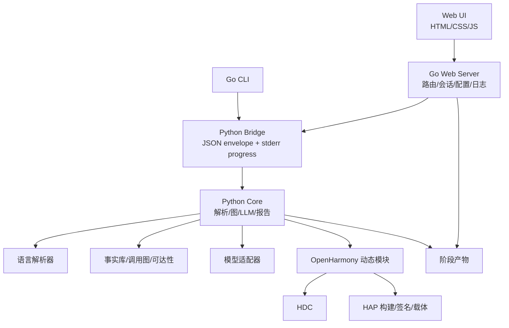
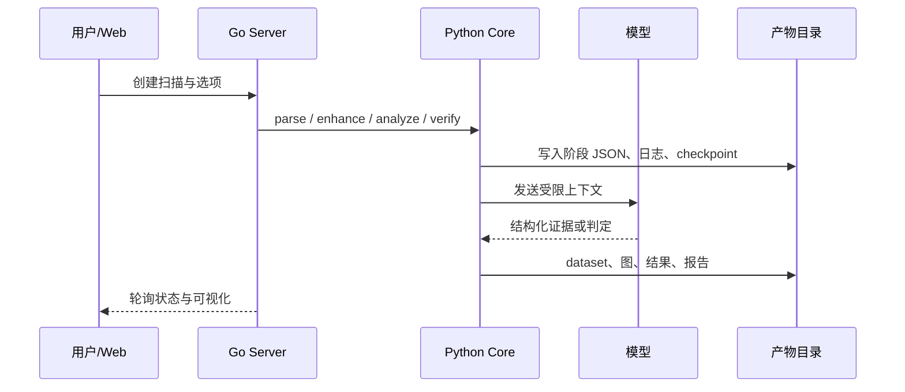

# VulnFounder 开发者架构说明

本文面向维护和扩展 VulnFounder 的开发者，描述模块边界、数据流、配置解析和测试
责任。产品名称已统一为 VulnFounder；部分历史产物仍保留兼容字段名，以便读取旧扫描。

## 1. 分层架构



### 1.1 Go 层

`apps/vulnfounder-cli` 负责进程生命周期和用户交互：

* `cmd/`：CLI 命令、扫描选项、阶段编排和退出码；
* `internal/server/`：Web 路由、会话、设备资产、源码定位、仓库管理、报告 API；
* `internal/config/`：配置文件、模型配置、OpenGrok 设置和项目根解析；
* `internal/python/`：Python 运行时检测、虚拟环境、JSON envelope 解码和实时 stderr
  转发；
* `internal/report/`：Go 侧报告聚合和 Web 展示适配；
* `ui/`：嵌入式 HTML/CSS/JavaScript 页面。

Go 不直接拼接设备 shell 命令或源码查询语句。它将结构化参数编码为 argv/JSON，
把 Python stdout 作为严格 JSON envelope，stderr 作为进度日志。

### 1.2 Python 层

`libs/vulnfounder-core` 是分析引擎：

* `core/`：扫描编排、解析适配、调用图、可达性、验证、报告和产物桥接；
* `parsers/`：C/C++、Go、Python、JavaScript/TypeScript、Rust、Ruby、PHP、Swift、
  Zig 等语言解析器；
* `utilities/llm/`：不同模型提供商的统一调用、限流、成本和响应规范化；
* `utilities/openharmony_dynamic/`：HDC、设备事实、协议契约、HAP 传输和动态验证；
* `utilities/dynamic_tester/`：Docker、Claude Code 和设备模式的统一入口；
* `report/`：中文/英文披露、HTML、CSV 和结构化摘要；
* `knowledge/`、`prompts/`、`core/rules/`：领域知识、提示词和默认规则。

## 2. 扫描数据流



每个阶段应具备独立的输入、输出、状态和报告文件。长任务通过 checkpoint 恢复，
不要依赖 Web 进程内存中的临时对象。

## 3. 关键数据模型

### 3.1 扫描与阶段

扫描目录通常包含 `meta.json`、`*.report.json`、解析数据集、调用图、增强上下文、
Stage 1/Stage 2 结果和最终报告。阶段状态至少区分 `pending`、`running`、`success`、
`partial`、`error` 和 `cancelled`。阶段失败不能被下游当作成功空结果。

### 3.2 调用点台账和有效图

调用点台账是调用关系的核心事实来源。一个站点记录：

* caller、规范源码位置和源码快照；
* 调用表达式、接收者类型和静态声明；
* 已解析目标、候选目标和目标集合完整性；
* 构建配置、范围状态、解析器来源和证据位置；
* `resolved`、`partially_resolved`、`unresolved` 以及排除原因。

原生图用于审计；有效图由已核验事实确定性生成。LLM 恢复只能写入独立 overlay，
满足证据门槛后才投影。函数级 BFS 可以按 caller/callee 去重，但审计产物必须保留
所有 callsite、条件和来源。

### 3.3 暴露面会话

设备资产会话和单目标源码定位会话使用不同 ID。设备会话保存 serial、命令、输出、
任务树和合并资产；定位会话保存标准化目标、检索动作、证据图、服务端/客户端归因、
Manifest 映射、仓库候选和用户确认结果。

## 4. 模型调用边界

模型调用必须经过统一适配器，输入带有阶段、模型配置名、上下文摘要和预算。模型
不能直接执行主机 shell；设备 Agentic Loop 也只能通过受控设备命令执行器。所有模型
动作、工具结果、token/cost 和失败原因写入阶段产物。

模型输出必须经过：

1. JSON/schema 校验；
2. ID、路径、行号和预算校验；
3. 本地事实存在性校验；
4. 关系类型和当前配置准入判断；
5. 失败反馈或 bounded retry。

`high`、`medium` 是证据标签，不是自动信任等级。入口和调用边分别判断，候选事实
不能无声混入 strict 图。

## 5. OpenHarmony 动态模块

`utilities/openharmony_dynamic/toolchain.py` 解析项目内工具链；`hdc_client.py` 负责
设备命令和输出；设备资产模块负责 socket 资产；`transports/hap.py` 负责模板参数化、
Hvigor 构建、SDK/正式证书签名、安装和卸载。

HAP 构建必须使用临时隔离目录，不能把私钥复制到报告或长期产物。自动 debug profile
必须绑定当前设备 serial 并由签名工具验证。任何设备状态改变都由上层授权参数控制。

## 6. 配置与路径

配置优先级通常为：显式环境变量 → 项目本地配置 → 默认值。重要变量：

| 变量 | 作用 |
|---|---|
| `VULNFOUNDER_PROJECT_ROOT` | 指定项目根 |
| `VULNFOUNDER_DATA_DIR` | 指定结果根目录 |
| `VULNFOUNDER_CONFIG_FILE` | 指定受保护配置 |
| `VULNFOUNDER_PYTHON` | 指定 Python |
| `VULNFOUNDER_HDC` | 指定 HDC |
| `VULNFOUNDER_DYNAMIC_TOOLCHAIN` | 指定 OpenHarmony 工具链 |
| `VULNFOUNDER_HAP_CERT_DIR` | 指定 HAP 证书目录 |

路径、URL 和端点都必须经过规范化，拒绝路径穿越、控制字符、shell 元字符和不安全
的 OpenGrok URL。密钥只在必要的子进程环境中短暂传递。

## 7. 扩展约定

新增语言：实现解析器适配器、函数/调用点标准模型、语言测试夹具，并接入扫描注册表。

新增设备暴露面类型：实现 provider，输出统一资产 schema；不要把设备命令散落在 Web
处理器中。

新增动态载体：实现 transport 接口，声明字段 schema、构建、发送、清理和证据收集；
不得复制某个样本的协议字符串作为全局规则。

新增模型提供商：实现统一客户端适配器，登记模型和费用，保证 API Key 不回显，并为
超时、429、空响应和非法 JSON 提供可诊断错误。

## 8. 测试与验收

修改 Go 后执行：

```bash
cd apps/vulnfounder-cli
go test ./...
```

修改 Python 后执行核心测试：

```bash
PYTHONPATH=libs/vulnfounder-core \
  result/venv/bin/python -m pytest -q libs/vulnfounder-core/tests
```

完整测试可能包含外部 OpenHarmony 源码仓库的测试，应使用项目指定测试路径，避免
把被扫描仓库的依赖错误误判为 VulnFounder 本身失败。至少应覆盖：配置 round-trip、
运行时解析、设备资产、源码定位、HAP 构建签名、报告生成和 Web API。
