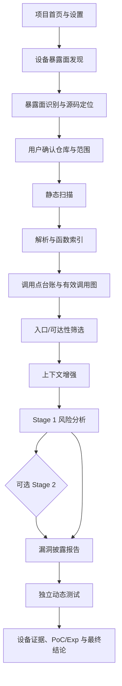
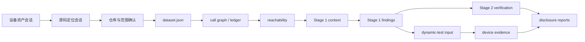

# VulnFounder 项目全流程说明

VulnFounder 将“设备上看得到什么”“源码中由谁实现”和“代码是否形成安全风险”
拆成可独立复核的阶段。每个阶段都会保存结构化产物、日志和证据，后续阶段只读取
已完成并带版本信息的产物，不用用户凭记忆拼接结论。

## 1. 总体流程

设备资产、源码定位、静态扫描和动态测试都可以单独运行；联合入口只是把阶段产物
按 ID 关联起来，不会把一个阶段的失败伪装成另一个阶段成功。

## 2. 阶段一：设备暴露面发现

用户选择在线开发板，系统确认 serial 唯一性，然后创建设备资产会话。Agentic Loop
以“发现设备上的 Listening/Bound socket”为根任务：

1. 模型读取 OpenHarmony 命令指南和当前任务树；
2. 自主选择下一条只读 HDC 命令，例如读取 Unix socket、TCP/UDP 表、进程和权限；
3. 命令执行器只允许设备探测命令，记录完整 argv、退出码、输出摘要和时间；
4. 模型根据新证据动态增加任务节点，直到字段齐全或预算耗尽；
5. 规则层合并跨命令结果，模型负责语义归并和字段解释；
6. 输出设备 serial、暴露面类型、端点、协议、状态、进程、DAC、SELinux 和证据。

结果可在设备资产历史中复查。阶段只负责资产发现，不会自动拉取源码或改变设备状态。

## 3. 阶段二：暴露面识别与源码定位

用户从资产历史选择一个 Unix socket 或 TCP/UDP 端点，也可以输入自定义目标。

检索优先使用 socket 名称、配置文件、服务注册符号和端点相关证据；不会用全仓
`bind(`、`recv(` 等通用词无边界扩散。LLM 每轮只能从受限工具集合中选择搜索定义、
读取文件、查询引用等动作，动作引用的 evidence ID 必须存在。多个候选仓库会分别
展示服务端证据、客户端证据、Manifest 映射和不确定性，由用户选择实际拉取项。

## 4. 阶段三：静态扫描

静态扫描的输入是一个源码仓库和扫描配置。前端可选择 `all`、`reachable`、
`codeql` 或 `exploitable` 等处理级别；动态测试不再嵌入静态扫描页面，而在独立
动态测试页面执行。

### 4.1 解析与事实建立

解析器按语言生成函数单元、源码范围、调用表达式、符号索引和原生调用图。C/C++
可选 Clang 语义辅助；有真实编译数据库时记录配置来源，没有时只把手工重建结果
标为候选证据。所有调用站点进入台账，分别记录已解析目标、候选目标、范围和构建
状态，避免“台账已 resolved 但有效图无边”静默发生。

### 4.2 有效调用图与可达性

Tree-sitter 提供快速语法索引，Clang、规则分析和 LLM 恢复提交带证据的事实。系统
从台账生成有效图，同时保留原生图、候选边、排除原因和版本指纹。只有绑定依据、
源码证据和当前构建条件满足准入的关系才进入 strict 图；不完整关系保留为候选，
不会假装确定。

入口来自结构化入口、外部输入和入站跨进程信号。`high` 不是无条件入口，必须通过
信号来源与证据检查；`medium` 可沿已验证边进入候选可达集合。最终得到 strict、
candidate、fallback 和未决等层次，并记录首个断点。

### 4.3 上下文增强和 Stage 1

上下文增强围绕入口到目标的调用路径收集完整函数源码、注册关系、分派条件和缺口，
以 `File Boundary` 或路径 bundle 分隔不同函数。Stage 1 接收目标函数、入口路径、
调用链源码和结构证据，识别风险类型、触发行、影响、根因和修复建议；它关注潜在
风险，不以参数污点证明替代调用路径。

### 4.4 Stage 2 与报告

Stage 2 是攻击者视角的独立复核：针对 Stage 1 候选检查输入边界、权限、条件、数据
流和可利用性，可能将结果升降级为 vulnerable、inconclusive 或非漏洞。关闭 Stage 2
时，Stage 1 结果仍会生成报告，但必须明确“未完成攻击者复核”。报告优先展示漏洞说明、
触发行、入口到触发点的攻击链、根因、修复要点和按调用顺序排列的源码，元数据和辅助
证据放在后面。

## 5. 阶段四：独立动态测试

动态测试以一个 finding 为单位，不依赖静态扫描页面继续执行。流程为：

1. 读取 finding、源码证据、候选攻击链和服务端入口；
2. 入口发现 Agent Loop 识别接收函数、协议分帧、字段解析和命令分派；
3. 协议描述符合成器输出消息字段、帧顺序、参数模板、预言机和失败条件；
4. 生成 HAP 或其他受审查载体，使用项目内工具链签名；
5. 经用户授权后安装、启动、发送帧并采集 hilog、文件、进程和权限证据；
6. 按证据门槛输出 `CONFIRMED`、`NOT_REPRODUCED`、`BLOCKED` 或 `INCONCLUSIVE`；
7. 保存 PoC、Exp、发送帧、设备命令、日志和清理记录，支持在线查看与下载。

动态测试默认采用安全、有限的命令和 canary 路径；任何设备状态改变都需要显式授权。
协议帧必须来自当前 finding 的服务契约，不应靠固定样本字符串代替通用推理。

## 6. 产物关系

每个阶段产物应记录源码快照、配置、模型配置名、图版本和时间。下游读取失败时应显示
缺失或过期，而不是复用无法证明一致的旧产物。

## 7. 用户最短操作路径

1. 启动 Web，进入设置，确认模型、OpenGrok 和运行环境；
2. 连接开发板，在设备暴露面发现中创建资产快照；
3. 选择目标进入源码定位，确认候选仓库；
4. 在静态扫描中选择仓库和处理级别，运行 Stage 1，按需运行 Stage 2；
5. 在漏洞报告中查看源码、调用链和证据；
6. 对指定 finding 进入动态测试，授权后查看设备验证结果。
