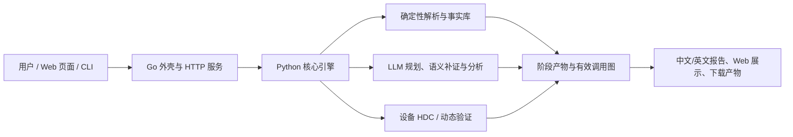
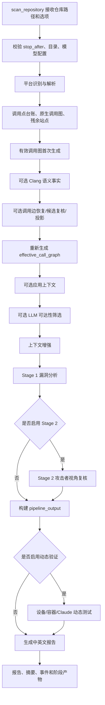
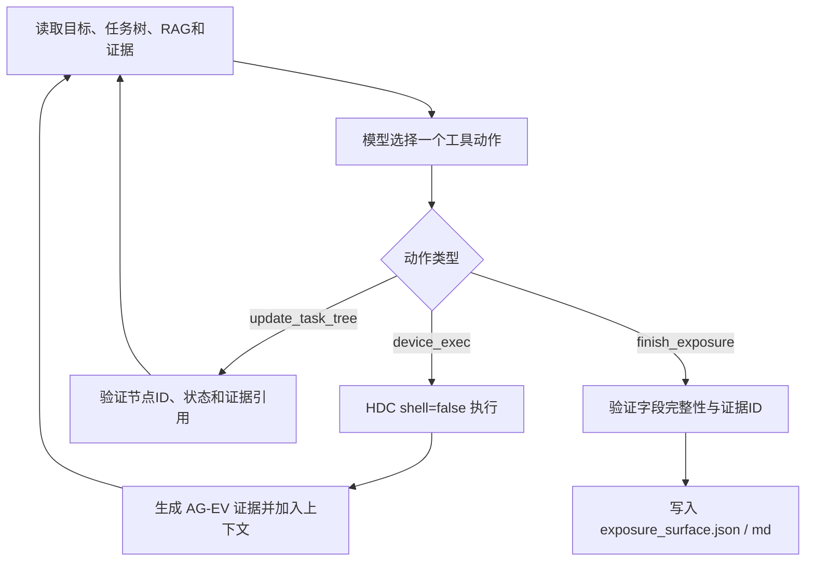
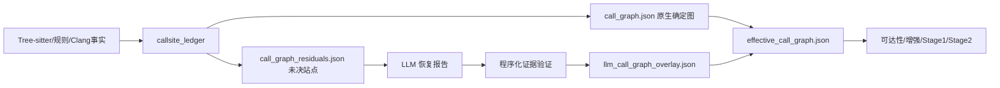
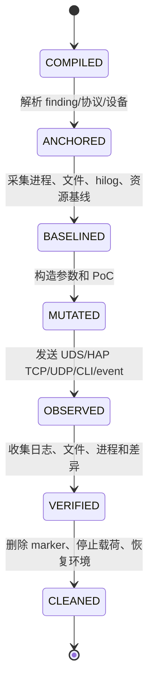

# VulnFounder 源码级全流程说明

> 本文以当前仓库源码为准，按一次真实任务从输入到最终报告的顺序，说明 VulnFounder 各层如何调用、如何交换数据、如何生成证据，以及每个阶段的边界。文中路径均相对于项目根目录 `/Users/shiyu/学习/hyl/new/VulnFounder`。

本文不是产品宣传页，也不是只描述按钮和阶段名称的操作手册。阅读本文后，应能够回答以下问题：

* 用户输入从哪一个 Go/Python 函数进入系统；
* 设备命令、OpenGrok 查询、源码解析和模型调用分别由谁执行；
* `dataset.json`、调用图、可达性结果、Stage 1/Stage 2 和报告之间怎样传递；
* 调用边恢复为什么不会直接改写原始调用图；
* 一个函数进入后续分析，和最终被报告为风险，分别需要什么证据；
* 动态验证的 PoC、协议描述符、预言机和设备结果怎样关联；
* 哪些结果是确定性证据，哪些只是模型候选或尚未完成的补证任务。

---

## 1. 项目整体结构：四层协作，而不是一个“大模型脚本”

VulnFounder 的运行时可以分成四层：



### 1.1 Go 层负责什么

Go 层位于 `apps/vulnfounder-cli/`，主要解决三个问题：

1. **提供 CLI 入口。** `apps/vulnfounder-cli/main.go` 的 `main()` 调用 `cmd.Execute()`，Cobra 命令定义位于 `apps/vulnfounder-cli/cmd/`。
2. **提供 Web HTTP/SSE 边界。** `apps/vulnfounder-cli/internal/server/` 处理页面请求、参数校验、会话目录、事件流、产物白名单和取消任务。
3. **启动并监管 Python 子进程。** `apps/vulnfounder-cli/internal/python/` 负责运行 Python worker、读取严格 JSON envelope、转发 stderr 进度和处理超时/取消/进程组回收。

Go 层不负责解析 C++，也不自行判断某一段代码是不是风险。它负责把用户请求变成受约束的 Python 调用，并把 Python 产物安全地暴露给浏览器。

### 1.2 Python 层负责什么

Python 核心位于 `libs/vulnfounder-core/`，其中：

* `vulnfounder/cli.py` 是 Python 命令分发层；
* `core/scanner.py` 是普通静态扫描编排器；
* `core/parser_adapter.py` 和 `parsers/` 负责解析、单元生成和调用图；
* `core/llm_reachability.py`、`core/openharmony/` 和 `core/call_graph_facts.py` 负责语义可达性与有效图；
* `core/analyzer.py`、`core/analysis_core.py` 是 Stage 1；
* `core/verifier.py`、`utilities/finding_verifier.py` 是 Stage 2；
* `core/reporter.py`、`report/generator.py` 负责统一结果和披露文档；
* `core/exposure_agent.py`、`core/exposure_surface.py` 负责开发板暴露面识别；
* `core/source_locator/` 负责 OpenGrok 源码定位和仓库归因；
* `utilities/openharmony_dynamic/` 负责设备动态验证。

### 1.3 UI 层如何进入 Go

Web 页面以静态资源形式嵌入 Go 二进制。`apps/vulnfounder-cli/ui/embed.go` 通过 `//go:embed` 嵌入 dashboard、扫描、设备资产、暴露面定位、源码定位、动态测试、报告和设置页面。`cmd/serve.go` 启动 `server.New(...)`，默认监听 `127.0.0.1:8080`，并将 Web 产物写入当前数据目录下的 `result/webui`（也可由环境变量改变）。

因此，浏览器点击“开始扫描”时并不是直接调用 Python，而是：

```text
HTML/JavaScript
  → Go HTTP handler
  → 生成会话目录与 jobMeta
  → Go python.Invoke(...)
  → Python CLI 子命令
  → 阶段产物 / stderr 事件
  → SSE 或轮询返回浏览器
```

---

## 2. 一次普通静态扫描的总时序

核心编排函数是 `libs/vulnfounder-core/core/scanner.py::scan_repository()`。下面是源码中各阶段的实际关系；某些选项可以跳过阶段，但阶段之间的产物契约保持一致。



### 2.1 扫描开始时的身份与版本约束

`scan_repository()` 首先读取输出目录和运行选项，计算模型/模板指纹，并尽早检查 LLM 配置。每个阶段产物会携带或间接关联：

* 源码路径和源码 revision；
* 构建配置标识 `build_config_id`；
* 解析语言及解析器版本；
* 当前模型 provider、model 和提示词指纹；
* 上游产物路径；
* 阶段状态、耗时、错误和是否跳过。

这项设计用来防止模型更换后误用旧 checkpoint，也防止新的 overlay 被旧数据集无声覆盖。

### 2.2 `stop_after` 的含义

`stop_after` 不是“在任意位置强行杀进程”，而是由编排器在完成一个阶段并写出对应产物后正常返回。例如：

* `parse`：只生成解析、函数索引和原生调用图；
* `effective-call-graph`：完成原生事实、Clang/恢复投影和有效图；
* `llm-reachability`：完成语义种子与可达性筛选；
* `stage1`：完成漏洞分析；
* `report`：继续到最终报告。

被跳过的后续阶段会写入 `skipped_steps` 或对应阶段记录，不能将“没有运行”误写成“没有发现问题”。

---

## 3. 输入、会话和产物的统一契约

### 3.1 CLI 参数进入 Python 的路径

`apps/vulnfounder-cli/cmd/scan.go::runScan()` 将 Go 侧选项拼成 Python 参数数组，例如仓库路径、`--processing-level reachable`、`--llm-reachability`、`--llm-call-graph-recovery`、`--verify`、`--clang-semantic` 等。它不会把整个 shell 命令拼成字符串，而是把参数作为独立 argv 传给 `python.Invoke()`。

`libs/vulnfounder-core/vulnfounder/cli.py::cmd_scan()` 再把 argparse 结果传给 `core.scanner.scan_repository()`。设备暴露面和源码定位有独立的 Python 命令入口，避免把设备探测、远端 OpenGrok 和本地静态扫描混成一条不可复用的流程。

### 3.2 Go/Python JSON envelope

Python worker 的标准输出需要是单个结构化 JSON envelope；正常进度主要写 stderr。Go 的 `internal/python/invoke.go`/`invoke_ctx.go` 会：

1. 启动 Python 子进程并设置工作目录、环境和取消信号；
2. 分别读取 stdout、stderr；
3. 从 stdout 解码 envelope；
4. 把 stderr 行作为进度日志转发给 Web；
5. 对退出码、超时、空 stdout、坏 JSON、上下文取消做分类。

这样可以避免普通日志混入机器可读结果，也能解释“Python worker produced no JSON envelope”“context deadline exceeded”这类错误。

### 3.3 主要身份标识

一个单元通常有 `unit_id`/`route_key`；一个调用站点有 `site_id`；一个事实有证据 ID；一个扫描有 scan ID；源码定位和设备暴露面有独立 session ID。函数显示名不能替代稳定身份，因为同名函数、重载、模板实例和多构建配置都可能不同。

### 3.4 产物不可互相替代

下面几类文件用途不同：

| 产物 | 回答的问题 | 能否直接代替其他产物 |
|---|---|---|
| `dataset.json` | 当前有哪些函数单元、原始源码和基础上下文 | 不能代替调用图 |
| `call_graph.json` | 原解析器确定的函数级边 | 不能代表所有动态/IPC关系 |
| `callsite_ledger.json` | 每个调用表达式如何解析、候选和缺口 | 不能直接当可达路径 |
| `effective_call_graph.json` | 经事实合并、投影后供下游使用的有效图 | 不覆盖原始图审计信息 |
| `llm_reachability.json` | 模型对入口/边界信号的判断 | 不能直接证明漏洞 |
| `results.json` | Stage 1 逐单元判定 | 不是最终披露文档 |
| `results_verified.json` | Stage 2 复核后的合并结果 | 不等于动态确认 |
| `pipeline_output.json` | 给动态测试和报告的统一 finding 输入 | 只包含报告所需视图 |
| `exposure_surface.json` | 设备上实际观察到的暴露面 | 不能证明源码归属 |

---

## 4. 设备暴露面发现：从 HDC 命令到资产记录

设备暴露面发现有两种粒度：

1. **目标探测：** 用户指定一个 Unix socket 或 TCP/UDP 端点，回答这个目标的详细属性；
2. **资产枚举：** 在一台指定设备上发现 listening/bound/connected 的 socket 资产，供用户之后选择目标。

### 4.1 目标规范化

`core/exposure_surface.py::normalize_exposure_target()` 将用户输入规范成结构化目标：

```json
{
  "kind": "unix|tcp|udp",
  "path": "/dev/unix/socket/paramservice",
  "process": "SP_daemon",
  "address": "127.0.0.1",
  "port": 8283
}
```

它会拒绝控制字符、shell 控制符、路径穿越等内容。TCP/UDP 的输入可以是 `SP_daemon UDP 127.0.0.1:8283`，Unix 输入可以是 `/dev/unix/socket/paramservice`。

### 4.2 命令执行边界

Go handler 在 `internal/server/exposure_surface.go` 中负责 session 路径、请求大小、序列号格式、artifact allowlist 和超时。实际 HDC 执行由 Python 侧完成：

* 通过 `subprocess.Popen(..., shell=False)` 执行；
* 记录完整命令 argv、退出码、标准输出、标准错误和截断状态；
* 设备序列号由参数显式指定或在唯一在线设备时自动选择；
* 结果写入 `exposure_commands.jsonl` 和证据文件，而不是只在页面上显示一段文本。

固定探针不是漏洞结论，而是设备事实收集，例如读取 `/proc/net/unix`、`/proc/net/tcp*`、`/proc/net/udp*`、进程/FD、权限和 SELinux 信息。Agentic 模式可以自主补充其他只读命令，但仍受到命令长度、控制符、设备超时和结果大小约束。

### 4.3 暴露面 Agent Loop

`core/exposure_agent.py::ExposureAgentRunner` 维护一个以“扫描目标暴露面”为根的任务树。每一轮模型看到：

* 当前目标及设备序列号；
* 当前任务树及节点状态；
* 已执行命令和返回结果；
* 已确认/待确认证据；
* 本地 RAG 指南 `knowledge/openharmony_exposure_surface_command_guide.zh-CN.md`；
* 剩余轮数、命令数、输出大小预算。

模型只能选择结构化工具：

* `device_exec`：在设备执行一条受约束命令；
* `update_task_tree`：增加或更新任务节点，并引用已有证据 ID；
* `finish_exposure`：提交结构化暴露面候选。

每一轮执行顺序是：



这里的“动态任务树”不是预先固定七个任务。初始只有根任务；后续节点由模型依据当前缺口增加，例如发现 Unix socket 后再增加“读取权限”“查找 FD 持有进程”“读取 SELinux 域”等节点。所有设备输出都必须能追溯到实际执行命令。

### 4.4 资产枚举与目标探测的区别

`core/device_socket_inventory.py` 用更大的预算对整台设备做资产快照，并保留原始行记录。它的输出可以包含：

* Unix socket、TCP、UDP；
* `LISTENING`、`BOUND`、`CONNECTED` 等状态；
* 命名路径或地址端点；
* 关联进程、UID、DAC、SELinux 标签/域；
* 命令来源和解析状态。

资产记录是“设备上观察到的事实”，不是源码定位结论。用户选择某项资产后，才进入源码定位或目标探测。

---

## 5. 暴露面识别与 OpenHarmony 源码定位

源码定位由 `core/source_locator/orchestrator.py`、`state_machine.py` 和 `worker.py` 协作完成。它使用 OpenGrok/Manifest/Git/LLM 证据，不在用户确认前把本地 `source_code_base` 当成已确认源码。

### 5.1 状态机

实际状态大致为：

```text
INTAKE
 → NORMALIZE_TARGET
 → PROBE_OPENGROK
 → SEARCH_INITIAL
 → TRACE_EVIDENCE
 → ATTRIBUTION_SERVER
 → LOCATE_CLIENT_COMM
 → RESOLVE_REPOSITORIES
 → VERIFY_EVIDENCE
 → AWAIT_USER_CONFIRMATION
 → CLONE
 → POST_CLONE_VERIFY
 → HANDOFF
 → DONE
```

证据不足时会进入 `RECOVER_EVIDENCE`；OpenGrok 不可用、版本不一致、拉取失败和验证失败分别有终止状态，不会伪造“已经定位”。

### 5.2 目标标准化与 OpenGrok 探测

标准化器处理 Unix 路径、TCP/UDP 地址、进程名、宏名和服务别名。随后 `PROBE_OPENGROK` 检查搜索、源码读取和 raw 内容接口是否可用。探测失败时，worker 记录原因并终止或等待用户修复，而不是回退到本地目录猜仓库。

### 5.3 初始检索不是无界搜索

`build_initial_queries()` 根据目标构造有限的高价值查询，例如：

* 完整 socket 路径或端点；
* socket 名称宏、配置项和注册字符串；
* 已知服务/进程名；
* OpenHarmony 注册 API、命令/事务值。

`bind(`、`recv(` 等通用词只有在已锁定文件/符号后才作为补充查询，避免把全仓库所有网络代码都当成目标服务。

### 5.4 证据存储和语义检索

每个证据记录包含路径、行号、源码片段、证据类型、来源查询、内容哈希和证据 ID。证据关系图描述“某个检索目标命中了哪些位置”，不等于这些位置都在调用链中。

当确定性检索无法补齐关系时，LLM 语义检索 planner 看到：

* 目标规格；
* 已有证据及有限的证据 ID；
* 已执行动作和结果摘要；
* 缺失谓词；
* 允许的结构化动作和查询长度/轮数预算。

模型只能返回 `search_definition`、`search_full`、`read_file` 等 schema 动作。worker 会校验查询长度、文件路径、动作预算、重复动作和失败连续次数；结果重新进入同一个证据库，所以模型不是无记忆地把同一个词反复搜索。

### 5.5 服务端/客户端归因与候选 PK

`ServiceAttributor` 按 socket 身份、获取/绑定、服务端消费、Manifest 仓库映射等谓词计算证据等级。它将服务端注册、接受/读取和业务分派与客户端连接、控制调用分开。

当多个仓库都出现相关证据时，候选 reviewer 比较：

* 进程构建归属；
* 服务端实现强度；
* 客户端/控制端实现；
* 重复或拆分源码关系；
* Manifest/build 证据；
* 证据行是否真正属于同一个目标。

最终候选是排序结果而不是硬编码的唯一答案。用户可以为每个候选选择仓库、revision 或版本；只有确认后才执行 Git 拉取。

### 5.6 拉取后校验和 handoff

`POST_CLONE_VERIFY` 检查：

* `origin` 是否与候选一致；
* HEAD/revision 是否符合用户选择；
* 目标文件、符号和关键源码是否存在；
* 目标目录是否位于允许的 `source_code_base` 下。

成功后生成 `source_handoff.json`，包含仓库路径、URL、revision、目标范围和证据摘要，普通静态扫描从这个 handoff 继续，而不是复用远端检索文本。

---

## 6. 源码解析：从文件到函数单元

### 6.1 语言分流

`core/parser_adapter.py` 根据扩展名和语言注册表选择 C/C++、Python、JavaScript/TypeScript、Ruby、Go、PHP、Rust、Swift、Zig 等解析器。多语言模式按语言分目录解析，最后合并 dataset、索引和调用图，并保留语言来源。

OpenHarmony C/C++ 的主要实现位于：

* `parsers/c/repository_scanner.py`；
* `parsers/c/function_extractor.py`；
* `parsers/c/call_graph_builder.py`；
* `parsers/c/unit_generator.py`；
* `parsers/c/test_pipeline.py`。

### 6.2 文件扫描和 OpenHarmony 范围识别

`RepositoryScanner.scan()` 遍历源码文件，排除 `.git`、构建输出、缓存、vendor/third_party 等不适合当前分析的目录，并同时识别：

* C/C++ 源文件和头文件；
* `BUILD.gn`、`CMakeLists.txt` 等构建线索；
* 可能的服务端、客户端、IPC、socket、测试和生成代码角色。

排除规则影响扫描范围，所有排除应在解析报告和 gap 诊断中可见，不能把未扫描误写成“函数不存在”。

### 6.3 Tree-sitter 抽取语法事实

`FunctionExtractor.extract_from_scan()` 使用 Tree-sitter C/C++ grammar 读取语法树，抽取：

* 函数定义、声明、参数、起止行；
* include、宏和枚举；
* class/struct、继承、字段声明；
* 局部变量与字段类型；
* 函数体中的调用表达式；
* 预处理和注册相关源码片段。

Tree-sitter 解决的是语法树和源码定位，不保证在缺少编译参数时完成 C++ 类型、重载和动态分派的完整绑定。因此，解析结果中会同时存在确定边、候选边和未解析站点。

### 6.4 C/C++ 直接调用绑定

`parsers/c/call_graph_builder.py` 先建立函数索引、类索引、基名索引、字段类型和局部变量类型。遍历调用表达式时依次尝试：

1. 无接收者的普通函数/静态函数名匹配；
2. `obj.method()` 的局部变量类型匹配；
3. `this->method()` 的当前类/基类匹配；
4. 字段接收者的声明类型匹配；
5. `new`、工厂和智能指针返回类型的有限传播；
6. 回调参数或函数指针的候选记录。

标准库调用会被过滤，避免把 `std::string` 等基础操作制造成业务边。一个成员调用是否能够成为有效边，不能只看“函数名一样”，还要看接收者类型、签名、源码位置和适用配置。

### 6.5 函数单元和源码边界

`UnitGenerator.generate_units()` 将函数包装为分析单元，常见字段包括：

```json
{
  "id": "规范化文件:限定名",
  "name": "Class::Function",
  "file": "src/example.cpp",
  "start_line": 10,
  "end_line": 42,
  "code": {
    "primary_code": "...",
    "primary_origin": {"deps_inlined": false}
  },
  "callers": ["..."],
  "callees": ["..."],
  "is_entry_point": false
}
```

旧版和增强上下文可能把上游/下游函数源码拼接到 `primary_code`，并使用：

```text
========== File Boundary ==========
```

进行文件边界分隔。当前分析器如果存在有序 `primary_path_source_bundle`，会把目标函数放回 primary slot，把按入口到目标排序的源码链单独传给 prompt formatter；这样 Stage 1 既能看到目标函数，也能看到有序调用路径，不再依赖宽度/深度拼接顺序猜路径。

---

## 7. 调用点台账、残余关系和有效调用图

这是项目中最容易混淆的部分：原生调用图、模型候选边和最终有效图不是同一个东西。

### 7.1 三张图和一份台账



* `call_graph.json`：原解析器写出的原生图，作为审计基线，不被 LLM 直接覆盖；
* `callsite_ledger.json`：调用表达式级台账，记录 caller、源码位置、接收者类型、目标、解析状态和原因；
* `call_graph_residuals.json`：无法充分解析或图中缺边的站点；
* `llm_call_graph_overlay.json`：经过证据门槛的补充边，独立保存；
* `effective_call_graph.json`：下游实际使用的图，是原生图与有效 overlay 的确定性合并结果。

### 7.2 台账字段的语义

一个站点应分别记录：

* `caller_id`、`callsite_id`、源码规范路径和精确范围；
* 调用表达式及接收者表达式；
* 静态绑定状态：已绑定/未绑定；
* 动态目标状态：完整/部分/未知/不适用；
* 候选目标与 `candidate_completeness`；
* 构建状态：完整、缺失、明确禁用、未知；
* 范围状态：范围内、确认范围外、未知；
* 原生图状态：已有边、edge_missing、未进入图；
* 需要的下一项补证任务。

`resolved` 只表示某个层次的绑定成功，不能单凭“候选数量为 1”证明动态目标集合完整。手工重建编译上下文得到的事实必须携带 `manual_rebuild` 和配置来源，不能自动升级为产品配置事实。

### 7.3 LLM 调用边恢复

`core/platforms/openharmony/llm_call_graph_recovery.py` 从未决站点建立有界队列。每个任务包含源码片段、候选目标、注册信息、相邻图、函数索引、入口提示、构建/范围状态和缺失原因。

模型不是直接输出“我认为 A 调用 B”一句话，而是提交带 schema 的候选边，至少包括：

```json
{
  "caller_id": "...",
  "callsite_id": "...",
  "callee_id": "...",
  "kind": "direct_member|callback|factory_dispatch|ipc|...",
  "evidence": [
    {"path": "src/a.cpp", "start_line": 12, "end_line": 16, "claim": "..."}
  ],
  "assumptions": ["..."],
  "confidence": "high|medium|low"
}
```

程序会校验 caller/callee 身份、源码路径和行号是否存在、证据是否实际匹配当前源码、构建和范围状态是否允许进入某一层、重复动作和预算。通过这些检查只代表“证据可引用”，不代表所有动态分派已证明。

### 7.4 候选边复核与投影

已有解析器候选目标的站点进入候选复核器，模型比较注册源码、调用点、类型和邻居证据。复核报告仍是独立审计产物。

投影阶段只把符合当前配置和证据门槛的关系写入 overlay。原生图从不被覆盖；如果新事实推翻旧启发式绑定，必须在有效图中撤销/替换，并保留原图作为审计基线。多个调用站点可以在函数级遍历时合并，但审计记录必须保留所有 `site_id`、条件和证据。

### 7.5 为什么模型接受很多边，最终新增边却很少

“模型接受的决策数”与“有效图新增边数”不是同一指标：

* 多个决策可能指向同一 caller/callee；
* 某些站点只是原图已有边的重复证明；
* candidate 关系未达到 strict 证据门槛；
* caller/callee 不在当前符号索引或范围内；
* 构建条件未知；
* 候选边参与诊断但不改变 strict 图。

因此应该同时报告原生边、有效边、candidate 边、已复核站点和未决站点，不能只看模型调用次数。

### 7.6 Clang 语义辅助

`core/scanner.py::_run_clang_semantic_batch()` 调用 `core/platforms/openharmony/clang_batch_extractor.py`，在有编译上下文时提取直接成员调用、声明/定义、类型、继承和源码位置。构建上下文可能来自 `compile_commands.json`、Ninja/构建文件重建或匹配的手工命令。

如果缺失头文件、宏、sysroot 或真实产品配置，Clang 结果只能标为语义不完整。项目允许将 Clang 事实作为 sidecar 与原生图合并，但不会把“能够在手工命令下解析”宣传成“已经证明产品构建可达”。

---

## 8. 入口、可达性和处理级别

### 8.1 结构入口的来源

`utilities/agentic_enhancer/entry_point_detector.py::EntryPointDetector` 依据源码结构识别：

* `main`、CLI 命令和参数处理；
* Web route/handler 和框架注册；
* stdin、环境变量、配置和文件读入；
* socket/IPC 读取和 native 回调；
* 线程、任务、事件订阅等异步入口；
* OpenHarmony 注册 API、stub/proxy/transaction 分派证据。

它会记录 `is_entry_point`、原因和证据类型。这个识别是结构启发式，不能保证找到所有框架入口；找不到入口时不能把函数证明为安全，只能标记入口覆盖不足。

### 8.2 解析可达性与 LLM 语义可达性

在 `processing_level=all` 时，解析器保留全量函数和边；`reachable` 是后续过滤视图。启用 LLM 可达性时，`scanner.py` 会强制先保留足够完整的图和数据集，再运行语义入口判断。

模型信号分为：

* **high 入口信号：** 经过信号结构、来源和边界证据检查后，可作为 strict BFS 种子；`external_input` 和入站 `cross_process` 需要有相应来源证据。
* **medium 信号：** 不直接成为 strict 种子，但可以沿已验证边进入 candidate reachable，供后续诊断和阶段分析；不会因为一条中等信号就宣称入口已确认。
* **low/unknown：** 记录为线索，不驱动 strict BFS。

可达性传播方向保持 caller → callee。反向查询可用于寻找上游和诊断缺边，但只有反向路径最终接到获准入口并且边已接受时，才能转化为正向可达证据。

### 8.3 `all`、`reachable` 和回退

* `all`：保留所有解析到的单元，适合评测、诊断、调用图开发和不想因入口漏检而丢失目标的场景；不会跳过入口识别，只是不用入口过滤结果删除单元。
* `reachable`：用结构入口和已接受语义种子做 BFS，减少后续分析量；应同时保存未保留原因。
* 无 strict 种子或图不可用时的 fallback：用于避免静默漏分析，但必须单独统计 `fallback-only`，不能把兜底保留当成入口恢复成功。

### 8.4 可达性不等于漏洞

可达性只回答“在当前有效图中能否从某类入口到达函数”。它不回答：

* 外部输入是否控制危险参数；
* 分支、权限和时序是否同时满足；
* 设备上该版本是否运行；
* sink 是否真的执行；
* 是否已经构成可利用安全影响。

这些问题由 Stage 1、Stage 2 和动态验证分别处理。

---

## 9. 上下文增强：把函数变成可审阅的分析单元

上下文增强的入口是 `core/enhancer.py::enhance_dataset()`。它不改变原始解析文件，通常生成新的 `dataset_enhanced.json` 或等价的活动数据集。

### 9.1 single-shot 与 agentic

* **single-shot：** 一次批量将已有函数、调用者/被调用者和源码片段交给模型，生成函数摘要、风险角色和上下文补充。
* **agentic：** 每个单元或一批单元由模型按需读取函数索引、文件和邻居，发现缺失依赖后再次读取；使用 checkpoint 支持中断恢复。

agentic 不是让模型无约束访问整个仓库。它有工具白名单、文件/字节/轮数预算，并把新增文件、调用链来源和失败写进增强记录。

### 9.2 入口到目标的有序源码包

在有可验证路径时，reachability context 会包含 `entry_context.primary_path_source_bundle`。它按入口→中间函数→目标排列，每个节点带：

* 稳定函数 ID 和限定名；
* 文件、起止行和源码 hash；
* 源码片段；
* 边类型、边证据和缺口；
* 适用的构建/配置条件。

这与参数污点链是两种东西：本阶段优先保证执行调用路径完整；source-to-sink 参数传播属于更细的数据流问题，默认交给 Stage 2 或后续动态验证。缺少数据流并不应把函数判为不可达。

---

## 10. Stage 1：逐函数风险识别

### 10.1 调用入口

`core/analyzer.py::run_analysis()` 读取活动 dataset、应用上下文和模型 registry，创建 checkpoint、加载函数单元，并并行调用 `core/analysis_core.py::analyze_unit()`。

`analyze_unit()` 的关键步骤是：

1. 从 `unit.code` 提取 `primary_code`；
2. 读取 `agent_context`、路由、语言、平台上下文和 reachability context；
3. 如果启用 multifile context reviewer，补充缺失文件；
4. 若存在有序 source bundle，把目标函数放入 primary slot，并由 prompt formatter 追加有序入口路径；
5. 调用 `prompts/vulnerability_analysis.py` 生成统一 Stage 1 prompt；
6. 使用 analyze 阶段的 provider/model 调用一次模型；
7. 解析严格 JSON；
8. 若 JSON 损坏，用同一 analyze binding 的 JSONCorrector 重试；
9. 写入 `stage1_context`、`stage2_context`、耗时、prompt/response/code 长度和文件清单。

### 10.2 Stage 1 看到什么

典型上下文由以下部分构成：

* 目标函数完整源码；
* 入口到目标的 ordered path source bundle（如果已恢复）；
* 调用者和被调用者摘要；
* 路由/入口角色、平台和应用上下文；
* 函数所在文件与行号；
* threat model 或默认安全规则；
* 已知的外部输入/跨进程/IPC 入口信号；
* 明确的上下文缺口。

Stage 1 输出通常包含 `verdict/finding`、置信度、漏洞类别、描述、证据代码位置、攻击链摘要、修复建议和推理。它可以输出 `vulnerable`、`bypassable`、`inconclusive`、`protected`、`safe` 或 `ERROR`。

### 10.3 Stage 1 的边界

Stage 1 负责发现潜在风险和给出证据线索，不以“完整参数污点证明”为准入门槛。`stage2_dataflow_status` 默认可能是 `not_evaluated`；这表示参数数据流尚未由工具或攻击者视角充分核验，不表示没有调用链。

模型返回损坏、缺字段或冲突 JSON 时，系统宁可标为错误并重试，也不把示例 JSON 或前言误当作结论。每个单元 checkpoint 带模型指纹，切换模型后不会静默复用旧结论。

---

## 11. Stage 2：攻击者视角和工具辅助复核

### 11.1 候选选择

`core/verifier.py::select_stage2_candidates()` 默认选择：

* Stage 1 的 `vulnerable`；
* Stage 1 的 `bypassable`；
* `include_inconclusive=True` 时的 `inconclusive`。

`safe` 和 `protected` 不进入攻击者模拟，避免将所有函数都重复交给昂贵的验证模型。

### 11.2 验证上下文

`run_verification()` 加载 `analyzer_output.json`/函数索引、仓库源码和应用上下文，交给 `utilities/finding_verifier.py::FindingVerifier`。验证器可以：

* 搜索目标定义、调用者、使用点和下游实现；
* 读取必要源码文件；
* 检查入口、socket/CLI/事件回调和 IPC 分派；
* 对 Stage 1 的描述进行反证；
* 补充参数来源、危险实参、权限和边界条件；
* 将 `inconclusive` 升级、降级或保留待定。

因此，Stage 2 是“攻击者是否能沿这条路径把输入带到风险操作”的工具辅助复核层，而不仅是第二次重复问模型。

### 11.3 Stage 2 的输出

`results_verified.json` 保留原始 Stage 1 结果，同时记录验证状态、修正结论、复核证据和 `review_findings`。验证失败时不会删除 Stage 1 产物；扫描器可以回退到 Stage 1 结果，但会在阶段报告中标注验证失败。

---

## 12. 统一 pipeline_output 与报告生成

### 12.1 统一输入

`core/reporter.py::build_pipeline_output()` 读取 `results.json` 或 `results_verified.json`，规范化模型返回的结果列表，恢复旧扫描缺失的 `code_by_route`，加载有效调用图和报告上下文索引。

它做三件重要的事情：

1. 将 confirmed 的 vulnerable/bypassable 结果转换为动态测试和披露报告所需 schema；
2. 将 Stage 2 未决 finding 和 Stage 1 的 inconclusive 作为 `review_findings` 保留，避免“未确认”被静默丢弃；
3. 对严格 confirmed 结果做 caller/callee 关系去重，但不把 unresolved review 记录吞掉。

### 12.2 源码和调用链水合

报告生成器优先从有效调用图/原生调用图及精确函数 ID 读取源码，而不是盲信模型在 JSON 中复制的代码。对于旧扫描，`_load_code_by_route()` 和 `_hydrate_pipeline_findings()` 会从兄弟产物补齐源代码和位置信息。

一份报告可以同时包含：

* 漏洞函数及触发行；
* 入口→目标的函数级调用路径；
* 路径中每个函数的源码片段；
* Stage 1/Stage 2 状态和缺失证据；
* 根因、影响、修复建议；
* 中文和英文版本。

“调用链完整”仍要结合有效图和 source bundle 判断。报告有一条路径，不代表其中每个参数都已经完成污点证明。

### 12.3 中文/英文和 inconclusive

`generate_disclosure_docs()` 调用 `report/generator.py` 生成英文目录，并在旁边生成 `.zh-CN` 中文目录。`render_inconclusive_report()` 对未决条目采用确定性模板，明确写出：

* 状态为 inconclusive；
* 已确认的函数、文件和行号；
* 已有调用路径；
* 缺少的源码、数据流、权限或设备证据；
* 下一步复核建议。

它不会把 inconclusive 改写成 vulnerable，也不会因为 Stage 2 没有完成就删除静态线索。

---

## 13. 动态验证：从 finding 到设备预言机

动态验证可以作为扫描后独立页面运行，也可以由 pipeline bridge 在 `pipeline_output.json` 基础上触发。主要实现位于 `utilities/openharmony_dynamic/`。

### 13.1 Finding 适配

`stage_finding_adapter.py` 将静态 finding 转成 `FindingInput`：

* 目标函数、文件和行号；
* 漏洞类别和危险操作；
* socket/CLI/IPC/事件入口提示；
* 入口函数和候选攻击链；
* 参数模板、预言机和设备约束。

它会对文件和行号做确定性校验，并保留候选路径，而不是只把模型的一条文本攻击链当成唯一事实。缺少入口时，可以运行入口发现 Agent Loop，根据源码和索引补充 `entry_hints`；它不能凭空捏造一个入口。

### 13.2 协议描述符

协议描述符描述“怎样和某个服务交互”：传输类型、帧格式、字段、分隔符/编码、合法探测、消息顺序和入口适用条件。它不是漏洞本身，也不是随便写的字符串。

`descriptor_synthesizer.py` 从 route-scoped source bundle 提取服务端接收、分帧、字段解析和命令分派证据，再由模型生成候选描述符。程序做严格 source evidence validation：字段、guard、transform、合法 probe 必须能够映射到真实源码；设备侧 legal probe 还要验证报文能被服务接受。证据不足时应返回待补证，而不是回退成与目标无关的固定协议。

### 13.3 Runner 状态机

`utilities/openharmony_dynamic/runner.py::Runner.run()` 大致执行：



具体顺序是：

1. 校验 `hilog_expectations` 和契约字段；
2. 解析 `__SRC_FILE__`、`__RUN_PATTERN__`、`__RUN_DIR__` 等占位符；
3. 采集进程、FD、内存、崩溃、状态和竞态基线；
4. 创建运行目录和 marker 预期位置；
5. 清理旧日志并记录时间窗；
6. 根据 transport 发送：native Unix、Unix datagram、HAP UDP、HAP TCP、CLI 或事件总线；
7. 观察 hilog、目标文件、权限/拥有者、进程状态和资源变化；
8. 执行契约中声明的 oracle；
9. 生成 `CONFIRMED`、`NOT_REPRODUCED`、`BLOCKED` 或 `INCONCLUSIVE`；
10. 清理设备侧产物并写入完整 run record。

### 13.4 动态结果的正确解释

`CONFIRMED` 表示声明的预言机观察到了契约定义的效果，例如受控 marker 被高权限服务创建；它不等于所有静态 finding 都能在任意设备上利用。

`NOT_REPRODUCED` 表示本轮没有观察到预期效果，可能原因包括设备版本不存在该代码、入口协议错误、输入没有到达危险参数、权限/SELinux 阻断、HAP 不适配或预言机不足；不能直接等价为安全。

`BLOCKED` 表示测试前置条件（设备、服务、安装、协议或权限）未满足。动态阶段的证据必须与源码 finding、设备版本和实际发送帧一起审阅。

---

## 14. Web 会话、实时日志和历史产物

### 14.1 静态扫描 job

`internal/server/server.go` 的 `Job` 保存 scan ID、仓库、参数、状态、日志缓冲、报告路径和取消函数。创建任务后马上写入 metadata，运行中的 stderr 通过事件/SSE 发送，完成后保存 report、summary 和 disclosure 路径。

服务器限制日志行数和总字节数，避免仓库或模型输出无限增长；日志截断会明确写入提示，而不是静默丢掉后半段。

### 14.2 设备暴露面和源码定位 session

`internal/server/exposure_surface.go` 与 `source_locator.go` 各自维护安全 session 根目录、ID 正则、artifact allowlist、SSE 事件读取和取消接口。用户看到的实时“第几轮动作”来自 Python 写入的 `events.jsonl` 和命令/证据文件，而不是前端虚构的进度。

源码定位常见产物：

```text
target.json
probe.json
search_plan.json
evidence.json
events.jsonl
server_attribution.json
client_attribution.json
repository_resolutions.json
confirmation_summary.json
source_handoff.json
```

设备暴露面常见产物：

```text
device_snapshot.json
exposure_commands.jsonl
exposure_evidence.json
exposure_agent_plan.json
exposure_agent_trace.jsonl
exposure_agent_evidence.json
exposure_surface.json
exposure_surface.md
```

### 14.3 产物查看安全边界

Go 页面不会任意读取文件系统路径，而是先确认 session ID 格式、目录不是符号链接，再只允许读取白名单产物和受限大小。这样既支持原始证据下载，也避免浏览器路径穿越读取主机文件。

---

## 15. 错误、重试和“没有结果”的真实含义

### 15.1 模型错误

模型连接错误、认证错误、超时和坏 JSON 会在对应阶段报告中记录。分析器有 JSON correction 和 checkpoint；调用边恢复有动作/站点/模型调用预算、重复动作抑制和失败连续次数控制；源码定位有语义检索轮数和阶段级 deadline。

模型失败不会自动伪造源码证据。阶段可以安全回退到已有确定性结果，但必须注明语义阶段未完成。

### 15.2 OpenGrok/仓库错误

OpenGrok 探测失败、HTTP 400、版本不匹配、Git clone 失败和 post-clone symbol 校验失败都有独立状态。候选仓库之间的混淆不能用本地目录猜测解决，应该回到证据、Manifest 和用户候选选择。

### 15.3 设备错误

HDC 无设备、多个设备未指定 serial、服务未启动、协议不匹配、HAP 安装失败和权限拒绝分别记录。动态测试如果没有确认设备服务处于目标版本，不应把 `NOT_REPRODUCED` 写成“漏洞不存在”。

### 15.4 调用图缺边

`residual=0` 也不能证明没有缺边，因为提取器可能根本没有发现调用表达式。因此项目同时保存调用点台账、解析诊断、未处理语法和 gap tasks。对重要站点要区分：

* 语法节点没有进入台账；
* 进入台账但目标未绑定；
* 目标已绑定但没有写入原生图；
* overlay 被拒绝；
* 图边存在但传播没有从获准入口开始。

---

## 16. 一个完整示例：从设备 socket 到报告

下面用一个命名 Unix socket 作为概念示例，不把示例中的仓库、服务或函数名当作系统固定规则。

### 16.1 设备侧

1. 资产发现 Agent Loop 执行只读 HDC 命令，发现 `/dev/unix/socket/example` 处于 `LISTENING`。
2. 证据记录保存 socket 类型、权限、SELinux 标签、关联 PID 和服务名。
3. 用户在资产列表中选择目标，进入“暴露面识别与源码定位”。

### 16.2 源码定位

1. `normalize_exposure_target()` 将路径转成 Unix socket 目标。
2. OpenGrok 查询名称、配置宏和注册关系。
3. worker 读取命中文件，提取创建/注册函数、接收循环、分帧函数和命令分派。
4. 如果发现两个仓库都包含同名客户端，候选 reviewer 根据服务端消费和 Manifest 归属排序。
5. 用户选择候选仓库和 revision，系统 clone 到隔离目录。
6. post-clone verifier 检查 origin、符号和源码 hash，生成 `source_handoff.json`。

### 16.3 静态扫描

1. parser scanner 遍历用户确认的服务目录。
2. Tree-sitter 提取接收函数、业务函数、危险 API 调用和类/字段类型。
3. call graph builder 生成 caller→callee 边；解析不完整的站点进入 ledger/residual。
4. recovery/review/Clang 产生候选事实，校验后投影到 effective graph。
5. 结构入口或 LLM high 语义入口启动 BFS，生成入口→目标 source bundle。
6. 上下文增强补充相邻源码和平台语义。

### 16.4 Stage 1/2

1. Stage 1 对单元调用漏洞分析模型，识别潜在类别、危险函数、代码行和修复方向。
2. 如果 Stage 1 返回 inconclusive，仍会在默认 Stage 2 中作为补证候选。
3. Stage 2 读取索引和源码，追踪调用者、下游实现、入口条件和危险参数；能够升级、降级或保留待定。
4. `build_pipeline_output()` 把 confirmed finding 和 review finding 统一为报告/动态测试输入。

### 16.5 动态验证与报告

1. finding adapter 读取实际入口和候选攻击链；
2. descriptor synthesizer 从对应路线源码生成协议描述符并验证证据；
3. Runner 建立基线、构造契约允许的 PoC、发送到目标传输、采集 oracle；
4. 结果与源码 finding、设备版本、发送帧和 marker 证据一起保存；
5. reporter 生成中文/英文漏洞披露或 inconclusive 复核文档。

这条链中任何阶段失败，都应保留此前阶段的产物和缺口，不能用一个“失败”覆盖所有信息。

---

## 17. 评测结果应该怎样阅读

仓库中曾保存过面向 27 个暴露面样本和 50 个预埋风险样本的评测表。阅读这些历史结果时，应区分指标含义：

* **暴露面评测：** 记录了 27 个样本的仓库/源码匹配和入口/暴露面识别结果。它衡量定位能力，不衡量漏洞检测能力。
* **静态风险评测：** 记录了 50 个样本的可达性和风险命中情况，样本由官方历史版本与人工预埋样本组成，覆盖 12 个归一化风险类别（样本可多标签，类别计数不应机械相加）。
* **动态评测：** 设备历史报告中 24 个官方样本的结果曾包含 `CONFIRMED`、`INCONCLUSIVE` 和 `BLOCKED`。它只表示当前设备、当前服务、当前契约和预言机下的动态复现情况，不是静态检测召回率。

正确的评测口径应分别报告：解析/入口覆盖、调用链覆盖、Stage 1 风险线索、Stage 2 复核、动态 oracle 复现和误报/漏报。不能把“函数可达”直接写成“漏洞确认”，也不能把“动态未复现”直接写成“代码安全”。

---

## 18. 源码阅读索引

如果需要继续审阅实现，建议按下面顺序阅读：

### 18.1 启动和编排

1. `apps/vulnfounder-cli/main.go`
2. `apps/vulnfounder-cli/cmd/root.go`
3. `apps/vulnfounder-cli/cmd/scan.go`
4. `libs/vulnfounder-core/vulnfounder/cli.py`
5. `libs/vulnfounder-core/core/scanner.py`

### 18.2 解析和图

1. `libs/vulnfounder-core/core/parser_adapter.py`
2. `libs/vulnfounder-core/parsers/c/test_pipeline.py`
3. `libs/vulnfounder-core/parsers/c/function_extractor.py`
4. `libs/vulnfounder-core/parsers/c/call_graph_builder.py`
5. `libs/vulnfounder-core/parsers/c/unit_generator.py`
6. `libs/vulnfounder-core/core/call_graph_facts.py`
7. `libs/vulnfounder-core/core/platforms/openharmony/`

### 18.3 入口、可达性和增强

1. `libs/vulnfounder-core/utilities/agentic_enhancer/entry_point_detector.py`
2. `libs/vulnfounder-core/core/llm_reachability.py`
3. `libs/vulnfounder-core/core/enhancer.py`
4. `libs/vulnfounder-core/core/attack_chain_context.py`

### 18.4 分析和报告

1. `libs/vulnfounder-core/core/analysis_core.py`
2. `libs/vulnfounder-core/core/analyzer.py`
3. `libs/vulnfounder-core/core/verifier.py`
4. `libs/vulnfounder-core/utilities/finding_verifier.py`
5. `libs/vulnfounder-core/core/reporter.py`
6. `libs/vulnfounder-core/report/generator.py`

### 18.5 设备和定位

1. `libs/vulnfounder-core/core/exposure_surface.py`
2. `libs/vulnfounder-core/core/exposure_agent.py`
3. `libs/vulnfounder-core/core/device_socket_inventory.py`
4. `libs/vulnfounder-core/core/source_locator/orchestrator.py`
5. `libs/vulnfounder-core/core/source_locator/state_machine.py`
6. `libs/vulnfounder-core/core/source_locator/worker.py`
7. `libs/vulnfounder-core/utilities/openharmony_dynamic/runner.py`
8. `libs/vulnfounder-core/utilities/openharmony_dynamic/stage_finding_adapter.py`
9. `libs/vulnfounder-core/utilities/openharmony_dynamic/descriptor_synthesizer.py`

### 18.6 Web 边界

1. `apps/vulnfounder-cli/cmd/serve.go`
2. `apps/vulnfounder-cli/ui/embed.go`
3. `apps/vulnfounder-cli/internal/server/server.go`
4. `apps/vulnfounder-cli/internal/server/exposure_surface.go`
5. `apps/vulnfounder-cli/internal/server/source_locator.go`
6. `apps/vulnfounder-cli/internal/python/invoke.go`
7. `apps/vulnfounder-cli/internal/python/invoke_ctx.go`

---

## 19. 最终边界总结

VulnFounder 的核心不是让一个模型“猜出漏洞”，而是把确定性事实、语义候选、设备观察和人工确认放入可追溯的阶段链：

```text
设备资产事实
  → 目标规范化与源码定位
  → 用户确认仓库/revision
  → 语法解析与调用点台账
  → 原生图 + 语义补边 → 有效调用图
  → 入口与可达性视图
  → 上下文增强
  → Stage 1 风险线索
  → Stage 2 攻击者视角复核
  → pipeline_output
  → 动态契约/设备预言机（可选）
  → 中文/英文漏洞或 inconclusive 报告
```

最重要的工程约束有四条：

1. **原始解析事实不被模型静默覆盖。** 模型建议进入独立 overlay，经证据验证后才能影响有效图。
2. **可达性、风险识别、参数数据流和动态复现分开统计。** 一个阶段的成功不能替代另一个阶段的证明。
3. **所有阶段都保存可复查的源码位置、版本、配置、命令和模型身份。** 产物不仅给页面显示，也用于复现和错误定位。
4. **证据不足时保留 inconclusive/候选/待处理任务，而不是伪造确定结论。** 这使系统能够继续补证，也避免把静态线索、可利用性和设备结果混为一谈。
